# 050：将内置渲染管线着色器升级至通用渲染管线 (URP) 🚀

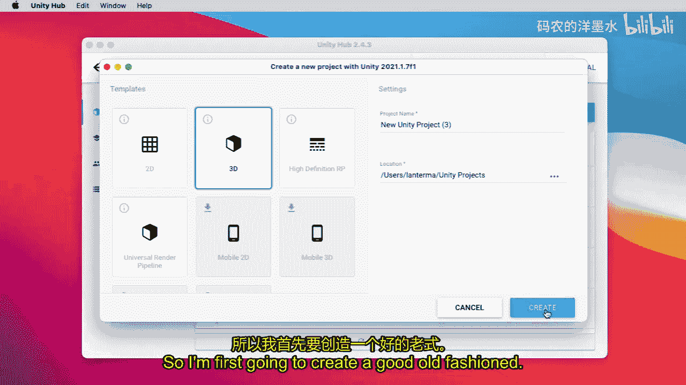

在本节课中，我们将学习如何将最初为Unity内置渲染管线编写的自定义HLSL着色器代码，迁移到通用渲染管线中。我们将通过一个实际的、逐步的转换过程来演示，重点关注如何解决编译错误、适配新的光照数据结构和处理不同的光照类型。

---

## 概述

我们将从一个标准的3D Unity项目开始，该项目包含一系列为内置渲染管线编写的自定义着色器。我们的目标是安装通用渲染管线包，配置项目使用URP，然后逐步修改着色器代码，使其能够在新的渲染管线中正常工作。我们将重点关注一个简单的顶点光照着色器，并解决从内置管线切换到URP时遇到的关键问题。

## 创建项目与安装URP

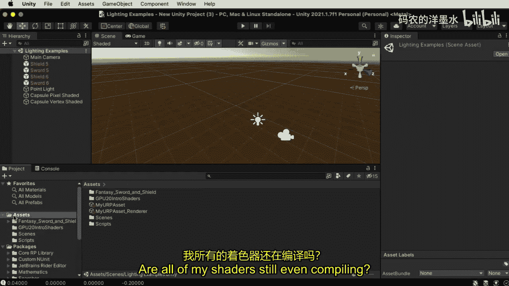

首先，我们创建一个标准的3D项目，而不是直接创建URP项目。这样做是为了模拟将现有项目升级到URP的真实场景。

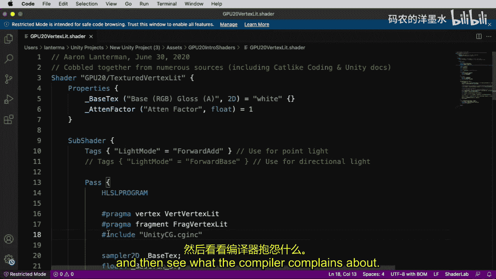

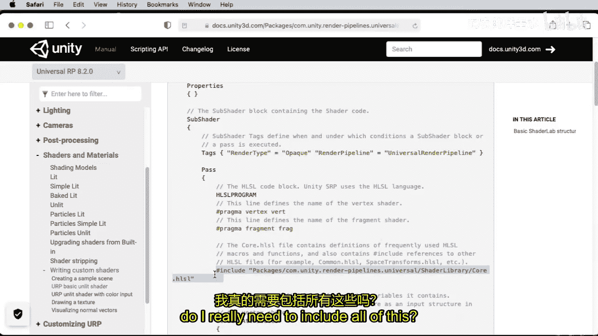

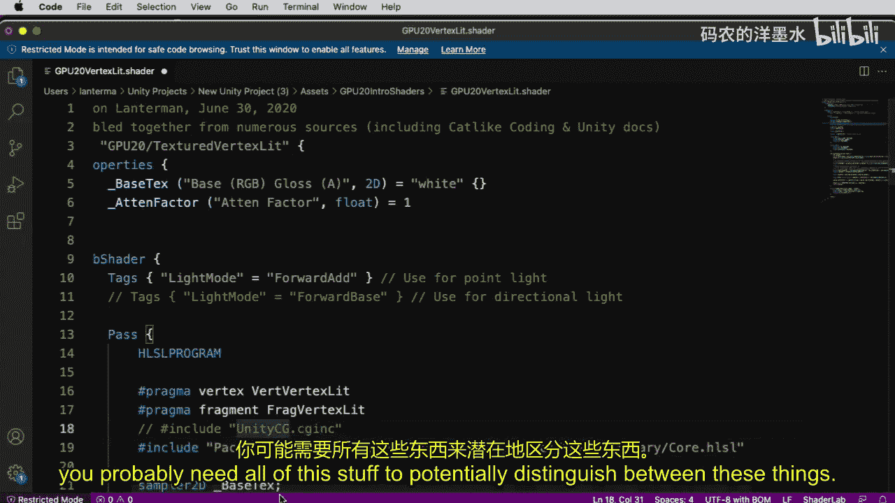

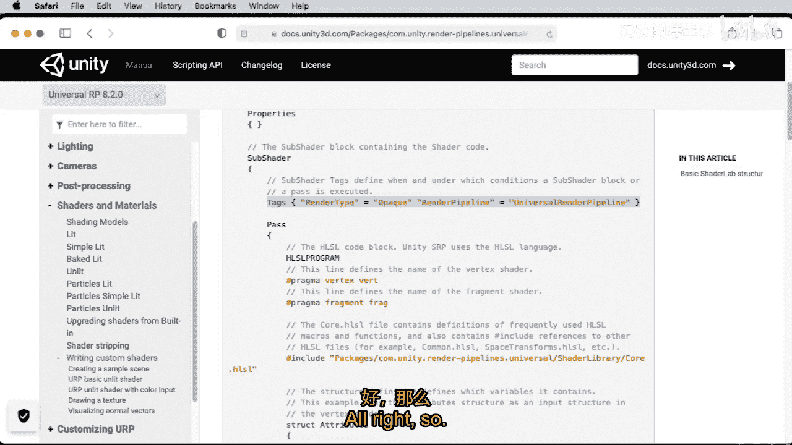

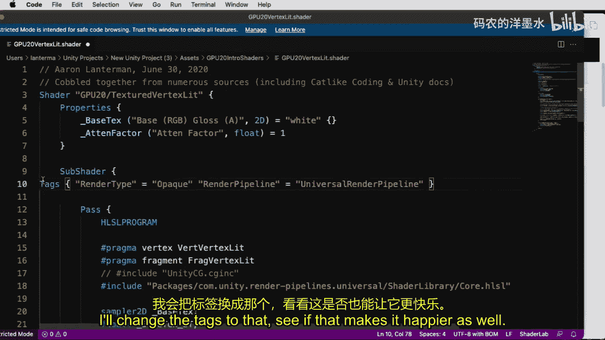

接下来，我们需要通过包管理器安装通用渲染管线包。安装URP时，其依赖的核心渲染管线库也会被自动安装。

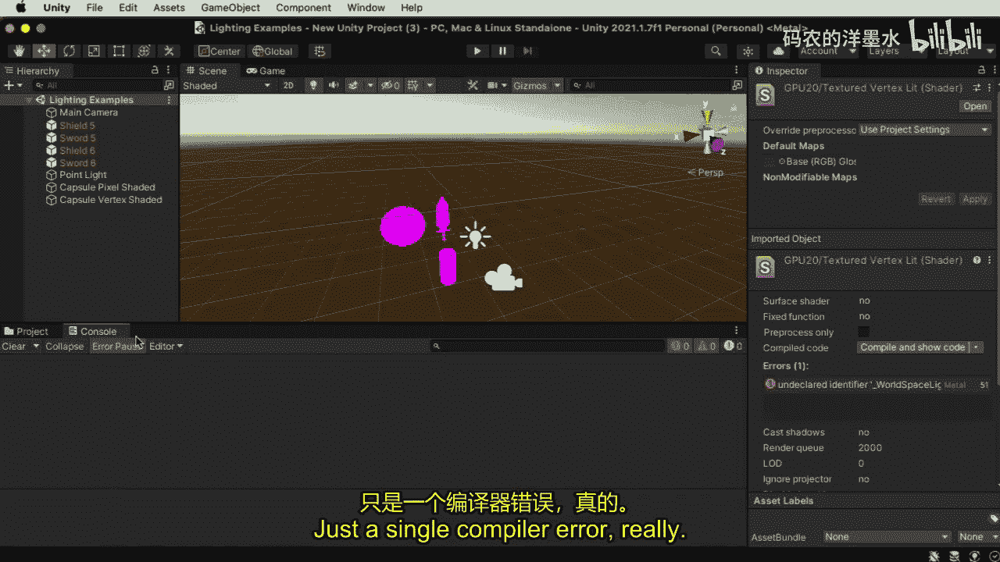

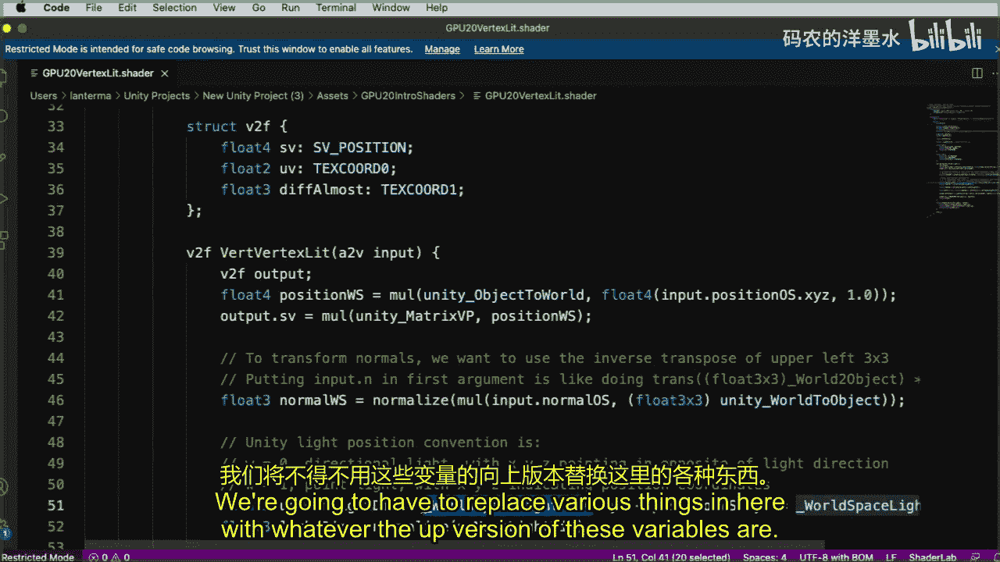


安装完成后，我们需要创建URP所需的资源。通过菜单 **Rendering > Universal Render Pipeline**，我们可以创建 **Pipeline Asset** 和 **Renderer Asset**。我们将它们分别命名为 `My URP Asset` 和 `My URP Asset_Renderer`。

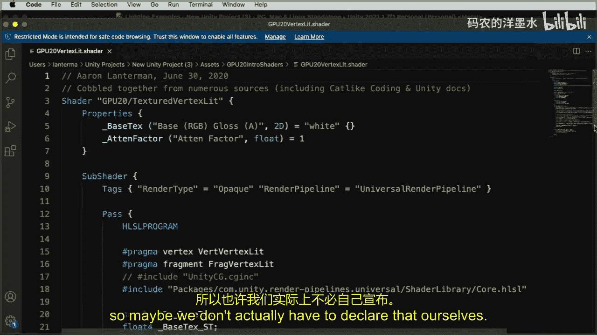

然后，我们需要配置项目使用新的URP。进入 **Edit > Project Settings > Graphics**，在 **Scriptable Render Pipeline Settings** 字段中，选择我们刚刚创建的 `My URP Asset`。同时，为了获得正确的光照效果，我们还需要在 **Player** 设置中将 **Color Space** 从 **Gamma** 改为 **Linear**。

完成这些步骤后，项目理论上应该切换到了URP。然而，我们发现一些简单的着色器场景仍然可以运行，而使用了复杂光照的示例场景则出现了问题。这表明我们的自定义着色器需要针对URP进行适配。

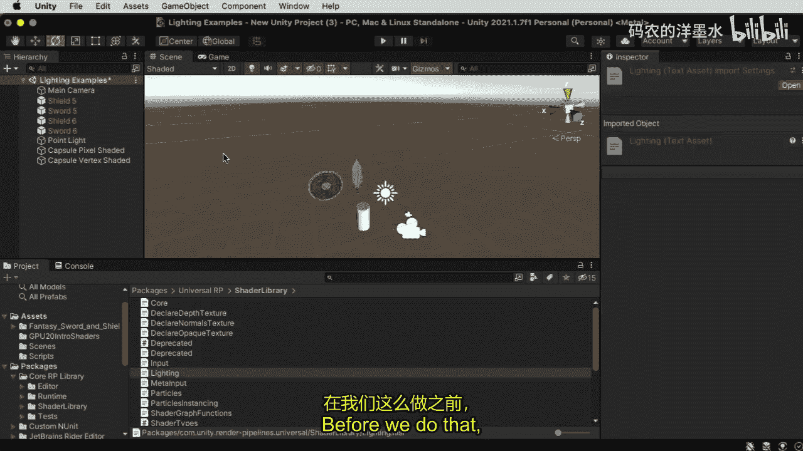

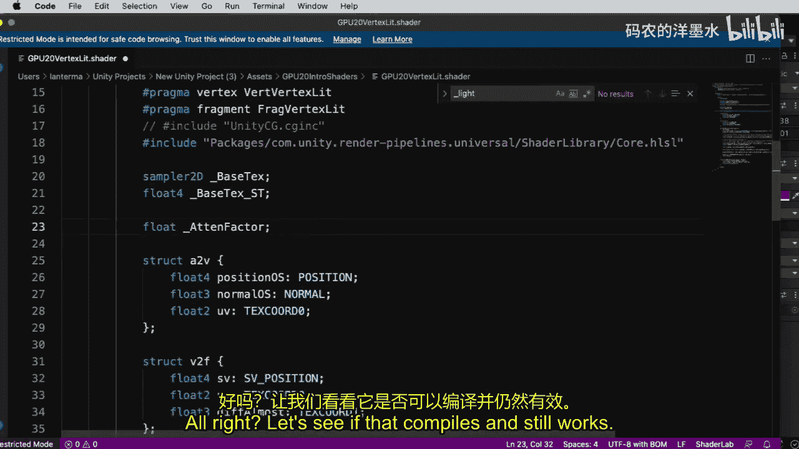

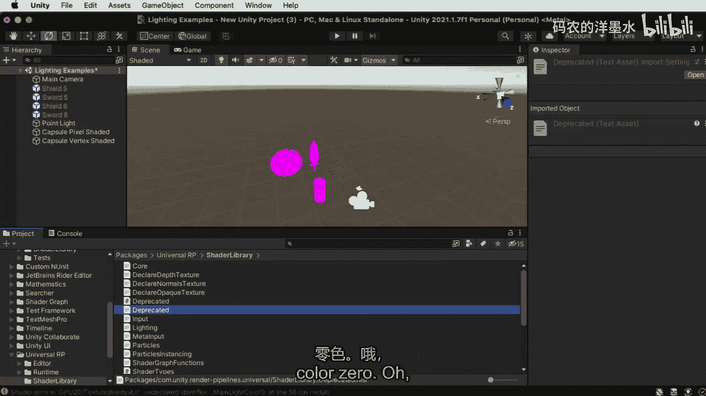

## 修改顶点光照着色器

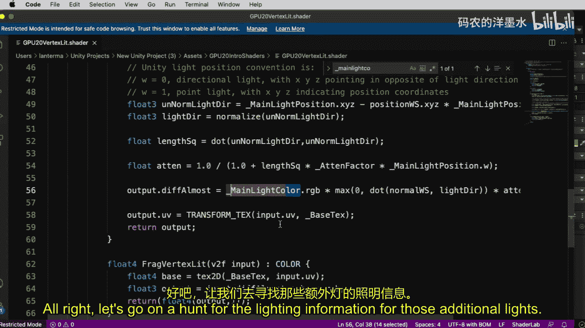

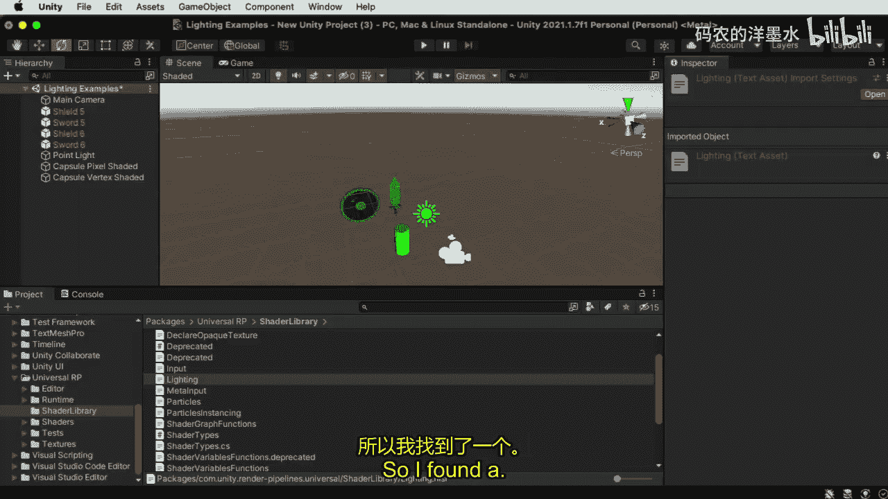

我们的第一个目标是修复一个名为 `VertexLit` 的简单着色器。这个着色器最初引用了内置管线的核心头文件 `UnityCG.cginc`。

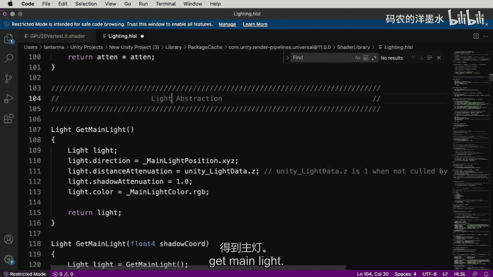

在URP中，我们需要使用不同的头文件。根据Unity文档，我们应该引用 `Packages/com.unity.render-pipelines.universal/ShaderLibrary/Core.hlsl`。

因此，我们在着色器代码中将：
```hlsl
#include "UnityCG.cginc"
```
替换为：
```hlsl
#include "Packages/com.unity.render-pipelines.universal/ShaderLibrary/Core.hlsl"
```

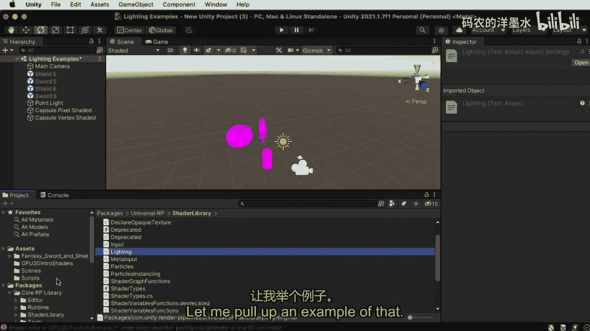

同时，我们还需要更新着色器的标签，以符合URP的规范。我们将 `Tags` 块修改为：
```hlsl
Tags { "RenderType"="Opaque" "RenderPipeline"="UniversalRenderPipeline" }
```

进行这些修改后，着色器编译出现了错误，提示找不到 `_WorldSpaceLightPos0` 变量。这是一个内置管线中的光照位置变量。在URP中，我们需要使用新的变量来获取光照信息。

## 适配URP的光照系统

通过搜索和查阅资料，我们发现URP通过一个名为 `_MainLightPosition` 的变量来提供主光源（通常是一个方向光）的位置/方向信息。其颜色信息则存储在 `_MainLightColor` 中。

因此，我们在着色器中声明并使用这些变量：
```hlsl
float4 _MainLightPosition;
float4 _MainLightColor;
```

我们将代码中所有使用 `_WorldSpaceLightPos0` 的地方替换为 `_MainLightPosition`，将 `_LightColor0` 替换为 `_MainLightColor`。

修改后，着色器成功编译，但物体显示为黑色。我们发现，只有当场景中的主光源是**方向光**时，光照才起作用。这是因为 `_MainLightPosition` 在URP中默认关联的是方向光。

为了同时支持方向光和点光源，我们需要引入一个编译开关。我们使用 `shader_feature` 来定义一个关键字 `_LIGHT_TYPE_POINT`，用于在材质面板上选择光源类型。

以下是处理不同光源类型的核心逻辑代码片段：
```hlsl
#ifdef _LIGHT_TYPE_POINT
    // 处理点光源：从URP的附加光源数据中获取信息
    int perObjectLightIndex = 0; // 假设场景中只有一个点光源
    // ... 从 _AdditionalLightsPosition 和 _AdditionalLightsColor 数组中获取数据 ...
    float4 lightPositionWS = float4(_AdditionalLightsPosition[perObjectLightIndex].xyz, 1.0);
    float3 lightColor = _AdditionalLightsColor[perObjectLightIndex].rgb;
#else
    // 处理方向光：使用URP的主光源数据
    float4 lightPositionWS = _MainLightPosition;
    float3 lightColor = _MainLightColor.rgb;
#endif

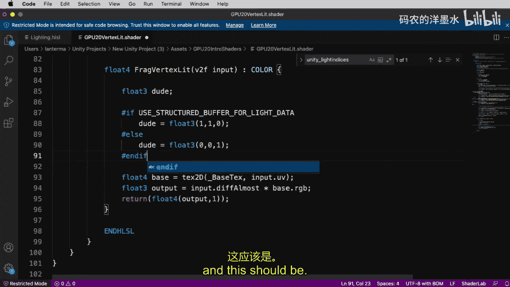

// 统一计算光照方向
float3 lightDir;
if (lightPositionWS.w == 0.0) {
    // 方向光：lightPositionWS.xyz 本身就是方向
    lightDir = normalize(lightPositionWS.xyz);
} else {
    // 点光源：需要从顶点位置指向光源位置
    lightDir = normalize(lightPositionWS.xyz - input.worldPos);
}
```

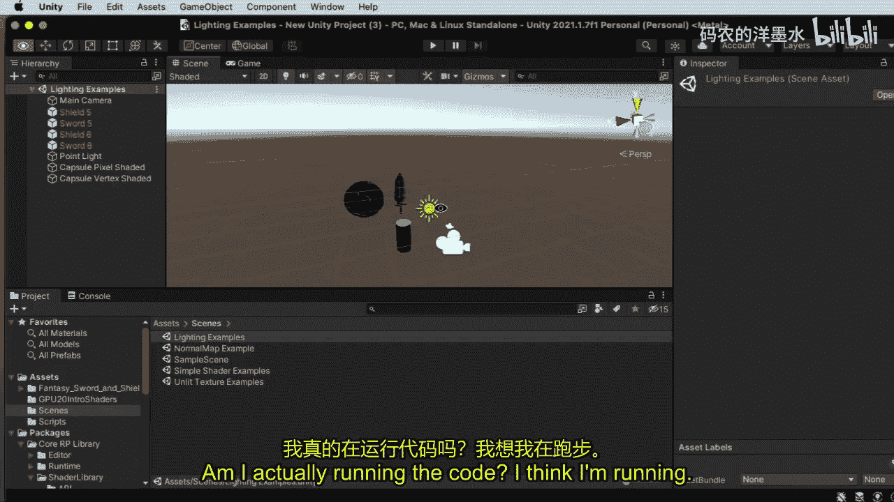

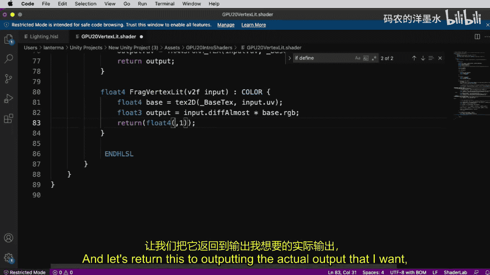

通过这种方式，我们可以在同一个着色器中，根据材质的选择来编译处理不同光源类型的代码分支。

## 调试与问题解决

在迁移过程中，一个常见的错误是变量名引用不一致。例如，我们可能在一个地方使用了新变量 `lightPositionWS`，但在另一个地方错误地保留了旧变量名 `_MainLightPosition`。这会导致方向光工作正常，但点光源失效。仔细检查并统一所有相关变量名是解决问题的关键。

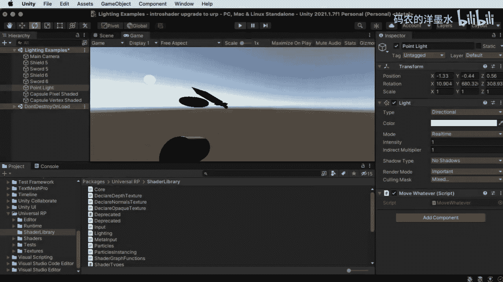

另一个需要注意的是，URP在一次绘制调用中处理多个光源的方式与内置管线不同。内置管线使用多个Pass（前向基础Pass和多个前向附加Pass），而URP通常在单Pass中通过循环处理所有光源。对于我们的入门示例，为了保持代码简洁，我们暂时只处理一个光源（主方向光或第一个点光源）。在实际项目中，应使用URP提供的 `GetAdditionalLight` 等函数来正确遍历所有光源。

## 更新其他着色器与总结

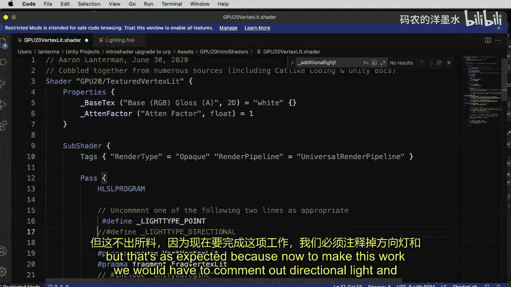

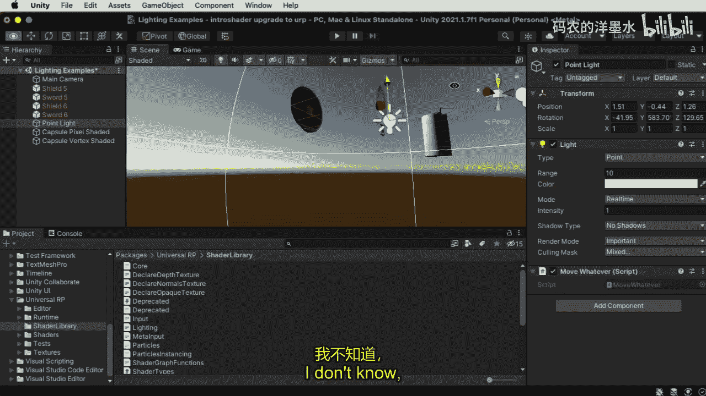

在成功升级顶点光照着色器后，我们可以将相同的策略应用到其他着色器上，例如像素光照着色器和法线贴图着色器。核心步骤包括：
1.  替换头文件引用。
2.  更新着色器标签。
3.  将内置光照变量（如 `_WorldSpaceLightPos0`, `_LightColor0`）替换为URP的对应变量（`_MainLightPosition`, `_MainLightColor`, `_AdditionalLightsPosition`, `_AdditionalLightsColor`）。
4.  使用 `shader_feature` 或 `multi_compile` 来处理不同的渲染路径或光照类型。
5.  仔细调试，确保所有变量名和逻辑路径正确无误。

---

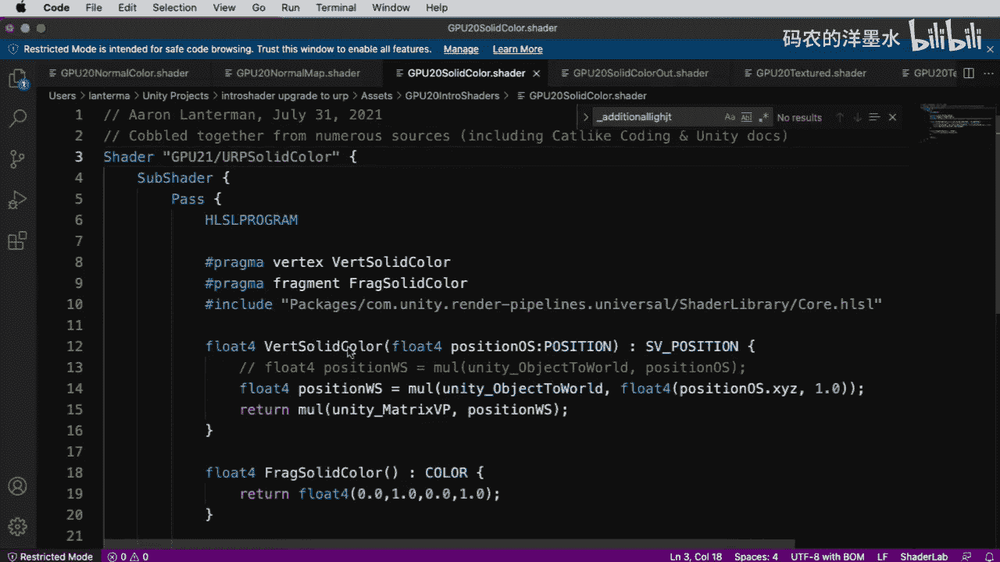

本节课中我们一起学习了如何将Unity内置渲染管线的着色器迁移到通用渲染管线。我们了解了URP的基本配置，学会了替换核心头文件和光照变量，并掌握了通过编译开关让一个着色器适配不同光源类型的方法。虽然这个过程需要耐心调试，但它揭示了现代可编程渲染管线的工作方式，为编写高性能、跨平台的着色器打下了基础。在后续课程中，我们可以将此基础扩展到更复杂的着色器和高清渲染管线。