# 051：将内置渲染管线着色器迁移至通用渲染管线（URP）🎮

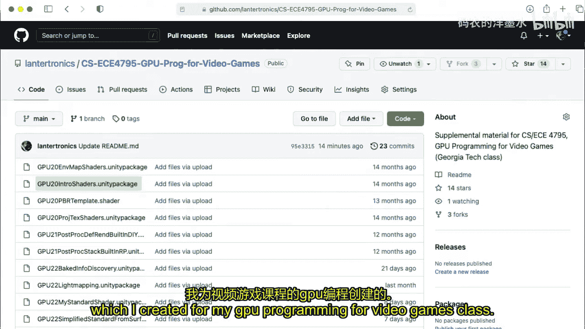

在本节课中，我们将学习如何将最初为Unity内置渲染管线编写的着色器代码，迁移到新的通用渲染管线（URP）中。我们将通过一个具体的像素光照着色器示例，逐步演示代码的修改过程，包括更新标签、包含文件、光照数据获取方式以及命名规范，最终使着色器与URP兼容。

---

## 概述

本教程基于佐治亚理工学院“GPU编程与游戏”课程中的示例代码。我们将把一个使用内置渲染管线的像素光照着色器，转换为适用于通用渲染管线的版本。转换过程涉及多个关键步骤，包括更新着色器标签、替换核心包含文件、重构光照变量以及调整纹理采样方式。

上一节我们介绍了课程背景和迁移目标，本节中我们来看看具体的代码转换步骤。

## 步骤一：更新基础信息与标签

首先，需要更新着色器的基本信息和渲染标签，以适配URP的单通道渲染模式。

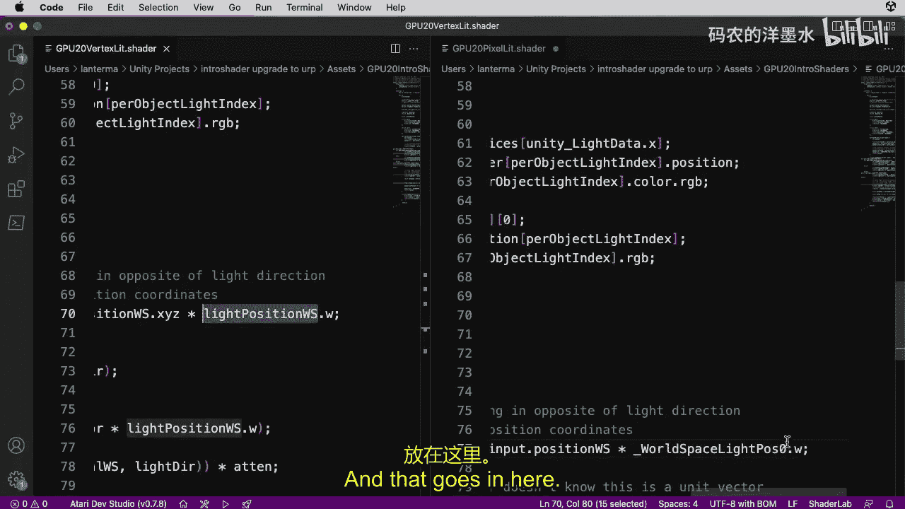

以下是需要修改的初始部分：
```hlsl
// 旧标签（内置管线，根据光源类型选择不同通道）
Tags { "LightMode"="ForwardBase" } // 或 "LightMode"="ForwardAdd"
// 新标签（URP管线，统一使用一个通道）
Tags { "RenderType"="Opaque" "RenderPipeline"="UniversalPipeline" }
```
同时，将着色器文件重命名为包含“URP”字样，以作区分。

## 步骤二：替换核心包含文件

URP使用不同的HLSL包含文件来提供内置函数和变量。

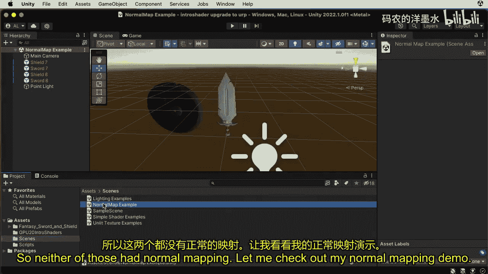

以下是关键修改：
```hlsl
// 旧包含文件（内置管线）
#include "UnityCG.cginc"
// 新包含文件（URP）
#include "Packages/com.unity.render-pipelines.universal/ShaderLibrary/Core.hlsl"
```
这个新的头文件提供了URP着色器所需的核心功能和数据结构。

## 步骤三：重构光照数据获取

内置管线与URP获取光照信息的方式不同。我们需要从顶点光照着色器的URP版本中复制相关代码。

以下是需要添加的光照数据准备代码：
```hlsl
// 获取主光源数据（URP方式）
Light light = GetMainLight();
float3 lightColor = light.color;
float3 lightPositionWS = light.direction; // 对于方向光
// 注意：点光源的位置获取方式不同，需使用light.position
```
在像素着色器中，使用新的变量名（如 `lightPositionWS` 和 `lightColor`）替换旧的 `_LightColor0` 等内置变量。

## 步骤四：修复错误与测试

完成代码粘贴和变量名替换后，着色器可能无法立即工作，控制台会显示编译错误。例如，常见的错误是未定义的标识符。

需要根据错误信息（如“line 84a”）定位并修正问题，例如确保所有 `lightPositionWS` 变量名拼写一致。修正后，着色器应能正确编译并显示光照效果。

上一节我们完成了基础迁移并修复了错误，本节中我们来看看如何为更复杂的着色器（如法线贴图着色器）应用相同的转换。

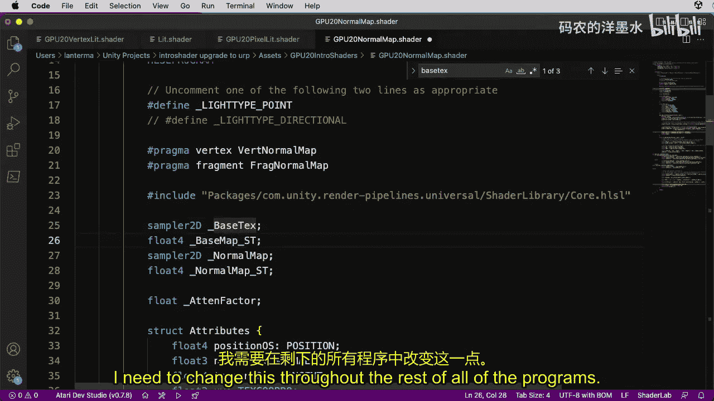

## 步骤五：升级法线贴图着色器

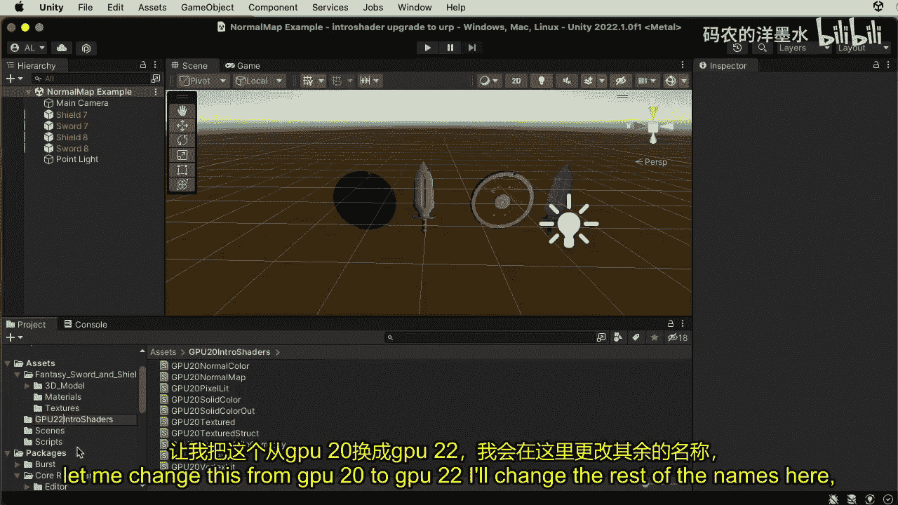

对于包含法线贴图的着色器，迁移流程是相同的。

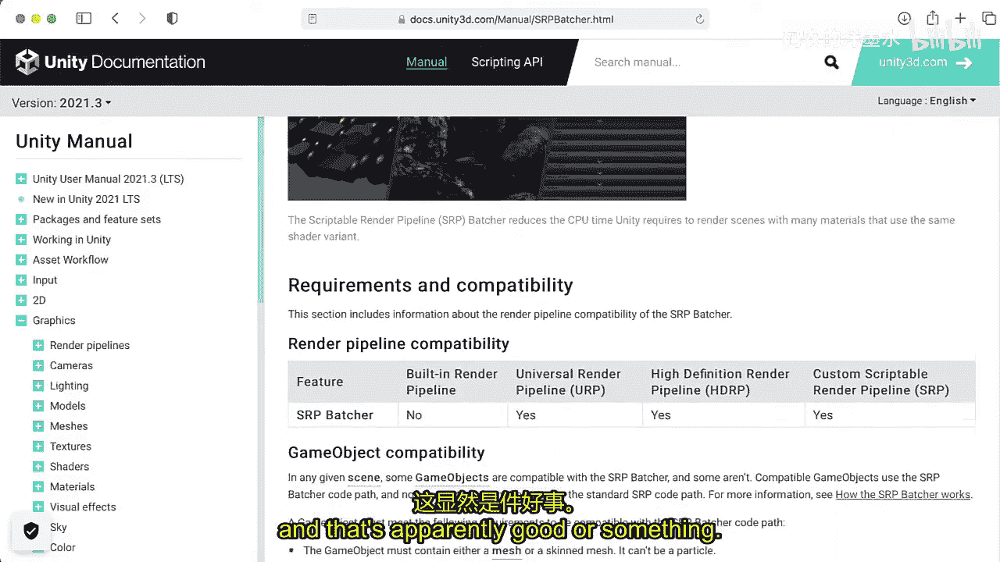

1.  **更新标签和包含文件**：与基础像素光照着色器步骤一致。
2.  **复制光照数据代码**：将相同的URP光照获取逻辑粘贴到新着色器的相应位置。
3.  **替换变量名**：将所有旧版光照变量替换为URP版本（`lightPositionWS`, `lightColor`）。
4.  **测试功能**：转换后，法线贴图效果应能正常显示。可以应用更明显的法线贴图（如自定义Logo）来验证效果。

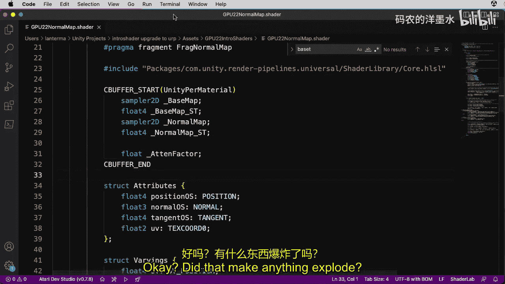

## 步骤六：统一命名规范

为了使教学代码与Unity官方URP着色器代码风格保持一致，建议修改一些结构体和变量的命名。

以下是命名变更示例：
```hlsl
// 旧命名（自定义）
struct A2V { ... }; // Application to Vertex
struct V2F { ... }; // Vertex to Fragment
sampler2D _MainTex;
// 新命名（与Unity URP Lit Shader对齐）
struct Attributes { ... };
struct Varyings { ... };
sampler2D _BaseMap;
```
这种一致性有助于学生未来阅读官方文档和源码。修改后，需在材质球上重新指定纹理。

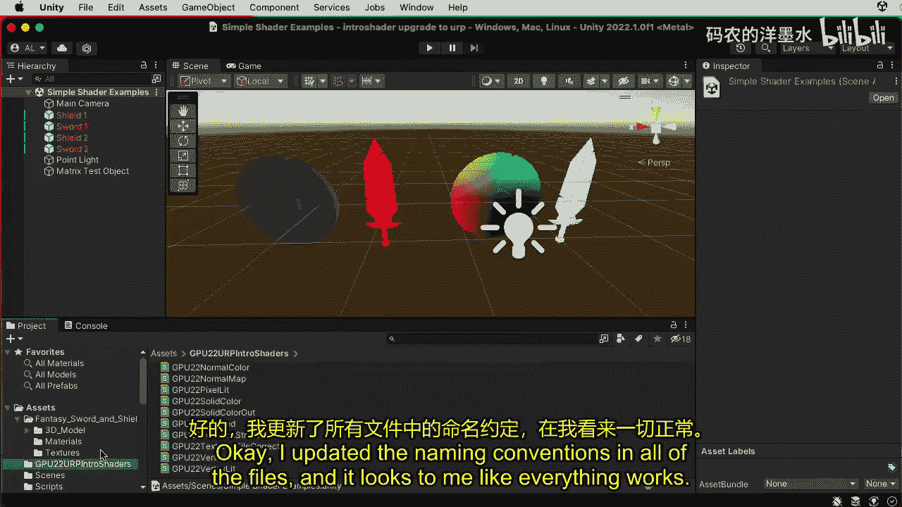

## 步骤七：添加SRP批处理器兼容性

为了让着色器与URP的SRP批处理器兼容以提升渲染效率，需要将材质属性包装在特定的CBuffer块中。

以下是添加SRP批处理器兼容性的代码：
```hlsl
CBUFFER_START(UnityPerMaterial)
    float4 _BaseMap_ST; // 纹理缩放偏移属性必须放在里面
    float _Factor;
CBUFFER_END
// 纹理声明现在放在CBuffer外部
TEXTURE2D(_BaseMap);
SAMPLER(sampler_BaseMap);
```
在片元着色器中，使用新的宏来采样纹理：
```hlsl
// 旧采样方式
fixed4 col = tex2D(_MainTex, i.uv);
// 新采样方式（URP）
half4 col = SAMPLE_TEXTURE2D(_BaseMap, sampler_BaseMap, i.uv);
```
完成这些更改后，着色器信息中应显示“SRP Batcher compatible”。

## 步骤八：最终整理与导出

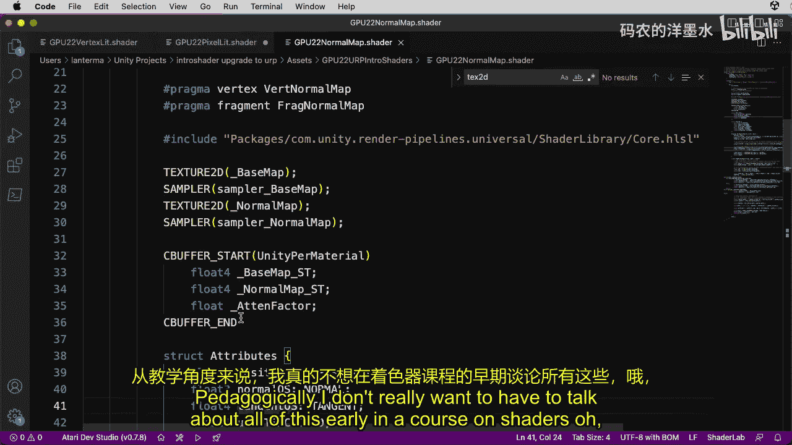

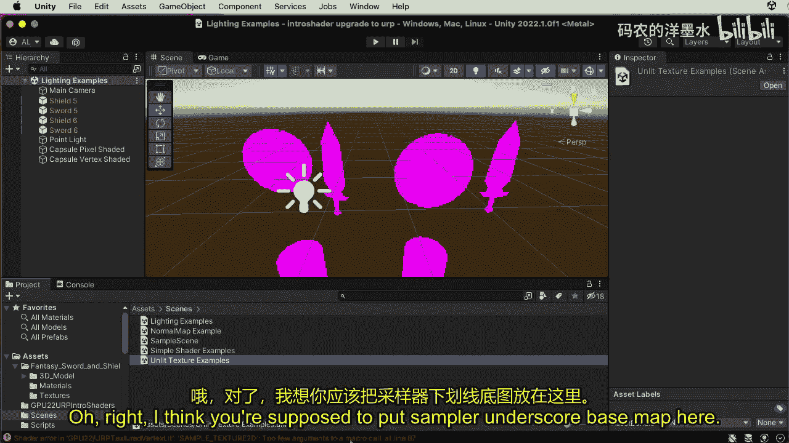

1.  **场景设置**：关闭天空盒和环境光，以便更清晰地观察着色器自身的光照效果。在`Window -> Rendering -> Lighting`的设置中，将环境光源的`Source`设置为`Color`，并将颜色调为黑色。
2.  **项目导出**：使用Unity的`Assets -> Export Package...`功能，导出整个更新后的着色器演示项目，排除不必要的默认场景，并分享给学习者。

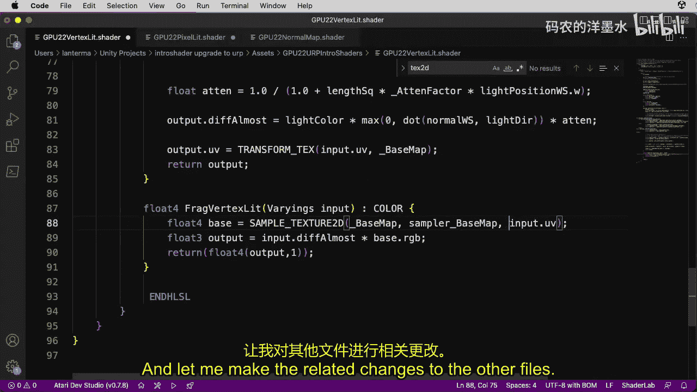

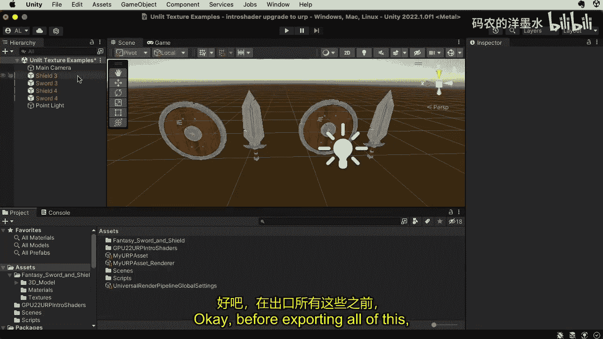

---

## 总结

本节课中我们一起学习了将Unity内置渲染管线着色器迁移到通用渲染管线（URP）的完整流程。我们涵盖了从更新标签、包含文件到重构光照逻辑的核心步骤，并介绍了统一命名规范以及添加SRP批处理器兼容性等高级优化技巧。关键点在于理解URP以单通道方式处理光照，并熟练使用其提供的`GetMainLight()`等新API来替换旧变量。通过本教程的实践，你应能掌握将传统着色器升级至现代渲染管线的基本方法。