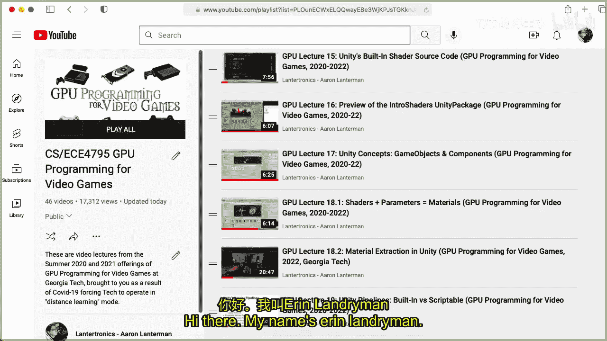
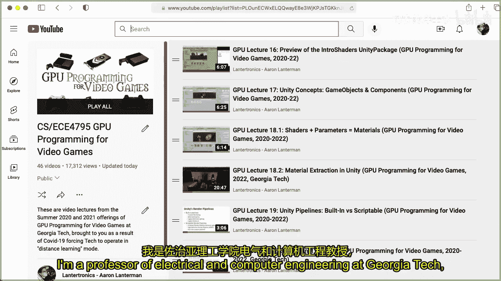
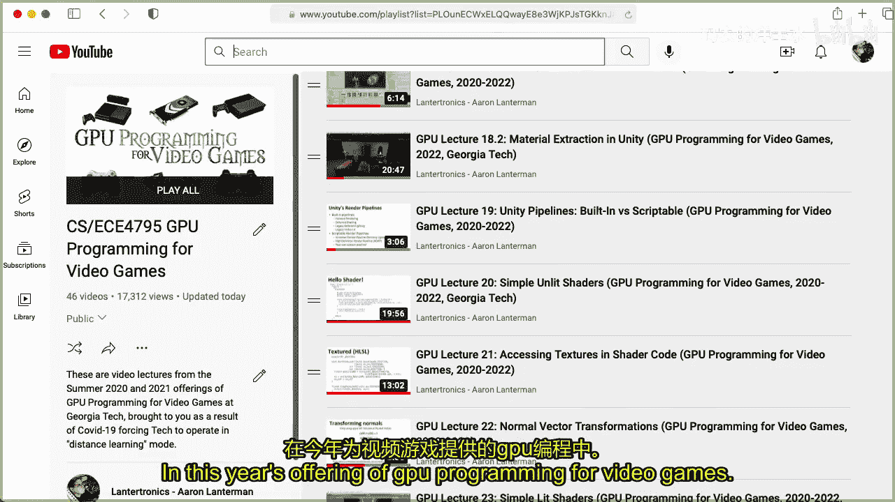
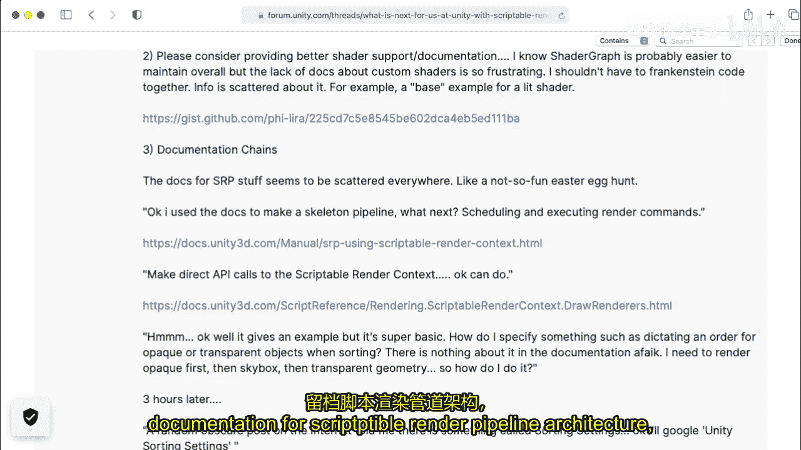
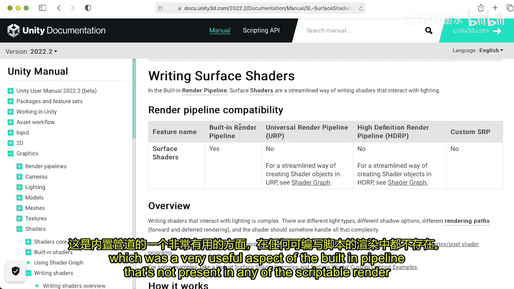
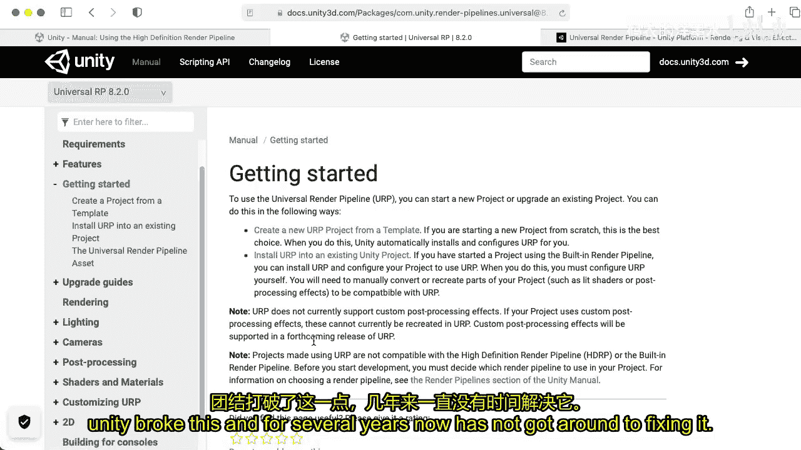

# 052：GPU附加内容-C

## 概述

在本节课中，我们将探讨Unity内置渲染管线与可编程渲染管线（SRP）之间的差异，特别是通用渲染管线（URP）和高清渲染管线（HDRP）在着色器代码和命名约定上的不一致性。

大家好，我是Er Laantterman，佐治亚理工学院电气与计算机工程教授。这段内容录制于2022年夏季，属于本年度“视频游戏GPU编程”课程的一部分。

我坚持使用Unity的内置渲染管线，尽管Unity希望所有人都转向这些新的可编程渲染管线，即通用渲染管线（URP）或高清渲染管线（HDRP）。多年来，我一直告诉学生，今年我们将继续使用内置管线，但明年可能会转向可编程渲染管线。这些说法的前提是，Unity最终会为可编程渲染管线架构提供像样的文档，并且会提供类似于内置管线中Surface Shader技术的等效功能。Surface Shader是内置管线中一个非常有用的特性，但在任何可编程渲染管线中都不存在。

此外，他们本应恢复通用渲染管线中的自定义后处理效果。这些功能过去在URP中是可用的，但在某个时间点，Unity破坏了这一功能，并且多年来一直没有修复。

尽管Unity在向可编程渲染管线的过渡中处理不当，但我认为SRP在理论上看起来相当不错，并且我仍然希望最终值得将课程转向SRP。因此，我确实想开始深入研究SRP代码。

## 探索URP与HDRP的Lit着色器代码

上一节我们提到了转向SRP的期望，本节中我们来看看URP和HDRP中Lit着色器的具体代码实现。

如果你创建一个空白的URP项目，可以进入Packages并搜索Lit着色器。向下滚动，找到后双击即可查看Lit着色器代码。对于HDRP项目，你也可以执行相同的操作来获取HDRP的Lit着色器代码。

在我的屏幕上，左侧是通用渲染管线（URP）的Lit着色器代码，右侧是高清晰渲染管线（HDRP）的Lit着色器代码。这些Lit着色器旨在等效于内置管线中的标准着色器。

查看这里的代码，我预计会有一些差异。HDRP应该拥有一整套URP所没有的功能，这没问题，因为它面向更高端的硬件。但在具有共同行为的地方，你可能会期望有一些共同的约定。例如，我们有一个叫做“base color”的东西，这里也有一个叫做“base color”的东西。在URP中，对应的纹理叫做“base map”。

然而，在HDRP中，它被称为“base color map”。为什么这些名称不同？它们的基本功能是相同的。我可以想象他们在这里使用“base map”这个术语的原因，因为如果我没记错的话，这是原始内置管线中标准着色器使用的术语。但他们已经声明，这些新的可编程渲染管线无论如何都不会与原始内置管线兼容。所以，如果你借此机会重新开始，你应该彻底重新开始，采用共同的命名约定。那么，为什么不为了两者之间的一致性，也把这个叫做“base color map”呢？

是的，你确实无法将相同的代码用于两个管线，但你可能有可以共享的代码片段。为什么不通过使用共同的命名约定来让我们共享这些片段呢？

让我们再向下滚动一点。看这里，在URP中，法线贴图被称为“bump map”。

但在HDRP中，法线贴图被称为“_NormalMap”。再次强调，为什么不使用相同的名称？为什么我们要有不同的名称？

继续向下看，我们有高度贴图。同样的情况，在左侧它被称为“parallax map”，在右侧它被称为“height map”。你为什么要叫它们不同的名字？

那么，自发光纹理呢？哦，情况相同。在URP中我们有“emission color”，但在右侧HDRP中我们有“emissive color”。在左侧的URP中，我们有“emission map”。在右侧，我们有“emissive color map”。为什么我们使用两个相似但略有不同的词？

这真的感觉像是Unity创建了一个URP团队，又创建了一个HDRP团队（实际上，URP早年被称为LWRP，即轻量级渲染管线）。总之，它创建了两个团队来开发这两个不同的管线，而且看起来他们不允许团队之间相互交流。Unity应该有人为此被解雇。管理如此混乱令人震惊。

## 总结

本节课中我们一起学习了Unity内置渲染管线与可编程渲染管线（SRP）的现状，并深入比较了通用渲染管线（URP）和高清渲染管线（HDRP）中Lit着色器代码的差异。我们发现，尽管这两个管线服务于相似的目的，但它们在关键术语和纹理的命名上存在显著的不一致，例如`base map`与`base color map`，`bump map`与`_NormalMap`，`parallax map`与`height map`，以及`emission`与`emissive`。这种不一致性反映了开发过程中可能缺乏协调，为开发者在代码复用和理解上造成了不必要的障碍。