# GPU MODE《CUDA、GPU编程54-87｜GPU MODE》中英字幕（deepseek-v3.2 p01 -20250426-Lecture 54_ Small RL Models at the Speed of Light with LeanRL.zh_en -BV1xbmQB3ETC_p1-

All right， chair， okay。He， heard to see most people。

Right well welcome everyone to another episode of GPU mode today I'm really thrilled to have like my friend and colleague like Vincent who works on the PythTch score team with me and Vincent has been working a lot on reinforcement learning infrastructure and how to make how to make like our algorithms like really really really fast so I figured this would be like a nice change of base from sort of the typical like LLM or HPC gra workload so yeah further review of Vincent please take it from here。

Sure， thanks Mark， yeah so I'm Vincent I've been working on M for about four years now and I was hired specifically to like work in the rainfall learning space and support the rainfalls learning community。

😊，What I'm going to talk about today is not really much about Ls， like Mark just said。

 although we have like a lot of effort， as you can imagine you know with deepy1 and all kind of things。

 we're working a lot on that space， but still I wanted to touch a subject that is kind of peculiar to RL and which has to do with the fact that in Ar we're still struggling a lot with tiny models like in the Google days you know MLPs with a few layers and a few cells。

 you know things that。Do not have an amazing scale。

 but if you want to do you know to control a robot or do this kind of very fast pace inference。

You cannot re all nowadays to have those humangoose。

Models with billions of parameters and it's a space that is hard to operate in because a lot of the infrra that has been built and a lot of the solutions that exist in the ecosystem。

To basically train and deploy those models。Do not necessarily apply to the space that we operate in so i'm going to talk a little bit about that not much about LLms I will touch the subject very remotely and hopefully in the near future I'll be able to come back and talk more about discount things。

😊，So the name of the toolque is breakingak papers from CPU bottlenecks and although it's a GP mode。

 we'll still bottleneck by everything that the CPU is doing and I'm going to dig into that a little bit later。

😊，Okay so what is reinforce learning so reinforce learning。

 the idea is that we formulate the problem as being something that is split between an environment on which which is kind of like a black box。

 you know， that gives you observations and rewards when you do an action and then the agent which like we understand as something that you can train something that will act on this environment to basically get the maximum reward you know on chain of events。

That's the basic setting the first diagram on this slide is something that you probably have seen a lot of times in the past。

 it comes from the seminal book you of Suton and Bartu on Real learning and it basically summarizes I think very very well what is going on in ArL and you always have this kind of loop and that's basically the thing that is interesting about ArL is that we're talking about something that is dynamic right？

The environment is not static， it's not a static data set that you're looking at。

 but when you interact with the environment you get you know things that change through time and then people came and said。

 hey， maybe we could formulate you know post training as a reinforcement learning problem。

And in that case， the environment is basically some sort of black box。

 it can be either a data set where you have a fixed set of answers， you know。

 like math problems and these kind of things。😊，And your algorithm and your agent is basically your LM right and so your LLM is trying to solve a task in that environment。

You immediately see that talking about the dataset is kind of weird and the reason why I'm saying that is that you can actually train that on the dataset。

 but then you can scale that out to other forms of agents and tools you know anything like browser or optimizing GPU kernels anything can be treated as an environment that makes basically this kind of algorithms very very rich you know because any problem can be solved through that technique and I think that's the most appealing thing about ArA is that。

The promise of RL， if it works， is that you should be able to solve anything。Okay。

So the pros of RL are。A really is very good when your problem is hard to formulate sometimes you have a problem that for which you can basically find a math equation and you can solve that。

 you know。ussing these calls form equation in Ar， what we're saying is。

 well the only thing that we can really say is that we have some sort of reward and we want to maximize this reward but we don't have a very precise path to do that and we're going to let the algorithm figure out what to do。

What what you can see also with R is that you can get continuous improvement so if you get more data or more tasks for a specific model。

 if you add those things usually you can get you know linear improvement based on the amount of data that you're throwing at it and overfitting is sometimes less of an issue than in supervisor learning for instance。

And it's quite computationally efficient to do RL because if you're using techniques like PPU。😊。

You don't need to back propagate as much as if you are basically back propagating through the reward model。

 what I'm trying to say is imagine that you have a setting where your reward model is another model right so you have one LLM that you're trying to train and then another LLM that is giving you rewards is basically looking at the prompts that the first LLM is outputting and is saying whether they're good or bad if you're using pure URL when you're training those two things together the second model。

 the reward model will never be back propagated through which is computationally efficient。

If you were to stack those two things together and just maximize you know the re parameterized reward through the two models that is more computationally intensive。

 so that's basically the fourth point on my list of pros。There is。

The first con in that list is that RL is not something that is immediately abuse to a lot of people and it requires a little bit of expertise。

😊，You will surely find a lot of people interested in that and it's something that is actually quite funny when you work with people who are not aous URL usually the first reaction is oh my gosh。

 this seems so complex， but it's just a mindset， in my opinion。嗯。😊，And also。

 if you're doing things like RLHF， you know that was probably the first form of RL applied to the space of LM。

It's basically always an incomplete patch so the way the way our LHF works is。

You realize that your LLM has some form of a or is not behaving correctly so what you're going to do is that you're first going to take a data where you have labeled good and bad answers or some sort of ranking of your answers you're going to train the reward model I was talking about to basically predict how good or bad an answer is and then you're going to fix that thing and you're going to use that thing to basically tell your LLM during post training what is good and what is bad but obviously that is condition on the quality of the data you have trained your reward model on so that's why what I mean by an incomplete patch if there is something that is not in the data that you have used some sort of trick or something like that that is not in the data that you have used to train your your reference your reward model。

You will never be able to figure out that thing。😡，It also to do in your model。All right。So Vcent。

 so Green matrix had one question around like the deployments of some of these ideas like basically like is AOT compilation like also fairly common N ArL specifically for things like deployments in C+++？

Yeah， I will come to competition later yeah that's like the second part of the hook so bear with me for a month。

Okay， so when I started working in RL in Pytorge。We wanted to build this library called Torch Charl。

We realize that。You know there is a big difference between ArL and other spaces in Pytorrch domains。

 the existing libraries where vision and audio and things that are more about the media。

 so if you're looking at Torch vision the job is kind of easy for them because they know in advance everything that is going to be presented to them right you're going to have an image and this image may be hasous set of labels or bonding boxes but everything is kind of predictable and so if you build a transform or model the signature of the input output of that class is。

Precise as said from the beginning。In the space of ArL。

 it's not really like that because ArL is not about the media。

 it's about the collection of algorithms that we're using。😊，People using ArL can do anything。

 L impulse post training， robotics， autonomous driving， drug design， like you name it。

 basically you could literally solve any problem I always think that's kind of the promise of the techniques。

So if you want to build a library that can do anything。

 you can imagine that doing non opinionated choices is going to be very hard。😊。

The other thing that we realized is there is you know in the diagram I was presenteding before you know with the agent and the environment。

 you kind of have this idea of yeah， sure my policy you know in the agent is something that is going to look at an observation and output an action maybe those two things are at tensor maybe their collection of tens source I don't know but even under the hood depending on the algorithm what your policy is actually doing is going to be very different if you're using an algorithm like DQN which estimates values for a value set of actions and then picks up the value that has the highest value to take the action or something like PPO where you build probability distribution over the space of actions and so what your' outputting is a probability distribution together with the action that has been chosen so we have this rot concept of what the policy is but then depending on the problem you're trying to solve and。

The algorithm we were using。What the policy is actually going to look like is very different。

So it didn't look like an easy problem to solve right here I took。

Just one figure from a multiageent paper to show you the kind of complexity that we're facing you know in multiageent people have like this problem of。

 I don't have actually a single robot but I have a whole bunch of them and then you have various settings where the robots are controlled by a central controller or there is no central controller and the robots can talk to each other maybe by groups you know things like if you have robots playing football you have two teams and the two teams should not really be talking to each other all these kind of settings that you can be hard to formulate and still you can of have the same tools you know that you need environment agents。

 ways of connectinging data and storing the data。So we try to wrap our minds around how to solve that problem of the multiplicity of input output。

What we came up with is with the idea of saying， okay。

 let's just assume that all the classes in the library that we're building are going to talk to each other through dictionaries okay。

 if you do that we can basically say the policy it has this responsibilitys in my code of selecting an action。

 I don't really care how it does that but that's what the policy is going to do。

The environment is something that usually is going to be something I can reset to at the beginning of the game and then I have a step method to basically output observations and rewards and stuff like that。

 but I don't want to commit too much in the signature that that thing is going to have so I'm just going to say my policy receives dictionary as input it reads something in that hopefully the action and then outputs everything in another dictionary。

re like okay that looks like a good solution， but the problem is that handling dictionaries in Python can be quite cumberssome very quickly because you will need to stack those dictionaries together and handle you know nested keys and these kind of things so what we decided to do is to build a class on top of that。

That we call tensorD which is a mixture between a dictionary and a tensor。

 you could see that as a tensor like object in the sense that it has a lot ofsor of the tensor features things like tensorD do Qa you to send the whole tensorD to Quda or and by the way if you do that with TensorD you're going to do that is synchronously so it's going to be pretty fast so there is like the convenience of doing those operations over a bunch of tensors fast and also make sure that it's properly done and that there is no bug or an intent behavior or in terms of ka synchronization these kind of things。

And then you have a lot of like reshaping operations or dumping your tensrs on shared memory or physical memory or all these kind of things。

 so we basically have a lot of tooling around like handling batches of tensrs together。So so Vincent。

 you might have already sort of hinted at the answer here。

 but like as you're sort of like exploring different solutions for this。

 like presumably one solution might have been using like pickle or Jason or instead you could have just like dealt with like raw pointers and like manage like so so when did the sort of dictionary。

And tensor like aspects sort of become start to feel to you like the right solution Yeah so the way I usually formulate that is the one too many problem imagine you're writing an Adamom optimizer and you read the equation in the paper and you're like。

 okay， what they right in the paper is actually the equation for a single tenor okay so they're going to tell you hey。

 here is a moving average that's not deviation stuff like that。

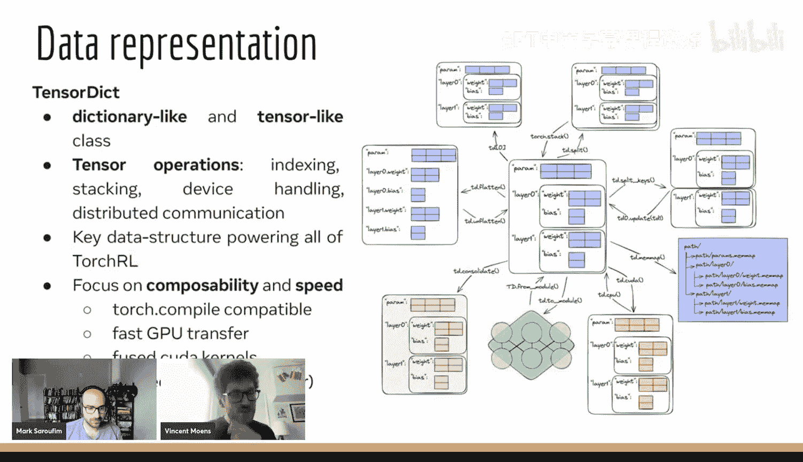

And then you're like， okay I'm gonna to write that and then you write that thing and it works with a single tensor and then you're like I would like for that note to work over a whole batch of tensors oh gosh I need you know to use something like by tree or something like that to basically dispatch all those operations you know to this whole group of tensors with tensor di the way you're going work is to say I'm going to write that for a single tensor and then instead of passing a single tensor I want to pass an object that contains a lot of tensors and that has all those methods built in so you can add tensor digs together subtract them multiply them and so we thought。

That's kind of cool， so there is tensor data and tensor class and those two things are like the data class and dictionary version of a tensor。

And it's really kind of a mindset of thinking。😊，Whatever I want to do with a single tense or I may want to do it with a whole batch of them。

 I think that if you if you try to abstract that as something else like Js on and all these kind of things。

 you kind of end up in a situation where you're basically spitting things right you're basically saying。

I want to write some sort of cong of what I want to do over my batch of Tensor。

 which in my opinion is more complex than just saying I'm going to group them and tell them all to do the same operation at the same time。

It's interesting I think like in your explanation will helped me was Pythtorarch tensor is augmented with functions that operate using Pyre is like a form of like data oriented design。

 but like in your case like it's more of a traditional like object oriented design which makes sort of like message passing like significantly more convenient Yeah there's another thing that there's a convenience of using it but there' also the opportunity for us to optimize your operations under the hood so that you don't have to do it so for instance all the arithmetic operations in use for each。

Wwhichch makes it much much much faster than what you would do with a regular full loop and so we can basically tell the user base you don't need to care about how fast that goes because we handle that we handle the compatibility with with tors and compile。

 we make sure that you can cutagraph the whole thing like。

It's really a matter also of delegating to the engineers of Pytorge。

 the efficiency of the approation so that you don't have to think about it。

So green matrix is asking are these operators are these data structures also available in like liptorch No theyre they're entirely python based and the reason for that is also that at some point we're thinking about like。

Turning that into C+ and then the feedback that I got from my peers in Pytorch was。

Hey look we're working on torture compile anyway and like efficiency is probably not going to be an issue once you compile that thing like it's going to run as fast as it can and actually it does so we were worried about overhead in Python up until we made the whole thing compatible with compile and right now like it's not really an issue anymore so yeah that's the main reason why。

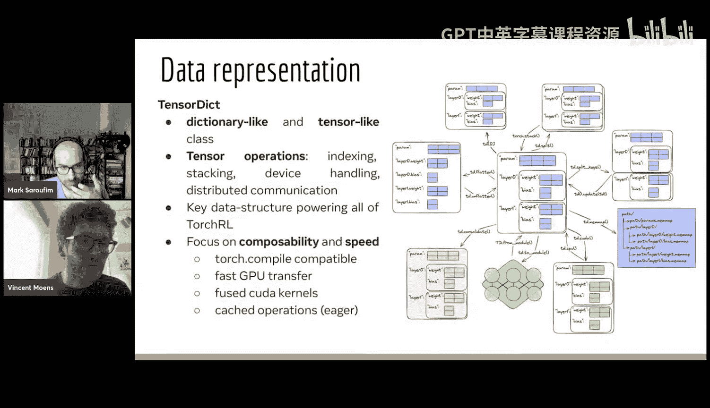

Oh， sounds good。Okay so that's about TensorD and based on that we build a whole like Torsha library so now TensorD is a separate library。

 we intend to upstream to Pytorch sometime in the future it's mostly right now a matter of bandwidth on my side like that I need to push all that and find a week where I'm just doing that but yeah so you have the TensorD library under the Pytorrch username and then on top of that we build the whole Torch library。

So the the scope of Tochar was basically to say， okay， now that we had this abstraction。

 we can basically build reusable components because everything having that very， you know。😊。

Generic signature。If you're using a single component of tortureal。

 the only thing that you need to buy is Tensorite， but you don't need。

To use the whole library once you start using a single component。

 which is a striking difference with everything else in the reinforce of learning ecosystem where people usually if they want to use a specific algorithm。

 they will have to adopt the whole stack you know there are some libraries where the entry point is literally a trainer。

It's awesome if your environment fits in a trainer。

But that also means that if you want to change anything you will have to dig into the code and like basically try to separate things from each other。

 which may not be super easy in Tol things are very well limited and identified such that if you just want to use the repair buffer。

 which is our like the。TheSo sort of data set abstractstruction。

You can just use that and it happened many times in the past that people came to me and said。

Yeah that all looks great but actually the only thing I really want to use in your library is the re buffer like don't get offend endeded and like this is amazing because if you're able to use just the re buffer and nothing else it means that we really succeeded in building something modular enough for you to do that and I think that's really the one thing that differentiates to around the whole a consistent。

😊。

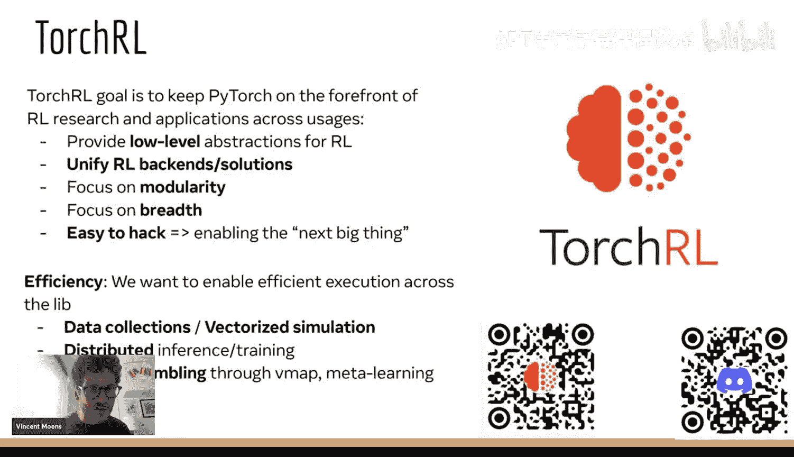

And yeah so these are the basic components of the library， we have abstractions for actors。

 you know so for modules to execute end modules and things like that in TorchL we have abstractions for environments that are highly generic you know now that we're working with otherMs we see that we can wrap you know things like。

Games or even solving data sets of math data sets and things like that into the environment abstraction and all that works perfectly。

And then you had the。The replay buffer， which is a dynamic dataset set， unlike regular data set。

 a replay buffer is a data set that can change through time you know。

 so it has not only the read operation， but also the right operation。

And then you have a bunch of fl modules and all of that works on。Single node， single process。

 single node multi process and multi node， we have various backends like to distributed and array。

 like we basically the width and breadth of the libraries。Very， very large。

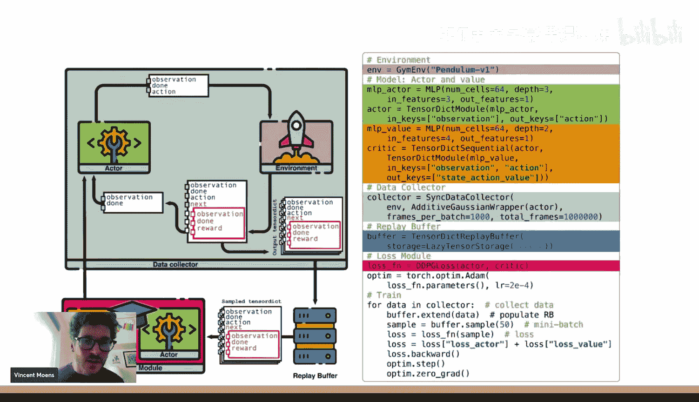

Okay， so going back to the original topic， one of the things that is striking in Ar is that。

A lot of the user base is actually interested in those tiny models。And as I was saying。

It's a matter of， you know， first thing is back in the days people were training those tiny models over a lot of data。

 you know， because you don't need a lot of interactions with the environment to train your model so they didn't want to have big models。

Nowadays， it's less of a worryry because we have very good simulators that we can very easily paralyize on GPU。

When I started working in RL like you know about seven years ago。

 we had those environments that were running one instance of an environment at a time。

 which meant that you were in the order of maybe 5000 steps per second in terms of simulation and to train an algorithm on a simple task you know a simple robotic task like you know a worker or something like that you would need something in between 1 million and 10 million frames so you can do the math。

 but like。You need some time to train your algorithm。Nowadays。

 and Vdia and Deep Mind have those libraries that are massively parallellyzed with simulations on GPU and those things that can easily collect frames in terms of 100。

000 or a million frames per second。Once you reach that level。

 like the amount of data is basically unlimited compared to what we had in the past。

So that's like a big shift in the mindset of the community。

 but one thing that still holds is once you deploy your model on hardware。😊。

You cannot have a robot that runss a full you know to basically decide what it's going to do。

 so you will need to have tiny models and so people still use simple MLPs or record on neural networks and all discount things。

Sometimes augmented with an LLM， you know to do some sort of embetic at the beginning of the task or query it ir regularlyg。

 but they don't do that you know。At a very fast pace doing inferencefrs。Okay。

So when you train these kind of models， you have various solutions and I will show you later a list of libraries that exist but。

The thing with those models is you can obviously execute them on Kuda and that's going to be super fasts。

 but then what you see appearing is that you actually start to see a lot of the CPU overheads due to using the use of Python。

And people would be like， oh yeah， sure you can go directly topro something。

 but those guys are researchers and they want to quickly experiment and change things though to make sure that you know they're not missing anything so Python is very convenient and it's very hard to move the community away from that。

And so the CPU overhead of Python becomes like really a big problem for us。

So the questions we had was， how can we build something that is generic that people can very easily use but get rid of most of the CPU overhead that we have because we're basically underutizing our GPPUs a lot。

 sometimes our GPPUs used like 10% or something and that's very， very bad we don't want that。

So just a reminder of how that works， you know where oh sorry that did not render well， but yeah。

 so if you're doing if you're executing ay Python code in Pythtorch。

 what you're usually doing is that the code goods from Python to C+， then you do an ATN operation。

 then you go back to Python， you collect the result and then you go back and execute that other ATN operation。

Now what To Comp does is it says， okay， I'm going to get rid of that。

 I'm going to like fuse those C++ operations and so you're just going to go from Python to thefusesed operations。

 not going to Python in between， and then I'm going to deliver back the Python result at again end。😊。

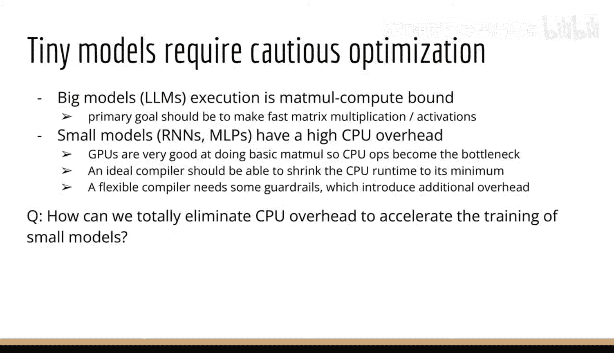

That's good， but that's not perfect because of guards and all basically of the infrar that goes around To compile。

So to be more precise， if you're， for instance， compiling this padding operation here。

 which is super simple。What you're doing is you're basically saying hey。

 I would like to pad you know， this tensor or this group of tensors and the padding value is going to be zero and I have like。

A addingdding mode that is constant or something。And you want to compile that and the compiler is going to look at your utensors and if you don't say that you have dynamic shape。

 it's just going to say okay， I assume that the shape is going to be fixed。

And then you provide an integer， so integers can be compileelled in the code。

 but strings cannot be compileelled， so the what is's going to do is that it's going to build a single compiled code for the string that you've passed if you pass another string you're going to need another compiled version。

And to check that， well， To compile is going to look at each of these values and say。

 is it still a string， is the string， does the value of the string match the value that I use for to do the compile and everything？

If you're working with anM that's not really real problem because the main bottleneck is a mat operation in between and so you don't really care about like checking those guards and all the overhead that is introduced if you're using an MLP with like four layers of 500 cells each on Quda。

Actually checking those values， checking those guards can take longer than executing your model。

 and that's a very annoying thing because then people with the usual user experience with Compel was。

😊，Well， I'm trying to compile my code and it's actually running at the same speed or slower than the noncompd version than the ego version。

Why going what's going on here and the other thing is then people went to jackX and in jacks。

 you don't have all these kinds of problems and they were like， hey。

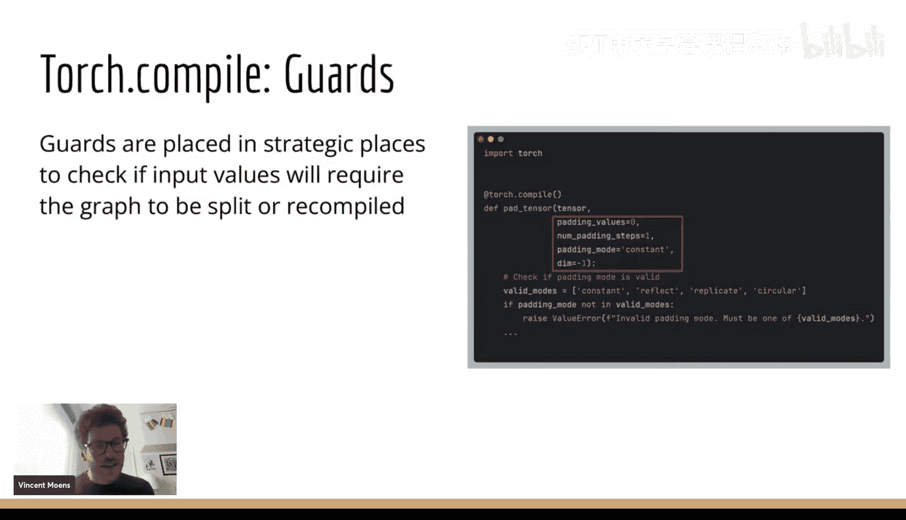

What does Biors offer， you know？Okay。So in mode， we have。嗯。😊。

We're not necessarily faster in compile mode than in in mode because of their high entry cost。

So in practice， we have very slow training times and we're not using our GPUs efficiently。

So the solution was basically the solution can be to use kabgraphs， okay？With QudAGss。

 you basically encapsulate all the operations on QudA。

 you register the whole graph of the operations， and then you're going to copy in place your inputs。

 execute the whole graph that you have registered， and then take the output， clone the output。

 and deliver that to the user。That works well， but if you just use torsn compile with mode reduce overhead。

 which under the hood is going to use cutgraphs， you still have those guards you know at the beginning and at the end and that's something that really we want to get rid of okay。

So to give you an idea， this is like the first， the first one is eager mode， no compile。

 no kilograph。What we do is that we have various skills， we launch each of them in a sequence。

 and you always have to go back to Python in between。If you do the ka graph version of that。

 then you register the sequence of your kernels and that goes much faster but there is no fusion once you use compile with kuda graphs。

 then you fuse your kernels， which I get executed faster。But you still have。

 the dynamo cache and the check of the guard at the beginning。

What we thought we would do is basically to say。Hang on me in a role。

 if you're working in these kind of settings like robotics and games。

The input structure is very predictable。In the sense that if you have a robot。

You know in advance how many cameras， how many joints the robot has。What is the size of the。

 you know， the output of the LiDar and all these discount kind things like all of these things there。

Fixed in stone and you know they're not going to change throughout the training process。

 you can also fix your batch size or to have dynamic shapes like everything can make can be made as predictable as possible。

So you can basically say， I don't need those guards because I'm in a closed environment and I know exactly how things are going to behave。

And if you can make that promise， then you can eliminate the guards by just compiling your code and putting。

The Qa graph around your compile code and not within。And if you do that。

 then you can see amazing speedups。So this is basically what weve built in an experimental library called leanarL。

 so the name of LearL comes from another library called Clean ArL which was containing a bunch of single fine implementations of popular Ar algorithms and we developed leanarL which was just a fork of that where we were using compile and cus to accelerate the code。

 and this is like what the raw structure of the execution of the update function looks like。Okay。

Vincent before you keep going， considering that we talked a lot about CP overhead。

 like green matrixtri had a thread of natural function question which was have you ever run into like issues with Python's skill and have you like have people explored multithreading like my suspicion is probably no because environments are can be multiprocesed but I'm curious about your take。

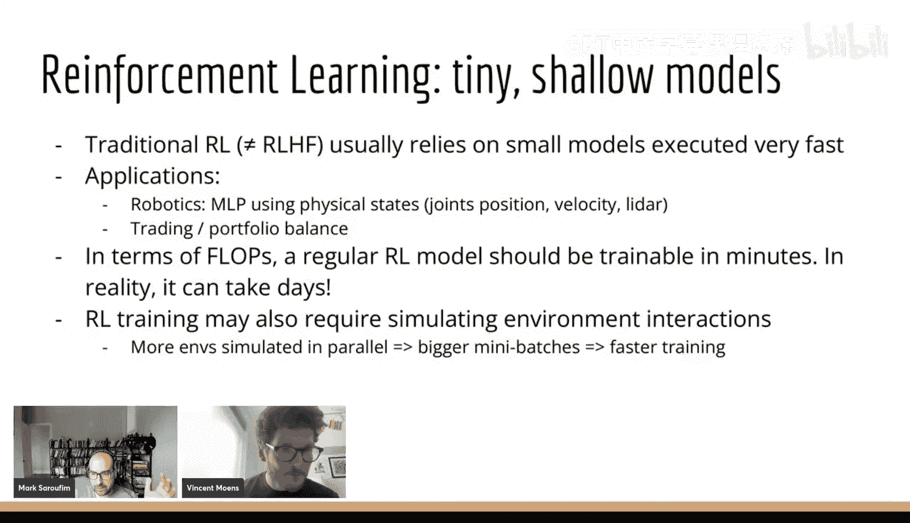

Yeah actually， that's a good question。

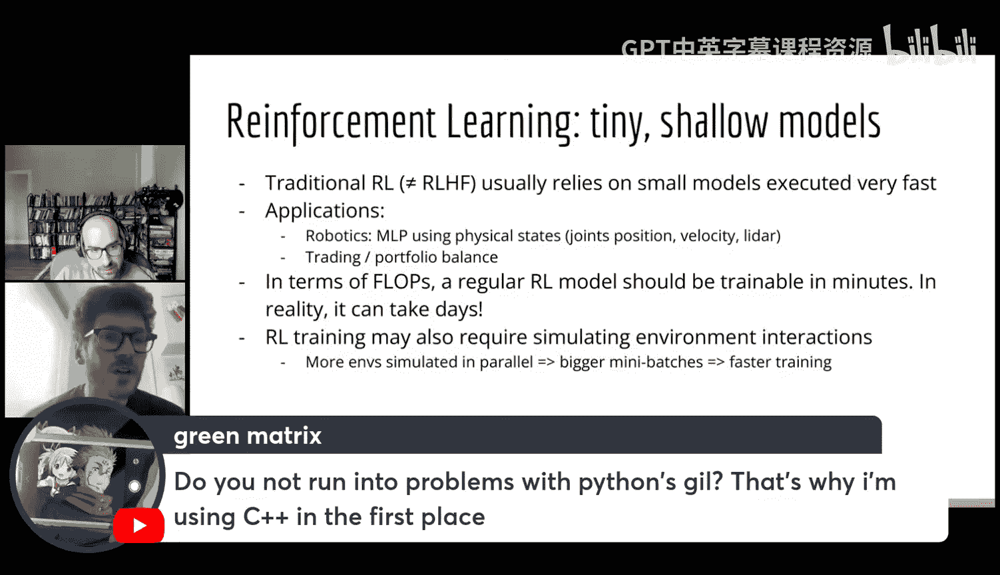

We do run into these kind of problems。Traditionally what people have been doing is like you were saying Mark offering things in multiprocess。

 you know like embarrassingly parallel and you can do that。

 the other thing that you can and then based on these kind of techniques。

 then you can start doing things like you know having async and environments where you basically like getting the first the first output that is ready like you can do fancy stuff but that's not the kind of thing that is going to bring you from like the 5000 frames per second as I was saying to the hundreds of thousand frames per second if you want to do that kind of like drastic shift in terms of efficiency you definitely need to go into like。

Cuda kernels and these of things and that's what basically NVDA is doing with Ia and like what the ecosystem is turning into right now。

So yeah， that gal in Python is definitely something that is annoying。

But the ecosystem is basically moving away from that。

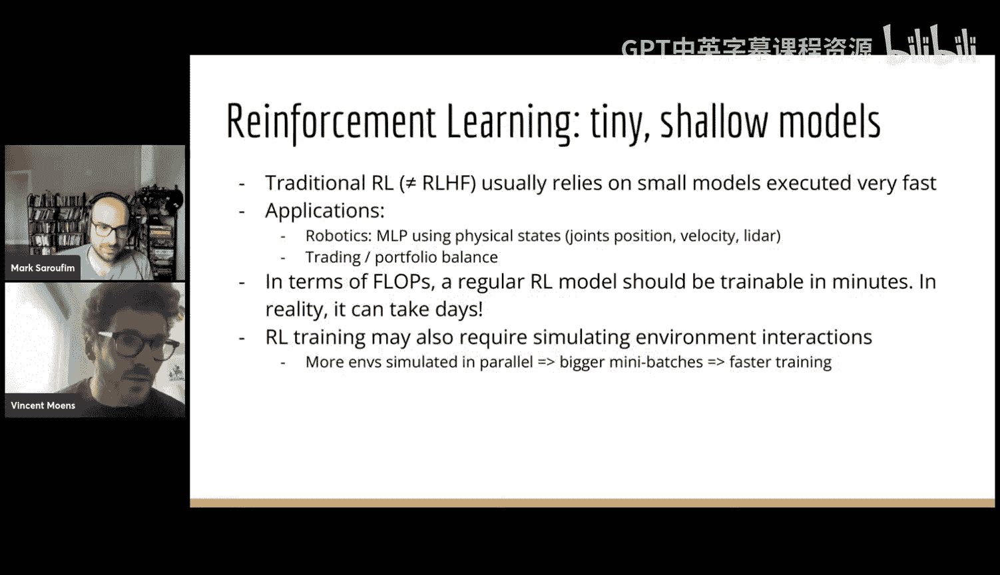

That was good， okay。Okay。So， if you look at the ecosystem of。

Fast libraries in Ar right now what you get is for instance SBX you know that is a library containing a bunch of like training algorithms in JX Another thing is perly so per is a library that does exactly what youre seeing right now which is it's C+ was based environment that run very very fast and the way they do that is that each environment shares its data through。

Basically structured arrays that are stored in shared memory such that all of them have access to a buffer where they can read and write very quickly。

And this library is basically simulating games and things like that and again， you know。😊。

Speeds of sometimes millions of frames per second， so basically the nowadays we have like this kind of simulation libraries that completely remove the roof in terms of speed of speed of simulation。

There is another interesting library， I think for for this community， which is RL tools。

 it's a very tiny library and they opinionly choose to。😊。

Have just a few RL algorithms codeed imp pure C++ with the goal of saying well you might just want not to explore the whole panel of existing algorithms you're just going to say I want to use PPO I know exactly what I'm doing I just want to train something and deploy that on my tiny robots very quickly and if you want to do that well you can use ArL tools and you'll probably be be able to train an algorithm in terms of in a few seconds where it would probably require you a few minutes or hours with Python based library so that's like。

A super cool thing， but you know for a very narrow set of use cases and then there are also a bunch of Julia stuff that is also pretty fancy so yeah the ecosystem is like very rich that's basically what I'm trying to say。

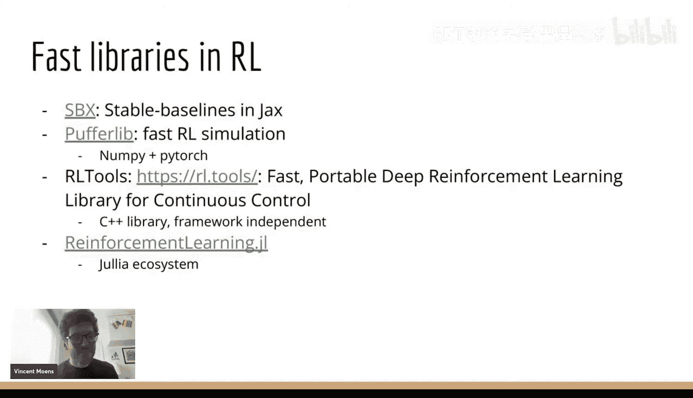

So linearal， as I was saying， if you look at linearal performance， you know。

 with this trick of basically kudgraphing compiled code and also asking compiled to do the kudgraph for you。

What we get as speedups in terms， you know， compared to the pure Python code in eager mode that was written originally is anything from 2。

7 times to up to seven times。That's very significant， especially if you compare to Jack's。

 I think I have to figure here yeah。

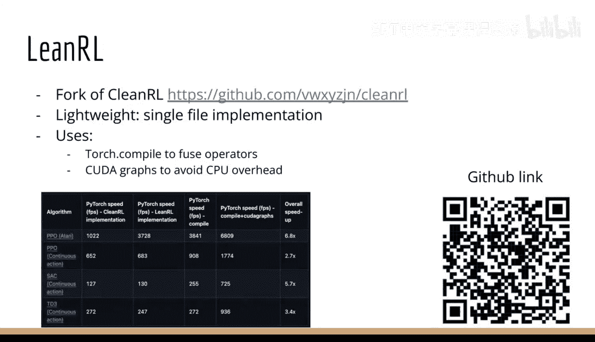

So this is， for instance， for TD3， tD3 is one example of an aerial algorithm。

 the original Python code was running at 247 frames per second。

 so a frame is basically one frame in a game， for instance。

And remember that to train the full algorithm， you need1 million to 10 millions of them。

If you just compile， you see that we go from 247 to 272， which is very。

 very small gain in performance。If you just do Quda graph without compile you ba you already get you know to 778 and that's without compiling your code so like just to show you the kind of stuff that you can get just by you know getting ridged of the intermediate Python overhead。

And if you compile and you execute that fusion of the kernels。

 then you get some further speed up and the J version in this specific example is 561。

Do not take that as you the kind speed up that you can get in every single case because everyarrow algorithm is different and like it depends on the model。

 depends on how many updates you do and all these kinds of things。This is just an example。

 obviously cherry peaks because it showed that Pych is awesome， but yeah。

 it's probably not going to be like that in every single case。😊。

Another thing that everyone found interesting is in1DB。

 you can basically look at how you're using your GPU when you're optimizing your model and one thing you know we looked at is。

Throughout the duration of training， what was the area under the curve in terms of GPU utilization？

So those are the raw numbers that you see in this slide okay and what you see is the old version。

 which is this the long purple line here， because it's the slowest one。

 it has an area under the curve of about 2000 oh sorry。If we look at the compile and kilograph。

 which is the gray line here， the area on the curve is 500 so that basically tells us that。

We're using on average or GPU more， okay， because like the gray line is above the pink one。

But overall we've used our GPU less through the duration of training and if we just use kudagraph。

 which is this purple line here on top at 60%， we're using the GPU a lot because you're not using anything okay so the best thing you can do if you want to reduce your GPU utilization to the maximum and use your GPU the best way you can is basically to use compile and kudagraph at the time。

 that's basically the takeaway here。We had a bunch of success stories with NRL， so it got。

A fair amount of traction from the community and some researchers reach out and say， hey。

 can you help us you know to bring that to our code base and when we try that what we got you know was。

Training times that were way， way way faster than what they were before。

 so that a lot of users observed the same kind of you know6 x speed up on their training time。Yeah。

 that video it did not turn during the PDF， but yeah。

 just it was just like a robot arm that was trained in less than a minute no to achieve a reaching task。

 which is like。Un seeing you in the space of R。Okay。

Yeah that's usually something that I keep for the Ar folks out there so maybe you don't need that。

 but it's just a bunch of tricks that what I often see in people's code based but since you're all a bunch of GPU experts you probably don't need that but there's a lot of like you know。

😊，What people usually do and that I always tell them not to do is things like creating a tensor on CPU and then sending that tensor on Cuda when you can directly create that on Quda。

Things like people you know doing intermediate logs and calling tensor dot item in the middle and that's basically in terms of the whole thing it's great so cuta sync and that like that's terrible so there's a lot of I think bad practice in RL of people not really providing their code and not looking at traces and then just complaining because things are slow when actually they you know I think they just don't know how to how to optimize things。

U。Yeah， so basically for any RL folks what I usually tell them is first thing you need to try the safest is basically to compile your code with reduce overhead and look at the kind of speedup that you can get if you're not happy with that and your field as。

 then you can try you know to use this module that we've built with Intenononic to build a kudagraph version of your update function or your po or something like that。

😊，So you compile， you cugraph the whole thing， and then you look at the camera speed that you can get。

And that's about it， yeah， that's my last slide。😊。

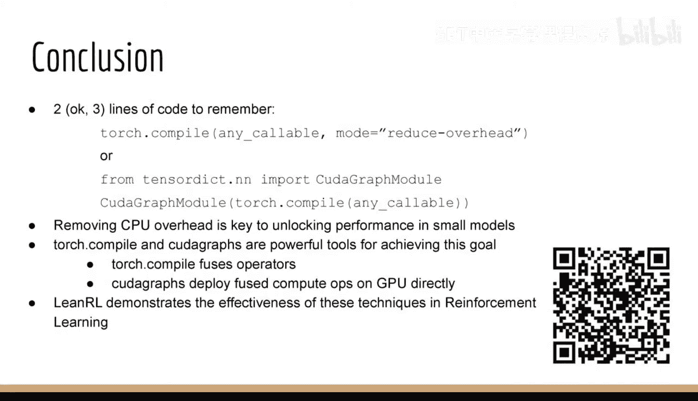

I got to hear him， your're mut Mark。OhThis was awesome thank you Vincent so I see three questions in chat and I also have like my own that I'll batch in the end。

 so let's just go over the one by one you can see the screen right？

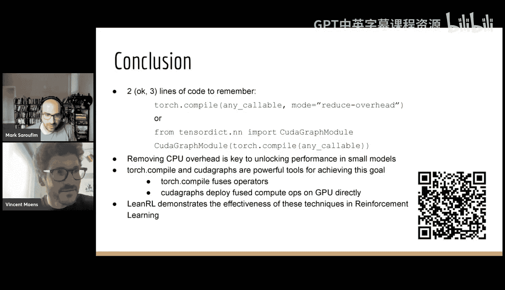

Yeah。😊，I'm not sure I get the question。 Is there any room for data oriented design。Yes， so， so。

 so I think this is in reference to like a comment I made earlier around。

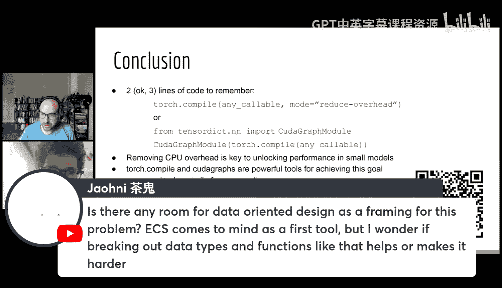

How like you can just like have the like you can send data without methods and then there's like things like where you know。

 like especially specifically in gaming communities like people have figured out the sort of abstractions like basically like a like what was it gun？

Like an array ofstructs is faster than astructive arrays。I forget like I forget what's most faster。

 but it's okay， maybe we can just discuss this one I'm fine。

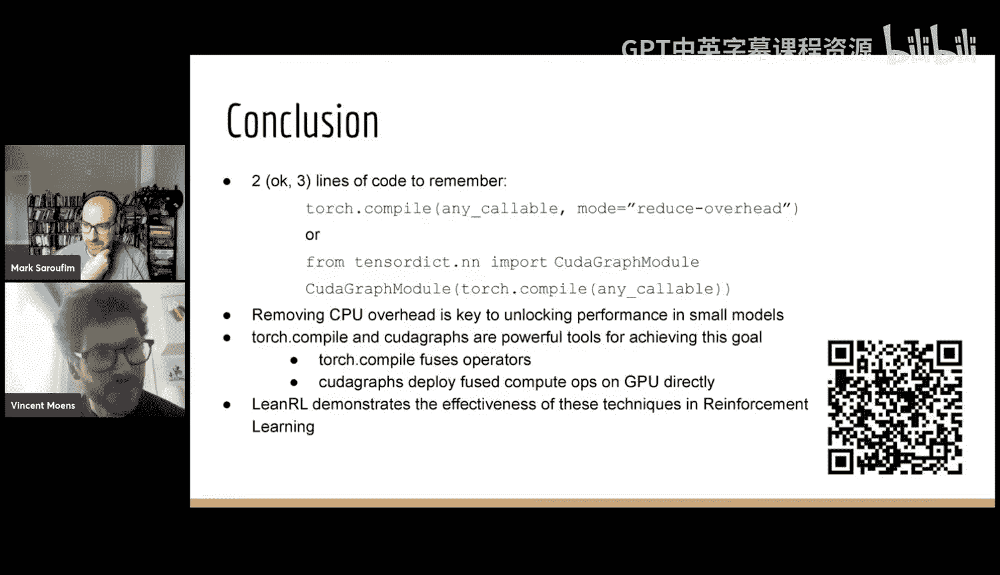

嗯。I think there was also a question from green Matri maybe maybe if I can comment on the last one。

 I think one thing I always keep in mind is。

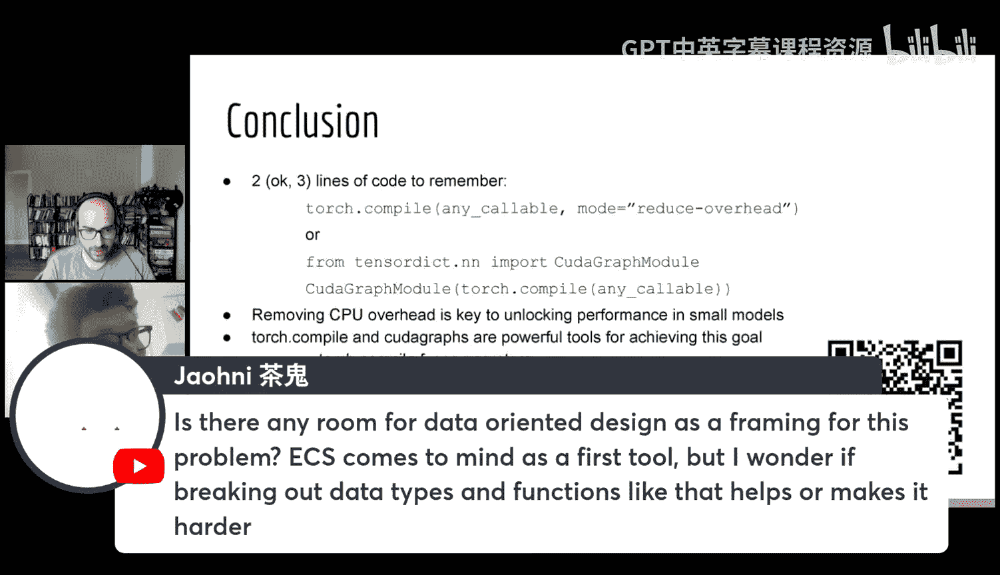

Where I sit， the problem we'm trying to solve is。We're facing a community that has like very different use cases。

 so what you when you're talking with researchers。They have like a thousand different research projects。

But usually they reallyt like one type of algorithm so what they want is basically to write their algorithm and be able to re use that across use cases and the typical example is。

You write your paper and you have a specific， you know。

Way of deploying that and way of showing that you're going work。

 you send your paper to New Europes and then you get reviewer number two saying。

 I want you to test that on this benchmark and that's on the benchmark。And when you need to do that。

 you don't want to rewrite the whole thing， you would like just to swap a bunch of components such that you know things are mostly reusable and you know exactly surgically what piece of the code you need to take out and what you need to bring in without rewriting the whole thing。

And that's you know the thing where tensory and torchar can really help because recycling code base to do one thing and something totally different is very easy right now that we're working you know with GRPO and deepCR1。

To bring the PPO example that was playing Atari games or making robots move to GRPO or a piece of cake because like all the components are the same we just need to swap the MLP with an LLM more or less and things just work out of the box so I think that more specialized designs are going to work much better in specific instances and if the problem you need to solve is very specific and very targeted。

Please do so but for things that are more generic and where people need to swap things around。

 I think like these kind of。Object oriented oriented design is。A good way to go。

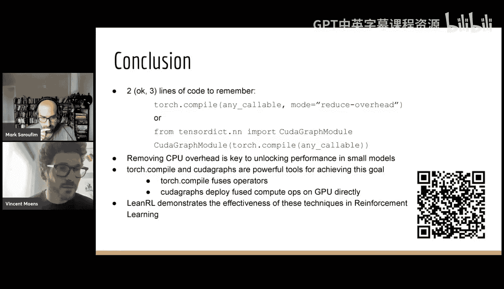

Okay， another question from Green Matrix。Why would I it be a bottleneck if I can provide data fast for the GPU。

 Yeah， that's a good question。 And actually， the Rl is always in。

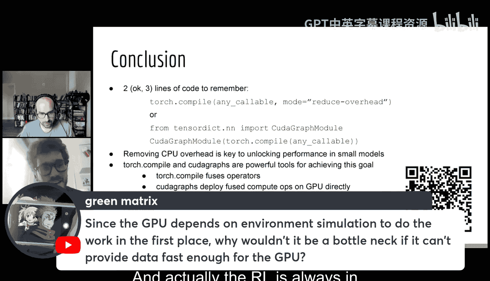

Struggling to make the most of the GPU in a sense that。In most traditional designs。

Your training looks like gathering data and then storing that data somewhere and then training your model。

Okay， so most of the time things people think in terms of synchronous processes where you basically。

Get data， store data， consume data， and then go back gathering data。 that's very inefficient。

 And so the whole community right now is shifting toward things where everything is asynchronous。And。

Where you can decouple the inference and the training now the problem with that is if you want to use your GPU for inference as fast as you can。

 you're basically producing a lot of data right and you're feeding that to your re buffer and then your trainer is consuming that data。

But then you decouple the training and the inference， and that introduces another factor。

 which is that the training becomes non deterministic。In simple case， it's not a problem。

 but in more complex problems that can become a problem because that means that I can write a piece of code and make it run on my machine and say。

 hey look， that train perfectly fine because I have a ratio of training steps per inference steps that is that much and then you try that on your machine and because for some obscure reason maybe the GPU you're using or something like that。

😊，Your training is slower or faster than mine then you don't get the same results and that reproductduibility issue is something I think the community still needs to think about a needle you know because that's not very good。

But yeah， definitely like the question of how you can produce how you can utilizeize your GPU as much as you can is kind of a Microsoft one and if I can add one other piece of info that complexifies all thing is。

Once once you start working with agents you know and you have something like a web browser。

 the web browser doesn't really require you to have a huge GPU infrra under the hood so you're going to be bottlenecked by your environment and with something that is very hard to parallelize efficiently so you could spawn 1 thousand browsers obviously and get more data but you there's only so much you can do and so with agents we kind of paste these different kinds of programs where。

Yeah， having a good inferencefr engine is something desirable。

 but not as much as having a good infrraar to ruin our agents。

So speaking of so so one of and follow up question really is I think this is like something that tripped me up at least when I first started to learn about Ar and Freux it's like the boundary between training and inference is kind of blurry。

 so I was wondering if you could comment like a bit more on this question as well。

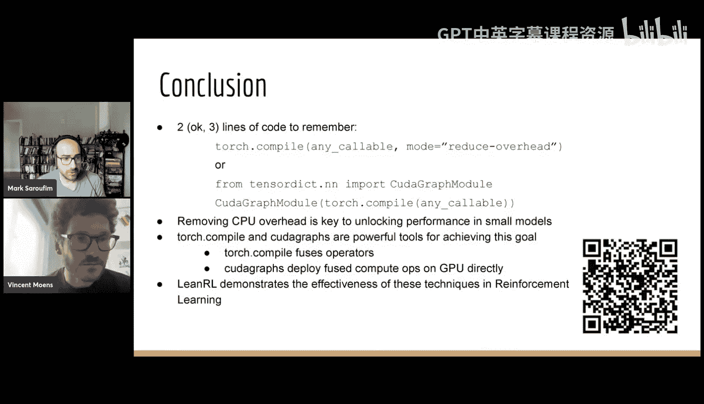

You'll have a training model and for smaller。

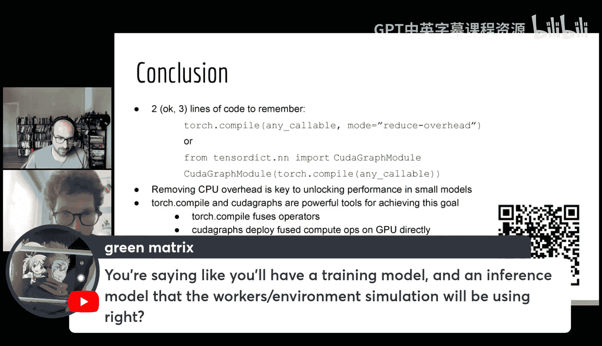

Okay， so let me comment on the way we think about training and inferenceferencing for Ls and what the infer usually looks like。

So， you usually。You're usually assuming that you're training the you're using the same model for inference for training I'm saying usually because you can have settings where those things are different you know like offline and these kind of things。

 but let's just assume that is the same thing so for instance I have you know。

Some Lama model I'm trying to train using LauraRA， and then I have the same maybe quantized version。

 you know on my intra zone。For inference， I'm using something like an inference engine。

 VLM or something。And so I'm training on OneNot and gathering data and consuming that data。

 and from time to time I need to basically send my weights to VLM and update my copy of VLM to say。

 hey， here is a new version of my post training model。That you need to use。

The question of how often you do that and how you do that efficiently。

 like those are very difficult to solve questions and there's not there isn't any one pixel solution unfortunately。

 but you can do anything from having a parameter server that contains various versions of your model and then your inference engine picks up the latest version when it wants to。

 you can have something a little bit more intrusive where your training good push hard pushes the weights to VLLM。

Like you。You don't know in advance and one of the things we're thinking about is basically to say we don't want to be too opinion and we want to give people the in to do all these kind of things if they want to like you want to do a force push you do a force push you want to you just want to have one copy of the model you have just one copy you want to many of them you do that and then there's obviously the question of your training node is probably going to have some kind of parallelism that is not the same parallelism that is used by your inference node and so how do you map those weights from one to the other like。

It's a crazy space to operate in。I don't know if that answers the question or if that clarifies things a it。

I certainly think it does so maybe my last question will be so I'm still not too clear on what it means like when you said like you said like sort of the key thing for the performance wasn't relying on switch compile tograph a cutgraphing the compiled model I was wondering if you could like just give us like a brief code walk through and kind of explain a bit in more detail like what you meant there Okay yeah so the main thing is basically all the extra operationss that compiled is doing for you and naming things like checking girlss and all these kind of things。

Many of these things are still Python based and I think that the engineers working in compile are like。

We don't really care that those things take a little bit of time a little bit of time because。

Even if it's just one millisecond， the four are passed。He's going to be significantly， you know。

Larger than this thing。And in Rl， you have usually a lot of inputs because imagine that you have a robot。

 you know， your robot is going to have。A bunch of drawings so all of these can be represented as an independent tensor maybe it has a few cameras so that's two more tensor。

 so basically all of these are python objects that you're presenting as inputs to your model。

 your model needs to check all of that plus the global variables and everything so basically just the check of those guards take as much time as a single forward pass with your model。

And so we want to get rid of that the other thing is when you train your model， you do this forward。

 then you have a graph break， then you do the backward， then you have graph break。

 then you do your optimizer step then you have a graph break you know like and all of these things。

 if you try to compile them。😊，Right now they cannot fit in a single graph。

 so you will have at least four graph breaks and typical update and we want to compile all of that because all of these things are in our case tiny operations that you could probably you know benefit from using compile。

 but each graph G goes with its own set of guards checked。

Once we use kudagraph on top of compile and not within compile we basically get rid of all those graphs because there is no intermediateent Python code you know like everything is just like one kuda code after the other and Python just ignores all of that and that's just executed you know seamlessly so if there is no control flow if there is no change in the inputs with things like strings that change or things like that or yeah like you should be fine there's a bunch of these checks you know I showed them this kudagraph module from T that thing。

There's a few checks， very few checks， and usually we rely on people， you know。

 to basically tell them huge warning。This has no guaranteed to work。

 you should know exactly what you're doing and have a tight control over the input output and all the global variables around your code and the other thing is you're kind of on your own。

 but if you get some speed up and you can check you that the training curve looks as it should then you're good to go。

I see。😊。

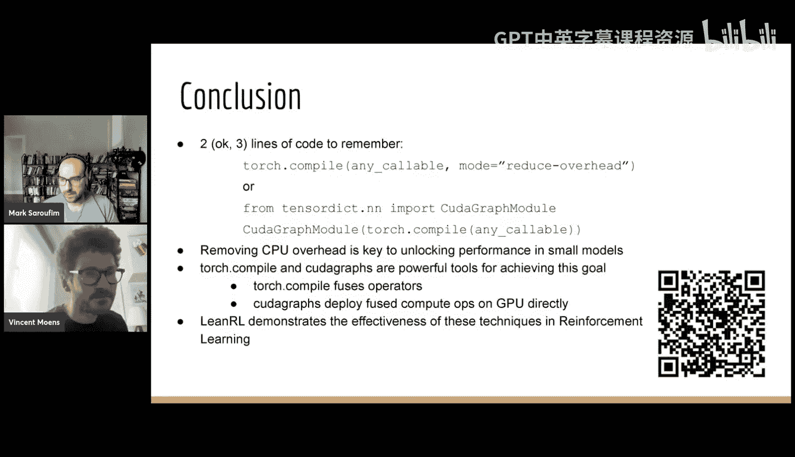

So last question from Chad then from Gerald look like with this trick sort of do you expect it to work with other inference engines or does this like really like sort of is there like a hard dependency on your work on torch compile。

 do you expect other inference engines like honest with Tensor RT to work well No actually regarding Tensor Dtro that that's a very good point so。

The writtenO work works with modules。

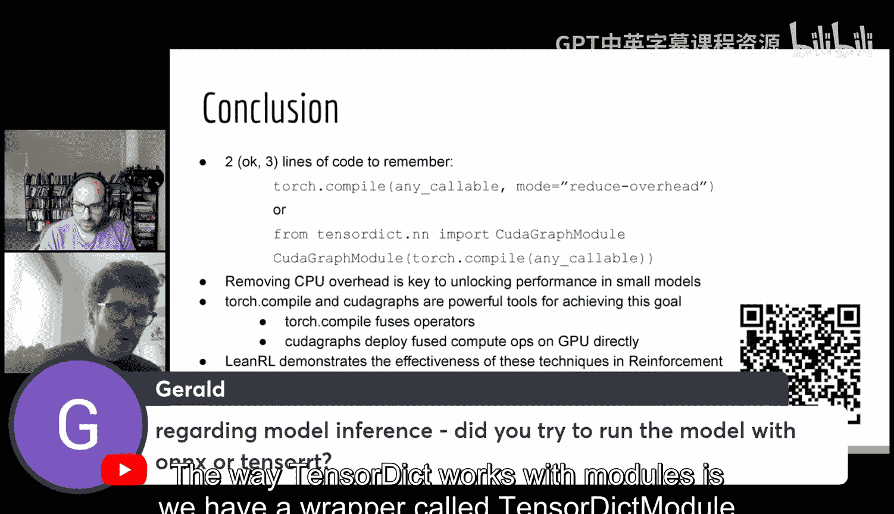

Is we have a rubber called Tensoronic module where we basically say。

We expect the input to be presented as a tensory， we mark you know what are the input keys in that tensoric that your module is going to read and then we have a set of output keys that are going to be written okay。

And we structure all of that like this in the Incodeook base。

When you want to export things and that's very important because a lot of the users that we have their piloting drones and executing things on robots and stuff like that。

 so they want to export are code， the way we do that with Onx or Torszo export is that you can basically mark what the input and output keys are and just provide tens source and under the hood TensorD is going to build that exported version for you that is TensorD3 so you just input input tensor and output tens and you can get the C space execution that is also TensorD3 like。

There is a tutorial you can just Google that TensorD export and you will see we have a bunch of tutorials in To and TensorD with that feature and that all works perfectly fine。

All right， sweet I don't see any more questions in chat， so Vincent， thank you so much for coming on。

 I know this is like late in UK time。So folks next week we're going to have like two tops we're going to have on Friday Chris Latner and Abdul Dakq who's going to be talking about like the new GPU support in Mojo and on Saturday we're going to have the T warrant team giving us a talk as well so thanks again to thank you Vincent and if you have any more questions to Vincent you already plugged the TorchRL thecor he also sometimes hang out on GPU mode so feel free to tag in there as well。

Thank you folks and thank you Vincent， bye。Thanks， Mark。

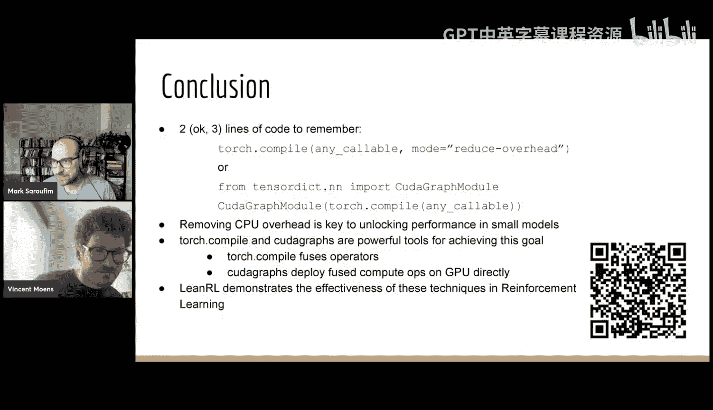