# GPU MODE《CUDA、GPU编程54-87｜GPU MODE》中英字幕（deepseek-v3.2 p02 -20250502-Lecture 55_ Modular’s unified device accelerator language.zh_en -BV1xbmQB3ETC_p2-

All right， can folks on YouTube heroes， Okay， let me double check。i think谁啊。Okay I think yeah。

 we already have I think we already have a good good amount of people so we can probably get started。

 All right， welcome everyone to another episode of GP mode。

 like this lecture today is like a very special one for me。

 I've been wanting to have Chris come give us a talk for like at least a year now basically from the origins of the server。

 So so I'm glad he could finally make it So today is really going be like a very deep technical talk about a lot of stuff like ranging from GPU programming language programming models meta programming compilers And so I'm really thrilled that like so first off。

 I'm co-hosting this with like my good friend and colleague like Al de Mi whos one of the core maintainers for Pytorch and the two speakers are going be Chris Chris Abduul who is basically one of the core maintain of the Mojos GPU support。

 So yeah if you have any questions I think both Chris and Abdul told me that they'd love to take them if you have any hot take questions also feel free to ask them。

😊，And yeah， without further ado， Chris， please take it from here amazinging， well， thank you Mark。

time for us and really excited to talk about what we've been building for a really long time and I hope you like it as Mark warned me nudry is acceptable in this audience and stuff if you want I'm happy to nerd out about things as well。

But we'll dive in， so what are we going to talk about today？We have a whole bunch of stuff。

 so we want to talk about where a short version of like what is GP software looking like today？

And therefore what do we want to do about it we're going to introduce Mojo talk about powerful meta programminggram and why it matters。

 talk about portability， talk about tile based programming， talk about composing operations。

 talk about performance because accelerators are all about performance talk about tools talk about comparisons to other things and then hopefully inspire you to do something really cool so this is a lot this is not a 10 minute talk but hopefully it's interesting to some of you。

So let me give you a warning， so there's a lot of things happening in AI。

 there's a lot of systems out there， there's a lot of claims， there's a lot of BS。So today。

 the reason that we have not given this talk until today and I love Mark and I really want to do this is that this talk is not vaporware。

 so everything we're talking about today is stuff that you can download and use today。

You can use it for free at any scale， you can use it on CPUs and multiple GPUs。

 including MDD andVdia。This is not a vision talk this is real so so I know that's a confusing thing in our industry sometimes but this is a really big deal and we want to make sure that we're extremely grounded on things that you can have a clear call to action to do you can learn you can dive in you can tell us where we did it wrong and so like you can really dive in and that's really really really important so。

😊。

So one of the reasons that this is a why now is we just open source。

Possibly the biggest open source GPU kernel library ever and so this is almost a half a million lines of Mojo code and so if you go to GitHub on modular/lash modular you can find it today。

 this is under an Apache2 license please check it out we'll be pulling highlights from the code but this is a really big point for us and so we're really excited about this。

So let's take a quick dive into GPPU software today。

 so if you're interested in GPPU software then I would love for you to read my blogs I'm writing a whole blog post series about OpenCL and KUDa and like the history and things that have TVM and XLA and Triton and like a whole bunch of different systems because there's so much both modern technology that is important and powerful for what is running the world but there's also a lot of history and there's a lot of things that many of us wanted to work but didn't quite work out the way we thought it would and so this blog post series dives in and it's up to nine parts now hopefully part 10 will be out next week。

So I'm not going to talk about that I'm just going give you the super super highest level take on this because we want to talk about our stuff today so first of all what is the problem well the problem is that there are too many languages。

 too many systems out there and so today modern AI is got a many language problem we want to be using Python it gives us quick iteration it's easy to use this is where the whole world and AI is converged but then when we want performance we end up having to drop down and rewrite things and C++ or rust or languages like this to get performance。

😊。

But then of course， AI is about GPUs， and so then you face this reality that now you have to rewrite again to get into Kuta。

Cud is a different world if you want to get to other hardware have rewrite it again。

 and so what AI today looks like， particularly if you care about performance and state of the art research。

 is that you're constantly rewriting code。Now rewriting is a pain， it's expensive。

 it has lots of different problems that are well known across software。

 but the actual big problem here is that every time you rewrite。

 you've split your team because if you're doing modeling you're in Python， if you're in GPU kernels。

 you're doing Kuta， but now you have a split brain problem where if you're straddling this boundary you're having to keep multiple different paradigms in your brain it's just not a good use of our time and so this is one of the big issues that the hardware enablement industry is facing。

 but also AI and a lot of other things。

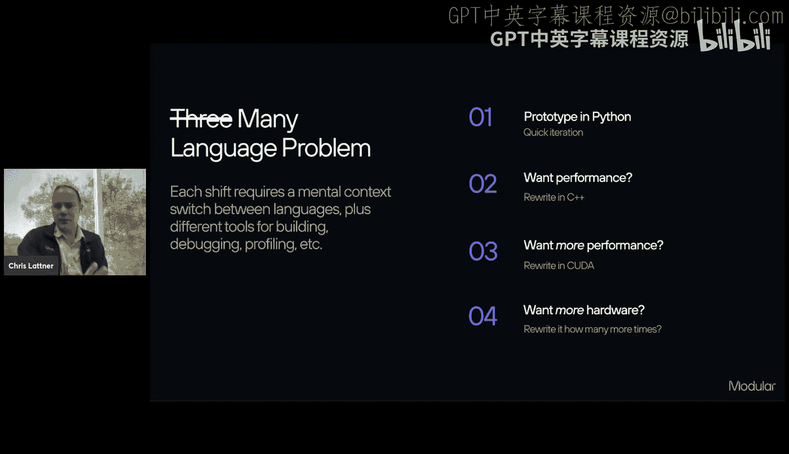

Well， because of this， we now have complexity and I'm not trying to pick on any individual system but roughly every system ends up looking like this where it's many different things cobbled together。

 lots of different hardware gets integrated， many open source projects get like extended and get different features over time and so the consequence of this is if you're an AI engineer building on top of this stuff well the problem is that you pick it up you want to deploy in some use case with some quantization thing on some piece of hardware and it just doesn't work right or the performance is bad or you get some weird stack race and the problem is is that every layer of this stack is evolving and wasn't designed together and it's often 15 20 years old depending on the technology you're using。

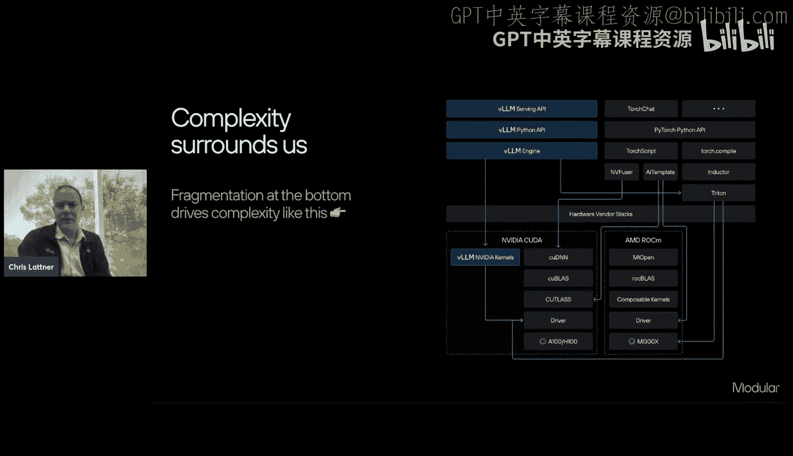

And this is a huge problem， this is slowing stone。So when I look at the systems out there and here's a really short and very simplified view of the world。

 zooming into kernel programming and GPU programming because that's what we're here for。

There's three things that really matter one is performance if you're using a GPU。

 we know they're expensive， we want to get all the flops。The second is usability。

 we have so much to get done， we want to be productive。

 we want more people to get into GPU programming and usability is key to that and third portability。

 we want to be able to move to different hardware， we want to be able to look at new opportunities。

 different specialized use cases and we want to be able to move our code and our algorithms over time。

And so if you look at the existing systems of people are writing kernels in。

 they break down into different spaces depending on the tradeoffs that they're looking for。

 and so notably CUa， I mean KUDa is amazing， it powers pretty much everything a huge swath of AI and not everything but a huge swath of AI Kuta start out by being the king of performance。

 recently they've added a lot of usability features with cutlas and some of the Python things they announced that GTC and so maybe it's getting better for usability。

 but of course KUDa is not at all about portability to their hardware。If you get Triton for example。

 Tritons are super wellknown， super widely used DSL， I love Triton it's tons of respect for it。

 it really does two things for us as GPU programmers one is it really improves usability and so that's a huge productivity benefit a lot of people love it particularly when you're prototyping it's pretty good at portability and so you can get portability of some kernels across like EMD and NVIdia for example。

 but with Triton you give up a lot of performance。And so that's okay if your use case doesn't require performance。

 but because the contribution in this usability and portability space is really key。

There are other technologies， openCL for example， OpenCL again a much older technology doesn't really do tensor records well so you don't get performance。

 but it's portable to like FPGs and things like this it's also not super usable and kind of has fallen fallen behind in various ways。

 there's also many， many， many other things rockM is amazing for performance on AMD but it's not focused on other usability or portability features and so if you look at these systems right the challenges we want all three and there isn't really a solution out there that is able to provide that today。

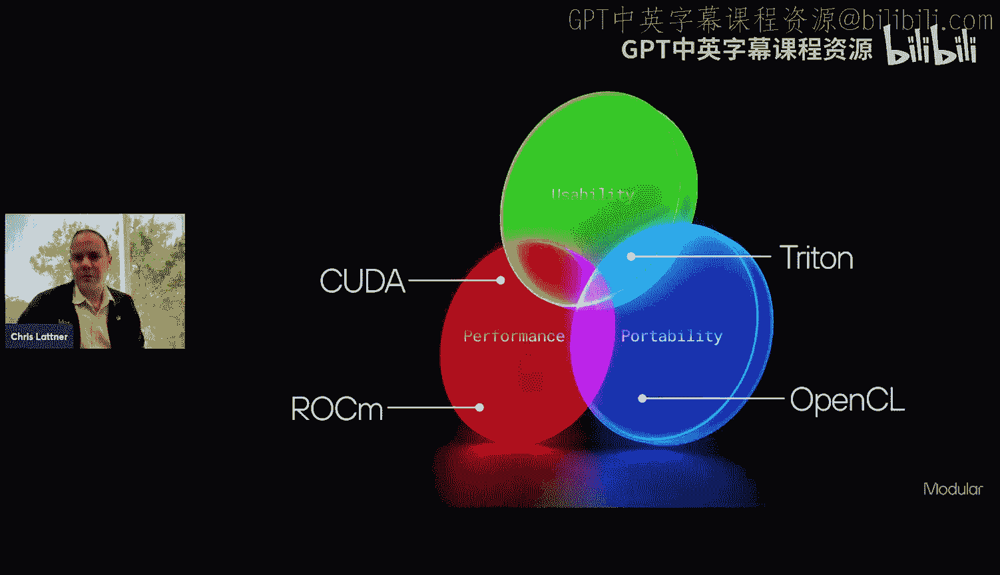

So I'm a compiler person that's what I'm known for and so I spent years trying to say let's go solve this by building the sufficiently smart compiler and I worked on XLA and I've worked on lots of other different things in the MLI world and for a lot of time both but the entire industry has been trying to prove to us that AI compilers can be the solution to the problem and we point out that kernels have all these problems and we want to be able to have generality and compilers looking into generality but there's a huge problem with AI compilers。

Jenny and I moves really fast， the algorithms in the research， everything's moving all the time。

 and unfortunately there are not enough compiler engineers in the world and also compiler engineers are often not experts in algorithms in the microarchitecture。

 the evolving use case， compiler engineers don't know all of the different things going on particularly because there's so few of them。

 and this becomes a bottleneck。Of course， we also don't want to have。

Other people like kernel engineers have to become compiler engineers to get things done。

 We also have AI engineers and other people higher level in the stack and so what I love about AI as an ecosystem and as a community is that success is really about getting all the different personas to be able to work together and so AI compilers as a direction really kind of lost that beat and tried to put everything in the compiler which made it so as a kernel engineer you have to end up reading IR or something which was really quite unfortunate。

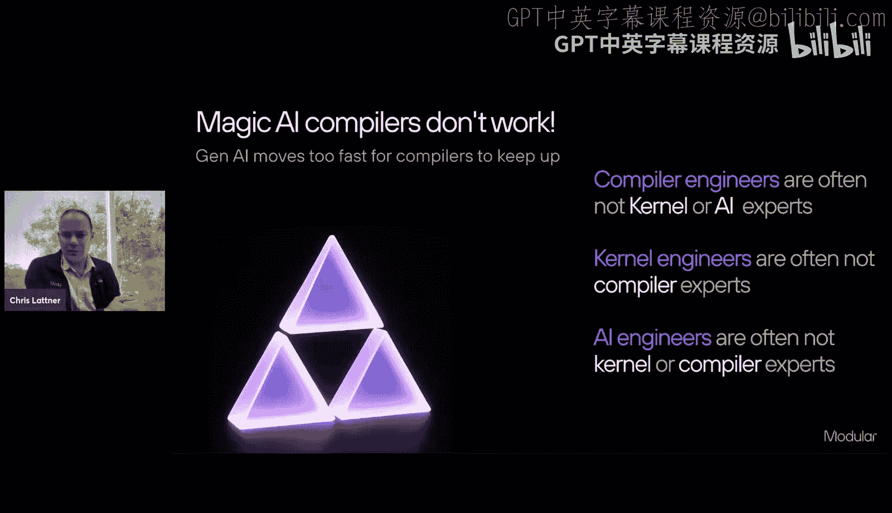

So what I want to have happen is I want to have this unified GenI native software platform and this is a big bold。

Quest like this is an industry scale problem I'm not the only one that wants us。

 and so what I think we need to do is go back and rebuild this thing from first principles。

 take all the lessons learned from all these systems and do something quite new。So what do we want。

 of course， multiple different GPUs from different vendors。

 we want full performance of the silicon because GPUs are all about performance and we want usability fundamentally。

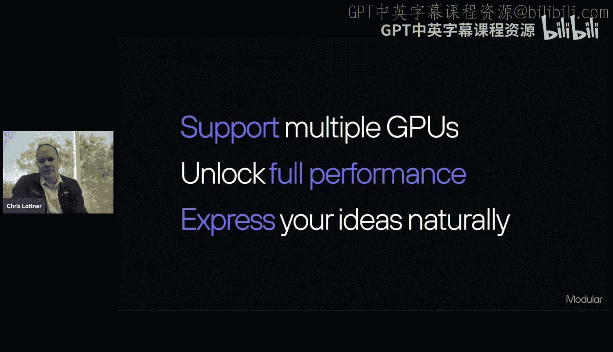

So this of course is what modular is about， so I'm happy to finally be able to tell the world about what we've been doing because we've been at this for quite some time and it's very very。

 very exciting like I said today this is not theoretical， this is all real。

So what are we doing so at a high level and we'll get into code for sure trust me but at a high level we're saying let's build an entirely new programming language。

 let's build an entirely new AI framework， let's build an entirely new AI stack all the way up to serving and fancy cluster management and all this entire AI vertical。

From first principles for heterogeneous compute， for GenAI， for the today use cases。

 this is not about do the thing that made sense 15 years ago and try duct tape it。

 this is really rethink and challenge these assumptions in a new way。

And so we started by building this and testing and validating on CPUUs CPUUs have a lot more diversity than even GPUs because there's all the micro architectureitects。

 a lot of weirdness， different macro architectureitects like Ar 64 and things like this。

 and so we brought that up。We then brought up NVIDdia， and so we have full support for NVIDdia。

 including all the data center and also the consumer GPUs and Su 4090 and the Blackwell and like all this kind of stuff fully supported by Mac today。

We also support AMD and so AMD MI 300325 download Mac download Mojo you can today use all these devices and it just works and in fact the same image works and in fact we're not using things like KUa to run on any of these devices and so when I say this is a first principles rethink。

This is a really big bet， this is a really big swing and a very big set of industry problems。

 and so this is why I'm so excited to tell you about it and we're excited today that we can not just tell you about it but show it to you and you can try it yourself。

Now in the future， there's a lot of hardware out there， I'm a hardware nerd among many other things。

 and so we'd like to be able to catalyze the future。

 but today we're talking about what's available today。

 we're not talking about any future potential or any exciting new directions。

So let's dive in and talk about Mojo Mojo is we think the best way to program GPUs。

 we've been working on this for years now， it's really hard to do what we're doing but we'll talk about why we decide to do that what it means and then we'll give you tons of examples on this now while this talk is focused on GPUs because hey we're here at GPU mode there's a whole there's a whole Python thing going on to and so if you have a lot of Python code and you want to go fast okay well there's a whole different line of work that's super interesting for that as well。

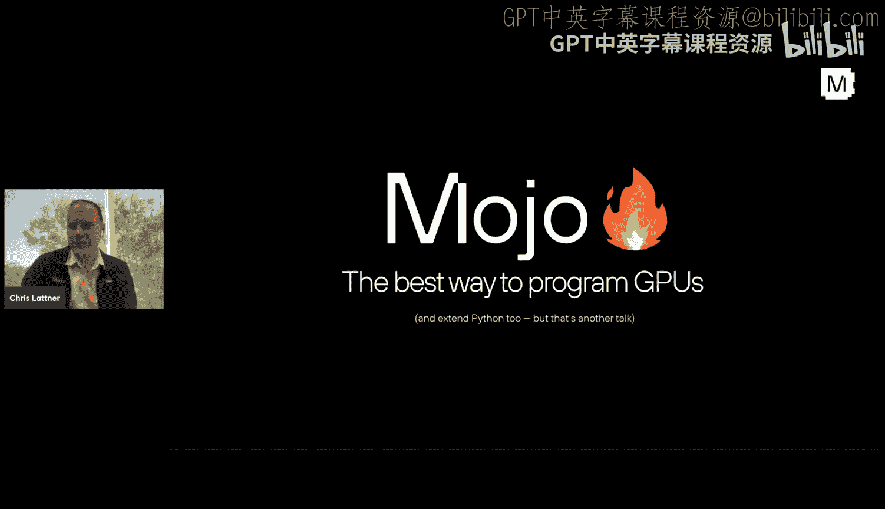

So let's dive into this new language thing， so wait a second， building a new language。

And by new language， I don't mean a DSO， I don't mean take something that exists and change it。

 I mean， an entirely new programming language from scratch。Well this is a terrible idea。

 let me tell you like everybody will tell me but it's common sense that building a new programming language is a bad idea and there's lots of good reasons for this it's that they don't get adopted like if you have to retrain your team to learn a new language that's a huge expense。

It's also extremely difficult to build them， you have to get people to use it。

 this is why many people in AI just use Python and Haett with the DSL instead of building an actual new language。

And so being successful with the language requires you have a consistent vision this takes years of time to do。

 you need to be able to pay for it， you need to be able to track the kinds of people that can actually build a language it turns out that there's a special kind of nerd that actually wants to do this kind of work and they're brilliant but there's very few of those you also have to be able to build something that people care about and so if you're going to build a language there's a million hobby projects out there。

 what I care about is doing something that has impact and actually gets adopted。So end to end。

 this is just an expensive proposition and so there's a very specific time and place where it can make sense to do this and fortunately we think heterogeneous compute is that time in place。

And so why do we think that is well building new language is the only way to get the best thing right we want something that is really powerful。

 we want to make something that has high impact， we want to make something that in AI developer kernel engineer can fall in love with we're not trying to do a point solution a quick demo。

 something that's research quality， we want something that is actually good and that can lift the industry in a way that very few other systems have even tried to do。

And so when you look at these things， we think we can check all the boxes like we think we have a clear vision of what we're trying to do。

 we've certainly been working on this for years， we've certainly paid a heck of a lot of money to get some very。

 very smart people together and actually build this and continue to evolve it and I'll just say from a personal perspective like I've done this before。

So I built open CL at Apple and then gave it to Kronos and scale and went on to scale it I built entirely new C++ parser and ecosystem for objective CN andC and all this stuff called Clang。

Super hard to build a C++ compiler， by the way， have built an entirely new program language Swift and launched that to the world。

 It was a very great nights and weekends project that scaled。

 but what I've learned across all these journeys is you need all of these checks like you need an amazing team of people。

 No one person can do all of this alone You need to be able to see it through You need to be able to execute and you need a good vision And so this is what we think has been really quite special about modular as we've provided that opportunity to bring together the people and the talent and into this opportunity and we're very。

 very， very excited to talk about today。😊，So what is Mojo？Well， so at a glance。

 it's a pythonic systems programming language。So let me break that down so Pythonic it feels like a member of the Python family and so we're not inventing new syntax。

 we decided that we like Python， the world likes Python， let's use what's great about Python。

 which is its syntax and its ecosystem。Second part of that is systems programming。

So forget everything you know about Python， this is fast so this this is not using the Python implementation。

 this is using the Python language， which is a very different thing。😊，Now as a language。

 it's not just you need to be able to have syntax， you also need a full tool chain。

 you need editor support， you need a whole bunch of other things， you need platform capabilities。

 a debugger， like so building a language is really， really quite hard， but this is what Mojo entails。

Now， like I said before， you can download this for free， you can use it for whatever you want。

 it's we're open sourcing all this stuff and we have quite a large community people that are already excitedly using it for different things which is super cool。

So。But what is module really？What we're doing is we're saying take the developers in the Python ecosystem and give them new superpowers and new tools。

 but then take an entirely new generation of programming language and compiler design and bring it together into a novel combination。

And so today I'm going to resist myself and not nerd out too much about compilers。

Happy to do that some other place， but we're going to talk about meta programminggram and some of the programming language things and then we're going to show you what that means for you as a GP programmer and why maybe someday you can be saved from C++。

So。SoBut going into this， even though the code looks very familiar and is super easy to learn。

 it looks like Python please， this really is not a Python DSL。

 this is a completely new programming language that happens to use the best syntax in tone。

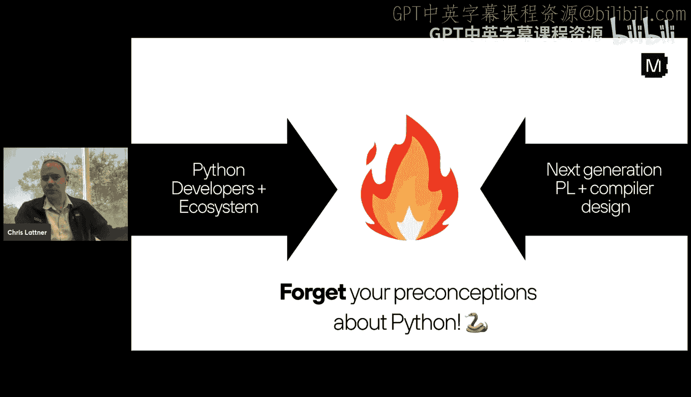

Okay， so what is Python sorry what is Mojo Well it's I said it's fast what do I mean by that well you can do pretty much anything in Mojo it's a fully general systems programming language and so you can go write tokenizers Here's a BE tokenizer for example when you measure it against something like Python this is a thing that I always get asked about is we're not trying to make a faster Python。

So yes， it is a thousand00 times or 10，000 times faster than Python。

 but what we're actually doing is we're working back from speed of light of the silicon。

And so this example is a CPU example， but we'll talk about GPU shortly。

 you can't give up any performance on GPUs if you want the best TCO and performance， you just can't。

And so on a sea view， this made you get full power of s0 threads。

 Nuumma there's a whole fancy compiler that I'm resisting talking about like has crackedtail calls like all these things you'd expect from modern language if you're curious we have a whole blog post that talks about comparing Mojo to rust and Mojo is a much more modern language that is learned from rust and Swt and many other things and so yes。

 in cases it's actually faster than rust which hugely polarizing some people don't seem to understand that rust is not be all an end all of performance。

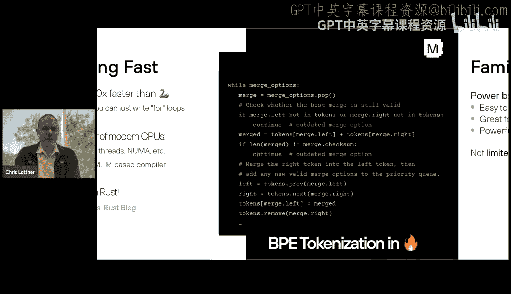

But CPUUs are not at all it's also about GPUs and so one of the cool things and we'll talk about this extensively today is that you get the full power of the silicon and so you get a very familiar GP programming model so yes you can go all the way down to thread indexdex。

X and block indexex。 Y and do this kind of stuff one of the really cool and very important things to think about Mojo compared to some other DSLs is that it's completely general。

And so I'm going to talk a lot about AI because that motivates me a lot。

 but you can write right tracers， you can write any kind of GPU program you want。

 go tackle biochemistry， go like HPC simulations， like everything we talk about today is quite general and we focus on AI but that doesn't mean that you have to。

 you can use all this technology to do pretty much anything that you can do with an accelerator。

So now one of the things that I love about GPUs is they're weird right and so this is something where there's so much innovation in D types you know Hopper added TMAs。

 they change every generation， Blackwell has crazy new features。

 AMD has its own take on things there's a lot of hardware out there and so what we'll talk about multiple times over is that you get the full power of the hardware。

And so we'll talk about how this works but this is not a watered down solution。

 this is not a make it easy for the simple case， this is a give experts superpowers。

 make it easy for them and then enable the super experts to build powerful libraries the people that are learning can build and scale into over time and so yes。

 you can go all the way down and program the TA you can utilize the lowleve Tensor core stuff if you want to。

Hopefully we'll use the higher level abstractions we'll talk about later for T based programming。

 but we don't want you to be there's no like headroom that you run into to prevent you from game with the hardware So if you are course this might be a good time for questions and I add like all the Mos back so I read your series basically on like sort of like the history of Ka and sort of like the design tradeoffs like you had with Mojo and kind of one of the things that you said that like a major limitation for fighting is that like once in GPP generation comes out there's all these new things that need to get supported and this is like a manual effort like。

Isn't that like inevitable like basically any any programming language needs to deal with this because you don't you can't anticipate what new hardware intrinsics will be made available Nope give us a few slides will'll show you how to go directly to PTX you can go directly to lowlel assembly like this is not the talk we're avoiding PTX we'll go all the way down to the silicon and and I'll show you how that's done and I'll show you how you do that without even changing the compiler and so this is the challenge right so those DSLs out there The problem is that enabling a new piece of silicon requires。

Changing the compiler。You do not do that here， that is not necessary and I'll show you。

So that is a fundamentally different thing， and this is one of the reasons why this is a new category of technology。

Allright， let me， let me let me get out。Sorry， I didn't mean the scary way， Mark。

So no and I'm sorry if I'm like being too excited， I I'm pretty excited about this and a lot of things I take for granted because we've been working on this for years is really non obvious but。

But yeah， you get full power of the silicon。We've implemented new GPUs and things like this without changing the compiler。

 which is really quite important。And also I'll talk about the way you do that is all open source。

 so we'll show you some of that code。So okay， so I'm just trying to frame the high level bits before we dive in another thing with Mojo being a fully designed from first principles for modern compute is that there's a whole thing that I'm not going to talk about much at all today called a graph compiler and so in AI you have a lot of things like you have a CU activation function。

Well you don't want to write all the permutations of here's your MaMo and here's your cell euffus into it and so auto fusion。

 memory planning， static specialization based on known dimensions all of this stuff composes and it's not the focus that you take so we won' to talk about GPU programming。

 but the best kernel is the one you don't have to write。And so when we talk about usability。

 it's a big deal that you don't have to write the cross product of all the things。

 and so this is something that Abdah will touch on I think later but we'll get back to this。

What about tools well building language is a real pain in the butt because you have to build support for the LSP and your editor。

 you have to build a debugger you have to build。So much infrastructure。

 so much technology but the benefit of that is you can have amazing tools and so Mojo directly integrates with KudDa GDP inside profiles that just works like all of these things you get with KUa come over directly and they just work this is huge and so if you care about performance it's very difficult and our experience to get performance without having a profiler and not being able to understand how your code maps to what you see in the profiler and so this is a really big deal。

😊。

So I want to get to concrete code right now and I'm going to talk about。

The like the major content of the talk is talking about like strict walkthroughers of code that we've written and how you program GPUs and do all this kind of stuff。

 but there's one language feature that's essential to understand anything this talk and that's metaprogram and so Mark this gets back to your question of like how can I enable new hardware without changing compiler。

The answer is meta programminggramm。And so whereas those AI compiler people。

 including myself and past lives， wanted to take power away from the kernel engineer and put it into the compiler。

Meta programminggramm in Mojo is how we flip that narrative our goal is to give superpowers to kernel engineers so that you have the power that was traditionally locked up in the compiler instead of having to go call a compiler engineer just because you want an incremental feature or a new D type。

So why do we want this， well， we need harder generality。Like we're talking about portability。

 capability， new weird features that that TC。Instruction of the day。 We want single source of truth。

 A lot of algorithms are actually quite portable at the right abstraction level。

 And so we want to keep the stuff that's common common。We want things to be parameterized。

 different chief views have different work blanks， you want a different enroll factor or tile factor。

 things like this so you need to like have configurable algorithms， right？

The state of the art way to do this today sadly is C++ templates okay and so C++ templates are a pretty wellknown thing I have I'll just speak for myself。

 I don't love C++ I've written way too much C++ to love it and it's because template error messages or nightmare it's really slow to compile I can never figure out how to use like string as a template parameter like just simple things don't work and so this is just fricking a nightmare but the requirements the benefits of doing this are profound because you can lift code from runtime into static compile time and you can get these reconfigurable algorithms。

😊，So with Mojo， again it's a Python family language。

 what we realized early on is that Mojo needs what Python already has and Python at least for CUus。

Has really powerful meta programminggram features it has things like decorators and meta classes and reflections it has dunder methods it has like all these things that make it。

Powerful and easy to build very amazing libraries that enable things like Pytorch and stuff like this。

But of course， Python isn't known for its performance。

And there's no way this is going to run on an accelerator right And so when we look at this we say。

 okay， let's be inspired by this concept， but let's do it in a very different way。

 This is basically our relationship with Python， by the way。And so let's do all of this fancy stuff。

 but instead of doing it at runtime， let's do it at compile time。So how does this work？

So Mojo has this thing called a parameter so parameter is like comp time this concept comes and is inspired from a language called zig and there's other languages that do this as well this isn't some novel concept but parameters you can think of them as being kind of like templates template arguments and so here's astruct in Mojo this is Sdy this comes straight from the standard library by the way and it has two parameters one is the D type so is this float 32 or is this float8 or is this in 64 or is this like what is the day type and then what's the width and so because these things are in square brackets。

These things are bound at compile time， and then this code is instantiated just kind of the way you might think of it as a C++ template。

Well how do you use this Well functions can also take parameters and so this function first class SIMD takes a width and it says hey。

 I'm taking X， which is a SIMD and it's a flu 32 and it has some parameterized width and so now it can build generic algorithms that work over any width of SIMD and in this case it wants the thing to be F 32。

Mojo has another thing called an alias again you don't have to memorize this。

 I'm just kind of painting the landscape here what an alias is is an alias is a comp time variable。

And so floatloat 32， this isn't built into the compiler， by the way。

 because we don't build hardware things like you know math into the library or into the compiler。

 all of math， all the primitives， all the integers and floats andemds and stuff like this are defined in Mojo code。

 you can read the code。And so Flo 32 is just， you can think of it as like a tech stuff。

But alias is a much more powerful thing than a typeF because it can be an arbitrary expression that is computed at compile time。

So again， this is probably not making a ton of sense to you we'll see a lot more examples later but。

Just think of these as like way better than CQ++ templates and you're kind of in the right ballpar。

Now the reason this is better than templates， there's a bunch of them。

 but one is that in C+ plus you have normal code， you have four loops and if statements and stuff like this。

 and then you have templates and you have partial specialization and so you have two different worlds。

That are very different to program and what Mojo does is it pulls together the actual language and the meta language。

And so what this means is that you can use a for loop at compile time。

 you can use a for loop at runtime， same thing。This also means that pretty much anything you do at runtime can also be done at compile time。

Basically， the only thing you can't do is IO。And the way this works is that if you do something at compile time。

 it can be arbitrary code， you can call Malick， we'll look at an example of that。

The interpreter actually goes and symbolically executes that and then it gets the result。

 the result might be an integer or floating point value or even an array in memory or something like that。

 it just puts the output in your binary and so you can shift an arbitrary amount of computation。

 for example， all that really complicated tensor indexing math out of runtime into compile time。

So okay。If you're a concrete person like me sometimes it's helpful to look at an example。

 so here's a really simple example of some Mojo code this is just filling a list。

 a list is like an STD vector you can think of that as an C++ if you're familiar C++ and so all this is doing is this is saying like create values it's a list of integers loop over from lower bound to upper bound and append an integer to it in front of the list this is not not super complicated code I'm trying to pick something simple before we blow your mind later。

So。The thing to keep in mind is this list is malic。

So this is like a resizable vector type thing right and so this is a very dynamic function and you can call this and you can get a list from 17 to 97 and it does what you'd expect。

Now this is a function， but functions can be called at either compile time or runtime。

 and so I'm not going to show you run time， you know how you could just call function Python it's fine。

Well， this friend， the saying alias that I showed you before。

 I showed you it was kind of like a type de， Alias says compute this value arbitrarily at compile time。

And so here's an example of a function that says。Give me Vec。

 Vec is the result of calling Phil the5 to 20。And so at compile time。

 this goes off and creates a list which is empty and then it goes and does a for loop and goes through the elements in that range。

 it does append， which by the way， does a resizing。

 reallocating thing that it would do and it returns back a malled pointer with a capacityating range and stuff like this。

And so what the compiler does is it puts V down into memory and then it's all been computed。

 there's no for loop that happens at runtime。 you just loop over the pre allocatelocated set of memory。

 but you've just got the result。And so this is just a very simple example of shifting a fairly arbitrary chunk of runtime logic into compile time。

Now this seems weird this is a goofy example oh so here you go this is meant to be simple and hopefully kind of gr what's going on here。

 this becomes extremely powerful when you get into much more real GPU programming examples that we'll show you。

Now meta programming is not just about storage， it's also about building powerful algorithms and so this is something else that will come up and so if you go look at the SID type again like like virtually all the code in the stock。

 this is public on GitHub， we'll share our slides later and you can go click on this link or find us on in the modular repository。

70 has algorithms， right， So one of them is a horizontal reduction。 So a reduced max。

 And so what we can do is we can use this compile time if statement prim if it says， hey， use。

I guess I forgot to update slide should say size use if the size is one just return the element and so a reduction of one element is。

Just the element。But otherwise we have to go do different special cases well so hey guess what there's all these special cases for different architectures well now we were talking about before okay well I want to be able to do maybe a recur of decomposition and so here we do a recurse of decomposition saying hey if the size is one then use it if the size is two then get the max of the two elements otherwise cut the vector in half and do a slice of each half of the thing and do a max of each half and get a nice。

Vor reduction loop， or it's not a loop， inline vector reduction in a very simple way on XA6。

But maybe if I'm floating point， I want to do something else， if I to this and do this other thing。

 hey， LVM has some intrinsics， I can plug all that directly into Mojo。

And I can write this in my code， I can write what is effectively a little compiler for an arbitrary horizontal reduction operation。

 the way I want to as a Mojo programmer。And so this is what I mean when I say we're taking these algorithms out of a compiler and putting them into libraries because what you would do otherwise。

 for example， that MLIR has this like vector dialect。

It has piles and piles and piles of special case logic for different architectures。

 different things and it's very opaque and it's not really optimized。

 it's hard to understand what it is， you have to be an MLric compiler expert to do this stuff。

I can just write some if statements。And that's really。

 really really different and particularly in AI and for kernels。

 you get really high abstraction things you want to express and writing piles of C+ plus code and MLR get just in your way。

 it prevents velocity， it's very difficult to work with。

Now this is also really cool and I'm just going to touch off this because not just are things parameterd on values like an integer or string or something like this。

 but you can use arbitrary types and so you can use for example。

 higher order functions as compile sign metaprogramm。

Combinators and so here's a vectorized algorithm and。

This will probably go over most people's heads on first glance。

 but maybe if you rewatch the video 10 times later。

 we're saying this vectorized algorithm is parameterized on a S0 width。

 so this is a compile time value for what is the width I want to vectorize like do I want eight elements？

And then I say， I'm taking a function and this function takes an arbitrary compile time function。

 so maybe I want to take sine or cosine or PF or whatever。That function is parameterd on a width。

And now this function can be passed in and I have an actual dynamic size and so if I want to go vectorize some algorithm across n elements。

 well how do I do that， well I want to be able to say， okay。

 well in my architecture I want a SMD width the four or eight or something like this and so for the first for first blocks of four or eight elements pull off eight elements。

 shove them into this function with the full SID width and boot do a block of operations a time。

 whatever my SID algorithm width is。And then I have a clup blue， and so for the clup blue。

 use the same function， they use a vector length of one。

And what I get is I can now compose something like sine or cosine or elementwise multiplier or anything like this。

 and now I can have a generic vectorized algorithm that just works across arbitrary things。

Now there are smart compilers out there and this is me。

 I think this is the last time I'm probably not the last time that I't complain about compilers。

There's openmp， there's all these things out there。

 but the problem for you as a kernel engineer is if you're using things like this。

 you'll get these pragmas and other features where you say， please vectorize my loop for me。

And it fails， so in this case I'm not doing anything that hard。

 I'm saying go over some pointers and maybe I got restricted wrong or something I don't know。

 but I didn't get vectorized code。😊，Well， by doing simple composition of libraries。

 this vectorized algorithm guarantees that the code will be vectorized on the S with U asset of4。

And so this is a completely different thing。 and if you don't like my vectorize。

You can write your own。That's quite different than what people are used to and that's one of the things that makes this entire system you're about to learn about so different。

And so what does this mean， well， if you love performance， if you love kernels， if you love GPUs。

 if you love hardware， if you love enabling new things。

 then you don't have to be a compiler engineer anymore。

That means that if you have a performance problem， you're not sitting there staring at compiler IR。

Guess what， I love compilers even I hate staring at compiler dumps like that's not the way the normal software is programmed you should not have to do that。

This also means just like I showed you spectraized you can invent new optimizations in library code that don't exist in the compiler and so you don't have to change the compiler for new instructions。

 which we'll show you in a second This also means that if something's in your way and it's not working right。

 you could just ignore it because。Libraries are great if you don't like them， build a new one。

 ignore them， go all the way down to the metal， do an assembly。

 you can totally do that there's not a thing between you and success。

 it's just tools that you can use to be productive。

And so this approach is a very different philosophy from what many other systems have done。

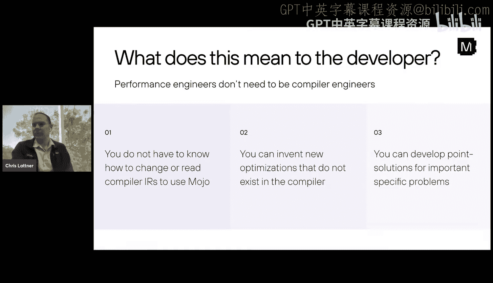

But that's all the high level framing background context now I'd love for a dual to dive us into a bunch of very concrete examples and show you something that looks much more like GPU code。

All right I guess like before we go we had a whole bunch of questions in chat so I think it might be like a good idea to batch them so so Chris I'm baiting you here a bit。

 but right like one way I've seen people sort of do like compiler engineering is like string based meta programming so like you can effectively use like dinja templates I think even in Python 3。

14 there's not T strings which basically are sort of built in support you can like look at it it's you know's not you can like look at inputs and outputs I've seen a lot of reos sort of get started with basic meta programming with this like what is the problem with this approach。

So it's not a problem it's just trade offs right and so there's no magic in the world it's not I can't tell you that everything is perfect if you do one thing as you say。

 the great thing about templating and stuff like this is it's super easy to hack and it's in your control you can see it it's directly in front of your face。

And so there's lots of great advantages but you're not going to have a debugger that maps back to source code well。

 you're not going to have you're going to have all the problems that come with that also and so what Moji's philosophy is is saying okay。

 well when you do that Mark you're becoming a compiler engineer right and you did that because you wrote the thing for BF 16 and now you want to make it also work for F 32 right but if you're kernel engineer doing that。

 you're making ap spokeoke compiler for one use case and。

That's not the best way to be spending your time and so what we're doing is we're saying let's give you the ability to build highpower libraries。

 which we'll be showing you soon that give you the ability to compose because when I've seen people do that again there's many of these things I haven't seen them all but what I see end up happening is one amazingly powerful kernel engineer builts a little mini ecosystem around their crazy preprocessor and then nobody else knows how to use it and so as soon as they leave the team or company or whatever then you have to rewrite the whole thing and so that's not a scalable way for it in street work。

Like I guess like a related question to this as this is a question coming from SR at 2357 so like how would you feel like would you like to see an industry standard ISA that captures like more aspects of GPU hardware I guess maybe this's like a risk of five question no no I'm the opposite I'm the hardware maxist I think that if you constrain hardware than you lose a lot of the。

The power， right， because here's the way I look at it。With the consolidation around TSMC。

What it means is that everybody has effectively the same physics to work with。

 at least if they're willing to spend all the money to get on the latest process note and so to me。

 innovation in hardware is driven by people doing different things specializing in different ways focusing on different niches and so'm not we need to go back to the days of XA6 and having one architecture and I'm in the category of unlock the full power of the hardware and make it super easy for people to be able to talk to the full generality of all the crazy chips out there。

And I'll say we're in early days right now we're just talking GPUs。But give us some time。嗯。Yeah。

 I guess another question is like so it sounds like you're not really using much of the Ka ecosystem like presumably you're not even using things like the K Kuda toolkits。

 for example at all correct we don't we don't use QD andN， we don't use TTLM。

 we don't use VLLM we don't use Pytorch where we have built entirely new ecosystem。

All open source check out our code。All right， Albertvin， do you have any questions。Yeah。

 another question in the chat was， how would you compare Mojo with SL as you know。

 in the C++ world and here you're in a completing new world。

Yeah open sickickle open seal so I'm very fond because I help build open seal Sickle has several problems and I wrote an entire blog post about that too go see democratizing AI compute shameless plug there's several problems one is all the C++ problems so I don't love STG two pool。

So like you know all that kind of stuff compile time like all this kind of stuff the bigger problem with openC is all the fragmentation and so there's many different implementations of openC they're all slightly different they're not actually compatible the driver ecosystem all this kind of stuff it's very difficult to write actually portable code because there isn't a single implementation if you read the block post series I thats up to the fact that was partially Apple my our fault because we contributed a standard。

 not a reference implementation and so the entire ecosystem was fragmented and as a consequence of all the hardware companies fighting each other。

 they held guns to each other's heads and stuff like this what happens we got all these crazy extensions and so sickle and openC have all these incompatible extensions from all the vendors and guess what you have to use those extensions to get performance。

And so at least last I checked， sickle ahead and standardize a tensor core。

And so if you want to give up basically all the flops on your accelerator， maybe it's okay。

 web GPUs same thing it's like okay， well you don't want to use Tensor core and get all the flops。

 well it's cool but if you want to get peak performance out of your B200 or something well then you need a different technology。

😊，And I guess part of what makes the flexibility interesting is like， I mean。

 a lot of people in chat are asking things like， well。

 how hard would it be to add like support for like a custom hardware like I don't know。

 welcome DSB or Apple hardware I guess like considering there's a hackathon coming up soon like do you for example。

 predict that like you know like a smart dedicated engineer could spin up a new hardware backend on the big O of how many days。

 for example。So。I'm trying to be very grounded on this is what we have available today。

But I will tell you some cool things so Abdul will talk about it later we implemented all of our H100 support in a couple of months including all high performance kernels flash attention3 like all this crazy stuff it's all open source go check it out full history like you can go see it right and so the entire point of what we're doing is too prong one is enable and solve today problems but also build into the future and so in this talk I'm not talking about the future I'm talking about today and so like I am very much a hard but let's talk about today。

And I don't want to over promise I want to like that's what everybody doesate。

 I want to be very grounded on what you can do today。

All right and last question just because we've received this a lot in chat has been sort of details around your question。

 I think there was some confusion about like Apache versus like your bespoke license。

 I'm sort of curious， at least for the programming language like what you showed us like we want to we want a programming language to make youfuse faster like what is sort of the state of the license of this language so we'll get to that the and so we have a whole thing on usage license is free but but so it said LVM Apache2 license just to disimbiguate that the LVM part of that removes restrictions from Apache And so it's more liberal than Apache2 it gets sort of like the binary attribution clause and GP V2 incapatibility and it's the same license LVMs use So if you like LVM then。

Presably you're compatible with this thing。So right， excellent， cool I guess without do。

 maybe we can， yeah， we can do the transition that's great。Can you see my slides one moment？Yes。

Okay， awesome。So we're just actually just starting。

 so we're actually going to go into the more technical side of things and know like。

First let's talk about what is present today i'm going to actually dig deeper I know like folks here are like to nerd out and look at assembly and so forth so over the next few slides。

I'll be talking more about Mojo and actually answer a bunch of questions that I saw kind of stream through the chat as well so the main thing is Mojo unifies everything so Mojo is more or us all you need。

So I don't think Chris has showed any GPU code before， but this is GPU code。

 so this is unifying CPUU and GP code so say hi， I don't know if you see in my mouse。

 but say hi is a function that I've defined and I can call it say hi 42。Where it's fine。

This is CPU launch， but I can also say call it with a GPU function with grid them1 and block them one。

All of this and you can go to the modular， you know everything here， these are links。

 you should be able to go to these to actually try this today， right。

Telling you just you can download it today and just try it right or not again， as Chris mentioned。

We' love to do a vision talk at some point， but this is not the talk for that。

But this is how Mojo GPU programming looks like。Now it's also like portable across all hardware and software so for example。

 again， one of the tenants of Mojo is everything is implemented in low library so even integer and Boolean our library types they're not the compiler more or less does not know anything about integer and Boolean which means you can define everything in Mojo right so here is a definition of exponent X2 so it works on SD types so CD is first class type you know SD has been around since the 19 95 or so so it's been 30 years it's kind of interesting that。

A lot many， many languages don't even have CD support and even extensions to support CD are few and far between。

Now the other interesting thing， which is you know Chris mentioned is here we have a polynomial evaluate but we use list and because it's in between these square brackets。

 this is compile time evaluation so this list has zero you know runtime overhead。

 but it's a nice way to encapsulate some sequence of。Of digits， for example， in this case。Now。

 you know this is valid you know this is a mathematical definition of x2。

 but there's also a bunch of ways you can actually optimize it even further right so for example for Hpper architecture。

 you can use you know the X2 instruction and it actually you can call it you know for if you have a single F16 type you can call it but if you have two F16 types。

You know， there's a different instruction。 So this is calling a PTx intrinsic。

And the same thing for you know if you're B float 16 you can call it in a different way。

 but the point is that we've abstracted the way you know a user calls x2。

 they don't know what the internals are， this is a unit of abstraction that folks do that parameter here when you put parameter if this is similar to a compile time if statement so you know if you're in C++ it's similar to if constant X。

Right， and then， you know， this， everything here is written in Mojo。 There is no， you know， like。

There is nothing special about this code， even Cindy type is written in Mojo itself。并哪个着。

And this is how you write this called PTX intrinsic。

 So what this is saying is if the Cindy width is one。I'm going to call the scalar function。

 call this function， by the way， you can pass in。Stringings as kind of parameters right so you know think about the pain you one has to go through to pass in strings as template arguments and C++。

You can also like concatenate strings， right I think there's ways to like bend。

C plus plus so you can do like string concatenation here you just call plus right and this is saying that if you're Cindy with his。

Is bigger than one just you decompose it into a sequence of two wide synyndi types。

 so it handles the decomposition of you know if I have a Cyndy of four elements。

 it will put two elements at the same time and it would call that。And if I do parameter four。

It it means unrollable loop and this is not a compiler hint so I know Chris showed the you know pragma OMP vectorized which is you know is more or less like a compiler hint or pragma enroll sometimes is a compiler hint this is actually a Mojo will not get in your way if I say parameter four。

Mojo will unroll the loop。And it trusts you right so we want to bring power to the kernel engineer。

 which also means if I unroll the loop and the loop is like 10。

000 elements that means it's going to take a while to compile right so that's kind of the pros and cons right so it gives you a lot of power but you have to use it as well like you know sensibly as well。

So none of this is like special code， none of this is I have to change compiler。

 I have to go change my frame of mind when I'm I'm working in C+ plus a Mojo and so forth。

 I'm always thinking about Mojo code， I don't kind of shift my mental mind right。

Which means also like everybody's working staring at the same thing， they're not staring at。

Five different files， five different languages and so forth。And of course。

 like when you want to add new support for new hardware。

You can do that so again we're picking on this X2 for example here。

 but for X2 what we could do is say you know extend this thing to if you're on AMD and your D type is F16 or432。

 call this LVM intrinsic。认。And this other intrinsic， the string， what it's called is if pure F32。

And again， you know。And why we're picking on X 32 well it's because it's actually used in attention the softm contains X as a core component and X can be implemented in terms of X32 the other thing that's kind of super interesting is you have access to all the LVM intrinsics which there's thousands and thousands of LVM intrinsics that are built by the hardware vendors right so everything is available for you。

And you can actually， you know in a bunch of cases like this， in this case。

 this hardware intrinsic does not support Cit， but you can make it so that the X2 function supports arbitrary synduit right by just unrolling the loop。

The other thing is you know familiar syntax right so you know if I do D type in float 16 and float 32。

 this is familiar syntax to a Python programmer you don't have to say D type equals。

Flow 16 or de type equals float 32 and things like these patterns and so forth you just kind of write the code in a natural way。

 which actually bridges the gap between your mental model。

 but also the researcher mental model researchers think in Python terms they don't think in C+ plus or couldta terms and so forth right and you know as it will you know I know folks minds are being blown at this point。

 but we'll show results that you know you're getting these things without sacrificing what kernel engineers care about and by the way I'm a compiler engineer kernel engineer etc cetera。

 etc cetera， so I want to make my life easier as well。

The other thing is portability so I think there was a bunch of questions about you know sickL and you know before that there was like c plus plus amp and other other things we want to also bridge the gap between GP programming and CPUU programming so i'm picking on this for each function which is an element wise operation so on CPUs element wise operations what you need to do is chunk the the domain into。

N chunks and n is usually number of cordors on your system and within these chunks I'm going to write code that evaluates。

The function in a vectorized manner， so Chris showed the vectorized code and this is。

 you know on CPU， that's what you do you vectorize a loop per thread。

 and then you run it multiple threads。On GPU it's a different strategy right so this is the point of you choose what abstraction at what level of the abstraction you want to pick on。

So on GPU you might say well I'm going to do threat indexdex@exer I'm going to launch number of SMM blocks and partition code based on that。

 but you also want to do vectorized loads and vectorized source you want to use the LGG instruction on GPUs if they're available and so forth so there's a lot of code behind the for each and it does a nice heuristic based on your problem that it gets you know that you're doing。

And as we'll see in the next few slides， you know， that this is not magic。

 this is not compiler wizardry， will show the code for this。Now。

 the other thing is folks really want sometimes to just express what they're。

You know they're maybe familiar with Kudta C++ they just want to translate their code into Mojo so Mojo does not block you from using Kudta C++ in fact before each function is written using primitives similar to what you'd see in Kudta C++ or CuB and so forth we're not using any any of that we've built all of this ourselves like we don't use MVCC for example。

 I think Mark at a question。But you can say you know you know run this out add one impulse and well there's a typo here it should be adding one。

 but that' that's okay， so it's kind of interesting。

 but there's another kind of interesting thing here which is input， I'm not sorry output。

 I'm not passing output。Actually there's another type which is out output should be here。

 but I'm not passing output I'm capturing that so this is a closure function that's being captured and I can then sort of build things in a compositional way right so I can use partial functions and so forth。

But this is very similar， you know， you say launch it with block size and then grid dimms is you know seal div and so forth and then the other thing to notice is there is no like this is not a DSL so I'm not saying。

 you know from something import sealD I just say from math import sealD that's kind of you know it's the same sealD that is available in regular CPU code that I'm using here as well right。

Now， everything in Mojo is Jit compiled， which means you get。

The best executable or the best run on your hardware and there's also no emulation so web size is 32 on NviIDdia it's actually 32 or 64 on consumer grade AD is 64 on enterprise andD hardware Sdywi or sorry web size is picks the right value right so there's no is always 32 to do emulation and so forth and same thing for Sdy with you know you have AVx 512 that's the you know 512 is a Cdy with。

 but if I go to neon and GPUs and so forth at 128 is a Swi right so it kind of the program by running it it adapts and making everything parameterized you get the best of everything。

Finally。The issue with Jit usually is slow compile time。

 I don't want to wait eight hours for the thing to compile。We care so much about compile time。

 we spent so much effort on making Mujo LVM， and so forth， MLIR。Use every process available。

 use every like core available， use caching and so forth so that in fact， when folks run Mojo。

It has the you know if I do Mojo run some file it's as fast as doing just Python the file right so that's how you get kind of the benefit folks don't have to wait like oh it's comped it's going to take one minute to compiler two minutes to compile and so forth。

And then the other thing you know that folks care about this performance， right？

So you have complete control over the code that's being generated right so we lift all the things from the compiler to the library。

Which means you can， let's say， you know， asyn copy。

 you just have to kind of write what the implantation of asyncopy is and might use LDM intrinsics。

 you might use inline PTX and so forth， and you have complete access of the entire GPU hardware you know through LVM MLIR andline assembly intrinsics and so forth。

Now you also get zero cough abstractions。So language features like closures， exceptions， traits。

Do not add any zero， you know， do not add any overhead so。You got the abstractions。

 you got the nice things without paying for them， right， which is。You know。

 I know there's like no free lunch， but this is getting as much free lunch as possible。Yeah。

Now I want to kind of nerd out about for each which is also called element wise and show you how it's kind of implemented I'm not going to go very very deep but you can go into the code so this one is just doing an element wise exponent so for every input element it you know computes the output you know output element is the exponent of the input。

Could say it's a target is GPU， I can give it a arbitrary dimensional space right so I can give it whatever I want and it would just run。

Now， El wise is nothing special other than it's a function that's built into the library。Here's the。

 you know， it's kind of an implementation， you can actually go to this file and see the full implementation。

But you know for the GPU， it says， oh， thread index is or you know TD is thread indexdexx plus block size times block indexX。

 you know it handles PL if folks are familiar with hopper and so forth， it will do PD for you。

 it then has heuristics on how to partition the data。

 how many grids and things like that to the block。Now how the thread index at x because thread indexes that x is also not special。

 right is just a library type。Right， so thread indexdex do x。It's you know。

 you get this nice thing about in Python get ater just gets you the property of that struct and it says if you're on NviIDdia GPU well。

You know， get this intrinsic and plus whatever this dim is， so this could be dot x that y that Z。

 so forth if you're on AMD。You get to， you know， you generate a different intrinsic。

Right so that's how that's how things work。 And then as you kind of add if you want to support new hardware。

 you just kind of augment that and so forth and we're we're going to be adding more features to Mojo so that。

You know it becomes easy to kind of extend these things to other hardware as well。

 but this talk is not about the future， it's about what we have today。But the point is。

 you can kind of drill down。From these high level constructs and go you know deeper and deeper and deeper right So if I want to like change what element wise like the hereuristic for element wise。

 I just change the element wise function I don't change the 500 places that the element wise is being used right or if I'm you know a proof prank or something like that if I want to say threat indexd dot x is really block index dot x。

 I just go and change these intrinsics right obviously things will break。

 but the point is that we want to give the kernel programmer who are sufficiently smart full superpowers。

Now， this is how， you know， you know， you write， you know， kind of more。High level code。

 but you also have a lot of features in Mojo that are kind of unique that are give you a lot more flexibility。

 So one feature that I want to pick on is traits so traits are you know you can think of them as interfaces in in Java if you're familiar with Java or。

Protocols and swift and go generics and so forth。 I mean， they're not one to one correspondences。

 you can actually go to the documentation they have you know doc out Mojo docs out modulejo do com has。

Whole sections on what traits are， but I want to pick on this because it comes up when you want to do attention so if folks are not familiar with attention。

 it comes with a different that there's many， many phases of attention。

 you have causal attention sliding window attention， chunked attention， you know。

 weird variant of attention。What we want to do is just define a generic attention kernel and then say。

 okay， I can customize it based on certain properties。So here I can say trait。

 MHA mask and it has a mass function， and then a status， whether it's fully masked， partially masked。

 or no mas at all。And。A concrete example is， I think two weeks ago， three weeks ago。

 Lama four was released。It introduced a new type of attention called chunk mass attention。

 This is the pattern that chunked， chunk mass attention is。

 So what we need to do is just define a chunk mass attention and。

We can then use it in our MHA kernel so the MHA kernel。

 the multihead attention kernel actually takes an arbitrary attention。

 so this is the code that does that and then appliess it and then I can just kind of make a chunk attention kernel instantiated if I wanted to and I can define the local window size you know as a proctor。

Now this means also like I can kind of customize these things， make the code more succinct。

 you know keep the algorithm clean， don't put a bunch of if statements everywhere in my attention code which is already you know kind of complicated already I don't want to I want to make things more composable and so forth and I want to be able to do different attention masks and by the way if you go to the MHA mask function。

 it also defines combinator so I can say or mask or and mask which takes like two masks and then composes them together so you can kind of say oh chunk mask causal and you just take the causal mask and then end that with the chunk mask and just create a new mask type。

To otherther， this is very， very hard and if you look at what others do usually they kind of read。

Orient their input so that you get the effect of chunk attention without actually implementing it yourself。

But it encourages a bunch of room time overhead as a result as well。Now I think do we have questions。

 I want to I'm going to jump into a different section， but I want to pause a little bit maybe marker。

So Chris is racing you because he's answering all the questions and shots of so we're now going to need to read out the answers you should keep doing it。

Okay， so we've been talking about yeah， so I'll ask some， I'll beit Ab do， right。

So and I think you talked about this a little bit， but come back to Mark's question of how do you implement。

 you know， the deepse people figured out some undocumented PTX instruction。

 like how do you add support for that to the compiler？

So you wouldn't add it to the compile right so when we say so let me take a let me say something that again。

 will blow people's minds away。Mojo has no clue it compiling for GPUs it literally doesn't it has no idea right it's a。

You know， it's the same logic for CPU as it is for GPU， it does not understand GPUs。

 everything is put in the library。So when I said， like I don't know which slide was thread index OX is not a concept in the compiler。

You know， launching a GPU function is not a。Oncept in the compiler。

 there is no like triple brackets and stuff like that doesn't doesn't exist the parser does not you know like we don't have this sink in Mojo。

So it has no clue so if we want to add what deep seek is， you know what deepse was doing， you know。

 you just kind of sorry I'm。

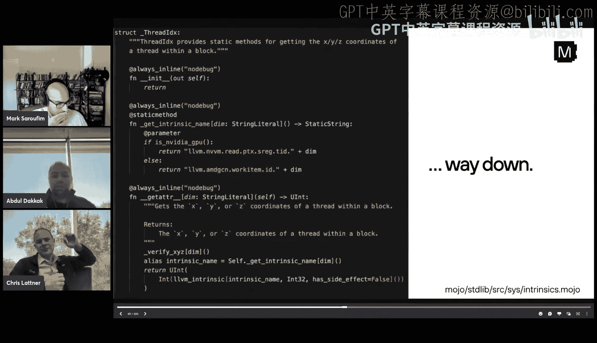

Going through slides， but you just add the inline PTX or the LBM intrinsic or you kind of say in the library replace the sequence of operations or this binary with this other binary and so forth right so okay okay Ab but then how do you implement some new scheduling algorithm do you want how much you have to change the compiler for this？

Zero， so again， we don't change any of the compiler， by the way， you should be able to， you know。

 again， you don't have to trust us for any of this， right？All the code is open source， full history。

 you can check。eight。0Bringup or A100 bring up or even like the first GPU function。

 how much we change the compiler？And the answer is none。Right。

A lot of folks that are writing kernels or writing these code。

 they many of them don't even know C+ plus。Definitely most of them don't know compilers right so again。

 this is saying the intersection because because finding those people is very rare。

 you're trying to find the person that knows kernels and compilers right there are different departments。

 different fields， everything right and then you also want would love the person that's the crown developer to also understand AI so to find that sweet spot you know there's only a dozens of folks in the world。

That have that intersection point so the。You know so so the entire point is don't put it in the compiler yeah so not even integer not even this address space shared or unsafe pointer is a compiler construct even this case is not a compiler you can go look look at the source code for pointers and address prices Carol is asking one I'll take it hi Carol you're asking if Mojo you thought Mojo has a bar checker like rust how does that work for GPU programming so Mojo does have a bar checker it is。

In the same space is what Ru does， but it's evolved because Ru is also 15 years old or something。

 and so you get memory safety， compile time， memory allocation checking， exclusivity checking。

Read exclusivity， blah， blah blah， modify exclusive or shared all that stuff also is all in Mojo。

We're not talking about today， but guess what you don't want a garbage collector in assistance programming language and so like the entire way that memory allocation works is predicated on having a really bad ass。

Memory management system that' safe。And so we're not talking about today because we're just focused on GPU programming。

 but it all works on GPUs because you don't have dynamic memory allocation and things like this。

 though Mojo does talk to C and talk to it's a very Mojo is a very friendly language so if you're on a CPU you can talk to Python library you can talk to C and call Malik。

 you can do whatever you want you just get an unsafe point things like that actually Chris that's a good segue into a question like Alban gave me before you have to leave which was like I does like Mojo interrupt with the rest of like the Python language features like specifically when you're dealing with Python implementations that are not C Python you have to deal with a arbitraryrbitr yeah yeah so we don't talk about so I mean just given the venue。

 we decide to focus on GPU stuff not on Python ecosystem but Mojo is very strong on CPUUs that's a huge thing by the way。

 on CPUs you have Python code and you have C and rust and C++ and like this ecosystem out there。

It's very important that Python and Mojo talk to each other and so you can do that in two different directions you can。

Important an arbitrary Python package and it just works in Mojo and that works by using the C Python interpreter to run that package and because the syntaxes are the same you could just use it it just works pretty amazing and so you can go importump or Pytorch or whatever you want you don't have to like rewrite code or make it Mojo compatibleible it just works no FF or bindings or all that kind of stuff。

A new thing that we haven't fully announced yet， I mean it's public within our community is the ability to go the other way。

 which is say I have a Python package， it's slow， I don't want to rewrite code and C and do FFI and blah。

 blah， blah and Pine and I just want to take a blab of these for loops and put them in Mojo and have automatically bind and so we're completing that now this will be out in the next month or two is or something like that and I'm super excited by that because that means that like you can the most commonly request a feature for us was hey emmojos like 30 times faster or sorry 30。

000 times faster than my Python code for this numeric thing like tokenization or whatever like how can I just put the fast。

Performance critical code and Mojo and just soldvent a Pthon package into my ecosystem。

I mean that also make like Pygenop stuff like much nicer I guess like you were hint at that in chat okay oh totally we use this in like LLm serving and LLm serving it's really important to have really high performance CPU code that's interopering with GPU code and this is really quite critical for heterogeneous computers and so like again we decided just based on the context here that。

Wed focus on GP programming and explode some brains around me programming and things like this。

 but this is really quite fundamental work and again we've replaced that entirenyI stack all the way up until like LLm serving and things like this and so in our repository you can go check out our page attention Raix caching and blah blah blah all that stuff to all written in Mojo and so like please check it out we're not going be able to talk about all the cool things but there's a lot of cool things and I know that。

People think we're。Like it's too good to be true or something but。

But don't believe me go do it It's fine downloaded like thats a whole frame Chris actually another tradeoffs question which is yeah so it sounds like like a lot of the stuff you guys were talking about here a lot of these seem like this is gonna be like a Jit like approach sorry not like a Jit approach So like typically the tradeoff there is like slightly slower cold starts but like know the binaries are small but you also need like a local tool chain My sense is the community is moving towards despite the tradeoffs but I'm curious if you all could both comment on your takeoff voice for Jit and AOT but you want talk about this yeah。

 I mean Jt is is very useful but I mean as you mentionedit it's not implemented correctly Jit can be very。

 very slow right I have no patience of waiting a minute for a some code to compile right I have no patience to wait 30 seconds。

1en seconds。For a very complicated piece of code and well show some you know like a attention code is。

What I'm comfortable with， even then we're constantly is you know never ending effort to bring that cold start from 10 seconds all the way down to one second。

Currently for folks， I mean just to put a little bit， you know again。

 a lot of folks you know will say this is untrue and so forth。

 but please try it today we can compile Lama 7b with。

Cold start in under one minute right and this means I'm compiling all the way down and right the integers being from Python from Python right from Python is this is not like you export a graph and then run a little compiler thing this is like the model so this is synthesizing kernels that we've never written right doing fusion and we'll talk about it by the way。

 for folks that we we're halfway through the slide so folks since my are being slow with I think we love it so。

So， so， you know， compiling like I think I think it was like a million lines of PTX in under a minute right synthesizing those million lines of PTx。

 but also compiling in under one minute right And then obviously can I I'm trying to resist because you know。

 I'm beating up on compiler engineers in the stock， but can I be can I be a compiler nerd。

 Is that okay。So when building an entirelyly new language。In 2022， 2023， 2024。

There's an entirely new category of compiler technology like MLR that you can build on top of and so I know a little bit about LVM。

Both the good parts and the bad parts。 And so this is an entirely new epoch of tech that didn't exist。

 And so somebody's asking about how we use MLR。 we don't use any of the MLR dialects。

 we don't use Lal orth or like any of that stuff we've been built an entirely new category of technology that didn't exist before this isn't we took an open source thing and Fork didn't hacked it up with a little bit。

 this is like we do use LVM an MLR core， but we don't use the dialects。

 this is like an entirely new thing。 and so this compiler that Abdul' is talking about that generates code 100% parallel so it's like actually uses multico right that's actually a big deal LVM couldn't do that for a variety of reasons while we fix this right and so there's an entirely new category of technology that we're talking about and we don't have time to deep dive into that we're talking about how to use it but this is extremely deepnerry So is this is actually like a new creation entering the world this is not again a DSL somebody hacked up over the weekend is。

Hundreds of people years worth of war。Yep， the other thing is， you know， that we give regular。

 you know， folks our interest and composite we gave a lot of。

What we did for Mojo at the LBM dev meetings there are videos all online please go that but this is not the talk for that I mean I think exactly you need to part about closures and many other very great nerdy things and there's many talks there right？

Async was another one that we gave a talk about， but again。

 different talk we'll do more in the future， right？嗯。

Now the other thing I want to by the way pick on is B checker so Brow checker is interesting because I mean what a borrow checker is it's not really too much about memory it's about like I'm going to init at some point and I'm going to call Dela at some point right so you can do whatever you want it's not just Mat luck and free you can say oh you synchronize on the Dell operation or you know do something completely different right so again this you know this exposes new programming paradigms that are were not available to you before and this is also again。

I'm not going to talk about it， but it's not similar to our AII and C++ and so forth there's this is a new category of tech so but let's keep let's keep going Okay let's keep going so are cool man come on yeah so。

Tile based programming。 So I know folks have heard of。Matrix multi attention et cetera。

 et cetera they're very very important right folks write compilers specifically to matrix multiplication compilers and attention compilers and so forth now。

The problem with。That to kind of implement it in kuta though， is there's a missing abstraction。

 you know ST is great for you know， kind of more or less like straight line code when you start saying oh works and so forth。

It kind of starts like。You have to bend your mind and so forth。嗯。So what， you know， in some cases。

 you know， there's a huge class of operations， matrix simification and attention and。

Driivatives of those are very， very important for AI workloads so we actually want to make sure that the kernel developers are also productive right we don't want them to reinvent the wheel like 50 times right you can invent the wheel once and then you want to use it like you don't don't need to invent it again now again I mentioned there's compilers for that you want to put it in the library Culas did an amazing job that proved that you know a librarybased solution is perfect for this the problem with cutlas and cutlas has a lot of great ideas is c++。

You know and again， I'm a C++ user， but you know I don't like to enable Ft and things like that right so this is an animation that's showing how each block can be you know tiled and then you can subdivide these tiles you can vectorize these tiles and you could do operations on those tiles there's a entire tutorial on how to do operations on that if if you're interested in that and what that means also is you can start thinking about things that from a tilebased perspective right I want to load this tile load this other tile do some operations on it。

 but maybe loading the tile there's an abstraction where there's things like Tma and other kind of asynchronous copies and so forth that it can leverage but I don't have to reimplement this all the time right I just hide the abstraction hide the you know the hardware specific detail behind the tile based abstraction。

And layouts are parameterized right so by the way， for folks are you know that don't know what layouts are it's essentially fancy ways to do index computation so if I'm doing I want to find the position。

You know I do it in a more natural way rather than linearized indices and you know weird you know shifts and shuffles and swizzles and so forth this is a more natural way and it was pioneered by folks on cutless and cute and so forth。

So what a layout is is a data layout and then an element layout， so what each element is。

 but also how you access each element so it's a function from Nd coordinates where you know that's how you think you think matrices are 2D to linear coordinates which is how the computer things right computer think just like you know address zero through address to whatever two gigabytes or whatever the thing is。

You can you know again， none of this is compiler magic or wizardly。

 all of it is you defined in the library， you can go to this。File， see the full implementation。

 it's not hundreds of thousands of items because it's like a few you know， one or 2000 lives could。

You know it's the same definition that you're familiar with if you're familiar with Kalo and Cuuth。

 but there's also extensions that make it easier to do that and you actually can debug print the layout。

 which is very hard if you're in the like I don't even know how you can print a template like if I'm doing a stupple and template argument。

C++ does not provide you with tools to do that now you can say oh you know do static assert and then put it as a third argument or whatever the thing is and that's the way but that's not the natural way right you're kind of bending the language into areas that it's not like forgiving for you The other thing is it' slow to compile right so that's the problem c++。

Now here I'm showing sorry this so here's like an animation of how you know if I have a four by four matrix and stride4 by four I can sort of subdivide it I can say here's my domain here's my range and can change it to column major instead of row major and so forth right so please go into go to the dots and they'll talk about it again。

There。If we can spend like hours on this thing， this is like you know， four or five sitess。

And you can make complicated layout， so you can say I have this block， I can subtile it。

 I can then rotate it slightly， I can do a swizzle， I can do blah blah bh blah， blah， and so forth。

Again， things like open XL Eri other you know other compilers they have similar ideas。

 but the problem is it's hidden away in the compiler and by the way， layout for a。呃。

A CPU might not be necessarily the best layout for a GPU and definitely like the the。

Setup for that you do for A100 is not the same the best way to do it for blackwell and so forth。

You can also like visualize the layout right folks like can stare at these things right。

 but you can also like say print these things this is familiar for folks that are familiar with cuts should not be super super complicated。

Now you know， folks can you know， you can kind of geek out about the mathematics of all of this and how this is an algebra and so forth。

 but at the end of the day we're pragmatic， we want to use these things right here。

We build these things because we're the users of this tech。Now， going back to like abstractions。

You have to choose what the level of abstraction is right so do I put one big as function and put 5000 if depths in it or do I just say well。

 these are just two different functions right？And what we say is okay。

 there's different pipelineing strategies for different hardware， so on an MI 300 AMD system。

 the best thing you can do is double buffer right so you say I'm going to load this tile and then I'm going to work on the prior tile right and just to do that。

A 100 have asN copies， so I could say pipeline the operation do， you know。

 let's say five asyN copies and then start processing the latest， you know the earliest one， right？

H100 you know gives you warp specialization other operations blackwell gives you another set of operations and so forth。

 so what we want to do is kind of unify everything you know you know unify what we can but also acknowledge that there is fundamental differences between the two and by the way we're not interested in the 90% of soda。

We're interested in being soda。 So that's another distinction between Mojo and。Others。

So I want to kind of delve into real code right so not that you know everything we've shown you is is also real code。

 but this is max this is like the thing that。Folks spend PhDs on， right？

And this is the implementation。😡，Of Mamal in Mojo on MI 300 now it was highly abstracted。

 but that's kind of a plus right so this is the plus of mojo is you get to get the abstraction you don't have to write the same thing 50 times copy paste the same code。

 I know like there was a talk about using ginja and all these things， which is like。

Essentially it's a programmatic way of copy pasting some code。RightBut this is the code。

 you know loads from RA， does a barrier， you know loads some other double buffer then does the you know main loop。

 this is like the sorry like couldn't put the entire thing on one screen。

 but this is the entire map matrix multiplication code and this is production code this is not you know even though it looks like pseudocode。

 it's not pseudocode， is this is what we use。I'll show also performance later on。And again。

Please keep in mind that this is the code that we're going to show peron later。

Now none of this is magic， so we're saying MMA here。Mma is just a function， right。

 So MMma is defined as part of this layout of tensor。

 So I say tile this operation by the number of MMmas。

 the elements per thread vectorize the operation， then do the， you know。

 do the matrix stop product right， And this is going to use tensor course。

 whatever is available on the on the system， right So you have to parameterize everything。

 But the point is that you get。You got the tennis court。

The other thing that's super interesting is like all of this is hardware agnostic right the implantation。

 like how you instantiate this is hardware specific， but the layout to algebra。

 all of that is hardwarers agnostic so it works on CPUs and GPUs right it's actually useful to debug certain things visualize the primitives on CPU right that I want to do print。

The thing or print the SVG or visualization of the layout。

You know use GPUs where it's good at use the CPUs where it's good at。

 but also unify things right so as Chris mentioned like。

You I know this is a GP talk but there's a CPU side that's driving everything。

 there's a bunch of pre processing and post processing that could leverage the system and having a unified library is very very powerful。

We're also not going to be talking about like performance of CPU。

 but we have soda on CPU side as well。And you can also define like， okay。

 here's my tensor core operation， so it takes a accumulation type， what the a type。

 what the shape is and whether it's to transpose or not。

 and then you can use the the Python as symbol， which eventually calls then their math function。

And all of this is like GP agnostic there's many things that are GP agnostic and you just leverage them there's nothing special about AMD and VDdia CPU。

 et cetera， et cetera， like tile is the same algebra vectorize the same algebra loading is the same thing and so forth right it's the primitives that change right am I calling WMMA on Hopper or TC Gen version 5 on。

On black one。The other important thing and you know again。

 a lot of these things are the composition right so you know building on top of things because we have a very strong parameter system it means everything that could be compile compiled a compile or could be evaluated compile time does get evaluated a compile time so a lot of these things you sugar into like an offset right some integer that gets resolved with compile time right so you have zero runtime overhead right。

Now。Again。This is a you can go look at the code， we have also tutorials on how to progressively implement a more complicated matrix multiplication。

But the code on the right is real code。And is just doing shared memory matrix multi with registered tiling。

And this is the fullka right this thread index and so forth again， you can use abstraction。

 you can unuse not use abstractions， you can use this tile tensor。

 you can not use it tile tensor is implemented using primitives you can go directly to the primitive if you want to nothing you can implement your own layout tensor you know 3D whatever you know like and the hypercube whatever you want nothing is stopping you from that so you want to kind of make it so that you're able to explore able to invent new things right if you're not in the AI domain if you care about you know。

We are data structures and so forth， we want to give you superpowers to be able to kind of put what whatever you have in your mind on paper versus。

 you know being shackled by， you know， oh， this is a DSL that only handles this domain or something else。

Now， the other thing to cover is you you know。You know， if you kind of take a step back。

 kernels are part of the puzzle， right？Colonnels are you know。Are meant to be composed。

 There's something before and something after， whether it's like。Post processing pre processing。

 some other operation， some other compute， some network， you know communication and so forth。

 all that is is super， super important。 So you just looking at that。

You know matrix smification kernelnal right nobody asks like I want to run matrix smation they ask I want to run an LM I want to run the physics simulation I want to you know at the heart of it is a matrix smification。

 but there's like other stuff around it。That's super， super important。So again。

 there's an entire talk that we can do about the graph competitor。

 but the thing to highlight here is this composition， right？So you have like， for example， a graph。

 you know， like llma and so forth， have a matrix multiplication followed by cian multiplication。

 right？You know， and what compilers do or graph compilers usually that's the term that folks use is they kind of smooush everything together right and that's Max has that so Max is the inference platform that we have we're not talking about that。

 but has that but the issue with。Thefuse everything approach is you get an operator explosion problem。

So let's look at sU like for example， so slilu is really X times sigmoid to x sigmoid is defined as one over the exponent of you know this equation so instead instead of this is one so this is slu is this this equation now I can go you know with four lines。

Implement a kernel that does seal you。But what's better than a kernelel that I write is a kernel that I never wrote。

And that's kind of a fundamental thing because I can never write。

 you know some new paper comes out tomorrow CU2 or square root of CLU。

 I'm not going to go in and stamp it out every very you know every time。

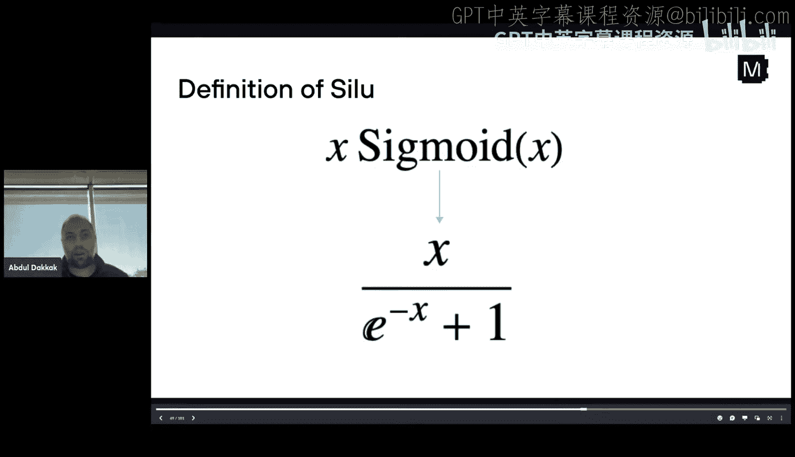

So what you want is you want to define the primitives。

Clio is just defined as plus the components are plus divide exponent negate。That's all you need。

And you want。Things to kind of synthesize new kernels for you。

 So what you want to do is you find puzzle pieces。And something that says， okay。

 fuse everything together， get the best possible implementation， and so forth。

And that's what Mojo and Max do as well。So you don't have to worry about like 2000 ops right and that's why you by the way。

 that's why if you go to the repo。You don't see Clu as an implemented right because we just define these primitives it's up to。

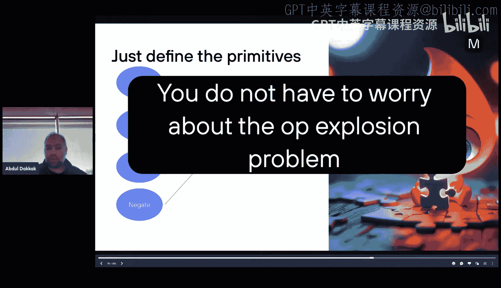

The other parts of the stack kind of synthesize Cforus， right。

 which means the job of the kernel programmer。Becomes much much easier because there's no 5000 things to to maintain it also means that you know again a lot of math is you know there's like a finite amount of math operations right trigoometric functions and so forth。

If you just implement those primitive operations， you know。

First chapter of the clus book or things like that。I'll be golden because nobody's going to。

 you know define like some weird operation， you know。

 same operations that you know existed in Euclid time probably still existed they ads subtract。

 multiply and so forth。It's not like a cutting edge science it's just a composition it's cutting edge right so you know so if somebody writes Relu which is Max。

It just kind of decomposes a max of x of zero， so Reello6 becomes like max of x comma6 right I don't have to write Reello6 and Relu and so forth I just start to write max。

Right so GPUs are great， we talked a lot a lot about programming。

 you can very very easily do everything that we said。😡，In a weekend。

 if you don't care about performance。Right so what we want is。All of this。

Plus performance right so if you remember the figure that Chris showed this usability performance portability right we up to now we hopefully convince you usability and portability we have not talked about performance right so again。

Mattriance multi is an easy problem if you don't care about prop you just write a three， four loops。

 right you don't use tensor cards， you don't do it any of that sort of stuff。

But we want this state of the art performance now all of those slides that I'm going to show for performance are still work in progress。

We'd love folks to help。You can also try this stuff yourself right don't trust these figures right theres。

I mean。If you know and you can replicate everything by just running K bench and the CMmophon right these are the shapes also for Lama 70b so we're not picking weird shapes right this is what Kuboss is supposed to be optimizing for Kuboss Lti or cutlas and so forth。

We picked Kubos here because it's the fastest implementation， right？And what you see is。You know。

More you know， we're close to pary in some cases beating Kubloss。

 Kloss state state of the art speed of light， we're still working on on this implantation。

But we also notice that there are some cases where。We' less than I do again。

We're still working on this， but we'd love folks's help。Right， now again。

 a person can go in and write these things in。You know。Different languages and so forth。

 but you don't get to portability。So this is the performance on MI 300。

 so it's kind of funny on MD hardwares， there's two different libraries， rock losss and hip gloss Lt。

Sometimes rock loss is faster than hip loss Lt， so what we want to compare is state of the art。

 which is the maximum of both。And what we want to do is achieve。You know。

Per parity or exceed the performance。Of hip loss or rock loss。

 or you know state of the arts essentially， we take the max of everything。So in many cases。

 you know like in this case we're faster than both you know this case we're faster than both other cases we're not again work in progress we're working on this would love your help and so forth the other thing to note is again going。

Backtracking a little bit， Maimmal does not exist in isolation。

 Mamal is usually followed by another activation law。

And the way we've written our matrix multi is it accepts an alogue function。

That does the essentially post processing on the matrix multi。

This is a head to head battle against you know the gem or b multiple boss operations， but you know。

 coub Bss and rock bosss and so forth does not allow you arbitrary。You know。

 kind of post processing that， you know fused into the matrix multi。

 So this is a head to head battle just being fair。 But again， in real world the application。

 it's maximum followed by something else。 We do the fusion。

CubloOSs and other boss libraries do not provide you the API to do that so that's also like the argument against you know traditionally the argument against libraries is libraries have encode common patterns versus for us because of the parameterization。

 we just make it flexible we make it open。And Ma mall is just part of the process。

You know we're also interested in soda on other things， so this is a attention kernel on MI 300。

Showing us versus Triton。Now up to now we're showing you code。

 but there's a human programming this and what a human wants is debugggers。

 you know syntax highlighting format mattersters， things that you'd expect from like languages in the modern day right。

 you know you're not using notepads for programming。

And you also want to integrate with like existing tools。

 we cannot invent everything but we can do is provide the at the compiler level。

 provide everything that a external tool meets right so it also means that you're familiar with the tools you're familiar with inside compute you're familiar with rock and compute you're familiar with good a GDP and rock GDPB or compute sanitizer and so forth。

So and what you could get， and this is kind of going back to Mark's you know。

 Ginja thing question is you can see like the PTX， but you can also backtce it and say what Mojo code can be attributed。

To this good， so this is very， very powerful because it tells you like this three lines of Mojo code took 90% of the time well。

Now you just go in and optimize that。Versus you know a block box where it's like， okay， well。

 you know， it went through three transpis to actually get to the output I can actually just kind of。

We don't do that。 We just kind of get。Good source location and source mapping。The other thing is。

 you know， folks don't necessarily have access to like I'm on a Mac。

Sometimes I want to look at and see like what？What's the output in PTX look like or you know what's the output in assembly look like？

What I can do is just say well I have this ad function and we're picking on ad a few times。

 but I could say compile it for B200 generate this assembly right I don't have to have B200 on my system right I can be on some Linux system and just run the sort of Windows。

Windows system Linux system Windows Linux subsystem， I could do that。And you can then say， okay。

 well what's the output for like AMD， what's the output for you know some weird accelerator。

 what's the output for CPU and you could just do that and you can actually just say Mojo emit LvN cross compiled target accelerator and VDA and then the SN type and then file Mojo just so。

Dumps it for me。Okay， this is more for the。Folks that are interested in looking at PTX and assembly and so forth。

 perfectly fine， you know， nothing is blocking， there's nothing else。

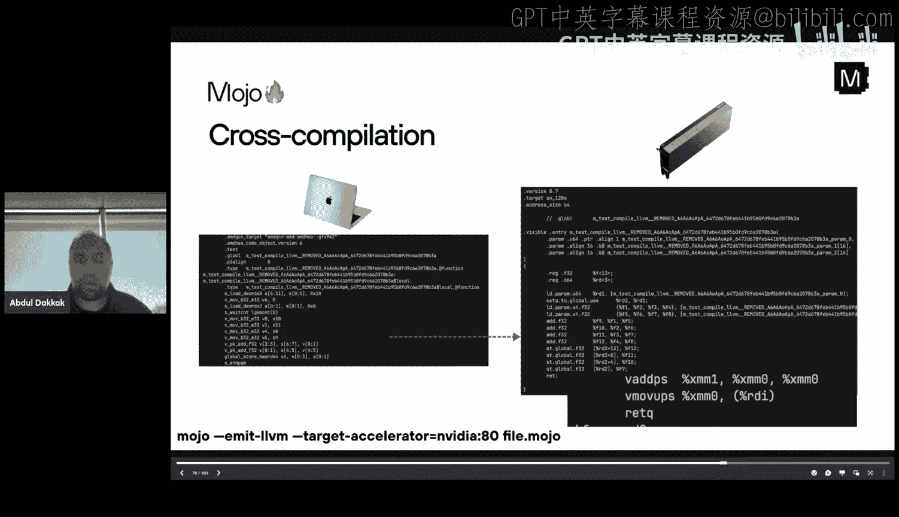

For the regular user， folks are interested in you。Using an editor。

 so this is an animation that's showing how folks write code。So here I'm just saying generate prime。

 run it， produces an output， I can then put a debug statement。

 see the variables that are being generated， go stack trace and so forth， I can add a log point， say。

 well what is the outper bound so I can produce like sensibleable error messages I can then say watch statements and so forth and rerun the code and things like that。

This is， you know， practically， you know。Maybe 1。5 x sped up， but practically the real time。

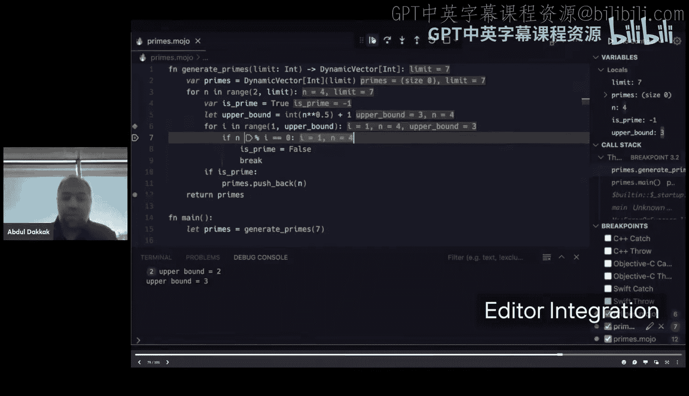

呃。Chris， do you want to take over。We can pause also for questions because I'm pretty。

Folks' minds are bone。 Yeah， why don't we do some questions Okay。

 and then we'll and then we'll get into Mark's hot takes。All right。没事。😔，嗯。So paraphrasing somebody。

 so you compare to CoUD andN how does it compare to cutlas？Right， so C you the Nn。Is or Kublas。

 I guess， right so Kubla potentially uses CDNN。Sorry， Kublas potentially uses。

You know their own compiler you know some poor soul wrote handwritten assembly right they say okay I'm going to write the handwritten assembly myself and so forth it also uses Kalo so uses a bunch of things right the figures that we're showing here is the best of everything。

Right so we pick the best I mean it's easy to like it's easy to beat on slow systems right so it's easy to say you're 10x faster than naive implementationations or semi naive implementationations we're comparing and like at the and this isn't just the me level this is like we compare against Trtl we don't compare against Pytorch eager or something right picking the speed of light do we know of right so so we're not benchmark here right this is like。

What the output was and this is like， you know you should look at our benchmarking packages this is not picking like you know it's three columns wide and and somehow we got a cute trick that they havent this is like la run the thing three times and divide by two areas like we expect these are the the best the most optimized things we can compare against which is how we make sure that how I as a pointer boss make sure that。

Our team is actually doing good work because that way we can compare and measure against state of the art that the industry is really driving towards。

Yeah， again， this is， you know， Mojo is the foundation that our inference platform。Users， right so。

What folks compare us against is the best thing out there right like either closed source or open source right and this is real money。

 the spend on AI is so massive that a flop or 10 flops。

Equates to millions of dollars right so we care about those like you have no idea how much effort went until like saying okay well we're using intake here instead of in 32 or because it saves us at register and things like that right if you think deeps was doing wild stuff。

We need to explain this to the well， but it's like trivial for our case and we're not bragging right。

 I don't like to brag。Yeah okay well so let me paraphrase and let's try to so just mark it's okay if the you'll try like constrain some of the questions。

 there's a whole bunch of questions about compiler stuff。

 we don't want this to be an eight hour long talk so we're not gonna to talk deeply about the compiler stuff please go read my blog post democratizing AI compute you can learn about all those other systems out there we've given a ton of talks at the LVM dev meeting if you want to learn about like how we use MLr and the crazy things we do to LVM etc like go there we've given those talks before but let me paraphrase what a dual say like we're doing this on hard mode like this is not taking the quick and easy path this is taking the hard path to try to get to a better result again coming back to the point at the top we think AI is worth it we think heterogeneous compute is worth it we want to unlock this we're trying to do something that's quite meaningful and it's really dang expensive but。

But again， and we've been working on this for years。

 that's why we're so excited to be able to say you can download it now and go and don't take our word for it。

 just like be skeptical， but。Trust us enough to actually try it right that's the mode that we're in and this is why made Mark wait for a year before youre able to give the talk。

 So anyway want to keep going if that's okay Mark or like I think you should keep going a little batch questions in the end sounds great so we always get ask about other systems and so I don't want to do a takedown of all the things but again。

 remember this is like designed for heterogeneous compute So today we're being focused on what you could download and run today and so there may be cool things over time I'm very very much a hard ner but right now again grounded。

 you can run this on X8664 systems you can run an arm 64 you can run on any Nvidia thing we haven't done anyva work but。

Go nuts like it should work directly it should work right we've done some work on Ampere Hopper Blackwell。

 we've done work on AMD the 300 series right and so we've put a majority of our work in the space。

 but being open source this is where we'd love to work with other people and push it forward。

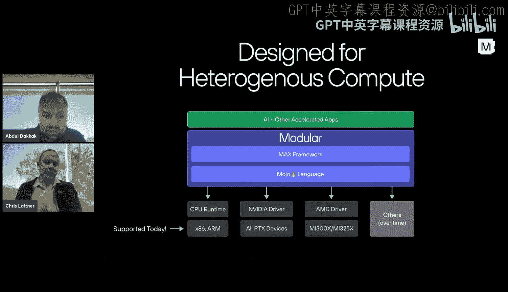

No。People always ask us about these things right and so how do you compare against cutlas。

 which is part of Kuda， how do we compare against F and open seal？

Like what we're trying to convince you， which is a high bar is that we're the first system to actually deliver the full performance of the silicon。

You could say our usability could be better。 We're constantly improving things。

 And so I think that is to be true。 but we actually provide way more portability than any of these on this map。

 And so that's actually， I should be careful about that。 Open C has some。Crazy FPG target。

 so maybe not open C， maybe we're not more portable than open C， but。But this is a new creation。

 and this is very hard to do this。Now I always get asked about one specific category that lots of people use。

 which is Python DSLs。And I think Mark was。Was asking about this directly。

 but Python DLs what a lot of people are used to， DSLs。

Are not like Mojo so Mojo and DSLs are in the Python family that is true。

 but the whole point of building a DSL and by the way I have a whole blog post about this。

 please read part7 for a whole explanation if you're not familiar with the technology and what a Python DSL is and stuff like this。

 but they're meant to be easy to implement which is why there's so many of them there's a ton but it's really about protyping。

 it's not about peak performance。And so you give up control to a compiler of some sort。

 there's different compilers out there， but you give up control to get more productivity and productivity is really important maybe if you're training or you're researcher or you're experimenting。

 but our focus has been on GenI inference and speed of light and TCO and things like this since this is a big difference。

And so if you look at the advantages of Mojo。Performance is number one。

 if you care about performance， if you care about inference， if you care about that。

 then Mojo is better than any Python DSL that I'm aware of out there。

Also like we've talked about extensively， you don't have to hack the compiler and so if a new piece of hardware comes out。

 you don't need a new tilings strategy or algorithm or whatever， just go write some code。

 go write a for loop and go implement your own abstractions and you don't have to like go change the compiler to be able to play with that。

 which is also a huge boon for research by the way。

Geneneralality so again there's a lot of DSLs out there they have different tradeoffs。

 but many of them are limited to specific domains and so Mojo you can go right or ray tracer you can go write arbitrary code not everything is a mapmo and not everything's attention even though yes those are extremely important of course。

If you want hardware， we've talked about this， Mojo is great for saying like I want this crazy as thing that the deep S just reverse engineered yesterday or something right and so you get full power of the hardware and that's something that when there's a compiler in the way that's trying to provide some weird abstraction for you that is helpful it also is a downside because it's taking away control and power and Mojo has as we've talked about the opposite philosophy。

Metaprogramming Well so again there's lots of DSLs out there I haven't seen one that allows you to write portable abstractions often they're just about giving you tools so you can unlock one piece of hardware and like if you go from a 100 to H100 to B100 you keep having to rewrite your code and so it's cool that it is easier to rewrite your code but you know we believe that with the right abstractions we can get more portability into this world and that that can help people be more productive now let me say the flip side of this also there is no magic it's not like you can have magic portability and and things like this and so we look for pragmatism and it's better and meta programminggramm helps you do that but still there's always going to be cases where you do need to write hardware specific algorithms。

Tools I Do was just talking about this like we think it's really important that you have a profiler or the worst。

 if you're doing performance， you want to be able to know how your code affects performance and a profiler that maps back to your source code and without requiring you to stare a compiler IR to get your job done is really nice so。

And finally， I don't know if this is true， but I think it's entirely possible we have the biggest open source kernel library for GPUs anywhere。

So if you want to check it out， that's pretty cool and so that's production quality implementations of all your favorite friends。

 at least the ones that are using in GenI and we hope this gets better now that we've open sourced this literally yesterday。

And so please check it out and we'd love to work with you on this。So Mojo has some downsides。

 so the major downside that I know of is that is still new right and so there's a lot of things out in the world that are two or three or years old coUDa itself is like 19 years old。

 quite mature and so if rockaw stability is the thing that's important to then please keep using coUDa C++ if you want any of the benefits that you're talking about then that's cool the Python DSLs they're also changing and so maturity and stability is dependent on which one you look at。

I'd also say that Mojo is like literally just coming onto the scene so we were excited to do this talk with Mark's invitation because because again we're doing a bunch of open source its real and can use it now and all the things we've talked about but。

But this is the beginning。And so if you want to be part of our community， we'd love to work with you。

 we think that you know we've done some interesting things， but we don't have all the smart people。

 we can't tackle all the problems and so we'd love to help build this future of heterogeS compute because we think the stakes are quite big for the entire industry。

So what we wanted and what we think that we're doing is we're building a unified GenI native software platform from first principles and so this is not easy because it's important and it's worth it。

So let me wrap things up and start talking about like some of the other things that people always ask us about does anybody use it。

 what we're very excited that people are starting to use it， for example。

 Evan Owen atquirky AI has been kind enough to say that modular is massively simplifying GPU programme they take what you're familiar with with Kuda and C++ but make it TySa Pythonic they make it experiment make it great to experiment and prototype kernels make it fast while beating and meeting performance expectations and so if your startup and you like moving fast then you could be very interested in this stuff all the stuff we're talking today is really meant for GPU programmers we have other stuff that is cool if you're building models or if you're a platform engineer and things like this but we think the GPU programmers are like a uniquely important and very special category of programmer because they're the ones that provide the power of the silicon so this is why we care so much about this。

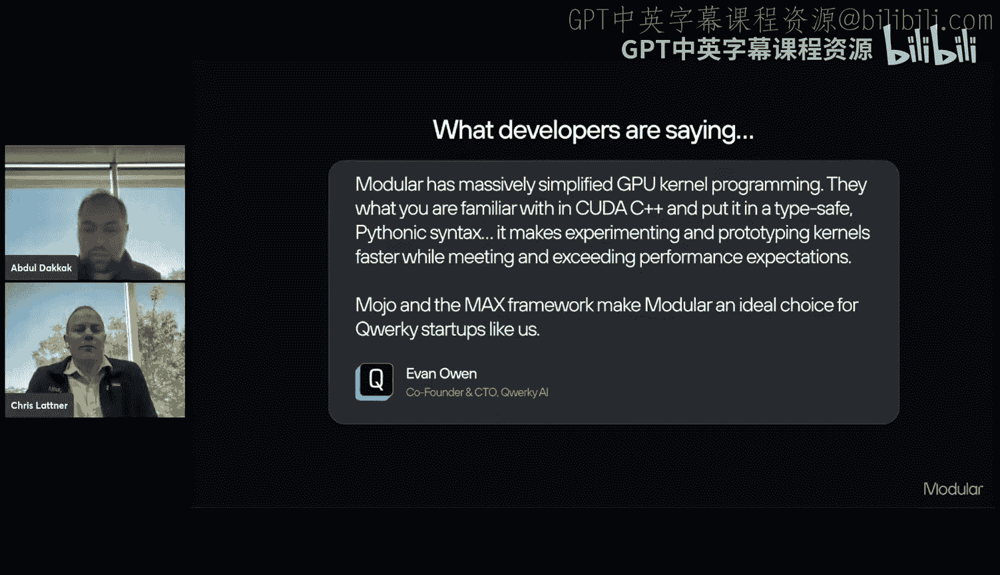

Like we talked about before we've open source this gigantic pile of kernels like this is actually huge for us。

 this is the why now of giving this talk check it out again I think that many people kind of assume snake oil or assume that there's like a catch like。

Literally we provide lots of links in the talk， please go check it out and you too can go see how CD works and you too can go see how It works or unsafe pointer or all this kind of stuff and so just go look at the code and so this is the power of putting it in the library instead of hacking it into an opaque compiler。

There's tons of kernels out there and so like or reduce lots and lots and lots and lots of code。

 not only did we give the code， but we provide the full Gi history。

So I'll share with you that I'm a person that cares a lot about open source。

And there's right and wrong ways to do open source I've seen a lot of projects at many of the companies I've worked at。

They don't understand communities and they don't understand that。

You know beinging open at the you know what that means and so we're very committed to doing this the right way and that's why we included fullgate history going back to years of developing all this tech。

Now the flip side is that I've also seen the bad thing that happens when you're too open too early so MLI is one great example that we something all the people that are in your business you're trying to get it to work and so what we decided to do is say fairly close until we got to work we're happy with it we're ready to scale it and then just now we're opening this all up so that everybody can close it and use it and go and so please take a look you can see all the mistakes we made and like you can see all the different things that we trade it off and you can see both the output of what works but you can also see the mistakes we made along the way。

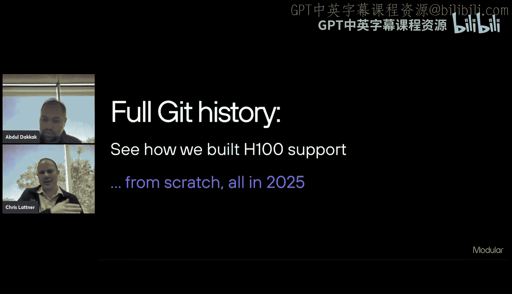

Well by the way we have P coming so this is another big deal you can technically do this today from our nightly。

 this makes it super easy to download our stuff by the way our packages are really small。

 they're not as small as they should be， but they're like roughly a gigabyte for a full multiarchitecture solution that runs on NVDdia and AMD single image。

 super cool P is really important， we think this is a great way for developers to work。

 we think that this really enables us to work with the community and hopefully folks on the PyTtorch team will find it really interesting and wed love to work together on making it super easy to extend PyTtororch with Mojo just like you can extend PyTtorch with Triton and other DSL。

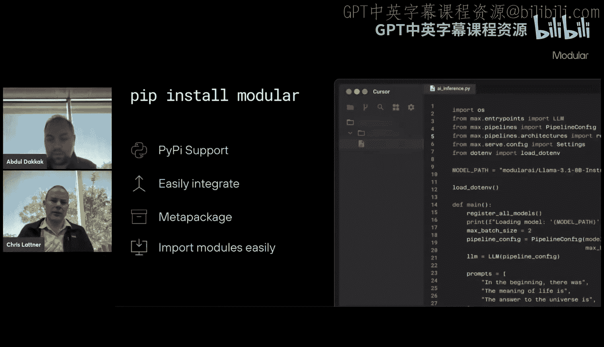

We haven't talked at all about Max really， we've just kind of glanced off of it。

 but Max's whole AI inference framework designed for predictability and control and performance end to end。

 highperance LLM serving。KV cash optimizations， continuous。

Continuous batchching and speculative all that kind of stuff。

 that category of tech we haven't talked about that at all。

 if you're interested it's really cool there's a whole like 500 of your favorite LLMs out there and there's more all the time。

U。You can see a lot of them on build。modular。com and so you can go there the models should be all open source too I think Ab Do youino has that done yes。

 yeah， so the models are open source， the server is open source。

Yep and so you can go check all this stuff out it's super cool all this is coming together fast for those that don't want to write all the GPU kernels and get the tense record work there's even nice high levelvel examples so you can see how to build a RA example and things like this and so that's pretty cool we want to make AI accessible to everybody not just the trillion dollarll companies out there and so as part of that we're trying to make this entire ecosystem this entire stack super easy to use super consistent super pleasurable to work with and iterate and expand and so part of that is actually teaching people how to use it and so that's one of the reasons we're excited to be here now and to be able to talk about this。

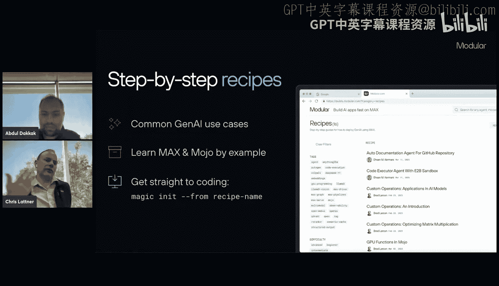

Some people are like what is the catch like what can I do with this or are you going to like take all my GP away from me well we're very excited that we actually want you to use this and we want it to be free。

And so we have what we call the modular community license。

 you can go to the webage and read about it， you can use Max Mojo and Mac and the stuff for free unlimited use for nonproduction non commercial research type things go crazy you can also use it for free for production and commercial uses the primary restriction is that we want you to be able to tell us about it if you love what we're doing you're serving production we'd love to be able to use that as validation for what we do for example we'd like your logo on our webpage and stuff like this we're still talking about how how best to handle noninviDdia non CPUU accelerators and so right now。

We have some limitations around that， but we've been progressively opening and relaxing things over time and so yes。

 you can run Mojo kernels on 100000 GPU training cluster if you'd like to do that go crazy that's totally fine that's really really quite important Yes you can export PTX and don't use Mac that's also fine right we are a modularulator we want you to use bits and pieces and that's totally fine Now if you're a production enterprise and you have a platform engineering team and you're managing distributed Kubernetes stuff then awesome we would love to help you with that too but for this audience like。

Seriously， go right， go right Colels。

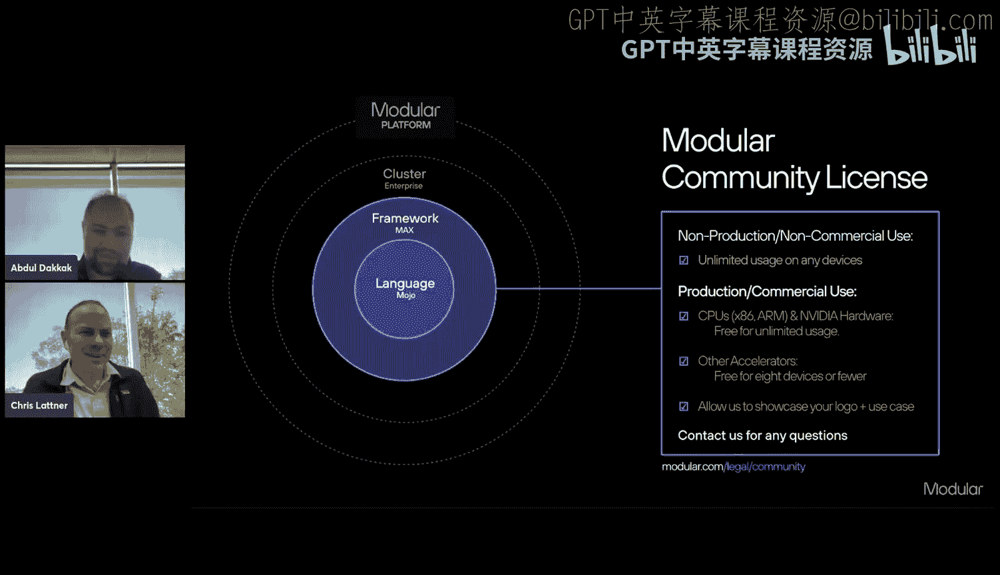

Next slide hardware right so like we talked about before we've put a majority of our work on amor and hopper type of devices and so they're relatively mature there are some minor features that are missing that are coming in all the time。

Bla hole and AmD or they work right now you can go run them we're still working on performance and so out of the box end to end LLM performance isn't fully there in all the ways。

 but but we'd love to work with you on that modular is very focused on this GenI LLM space and so we speak。

KV cash and Raix attention and all this kind of stuff。 We haven't put any effort into traditional AI。

 We haven't put any effort into like HPC applications or bioinformatics or all these different things。

 We want you all to do that。 be really awesome。 Like we dont We don't have expertise in this。

 We're useful for the things that we know。 We want the technology to go far and wide。

 Another thing we'd love help on as CPUus。 And so if you speak Amx。

 which is basically a CPU Tensor core or SME， you're a Mac user and you' you're excited about the latest Apple silicon。

 please like actually help us， we'd love to extend all the stuff。 And if you can do that。

 then it makes everything better for the entire ecosystem。

 There's a million different things that are going on here。

 This is why we're open sourcing with kernels and open sourcing all this technology。

 And so we'd love to work with you together on this。

So wrapping it up come build with us so we have a community that's just really opening up you can download Max and Mojo。

 you can deploy models， it's free like we talked about go export PTX and put it in your legacy system。

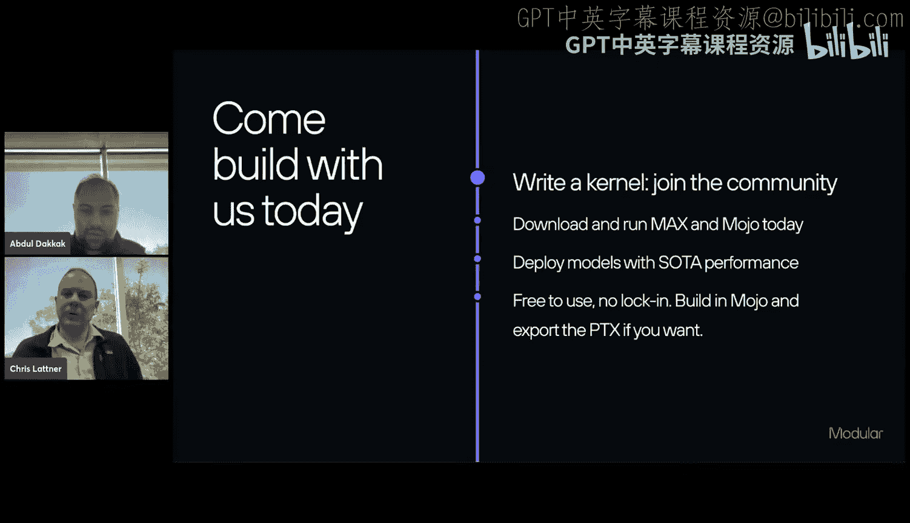

Legacy， I mean the system you you've you've you've built with love and care。

 sorry I should not say legacy like the thing that you're already using right？

If you're interested in this stuff and if we've blown your mind and you're like I want to know more but please help please come visit us we have a hackathon in the Bay Area in Hillsboroough California near San Francisco。

呃。Mark will be visiting and we'll be talking and we have an all day hackathon type of thing we have rewards。

 we have challenges， you could win a blackwell RtX 5090 lots of cool stuff it will be a ton of fun and so if you're interested please check us out at module la/ hackathon and come come visit。

Oh yeah by the way we're an amazing team we're hiring and looking for amazing people and so if you care about writing GPU code and if you care about GennyI performance or LLM serving or things like this please check us out we have a careers page and that would be cool and so this wraps up the talk I'm sorry we didn't get to talk about all the cool things but hopefully this was interesting as a slice of what we're working on。

Hello Abdul and Chris， so just for people to know a context behind some of this。

 Chris and Abdul matters during GTC and we are like， okay。

 we want to do this and we want to enable Moio talk in the GPU mode Chris was super excited。

 I like I want to do it。 I want to do it。 I want to do it。

 I get excited sometimes this happens to me Yeah， and we are like。

 okay it should happen immediately as fast as possible and thank you everybody for joining in and thanks Abdul and Chris for an amazing talk。

 I do have a couple of questions so so。😊。

Right now there is a whole variations of the different capabilities through like multi GPP enablement and doing the communication across with different mechanisms of doing the communication too like there is a whole lot of like complexity that is associated and things like this yeah exactly so any thoughts on how this can be enabled in module where it is and what the plans on that I mean you spoke a lot about doing compute orchestration or compute jobs and all but less on the other side of things so I want to hear your thoughts on those。

😊，Abduah， please tell us about auto fusion with all reduces。Yeah， so I mean， go to again。

The you know go to GPU slash co slash all reduce you'll see an all reduce comm you know primitive also all gather we plan on adding all to all and so forth by the way it's portable works on amD and videodia you know there's certain instructions on blackball and hopper that。

We need to actually do the you know implement the I' reduce the primitives are there for folks actually that's a great hackathon project or folks are interesting contribution using multime and so forth。

😊，But also like it's the again going back as the composition all reduce is not the only thing it's all reduced followed by or Ma followed by an all reduce or an all reduce followed by activation and so forth we're actually very capable of doing that again nothing is is by the way all of this is written in Mojo we're not using niel or anything like that but if folks want to use like MV Schmm or。

Nixol or other things again， there's full compatibility you can go to the Ffi package you can call any C+ plus or C function if you want right so there's nothing stopping you from using Nxol or something else or nickel or Rle or msle whatever the co you want exactly but today our all reduce is actually faster that nickels all reduce right for inter node if within a node right and we also do a fusion so that's kind of novel for this thing and we use PDL as well so that we can overlap the math model they all reduce as well Yeah so so let let me just frame this up a little bit I just switch my your pods out Can you still hear me okay cool so we don't like dependencies and so this is when you hear Ab will say we don't use nickel we don't use kuddo we don't use any of this kind of。

It's because dependencies have lots of bad things to come with them and so we typically reimment the stuff that we really care about that's important to us。

 but you can call into all these libraries in this ecosystem as well and so but Vikram to your question right？

This is like the mind blowing thing， is that when you get out of a fine math compilers using polyhed。

 blah blah， bh bh，lah blah blah， well， suddenly communication isn't special。

Right that is yeah as long as you we can arbitrary things you might do with your accelerator and this is why yeah we can autofuse because we're not auto fusing with a fine math and blah bh blah blahla it's a fully general algorithm and sos that's like again a very different thing in the ecosystem which makes it all just way simpler right it's not that。

To be fair， like you can achieve a fused do reduce or something with Kuda。

 but it just means that you have to like write the permutations and so this is where language integrated with the graph compiler as far as I know。

 has never been done like this。That is true。 So I think that is one of the unique way of you guys are handling this scenario。

 You spoke about releasing some of the piece of code in public。

 what's your plan on your roadmap to release the compiler。

 the Mo compiler is it there in the radar or how are you thinking about that， So yeah。

 so this is something that I annoy people with So this is a frequently asked question me let me before I answer the question I'll tell you my backstory on this right So I'm known for things like LVM and Clang and program like you had an open source person。

 So that like I like open source， The thing that most people don't remember is that none of these were open source initially LM was built in secret for three years。

 Kang was like。😊，Literally secret even for most of Apple for four years and then it got open source two years later。

Cline was open source was or it was proprietary one building and then we released it from Apple et cetera。

 right there's a reason for that。And one of the things I learned and was reaffirmed was with MLR in the problem with MLAR and I wrote about this in the blog Go series is that I was trying to build a compiler construction toolkit and then it wasn't done。

 but everybody's like oh my God there's a thing there's a I want to use I want to go do stuff and they build all this legacy code much of what you're now the MLA dialects by the way while MLR was still just being created and so what I really believe is you need to get a new novel creation to a very consistent point and it's actually baked before you invite the community in because yeah it can be fun to have like lots of opinions on syntax or something。

 but it doesn't make me get to success faster and so what we decided to do with Mojo is say。

 okay well we'll open up the parts that we want attributions。

 we'll open up these pieces over time and then I want to get some of the basic types of some stuff really nailed down because unless it's helping us get the victory faster like I'm not。

It's self defeating and so we've committed that we're open sourcing Mojo by the latest end of next year。

So maybe sooner than that， but we've made that commitment to thank you， thanks for giving that。Okay。

 so so I think now might be like another thing I would say by the way。

 just to give you a snippet and a snapshot of how weird modular is right so we have a Monte repo modular。

😊，We just passed， we have more Mojo code in our Monte Repo than SQL++ code。

So this is not like an abstract thing that we do for fun because we're messing around with it this is like。

We're building this thing because we use it and so this is really。

 really important and so this is not like an abstract academic project this is like really important that we get it right and so this is we want everyone else to use it too and so that's why we're opening up and everything else but again my incentive again is a guy who builds things that take years to bring to market and then have large impact on the world like the incentive is make sure it is right and if it takes a little bit longer if people are shaking their fist at me for a while that's okay I can take it now。

All right， like I think on that note， I think Chris like thank you so much for joining I figure it sort of like the sort of recurring。

 I mean， sort of I think maybe the main takeaway for people should be there's sort of a lot of like very fancy features we talked about today just like go try it out。

 share your benchmarks on on the discourse server let us know how it goes I'm gonna be personally hacking all day on Mojo Saturday of next week just to see like what it's like for myself。

 I think like basically if a lot of the promise of like performance portability is true then you know what we should do is have you guys be popping both like an Nvidia and Am leader board on our server and I think like I'd love to work with you on that like I was able to tell that should just have modules executed on scenario and then say hey yeah this is amazing that's ultimate complex。

😊，UBut。