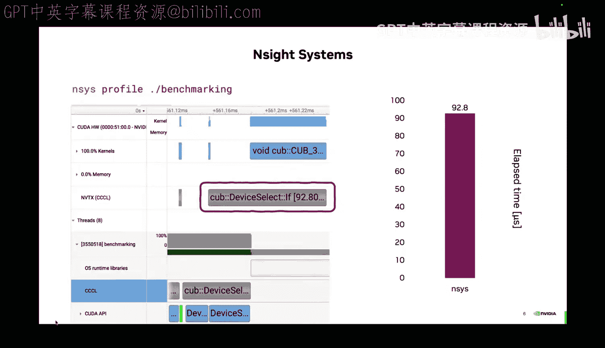
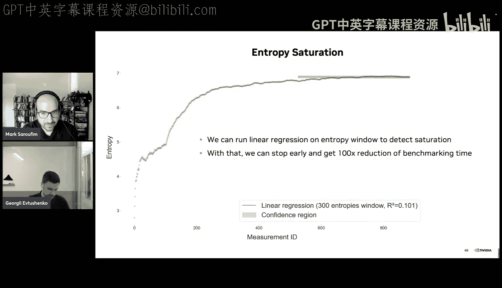
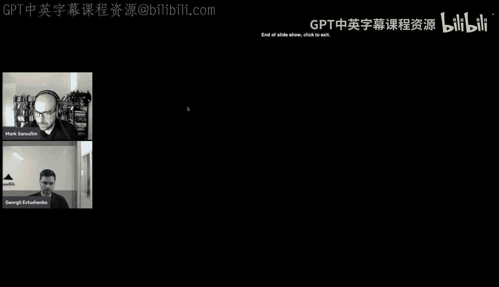

# GPU MODE《CUDA、GPU编程54-87｜GPU MODE》中英字幕（deepseek-v3.2 p03 -20250509-Lecture 56_ Kernel Benchmarking Tales.zh_en -BV1xbmQB3ETC_p3-

Yes okay on on the chat in the meantime， like welcome everyone to like episode like 56 now of GPU mode we have like Georgie again from like that video like Ka team here to talk to us about like benchmarking I think that Georgie at this point you are our most common speaker I think you're the only speaker who's given three lectures。

So far， so it's good to have you back and yeah， without further ado， Gegie， please take it from here。

Thank you thank you for having me and so audience， thank you for attending today。

I'll be talking and telling you some cardinal benchmarking tales today and first let's figure out what benchmarking is。

So benchmarking is a tool that is needed to answer one of the most basic questions about your code kernels。

First question to ask would be， does your kernelel provide correct results？

And this set of questions are usually answered by unit tests。

And once you answer the correctness questions， you can proceed to the question about the performance。

 so how fast is my her？And these kind of questions are usually answered by profilers and benchmarks。

So while profilers and benchmarks provide technically correct answers。

 the journey to discover the answer。Often resemblesems he Green's fairy tales and hence the title。

This area is deceptively familiar at first glance， but it turns into a nightmare fuel as you keep going。

So let's actually try to answer the performance question for device Select。

To be specific So imagine you have an application and somewhere in the middle you have called to cup device select it。

If you' are not familiar with this algorithm， what it does is it。Takes an input trench。

And then operate。As a precate here on the screen that returns to you true for all odd the numbers。

So if your input is like one4 three， one is selected by prediiccate。

 so it is getting compacted in the output range in place in the data。Two four is thiscarment。

 three is compacted， so you have two in the output here。

Let's say this kernel provides you correct results。Now our question is， is it fast or not？

And at the application level， how do we figure out this？

First thing you should start with is using and systems。

These systems is a profile that gives you a system wide view of CPU and GP activities。

It will visually represent some asynchronous kernels， memory transfers， etctera。

So let's try and use this font。When we use inside system mode。With our kernel， with our application。

 we see some measurement with MVTx here。

Because the electrolies on the catalog bag that we discussed in details in one of our previous talks。

This algorithm consists of two kernels actuallyly， first one initializes some tile states per third block in bubble memory。

In subsequent kernel is using that an actually loads the data。

So we can take a look at the Unity exchange to discover that this algorithm takes 92 microseconds。

So that's kind of easier。But it's not the only tool that is available to ask the performance related to questions。

TheV also provides you a tool called Ins Comps that gives you a detailed performance view of your kernel。

 it gives you a source level correlation with some performance metrics and guided analysis for performance optimizations so let's give this one a try。

We call In compute with our benchmark C2 kernelnals again。But something is out here。

When we add the duration times for both cardinals， we get 114 microseconds。

 so more than we saw within site systems。Why is this happening？Well。

 the answer is somewhat on the screen。Here you see that Inight compute reported the frequency to which GPU is working。

So here we see 900 Mingggahertz。But the GPU that I'm using here it's a6000 AD。

It can boost up to three niiehers。So。Inside compute locked clocks to the base value here。And insight。

 and that led to poor performance on the audience。So。We can actually control this behavior。

You can tell a computes to avoid locking clocks。And this will reduce the lopbs time for our algorithm significance。

Almost twice here。But it's still confusing， like now we see 57 microseconds while inside systems reported 92。

What is going on here？To answer this question， you have to understand what has to happen。

For us to launch a car in the first place。So initially we have a device code somewhere on let's say disk。

We have to load the data into a Ram， process it and put it into global memory on the GPU。

Before we call a kernelal。And previously， all the kernels， all the device code was loaded。

At the application start time。That means if your application has thousands of precomped kernels。

And we'll say you're only using a few of them。It has a lot of overhead coming from that startup time。

That is why in Kki of that three。Soward， we switch the default to。A lazy loading of the device code。

 This means that。The device code will be processed and loaded into global memory upon the first use of a kernel。

And this takes significant time that slows down our profile。

You can actually control this behavior and set a co module loadsing environment variable to eager mode。

With that， all the kernels are loaded at the application startup time again and we don't incorporate the time it takes to load module into our profilefiling and this helps as we can see inside computer and site systems now report approximately the same time。

There is a minor delta here that is actually caused by the fact that inside compute gives you peripheral kernelnal results。

While the inside systems gives you a actual time span it takes to execute the organism consisting of multiple kernels。

Between the kernels， youll see a small delta that is caused by kernel tear down and setup up time。

At this time it's not incorporated inside compute， so it kind of makes sense。是。No。We can。

Try to shift our perspective a bit。At application level， when we use an accelerated algorithm。

We can ask a question of how fast is this kernel in my specific use case。

 that means for device select， if say 50% of the data is selected。

 when the problem size is like 200 million elements。And the type of the se is with C chart。

These kind of questions are answered by profilers。But how't you develop a kernel？

You shift perspective to asking a question of how fast it may kernel across a variety of use cases。

So you need kind of a unit test for performance of your kernels that covers a wider set of workloads。

For the web select， how would it perform with let's say one selected item on 200 million selected items。

 what if the data type is double？It's all。Helping you to read locally about your kernel as you develop it。

So instead of thinking which input to the huge application， let's say which LLM I have to load。

That will result in a bit different use case for my device select that I work on it。

 you can just only reason locally about the device select code thinking about in terms of entropy or the input。

 percentage of selected output， data types of your input range， etc。

So this gives us a clear cut between profilers and benchmarks because profilers are essentially performance debuggers。

They give you a single short analysis of specific execution deep dive into what is happening now。

They also have a much better hardware visibility。Well， benchmarks， a kind of performance unitists。

This can be used in let's say performance CA， and these are usually covering a wide range of workloads like input sizes。

 data types， etc。So let's give it a try and write a benchmark。Now we have to time the。

If we select ourselves， let's try to do that trivial will then just put stoodch around that one。

See what happens。And something wrong is happening， you see that we get about four microseconds and this is unrealistically first。

And as you probably guessed， this is caused by the fact that device select is asynchronous as achoic kernels。

So。We are not timing the。Sme it takes to run the algorithm。

We are just time the time it takes to launch these kernels。

To fixed that we can wrap our code with Co device by synchronize。

 first one we add before fourth timing the begin event。And that prevents timing。

Different asynchron separations on the same stream。

We can also add good device synchronize before the end measurement。

This way we wait for the algorithm to finish before we time the end event。

So this helps we now see more or less realistic 100 microconds but it's again twice as far from inside systems with eager mod loading。

 why is this happening？So。100 meseconds is the range we already saw？In inside systems。

 when we relied on。Laser loading and this is actually the case here as well。

 so we haven't set up this variable on purpose because let's say you don't want to set in mode for the color benchmark。

You're just interested in notes staving。Lazy loading for your particular algorithm or kernel。

To work around that we can have a warm upron， so here we just issue a C device select E synchronize the weight for it completion and then time it again。

This helps now we see 57 microconds， but it's kind of faster than what we see within size systems eager mode。

Why is that？So that helped because the first in triggered all the。

Louding of the device code into global memory。But it also preheated Alto cash for us now all the data that the algorithm will be reading is already resident in L2 at the time of the second vacation。

So we're kind of putting the algorithm into a scenario。To work around that， we can try to flush outc。

So simple way to do that would be just writing a bunch of random data to evict anything that was reant L too。

And that helps， so you see that now we get back to 66 microconds， which is slower as expected。

But still kind of far from inside with the eager mode。That takes only the 60 micros。

What is the cause of？Overcrs， no。To answer this question。

 let's take a look at the current benchmarking scheme。What we do is that we register a certain time。

With Chron on now， this gives us 20。Then well launch all the kernels。

 then we each could a device synchronize that synchronizes with some timelets call Ts in this string。

And then we wait for or record event for end measurement with Chronaau that gives us C1。

The problem here is that。We are interested in getting end measurement as close to the end of the kernel as we can。

But because deviceynchrons is doing more work。It actually waits for GPU to finish work。

And then synchronize a CPU with that that obviously takes some time。

So what we want to do is we want to get rid of the overhead between Ts and T1。How can you do that？

We can rely on good events to do that， so if we just record good events。

 we are not incorporating that time it takes to synchronize with the CPU。

So T1 should be much closer to the end of the kernel。In code， this might look something like this。

So we still have warm uprun， then we flash al toet， then we create two events。

 record the start event， issue our asynchrons kernels。

 record the end event synchronized with the event and get the e lopsse time。

 but could the event elops time cold。Okay， that gave us much better results。

 so now we are closer to in with an eager mode。We removed some of the overhead。

 but we are still kind of far。What is going on？To answer this question。

 let's take a look at the current scheme again。事后。The recording of the beginning event is quite far from the start of the kernel on the GPN。

😔，This overhead is caused by the time it takes。To launch a kernel on the CPU end。

This is called a kernelnal V Agency， and we are not interested in this time because we are trying to understand how long it takes the work to be done on the GP end。

Not how long it takes to launch this work。😔，So how can we bring T0 closer to the kernels？Yeah。

We can kind of trick the system by trying to block the codeer stream。With that。

 we can record the start event， launch all of the kernels。

 and record the end event and then unblog the stream。If we could do that。

 we would bring T0 much closer to the kernel stud time。So。With these changes。

 if we warm up partial to block this chain， record the events issued the syndrome separations。

 record end events and among the stream， we get very similar time to what inside systems is reporting。

So this is quite accurate measurements。But it's not exactly a full story。

There is a second reason for the title of the talk benchmark entails。

If you benchmark this in multiple times， you'll actually get a distribution of measurements。

 not a single。快点。It is partially true like any fairy tale that 880 microseconds is somewhere in the distribution。

But the kernel can take faster to run or slower to run。

So the part of fairy tale here is that we can represent the entire distribution with a single value。

So let's say。Good point for a quick reup。At this point。

 we figured out that profilers performance debuggs。Benchmarks， performance， union tests。

We also understood that accurate timing of kudtic kernelnals requires warmer pra， al flashes。

 complex use of kuda streams and events for better。

And that a better left to special tooling that we'll talk about later。But most importantly， we。

Realize that measurements are noisy。And this leads to a requirement on multiple measurements。

If you measure multiple times。We have to ask a few questions。😔，First。

 can or should we try to reduce the noise we getting the data？And the second question is。

How many measurements do we have to perform？So let's start answering the last one。

The easy way would be to just issue， I don't know， 100，000 ins on the kernel。

And just compute the average time it takes to run the algorithm。But if we do that。

 we see completely strange results， so now it takes an order of a millisecond to run the kernel。Well。

 previously， we were in the10 frame of 800。Microseconds。So what happened？So figure out the answer。

 we can try to see what was the frequency of the GPU while we collected these mineral。

As we collect measurements， you see how the frequency starts dropping。

That is caused by the fact that our select implementation is very efficient at heating up the GPU。

As the GPU hits up， it starts dropping frequency that is called a Thrrotling。This throling。

As an effect execution time for our device select。Which results in about 35% difference in the lifetime。

So。What can we do about that？Easly variance。Caused only by throttling or there other factors。

To answer this question， we can try to solve the data by the frequency range and first thing that it helps us to do is to realize that our device select implementation is in strong inverse linear correlation with GPU frequency。

So it kind of makes sense the slower。GPU works， the longer it takes the algorithm to run。

But there is second observation that we can make。Within the same frequency range。

 we have about 2% variation of the runtime for our algorithm。

This is caused by the concurrent nature of device Select。

I selected it for a reason it has some complex concurrent mechanics inside。That you can。

If you're not familiarda with the catalog back， you can take a look at one of our previous talk in Badad。

But。The launch story short here is that。The catalog bag doesn't have the deter performance。

So we do have to benchmark multiple times to figure out what is the actual representative set of performance states that this algorithm can be in。

But， there is another。Takeaway we can see from this plot。

The dark greenish color here was observed by hitting the algorithmgaating with uniform distribution and selecting all the elements。

If instead of that， we just have， let's say， some constant that is close to zero。

And we select this constant in a way that leads all the same number of elementss being written back to memory。

 all the same code paths are taken in the kernel， you can observe that the lapse time can drop significantly。

 so why would that happen， why would the same code paths lead to different frequency scaling different execution time？

Well。I selected this workload to show that。Value is close to zero。

Means all the bits in this file zero and zero means there is no current of the chip。

And less current means less heat。So。You just can observe different th and behavior。By。

Selecting different to workload or input that doesn't affect any color path in echo code。그。For us。

 this means that as we work on the benchmarks， it's crucial that we spend some time to prepare some realistic workload。

Instead of just feeding some random artificial constants。But anyways。

 how can we reduce this variance， let's say we do have to benchmark you from distribution because it's more realistic and representative on what application features device I select。

Can we reduce this variant somehow on the hardware level？Well。

 we can try to look at let's say Macs clocks to be as close to the user setup as we can。

Let's try to look at 3。1 gigahertz。I see what happens？

And here you see how we started somewhat higher in frequency range。

 got some better faster e lops times initially。But， faster。GPU heat it up sooner。

 so we have a small deep and frequency range。That overall doesn't really affect the variance of the elapsse times in this 100。

00010 vacation of the kernelel。I don't know what we expected actually。

 like it doesn't make sense that GPU will maintain 3。1 gigahertz because if it heats up。

 what should it do like be？We probably don't want that。

 so it has to scale if you look at Maxs clocks。For us， this means it doesn't help。What can we do？

What else can we do to reduce this nerve？Yeah。Well。

 obvious choice would be to then look at lower clocks。

 so not looking at Maxs but selecting some low value let's say 2。5 gigertz， 2。

2 gigahertz and see what happens with the algorithm。Let's try to do that。

 but use a bit different algorithm this time， let's try to use device histogram and this leads to some surprising results again。

So。Let's say a benchmark， histogram even。On the very same workload， very same problem size。

 data types， all the values are the same。But I benchmark market at 2。

5 gigahHtz and then benchmark at 2。2 gigahHtz。On this screen you see how this affects eob styles。

 I represent a density of like distribution histogram here。The tros。For these eopps times。

 how many measurements we gathered？And you see there are 2。5 gigahhertz。We get about 2。

7 microconconds， but then as you。Lower the cloaks。It takes August。A becomes faster。

So we have about 6% speed up from lowering clocks， not tracing them。

And this is somewhat surprising like， why is this happening？Well。Histogram。Is atomic heavy algorithm？

At some point we。Iue a lot of atomics into memory， which causes attention。At higherclocks。

It makes sense that we issue the atomics at higher rate。

But if we drop this frequency on the GP end and keep the memory at the same frequency。嗯。

We shalltime어。Lower late rate and this means contention is lower and this might have positive effect on the performance what we see in the data on the screen。

If you now try to plot the distribution of ela times。For every frequency of the GPU。

You'll see that it behaves something interesting here。At first it。Makes sense， it takes。

Les time at higher frequencies， but as you reach up， 2。2 gigahHtz。Yeah。

Range the time to run algorithm， start growing then drops a bit and this is somewhat let's say nonlinear behavior。

Of a lap time dependence on the frequency。Okay， what does it mean to us。

 can we look at lower clocks or not？Well， it's a good time to。Ask a question。

 why are we interested in the accurate measurements in the first place？Or the stable measurements。So。

Usually you're interested in stable measurements when you're trying to compare something。

For instance， you might be interested in。It has my carinal regress performance。

Or does my change lead to performance improvement to that？But when you have a non nonlinear。

Dependency of a lapse time and the frequency， the answer might be surprising。

Let's say we have a histogram again。At this time， were interested in a change。

We want to change the thread block size from 300 threads to 1000。How will this change affect thes？go。

On the left you see 2。2 gigahHtz lo in GPU on the right， you can see 2。5 gigahHtz loggged logs。

On the left you see how this changed。Regress performance， so going from 300 to 1000 threads。

 rigorous performance。And it kind of makes sense because we are not ising enough atomics to create。

Contention on the memory end。So increasing thirdb size just dropped occupancy。

 so less cancur on thirdbs working with histogram is a regression。But that higher cloaks。

Reducing the occupancy helped because we got less atomics issued。

 but larger thread blocks working on larger priorvatized histograms and that noticeably helps。

So long story short， if we will look at lower values of the GPU clock。

We are risk to observe a change in。Performance that is not representative of a real setup。

Usesrs software your kernel will not log logs， they're interested in the max performance of the GPU。

So if you observe， let's say a regression here on lower clocks。

You avoid applying this change that actually led to significant performance improvement on higher clocks that are more representative for user workloads。

But opposite might happen as well。We saw a few times how。On lower clos。

 you see a performance improvement。But then at higher flow rates。Pformances just regresses。

So it strongly depends on the shape of the depend here your lot time。So frequency for your GPU。

And for some algorithms， it's not as bad， so adjacent difference is one of the simplest journals of heaven come。

And it pretty much doesn't depend on the frequency of the GPU。

Because this algorithm thing is GPU is memory bound。It has very little compute。

 so it kind of makes sense。So。What kind of takeies can we make at this point？

It's not safe to lock lock at lower rates， it doesn't help to lock lock at higher rates。

And we have variance caused by the algorithm itself， so we have to benchmark many times。

But we have this problem of excessive throttling caused by the amount of benchmarks that we launch。😔。

So what we can do instead is we can try to measure the average frequency of the GPU during our benchmark。

And then just discard the measurements that happened during obvious rotting。

So here I declare a max frequency that can be co using code A。

You can also get the average frequency and threshold is use the control plus AA。

I'm telling that 75% of the peak， I would consider the unrealistic for my application。

So I' just discard this measurements。That would help us get more representative sample for the。

Performance metrics of collect。There is also an tangential question of should they log CPU clocks or not？

So because of the block stream approach we discussed previously。

We are not really incorporating the time it takes to launch a kernel on the CP end。Therefore。

 CPU doesn't have a way to impact our measurements right now and it doesn't help to lock clocks。

On this screen， you see how I compare a locked and unlocked few clocks with the。

Measurement scheme we presented previously。And you see there is like little difference in variance。

Okay。So we shouldn't log logs， but we still have a problem of 100，000 measurements。

 it's kind of taking too long for some workloads that can take like half a day to run。

This is just a single workload， we can actually have many data types。

 many problem sizes that was the purpose of the benchmarking。

So we're interested in using this number of measurements as much as we can。How can we do that？

We can try to rephrase this question a bit。To have an analogy。Let's see I have a dice。

But I don't know how many sites it has。How can they figure out。How many times I have to throw this。

Dice。Don't understand the number of sites。Thanks answer this question。

 we can refer to Shennon entropy。So ch enthtropy is representing a。

Expected amount of information needed to describe a state of a random variable。

On this slide you see an equation for it， so p of x is a probability observing event X。For us。

 event text means side of the dice like observing one or observing two。

In the context of performance measurements is a concrete ellappsse style we observe from the coers。

So let's try to throw with the dice ones。Let's say we are old six。The only event we have is six。

And we've observed it once。 so the probability of observing six is one and the7 entropy gives us0。

This makes sense because there is zero information needed to describe the next random variable from the data we saw it'll be six again。

 so it's kind of easy。If you ear the day second time and observe two。

Now we have two equivalent likely events， so one over two for six， one over two for two。

And the sh Enpy raised。 now it's giving us one。 So now we have to。

Get more information to describe the next row。You can be two or can be six， we don't know。

And as you keep rolling， you see that enpy increases with each new or surprising measurement。

If we roll 19 times， we finally see the last side， so it was like six side days。😔。

We're old one and ideally， if we knew about the actual number of size on our dayss。

 we would stop here。So after 19 roles， we would say that's not。So you see how entropy。

Started kind of saturating as we roll more and more。

Because it's getting less and less surprising to see each new measurement。

But but we don't know actually that we have six sites， maybe there are more。

 so let's try to roll 47 times。You see how entropy completely stole now it doesn't reach any further。

 it kind of saturated。We can use this property in our benchmarking。

So come up with the stopping criterion。Let's go back from the strong days to performance measurements。

And for the select， try to trade the entropy of the sample over time。

You can see here the same effect we get less and less surprising measurements。嗯。

How do we keep benchmarking？And we can try to run a linear regression on the window of entropy。

To see where linear regression indicates a sateration of enpy。With a certain equi region。

With that approach， we can start much earlier。So here we stop at about 800 measurements， which is。

More than 100 times less than。Will be be clickout。Well。Raising the question。

 do we actually see all the performance distribution that observed previously？Well。

Here I'm presenting a plot of the 100，000 measurements versus 800 measurements we collected with entropy stopping criterion。

And as as you can see， it's kind of not ideal， but we cover at least the same span of e lot times as this excessive benchmarking。

And the same span of frequencies。So we get more or less realistic distribution for the。

Measurements were trying to make while reducing this measurement as much as we can。

But implementing all of that is getting kind of un。

 It takes a lot of effort to implement all the blocking stream approaches， all the。

Stopping criterions， warm up， water flashes， etca， so it kind of makes sense to abstract all of that out into a framework。

And that's exactly what we did， so we came up with El Bench。

Stills a lot of like Google benchmark if you're familiar with this tool。

But the difference here is that it supports K nature。 so it understands good timers， devices。

 cash flashes。It is also improving stability of benchmarking lot with blocking stream sound stopping criteria that is essentially based。

It also has a lot of utility in powerful parameter sweep frameworks that allows you to explore the workload space。

Es there。And also incon， flexible command line interface。

So let's take a look at how the benchmark would look like if we used to newbe instead。

Pagemark is just a function that takes a new page state reference。

And that you later register with every bench macro。With this。嗯。

You can also register different accesss for parameters of your cardinal。For once。

 we' are interested in how our select perform for small， large， medium problem sizes。

So you can register an access called elements here with three values。

 so the benchmark is going to be invoked three times。Inside the benchmark。

 you can retrieve the current number of elements。With state that get in 64。

You can have as many of the sexes as you want and the entryphi benchche will cover the full carion product of this workload。

Yeah。Inside the benchmark function， you have a setup stage。

 which is convenient because sometimes you have to spend time preparing the workload like generating data with certain distribution or。

嗯。Are you reportinging some of the metrics to your page？So this place is not going to be timed。

By any page， it is purely a setup that is not incorporated into any of the timings。

Inside the state executiveec where we had all the complexity of benchmarking so this state that exec will perform a warm up run。

 it will invoke the kernelnal multiple times until the stocking criteria is saturated。

It'll also increase accuracy of the measurements by looking block kernel will try to flush off to throttle。

Detection in in place， so everything we've mentioned in this talk is going to be implemented on innovation patient。

You the。Clonnal launch you provide state Ex， make sure to launch your kernels on the stream that every bench provides。

And the report of Enbech。Looks something like this。So you see the workload。

 the benchmark was launched to it。 So here its elements。 You also see how many samples were。

Gathed and the。Wch mark， you see some statistics of GPU time。

 so here's like 814 microseconds that actually happen to be lower that we。Absorpt within systems。

Because inside systems gave you just and。Outlook for one concrete in， but as we figured out。

We have to benchmark more to exhaust all the states。

 so 814 is kind of the average time the algorithm can run。

But you can also see the Sun relative deviation called noise here so you know that 2%。

I very instantly。The lot time for this concrete workload is intrinsic to me。

Concurrent nature of the algorithm to itself。Yeah。These benchmark results can be presented with Merdown or Gson hormones if you want to make it part of your CI。

But there is another column that is of interest and we haven' discussed here you see budget to GPU time。

 which is much higher， what is that？So not all kernels kind of one shot use some kernels are intended to be used in a hot loop where you have many vector to back lets say matrix multiplications。

In this case， you're not interested in getting one or vacation as fast as you can。

You're usually interested in the batch of the solids before fast。

This means that sometimes you would tune nos differently。In device select。

 we observe that we have a busy loop with a delay。To reduce memory contention。

And when we era this delay。We kind of deter the fast use case。

 but we improve the use case for when the cellut is used within the budgetged segment。Oh。

Because this object hits GPOS， you throwrottle less and overall on average。

 this leads to a better performance。So if you're interested in these kind of match measurements。

 this is the field you should be looking at。But also the different use case for budget measurementss is when your kernel is relying on L cash residents。

So when you do want to。Have data left in Alcache so that subsequent code the only thing we use is that。

That's another use case manage to then multiple runss performing faster rather than a single in being fast。

But as you use budget measurements。Sometimes it's not actually used for your algorithms。

 so you can disable that with every bench exact type， no badge。This will disable bunchman rules。

If you do need batch measurements， be aware that batch measurements will not flush all cache。

 it will not try to detect trorotling。It will give you like actual production close results。Yeah。嗯。

Different part that you should be aware of is throughput information。

You can report the number of bytes here algorithm is reading and writing with state at global Mem and at global memory rights。

This is needed for speed of flight analysis that we also mentioned to one of our previous talk。

 so if you are algorithm is memory bound and you need speed of flight analysis。You can register to。

Lo or theoreticalical number of bis should be reading。So for select。

 let's see if we know the percentage of selected items is 100。

We know that we are going to read and write exactly number of elements we feed to the algorithm。

 so that will be a theoretical lower limiter number of bys。

That our algorithm should be reading and writing。When you add this。Declaration of read and Right。

You'll see new columns in the every output。That would indicate what's the achieved the output of algorithm。

 so here is about 700 gigabytes a second on minus view。But also the achieved bandwidth utilization。

 so you see that our algorithm reaches 70% of speed of flight。

This metric is going to be far from what you see in inside tools。Because it's a theoretical metric。

 not an actual number of bytes your algorithms reading the writing。

You can have auxiliary data you read like global states tile states that we mentioned for the couple back。

These are not inherently needed by the data， it's just an artifact of how the algorithm is implemented。

 so we don't want to incorporate that into the speed of that analysis。

If you do need this raw deear bandwidth。And your bench provides a cap to integration。

 so you can actually collect。Ctic metrics， a metrics with state that collect drums throughput and one hit ratess or two hit ratess。

嗯。And this will report you something very similar to what。You'll see in insight tools。그。Okay。

Here you see the report for L1 Hitrain， Tto Hi trade。

 long and store efficiency and hardware E combined。Yeah。

Different part that is worth mentioning is that inside the Carnal launcher。

 you are not allowed to synchronize with the GPU。Because we rely on could stream blocking。

If you try to synchronize with the GPU， the blocking kernel will never finish running because we will never reach the place when we unblock the kernel often blocking the kernel launcher。

Yeah。This means that if you have code strip synchronize， event synchronize codea free like any。

APpiI that list of synchronizing behavior。You'll observe a dead look。

The steel benchmark in these cases， you can add any bench exact type sink to indicate that your kernel launcher is going to。

Be synchronizing with the GPU。In this case， we will not block terminals。Block streams。

Which will affect accuracy in bit， so now youll start incorporating kernel launch overheads into the measurements。

So make sure to benchmark larger workloads。Reduce the effect of this inaccuracy in the measurements。

But also we'll disable th detection so be cautious about that and。At this point。

 it might make sense to log sp logs to reduce the variance of it。是。不。

And bench also can provide you a g on output。For your benchmarks。

 so let's say here is an example where I made a change in the histogram。And the。

Use 1000 or 300 threads in the thread block。With the adjacent option。

 we can dump the measurements into adjacent file and later compare them with any basic script。

The result of the comparison you can see on the screen indicates this 4% regression。

From increase in third book size on lower blocks。And the。You can use this C support of UC as well。是。

It says that you can use Gson Min option to actually dump all the sampling data。

The sampling data can be later visualized to show the actual distributions of eopse times for your kernel runs。

You'll have one binary file per workload in your benchmark。

And this will have all the collected measurements by the module of the ones that were discarded during GPU throling。

If you're interested in that， you can actually read this binary files with just a NI from file is just a b of。

If these sensitive values。Okay。Seaving a benchmark doesn't mean you suddenly don't have to debug your performance of your kernels。

To help work with the profiler。We don't need to run the benchmark multiple times。

We are just interested in a single run， we don't want the kernel to deadlock as well because inside computer will synchronize kernels。

So。To make abe inside profile bird， you can add a profile option。

And that will disable some of the machinery we have on any page and。

But it'll allow you to have a deeper insight into hardware metrics。Yeah。그。

So to get entry bench you can this easiest way would be to have a C integration with cM cM is a CMake package manager of the screen you see how I use cM to。

Pull any bench directly from Gitthub and then it's sufficient to link with any bench main and your benchmark is ready to be compiled。

As you compile your benchmark， make sure。To compile the release bills。

If you compare with dashj or debuing for。That will disable all the optimizations of the comprant。

So you see like。A little performance difference like 6，000% just from this change。

So make sure to benchmark early bills。So I wanted to briefly mention what you have on the road now。

One of the next things that we actually use extensively on the code core libraries and is data generators。

Some of the patterns are quite common for preparing the workloads for in your benchmarks。

 sometimes you're interested in uniform distribution。

Sometimes you're interested in the data with a certain entrytropy level。

 sometimes you need a log normal or uniform distribution statement excuse me but before you keep going。

 I did't want to ask you a question on the previous slide。Yeah。

MaybeMaybe it was a few slides back anyway， I'll just ask my question。

 which was so at least like within like the Pythonic ecosystem for like microbenching。

 like people have really like like Tridents do bench function。

what it does is it basically just clears your L2 cache and then it uses scagraphs to like remove like kernel launch overhead and it's been like quite convenient to have like a lot of these best practices available in something that's like a single pythonic function you can call and I was wondering is this like something you've also been exploring an NV bench？

Yeah， I'll try to briefly touch on that one bit later。

Currently working on a modern version of the kernel launch interface。

We can see that integrating some of the benchmarking facilities in this one so that with some let's say marker you can enable benchmarking of all of your kernel launches so we thought about that we have this on our wish list。

But I will touch on Python a bit sooner as well。s good，Okay， thank you。So for Aers there are。

Many patterns that you kind of want to reuse。In many benchmark。

 you don't want to cook uniform log normal distributions for let say。

Sigted problems with certain properties like meaning life segments and the total number of elements。

So we're considering upstreaming this part from Coo library benchmarks to the end B upstream。

Different part that we heavily rely on in coreal libraries is diningning infrastructure。

On this slide you see how this looks in the code。We declare two comments with ranges。

 one4ty items per thread that we are going to use， this is going to be a compel time variable so you see like this coolusto can be used with two items macro。

But also the number of threads per block can vary from 64 up to 1000 threads。

And we don't want to choose this manually when your search space。For this metapar starts growing。

Manual work becomes。On optimization on tuning becomes very error prone and tedious。

So we automated that and considering upsstreaming this functionality。Into any bench so that when you。

Just describe the tuning parameters meta parameter space in your benchmark directly and your bench would be reused so。

Find the optimal combination of let's say， red block size， items per third and many other parents。

Yeah。And besides that， we're also thinking about the。

 we actually drafted the poisonon exporter of India bench。

This is helpful when you are trying to compare performance across the language because you can just produce the same Json output from Python and S++ and then compare that with your only B compare script。

And were actually considering different interfaces for that one that you mentioned right now that。

It would just。The single function。That。Eass wage fund development。But anyway。

 that is an narrow wish list。So for takeaways。Profiles performance debuggers， benchmarks。

 performance syns。You have to use both。And while representing the performance data。

 you don't want to stick to a single value。It's pretty much impossible algorithms take as part of performance states and you should be aware of this distribution。

So you have to embrace the noise in the measurements and rely statistically sound。

Methods to work with them。Mesurements are noisy and we have to benchmark multiple times。You。

You have to make each measurements accurate while you're doing that with eliminating laser loading with warmer runs。

 ultra flashes and streams， events logically discussed previously。

For the one of the questions we had before， Ken， or should we try to use this nice？Also is no。

 you should discard complete。Throttle， but。Overall。

 you have to be as close to the production environment。

 the audit will be run and see the whole distribution。And for how many measurements do we need？

We can rely on entropy metrics and situation of the entropy to understand when is enough of measurements。

And the good news is that A bench autos all of these hard questions for you。

So where to go from here is like till there from the stock is anyone benchmarking could kernel should be using every bench。

U。Work on every bench is ongoing so it's all open source you can reach us on the Github or Discord so。

File issues。Ask for improvements or report any your mugs you can observe。

But also I wanted to say that there is a great talk on more of an application level benchmarking you can find on a GTC on demand called measure rate。

And with that， I want to finish the talk thank you for listening and。

I would be glad to answer any questions。Excellent， thank you so much， dirtygie， as usual。Now。

 I was joking earlier today like George's like I think today like our most common leg speaker three talks。

 so like I think even Andres and I are I think around that rangeer， I think three or I forget。

Anyways， yeah yeah like like Georgie said like if folks have any any questions please please let us know I guess like Georgie maybe to start with like one sort of thing I found kind of interesting about your talk is like yourre like let's say people aren't using necessarily standard tools and they're for example just like。

m like。Like the conventional wisdom we get as you should warm up。

 but like you're also telling us like， well， if you like warm up too much and you're like running for too long。

 you're gonna run into thermal issues。 And so like it becomes like really nuanced to figure out like what is。

The right like actually maybe I should sort of elaborate on my question a bit more so generally if like let's say you're trying to。

 for example， compare a set of kernels like let's say like in our colon leaderboard and decide what's the fastest kernel。

And if you want the results to come back at a reasonable rate。

 you ideally want to have as few measurements as possible that will give you like some degree of confidence and then before like they declare a winner you want to be。

Like as comprehensive as possible and so I'm curious like if you've also explored more of like the sort of like statistical aspects where like you might not want the most accurate measurement。

 but like hey， maybe it's accurate enough for the purposes of using a fast iteration cycle。Yep。

 that's a good question， actually， most of these。Things you have to do with starting criterion。

 so this kind of chart。What you can do is that you can configure most of the parameters we have in the stopping criterion。

And we have an interface for you to experiment with stopping criteriaiterion yourself。

 so ideal you would be able to even create your own stopping criterion that just runs something once we wouldn't recommend that。

 but it's kind of possible。But I' say with entropy stopping criterion。

You can control the parameters of the linear regression that we use。

 so you can set Earth square here or the angle of this linear regression。

 so let's say you can stop after somewhere here about entropy of5。Or six if you want。

 so you can further use this four times if you're interested in laterof measurements。Very， okay。

And I guess do you mind going back to your slides with Python stuff？Yeah， the。Where is it。

By energy bench。Okay， what are the limitations for like the kinds of input functions that pi and Ben starre can take？

呃。Current limitation is like in the C plus percent at phase。

 it should be a function that takes any bench state， that's the only limitation。event state， okay。

 and and what's en event state exactly？So any major state is the。嗯。And the be variable。

That will have exact function that will actually perform the benchmarking。

So you see how in Ed2 benchmark I。Call state data grid and pass a kernel launcher you can do anything。

In this code before calling Exec。This time this segment is not going to be time。

You can do anything in the launcher of your kernel。This is again。Completely up to you。

 You can launch at many kernels。 if you need to synchronize like allocate memory or something。

 just make sure to。Provide things like sync tag， and then again there are no limitations。

 but the shape of add to like its signature。Because it's ined by in page， it's kind of fixed。

And then so then are there restrictions on like what the launch your function can look like like for example。

 like what I'm envisioning is like， if it's a dot forward call in a Pto program。

 like could you just pass instead dot exact dot forward and expect this to work？

I don't know what that for is and not quite Oh you know。

 this is more like sort of like Python stuff like which is like like ultimately the question is。

 can this be like an arbitrary Python palable？you can pass in or is there also like does it need to look like a kuta launch share function？

Yeah， this。Interface has two levels of interaction right。 so here first one is the B market sold。

Its role is to purely separate setup from the benchmark itself。

 like what is the region you're referring to benchmark versus what is the setup for that region？

So this one has specific shape， the launcher。Its a specific shape as well because it's intended to just。

Issue all the work on the GPU， so it has to accept this launch parameter that is coming from every bench as well。

For you， it just needed to get a stream， there are some different。Mechanisms you can do。

 like discard some of the measurements from within the launch server， if you want， like。

This add an API to that， but inside launcher， you can do whatever you want。

So you can load any functions as soon as like preferably use the stream that is provided in the launch that's。

Okay， very interesting。 I， I think then like I， we might end up exploring like this kind of API for the kernel leader board and just see like if we can make。

Like the sort of total runtime of jobs like decrease。

 but also increase like our confidence or at least just make sure like， you know。

 either our measurements become less noisy or like they take less time。

You should definitely get much more sound statistical results from that。Because you'll be able to。

Certain a more representative distribution of front times I saw a few times when you just benchmark and all on once and it performs faster。

 but on average it's worse。And then some other algorithms。

That would be a great idea to integrate that on GP on report。

Yeah like I think it it's just like give us a good sense of these problems， but okay。

 so so I don't see other questions in chat but like again Georgie。

 thank you so much Jake as well thank you for the good answers in chat I'll reach out to you guys offline I'd love to work with you together on this。

Awesome， thank you I'll see you。