# GPU MODE《CUDA、GPU编程54-87｜GPU MODE》中英字幕（deepseek-v3.2 p04 -20250517-Lecture 57_ CuTe.zh_en -BV1xbmQB3ETC_p4-

All right， can folks on YouTube here okay， let me double check。Yeah， looks like we're good。All right。

 welcomele everyone to another episode of GPO， this is like a lecture 57 and today I'm really thrilled to have Chris Seca who's made a few cameos in a few of our past lectures Chris is the creator of Q and so easier to sort of teach us basically everything we need to know about like Tensor algebra I'm also joined by one of my friends and colleagues like Christta Seus who does a lot of cute attentiony related stuff in Pytorch and might also have a lot of questions so yeah so Chris already told us before the cameras got rolling he loves questions so please if you have any questions drop them in chat and we'll interrupt them。

😊，So yeah， without further ado， Chris， please take it from here。Okay， thanks， Mark so。

I am Chris Checker， I am the original inventor of cute and。

I wanted to come on here and kind of tell you the story， O cute and tell you。How it works。

And so Qute stands for Ka tensors。嗯。And let's jump right into。 I'll give you a quick history。

 I have a big history in numerical and algebra。I was doing a lot of， for example， FFT research。

And for the FFT research， I needed Blas extensions for tensor contractions。嗯。

Tensor contractions were difficult to do， and I didn't understand why。

 why did they have to be difficult to do？嗯。Sorry， this is。ing with me。那没有。

Blas extensions were tensor contractions were difficult to do。

 and I didn't understand why I moved on to some low rank machine learning research。This， for example。

 is a。Chroner product of two canonical polytic decompositions。

 which is my favorite tensor decomposition。嗯。But again， tensor contractions were hard。

 and I didn't understand why， Like why can't I just have my tensor contractions。

 Tensor contractions are just gems。So I started poking around In in video。

Like what can we do about tensor contractions？And I collaborated with Paul Springer for a very long time。

 he was building CU Tensor at the time。And encountering a lot of colors to pain。嗯。

I understood some of that pain， and I didn't I still didn't understand why this is hard。

 like this seemed like the most obvious simple thing to me。So I started building here。

And I applied you to Volta Ampire Hopper， a really amazing intern Mohammad Osama Kaallo。

And I knew I was on to something when in the first week。Of his internship， he was able to gr。

A just a single file， cute example。For a speed of light gem。Modify it and beat Kub lawss by 25%。

Which is was unheard of。Because at the time， gems and Nvidia were pretty much being built from assembly directly and having an actual hackable single file。

 C code， C plus plus code gem that you could hack and modify and do something interesting with was。

Was amazing， so we kept going， we implemented what's called Stke， published paper， tensor cores。

This is my favorite Tensor core。嗯。I applied this to。

 I finally applied cute to actually doing the tensor contractions that I initially started with and was able to get S OL and show off a bunch of things that got Culas's attention。

 And then VJ， who I nicknamed the Golden intern。Took these ideas and。

Ran insanely fast with them and helped to build out this Culas 3。

 which covered Hopper Blackwell TmaA。 And yeah， that's that's kind of the story of cute development。

In history what is cuts Cus is a set of abstractions for productivity and performance for all scopes and scales of building dental linear algebra for GPUs Its multilevel you can enter it a different at any one of these layers so we have full SOL Ex me SOL insideside of video stands for speed of light speed of light is as fast as a certain chip will go We can calculate how fast we can possibly go using a certain architecture。

And that is the speed of light to us if you hit that speed。Good job if you don't hit that speed。

Where if you're 1% off， let's go find that 1%。 we need to go the speed of light。

 We have to go as fast as we possibly can。 So colors presents a bunch of speed of light kernels。

 If you're just interested in a gem， we have a gem and you can stamp that out and run。

 If you want to start hacking a little bit， you can get into the collective layer。

 If you want to start hacking even more， you can use cute。

Everything inside of cutlas is implemented in terms of cute。

And and I'm going to show you some of that some of that base level stuff inside of here。

 there's there's cute examples， which are really actually these these kind of bare naked single file gems。

That serve as examples， both to internal Nvidia engineers and to external people that are interested in C。

And it shows you how to use some basic operations。Over 100 cutless examples now。

 I believe that cover everything from tensor attractions， convolution， fast attention。

 multiheaded attention， group gem， FP4 Stam K epilogue is distributed gems。

 optimizations on top of optimizations。 It's amazing。

 This is the most popular in video open source projects period hands down。 It's got 4。

2 million downloads per month。7，500 GiHub stars that this is a wildly successful project and I am。

Ecstatic。To be working on it。This next slide Iied I copied from a presentation at GTC and I have never seen it before in my life。

 so let's take a look at what this says。Major pain points with C++。C++ templates are inconve， Oh。

 this feels like them。Personal attack。Additional mental load when writing compile time。Logic。

Air messages are longer than novels。 Whoever wrote this doesn't read。 They don't like reading。

 don't like full。Information in their error messages。C++ templates suffer from slow compilation time。

Sound like a skill issue front end too generic for our purposes wow I like。Anyway。I'm a see I can。

Oh my codes compiling takes forever。I can probably， I can fix this slide。嗯嗯。O。So I am a C++ envoy。

 I grew up in C++ C+ has an amazing architecture model and computer model。嗯。But I agree。 C++ is hard。

 It's slow to compile。 People have complaints。 That's okay。Because。We just introduced Col 4。

0 all of the things that I'm about to show you， we have this cute little python here reading a cute ESL book。

And so all the things I'm going to show you in this talk and all the things that I talk about in this talk are being。

Are now ported to being done in Python。And the benefits of that， of course。

 are integration with things like pytorrch。And all of your ML kernels， of course。

More benefits are included in blazing fast compile times。

 so over 100 X improvements in compile times， C++ has a hard time with that。

And you can just start writing coudto kernels in native Python itself。

 so this is a hello world and there are a ton of resources if you go to the NVdia Culess GitHub repo。

 lots of documentation， lots of new examples I highly recommend checking out。

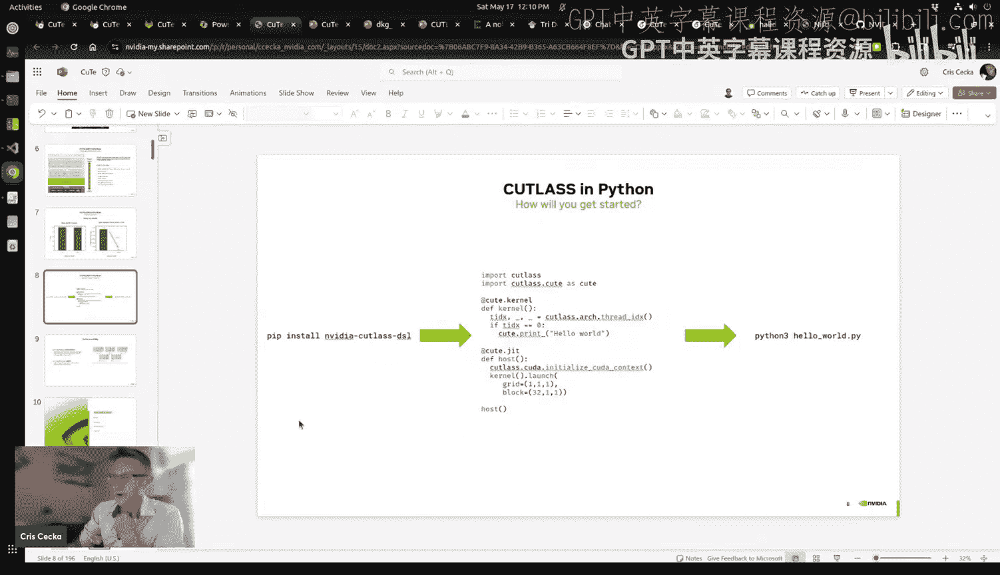

But I'm here to talk about cute， everything that I say here should also appear。

 should also apply to Python if it doesn't， let us know about it we would like to know。

But what is cute？Cute in a slide is two things。Cute layouts are a representation。

It allows us to express data layouts that go far beyond row major and column major。

And they let us write extremely generic algorithms。Like copy， gem， reduce。

 we only need red knees once。They allow us to encapsulate metadata。

 I'll explain what that means later。Cant layouts are also an algebra。

What does that mean that means I can combine layouts to create new layouts？

And I can implement way more generic tiling and partitioning than I have ever seen before in any other system。

So let's see how some of this works。So。The way that I think about cute， again。

 let's talk about loops first。If we consider this arbitrary for loop and I wanted to essentially represent this for loop。

 all of the parameters of this for loop I could I could write down inside this box right the for loop starts at two。

 it ends at 50， it increments by3， It has a base pointer of a。

 and it does this weird index transformation inside of the loop。That's complicated to me。But。

But an exactly equivalent code can be written like this， just by transforming。

The the for loop starting position to zero， transforming the for loop increment to one。

 and then performing some index math on the base pointer and transforming the any index transformations that are inside the loop。

And this， I claim art is much more interpretable because now I can find， I can immediately say。

That there are 17 elements。Inside of this that I am modifying。

 those 17 elements are all strideed away from each other by 21。

And those 17 elements start at this particular position in memory。

Just by glancing at this for loop and these parameters， I could not tell you that， right。

 we can derive it， of course， but I could not just immediately tell you that。

So this is a 17 element vector somewhere in memory whose elements are started。我我也是你说的。

We can do the same thing for two dimensional loops， right this is not constrained to one dimension。

So for a two dimensional loop， right the parameters the parameters start exploding very。

 very quickly， but again we can transform it so that the base index is0， the increment is1。

 all the transformations are happening inside the loop。

 all the constant offsets are accumulated into the pointer and so we just have a base pointer and here it looks like we have a two dimensional object which is taking two indices that one of those indices iterate to four and one of those indices iterate to 20 so maybe we could interpret this as a4 by 20 matrix and then it's got some strides which tell us where the elements of this matrix。

Where the elements of that matrix actually live？Again， by just looking at this code。

 I couldn't really tell you those。Those things， I couldn't tell you what's going on here。

So by simplifying the shapes that we're looking at。

 by simplifying the base pointers that we're looking at。

 we can start talking about building this layout object。

 which is going to be a mathematical function which tells us how to map logical matrix coordinates。

To physical value indice。And this is not new， it's not particularly interesting。嗯。And so。

 for example， if I have a two by three。Matrix， I can represent that in column major。Okay， and I'll。

List out the strides explicitly。 So the strides， as I go down。

 this first mode of size 2 is this the stride is one。 So A D。D follows A。 E follows B。 F follows C。

 as you can see in the physical representation。Row major is the opposite。

 the stride one just appears in the other mode。We can immediately you know， generalize this。

 There's no reason why I have to use three here or two here。 I can strive by four。

 This gives me a padded column major so， so the actual values of the matrix live here in these positions in memory and the other positions in memory are just dead space they're just not used Okay that's fine。

This immediately extends the tensors as well right， so if I have a three rank， a rank three tensor。

 I can give each one of those modes independent strides。

 and that will tell me where these elements live in physical memory again in general。

 if I want to know if I want to map from my logical coordinate。To my physical ad。

 to my physical offset， then I just take the inner product of the coordinate。With the strike。

That I have。Does that make sense to people？So Chris a lot of the insight here is like all of these sort of like mapping from logic to physical the constraint is always like this is an fine function right and so like I guess like are you also suggesting that like this is the only kind of useful transform and I guess you made a face so maybe you disagree with me I'm curious。

So I agree these are all outlineline transformations and those happen to be the most useful and the most common they are not the only transformations that you could imagine triangular matrices if you wanted to do those。

You could not have any memory at all。 You could be looking up you could be computing values on the fly。

 You could be doing lots of things with this， with this layout。Um， these are the most common。

 these are the ones that people like to start with row major and call major。

I think everybody's implemented something like that at one point。But to that point， I can， I。

 I do think of cute as as a generalization of of these kinds of。Really common patterns。

 So for example， MD span。I compare cute tensors to MD spend very often。

But I would also claim it's much， much， much easier to use。

At least for all of the very common applications that that we're going to be talked about。

 which do happen to be a fine。You can do fancier things in cute。I'll touch on it if we have time。But。

Yeah， we'll focus on these first。So， to。If you're familiar with student entities then I don't。

Like its interface， I don't like a lot of its abstractions。

And I should just be able to create what I call a layout， it has a certain number of rows。

 a certain number of columns。Give me an iterator to whatever data you want to actually。

Back to this tensor width， give me a layout that describes this coordinate to index mapping。

And then we're off of the races right we can have our double4 loops。

 we can index into our matrix and set it to whatever we want。

 we can assert that the rank of this matrix is two right I gave it two modes here cool。呃。Yeah。

Tsor is a view， not a container， can take any kind of iterator that you want。

The rank is the number of of。The number of modes of a tensor。

 sometimes called the number of dimensions of a tensor， like a matrix is rank two。

 a vector is rank one。The size is the extent of a mode。

 So here we're just asking like what the size is along the zeroth mode。

 what is the size along the first mode。And the stride is the elements between the consecutive ones。

The cool thing about cute， the first thing I did in Q was that very， very often。

I know what these values are， either the shapes or the strides。I know what those are at compile time。

And I don't want。This integer to require any storage in memory or require any compute at runtime。So。

You can just replace these dynamic intinggers with static integers。This int 22 is a static integer。

Didn't change any other code， still just going to make a shape out of the static integer and the dynamic integer。

We can still assert that this is a rank2 matrix， we can now static assert that the size of the zeroth mode of that matrix is statically known to be 22。

And we can do the same loop structure， we don't have to change anything else。

So this is effectively an optimization。And。Here， I've printed out the matrices as well。

 So this first one， you can see it's got a pointer。 It's got the address of that pointer。

 This is a 32 B because we're。We got a pointer to flutes。This is 22 by 19 stride by one。

 these are just the default strides that defaults to column major。A stride of one。

 that's a suspicious looking underscore and a stride of 22。If I make that if I make this mode static。

Then I can again print this matrix。 You can see this underscore odd。

 the underscore is indicating that this mode， that this value is statically known。

So this mode is statically known to be size 22， this mode is dynamically known to be size 19。And now。

 both strides are static。Which is pretty cool。 I didn't tell it the strides， right， This is。

 this is the default column major strides。 So default column major。

 we've got a static 1 stride and a static 22 stride， which means that when I index into this matrix。

😊，The inner product。Is not going to be the inner product with the stride。

 it can build in these statically known integers into the inner product。And。Actually。

 the compiler is very， very good about making that much faster than dynamic interest。

And then of course， we can specify the strides as well so we can make an arbitrary shape。

 we can make an arbitrary stride。Those strides can be both dynamic and static as well。

 anything you want。And we can extend this to arbitrary affne layouts layout left is this default column major that I was telling you about layout right is the opposite default kind of row major it reads from right to left instead of left to right。

And then here I'm just explaining these static indicators。So that's all well and good。 And this is。

 this is all kind of like one to one。 You can do the equivalents in in。

Withto MD span or pretty much any other transferor library。

 so nothing well except for the static enhancement is pretty cool， I think。

And other tensor libraries have their ways of doing this。

 I think this is very terse and easy to work with。Now we can get into kind of the interesting stuff though。

So in all my work with tensors。It is very common to。Be in a situation where I have。

Consider a two by two by two tensor。 Okay， I have a two by two by two tensor。 So3， rank 3。

And I've got its layout here。Sized2 by2 by2 and stride by 4，1，2。

 So that means that as I go across the row。Across the row is divided by one。 So A B， C， D。

 you can see A， B and C， D are stored next to each other， et cetera。

 and follow the strides to figure out what the physical storage pattern is。It's very。

 very common to want to take a tensor like this and fold it。Into a two by four matrix。

And in this case， we can absolutely do that。 This is really cool。 So instead。

 I can just grab that same pointer， right and replace the layout。😊。

Replace the rank  three layout with this rank 2 layout and everything just works。

This one mode is across the row， so A B， EF， and there it is A B，EF in physical memory。

 everything's happy。And this， and I was able to do this and publish papers on this。呃。To。

 to great effect where pretty much where any tensor contraction can be mapped to a batched gem。

And we do that by kind of like grouping the modes together。And so all of we can identify modes。

 group them together， call this the row mode now， call this the column mode。

 call this the reduction mode， because it's repeated along here。

 the batch mode appears in all three of these tensors and we can canonicalize this tensor contraction into a batch gem。

And that's equivalent to just folding the tensor into a matrix and then passing it off to Ku Blause or your favorite Blaza library。

The problem that always bugged me。Was the following。

I can fold this tensor into a  two by four matrix。But I can't fold the tensor。Into a 4 by two matrix。

There is no stride that I can put here， so A C， E， G。诶。C， so that's a stride of 4。

 But then E is a stride of2 away from a。 And we actually went backwards， right。

 We went from A to C backwards to E。And then all the way to G。

So there is no integer stride here that will describe is where my elements are stored down this mode。

So this asymmetry bucked the crap on me for a long time。 Why can I fold it one way。

 but I can't fold it the other way。And this is preventing me from just using all these gem and buse libraries off the shelf to perform whatever tensoring direction I want to perform。

So， I。Went back to this work and said， oh， well， but we're just combining modes and identifying them as other modes。

So。Let's do that。So if I， instead of， instead of trying to fold this as a 4 by two matrix， I can I。

I know that I can actually embed inside of this mode。More modes。

 And actually keep track of like this is， this is a matrix inside of this particular mode。

 That's kind of weird。 But according to this inner product rule。

 like this still works as long as I index into this matrix with， with the with the right coordinates。

 right now the， now the coordinates for a row。Are going to be two dimensional。Which is weird。

 but it works。According to this in your product， it's a nice little generalization。And。

We can see it just works。If we wanted to index。Into a 4 by two matrix this way。 But I don't， right。

 Because if I had to index into a4 by two matrix using the using these like coordinates as a row index。

 like， then it's not a matrix。 It's not the same as。As a。

As if I were just treating a four by2 matrix。ok。I mean， we could use indices。Here。

 and just internally， like map， map this row index into this row coordinate。

And then perform the enter product， and that would work。

And then if we squint our eyes and kind of forget about。

Forget about this like hierarchical shape that I'm doing。呃。

If we squint our eyes and use these integer indices for the rows and the coordinates。

 then then it really is a 4 by2 matrix。 I can treat it in code exactly identically to a 4 by2 matrix。

That's kind of cool。 That's really cool。But this still， this still bugs me。 Like like。

 this still feels like an asymmetry， right the。The two by four view was really， really simple。

 The4 by two view requires this like hierarchical shape and and this row row index transformation。

What's actually happening， why isn't this perfectly symmetric？

And then you can take a step back and say， oh， this four mode。Is actually a folded。

Version of the other two modes。 It's just that we recognized。

That the transformation from these index row coordinates。From the row indices to the row coordinates。

And then the inner product。With this particular column major stride。Is exactly equivalent。 So this 2。

2，1，2 is exactly equivalent to 4，1。The indexing is the same， the result is the same。

So this top one is exactly equivalent to the bottom one， we can index both of these with raw indices。

 we can index the top one with a coordinate。But if I'm doing code， I'm just going to use raw indices。

So that was really cool。And I'm like， oh， so this is all symmetric。 I can index。

 I can fold any tensor I want。Into any matrix I want。Just by combining modes like this。

 And instead of trying to flatten or we call this coalescing。

 instead of trying to coalesce all the modes， I can just。

Keep them next to each other and perform these computations。

So let's start formalizing this a little bit。 What is a how， how do we build up these types。

 So I'm going to call a shape。 A shape is going to be this hierarchical tuple concept。

 And it's going to have ins。 And we define this as saying a shape is an int or a tuple of。Ss。

So it's recursively defined like that。嗯。You know， for lack of a better term。

 this is a pretty cute definition。A stride is similar for all intent purposes。

 you can think of these as integers as well， but actually these can be anything that support inner products with integers so this is in。

In mathematical terms， this is called an integer module。诶。

We are free to think of this as only being integers for the time being， you can do some really。

 really clever things by playing with your stride objects。

But we do want it to be congruent with the shape， so we want it to have the same like kind of hierarchical tufold structure here。

And then a layout is simply a pair of these shaped and strides。

 and we can map between these logical coordinates within the shape and then this index。

And then a tensor is just a pair of a pointer or an accessor and this layout function。

And so any pointer you have lying around， it's an array， a pointer， we can have tagged pointers。

 we can have implicit iterators， for example， like out of thrust。Transform iterators。

 any kind of iterator you got laying around， Thr into a tensor。

 Now it's shaped and strideed and and you can。New kinds of things with it。

So this is nice for a representational perspective。

 but I apologize Chris its just a very newbie question like isn't an iterator a form of strider that I like miss miss this like basically the like。

The offsets at which you stride over is effectively like an iterator。

 I'm like confusedfuse what accounting and transform iterator actually are。Yeah， so， okay。

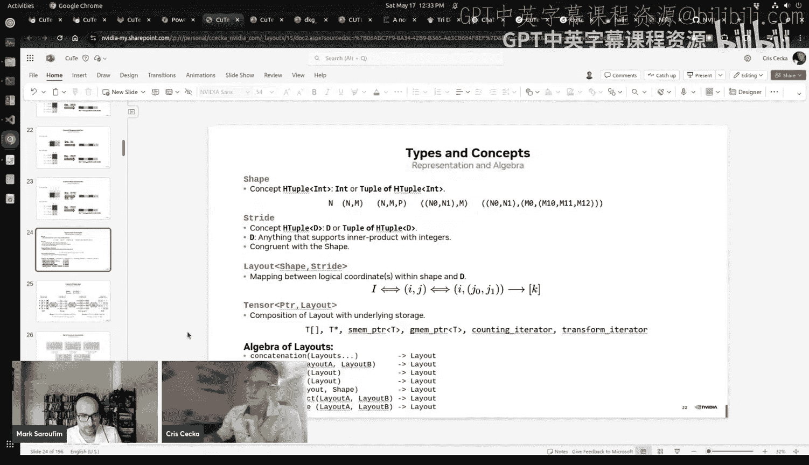

Let me tell you a story about iterators in cutlas 2 x。Everything was implemented with an iterator。

And。The iterator abstraction is a poor abstraction for。呃。Multidimensional linear algebra。

Because you're embedding not only。Because an iterator is jumping between memory points。

Arbitrarily and so in cuts 2。 x。All of the iterators were bespoke， implemented。

And we had all of these complex layouts and patterns that we wanted to represent。

 and each one was represented completely independent。

The revolution here was in replacing every single one of those iterators with this cube layout。

So in this perspective， an iterator is just。An array。 It's a data。 It's a random access thing。

 where I can ask。Hey， data backing， what do you got at index 5。Right， and that's all it is。

 An iterator should be done。You can start getting clever with it。But。

but not too clever right because like the composition of like two I find iterators would still be like an iterator。

 so I guess like the abstraction doesn't let you do wacky stuff where you're going back and forth presumably。

It does let you do Oh， Oh， it does let you okay Oh， but we're not going to talk about that。 Okay。

 I see。Yeah。Okay， and then。

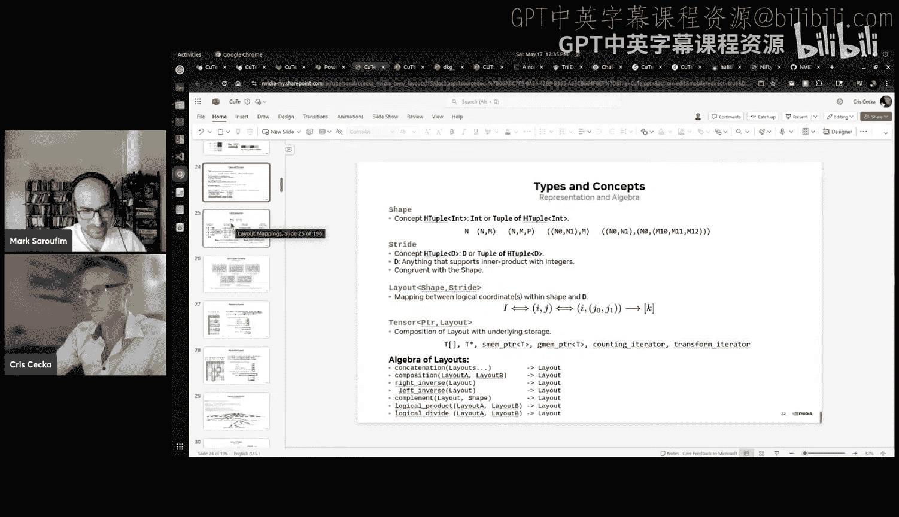

So this is a pretty compact representation。Again， all I need is an iterator。

 something that that when I send it an index， it can look up in memory or whatever else it wants to do。

 it can give me back of value as long as， you know， that value is consistent。 It should be。

 it should be a consistent lookup。嗯。And then the really fascinating part is that you can start running。

Really far and you can create what I call an algebra of these layouts because these are aine like Mark just mentioned。

 you can combine。Aine functions。And you can start asking， hey， what can I do with。Two layouts。

 I can concatenate layouts。Certainly， I can functionally compose two layouts。

And it turns out that the functional composition of two layouts is almost always another layout。

I can take the right inverse of a layout。And get another layout。

 I can take the left inverse of a layout and get another layout。 I can take the compliment。

Complient's a weird definition。There is a notion of a product of two layouts。

 I can take the product of two layouts， which you can think of， like， I can replace every。

Every element of one layout with a completely other layout。So a layout of layouts。

I can form this what we call divide of the layout， so I can split a layout into two according to all of the elements that are in another layout。

And this starts to get really powerful， really fast。

So just to be clear though and I don't want to jump into the other quite yet。

 but just to be clear the shape defines these coordinate mappings right we can go from these one dimensionmenal coordinates to these logical indimensal coordinates to these logical hierarchical coordinates and then finally we take the inner product with the stride and that gives us our physical storage index。

We take that physical storage index。 We ask our pointer。Hey， what you got？

And the pointer comes back and tells us our stuff。Ts the surveying。So a bunch of quick examples。

 obviously we have column major， we have row major。It's very easy to do a column major padded， right。

 that's just a different stripe。呃。Cts2 had these column major interlea iterators。

 but what it was effectively trying to model was this layout。

Where it kind of goes halfway and then scoots back and then comes up and then goes back up up just kind of two blocks and then you can do this thing which I don't it doesn't even have a name like why are we trying to name all of these things just tell me the just tell me the layout and we'll go from there。

But the point being is that all of these layoutoffs。Or can be interpreted as four by eight matrices。

And I can index into them like they are  four by8 matrices。

And I don't necessarily care where all of the data lives。 So， so occurs with the question here， like。

 could you literally just put your finger somewhere on this like tensor and like draw like randomly and'll get like a total light and just build like arbitrary layouts Like I' was like trying to think about like what is possible to express versus versus not。

 Yes， it is possible to express some really crazy bonkkerers layoutoffs。 I have lots of examples。

 if you would like one。

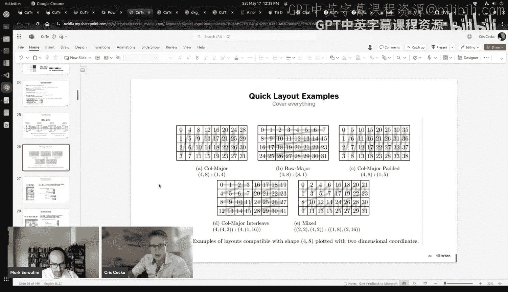

And swizzle layouts are even crazier。Yeah， so here's a crazy one。 let's look at one。 So。

 so this is iterators versus layouts。 Okay， so recall again and cut us to all of these。😊。

Ks of loops were implemented with iterators， which like take me from one block to the next block。

 right？And this is how it was implemented on the right here。

If you want to write this code and you want to maintain this code。电 know。They could do。

But we were able to replace every single implementation and I did account at one point and there were something like。

I should have put the numbers in here。Something like2 to 300 implementations of iters spanned across 80 files composing something like。

30，000 lines of code， 40，000 lines of code。And， you know。

 none of these iterators work with each other。 they don't。

You need this iterator with this computer with that math and。

And when I partition it from the grid level to the thread level。

 then I need to only use that iterator。Theres a disaster。 But the point is。

 you can replace all of that with。So this is a layout。

You can see I've got a relatively complicated layout here。 I've got this magical swizzl function。

 which is doing something。😊，Something funny that turned out to be useful inside of the architecture。

And then I can do this nice little tile to shape。I have this layout and I can it appears to be。

How big is this layout， This is 16 by 16 layout， right。

If I take the product of these two shapes along these two moons， 16 by 16 layer。

But I didn't want a 16 by 16 layout， I wanted 128 by 64 layout。

but I can do that because I can just take a 16 by 16 layer and just。And now I've got 128 by 64 that。

 and we can print this too， by the way。 So just print Lo tech。And we get this nice little print out。

 here's my 16 by 16 layout。I've tried to color it to be reasonable。

 but that it's still not very reasonable point is I would like to write this once and then forget about it。

I had a much simpler question after this aggression but the iteration order of a layout there's always that like natural indexing from zero to the size of the layout right I guess like new question is it is it always left to right increasing along an individual mode？

I mean， you can write your full looppower that you want。

 if you're just talking about writing your for loop。

 you're welcome to write your for loop power that you want。

Thevert the photo that I think the next slide。Um，Would this just be like from left to right。

 exhaust the size of an individual mode and then increment the next one？

If I so normally what what happens in applications and we can get there。In the next one。

 we're going to write algorithms with these tensors。

But normally what happens right is I would have two four loops， one that's iterating across the rows。

 one that's iterating across the columns， and when I access that IJ pair， you know， thats the value。

 that's the offset that I'm going to be looking at。That's all it was。呃。

So we have these slightly more advanced patterns， if you're familiar with Morton codes。

 this happens to be a three level Morton encoding expressed as acute layout。

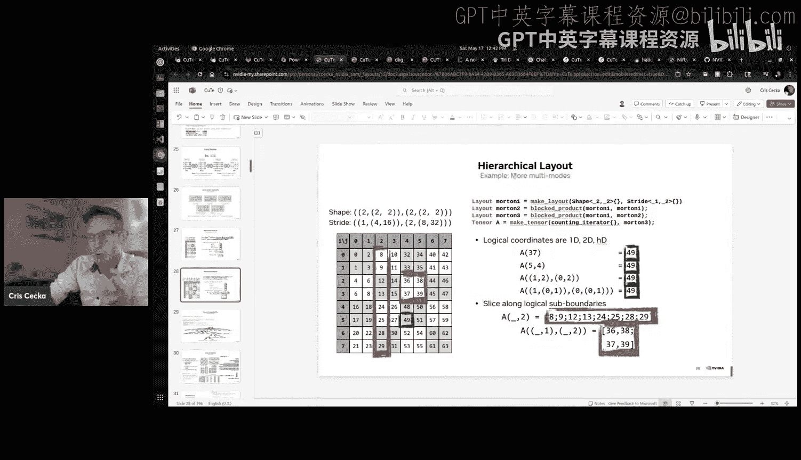

This is an eight by8 layout You can see that we have。嗯。I alluded to these， to these。

To these algebraic operations we have。 so I create a small two by two layout。

 I take the product with itself。To create a bigger one， and then I take a product again。

 to create this eight by8 one。 this is what it creates。Doesn't matter how I produced it。

 I could write this down manually， right， but it's cool to just take products of layouts and make things like this。

 too。 I can index into this in multiple ways。 I can。😊，Like I said。

 I can treat this like an8 by8 matrix and index into it with row and column indices。

 but there's no reason why I can't also just use an integer coordinate。

That'll get mapped to the exact same thing。I can use these hierarchical coordinates。

At any level of the hierarchy that I'm interested in， they all get mapped to the same position。

 is these are， these are all ways of asking for position 49。And of course。

 I can do matrix matrix E things， and I can slice along log logical sub boundariess。

 So if I wanted the second column。This is how I would write that。 And it gives me back， Obviously。

 this is not just a vector or anything。 This is another tensor。 It's got its own layout。

 We can figure out the the pointer offset and the new layout and。

And go off and do whatever we need with the second column of this matrix。

There are nice mathematical properties here， the shapes form a post set。So for example。

 if I write an algorithm。And this particular algorithm requires。

 you must pass me a eight by four matrix， or in this case， you must pass me a six by six matrix。

Then in principle， you can pass me any one of these。As well。 And that algorithm will be happy。

Because I can index into a 6 by6 matrix symmetrically for every single one of these tensors。

Which is really， really attractive so I can start doing really clever crazy things with where all of these values live and how they're being accessed。

So like I said， this was。A great success for representing everything that Culas ever wanted to represent。

And more。So let's write some arguments。This is cool。That's right， copy。

If I want to copy from one tensor to another tensor。Okay， I've left a lot of space here。

We probably need to probably consider the rank， right？ So if the ranks are。

Two dimensional then we need two four loops we'll probably iterate over the rows or columns at once。

But we need to do that together， what about three dimensional tensors， you know。

 it gets a little harder。All of these tensors except integer coordinates。

And so that's my implementation of copy。And that's universal that will work on any tensor in Q。

Is this considered like a natural ordering of a layout？

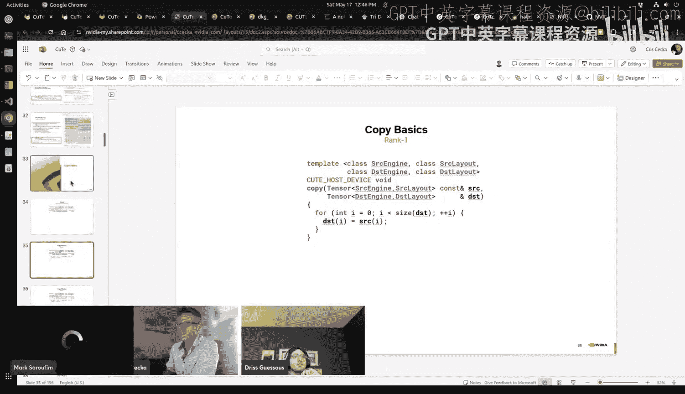

Because like I guess is every layout defined this sequential index to the end。

That that's kind of what I was referring to where in your previous slide you have this like。

Itating point movement I'm curious what the like the little line was just for exposition it just kind of shows you the the physical order within this storage but yeah it doesn't have anything to do with necessarily the iteration order or anything。

So。This is interesting， pretty immediately interesting。We can start pointing out some problems。

Copy is fundamentally， I would call copy fundamentally a rank one algorithm。

 like I do not care that you were passing me these super high dimensional tensors or anything。

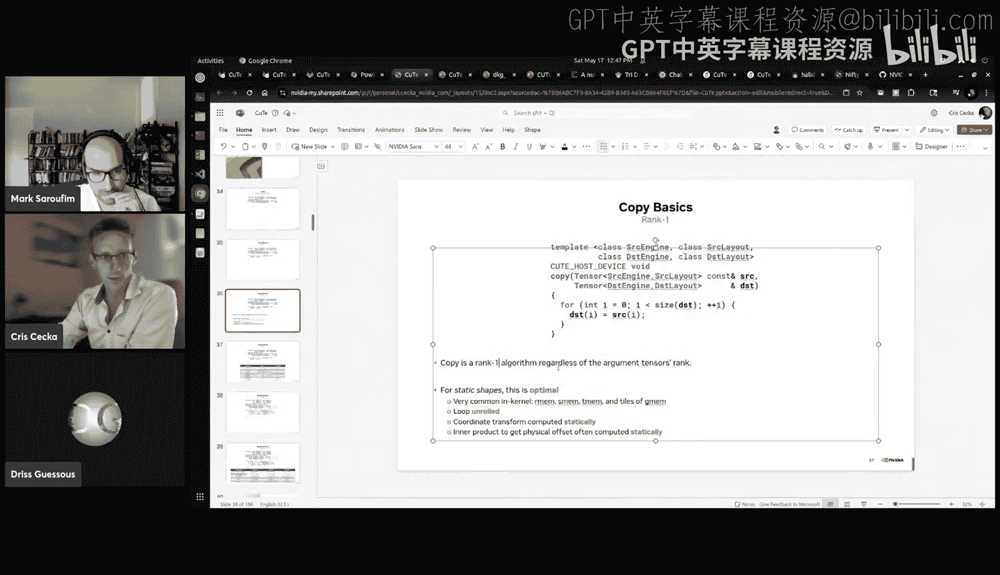

嗯。And what's most interesting to me is again， remember the static versus dynamic stuff for static shapes。

 this is optimalle。And by that， I mean that if the shapes of these two tensors are both static。

Then this loop can be completely unrolled。The coordinate transformations。

That I have to apply can be also computed completely statically。

And the inner product to get the physical offset can also often be computed statically if the strides are static。

 then that will also be completely statically computed if it's dynamic。

 itll still be optimal because I've got that hierarchical coordinate that I'm performing the inner product with。

 I know that coordinate statically。And the point being is that static shapes are extremely common。

Especially in KUDA program。Because our men of register memory is fundamentally static。Shared memory。

 we almost always know the layout of shared memory that we want to be competing with。

Tsor memory in blackwell is always static。 And the first thing and global memory。

 that might be a dynamic shape。 that the very first thing we do to every global memory tensor when we are writing a k kernel is we tie it。

😊，And that tile is static。So the subtile that we're working on within the block of our kud kernel。

Is almost always a static。Statically sized tile of global memory。

So this starts to tickle you a little bit and you can think about what you can do with this implementation。

 we can copy， we can obviously copy one dimensional arrays to each other。

 we can copy multiple dimensional arrays to each other， so this would be a rank three tensor copy。

We can you know gather a bunch of elements that are kind of distributed around away from each other。

 We can gather those all into a vector。We can do this opposite and scatter a vector into a bunch of elements that are scattered around everywhere。

 These are kind of interesting。 Zero stride is a thing。I can broadcast。

 So this is an8 logically8 element vector。Where every element of that vector is the same。

Value in memory。And I can copy that。To。A non broadcast in vector where every logical element is a distinct element。

Similarly， I could copy a constant vector to another constant vector， or I could perform a transpose。

 This is an implementation of transpose。 Copy is an implementation of transpose。

 and I can take an 8 by 3 column major。嗯。A by three column major tensor and copy it to an8 by3 row major tensor。

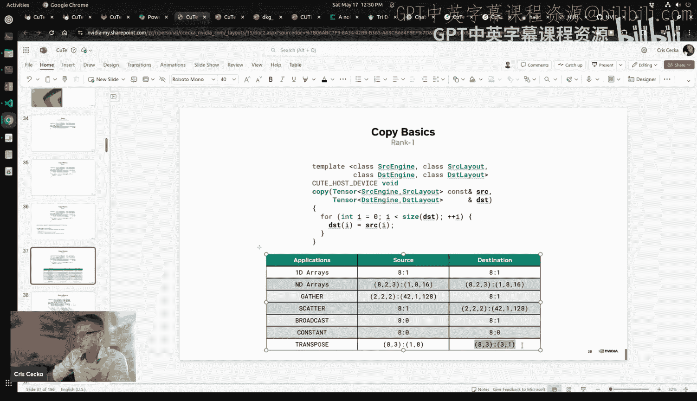

And implementational copy will just do all of these for me。

We got an interesting question in the chat like what is optimal with respect to。In your last slide。

In the context of I don't want any runtime overhead whatsoever。

So I've you know suggested that we should be doing these row index computations and these inner products everywhere。

 everything like that， I don't want that to cost anything at runtime。

And so long as the shapes are static， that almost certainly will not cost anything at one time。

And I guess like Chris， another newbie question， which is like。

 is this like the heart of the complaint regarding like slow compilation times like in effect。

 like especially when I looked at your slide 37， like you're generating like straight up like an algorithm that like you know the alternative is someone having like if like writing separate functions for them and is this sort of like the source of the compilation problem or is it like something else entirely Yeah。

 of course， it's propagating all the static information around and I make absolutely sure that I never lose track of any static information。

Because that that's the death of runtime。And and related like we had Ismaelj ask a question。

 which was like why templates and why not things like constant expressions， like again forgive me。

 I'm not like a SQ+ plus expert the compiler is very， very bad at propagating Con expert around。

There are very easy ways to lose track of constant expert。

 and then all of a sudden you've got a dynamic value in your code。All right， last question for me。

 if you go to slide 37。Sline 37 yeah next one。 so like so things like， for example。

 like when I look at your 1D array like copy versus transpose like those those seem to me like oh。

 you can be clever algorithmically and do something。

 but like things like gather and scatter like these are things like where like the math needs to touch like the real world。

 And so I'm curious like there's kind of like what you can express。

 And then there's like what what low levelve Apis you need to call in the N video ecosystem。

 and I'm sort of wondering if you could help me and okay， it sounds like it's coming later。

 I can show you an example of that right now。So this is， this is more of my cute copy stuff。

 We can talk about optimizations， but I don't want to get into that right now， But imagine I have a。

I a global memory tensor。 first thing we do。 we tile into it， right？

 I have very generic ways of tiling into it。 For example。

 this is four different ways of tiling into global memory。

 I claim that every single one of these ways is a 4 by 8 subtensor。😊。

It's a 4 by8 subtenser is just going to have different strides。Whatever cool Okay。

 now here's the shared memory that I want to copy it into。

 Here's four different ways that I can arrange my shared memory so I can define my shared memory layout。

 right。And I might want to define it one way or the other in terms of access patterns or vectorization or what have you。

There's one way to copy。No matter what I have， I can copy a 4 by8 tenor to a 4 by8 sensor。

 Any one of these tiling patterns， any one of these shared memory layout patterns。I'm done。

So that's the reason why this is so powerful。 and of course。

 there are optimizations that we can make inside of copy。😊，And we can do those very。

We can do those very well， in fact， because we can inspect the layouts and we can make deductions about what。

 what we can do better by inspecting these layouts and asking questions about like， where's。

 where's the strike 1， Should I be iterating in this way or that way。

 Maybe I can vectorize elements automatically， Maybe I could prove that there are no race conditions。

 Maybe I can eliminate。Redundant instruction。You do a lot of fancy things。

 use more complex instruction。To perform an equivalent copy。Same thing for gem。

 gemm is fundamentally a rank three algorithm， This is my implementation of gem。

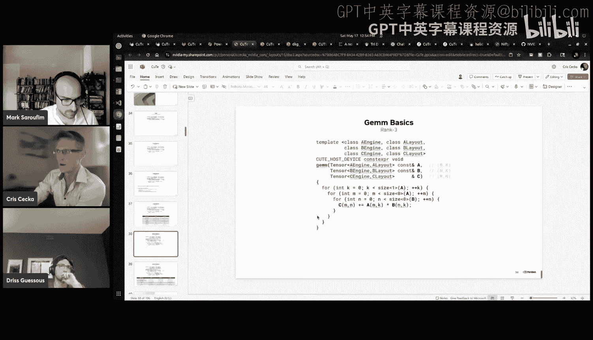

And again， we can start using it for。A huge breadth of applications。

 So all of the N T T N N N T T Blas gems。 obviously， I'm not going to list them out。

 but they're just swapping LD and one here in the layouts。

 We can do an N T T gem where I'm where I'm transposing the the C matrix instead， of course。

 you can do this in blas as well。 but you' got to use the transpose trick and。

Half of people probably don't know what I'm talking about， but it comes up。

At least a couple times a month。m in our select。The bliss gem bliss is another bze library that uses arbitrary strides along both M along both modes of the matrix I always thought that was kind of interesting It's cool we get it for free。

 we can do we can do tensor contractions， of course if we have multiple modes we can do aor Tensor contraction multiple M modes。

 multiple K modes doesn't matter， we can do convolutions convolution is a little crazy。

 but I am to call fundamentally transforms a convolution into a matrix multiplication。

 We can represent the I am to call transformation with acute layout。

And then just call Ge and you're done。And。Of course， we have to make you know， proper optimizations。

 But the point being is that convolutions can be tiled the exact same way that gems can be tiled and we don't。

In principle， we don't have to write lots of extra code for it。

 We can reuse the same optimizations and kernels that we've written for matrix multiplication。

How much time do I have， Mark am I drive you can go as long as you like， really， yes。

I've been really enjoying this。 So if you wan to go 3，4 hours， like， you know， it's。

 it's totally your choice。 Okay， let me get through this section then and I'll。

 and I'll stop that after this section and we can。😊，Chat about where to go from there。So。嗯。

Wouldn't the TMA load be more useful than the universal Yes it would。

If only we had a way of constructing TMA copies with。Yeah， we have lots of teammate examples with Q。

So cute composition。Is the workhorse of the cute algebra， all of these products， divisions， tilings。

They're all implemented with composition， I'm going to show you what that means。

Let's go back to our layout mapping， how our layout mapping works。

 we transform our coordinates right， and then eventually we take the inner product of that of those coordinates with the strides in order to get our physical index。

If we squint。Or get a little drunk or whatever。 Then we can ignore most of that and say， oh。

 a layout is just a function from integers to integers。

And the first thing I can think of to do with a function of integers ingers is functional composition。

And it turns out that the functional composition of two layouts。Almost always produces another lamp。

Or。And so going functional I'm going to define the composition of two layouts A and B。

 to produce another layout R。Such that R is shape compatible with B。

 This is my notation for shape compatible。 This is that post set of shapes that I showed up here。

 right， I want it to be compatible with what I'm composing with。

Which is just a shape constraint and then such that you know。

 we satisfied the composition property where。呃，B of C。

Evaluated at a is exactly what the comp plant gives you。So layout R is compatible with layout B。

 which means that all coordinates of layout B can be used as a coordinate of layout R。

 we have left and right identities， obviously this gives you sociivity。

 this gives you left distributivity upon subjectivity of B。A bunch of other cute stuff。Point is。

 let's suppose we have this composition。Okay。And let's do something interesting with it。

So imagine I have a vector here。Okay， I'm not going to tell you the。

 I'm not going to tell you the layout of this vector or anything else。

 I'm not going to tell you where the data lives inside of this vector。

 I'm just going to give you a vector。This is input to your program。Okay， and now。

Inside of your program， you want to start partitioning this vector。Okay， so for example。

 I want a thread zero。In my coD program to be responsible for these six elements。Okay。

So what I'm going to do is I'm going to create another layer。Which。Points to those six elements。

 And and by points， I mean， like， I'm going to list the coordinates， not the addresses。

Anything like that， the coordinates。 So this is coordinate 0， coordinate 1， coordinate 4。

 coordinate 5， coordinate 8， coordinate 9。 I'm going to put those down in a list。

And I'm going to say， hey， that's a wh。And I can represent that layout as two， three， one， four。

So this is six elements。Sttrided by two and then strideed by4。I sorry I won。Yeah。

 I want each thread to have these six values。喺上音不质啊。And then I want the next thread。

To have these six values。Okay， so again， I list out their coordinates。Not their addresses。

 I haven't told you what the addresses are or anything like that， just their coordinate。

And then we have two more threads。Lying around。 And they get。

I want them to have the values in these positions as well。咁。

So we've looked across the row here and we've。Noticed。

That the values that each thread receives forms a layout。 And now I look down the column。

And I notice that the threads where each thread starts is also a layout。

And I can write that layout as 22212。So I stride by two first， and then I stride by 12。

I put these together and I can create a two dimensional layout。Now， this two dimensional layout。

 what is this， what is this object， This is， this is a map from my thread index。And my vowel index。

To a 1D coordinate of myre。Right， so if I am thread2。And I want the fourth value of that thread。

That I'm looking at than that。Thread value pair tells me I'm looking at coordinate 17。

 which is this one。Okay。That's a weird construction。And so now， but if I have composition。

 then I can take a vector like this。I can compose functionally compose with this thread value layout that I have。

 I get another layout。Because that because the result has to be compatible with the layout that I compose with。

 then it's still。Four by six。And if I want to partition it。Then it's just a slice。So now， thread1。

Has all6， all six values， these green values。 This is thread one's ownership。

 This is thread one sub tensor of this vector。All six elements that thread one wanted， it now has。

And so in code， it literally looks like this。 I have a tensor of input。 I create a vector， right。

 I have this thread value layout that describes this partitioning pattern。

 I literally call functional composition on the input tensor and my thread value layout。😊。

And then I slice it。Along the thread index that I'm interested。

So this thread now owns this row of elements， which is these six elements in the original tensor。

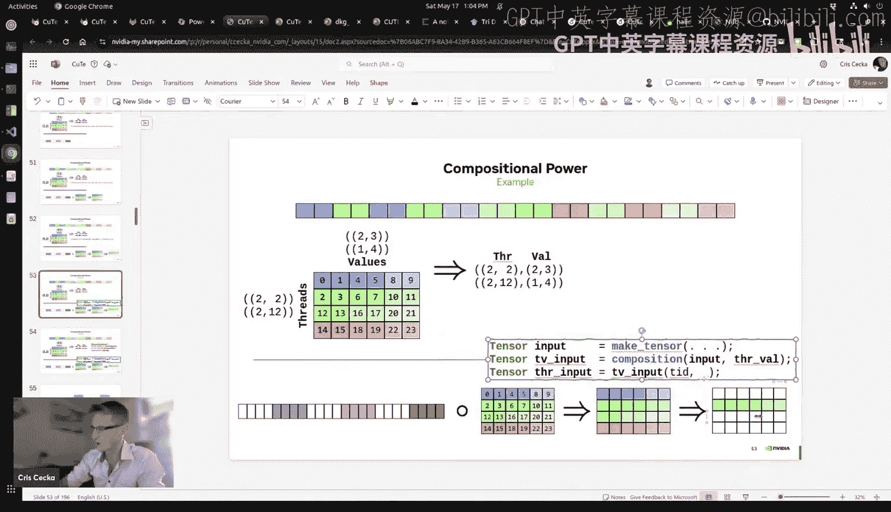

I have a quick question this makes sense I'd say what my curiosity question is what if the thing you're partitioning isn't so well aligned？

Do you， yeah， I guess like what's the general strategy for handling preddication？

Prediiccation is really cool。 That would be an entire another talk。 We have a。呃。We have a formal and。

Really strong approach to app predication。嗯。If， if the you can compose。So just like， you know。

 we need to tile fences。Into tiles where the tiles don't per divide the major or something like that that is totally fine you can still perform all of that is implemented with composition and composition will work it will do exactly kind of what you think it is which it will round up。

But then you need this predication tensor to tell you which values are legal to access and which aren't。

and that's it I don't know if I didn't know mine I magic。

There are magic and equally mathematical ways of constructing that predicate tensor that will always protect you。

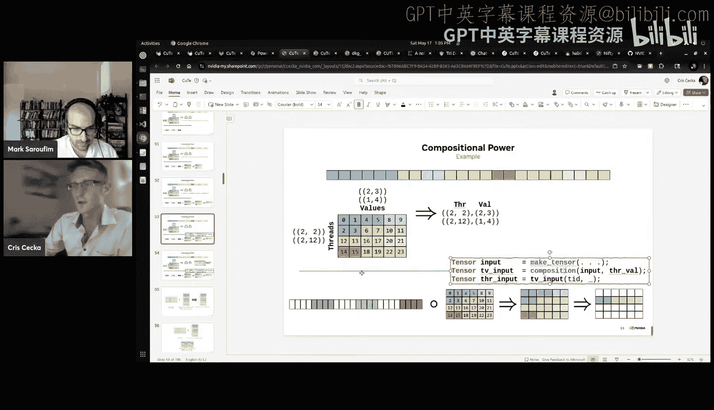

And so the moral of the story here is that， given the layout。Given a tensor partitioning。

The term partitioning is functional composition followed by slice。

And that's that's a pretty cool and powerful observation because I can partition a vector like this in any way I want by by just defining the right right value layout or however other。

However else I would like to purchase on this kind of thing。嗯。And then the punchline。

 the punch line is we did this for a tensor for a vector， right？

So we applied we constructed this thread value。This thread value layout。

 which is a partitioning pattern， we applied that to a vector of elements so that each thread would get a portion of this vector。

But every tensor。Is also a vector。We can index into every tensor。With integer coordinates。

And we can think of every tensor like it's a vector。Which means what we've just done is we've divine。

 we've devised a way to。Arbitrarily partition。And arbitrarily ranked。Arbitrarily laid out tenser。

And that is。Wildly， wildly powerful。Because we can immediately apply that to M Ms Tensor cores inside of Kuta。

 So， for example， this is my favorite tensor core inside of Kuta。 This is the Volta 8 by 8 by 4。

Tenssor core， this is what inspired cute， this is the first Tensor core that I printed out in this way using this long tech print and I was like。

 oh， that's so cool。This is if you read the the ISO documentation。

 this is the partitioning pattern that is specified by the instruction。

 the instruction requires you to partition。Your input matrices。So that thread zero has a value0 here。

 thread one， thread two， thread3。Each one has four down。

 you can see this one's not even continuoustiguous here。

 threadread zero has these eight elements here。The point is。

These are the same thread value layouts that we just did our exercise on。

 and we can encode that as metadata to this instruction。

This is the only thing this instruction understands。

And so it needs to be part of the instructions's metadata in order for me to use this instruction。

And we can do this for every single tensor core。In yours。 So this is， this is a generic tensor core。

 a generic Cti multiply。This is a DP 4A。Which was the predecessor to the Tensor Corps。

This is the first  Volta tensor core。This is the ampre double precision 8 by 8 by 4 Tensor core。

 looks pretty similar。Different， different partition pattern for A And B。

 different partition pattern for C。 We're getting bigger now。 Amre 16 by 8 by 8。

 This is for half precision values， again， just recording and writing down。

The partitioning patterns from the ISO documentation into these thread value layouts。On Hopper。

 it gets a little weird because we have these shared memory descriptors that we need to construct。嗯。

And the A and B tensors aren't even partitioned， but the C tensor is。

Point is we can construct these shared memory descriptors precisely because we can inspect the layout of the incoming matrices。

 we can validate that that they have the right layouts and we can construct the shared memory descriptor for you。

 So all of this is completely opaque。So just a quick rundown So this is what we call an MMmaA atom when we have the raw PTx and the PTx metadata。

We combine those into what we call the M main atom。It can check all of these layouts。

 it can create what we call fragments， but point it even cooler， we can just print them。

So we have these MMmaA atoms。Show me what you're doing。Print the Lotec。

 it shows me this partition pattern。Cool， this is exactly the thread value layout that we were just talking about。

The tiled MmaA， we can multiply these essentially， so if I have this instruction I've printed out a single instruction it's worth。

 right？This instruction operates at a one warp level， I don't want a one warp level。

 I want four warps， I want a two by two layout of these of these of this instruction。And so， I。

Take profit。Of that layout with a two by two column major layout。

 this could equally be a two by two row major layout or a four by one layout what have。

So now this is bigger and more complicated。But again， I can just print it， right？

We can do fancy things。 actually， we can actually permute the M mode， We can permute the end mode。

 and we can permute the K mode。And you still have an equally valid computational strategy。

So this is an example of permuting the M mode。And what that does， it's hard to see。

 but it brings like the threads values next to each other。

 So it's it's slightly easier to design a shared memory layout that will。

That will have good access patterns for this MMA instruction。

 but effectively what this is doing this is interveing multiple MMA tensor cores。

Which is really amazing。

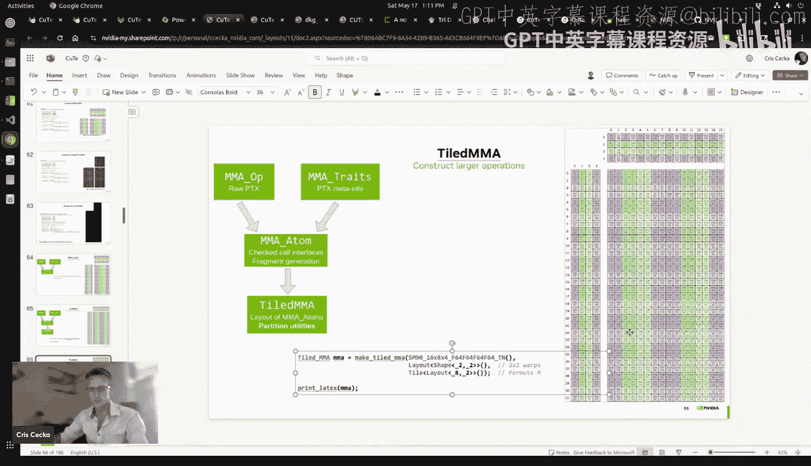

Whoops， oh no。

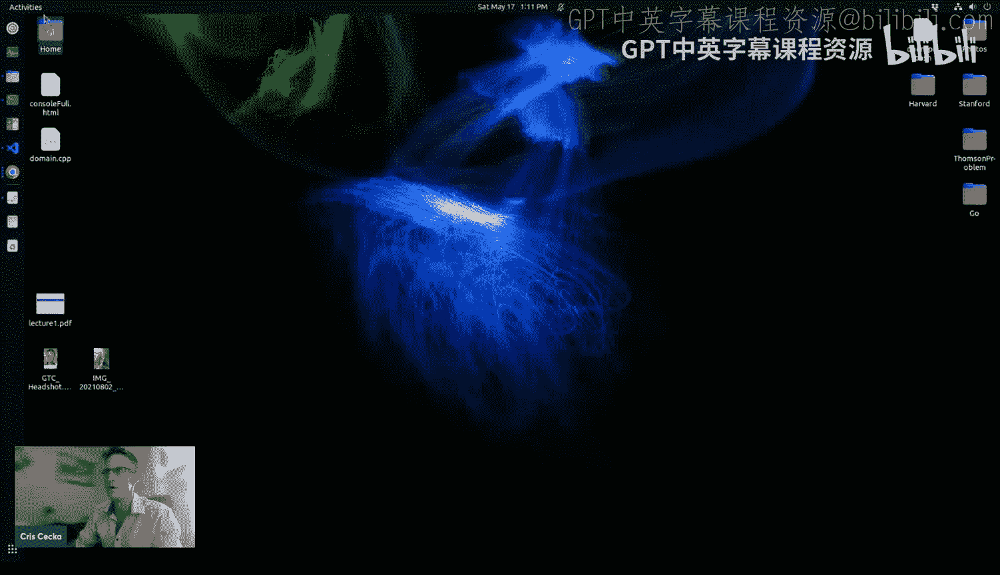

呃。Finally， we can slice that right each thread is going to need to access its particular data。

 so we take this giant tiled Mmama that we've constructed， however we've constructed it。

 we pass it our thread index， and now I've got an object which represents the partitioning pattern for this thread is going to inherit the values in A B and C。

 I've highlighted thread 24 here。And you can see it doesn't even make sense。

 right from from a gem perspective， iterating over rows and columns and stuff like this one。

 What is this guy doing way over here， that's Bnkers。I wouldn't want to keep track of this by hand。

How do we use this？How do we use this M， we construct shared memory tensors。Again。

 these can have any layout that we want。We construct our MMA。However we want， we get a slice of it。

And then we can use that MmaA to partition our shared memory。 So we partition our shared memory。

 partition our shared memory， partition our shared memory。That gives us back。

And that gives us back our threads subtensor that it's going to be responsible for in in。就。

In this instruction。And then we also need fragments， so these are like registers。

 so these tensors are still shared memory， these tensors are register memory。

These registers just have the same shape as the shared memory。Which means that we can copy。

 so we copy from shared memory to registers， we copy from shared memory to registers。

 we clear the results， the results accumulators， we can write a triple4 loop， really。

 really basic and call our really complex instruction and then copy our registers back to global memory。

 this is global memory。Not even个。Right， this one's global memory GC。GC is Google memory。

 SB is sharedd memory。But we partition global memory the exact same way that the instruction expects。

 and so instruction doesn't care it doesn't care if it's shared memory or global memory or what have so all of these are shaped right。

So I want to stop there。 and this is， this is the basis of， of cute。

 And this is what made programming cut lists much， much， much easier because clearly we have a。

Extremely robust， extremely general representation of these tensor cores。嗯。

We can access all of these subtensors， we can always see what's going on if we have a bug。

 we can just print out these tensors or print out these MA。呃。Optimizing often。

 very often just becomes like figuring out the right shared memory layout so that this copy is fast so that we can vectorize this copy internally。

But otherwise， the MMA is just like it's always right。It's。Difficult to write incorrect code。

When you you adopt these kinds of patterns。So that was only 15 minutes over I'm pretty happy with that you don't have to stop now。

 by the way， I think I I could go longer if if you're interested。

 but like like maybe could you give us like some sense of what your is I still see your like maybe a third of your way through your slides what were like some other ideas you're hoping go over I've got a lot of slides。

There are just really cool things that we can do with this。

Like I've already shown some pretty amazing。Results， in my opinion。嗯。But。Like， for example。

 returning the copy。Right。We have all of these possible like inputs to copy。

You can ask about vectorization。 What if I wanted to copy。If I'm copying this layout to this layout。

In principle。Like instead of performing。These two values are next to each other in physical memory。

Agreed， and these two values are next to each other in physical memory。

So that means that I can perform a vectorized copy， I can issue one instruction。

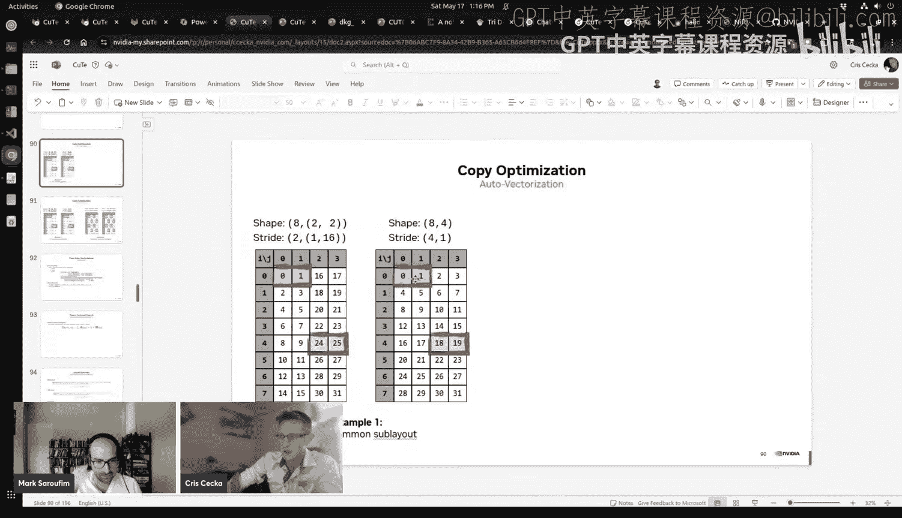

Of double the width instead of two instructions。嗯。And I can do that here for this blue element as well。

 the 24 and 25 I can slip into position 18 and 19。 They're next to each other in physical memory。

Next to each other in physical memory has nothing to do with next to each other in logical memory。

 So 0，1，2，3，0，1，2，3。I can perform a four way vectorization here。

In copying this tensor to this tensor。And that's because they have what we call a common subplay。

This one has a two element common of layout。 This one has a four element common of layout。

If only we could figure out what that common sub layout was。嗯。

And I don't want to go too deep into it， but we can figure that out。

We can start writing down the math。For what exactly is a common layout？We invert that。

 and it turns into the inverse of one layout composed with the other layout。

 And that tells you exactly the overlap of those two tensors。

 And it tells you is exactly the vectorization width。That is safe to perform。

Is this like another overall theme in your work， which is like you're basically mathematically proving a priori at compile time which optimizations are safe to perform yes I see okay。

AnAdd。No， I don't think it is it， is another way to rephrase a common sublay。 Is it like the。

 the minimum slice that is contiguous， Yeah， so。So when I actually present this and don't completely gloss over it。

 the question is， yeah， what even is the comments up there， right？

And so we the simplest way to express it is that A and B have a common set of coordinates。

That map to consecutive offsets makes sense。 And so there must exist。A certain set of coordinates。

Where they both are producing the same consecutive offsets and so there's multiple ways of writing that right and then we can kind of play around with the math and the expressions here and we end up at this really simple invert B composed with a。

I have a left field question which I think the validity and power of Q for gem programming is very apparent if someone at NVIDdia were to say Chris write me a kernel to do X。

 are you going to reach to cute to express the partitioning of the data to threads and values for any kernel you could think of？

Did you say if someone approaches me into every single week， yeah？Yes。

 and I've reached for cute every single time so for example。

 when when we were trying to figure out how to program TMA TMA is a very， very。

 very complex copy instruction inside of Hopper and blackwell moving on。😊。

And it requires an immense amount from the programmer。But I was able to use these cute operations to。

TMA has what's called the TMA descriptor， which describes the entire problem and then you have to generate coordinates inside of that problem space and TMA takes the coordinate and the descriptor and does all the predication for you and it does the right thing。

 right。that descriptor is huge and it's a pain limit it to write and it's confusing and people get it wrong and people don't optimize it quite properly。

But I can inspect。The global memory layout， and I can inspect the shared memory layout。

 and I can generate that。That TMA descriptor， and I can generate the right coordinates。

 and I can figure out where you are and and how many bytes are going to be transferred and blah blah blah blah。

 blah and yeah， everything is。I is done for you and it's very safe and it's relatively easy to write。

でもいか。So this kind of programming model。Ha yes， it's found a ton of applicability inside of gems。嗯。

But it's。Become more general than that， where we are using it for every copy operation。Every。

Compute operation that we have。 copypy operations are getting extremely complex。

 They're all collective。 They're using multiple threads。 They're using multiple warps， the source。

The source partitioning pattern is not equal is not equivalent to the destination partitioning pattern。

 so is this is a copy atom， which is the equivalent of an MMA atom but for copies right and this is for LDSM。

Which is a load from shared memory into registers。This is the partitioning pattern for the source。

 which is shared memory， this is the partitioning pattern for the destination， which is registers。

They are not the same。That's mind bending， and it's impossible for humans。

And we had Excel sheets on Excel sheets like tracking shared memory layouts and operations and what is this register representing and where does this live and how do I get this all back in the epilogue back to global memory and how do I make sense of this？

But then at the end of the day， like all we want to do is write code like this where I have some kind of tiled copy。

I apply that partitioning pattern to the source， I apply that partitioning pattern to the destination。

 and then I just start calling copies。And。And trivial for loops over the integer coordinates of these tensors。

Let没说算。Yeah， so Chris I want to ask you like maybe one dumb question one interesting one So its a dumb question considering I wish we had you for a bit longer do you mind sharing your slides after this call like just a lot of people want to go through them Yes。

 but I won't include all of them whatever whatever you're comfortable with I guess my second question is like when I look at sort of like the annoying parts of writing bytor code like at least the parts where people get tripped up the first time it's like very often like when they're doing like reshapes and cats and flattens and it's basically people are like manipulating shapes and it's kind of like hard for them to sort of like mentally map in their heads but like like it sounds like while for cute maybe the upfront overhead is like quite higher like ultimately it gives you like a mathematical algebra for you to reason about。

Like copies， reshapes。Regardless of layouts， regardless of the number of devices， et cetera。嗯。Yes。

 and there's a lot to say about that， whether you're talking about like logical reshapings versus physical reshapings and do you actually care where everything lives。

 sometimes you don't， sometimes you do， There's lots of these extra cr Crotient。

 so you do have to be careful。呃。But。Yes， in terms of just like being able to fold。

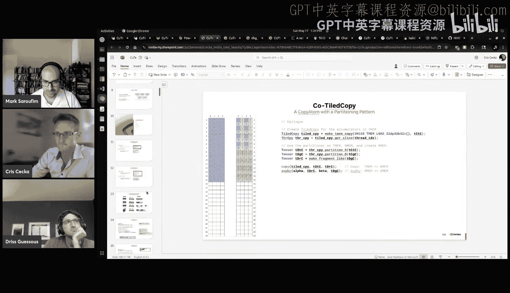

Just the representation itself and being able to fold tensors into matrices。

In more robust ways than are usually possible has been。Has been immensely useful。

For just getting this stuff off the ground。And so so would you say like the two papers you linked there at the bottom like the those age well。

 you still view them as sort of like the besttro for people to get introduce to these ideas Oh no。

 absolutely not these are these are academic papers on applications for tensor contractions and such if if you want introduction and you want further work for。

For cutlesss and cute， go to Nvidia Culas， there is an immense amount of media and documentation on the on。

Colls， I have my own documentation folder， most of these I wrote myself。And then the new Python DSL。

 you can see how to get started， the quick start here。

 Hello worlds also goes through a lot of the cute operations。

 all of these products and divides and how do I do tiling and predication and such and such and so。

That is the best place to get started。There are a lot of code examples as well that you can find in here that are linked in within this documentation as well that all of those are highly。

 highly recommended for for continuing and getting in there and like。

Hacking on kernels and doing that one weird thing that we were never able to do before。Okay。

 I think then this might be a natural time to call things Chris， honestly， thank you so much。

 this is one of my favorite talks so far on the server。

 the recording will be out folks soon we'll hopefully get some slides and if you like this please comment on the video so Chris comes again next week we're going to have a talk on thisaggregated element and Fri by Jindochn and yeah I'm looking forward to it and see everyone soon。

😊，Cool， thank you， Mark。Thank you。