# GPU MODE《CUDA、GPU编程54-87｜GPU MODE》中英字幕（deepseek-v3.2 p05 -20250526-Lecture 58_ Disaggregated LLM Inference.zh_en -BV1xbmQB3ETC_p5-

Yep。😊，Okay， I think yeah so yeah， welcome everyone to lecture 58 of GP mode then I'm like really excited to have like G1 agendanda from the how AI lab ESD to talk to us about like a of like like the segregated in France this for what it's worth has been some of the most impactful like ML systems research of you the year I think it was like Yen's keynote if I'm not mistaken。

😊，And so like Juda does like a lot of cool work in this space。

 I highly recommend you go check out his today we're talking about the segregated inference and。

 please take it from here Yes， hey everyone， I'm very。

 very excited to have the GPU mode talk I think I was originally want to schedule it right after GTC but GPU mode is like so popular and everyone has amazing talk So kind of schedule like two months later and I think like two months later。

 the space has changed so much that the slides that I'm making today probably doesn't catch up with what is happening in this community So if I make any mistake or if I you know like if there's anything that from the slide。

 please just let me know in the comments so that I can add it into the slides or next presentation or for just more complete acknowledgement and I also thought about this title for quite a while like originally the title was called throughput is not all you you know what I mean later in the presentation saying we're actually saying。

😊。

You know like a goodput is actually a better metric for evaluating GPU inference。 And for now。

 I think this community has grown into a size amount of people actually。

 I think most of the major company are actually having their own disaggregated serving feature。

 So I think it's a good time that we have a discussion about you know what is free dissegregation what what are some of the motivations that behind this and particularly in behind our work and some of the community effort I already have in this community。

😊，So without further ado， let's get started。A little bit about me。

 I'm now a I'm a second year PhD student UCSD， my interest is mainly focusing on efficient LM serving system and also recently I'm looking into of reasoning system to see how to actually accelerate reasoning to make it more efficient。

😊，And before that， I was in U medicineine having an undergrad master doing mostly traditional system。

 P system and database， and then I joined Datachs an intern for four years。

 I was doing technical lead and I was enjoying a very great time doing data analytics。

 some of the NLP researchers and also more of the foundational system efforts。😊。

So。😊，Today， I want to talk about start start from talking about N dynamo， which is when in GDC 25。

 you know， Jensen actually announced this dis aggregaterogated inference framework in GD 25 as one of the major。

You know， featured a framework for inference for LM inference， particularly if we look at this graph。

 you actually show that， you know， if you have a MR 72 system with F4 with TDLM support。

 then you have this very nice graph， very nice tradeoff between throughput。

 and latency by throughput， what I mean is the aggregate throughput that the system is producing。

 for example， if you have ML 72， which will have like 72 gs， then you will get， you know。

 the total number of tokens that generated every second right for the aggregated metric of the whole system。

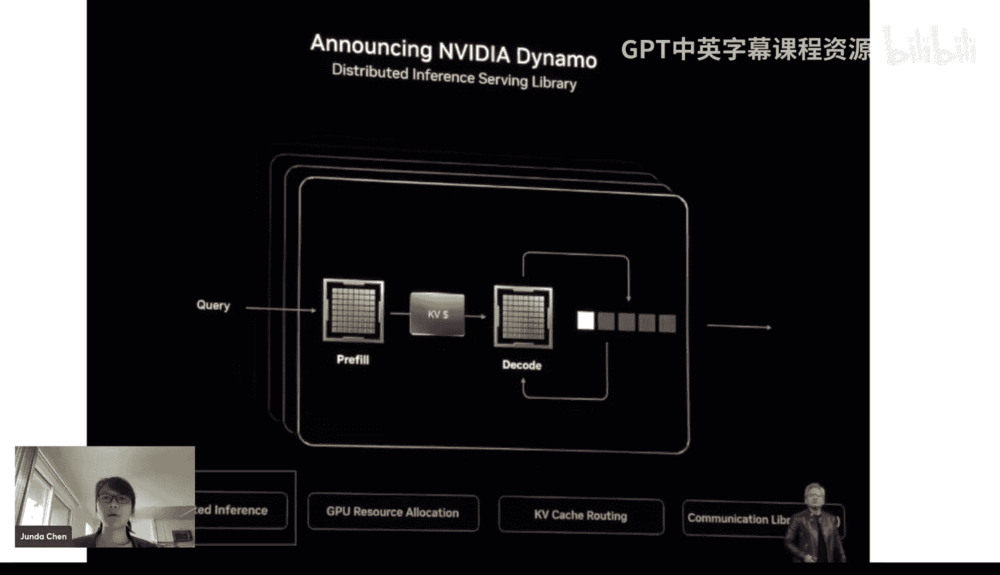

But you have another metric actually on on the X axis， which is the token per second for a user。

 which means that， you know， if you're one user， what is the actual latency that you are going to see right when you're sending that request。

 So it turns out this is actually a nicely tradeoff space that you can explore and doing dis arogation is actually a very good method for doing for finding you know like the golden point in this space。

Iex explain what， what， you know， each of these， you know， throughput or latency。

 whatever means in the next few slides。 So if you're so confused about what this really means。

 hang tight。And you know， I was very excited over there。

 I actually took a selfie with this photo because it actually means that our research actually take off and you a have a really interesting impact in the community。

😊。

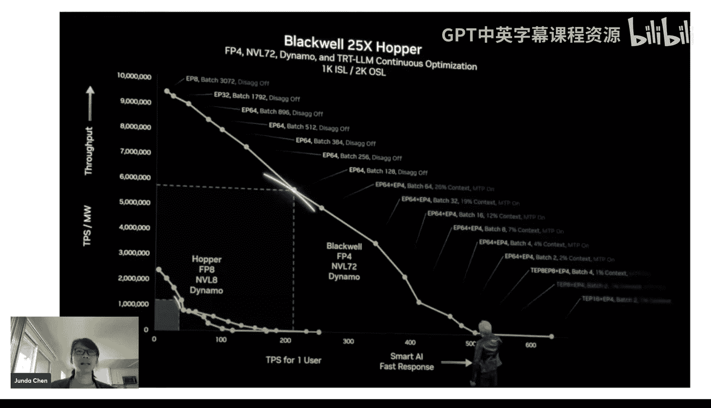

So one of the very essential reason for why this server is interesting is because nowadays we have many different applications。

 for example， for chatbot or search engine or for programming agent。

 and they actually have different SLO measurement， and particularly we're interesting in two metric。

 one is this TTFT， which stands forken time to first token。

 and then there's another metric called TPOT， which is once you cross the times for the first token。

 how what is the time between each token they're going to output。

So this SLO in in this chart may not reflect， you know all of you because this every company will have its different SLO defined。

 But the just is like， you know， application will have different SL， right， for chat， for example。

 T TFT， you may， you may be kind of lose to to set it as a as a one to two second of TTFT。

 whereas if you're a programming agent， you probably want a very low TTFT， right。

 which is like a 100 or 200 in and second。Whereas for chat。

 you have different TPO T than the program。 So essentially like when， when you're a service provider。

 you' will be setting this SLO as a monitor to see if your service actually healthy。

So usually people would use throughput in probably one or two years use throughput alone to measure what is the serving cost by here throughput we mean number of requests per second or you someone some people would actually preferred to say number of token per second to measure what is the money per requests that actually get generated。

So for a very long time， throughput is sort of the sole metric as a proxy to evaluate what is the dollar per request in the LM inference system。

But there's also another metric， which， you know， if you consider latency， right， if you。

 if you want to say， right for a user， I wanted to have a particular latency requirement for my token per second。

 that we really need to consider like what is the SLO constraint in this throughput metric。

 So we kind of define this metric called goodput， which is other than， you know。

 just satisfying the number of requests per second。

 we need to measure the number of requests that satisfying that SLO constraint and you take that over the second。

 So you get dollar per good request， So meaning that your system cannot be saturated so much that it gets a lot of。

 you know， not so good requests that violate the SL constraint in this whole system。

So we can argue that Goodput is actually a better proxy for dollar per request， but because， know。

 if your service gets saturated， your user doesn't get their experience。

 then you're actually you know sacrificing that user experience so that because you degrade a user experience。

 user may you or terminate the request so that doesn't really get used at all for that request that you sent。

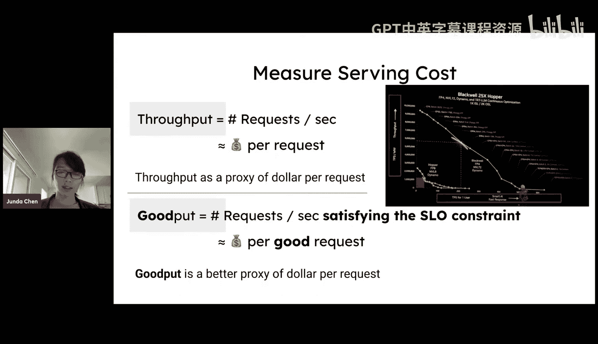

In particularly， if you look at the point over here。

 right the golden point that enlarges the most of the area， which is according to GDC。

 what Jensen has presented， this is what like the golden metric that he was determined right if you if you set a latency for 200 token per second for a particular user。

 then this point would give you sort of like an optimal throughput for the system。

But if you think about it a little bit more。RightIf I， if my service should guarantee， let's say。

250 tokens per second for a user， then the aggregated throughput can only achieve at this optim point。

 right， which is around 5 million tokens per second for this whole system。

So that is an intrinsic tradeoff that we wanted to actually think a little bit more careful about。

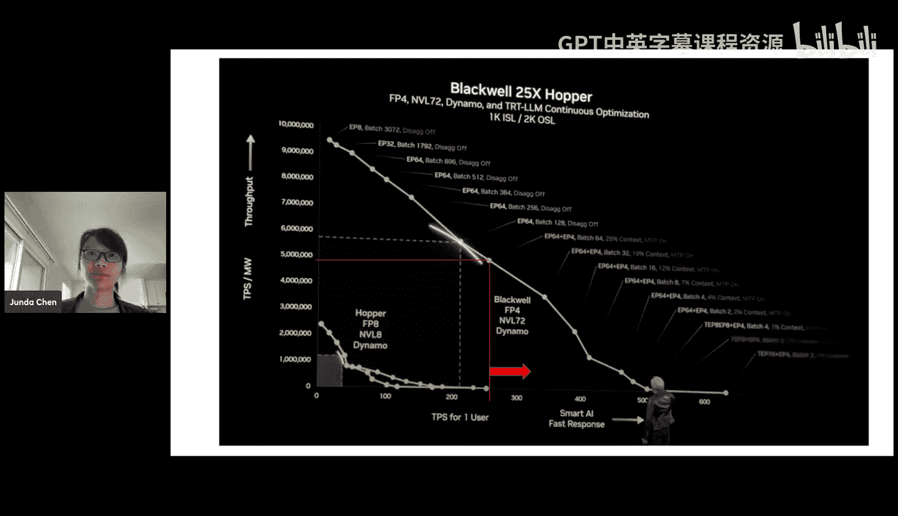

And I wanted to illustrate like a very good very simple example about why high throughput is not high goodput。

 right， So imagine you have， let's say you have this system where it generates 10 requests per second for you。

Now suddenly you post this， you realize， okay， we want to set ethical all constraint to this number。

 which is for TTFT， it is 200 minutes millisecond and for TPOT is 50 millisecond。Now。

 your good put certainly dropped to three requests per second because you have to only only account for the request that are within that regime of the SO constraint because they have to satisfy actually both constraint。

 So you should have a pretty low good put in the sense。

I hope this is a very conceptual understanding of high through system can also yield low goodput。

 and this is also one of our challenge because know if you have this kind of system。

 it actually leads to poor user experience。So the system design goal that we were studying at that time is to actually maximize this goodput that were determined。

 meaning we wanted to actually use the fewest number of GPUs to serve more requests subject to that various latency requirement of the application。

 and in particular we're studying TTFT and TPOD。More concretely， we're evaluating， say。

 a P 90 or P 99 latency for T TF and TBOD。 and we wanted to say when this guarantee when this latency guaranteed under a particular threshold。

 we wanted to measure what is the number of requests per second that a system concern。

 So that becomes the metric of the good boot。Okay， so one of the observation that we have from preent Decode is that they actually have distinct characteristic。

😊，If you actually measure that for prefi， you realize it's compute bound。

 meaning like even one preview request will saturate a compute fairly easily。

 If you look at the scrap over here。 So if you actually。Yeah。

 so if you look at here the the purple line for this 1 k token， if you just have a context of 1K。

 they actually saturated a 100 GPU pretty easily in the pre side。Now， if you do decocode。

 it becomes a memory bound operation because， you know， most of the memory movements are coming from。

 you know， moving the memory of the model of the memory into into S Ram and then doing compute。 And。

 you know， you have to have a very big batch of the request to together in this one single batch to separate to saturate a compute。

 Otherwise， it will become a memory dominated。Reg， so if you look at this figure， right。

 as the batch size goes off， the the throughput actually just。I mean。

 haven't really saturated for this particular sequence land。 So it means that， you know， if you。

 you need to go a little bit more off the batch size for。

For even satururing the decocode computation。 and most of the case。

 this will just get you OM because you cannot actually do that much of a batch size in the system。

So actually， I'm seeing in the chat， there's someone asking what is a prefi operation。

 This is actually a good time for me to actually show this animation of what prefi and decocode is。😊。

So essentially when the LM system， think about it as there's a two component in the LM serving system。

 one part of it is the request pool， which means that when your request arrives。

 it actually assists in this request pool for a while to wait for it to be scheduled。

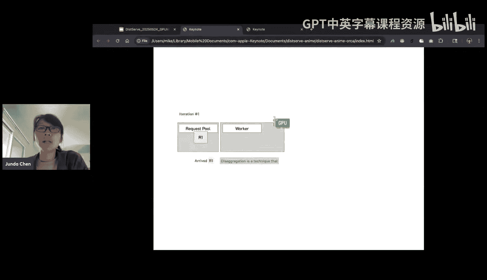

And there's a worker which is a GPU to actually serve this request and to output some tokens。

So for example， in this system，'re， we're having this R1 arrive， which says。

 you know dissegregation is a technique that something， something。

 which is this becomes a user input that get input to the system。So what happens is， you know。

 when the scheduler says it's ready for fulfilling the R1。It will schedule this R， and then。

So prefering this R1， meaning you will have all of this token sent to the GPU at once。

 Let's say here iss like 10 tokens。 But in reality， you will have your system problem。

 Let's say maybe a  one K token。 and then user input， probably100 to 200 tokens。

 depending on what's the user input。Set into the system and then do all of the parallel forwarding for all of the tokens。

And in this operation you generate something called a KV caches。

 which is you'll be later used for the attention operation。

 and that gets stored back into the memory。So at the pre stage。

 the output will be all of the token forwarding at once， generating all of the KB caches。

And then it also generate one extra token out of this whole forwarding。

 which is the next token that we're going to proceed。And this token。

 obviously will get sent back to the user and all of this time right to processing all of the tokens at once will be counted as this time for first token。

 right， meaning know after Ive finished this preview after I've finishing of the processing of these tokens。

 I get the first token， right， which which is the time to the first token。And then。

Aill arrives at the system。What happens usually in a serving engine。

 if you enable chunkrfi or if you do this mixed batchching is that you will send this R1 and R2 both into this worker。

And then you start， you know， for R1， it starts decoding， which means that after this one token。

 you start you know this token generation one by one auto aggressivelyively。And then for R 2。

 it actually kickstar preview just like what we did with R1， right， So here you see R2 becomes green。

 and then for both of the requests， you output one extra token。

 and then that finishes another request。 And that goes on and on until both of the requests gets finished。

I hope that clarifies what is this prefi and decode operation and。

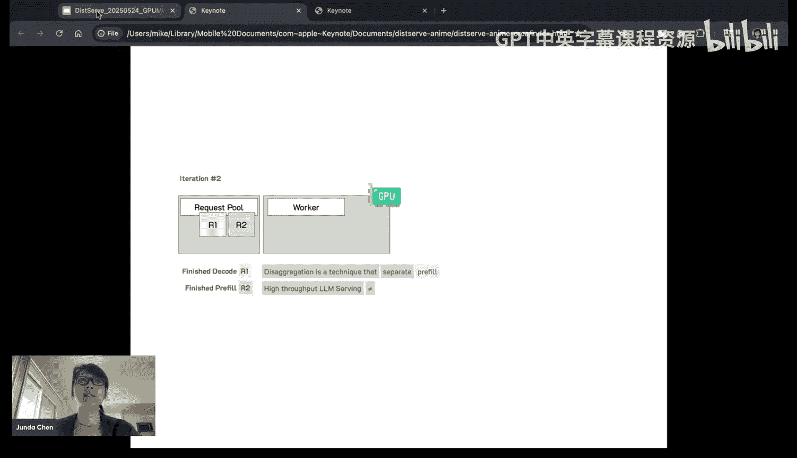

Yeah， and the and what is the kind of the scheduling behind it？

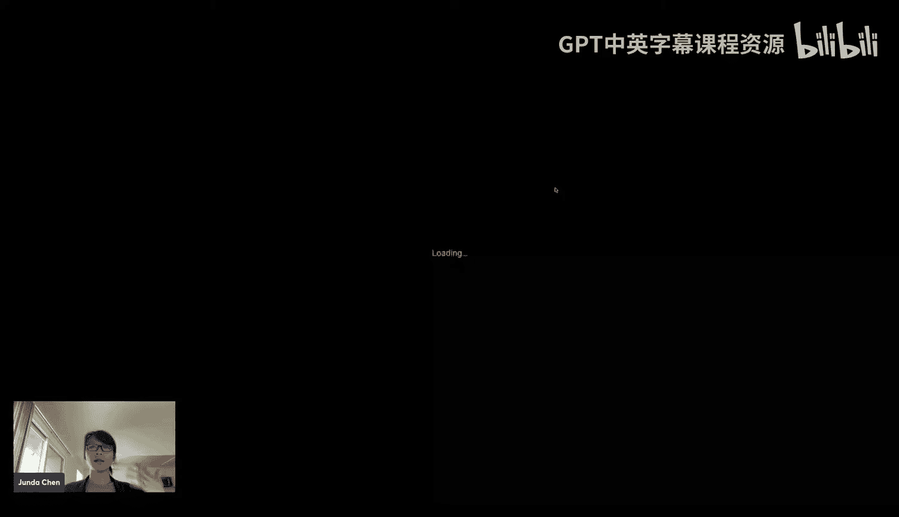

So one technique that actually in this communities widely use is called chunk Pre。

 so chunk Pre is just what I showed essentially batching R1 and R2 into one batch and then do a forwarding。

There's but there's one problem about this hybrid batching， so let's look at this graph。

When let's say R1 is starting decoding， right， as we had an animation。

 R1 starts with decocoding and then suddenly R2 arrives。

Then if you batch these two requests together， right。

 Like R 2 is doing the peripheral phase and then R one is doing decode。

 you actually see that there's this time was for decode for this R1 in this gray area。😊。

Because R 2 comes。 R 2 is a computer Comp optimal operation。

 It significantly elongated what our R  one is in this one deco step。😊，So。😊。

The observation is actually， incoming pre requests will elongate the decocode for very much。

 Let's see some actual data， for example。 Supp I'm running in 1 A 100 GPU。For Lama 13 B model。

 which is I'm having one preview requests， adding n number of decocode requests， right。

 and in this sense， I'm setting this prompt line， this brief lens as 128。So if you do prefi only。

 youll get you know， somewhat here， which is like 14 millisecond for this one forward。

But what happens and also for the for end decocode。

 which means that here is like one decocode for one decocode request， you just run， you know。

 way under 10 millisecond， which is like I think， I think this is 7。5 millisecond。

For this one request forwarding。 Now， if you batch it with one preview request。

 your time suddenly jump about two times over for the latency up to like 14 millisecond for that one iteration。

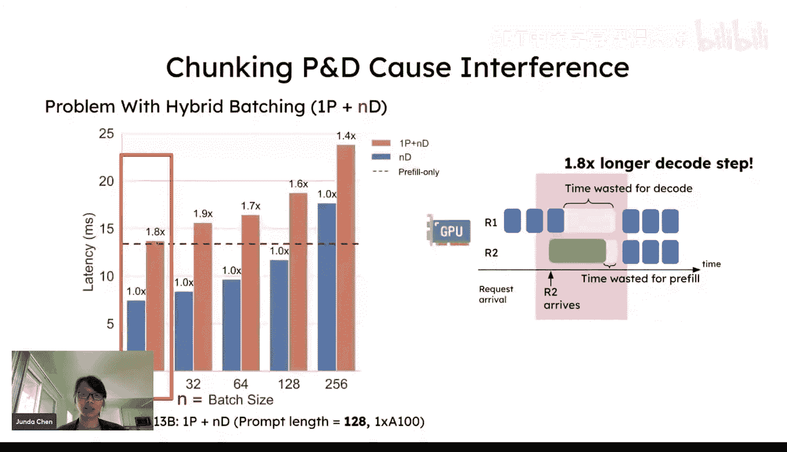

So here， if you map it to this graph， you see that there is this 1。

8 longer for this one particular detail step， right when R2 arrives。And I think， you know。

1208 is a very small prefix line。 Now， nowadays， I think people send， you know。

 like 1 k or 2 k of the of the prompt line that's not a super long thing。 And you realize that。

 you know， if you batch this together， let's say still a1 P1 D batching for further request。

 You see a like a 12 times larger for this one decoding step in in the in the generation。

So we're seeing that this incoming pre request， which is about 1k。

 elongate this decod laency by 12 x， which is not very good。So， yeah。

 so it's just a comparison between these two。 as the。

 you can also imagine as the prompt line grows into， let's say。6K， right， or like 7 K。

 Then this gap between between this prefer and batched latency will become super high that the service will just no longer actually guarantee your。

 your deco request is under a certain limit of time。And there is someone one may ask that， you know。

 can we do some prioritization schedule， right， Can I can just kind of swizzle the the prefill and the decocode request such that you kind of interleave such that you can。

 you know have some prefill into the system while your decocode is also you know slip in so that such that you can get some slack to kind of balance the time to first token and time for token。

The thing is， if you always prioritize prefi， then you actually artificially introduce this queuing delay。

 right， meaning if you have a few prefi requests that are you're always gonna prioritize。

 you're actually elongated this decocode request by the amount of time that're actually queuing。

And it's similar， if you always prioritize Decode， your preview request will just get delayed in that sense。

So this very big problem one is about interference so if you col prefi and decocode requests together。

 they're going to interfere with each other because the prefi is compute bound and decocode is mostly memory bound that prefi can drastically slow down decode in the sense that if youre a service provider that is if you wanted to have extremely low latency for Decode requests this is very not a good solution once you have enough GPU to serve your requests。

I can pause here to see if you have questions that I can clarify。

So so maybe you a question I had was like really around the characteristics like I mean。

 it does seem to me that like the overall trends is that the average prompt length is increasing a lot like basically system prompts are quite large。

For anything that's like involving company data， they're going to prompt all of their sort of company wikiis。

You know， if you're Amazon， it's like oh， all of the customer reviews before you answer a question do you still sort of see but like you sort of view this as sort of being the primary workload ast you sort of。

Taken for granted that like prefi length is always going to be this like massive overhead or do you still sort of see a place for optimizing very short systems prompts and very short user prompts and would you do your engineering work differently in one case versus the other。

I actually so I actually think this is used this is a very great question。

 So I actually think a lot of use cases like whether or not you have a long prefi long shortdecode or you know short prefi longde like any of these are actually useful there's another there's another dimension。

 which is the request rate that we haven't talk about so much yet So if you have a very large request rate that means you know even you don't have let let's go back to this one right even if you have short prefi if you have frequent prefi in the sense right then if you do prioritization scheduling。

 that means De will always get delayed。😊，Now， if you have， if you do chunk prefi。

 that means you were for every decocode token， you have to batch with some prefill。Right。

Mean if you want to set your latency for the decocode request to extremely low， for example。

 in reasoning， right reasoning， you generate a lot of deco tokens。

 that means if you have a lot of the prefi even short。

 that interferes with the decocode that will significantly draw back for the reasoning time。

I hope that answers you。 I don't know if that no， no no， it does。 Yeah。

 like I hadn't considered like just how insanely long the decocode time is for like reasoning models。

And yeah， then in that case， like yeah， we already sort of see the two imbalanced questions。

 which is like one go reason about something and then the other part is like read all of this like product information and then give me advice and like both of those are quite long。

 and so it's quite unclear。Whether we can make long term claims around which part will be a bottlene it's sort of like depends。

Yeah， yeah， very helpful you。Yeah， and I will show actually another very appealing reason why we wanted to do this pre deco desegregation iss around resource allocation。

 so I think that's actually a good segue into that。

 but we like to see if there's any questions in the chat。😊，And let me grab a water。よし。嗯。Here。

 I do see one question from Ed and folks if you have any other questions the agenda， you know。

 this is the person to ask these questions too， so it gets back to this question or I'm like the pre full and decocode kind of being almost like different programs in some sense。

I think like the answer is yes here， but like I'm curious if you have more thoughts on this。Yeah。

 you can think about it that way。Essential， so think about if， if you're。

 if you're from the serverless community， right， like， you know。

 I think when five years ago or I think 7，7 years ago， when Lada As Lada was was coming up。

 where you can think about there as like theres two different characteristic。

 whereas I O bound versus compute bound and you can think about it as like two distinct program。

 in a sense， is's like sort of handling different workloads， the the kind of。😊，Like。

 but you can think about these two programs are very similar。Essential。

 starting a prefi and decocode engine。 It's essentially the same code base， right。

 Like you're starting a VM engine， for example， for hosting prefi and then just transfer something from some state。

 some internal state into the decocode engine。 and actually execute sort of like the same program。

 It's just the computation amount of executing that is different。😊，Yeah。

 I guess thats another question like was this introduced by deepse。

 I guess like no not really this is you know， predates deepse by quite a bit。

 I know it was like the first person to sort of like explain the Perf characteristics between prefill versus decocode。

😊，Maybe you know I'm just the air paper， but I don't know，nhen you know？

I actually this is actually a very good question， so I think the paper I said here actuallys there's a paper called Ch Re Phil the Stri paper。

 actually in 2023 I think it came out yeah in summer actually explain this phenomenon I don't know if there is another paper that's before I think there probably there probably would be in in some literature。

 but I'm not sure if it's kind of explicitly laying out there is a this cat like a proofent decocode。

 but this is an excellent paper for people in shot I remember reading this last year。

 it was very very good。Yeah， I think we can， maybe we can keep going now。

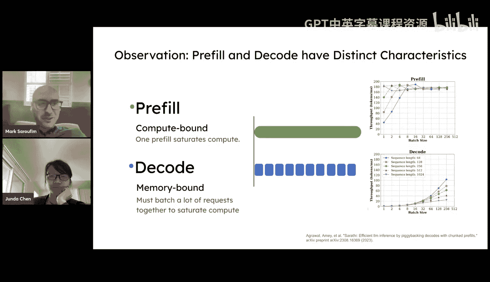

Yeah， okay。朝？Cool， so I guess I hope people have sort of like a general sense of what prefi versus Decode is。

 And then also about， you know， sort of this prioritization scheduling， chunk prefi。

 we have we kind of have introduced a lot of term also like good put throughput latency。

 these kind of term。 I hope people kind of catch up if you have any question just ask in the chat and I will be willing to I'll be more than happy to actually clarify because these are a lot of terms in the serving area。

😊，Okay， as Mark asked， like， what is the other reason for dis arogation that's maybe more appealing。

So if you really think about like resource， if you think about you back in the days where you have serverless where whereas only like CPU type of programming。

 right you can assign you different CPU time slices for each of the programs or different memories right for different programs and you know that kind of adjust you know the serverless price right。

😊，What's the program that you're going to execute？So in our case， if you think about， you know。

 the different parallelization strategy， If you don't know what is sort of tensor parallelism and partner parallel。

 don't worry。 So of tensor parallelism is essentially just sharding for each matrix。

 You can think about it as as if for this large model。 you， you sharded for。For each matrix in half。

 you put it into two GPU and you do some computation in both the GPU and you do some network communication to aggregate the result。

 And if you do tensor parallelism， it can drastically lower the latency。

 You can think about it for like tensor parallel degree2。

 It will just you know slash the time and half for a latency of the forward。

 It doesn't It's not like entirely true， but just think about it that way。So。

 I wanted could elaborate on that because I always found that really counterintuitive considering you're adding communication overhead。

 which feels like it should increase latency， but I'm wondering if you could tell people more about this property。

Right， so essentially like for each operation， you will have a particular。Let's say， for example。

 for matrix multiplication right and for attention you will have like this trade up between the roof line to say。

 oh if this operation itself compute bound versus memory bound， so if you s this into different GPUs。

 that means you basically remain those capture the same other than the flash the attention part。

 but when you're adding slightly of the communication overhead。

 depending on the size of the communication， for example， for tensor parallelism。

 you're adding it or reduce。Actually， two already reduce at at each of the right after the the tension step and the MP step。

 And that is proportional to the size of the activation that you're having。 For example。

 if you're just doing decoding， for example， right， that's meaning you have one token。

 I don't know if I can draw over here。 but let me see。Turn on the laser pointer， but I cannot。

 I cannot draw， for example， right， if you have this。Tsor X， right， that let's say in deco that。

 right， you only have one token。 let's say。 And then you have， this is like the D dimension。

That you're having for each of the shard， actually let me just draw this in the case of Tp equals to two。

Okay， the case of T B equals to two that you're having， let's say that the model。

 the hidden dimensions D， which means you're gonna divide this by two over here and the same over here。

 So you do or reduce to some of these two values And that is actually a very small communication overhead。

 This this essentially falls into the latency regime of everything。Right。

 so as long as you have a sort of like enough low latency network and you also have， you know。

 like a small matrix that you know， fall into that regime。

 It's actually the the ratio between this communication and communication， and computation。

 then you actually have a good latency for tensor power。 you can think about it as sta have。

 and then you plus some overhead， some some communication overhead。I'm sorry。

 this is interesting because you would expect that it's most useful when the matrices are really large in which case the communication overhead would be high。

 but like I guess like you're saying that like if it's small。

 then actually the communication overhead is also small。h。

 and that that way you sort of like in the roof line。

 you sort of remain in the like you're less likely to be memory bound sort of total in the roof line。

Yeah， depending on the operation， yes， yeah we can think about that。Yeah。好。嗯。

Can let me turn off the pen。Okay， cool。 So I'm just trying to say。

 like there are a lot of parallelism strategy over here， right。

 You can do tensor parallelism to cut down latency or you could do pipeline parallelism such that you can。

 you know， you can just shard， for example， if you don't have enough memory。

 you can also shard it into different GP。 and also。

 pipeline parallelism actually prevent burstness in the request arrival。😊，So。

 and also extra parallelism， there also data parallelism werere talk in our work。

 we only talk about tensor parallelism， pattern parallelism。

 But you can imagine there are there are also other kinds of parallel strategy over the spectrum。So。

😊，In this world， we have this different parallelism strategy for accelerating model inference On the other side of the spectrum is you have application that wanting to have different SLO constraint like。

 for example， for a for a speech agent， you may you may want to have a lower TTFT as low as possible and the TPOT is insensitive because you know you only have the output sort of like the human the the speed of the output that matches what what the human is sort of percepting。

😊。

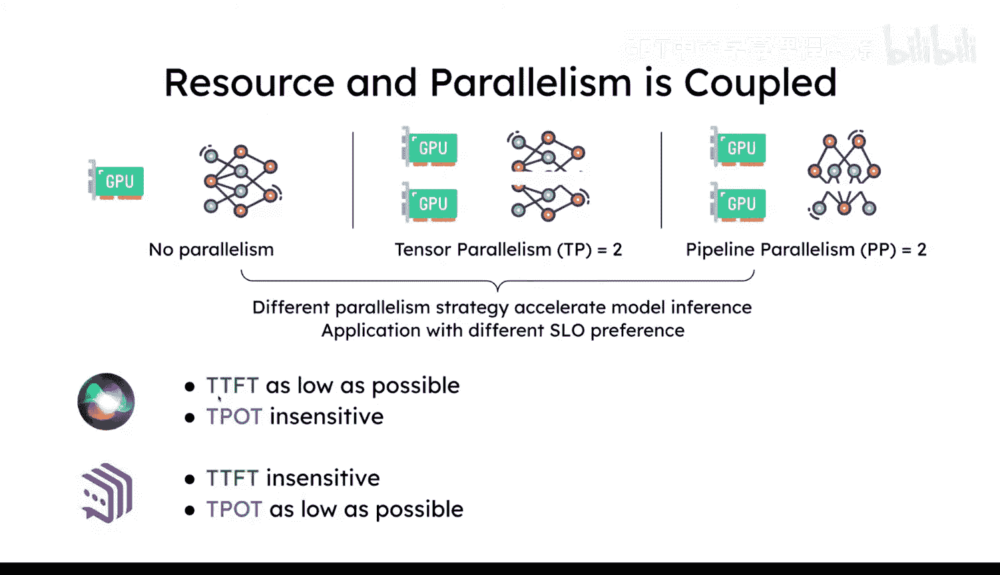

And for other workload， it may have differentness constraint。Now。

 if you're an expert sitting in front of the the LM serving engine， you'll spend a。

A lot of time actually tuning， okay， how many GPU do I need to have So serving this my my request workload。

 And in particular， you're interested in looking about in looking at what is the request rate for my arrival versus you know。

 how much how much of those and and study like how much of those request rate can attain what amount of DS SL attainment。

So I didn't relay out this figure， but just wanted to show you right like this。

When when we're looking at this graph， right， let's say in a time window， we serve 10 request。

 If I set this particular latency over here， I'm seeing， right， for one GPU， I can satisfy， you know。

 only this amount of actually， the color is a little bit off。 but really， it only satisfy 1。

2 and  three requests。 But if you look at the prefi and decocode right constraint。

 you actually satisfy 9 of these requests for prefill latency。

And then you only satisfy three requests for the decoency。 So you kind of， okay。

 you're probably gonna tune this number of GPus。 and then you realize， okay。

 I need four GPUus to satisfy all of this requests under this particular constraint。 right。

 So in the appointment， youll say， okay， on this GP spectrum on this particular workload and that I measure probably from the real workload characteristic I'm seeing。

 okay， maybe using4 GPU for this workload as a unit of scaling would be the best optimal strategy of doing this parallel。

So。That means， you know， like you would be using this as a default option。 The problem is。

 you see that here for TTFT。There is。No need to actually use so many GPUs。 Like if。

 if you're only serving T TFD， you're probably not putting a lot of GPUs in that in in the preview region alone。

 whereas you wish to have a lot of GPU putting into Decode right。

 such that you can lower the latency into your specific SL constraint。So that is this other problem。

 problem too， which is we call resource allocation right if you do colocation prefi and decocode。

 the best is is that you can tune one GPUnob for this multiple requests。 And you know。

 if you do colocations you cannot actually tune the parallel configuration for prefi or decode separately so in that sense。

 we kind of lack a space to search to achieve the optimal configuration for for both TTFT and TPOD。

I hope that intuition kind of makes sense for everyone and I can pause here for a question from the audience。

All right， I think there's a few questions。 Let's go over the first one。O。

A users previous requests and AIs response recent。In the following request seems like a token hungry method。

嗯。I probably didn't understand the question。So my sense is this is asking two things like one is it's asking about like long conversations and like what are sort of like the performance characteristics of。

 I guess， continuously increasing the pre length。And then the other part is like how does this play with memory like in general。

 like I think a lot of like I think specifically chat GT and I features for memory and this user is asking like how does what is the computational workload of briefing in the context of older questions as well now just older responses within that question？

So I think that's actually a very good point。 So essentially。

 you can think about it as pre is not as memory hungry because， you know， it's just preing the。😊。

Fixed amount of memory in this lifetime， whereas Decode， because you're actually extending， you know。

 token by token， that means you're adding the KB cache into this decocode。😊，Eine itself。

 that means you will need more memory for the deco。 that's actually a very good point。

 So when you increase the content then what's happening is that if you do prefill this segregation。

 that means your prefi is like you're having this essentially like having a lease of this chunk of the data you're gonna prefill。

 maybe you hit some KBc， maybe you need to compute a little bit more to produce the new KBc either because you have multiro conversation。

 you have some of the KBc transfer or you maybe you don't have Kbc transfer back from Decode into prefill or because the user has submitted some other a portion of the user input back into this conversation。

So， but regardless， you know， if you， if you do prefi。

 that remains largely compute intensive because just because， you know。

 you can have multiple tokens that for in parallel and that， you know， even if it's in B 200。

 you can see that it's the case that it actually easily saturates the GPU。

 So that's the compute and memory side of the story in prefi。

 And for Decode is it will remain memory intensive just because of the characteristic of having。Yeah。

 a lot of it's actually having having the the KB cache as a component and also for the model weights and and the little compute that it needs for Decode。

All， well， I think the next question relates to your previous slide。

The one with the parallelism strategies， this one。This one。

 yes so so I guess I'll modify this question a bit to say， you know。

 it wasn't too clear for tensor parallelism or pipeline parallelism。

 how do they go about addressing the product needs that you have below like basically considering a workload you know you're like okay。

 I care more about time to first token and I don't care about Tpot should I do no parallelism。

 Tensor parallelism， pipeline parallelism or like none of the above。

So I guess so that's a good question I think I missed a slide over here of saying what is the why is pipeline parallelism effective and in some sense。

 you can think about like tensor parallelism is if you if you're drawing sort of let me try to draw this one so your drawings are very helpful so thank you。

😊，Sorry， yeah， okay， there we go。 Let's go back to this one。 So if you。Okay。

 probably not a very good way to join， but let's say， okay， so this is。

 let's say this is sense of parallelism， right in this part in this particular regime。

Then tensor parallelism， essentially， you can think about it as you know， dropping the。

 the slope of the， of the of， of of this latency graph， whereas in the pipeline parallel。

 you can think about it as if you have， it doesn't really reduce the latency， but it kind of goes。

IThink about it as how do I draw this， It， It kind of goes up like like that。Because the pipeline。

 the pipeline parallel kind of buffers a little bit on on the queuing on on this。

 on the burstness of the request。 So this is。This is probably not a very good graph that I draw。

 Maybe I draw a wrong graph。 Sorry， let me， let me think about it for a second。Thank you实。Yeah。

 so okay， so here I should， I should really draw a request per second over here。

And then I will have this， let's say， I have a P 99 latency， P 99。片内ない你思。

So Tensor parallelism would say， okay， if I have this latency request， you know， you I I could。

 I could go this way。 Now， if I go Tensor parallel too， I will go probably like this okay。😊。

So meaning that， you know， if I have this latency like here， I， I cut half of the latency。

 But as the request rate per second grows， I still have this， you know。

 the sort of like the exponential exponential growth of P99 is not really exponential。

 but like the growth of P 99 is like the same shape for this GPU。😊，Now。

 if I introduce pipelineyon parallelm， what's going to happen is like I'm still having this this graph even what happens let's say I have a pipeline para of two。

 then I actually get slightly a little more， you know， if I have bubble in the system。

 Ill probably go a little bit up， but what I get is that I will have a more smoother curve。😊，To。

 to to kind of contain the request per because， you know， when the request arrives。

 they have sort like one GPU to buffer for a compute。 And then when they go to the next GPU。

 you can actually receive another request over here for this one GPU。

 So it's like a sort of like a buffer for for a burstly request stream that comes into the user stream。

This is interesting because like I think this has like a few immediate product implications， like。

 for example， like pipeline parallelism is only useful if you have a popular product。😊。

Right like basically because the like you you need the burst in us。

Whereas like tensor parallelism is almost always useful because who doesn't like lower latency and as a result。

 you probably almost always want to use tensor parallelism and then like pipeline parallelism is more of a question of like does your burstiness justify this？

😊，Exactly， yeah， and I'll mention a little bit later like this。 Yeah。

 if you have this fast reconfiguration between， you know。

 different resource parallel configurationration， then you can have both world。

 You don't have to kind of stick to one parallel to some sense。 Oh Oh interesting。 So like。😊，Oh。

 I hadn't even considered rearding Okay， I'll pause my questions because I suspect you might answer them later Okay。

 this is very exciting cool I'll shut up。😊，Although I think most of sort of the implementation or for the common sense of the community。

 we don't really use a lot on the P parallel， but instead we're using ten parallelism expert parallel the kind of for example。

 if you're hosting deep right you would do sort of the DPD you do an extra parallel and you do data data attention what do we call data parallel for to the attention I forgot what they call but essentially it's a different kinds of parallelism degree but having said that we can move forward So essentially these are the two challenges that we're facing for we when we're designing the system essentially is like how do we overcome preent interference and also how do decouple the resource and parallel configuration such that you can have the most of the both world for TTFT and TPOT reduction。

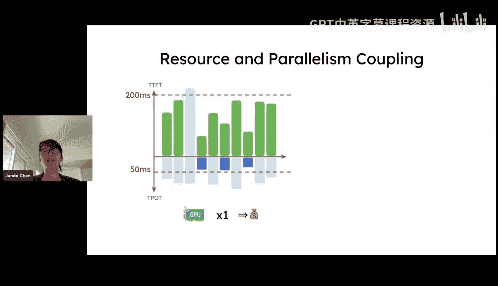

So then we introduce this serve。 essentially， the， sort of the， the， the。

 the solution is actually pretty simple to put it in the in in a diagram。 Let me hopefully actually。

 we have another。 Yeah， there we go。 So we have sort of like this animation to show you。 So。

 for example， here as。

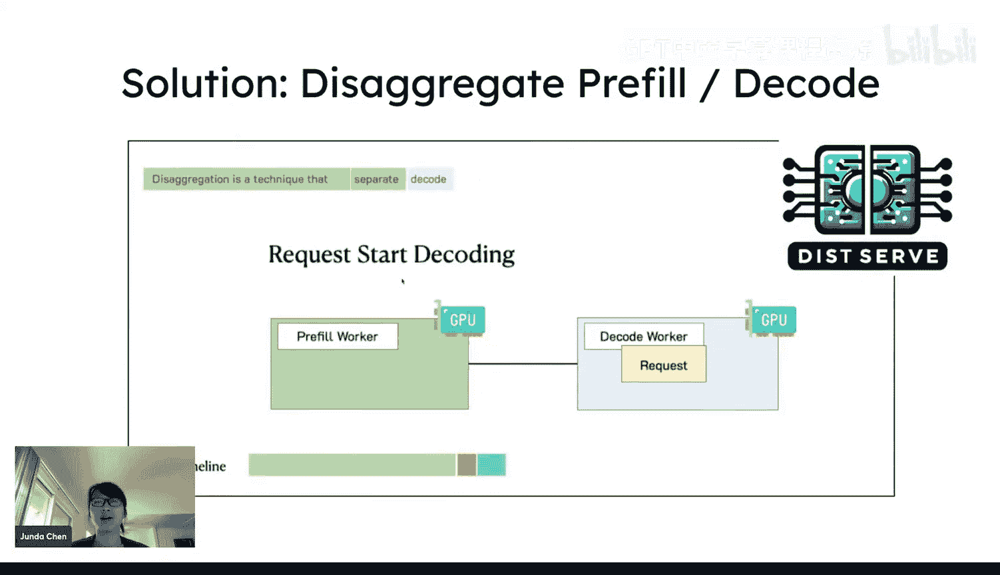

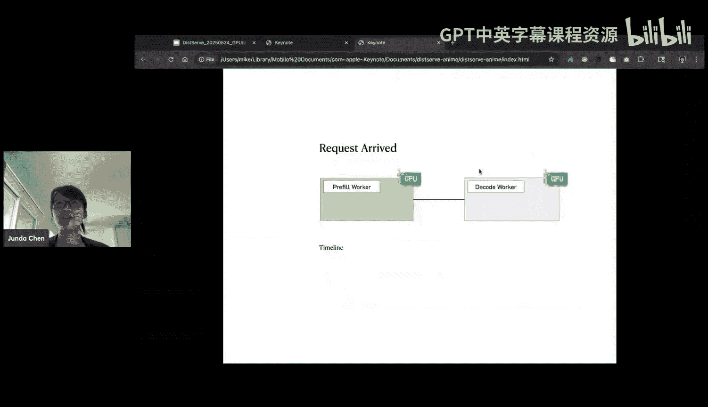

Actually， before that。So we have let's say we have two GPU what we will do is we'll separate this two GPU into you know one for preview worker and the other one for Decode worker and hopefully they're linked by some high speed network like any link between these two。

So what happens is that， let's say a request arrives。

It will first go into the preview worker and then do this pre step。

They're generated this one extra token。And then if， once you finish up the prefi。

 it will get migrated from prefi worker to deco worker。

 suffer from a little bit of a migration overhead。And then， you start decoding。One step， one another。

 until it gets finished and leave the system。 So that's essentially the whole idea of disate。

 dissegregation of the pre de。

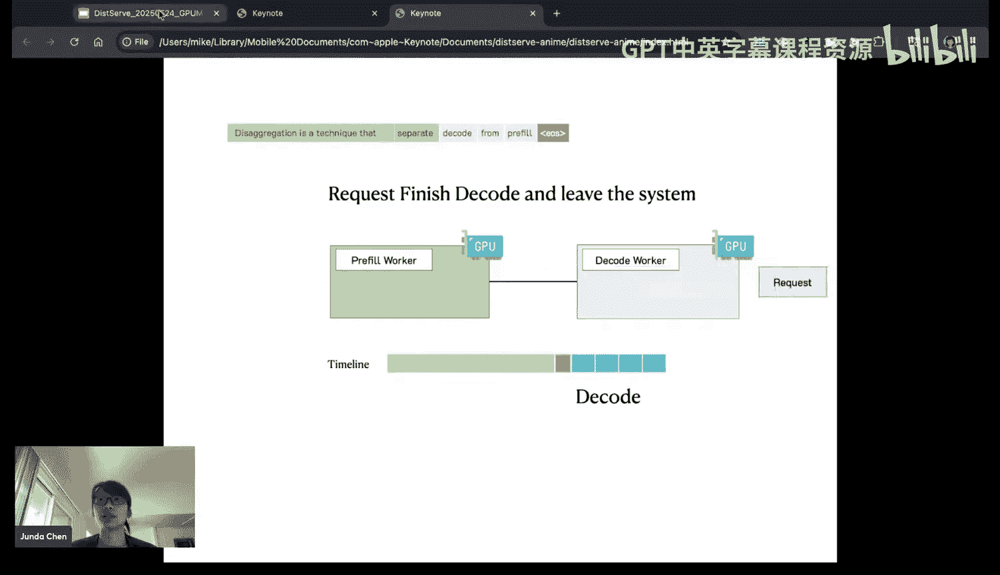

So。😊，Ill just give a very example， very simple example of why this allation will achieve better good with。

 So on the upper part of the system， we're seeing this col locatecate system of， let's say。

 using one GPU to serve a particular workload。Right， so here on the Y axis。

 we're measuring the P 90 for TDFT and also the P 90 for TPOT。

And then we're setting for this particular service， we're saying， okay。

 we wanted to have T TF T to less than 400 millisecond and then for TPO T less than 40 millisecond。

 both for P 90 okay。So when you how this experiments run。

 you actually just do a profile of this workload and then you get this particular meaning okay。

 sorry， so for this particular workload， we will gradually increase the request rate。

 let's say you for each point in this graph we're saying request rate equals1，2，3，4 and 5。

 then we'll get for each point， what is the P 99 TDFT for this particular request rate and then what we'll do is okay for the for the GPU expert sitting in front of the screen。

 what you'll say okay for the cFT less than equals to 400 millisecon。

 I'm seeing a maximum number of requests per second for the prefi phase to be you know three requests per second。

Whereas for the decocode， if I subject to this particular constraint that I have to have you know only 1。

6 requests per second right to satisfy the system constraint so and just mindful right these two these two line are actually the same but you know when I plotted this it's actually a little bit of an artifact so I didn't really get a very good plot。

Over here， but just just dont understand like this。

 this is like the request that like the single request rate per second versus the two metric over here。

So now， if I calculate the maximum system good， I will only。

 I can only take the minimum of prefuent decode， right。

 request per second that satisfy that particular constraint， meaning I can only have 1。

6 requests per second per GPU in that sense。But if I have， let's say disaggregation。

 if I were to give three GPUs in total， right， I allocate two GPU for this prefi phase and there's one GPU for the decocode phase。

 What will happen is if I look at this graph right this is running and this is running prefi only right now that you have separated into two phases。

 you're running decode only on this particular workload。 Now you're gradually， as we said。

 we gradually increased the request rate per second。 Now you're actually hitting 5。

6 requests per second for this particular constraint。

And then you also realize for decode and actually hit like 10 requests per second because you know that。

Increasing the batchsh size doesn't really increase the delaency for that long。

 which is what you have measured。Now okay， a very， very simple strategy is if I do if I just assume homogeneity right I assuming tensor parallel cut in half or assuming data parallel have this very homogeneous workload between these two data parallel。

😊，Whatever the case， I will put this two GPU for prefi。 and the maximum I will get is actually。

 you know， doubling the request rate because I have two GPU for that。

 And I put one GPU for De to have this 10 requests per10 requests per second。Now。

 I suddenly for this3 GPU， I get an aggregate of 10 requests per second per3 GPU， which amounts to 3。

3 requests per second per GPU。Right and remind， just a reminder。

 this is a per GPU request per second。 This is not the aggregate system request per second rate。

 which means that just very simply disaggregating the prefu and decode into in this tooth phase。

 you get a two x game right for satisfying this S constraint in this particular workload。

I hope that makes sense， I can pause here a little bit to clarify。

 but I hope this intuition of this irrgregation getting this 2x performance per GPU kind of makes sense as an intuition。

Okay。Okay， awesome， so when we're designing this serve。

 we're facing a few of these design challenges， I'll explain them a little bit more。

 but I think one of the two challenges I think people are more interested in hearing is about how do we configure this param strategy。

 like how do we even come up with this Parism strategy to measure is what is a good one to use in deployment？

And then the second one is how to efficiently transfer cableB cache， right which is you know。

 if we look at the graph before， we'll see that cableB cache has this migration overhead。

 then how exactly do we efficiently transfer them？😊，And also。

 there are two other questions which is how do we combat burstness and how do we reduce the pipelinein bubbles。

 which we had briefly touched in the previous presentation， but we can expand a little bit more。Okay。

Actually。So I will skip this to actually let me just briefly touch on what is the building blocks here。

 right so when we're building that we're building on top of the VLM engine and as usual VLM engine has this one engine that has a scheduler that manages a block block table and also manages a few workers that actually have this GPU the KVc memory inside of these GPUs and it also had a model chart on this particular worker。

So this third architecture is actually very simple。

 We have this one main engine that spawn up to a particular engine， one prefi one decocode engine。

 and for this one prefi engine， we'll have let's say P workers。

 meaning we hold P GPPUs to doing prefi and then similarly for Decode and in between this prefi and Decode we have this migrator which has the migration queue and also have this kind of metadata states to transfer the request metadata from pre and decocode and also having the KBc transfer between them。

So to combat to actually address the para strategy to find out what is the good param strategy。

 we realize when you get when you do the KV has transfer。

 you have two types of network right one type of it is actually a high affinity network。

 meaning for example， if you have all of the GPU MV linked into oneNote or if you are in the MVL 72 system。

 you have sort of like a very good network， or if you have TU right you have basically homogeneous network between the GPU gens。

Now， what happens is that you can， you don't really care about the placement because you know。

 a point to point communication almost have the same bandwidth across these。

 So let's say in link for1 GPU to another GPU communication single direction in a 100 link system is about 120 to 150 GB per second。

 which means there's actually a very handy number。 if you transfer 1 k contact La token for Lama 8 B。

 it actually take 1 millisecond to transfer the K cache。 And I mean。

 if if you do decocode that that for that one GP you probably amount to like 10 millisecond is for them。

So the K transfer overhead is approximately equal or less than， you know one deco step。

 but that that depending on what's the context then in that sense。

But if you're in this very high network affinity， then you really don't care about what KB has transfer。

 you know， for like how KBC transfer should happen or how the model placement should actually happen。

So if you're doing a low network ininity， meaning you have let's say you have two node。

 each node is still a DGX box that's envy linkeded fully， but cross node are using， let's say。

 Infinity band that only have 25 gigaby per second。

 which is about an order of magnitude difference between these two。So what we will do is cross node。

 well do pipeline parallelism。 Remember， pipeline parallelism。

 you only transfer the activation between layers， meaning， you know， if you have this one x token。

 you're only going to transfer that very little amount of the data。

 which means that you fall into this latency region。Now， if you do Kbh transfer。

 realize because you put those layers of the same sorry。

 you put the same layers groups into the same node。

 the Kbh transfer only occurs in the same node right so let me just repeat that again so in this case we are putting。

 let's say we have 12 layers in the total and in this LM。

We're putting the first six layer into node 0。 and then the other six layer into node into this node one。

 Okay， and remember， Kb cache transfer only happens Well。

 so so the KB cache is only used within one particular layer to do to do your attention operation。

 right， Remember the Q KB operation。 That's where you actually use this KB to do the attention operation。

 which means that， you know， as long as your layers are within the same node。

 you can still use the high speed network to transfer the the the Kb cache within that same node。

I hope that clarifies the question right So you never do cross node KV has transfer。

 That means the overhead of the Kbc transfer will still remain very little。 And in fact。

 if you look at this graph， we actually profile that latency breakdown to answer that question Does Kb has transfer dominate latency we're showing that is actually less than 0。

1% in our particular setting right we're just doing Kb has transfer intratro node and we're not never doing a cross node。

And we do realize that there are a lot of system today， for example。

 mooncake cash nanonamo will also encourage to have this more sort of like a more simple system by sailing across the node such that you have to have like this cross node transfer This is not defeating the point of having this arogation。

 but it's just how do we optimize the Kb has transfer overhead using some smaller techniques right and I'll leave to actually I have a few more slides later on to actually explain how to do that but I'm not sure if we have the time to cover that today So I'm just going to pass here to to just recap So it' like the most desirable chart like if you could go to the next slide the one with with the blue charts like you ideally just want everything to look blue like what would be the most ideal thing as you're looking at this。

Well， I mean， this is already the very ideal chart。 like this latency is like amount to only。

Very little of the overhead。 So if even， let's say， if the decoding execution， I only have。

 let's say like three token of the output， right， then I really want this latency to be。

 let's say less than one deco step。 or like approximately one or two deco step。

 So that gets amortized along this decoding。So I think this is already a pretty optimal case that we're showing。

4。Mitigating the KV transfer program， I don't know if that's the question you're asking。

 I it the left graph or the right one。哎对对对对对对。Mark。

 I think you broke a little bit so I cannot hear you answer my question keep going awesome。个。Okay。

 and I can briefly touch on this parallel placement strategy， which is， you know。

 if you have a high networkfinity， then you just do a proof force search on TP and P and then you just simulate for your particular workflow on the simulation will just be like this right for prefi you will pick a TP and P。

 which is the proof force around this particular grid And for De。

 you also do this particular grid And then you calculate the for this particular configuration by for each of this rate per second of request you just say request rate equals to one。

 what is the good request rate equals to2， What is the good。

 And you extend to a particular number where you guarantee that is not going to have very good good。

 Let's say good equals to0 and you pick the goodput such that you have like your P90 satisfy a particular threshold。

😊，And then you calculate， you know， like for this， you calculate the number of GPU you used。

 and then， you know the the maximum rate per second that you can achieve for P 90。

 And then this is the good put that you're gonna output with the configuration。

And then for the low level affinity， there's just one more constraint， which is， you know。

 other than， you know。Sort of like beyond like above this， this algorithm block。

 youll insert a statement， say， okay， I want to do this cross node P P， right。

 instead of doing tensor parallelism across node。 So I only restrict that， you know。

 pipeline parallel will have another degree of this cross node pipeline parallelism。

 And then for each of the unit within the node。 you would do， you know。

 you search for preent decocode configuration。So that gives you this network topology of searching this placement algorithm if you have a low network affinity。

So and at that point we're designing this to about 2 kilolon of Python code the simulation runtimes kind of less than two minute。

 which means that if you have like a one hour run， you'll kind of record all of the history run you're having you dump it in a simulator。

 it's going to get you the optimal configurationguration for that particular history configurationguration and you can use that to reconfigure a system to adjust to that workload。

Okay， so I hope address the two the first two question using simulation and then using the smart GP placement to address KP has transfer and parallel strategy。

Okay， and for the first question， how to combat burstness。

 we actually designed something called the pull base K has transfer。

 So there are actually two flavor of this Kb has transfer。 One type is like this push base。

 meaning once the prefi finishes， its it it's pre face。

 it will push the KV cache from the worker one to the decocode worker。😊，Right。

 so the drawback here is that， okay， we all know that decocode is like memory hungry。

 let's say when Decode is like， let's say90% of the memory， it's full。

 Now the pre wants to push that particular memory into Decode。

 This book gets saturated right you probably the deco side wouldn't handle that that cache。

 So to mitigate that problem werere saying， okay， how about we reverse that K cache transfer logic。

 We're saying， okay， because prefi also doesn't use a lot of memory right for prefi。

 and most of the memory our sort of memory， let's say， okay， for decocode。

 I'll just get the buffer get。😊，Sorry， on the pre Ill open an IPC memory handler from peripheral side。

 I shipped that onto the deco side such that the decocode will have this particular handler like a memory address。

So what happens a KVc transfer is the decocode worker receives some signal of the prefi from the prefi saying。

 okay， there's this request that have been finished。 Do you want to do transfer。

 And then Decode said yes， what happens is that it just open this IBC this IBC handler and then directly access the memory from prefi to fashion into the buffer ofcode And in that sense。

 prefi doesn't really need to sort of actively transfer the K cache and the decocode can decide when that K has transfer to happen。

 such that they can combat this burstness of the request or to kind of just reserve the memory for the ongoing decocode requests。

And you can imagine after the Decode has successfully transferred those caveV cache。

 you just tell prefi， okay， let's just discard this memory from prefi side or maybe if you're in the KV cache。

 you don't have to sort of hold hold them as an active memory anymore because every you know finish up the transfer procedure。

And at the point we're implementing， we're implementing as a k kernel plasma ni operation。So。😊。

That solves the third question。 The fourth question is actually easier or actually harder when。

 when we're trying to reduce the pipeline bubbles， if you're doing pipeline parallelism。

 you have some pipeline bubble。 So a very good common use technique is to do chunking。

 Do you chunk that into a particular chunk to decide what is the optimal number of tokens to chunk for each batch。

 And I think there are a lot of talks actually talking about more advanced technique for reducing pipeline bubbles。

 And I'm just giving like one naive solution to doing that。 But that kind of works well in our case。

😊，So that chapter mark， so for I'm just trying to show some very simple evaluation to show you like what is the what is like a correct way for evaluating sort of based on goodput because I think there is a very common question about you know how do you we evaluate you know across using goodput to evaluate versus just looking about talking about throughput。

So。😊，In particular， at that point we're evaluating against three data set。

 the share GPT was just more like conversational， I think we're only evaluating in run round and we're actually evaluating on OPT model which cves the tuken lens at 2K。

 which is not that long。And we also have human e， which is like coding and then long bench for summarization。

So this is a typical graph of looking at the SLO attainment。

 meaning you know how much percent of your request fall under that， let's say。

 400 millisecond T TF T and then 40 millisecond TPO T kind of constraint， right。

 How many request have satisfied a constraint。 So you draw a line at 90% to say， okay。

 what is the maximum request per GPU that I can achieve。 So at that point， we're saying， okay。

 this serve， if you're just doing a particular configuration I didn't showing over here。

 you can achieve， let's say three times the goodput versus the LM alone。And that， you know。

 it's like varying the per GP rate， meaning it's not the aggregate。Yeah， system rate。

And then the other aspect of evaluating is you can have still the y axis is an SL attainment and on the axis is the SLO scale。

 meaning at this， for example， SLO scale equals to one。

 meaning you know you just it's just the original SL 400 versus 40， and if you relax that。

 let's say over here like 10 times it means that you relax that constraint by 10 for each of them。

 meaning know for the 400 with a second for TTFT now it becomes like a four second latency constraint。

 which is a very loose for TTFT。So。That gives you a sense when you're。

 when you're a system developer， right， like tweaking around the space。

 I want to see like how strict I can to set this S S scale S constraint。

 that gives you actually like the 10 times kind of freedom to a stricter S for setting that constraint。

 I hope this kind of makes sense because I don't really have like a very detailed show the presentation。

 because that will be super dense。 But I guess like I'm just showing like this is this is like a common useful way in a service provider to evaluate。

 you know， in terms of S attainment， not just about throughput to evaluate what is the effectiveness of pre dissegregation。

ok。😊，I know we're almost at the time， but I really want to talk about this sort of next section about because there are a lot of dynamic in the pre dis arogation community or this arrogated serving community today。

 and I wanted to touch on a little bit about the future right what have we achieved today already in a broader community and what do we have left still in the future for people who are interested in this community to actually work on。

😊。

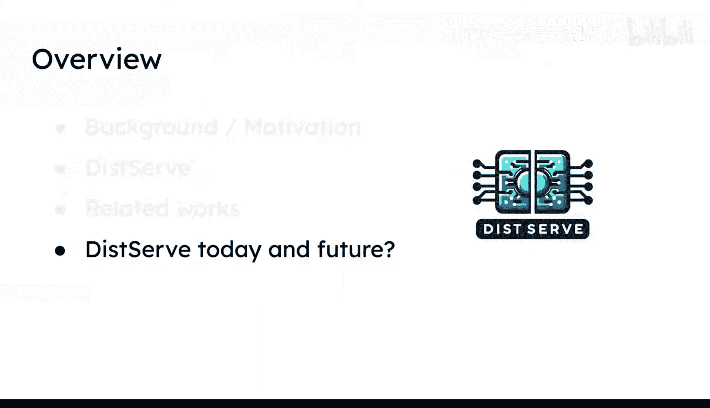

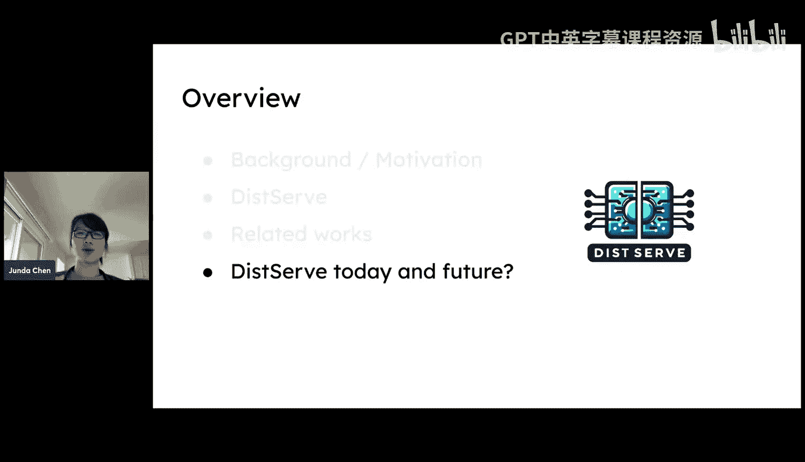

So as you can see， most of the major companies and serving provider has adopted this segregation as one of their feature。

 one of the major feature。 and particularly I think in G 25 and media announced animalymo。

 they have a very nice。😊，This arrogated serving section that covers you know how to do prefi and decode dis arogation and underneath they have a few layers over here on the very under。

 which is this。MVR inference transfer engine， Non。They have a pretty much tailored for latency interconnectgnostic multinote data transfer library that allows you to transfer this KB cache very much easily。

 So let's say if you have， you know， your custom customized via engine rest engine。

 you can just plug in Excelel and then do the KB cash transfer and you can kind of guarantee that the transfer overhead is well。

 the transfer bandwidth actually match whatever it is。That every link can provide。And I。

 I also think the library is like very easy to read and it's very elegantly written。

 So if you're interested， check out the repo to see more details。😊。

There is actually a very important， another very important sort of component in in the serving area。

 which is sort of more the KV cache aware routing， meaning， okay， if you have a continuous workload。

 for example， you have some documents right， have you have some rack workload if if you have some like document for like long document for processing。

 then you really want to have that hitting the KV cache， because if you don't hit it。

 you spend more time actually doing the preview phase， right to de。

So what happens is you want to have some global router。

 right to route between different pre instances and then say， okay， I have this particular request。

 particular input。 What is the instance that is good enough for me to minimize my my T TFT because it hits more KB caches And also it does not kind of sort of overflow this particular instance for serving this preview request。

 So it is actually the small routing part is actually a very important part of。

Of of the disarrogation。And on top of that， you have a unified API server that you can just plug in with any of the APIs。

 open AI API or different kind of API。And onek probably some of you also know that onek is targeting at the Kbc centric transfer agent。

 I mean， so we live in a very polarized world， for example in the US we have super high network transfer such that if you do intra node Kc transfer kind of makes sense because your envy link bandwidth is sort of like magnitude over intra node sort of intra nodeode transfer overhead。

 whereas for example， development in China， also you have less bandwidth for Mvylink。

 but you have decent amount of RDM or sort of the NickI bandwidth between node。

 So what they did is instead I don't do this fancy parallelism intra node。

 What instead I do is I will allocate a few node as a node groundular for prefi and decode and what we do is I have this global centric Kbc centric store to actually store these Kb caches at a CPU D or ISSD。

Right， so what happens is you have a previous station optimized for Kbc reuse。

 and then for the deco phase， you actually maximize the throughput。And they have very elegant design。

 So please check out the repo and also their paper。

 They actually won the best paper in fast 25 conference。

 So I think they also actually have a dedicated talk for， for this one。 So if you're interested。

 please check that。😊，And for the major two serving engine VM and。

 they also integrated pre desegregation， I'll just skip over here。 if you're interested。

 we can come back and look over this architecture， particularly in Aang。

 they have a block saying how do they achieve PD segregation on deep1 model using9296 H100 GPU on their block in the MDD GPU side。

 So if you're interested also check that out。 And this is a very daunting PR that has a lot of commits a lot of code。

 I haven't really understand what's sort of the integrated inside So I can speak too much about that。

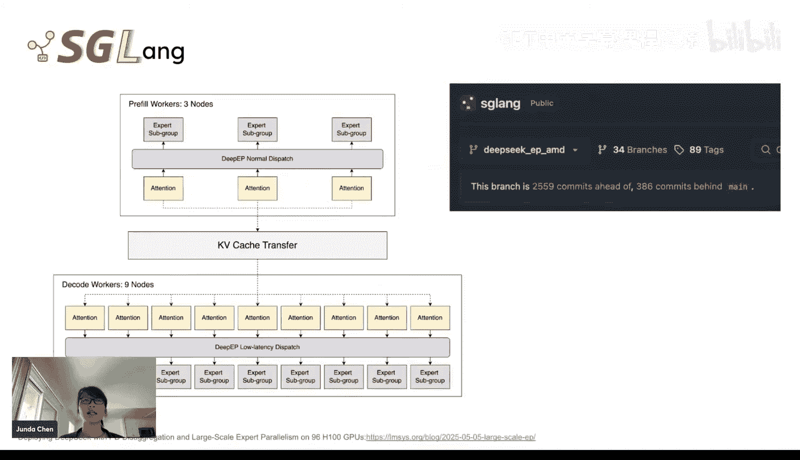

Okay， a little bit about future work in 2024 when I was posting this this。😊。

The slide back I actually， I think this this is it the1 time or even more time I've given this talk and this is the future work I lay out in 2024 saying。

 okay， this is probably something that we want to have know as a wish list and I think these are mostly done by a community。

😊，So now I actually post a future work for 2025。 I don't know。

 Maybe some of the work has been addressed know partially some haven't at all。

 And if you're interested， we can talk about a little bit more about what are some of the interesting future for P segregation。

 what does it enable us to do furthermore in the serving system。

 particularly I'm very interested in this fast reconfiguration。

 because you know as your workload changes， you probably want to have your system quickly adapt to those changes to combat this kind of workload you want to have extreme sort of ability to do auto scaling upwardcal that。

 and you also want to choose the right configurationration， Tenor parallelism， parallel。

 ex parallelism to actually do the serving for this particular。And if you。

 if we think back from the serverless world， right。

 the serverless promises that you can achieve this using the minimum cost because you're just taking a fraction of the CPU time。

 a fraction of memory， and I can sort of autoscale you on these sort of free resources that I can have in the serving system so。

If we can achieve this fast reconfiguration， that means for the co community。

 we can drop this LM serving price further down by having the serverless framework。

 So I' looking forward to see if anyone actually interested in building， you know。

 this sort of like a true serverless LM system in production。

 There are a lot of challenges over here。 If you're interested， I'm willing to discuss this more。😊。

Okay， so at the very last minute I wanted to do a shameless advertisement of our lab this pre dissegregation or we're actually launching this in UCSD we have a class called CSE234 LM system and if you want to check it out this is the website and the very last lecture we touched on a little bit on you know what is disargregated preferredent deco and what is the kind of integration into deep deepse in their actual。

😊，Implementation。 and then in our lab， we also have a lot of fun projects。 We have the game arena。

 which is you have an LM running behind。 and then we evaluate how LM can， you know。

 if LM can really play games for here， we're evaluating， let's say cloud。

 Gemini and GBT for playing multiple different games。

 And you can see how these LM sort of don't have a lot of longter planning ability or how they fail across all of these games or some of them actually pretty smart across them。

😊，And then this is one of my projects called Dnosaur。

 which is how to efficiently run reasoning model or reasoning algorithms over these serving engines for here we're actually using dynamic allocation of the resource for different reasoning models like deepSR1 or Q1。

 but also to extend to different kind of resource reasoning algorithms like subconsistency MCTS。

This is actually a very interesting hook for this one is actually if you're doing sort of like a chile thought reasoning iss actually a PD degregation is actually very useful in some of our case。

 we're actually proposing something called dinosaur COT which is you use some probing mechanism to kind interrogate the model to say。

 okay if I'm deterministically certain about my answer or not and that is a pre phase where we can delegate to the pre for instance in thisgregation So there's something that ties back into kind of reasoning versus PD deaggregation。

 but not the center of this paper So if you're interested， please check that out。😊。

And then also in fast video which is next week on the same time we're going to have Pei yuan talking about fast video。

 which is a project that accelerate attention in video generation so I'll leave it to next talk if you're interested please check it out in next next week I think it's May 31st in the same time。

So in conclusion， we have this thiser project which is touching upon the pre deco desegregation and where I think one of the core ideas is we want to evaluate the serving quality as goodput instead of just throughput along so you see there's a tradeoff between throughput and latency right in the space where you find your service actually defining a particular goodput in this tradeoff space。

And if you think that is a good metric， then dissegregation。

 PD disaggregation itself is a very effective method to optimize the goodput metric。

 and in particular， we have achieved sort of like the 7。2x goodput versus VLM at that point。

 I don't know what's the number right now， but essentially that's essentially showing there is an effect of this serve this kind of technique and the technique has already being adopted by many companies and many serving engines。

 And if you're interested where I would love to discuss more about this serve。

 how to integrate it and what are some of the engineering challenges along this integrations So I will leave the floor for the question Thank you so much for your patients and listening。

😊，Thank you this is an awesome talk I think I've only seen like super positive feedback and chat I guess like I have a sort of more forward looking questions like I mean one is you sort of briefly touched on the challenges of MEes and the segregated inference like I think you sort of briefly said it's like very complicated I guess like what would you sort of suggest is like a better entry point for people to understand those specific problems is it just like you know power through the SGlan commits or is there like something a bit more reasonable。

I do you suggest people could do。Yeah， I actually don't know either。 But I mean。

 deeps said that they're going integrate into your at some point。 So we're gonna see。

 you know what that happens。 and hopefully I'm very hopeful that， you know。

 deepse are going to release some technical report。 that is extensive enough for everyone to study。

 And I think this is what deepC has done very well for the past few years publishing high quality know。

 sort of like not just academic level， but like sort of very extensive technical report for。

 So in terms of engineering， that's something that I look forward to see。😊。

The other question is like like there's sort of two questions relating to like how one might get started with the MLl systems one it seems to me like the vast majority of your research is on a single node。

 is that like correct or like do you sort of like also like you do cluster level research like fairly often。

So for this one we actually evaluate on for node it's not like node but at that point it's like a for node we haven't done a lot of sort of like cr cut we haven't done sort of like for example。

 a run on MVR 72 if we have that resource， we would love to do that。In particular。

And last thing is like。So sorry sorry yeah yeah I do realize your question maybe be center around right if you're doing cluster level kind of data center level research。

 what is kind of the difference between sort of what we have proposed versus you what they would manage I think one of the challenges of this serve putting the data center level is that when you're considering this parallelism strategy right then know for the simulation over thisman GPU you would take some amount of time to actually do that we do realize like this if you have sort of like a one particular service provider right and having this one one set of the workload then you can tailor that very much pretty good you sort of like overfitting your cluster configuration to that particular workload and I think this is pretty true in most of these services like for the daily workload you will have this particular configuration versus not and I think in the data center study there's actually I skip I think I ski one section。

For today in the interest of time， there's a related work session that we talk about sort of splitwise。

 which is at the same time it comes up with thiser as a cluster level solution that they also look at sort of like the energy consumption problem if you sort let's say you lower the power consumption for decode。

 for example， you save and power of this power plant。

And they also look at sort of like how do you do。The interconnect between， let's say， different。

 like different GPUus across data center。 So I think that's also something that's shout out to Microsoft Azure team this is also an interesting paper to read。

So I'll just like leave with one last question which is adds like if you were to sort of like I guess look back at how you're learning about ML systems。

 which resources would you start with and perhaps it is a shameless plug and it's like go look at the how AI lab lectures。

 but yeah here's through thing。So well I mean definitely you know I think I think how did a very good nuturing on the LM system how I mean how is one of the authors in theLM and I mean he basically see how the LM system kind of started from the first place I think also a few very interesting resource I've read。

😊，Is。I think at the first time I was reading like papers like OrCca or VLM page attention and all along the papers。

 I think I sort of lack an understanding of how that system really merged together so I think at some point I'm saying okay enough about this I think I need to no more details so I actually just implemented VLM from scratch for like one version of it and then see how that fits into the paradigm I think at that point it was sort of 2025 January or February and at that point it was thought like still pretty small codebase now VLM has grown very large I think if people wanted to start today learning into the codebase maybe VLM B1 would be a very good starting point or alternatively like SGM would be a good starting point to actually look at what is like a serving system although it has a lot of complexity in there。

Dinner， thank you so much。 I really enjoyed this lecture。

 If you'd like to ever come back and give us a talk， we'd love to have you。

 I think people in chat would love to have you and I guess yeah。

 we're going to have like another AI lecture next week on fast video so we'll see everyone next week and thank you。

😊，Yeah， thanks， everyone for joining。 And if you have any question。

 I'm in the GPU mode channel so you can DMm me or maybe we can add a thread of P desegregation so that you know。

 people can ask question I can answer。😊，Sounds good， Thank you and just one second okay so。

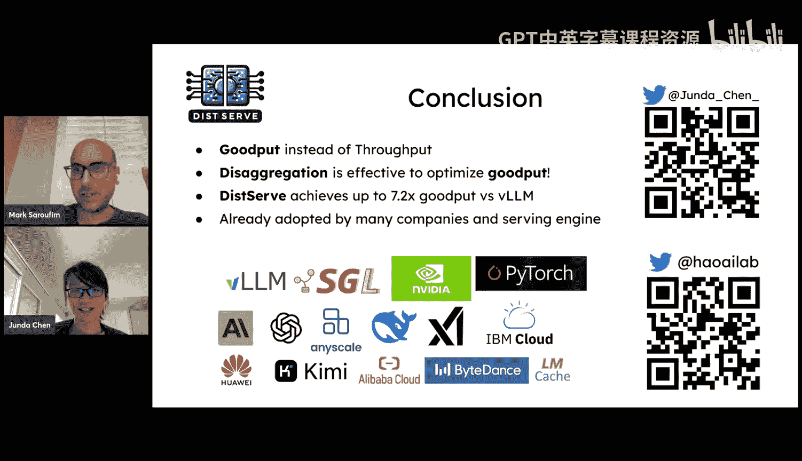