# GPU MODE《CUDA、GPU编程54-87｜GPU MODE》中英字幕（deepseek-v3.2 p06 -20250531-Lecture 59_ FastVideo.zh_en -BV1xbmQB3ETC_p6-

Right， I think we're live。Okay， welcome everyone to another episode of GPU mode today I'm really thrilled we have like Carry Zang from like the Ha AI La at UCSD here to talk to us about making video models faster。

 video diusion models faster， I figured it would be like a nice range of pace from the typicallum stuff that we usually discuss on the channel。

So Perry， thank you so much for coming and please take it from here。Yeah， great， great。 wonderful。

 I guys。

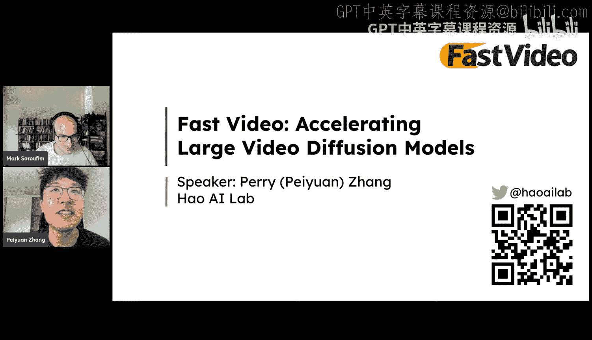

Thank you for having me here for for this opportunity to present our project of fast video。

 accelerating large video diffusion models。And if there's any mistakes made the slides。

 please let me know in the comment section or just call me out。Yeah， and as the host just mentioned。

 today's talk will be more on。The application level compared to previous talk in cooler mode。And。

I'm sure people here are are experts in language model inference， and I try to。

Give people an overview of the inference workload of large video。Diffusion models。

And including some efforts that we made in our fast video projects and some of。

The ideas that we published in our recent papers。And we may touch a little bit about the concepts of attention kernels。

 but not too much。Yeah。A little bit about me。 So I am a first year PhD student at UCD。

 supervised by H。And I worked in video generation in general。And I work on the project fast video。

 obviously。嗯。I publish papers like S T， A and V SA。And before coming to the United States。

 I spent five years in Singapore and working in vision language model and language models。

 and I am one of the many authors of Lava One Vi Nva and Tany Nama。

Great， great。 So let's took a， take a look at video generations models nowadays。

 And I think it is a really good， good time to look at them now。

 because they are take really taking off with a very， very sharp upper trajectory。

 If you look at how the E， O score of Google's view 3。😊。

It's managed to increase from view to That's by。Above 100 points in E， L， O。

 And normally for language model， they only increase like the the sota model only increased by like 20 points or 30 points。

So they they are， they are developing。 people are developing and increasing the quality of video generation models very fastly。

 Many companies are working on this Google， open AI and clean。And maybe right now， it's market share。

 a market is not as big as language models， but people believe it will one day become comparable to language model because people believe。

I mean， at least some people believe future video generation models can become so called world model to model the world and that which can be potentially used for agent class and embodied AI。

Great， so since not all audience has a background of video generation。

 I will firstly briefly introduce how diffusion transformer。

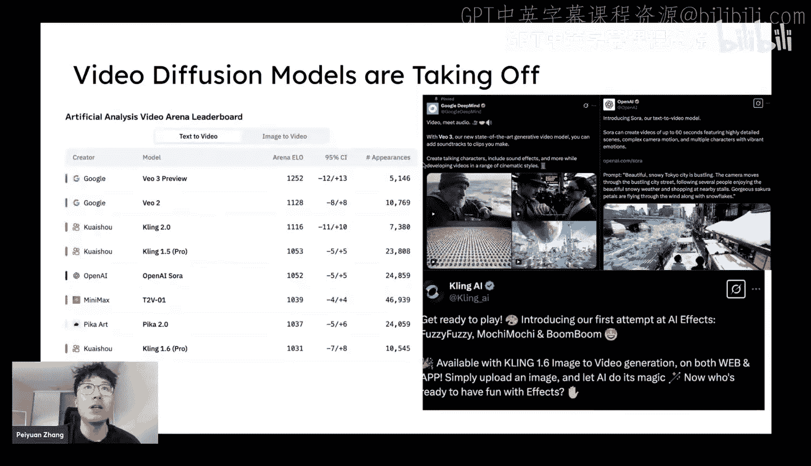

Works to generate a video。And I will take this state of art， open source video models 12。

1 as an example。It's basically the same as image diffusion models。

 but with a much longer sequenceness。Here are you。So the diffusion process takes inside the diffusion transformer。

 which is in this block。And this is the core of video generation models。

The denoing process is conditioned on our input， which is a noise and a user provided prompt。

And also， the time step。 and the time step is normally 20 to 50 times。

To guide a generation with textual information， attention is applied between the diffusion transformer and vision the text encoders。

And note that videos is in 3D。 So there are height whites and timet and the time dimension are the frame dimension。

 So when performing transformer takes a sequence。 So we need to flatten the 3D videos into a 1 D sequence。

 And finally。A decoder， deco the final video from the latent representation。

And produce a high resolution generated videos， so diffusion transformer works in latent space in general。

Which can compress the sequence a little bit。Let's break down the video D I T inference time and see how we can accelerate them as a context。

So taking Hu Yuuan video as an example， which is another state of art， open source models。

We can produce videos with 5 second and 720 P。Resolutions。

And the diffusion transformer will take in tokens with。32 by 45 by 80。

 and a simple calculation will arrive at more than 100 tokens。

Which is a lot if you consider that it's only a five second and 720 P videos。Consequently， consequ。

 the lung causal attention used in diffusion transformer takes over 85% of the flops。

During inference。And their diffusion is an iterative process。 For example， for Hun Yuuan。

 its default diffusion cycles is 50。And each forward pass of the diffusion transformer takes like 19 seconds on an H 100。

That is with with the optimization such as flash attention3 and torch comp。

 So in total with 50 time steps， it takes 16 minutes to generate a video that is only5 seconds。

On this high end H 100。Which is very， very cuersome。And language model， the language encoder。

 and V takes very minimum time。And as I mentioned， attention dominates the cost。 So in summary。

Existing， at least existing open source。Video generation models are bottlenecked by two things。

1 is the iterative process of diffusion。The other is the attention。

And we should dev methods to tackle those two major costs to accelerate。AVideo diffusion models。

And there are many。Numerous works has been proposed to reduce the diffusion time stepss。

 including in the for image generation， as well as video generation for distillation like methods。

 progressive distillation， consistency models， DMD， LD。

And a note that this distillation is not from a larger teacher to a small smaller student models。

 as in the case of language models， it is between two models with identical size normally from a teacher model with a large amount of diffusion time step to a student model with a very few diffusion time stepss and this distillation methods can reduce the diffusion time steps by5 to 10 times。

 so it can accelerate。The inference time by 5 to 10 times， which is a lot。

And distillation requires training and training is notably very unstable。

There are many successes in applying distillation in image generation models。

 but not so much in video generation models， there are some papers published in this area for video generations。

 but there's not a lot of open source code out there and it's very hard to reproduce based on existing very few open source code。

And another line of work is called feature caching。

So they leverage the heuristics that enablinging diffusion time steps。

 So imagine this is diffusion previous diffusion time steps。

 and this is the current diffusion time steps。 The intermediate feature maps of transformers is very similar so we can strategically reuse some feature maps from the previous time stepss and use them in the current time steps so we can avoid calculating some components of the diffusion transformer here in this plot we are skipping the Fi4 wire layers。

Of the for the forward pass。 and we reuse。The features from the previous time steps and maybe in the other times that we can disable the attention and reuse the attention features from the previous time as well and normally this kind of methods can accelerate inference by by two times and it does not require training。

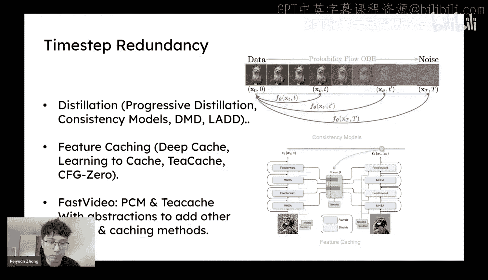

So sorry Per a question so when you mentioned something like feature caching here。

 like presumably if you're skipping a feet forward， you're not doing a computation。

 but you need to load the weights from the previous time steps so it feels like。

You'd become memory bandwidth bottleneck。 So is this just the case that the fusion models are typically。

Compute bound because you're doing 50 steps。 Yeah， diffusion models is typically compute compute bound。

 And because the sequence is very huge。 So it's like over 100 k。 So it's。

 it's definitely compute bound。 But the memory is indeed an issue because you need to。

Cash the entire。The entire intermediate features from the previous time steps and if your sequence lens is 100K。

 that is a lot。Consider that you have many diffusion blocks and you need to cache the features after each like fee forward and after each attention。

Yeah， and then so also related， like when you first mentioned progressive distillation to me。

 this sounded like a form of speculative decoding in some sense。

 like where you basically just have like， well， well not not quite actually。

 I think the Na doesn't hold I can never mind the whole part of my question。Yeah。

 it's a it's I would say it's very similar to it's actually very similar to distillation in language model if you consider the fact that it's just a diffusion distillation in language model is from a larger teacher to a smaller student and here in diffusion models it's from。

A teacher with more time steps to a student with less time steps。 So essentially。

 we are still reducing the compute we needed to for the same kind of performance if we， we can down。

 we can do the disill quite well。Yeah。Great， that's great。 Thank you。

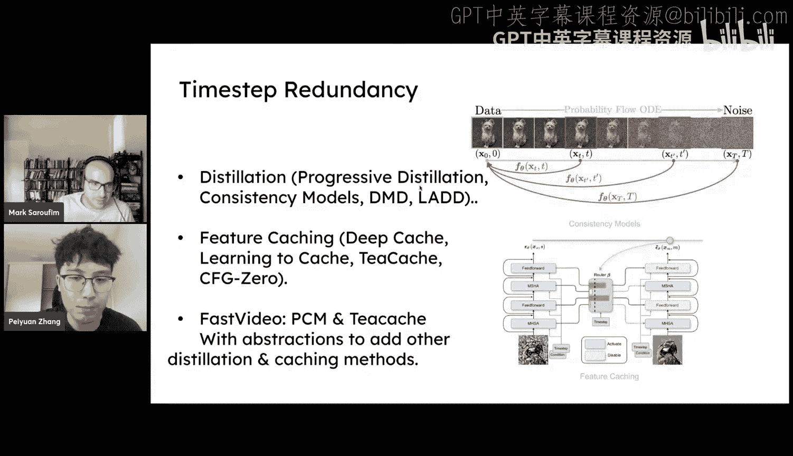

And。And as I mentioned， there are many distillation methods。

 many of them is applied on image models and a few of them is applied on video models and not all of them is open sourced。

 so fast video currently has incorporate one distillation method。

 which is called PCM and one feature caching methods called Tcache。

And we have abstractions to add other distributiontion and caching methods。

 So we want to have a unified。So inference framework。

 so people can add features to to fast videos because currently the it's very fragmented。

 So people need people publish their code in different reports for different models and very hard to compare which methods works the best。

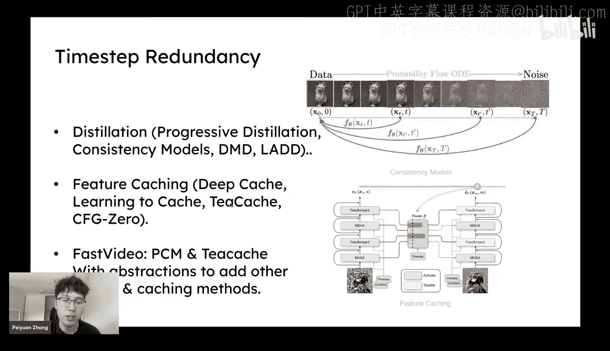

And we have trained distilled a model last year， I think it's on December of Huunyuan。

 where we in fast video and we can make it eight times faster with a slight drop in quality。

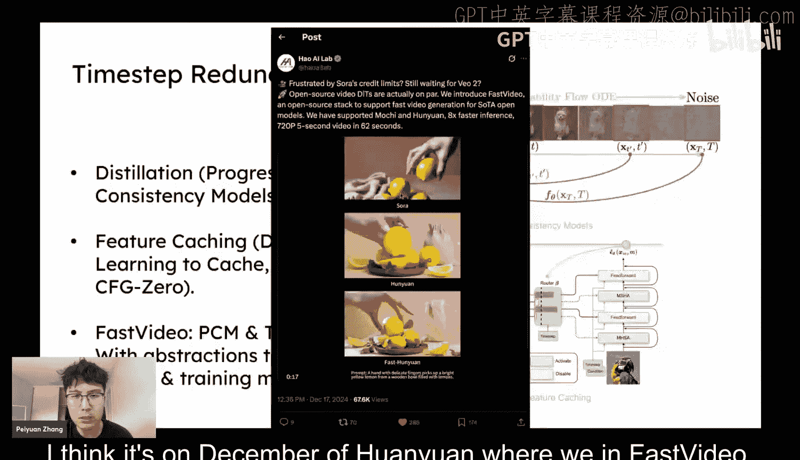

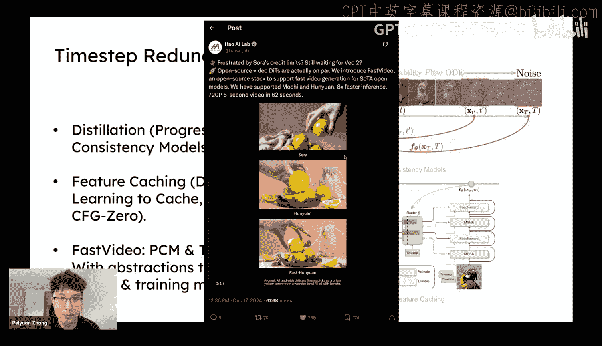

And as I just mentioned， the two main major cost in diffusion transformer is firstly the iterative process of diffusion。

And secondly。The un proportionportional amount of attention flops in the D I T blocks。

 So we also want to have some methods to reduce attention。Flops， and this is。

And people only start to look at this very recently， because。

The sequence is only very long for video diffusion models。

And it's actually short for image models so people did not look it before。

 at least in the context of diffusion models。So， Barry， before we go to attention。

 so someone had an interesting question around。I've seen there are some labs like for example。

 like Tvid for instance， has distilled video diffusion models that they provide where they basically say this runs in four to eight steps and then it's extracted as a Lauraura such that it's compatible with diffusers Could you maybe talk a bit about the composibility of Lauraura and and distillation in this case Oh yeah so people。

People use Lauraura as a plug in plug and play adapters to accelerate diffusion models。 So the main。

 main application scenarios is like， so imagine I can train a distillation las from， for example。

 this one model。And later， some people fine tune1 on other on some domains， they say cartoon。

And they do not。Dill their fine tuned models on cartoon。 They just fine tune it。

 So it's still a 50 steps diffusion times， time steps。 In that case。

 Laura is very composable because you can apply a Laura that is trained with the original pretrained 12。

1 and apply that Laura on the fine tuned model， and it can still accelerate。

The diffusion transformer and that's why I think people love Laura one reason is obviously it's very small。

 the second reason is like plug and play and very composable。listen， okay， thank you。Yeah。So。

 let's go into attention。So we have two papers that is either published or archived。

The first one is a fast video generation with slidingtail attention that is accepted just accepted by IML 2024。

 and this faster video diffusion with trainable spae attention is recently archived。

So the reason why we can accelerate attention is because attention score is generally very sparse。

And here， if we look at the left plot， which is the attention map。

 you can see that only very few indexed in the attention maps is has a high attention score。

 and the rest is basically 0。And a different attention head in different layers has very different patterns。

If we can。Have a mechanism to predict this pattern without calculating the entire attention。

We can accelerate attention。And the right plot is more illustrative。

 which shows a 3D scenario in video， so consider this as a video， this is like the frame dimension。

 this is like the white dimension and this is a high dimension。And in the middle， there's a query。

And the query will attend to Ks。 And here we plot the Ks that that is that has huge large。

 significantly larger。Attention course。So you can see that some patterns is like local。

Some pattern is global。Some， some attention hit exhibit both local and global characteristics。

 and some like it's very in intuitive like they have， they attend to the height and white dimension。

 Some attend to the temporal and white dimension and temporal and high dimension， so and so forth。

But so the main takeaway is that attention in diffusion transform is sparse。😊。

But they are very dynamic。 And we need a method to predict。The pattern。But the。

 the prediction should by itself， very lightweight。So we can really accelerate the attention。

And there are also some hardware constraints for。Attention pattern as well。

 which is basically the block spae pattern。 So this is。

 imagine this is the attention map and the each row represents a query。

 and each column represents keyvs。And。If we have an attention map that is on the left。

And it's very scattered and very zigzag。I have there there will be three different kind of block。

 So attention works。I'm sure I think people know how attention works。 It basically performs tiling。

 And on each GP S M， they will calculate a single block。And。If a block is a dense。

 the GPU can compute it very efficiently。 but if a。A block is like mixed， which has。

 We want to calculate some of the elements from it， but remove the rest。

 The GPU still needs to perform all the computation and later remove the unwanted result。

And if a block is completely empty， we can just keep that block。

So we want to predict the attention pattern。Like this。

 But we also want the attention pattern to look like， look something on the right， which has only。

Dense block and empty blocks， because dense blocks can be calculated as a whole。

 and empty blocks can be excluded。 And mix block， if we are， we have some mixed blocks， we。

 we are actually wasting computation。Because the mix block has the same computation cost as the dense block。

 If we need to compute everything inside a mix block， why。

 why not we just retain all the values out of it。Right。

So this is some like hardware constraints on the attention pattern。So in general。

 as I just mentioned。We want to predict a critical tokens。

And only perform attention on critical tokens。And we want to。

 we want the prediction process to be very lightweight。

So theres a prediction and actual attention cost。 How much attention， how much cost。

 how much computation should we spend on prediction and how much computation should we speed spend on the actual attention。

And for efficient execution， we it will request blocks spa attention。

And it means that we are essentially calculating critical blocks instead of critical tokens。

 So in the runtime side， I have a figure to illustrate these things。

 So if we want to calculate the critical tokens， as denoted at the red doubt。

We only want to calculate them。 And if I have a attention block size， that is4 by4。So I will pick。

 I will potentially pick this block。Even though I only， I only want this for doubtted。Points。

I can still retain。The other， the other attention scores， because there's no harm There's no harm。

Including them。Because attention is by right， Full attention。 And we want to make it。

 make them sparse。So there's always no harm retaining those scores in this block。And。

The block size or tile size plays a very critical role here， because。If the block size is small。

We can come up with a more frant attention。Tyn that can capture more critical tokens with the same sparsity。

So the left plot and right plot has the same sparsity。

 We are calculating the same amount of the blue。Blue squares。The only difference is their block size。

 So the right hand side has a block size of two by two。So， we can。

We can then calculate all the red dot with the same sparsity with a smaller block size。

But that's not achievable in the left hand side。However， block smaller block size。

Will have a lower arithmetic intensity in attention kernels。

 which means the attention kernels may run slower。So there is a block size versus efficiency trade off。

We believe that a smaller block size。Make the attention pattern more expressive。Which is good for。

 for the diffusion performance。 But a smaller block size is bad for the kernel efficiency for actual speed up。

 So imagine the scenario where the block size is just one。😊。

Which means we can allow for any kind of attention pattern because block size equals to one。

Basic links we are no longer following the block bus attention pattern。And then the last question is。

 if we are only calculating for those， for example， blue regions。

Which means we are excluding a lot of connections in the attention。

 So do we still need dedicated branches， attention branches。For global or local context， make。

 maybe we can design some attention mechanism that is more core green， more lightweight。

 but it attends to every token。And maybe we can use some heuristics from CN。

Where a token will attend to its neighbor。So that is the question we try to answer in our paper video sparse attention。

And for efficient execution。Following the pattern of block spa attention。

 one very important techniques used is to reder the sequence。 And this is。

 I believe this technique is first proposed， at least in the in diffusion transformer in is in our first paper。

 fast video generation with slidingtail attention。So this is the 2D scenarios。 so it's not video yet。

 it's image。Imagine this is like VI T。Normally， when V I T deal with image。

 you will flatten the 2D image into a sequence， and we。

Video deffficion transformer or the way V IT flatten it or DI T image DIT flatten it is following。

 following a zigzag pattern。So， it assign an index。Roow by row， and column by column。

One problem with this is that。Nearby。Near so these two， consider this 1 and 10。

 They are very close to each other， but they have far， far away indexed in the one D sequence。

We propose to our token reorder techniques。Let's sh a 2D image into sub regionsgs。

With continuous index in each region。So here in this sub in these sub regionsgs。

 we have in total 9 tokens。 and if we can use。A block spa attention with block size 9。

 Obviously also， so yeah， this number 9 is just for illustration， normally like attention。

Box S has 128。So。And if we can map these subregs to a single block。In attention。

 we can allow for efficient execution。In 3D scenarios， that means。We can shout。

Videos into very small cubes。For example， here a cube is a two2 by two by two。Ce。

We can map this cube into a single block。In the attention kernel。That is continuous。

And when we perform sparse attention。This entire cube will either attend to this cube or do not attend to this cube。

So we can then form a block pass attention。Pattern。And in reality。Normally， the。

Dimenssion of a video for 5 seconds，720 P。It's something around 30 by 48 by 80。

And we can design the cube。Dimension to be 4 by 4 by4， for example。

 which is actually a very small cube。That corresponds to in total，64 tokens。

And then Mike that 64 to a。To a block in attention。

And this 64 is actually a small number for attention kernel。 normally on H 10 on a 100 is 128。

 So for maximum， like theoretical speed up for the attention kernel performance。

 we may want to design the cube to be shaped， for example，4 by 8 by 4。And there is also a minimum。呃。

Block size that we can support， for example， on a 100， A 100 minimum。M， M， M， M A size is 16 by 16。

 And on H 100， the minimum is 16 by。64。So the trade up here is if we want to make the cube size smaller。

We are making the通讯 kernel slower。If we want to make the cube size bigger， the tension is faster。

 but we will have more call screen attention pattern。Which is already illustrated。

Illustrated in this plot。The so the main paper。The main contribution of V SA is a lot of。Abbllations。

To help people choose， what is the correct balance between attention speed。

 kernel speed and the cube size and and many other design factors。

I will just firstly go through the best。Configurations that we find do a lot of abls。

For a better understanding。So a video is first partitioned into cubes with size 4，4，4。

Which means while using a block spae attention with blocks at 64。

And tokens with the same within the same cube has a continuous。

Positions when flattened into  one D sequence for attention。Which phone blocks Sp attention pattern。

And here in this plot， this is。This is attention。Flow chart。 This is Q， K and V。 After Q partition。

 a course branch。Will， perform。4 by 4 by4 average pulling。for q q v。To get cube level representation。

While essentially reducing the sequenceness by 64。So the cube level attention is very lightweight。

And we can get a global cost green output。And after the attention， we need to broadcast。

The attention back to the original sequence。And the attention map of the course attention。

It's used to pick the critical blocks。For the fine Gr token level attention with top K。

So the fine green branch is still computing token level attention， but with sparsity。

How do we decide which block to calculate or not is from the attention map from the course branch。

And frame branch use a attention block size of 64。And in the end， we have。A gate for each branch。

 this gate for course branch and this gate for fine fine branch。

 We time them with the corresponding attention output and item together to balance the contribution of course branch and fine branch to get the final attention output。

So far， is there any question in the channel， I can't say the comments。Yes。

 so there's some questions that I think I would rather save until the end。

 but maybe there's one question is from Toga Congozo which says。

 do you see potential in Marioshika representation learning in this field。

 they seem very data efficient， but perhaps there might be some performance concerns。Sorry。

 can you repeat the question。Let me just post it on the here you can。

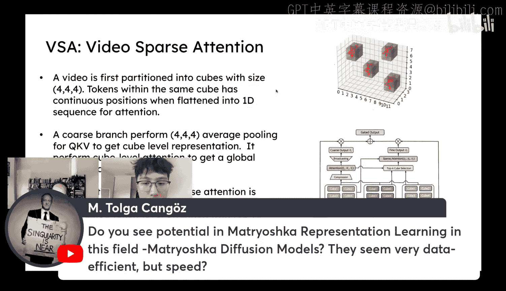

Oh yeah。Yeah' not sure if， I'm not sure if he is referring to compressing the tokens。

 I read some papers。Of the martous scar。

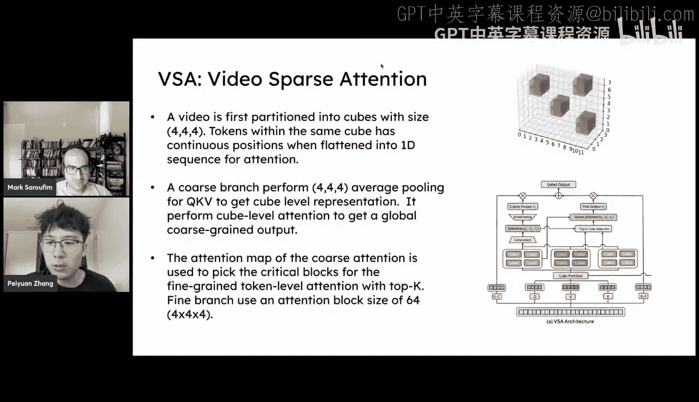

A representationpresentation in， like， invasion language model。

So you can maybe compress some tokens and the other hook， I think。They are togonal， but。

I think the idea is that if you compress by a lot。Your performance will degrade because were already compressed in the V AE。

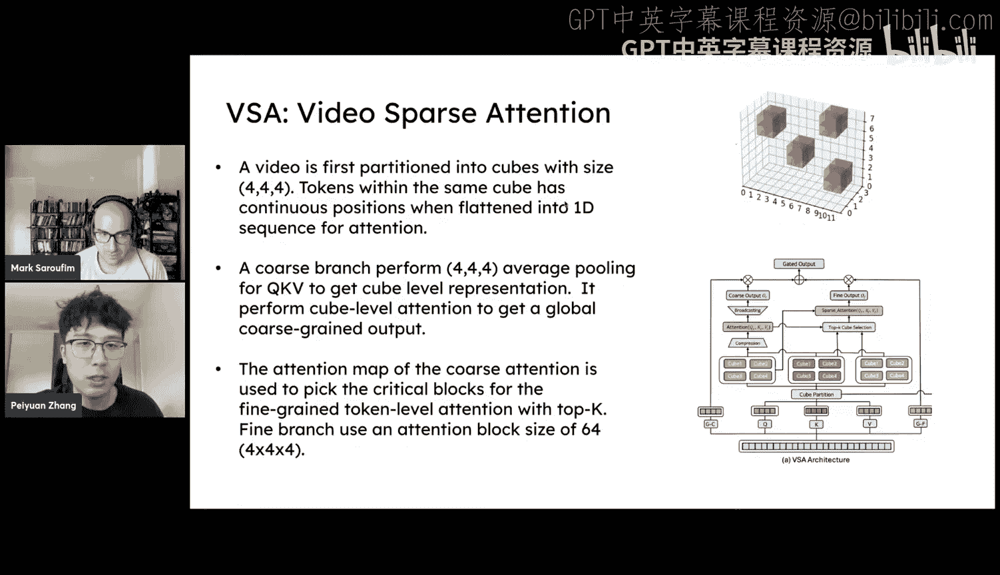

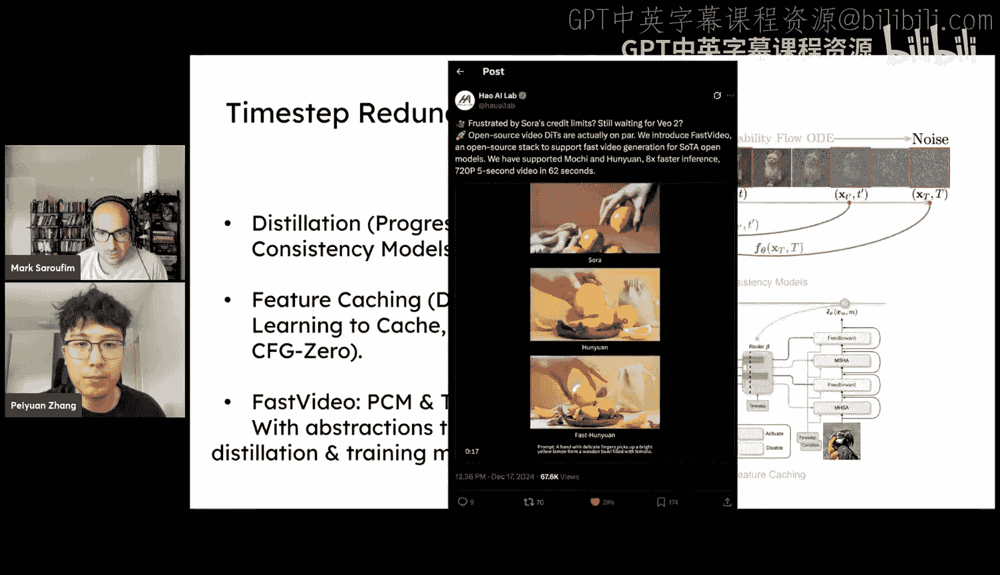

So remember， we have a variational auto encoder to compress the pixels。And。Normally。

 people use the compress rest four times 8 times 8。And that that is used by one。

 That is used by Hun Yuuan。I think the reason why there are some papers published that if you use a very large compression rate here in V E。

 it's very hard for diffusion models to converge and learn。And we show， I will later show that。呃。

Our sparse attention has a better preal frontier than full attention。

And I have some baselines to compress the K and V values as well， yeah。

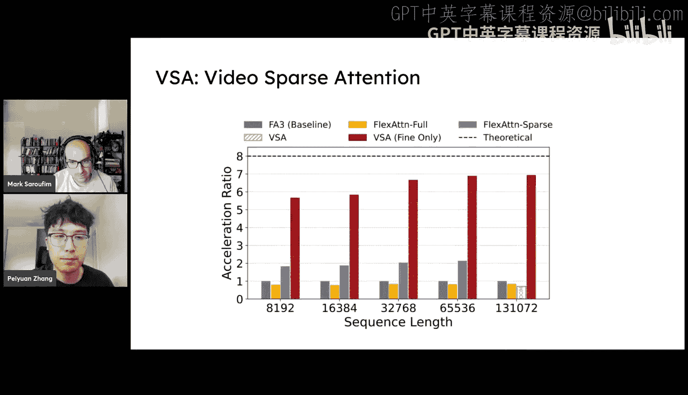

So we use a block size of 64。That is obviously going to slow down the attention kernel， because。

 for example， in F3， I， I believe they use a block size of 128 times like 172 or something。So if。

 for example， if we set our。Sparrsity level to 87。5。Which means we are only calculating 1212。

5% of the attention。Theoretically， we have， we will have a speed up。Of eight times。And in reality。

 with a block size of 64， we can achieve a speed up around 6 or seven times very with huge sequenceness。

😊，So， here， the red plot。I I the red bar I plot two things。 One is V SA with fine branch oning。

 which is the actual block spa attention kernel。And the entire red bar shows。The speed alsoで this。

Slashed bar shows the entire speed up of the entire V S A attention。

 So V S A is composed of two things。 One is coursese branch。 One is fine branch。

 F branch is the actual blocks bars attention， and the course branch is going to add overhead。

So I think this performance is actually quite good because we are close to the theoretical speed up of eight times。

😊，And one thing to take note that some attention pattern do not follow blocks spa attention。

 They will include some elements that is not block spa， for example， in。

And they may may not have such speed up。 And there are some other kernel implementation。

 like flex attention。Spare， and they will have speed up as well， but they are not as huge。Yeah。

 by the way we will write our kernelel in dollar kittens。Okay， so this is comes to the ablation。

 and I can， I can answer the questions about。If compress will help。

So there are many existing sparse attention in the field。But up today。

 people still use full attention。Even though they pay a high cost of 80% of the props。

But people still use full attention， at least in so open source model。

This is a very intriguing question， and we try to understand why。

Here we are pre training our video diffusion models with 120 million parameters。

And we have two set up。So， we run some simple。Experiments。

 scalingal experiments to find a compute optimal budget。And we also overtrain the models。

So this column， O， P T means。If we train our models， compute optimally。What is their loss， the lower。

 and the better。And if we overtrain the models by 10 times the flos of the compute optimal。

 what are their flops， And we use the 1，2。1 architecture。And we you pre train from scratch and you。

We a with different attention。And one。Methodd is to compress。The key and values。

 So if we can compress the key end values by average pulling them2 by  two by 2。

 So that is a times sequence reduction。And note that we do not compress the query tokens so we can effectively reduce the flows of of attention by eight times。

And you can see that its actually convertver Bras slow， and it has the highest。😊。

Loss across all the a。And there are some very good， sparse attention。That is fixed pattern。That I。

 that can actually outperform full attention。 For example， Stred window attention。

 which we implement based on swing transformer。And some attention such as spatial temporal。

 which is another variant that people use a lot。In like 3D V I T or like in。

 I think in diffusion models last year。You can see that in a compute optimal setup。

 they all outperform。For attention。But the thing is， if we overtrain the model。

F attention becomes the best。I think this partially explains why people use full attention because people now that this tend to overtrain their models。

To reduce the inference cost。And VSA stand out because。

It outperformed full attention in both compute optimal region and in the overtrained region。

And there are a lot of components in our design。 We are going to。

Explain one by one why we want to make it that way。

So one baseline we use is instead of asking the course branch to choose which block to attend。

For the fine branch， we can force the fine branch to attend to only local box。

And this is that's experiment7。And。We can see that。A data dependent trainable sparsity。

 which is experiment 8。So in experiment 8， F stands for fine， fineine branch。

 and air stands for like local。If we compare 7 and 8。

 we can find that data dependent trainablersity sparsity wins over fixed pattern。And it also wins。

Over full attention， as illustrated in the previous light。

We a whether should we in include output of the course branch to the final attention output at all。

 Because another design is to only ask the course branch to help choose。

Which token to attend in the fabric branch， But without including its output to the attention。

So we can remove this O C and compare 8 and 10。 So 10 is basically this graph。

 what this graph is doing。So we can see that including a global information from the course branch is necessary。

We also a。If locality price offer。Offer some schemes。 So we can for， for example。

 we can force this fine branch to choose its local。Neighbors。

 and then you can freely choose the rest。So we can ask， so this is the experiment 11。

We can also add another， like local branch here。Yeah。

 so those abls experience is verytricate intricate。 and for those who are interesting。

 you can refer to the paper。And our conclusion is that。

We should let the course branch to freely choose which blocks to attend。

 and we should not add any local heuristics such as those used in CN。

But global information is necessary， So we still need to include this output to the final attention output。

And the last a is probably the most interesting one is about the trade off between block size and performance。

So here this is how we map the cube size to the attention block size。2。Remember， this is the final。

Configuration we use。And。If we look at this table D。And we compare。Ex 14，15 and 16。

Will reduce the block size from 256， all the way to 64。And if we look at 18。

 we even lower the boxes to 16 by 40。64， which is the smallest block size that is supported by H100。

 the WGMMA command。And we can see that。By the way， this， this table is flps controlled。

 So we use the same flops。We can see that the smaller the block we use。The smallerlocities。

But if we measure。The latency or the time takes to train such models。As measured by the T fl。

 So we we write several kernels， attention kernels with different block size。

We can see that if we have very small。Block size。 The attention T flops is very small。

That's why in the end， we choose this setup of experiment 16。

Because while the Tflps is slightly lower than。14。Its performance is better。Yeah。And now。All。

 all previous ablation studies。Are flopss controlled。And they are， they are。

 we are training models with 128 million parameters。

So to really show the effectiveness of our proposed sparse attention， we。

We compare it to full attention。On larger scale。So， here。This is the。This is the lowestfls for 410。

Million parameters models。And X axis is step。And we are using a sparsity of 87。5。

So you can see that even with sparsity， V S A matches the loss of full attention。

So V S A can train the attention， can can enable a faster training。

 speed up training times of attention， pre training。And we even run。Sort of a skill experiment。

We we train the models from 60。Million parameters to 1。4 billion parameters。

And we pulled their plateau frontier and here the X axis is the flops。And we can see that。

 this green。Line consistently achieves better loss flos。

Pal from ti compared to the full attention and。Their line is， like， parallel。

So we we can draw the conclusion that V SA is more scalable than full attention。

Another interesting question is， how do we choose the correct scarrsity of attention。

When we vary the different sequenceness。And our conclusion is that。Optimal， sorry， this is thetypo。

 This should be optimalti。 Opti spaity depends on training budget。As well as the sequence。Basically。

 the more we overtrain the models， the more we want。The sparsity to be low。

This is very intuitive because if you consider you have a model and you you train forever infinity。

You would assume a full attention model will perform the best， right。So。The actual。

 but in in reality， when you train a model， you need to take into consideration the， the scaling law。

 and you cannot。Infinently overtrain your models。搜。The actual interplay of sparsity。

 model size and sequenceness。Maybe requires another full sweep of skeal experiments by adding the sparscity into the skeal。

Formula。And we leave there for few future work， but we present some flops here。For。

 for some intuition。For example， in this plot。We are varying the sequences from 8 K。To 61 k。And we。

 we observe that。诶。We choose the top either top 16 or top 32 blocks。Achieve the best performance。

 And remember， a block is a has 64 tokens。😊，So top 32。

 essentially we are choosing the like 32 times 64，64， which is top。2 k tokens。

And you can see that there's a no clear pattern about which top K is the best。 Intuitively， we。

 we would imagine the top K， the K to be larger。The optimal K to be larger for longer sequences。

But it is not the case。The optimal K for sequence and 61 K is even 16， which is even smaller。

It seems that we are having a conclusion that。For larger sequence。

 we can even allow for larger sparsity。 But here in this plot plot， we are flops controlled。

So we are all training the four different rounds with the same flos。 So a sequence。

 a larger sequence is less trained。It's very undertrained， so that's why we believe。

And if we look at this， if we switch to a X axis with flops。We can see that initially。

 top 16 is the best， but you， it was later catch up。In this region。By top 32。

And I would imagine this top 32 will later be catch up by top 64 in the future。And eventually。

 maybe full attention is the best， but it depends on how you want to extend your X axis and。Remember。

 this X X is is exponential。 So in practice， I think we should still choose。

A top key value that is like 32 or 64。Yeah， by the way， this， this attention， this experiment is is。

Already like kind of large scale， at least for academics， because for each round we are like。

 I remember we are running with 64 GPUus for like one or two days。

So those are all the like pre traininging ablations for VSA。

 and I think this is more the most practical things for people to play with。

 which is to fine tune existing model with VSA。And we'll introduce two methods。就。😊，Gradually。

Convert a full attention to our video spae attention。 So firstly。

 this compressed branch is newly added to。To full attentions。 So we inspired by Laura， for example。

We can initialize the course branch gate。😡，It's projection weight with  zeros。

 So this term will be all 0， which means nest here is all zeros as well。So initially。

 during initialization， we will only have this fine branch。

 and we can initialize the top K to full attention as well。 So at the beginning of training。

 if we have in total，300 K，300 blocks， we can。😊，Iitialize the K to 386。

 and will gradually decrease its value to 32， which is our ideal sparsity。Duringing the training。

And in our experiments， we find tune 1 with synthetic data generated by 114 B。This is and this。

This progress chart is very interesting。This is， if you look at it at trading step 0。

 If we use V S A with sparsity， like with around 80% sparsity。It produce。A video that is。

Like with very artifacts。With many artifacts， but you can still roughly see the astronaut here。

 maybe。 And then at the training progress， it's getting better and better。

 And then and it can produce。An actual video。That is comparable to the quality of the full attention。

And I can show。

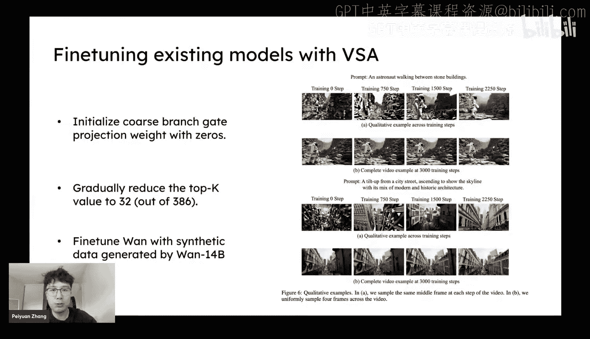

I can show some， like。

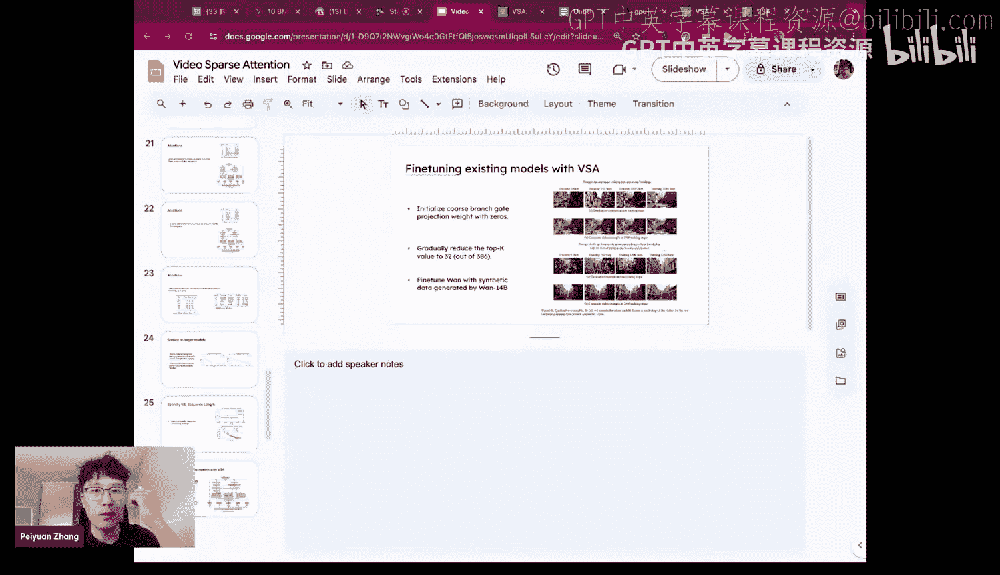

Moels trained with our attention V S A and models with full attention。Oh， this， this is probably。

You might be sharing something else， by the way， because I don't think we see your most anymore。Okay。

 you're about this。Yeah， we just see slides， by the way， that's it。 Oh you're just the slides， yes。

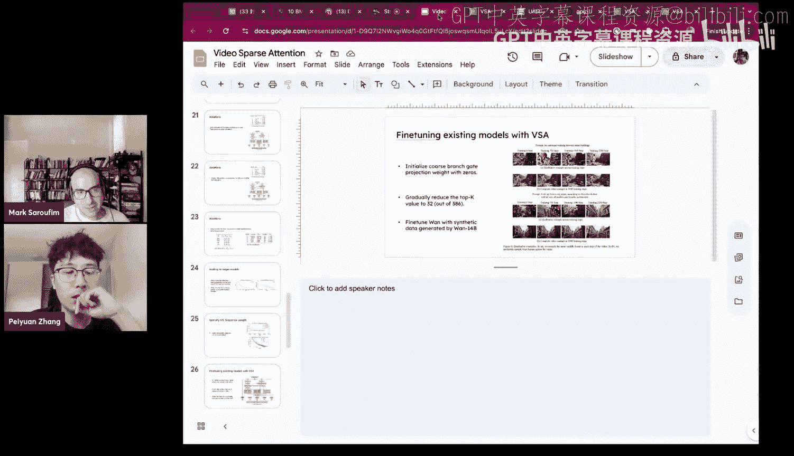

Oh yeah， maybe maybe I'll leave it to then。Oh。Ohmus， I'm right。Yeah。Yeah， we done。Alright。

 so maybe that let me conclude first， so。For video generation acceleration。

 the ball picture is that you can use many methods to accelerate them。

 I think the most prominent thing is probably distillation， because distillation offers。

Like5 to 10 times speed up。But as I just mentioned， the problem right now。

 at least in the open source world with video distillation is that there isn't a lot of open source code and it's scattered。

In different Github repples， and when people publish this code。

 they may only support one open source models。And then later。

 you need to adapt it to a different models if you want， if you want to train your own， like。

 for example， people may publish code with Hunyuan， but later you want to train it with one。And the。

 the data for this solution is also a big concern。And for futureching caching。

 it does not require training， but it only offers two times speed up。For spa attention。

 I would say also oning our first。Two times speed up。

 But the pros for sparse attention is that it can speed up training as well。 So for pre training。

 if you can speed up。For like two times， that's a lot。

And there are other methods such as quantization that is also explored recently。

 like in sage attention。And we can also like similarly apply like F P 8 linear and smoothing for。

ADiffusion， video diffusion models as well， because they are all like all in all transformer。

And we may also want to have some fuel kernels for diffusion transform。

 because diffusion transformer has a few， not so much， but a different。

Operators stand language model， for example， the Adaom。And our project， ongoing fast video project。

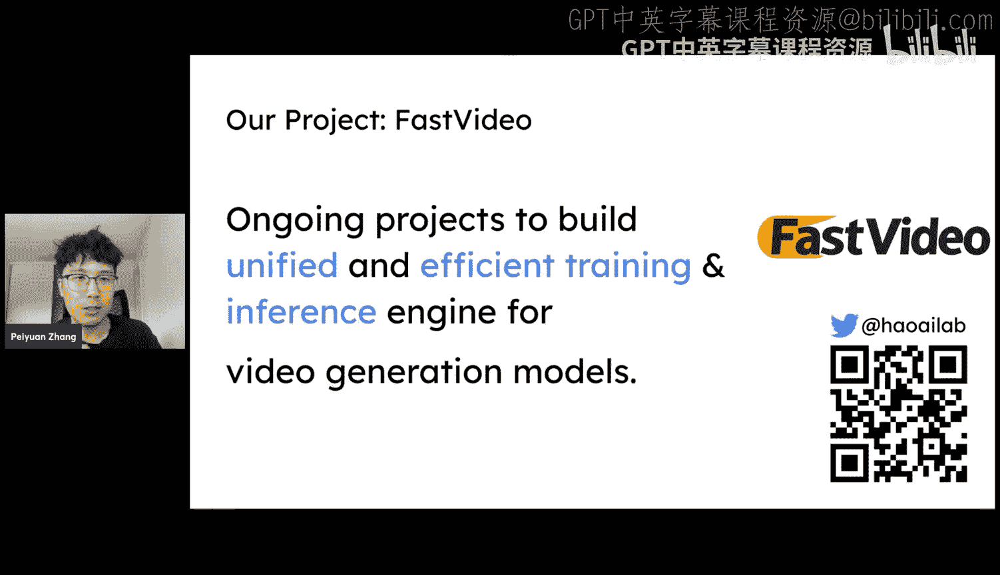

Try to build a unified and efficient training and inference engine for video generation models。

 where we try to support different models， different distillation techniques and different sparse attention。

And right now， we already support fine tuning with sequence parallel， FSDP。

 and we support different models。We also support distillation with the PCM method。

 and our we we recently build a inference pipeline that has fast loading。 We also have T cash。

 We have S T A search attention and V SA。So we try to build a centralized place where people can submit PRs if they propose different distillation or like sparse attention methods into fast video。

To accelerate， because we believe there's a huge room to accelerate video di models to reduce its inference time from 16 minutes on H100 to a real time。

YeahAnd there's some links。And thank you。 And happy to take question。

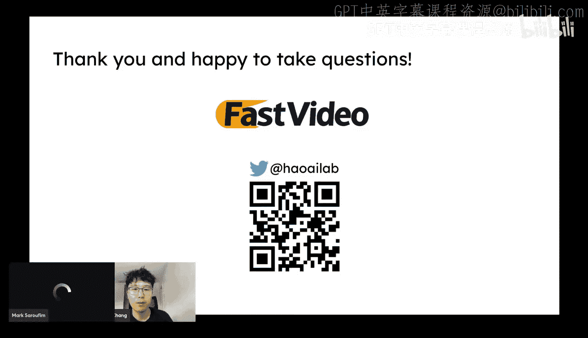

GreatThank you so much， Perry， yeah， folks， if you have any questions like please drop them in chat。

 I'll read up some of the ones that we didn't go over earlier。

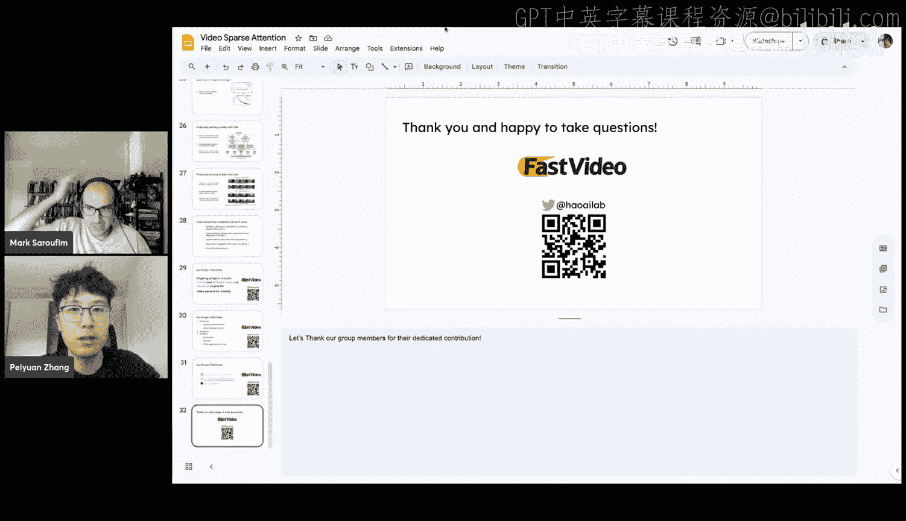

Yeah， I guess we we have the infinite view though like this would great maybe we'll stop sharing your screen Okay。

 I think yes， we can do this。Yeah， so I guess my first question is like， I mean。

 going as you were going through sort of modern diffusion architectures。

It did seem to me like you could imagine that like， well。

 the ideal case is you distill down to a single loop。In which case。

 like a diffusion model starts to look like。Regular LM inference， in which case。

 maybe frameworks like VM could like do fast diffusion inference。

 And so I'm sort of curious like how you sort of think about。

The problems that are unique for infrastructure for the fusion inference versus element inference。

Okay， I think so firstly， I think it's converging like recently their are works， for example。

 a bagel from Bdenance。They are trying to build a model that can understand image and generate image in the meantime that is quite similar to TT 40。

 which means we need to decode language model and we also want to generate in diffusion。

 so obviously a lot of code in verM can be reused。And I think， I think the。

The major difference right now is that I think diffusion inference is。Actually。

 the problem is actually。Maybe I will call it easier or like simpler than language model because it's compute bound。

And maybe you request more。For example， when you design like quantization kernels or something you may for language model。

 in some cases， you only。So long as you reduce the memory and its memory bond you can accelerate it。

 but for diff models you really need to have a quantization methods that can leverage like for example。

 FP8 tensor course to accelerate your model and I think another characteristics from the application level is the enormous sequence。

I believe a language model can satisfy 99% of the UK use case with a sequence of 100 K。And yeah。

 maybe the last1% of use case still needs one million sequences。But。

If you look at the diffusion models nowadays for5 second video， you already need 100 K。

So if we want to scale up the sequence， if people really want to generate a movie。

That's really a huge。Huge problems to be solved in the future。A two。

 maybe with linear with some linear tension or maybe with some sparse attention。And in terms of。嗯。

Yeah， and either there。我 things。And diffusion models。

 maybe this is something like that's similar to RL， maybe that you need to host multiple models。

For your diffusion pipeline， for example， you need to fill host your。Language language model encoder。

 You need to host V E and diffusion models。And。And when that comes into。To like parallelism。

 How do you like short your models， Do you want to have dis aggregateate the。

Language encoder and the diffusion part。 Or do you want to like put them in the same card。

 that's also a question。 And I think there's a lot of room and。Nowadays。

 people are just like starting to explore those things and there is isn't。

Maybe there are many directions， yeah。So speaking of the sort of future directions。

 one paper I enjoyed reading yesterday was the hybrid flow paper。

 which was a paper on art like the it's a paper on rural and RHF infrastructure And so like one of the things they talk a lot about in that paper is basically how different like models might have different like sharding strategies。

 and obviously when I looked at a diffusion model it's not like a model it's like a diffusion。

 it's like a list of models and it's like infrastructure。

 And so have you also sort of seen ideas borrowed from like modern RH infrastructure start to make their way towards diffusion modeling are people not using Ray or they using other products I I think there's one paper is it publishingDI or OSD that they。

They basically put the language component into a different GPU cart。

And then they they it's sort of sort of like this serve， they this。

 it's just like this disarroate the language component and the diffusion。

 So diffusion is like the preview of language model。嗯， yeah。

And we haven't explored that in our fast video project yet。 but I think there are some。

 some works coming out。And so sort of similarly， you know， again， speaking of conence。

 presumably there's some labs experimenting with Mes with diffussion models and this adds other。

Important constraints， I think， as far as how you design things like has to do。

We haven't touched M OE yet。 And in fast video， I think one thing that that is different from existing。

 So people right now， I think they many use diffusers for inference。

And I think diffusers works okay for like it's already works okay because diffusion is compute bound you maybe all you need to do is just add a torch compound and it runs pretty well and one thing we we do that is different from diffusers is we have。

So we break the diffusion pipeline into a different stage and we try to reuse code as much as possible。

And we also borrow a lot of code from VRM， so which means people can contribute different kernels and attention kernels and it's very easy for people to add attention kernels。

Because attending kernels is， as I just said， all my talk is about attention and it's very important。

And we try we try to have something that is so if people contribute attention kernels。

 it can be automatically used across all different models。

 that means we need to reduce code by a lot。And that's。

 I think that's the main goal that we try to achieve here。

All right I think I see maybe one last question we can go through so this discussions from AsLx with important sampling makes sense here。

 maybe a phone course attention block is more important than others more fine grainin sampling should be done for that block I forget which slide this was referencing I think let me remember。

This was like 20 minutes ago。Yeah， maybe we can pull up your slides， it'll be easier to remember。

Sheす。

I think it was maybe slide 20。I'm not sure what exactly。Is he referring to about important sampling？

Like is it like different blocks use different kind of attention or different blocks use different like sparsity level or something？

If。呃。Im I'm not sure either to be honest， not let me just presume yeah， I think I think it's a。

It's definitely a very important question to assign different spa level for different。

Blocks or maybe even time steps。 And those are some heuristics。

 And when we do a lot of this pre traininging abls， we want to keep things simple。

 and we use our uniform spaity across different each time steps and different blocks。

 And even for our pre traininging experiment， we use the same top K。

We use the same key for different time stepss and different layers。And I think。

I think different sparsity for different time stepss would definitely help。

 And there already have some heuristics。 For example， people like some other works。

Like for spa attention。In in video generations， they would use full attention for the very few。

For the first few time steps in the diffusion process。

 because a heuristic is that for the first few time steps， it's more global about global structures。

 And once you fix the global structures， then you can use sparse attention for the rest of the division time stepss。

 And that wouldn't reduce。That wouldn't drop your quality。

 and you can produce videos that is very similar to the original videos produced by full attention。

Yeah， we didn't explore that because we want our like sort of experiments to be more principled without a lot of confounders。

 but yeah， it's definitely worth trying。

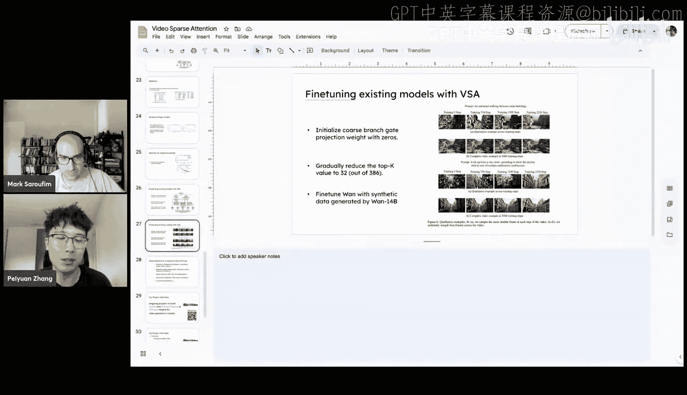

All right， I think with that might be a good time to call Perry。

 thank you so much for joining us folks， if you have any more questions to Perry。

 I guess you can find them on the fast video Gitthub and I think you're on the server as well。

 so feel free to tag them there if you have any follow。😊，And yeah。

 thanks so much almost everyone too thanks。

