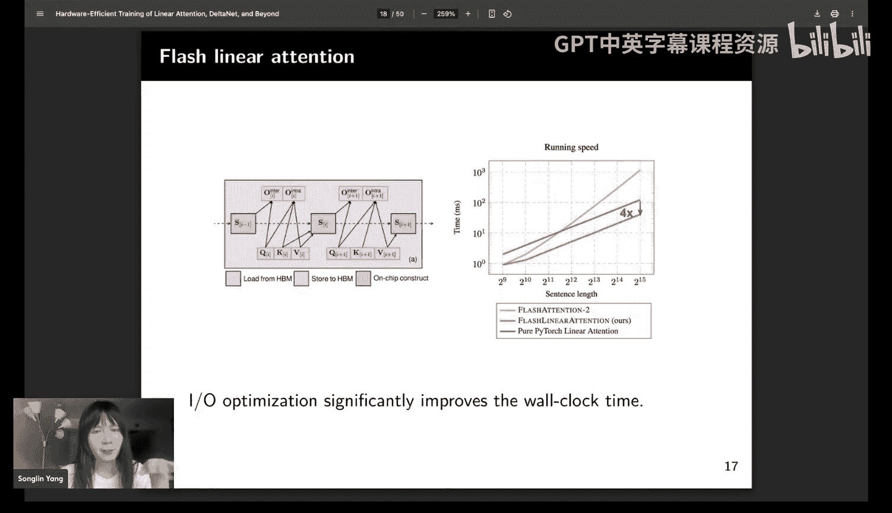
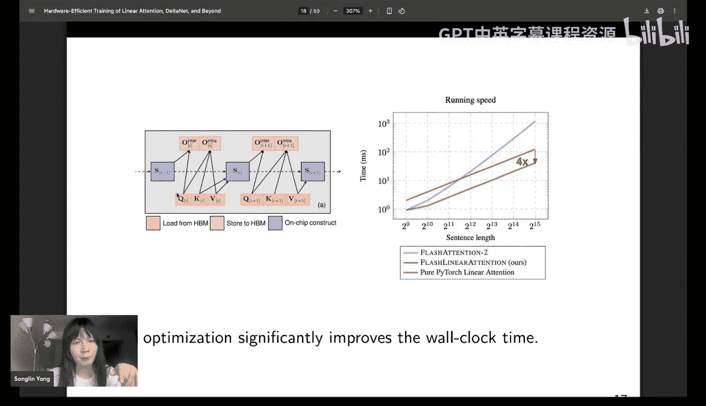
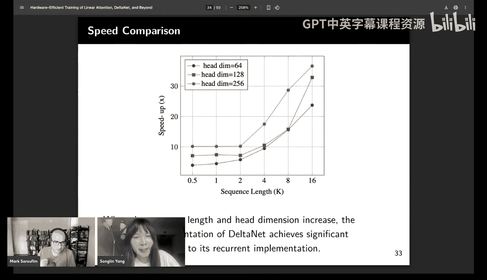
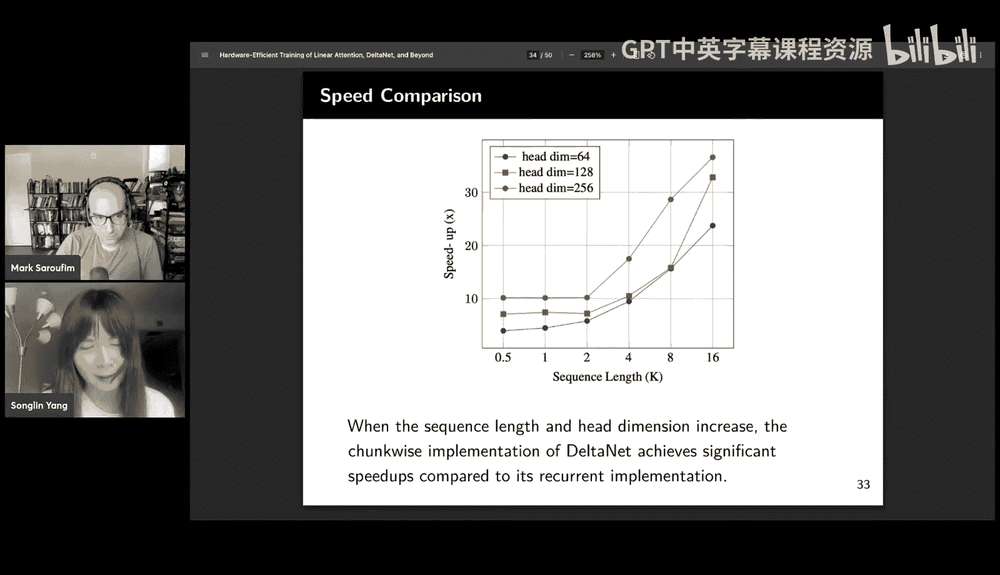
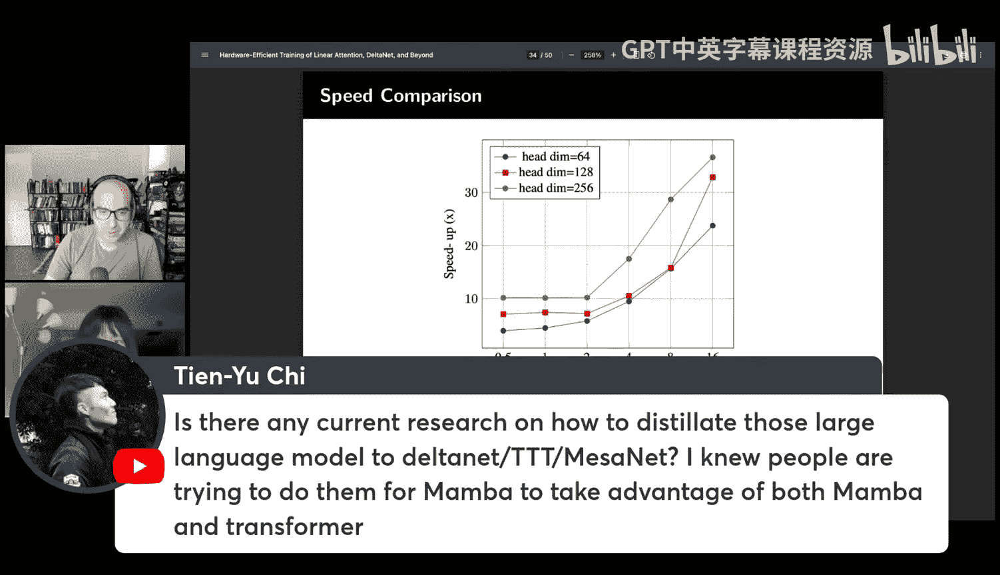
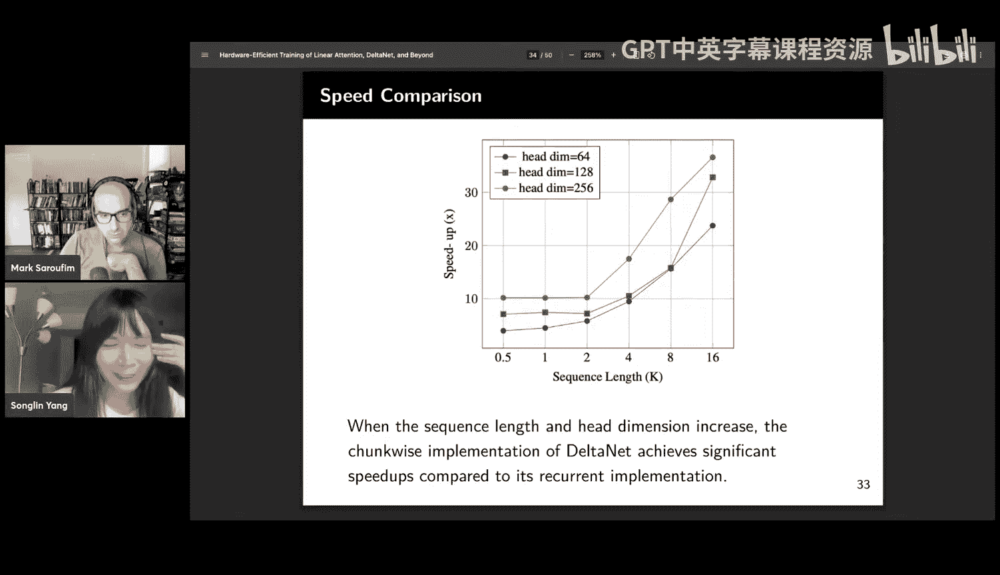
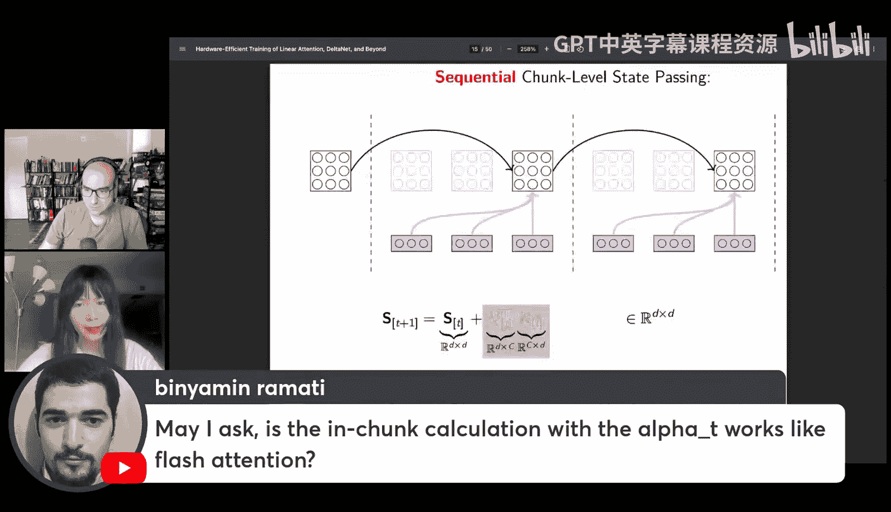
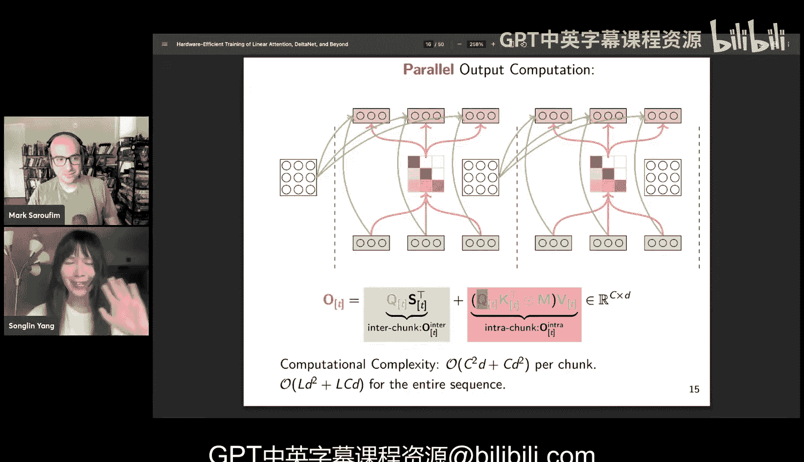

# GPU MODE《CUDA、GPU编程54-87｜GPU MODE》中英字幕（deepseek-v3.2 p07 -20250607-Lecture 60_ Optimizing Linear Attention.zh_en -BV1xbmQB3ETC_p7-

All right I think so。 So welcome everyone。 I'm super glad today for like another episode of GPU mode and today one our guest is Songland Yang。

 So Soland actually was like recommended to come in as a speaker to me by like multiple people and the main reason being that like what kind of makes a lot of what we do in the server around like writing custom kernels is interesting is exploring atypical architectures。

 and Soland has been one of the sort of the really key people in the research community building efficient architectures and also like making them faster。

 So I thought you should all love to fromer and I'm certainly very excited for this talk。

 So yeah Songland， please take it from here。😊，Yeah， thank you for having me today。 And today。

 I'll be presenting how we， hard efficient training of linear attention， data night and beyond。

So first off， we have the transformer， which is the workhorse of modern geneity AI。

And we all know that self the soft attention mechanism。 So here is a quick recap effect it。

For parallel training， we have three matrix， Q， K， V of size L by D。 L is the four sequence。

 and D is the head that dimension。 We only discuss a single head here。And M is the cord mask。

 so for parallel training。 we can use several double product。 So first。

 we take the double product between the query and key matches to obtain the attention logic。

 And then we apply the cordial mask followed by a software softwarewriter。 and finally。

 we we take another double between the resulting self attention matrix and the value matches to obtain an output。

This is for parallel training in those scenario。 we have the input sequence。

For autoregressive generation， we have the iteration iterative form， so basically at time step T。

 we use that time steps query QT to attend the previous key vector so that we can have attention score and then we use this attention score to take the weighted sum of the historical values to obtain the output。

Okay， this is a very quick recap of the soft mask attention mechanism and I'm pretty sure everyone is super familiar with it。

 so I'm not going to introduce more false attention mechanism。😊。

And we all know that for soft max attention， it has several efficiency issue。

The first one lies in the training efficiency due to the quadratic scaling of the super attention mechanism。

And this could be very problematic when the sequenceness is like really large。 for example。

 when the sequenceness is like in the media level， which is often the case in video generation or DNA or I modeling。

 and in this application layer of the self attention mechanism tend to be a key bottleoid。

The second efficiency issue lies in the inference and in inference。

 we need to maintain the historical key and value vectors， which is so called the carry cash。

It KV cache size grows linearly with respect to the generation lens so in this。

 if we want to do no generation and the KV cache size will like tend to blow up and leading to some memory out of memory issue。

Okay， now we understand the key efficiency challenge of self attention mechanism。

 and I'm pretty sure there are lots of different optimization techniques for reducing this cost。

 but today I'll be focusing on a different architecture that can remove the carry cache for the first principle so it is the so called linear attention。

And the key idea behind linear attention is really simple。

 And so it basically we have the So max attention and the what linear attention does is to remove the So Max operator。

And so we can have this iterative form。Let's dig get it into it so here we have this attention score。

 we don't have the software Microsoft operator and now it is a fully linear operator because we removed software operator。

😊，And first， this is a scalar value and we put the scalar value to the second position。

And then we leverage the associivity property of these operators and to compose the value and the key first。

So we have this turn colored in red， and it is a cumulative song of the keys and the autopo between the keys and values for all historical steps。

And this right， this term coding right is often referred to as the arms hidden state because in distance。

 this。This hidden state encodes the key value association pair into this record memory。

Using this outer product computation structure。Now。

 it becomes very clear that linear attention implements linear recurrence。

 so the recurrent state of data is a very simple cumulative sum of these alterer product between the cases and values。

For output computation， we use matrix vector modification， so to obtain the output。

And this is a really simple， linear recurrence。And we also know that in this case。

 the reconent state is of size D by D in classical arms like ass and the gated recurren unit。

The reconsance size is often in the scale of D， which is the input dimension。

 and now the recons state size is in the scale of like D square so in this sense。

 linear attention has a mechanism that allows us to scale up the reconsance size in a very efficient manner。

And we all know， like for irons， the recurance size is super important because ions only has a freak state state memory to encode all the historical data and intuitively the larger the state size and the better the memory capacity of this arm。

Next， I'll be discussing how to train this linear attention model in a hardware efficient manner。

So previously， we have shown the parallel form and the recurrent form of Li tension。However。

 unfortunately， both forms are not suitable for hardware efficient training。

 so first first for the parallel form， it is like a very similar to the wides of mice attention case and it also scales projectively with respect sequences。

Which is very problematic if we do very long sequence modeling。For the ret front。

 is also problematic because for several reasons。The first reason is in recur form。

 we have to do this sequential recurrence， which limits the parallelism across the sequenceness dimension。

 So this reconform is like very， you need to do it in a sequential manner。And secondly， we can see。

 okay， for this recurrent state update， we only involve a rank one auto product update。

And for memory doubt， we only have a matrix vector modificationifications。

 both of which are not matrix modificationification。

 and these two operations cannot use tensor callss。

 and this is why these operations cannot be accelerated by the tensor core。

 which is like very efficient。A common question is that why don't we use the parallel scan to train this linear attention model because you know the first limitation of the reconence is that it cannot para across the sequence。

 but this is a linear recurrence and we all know that the linear recurrence can be paralleled across a sequence using the parallelL scan algorithm。

But in the N tension case， yeah， parallel scan can provide sequence level parallelism。

 you can do parallel computation for different chunk of data。 However。

 if if if you just use the parallel scan algorithm to train linear tension。

 you still do not have the those operations that allow you to do fast。Vduation ons。

Basically because this is due to the limitation of the return form。

 it just does not have the measures multiply based after the mechanism。

This could be problematic when scaling up on the re state size。 and for this reason。

 member Wang cannot scale its size fishermenlon because it cannot leverage the tensor course。Flony。

 and the parallel scan tends to incur a very large memory and I overhead。Yeah， we cant see a thread。

So for for re form， we only need to maintain a single re state of size D by D， but for parallel scan。

 especially when the state size is like too large can fitted into the share memory。

 So we mustize it into the HM。 And this is where you need to maintain a lot of re state size and this is like superme consuming because as we mentioned before。

 we have a linear state expansion mechanism and for each position and the re state size is like of D by D and if weize the re state size for every single time step the the memory complexity is like an OL times D square。

 which is like D times larger than the core or the key vector and this is not acceptable。

And for these reasons， P scan is just too slow in practice to train these attention mechanism and models。

So due to the limitations of the recurrent and parallel form。

 we now we discussed the trunkquest form， which is basically a intermediate form。

 a city between the recurrent form and parallel form。

So the high level idea of trunk rights algorithm is that if first。

 we have a sequence and we also we have a trunk size C。

We split the sequence into several chunks of equal size。When the trunk size equals to one。

 we can recover the recurrent update mechanism。 And when the trunk size equals to the four sequence length。

 it will reduce to the power。And here， I also want to emphasize that the trunkgress form is not an approximation。

 Yeah， it it is like mathematically equivalent the record form and the parallel phone。

Because linear attention is like， you know， there are a lot of linear operations and allow us to leverage the sociivity property to。

To do these mathematical transformations。In Chngwe form。

 we instead of computing the recurrent state for every single token。

 we only compute the recurrent state for each trunk and potentially materialize onto the HBM。

And then we can use a hybrid form to compute the desired output so for historical context。

 since we already encode all the historical information into the trunk level hidden state。

 then we can leverage this record form to compute the output contributed from the Per context。

And for the local context， since we do not have the re state。

 then we can resort to the parallel form to directly compute the output contributed by the local trunks context。

This is the high level idea of Chhuang Que phone。To to formulate it mathematically。

 we have several locations。 So first this is the trunk clever hidden state。

 and we use this sub script with blanket to indicate the this number indicates the the index of the trunk。

And also， we have these locationss to denote and the subb for query， key value and output matrix。

So they are of size C by D。 the full matrix is of size L by D。

 but now we only take it a sub block to to consider the computation of the trunk I。

So first off in the first step， we have the trunk level recurrent state computation。

 so in this stage we only compute the recurrent state for each trunk。

 which is basically the last position of each trunk。And we directly jump from this state。

 to this state。 And in the middle， we have several state。

 but we skip the computation will just directly jump to the last state。

And for this recon state update， we need to do the culative sum of the autoer product between the key and value vector for this very trunk。

And there is a very elegant mathematical property。 So the cumulative sound of this autoer product could be written in matrix modification。

 And this is why we can write this recurrent state update in matrix modification。

so here we have the key block and value block of size C by D。

 and we take the transpos of the value block and then we take the do and we marginalize over this trunk size dimension。

 so we will obtain a D by D output， which is of the same size up of as the return hidden state。

 then we just sum up on this two turn to achieve this state update。For the op computation。

 like we mentioned before， we have two sources of contribution。

The first we have the historical context， which was summarized into the last hidden state。

So for these trunks， we can leverage the recurrent form for each query we can attend to this recurrent state to obtain the output。

And since we have multiple quarry in this trunk and they are reing and output from the same re state。

 So this is like a batchrification computation so we can do the batchrification in the quaries sequence dimension to have a have a matrix modificationification。

So the first term is of size C by D， and the second term is D by D。

 so we we can rewrite this process as a matrix modificationification。

This is the inter trunk contribution。 We compute the output contributed by the press context。

And second， we also need to consider the output contributed by the current local trunk。

 and in such scenario， we just leverage the parallel form to directly compute the output based on the input query key and value。

 We do not need to compute any intermediate recur state。

 we can just compute the output based on the input data。

 And this is very similar to self the parallel form of the self attention mechanism。 Yeah。

 this is like a local trunk linear attention。 We apply this parallel linear attention form to each trunk separately。

To summarize with this trunk request form and with the fixed trunk size C。

 the overall time complexity is OL D square plus OL DC which is subconratic when this C does not grow with respect to the sequence L。

 and in practice we set C to a small constant that allows us to do hardware efficient computation for example 64 128 and to 56。

 These are very common block size when we write some which modificationification kernel。

This Chngwise phone is also very general we can extend this Chwise algorithm to to have hardware efficient training of different linear attention well ranks like N attention with DK for example。

 member to and also N tension with the Delta rule， which we will introduce later。

And this evidence has been the。standard training technique for modern linear attention models like member to based data M T among others。

We also have so for trunk form， yeah， we have a algorithm that is very aligning to the modern hardware。

 but we also need to do some IO optimization to further increase to improve the workload time。

And in flash linear tension， we do several kernel fusion to try to reduce the oil cost because like for example。

 in this case， this query block could be used to compute both the output and also the output for for the two parts of the output contributed by the Paris context and the local context。

For the key block， it could be used compute to update the hidden state。

 and it also could be used to compute the output from the local context。Yeah。

 so this is like a simple cur fusion to reduce the I cost。 and in practice。

 this cur fusion can lead to a significant speed up on modern hardware on GPU。

It's like you can need to like four times speed up comparing to the vanillaina P implementation。

And we also have an open source library called Flash media attention。

 and in this library we provide lots of implementations of different media attention mechanism like Ra light。

 GA based RWKV stuff like that。And to summarize in the linear attention。

 the conceptual linear attention is quite simple。 It just solve attention without software。

 and it could be formulated that the linear R with matrix valued hidden state disallow you to have a more recurrent state to encode the historical data。

And the Chquest Power is on the hardware efficient algorithm to train these linear attention models。

And flash linear attention is an aware implementation of this trunkquis powerful of。Okay。

 now we are good with some basic optimization techniquess of the linear attention however。

 linear attention itself has several performance issue。

 especially in this in context retrieve so we have multiple paper to to show that okay linear attention or R space model。

 whatever they are all limited to some common issue like in context retrieve due to the limited state size so this is also very intuitive because you cannot expect the R to encode all the historical data in a looseless manner because the hidden state is fixing sites。

And it so because this method are very performed very poorly in in。

 and in is very important for downstream task。 So so so in Paris I want to come up with the model to imp in context recall of this linear。

W is is the datanet and I'm going to introduce the datanet in this session。So first。

 we can analyze why linear attention performs poorly in in context circle。Like we said before。

 N attention could be regarded as an associative memory。

 including the key value association association pair using this auto product structure。

 This is very related to the classical asciative memory。And if we want to use。

A key like we use key to retrieve the output from this record memory and we use this memory operation to retrieve the output。

 And we can see because this K J is an associated with the value at the S time step So ideally。

 we want to retrieve V J from this record memory。So but because in this associatedciative memory。

 we have other key value association pair， so we have some unwanted cross terms。

 which is colored in orange and I refer to this cross turn as the retrial error because this is the term we do not want from this record memory this is because if we want to do perfect retrial of the key vector should be orthogonal to each other then we can do this perfect retrial but becauseciative memory is D by D。

 so there are are up to the number of association。DD number of orthogonal vectors in this vector space and and this and this true error is inevitable when the sequence is larger than the model dimension。

And this is why increasing the high dimension is very useful。

 because if we increase the head dimension， there are more room to to have more orthogonal key vectors in this vector space。

 And then we can have more better retrieval performance。

And this is the a fundamental limitation of L Liang function。

 And so we want to design some mechanism to elevate this issue。 And here we have the data net。

 data is actually the classical model proposed by。And by the by。Then。

 and they use a very intuitive memory of the mechanism。

 So we have the query key and value vectors is are similar to linear attention or attention。

 We have several linear projection on the input data to obtain query key and value vectors。

And in datanet， we also have another linear projection。

 mapping the input token to a scalealar valued。 and we also apply the sigoid function to restrict this value to0 and1。

And this beta T could be imagined as the writing strength of the current input。

嗯Danet has a memory management mechanism that it the the。

The final input is computed by the weighted sum of the new input and the old value this old value is computed in this way。

 So we first we use this input key to retrieve the associated value found this memory。

 and then the model dynamic decide whether to use the new associated value。

 which is the input value colored in green。 And we also have some old associated value colored in blue。

 and the model must must decide whether we use the previous associated value or the current associated value。

we saw we have this beta T to control this process。 and this beta T is data dependent。

 And so so the model can dynamic me decide to learn to retain the current value or to use the previous associated value。

And then in that， it eras and the old value from this record memory and then it write the new key value association information into this record memory。

And this after magazine is a key to achieve very good associative recall performance。

For the memory doubt， it is the same as vanilla Li tension。

 we have a met vector multiplication to do so。So here we have a very toious benchmark called Multicho Associative recall。

 This is a synthetic benchmark to test the in context retri performance of this emerging architectures。

 This task is very simple。 So we have multiple key value pairs provided in the Paris context。

The keys are the capital letter and the values are numbers。

 so we have these key value pairs in the pair context and the model needs to retrieve the values based on the keys found pair context and this is a purely in context learning task because the answer is only provided in the pair context。

 It is not provided in in the pair training data， and these training data is constructed on the fly。

 So model have no way to encode dis associatedciative pair in in its like a straightforward memory。

And although this task is very to， very simple， transformer。

 the software transformer can solve this task perfectly。 bad for an other subconjecting model。

 like member G A right night when the model dimension is small。

 It cannot achieve perfect performance。 we also have discussed before。

 because like when the model dimension is small and the model can only have a small number of keys in space。

 and this is and this is where the model can have a large retrieve error。But for data。

 it has a better memory management mechanism， allowing data to have perfect perfect performance。

 even when the model dimension is more。Okay， now we know that data is perform very strong in context retri。

Likes Ill connect a data light into some a very recent concept called test time training or test time regression。

So here we have a very elegant framework called test regression。

It categorized many recent self projectgetic sequence modeling layer into several categories。

And in data has an online learning objective， and it used stochastic gradient designcent to optimize and the online learning objective。

So the online learning objective data net is this linear regression loop on between the transport key and the values。

So in this case， the returncur hidden state S is regarded as the weight matrix this view also has a very interesting collection to the fast weight programming so the returnrent state of the RN can be viewed as the fast weight by fast weight it change every single step。

😊，And the test center training framework also has a has this interpretation。

 So it regard this recurrent state as this weight matrix。

 And so we use this weight matches to do this like linear transformation。

 and then we want to recover the input value。This is a linear regression lose function。

 And if we take the single step of gradient descent on this objective function。

 and we will recover the data light an update rule。

So disity here is the learning rate from the perspective of9 gradient decent in the press context。

 Disity is the writing strength， controlling whether how how many information we want to preserve for the historical associated value and how many information we want to new information we want to use for the new incoming input value。

So here we can recover and data update room。And also， a common question is that， how can we。

How can we why do Why should we use this online learning new objective This is a common question I've encountered for my previous talks and here I give you very intuitive understanding of this objective because so you know for income tax learning we want to use the some key value association pair provided in the previous context so for softwarevis attention。

 it used the keyV cash to directly store this key value association pair for later usage however for RN it does not have the KV cash to store this income tax information and then we would want Rs recurrent hidden state to encode those key value associationci pile for the Paris context。

And we want to encourage the iron to encode those key value pairs as accurate as possible。

 So if we have this learning objective， the R model directly optimize this key value association predictions and so hopefully it can better memorize this key and value pairs。

So this is like a very intuitive understanding。 Why we want to optimize these linear regressionals between the these key value pairs。

And next， I will be briefly discussing the parallel training of data。

So by rearranging the D linear recurrence， we can obtain this form。 so I skip several derivations。

 so add this is the final linear recurrence form of D。

And we can also write it into a form that is very similar to the vanilla linear attention。 so here。

 as know， we can compute this U T in a very efficient manner。

 Then we can leverage the linear attention kernel as we discussed before for hardware efficient training。

So first of， if we want to train our in parallel， we need to unroll this recurrence。

 and by onrolling the recurrence， we will have the cuulative product of this transition matrix。

 And in the data net case， we also have this community product transition matrix and which is colored in blue。

For arbitrary， if we have arbitrary transition matrix of size D by D and this accumulate for dog computation will be very computationally intensive。

 However， for Deltanet because it user structured transition matrix this matrix is for identity plus low rank and in this case。

 there are existing algorithm to for fast computation。 for example。

 this form is like very similar to the well long household matrix。

 when this beta J equals to2 and this case L two we can have those household matrix and product of the household matrix has been well studied in the numerical so。

And in this work， we leverage a classical algorithm called the WY representation to compute the cuulative product of this household like matrix。

 your hardware efficient manner。 Yeah， so a two that we can rewrite this cmulative product as cumulative sound using this W Y representation。

 this makes the optimization much more easier because this cumulative sound of the auto product could be written in matrix modification in very easily this is like very similar to the linear attention state of the rule before and will show that okay。

 this cumulative of disorder product could be written in matrix modification。嗯。

So we can adapt the linear attentions algorithm to the case。

 So first of for the state update we need to consider the state transition matrix as well。

 so for the vanilla linear attention we can view the state transition matrix as the identity matrix。

 So it basically it does nothing thing。 and however， in this case。

 we need to take into account thisative product of the transition matrix。

And here we need to take the community part of the transition measures within this trunk and this could be written in this form because here we have a conclusion。

And we can also write it into the matrix multiification form so we can have this state update matrix modificationification。

And also， we can leverage another well known technical called the reality transform to to compute this W vector and the input U vector in a very hardware efficient manner。

So I don't want to talk this in detail because it's kind of like a heavy in mass。

 but the key intuition is that we can solve and here we have we can use some matrix education to obtain this C by C matrix。

 and then we take its a loyal trial and we make the diagon elements to be one and we solve this loyal triangle matrix we can use the forward substitution to compute this matrix in。

And then once this C by C matrix was computed， we can compute this W and dis you matrix using matrix multi。

Yeah， so if you' are interested in the devation， you can read my blog post for more details。

 I have a blog post to derive this algorithm in detail。For the paralleloppo computation。

 it is very similar to the linear attention case， it said that we need to consider the influence from the previous previous hidden state because in data net and the input value is influenced by the previous hidden state。

And we use another matches multi to address and input value matches。 So this matches is the。

Is the U T matrix we want。 Yeah， so this is the evidence we can compute that you vector in a trunkwise hardware fisherman。

Yeah， this is the key idea of the datanet Chized computation。And here we have a speed comparison。

 so for this is a this is speed comparison between the tringized kernel and the pure recurrent kernel。

 we can see that with the with the increase of the head dimension and with the increase of the sequence the speed up becomes more significant this is not surprising because like when increasing the sequence we want to use more sequence level parallel to tackle this computation for recurrent form。

 you have it has to compute it in a sequence manner。 but for tri form。

 we can parallel it the computational of the sequence。For a large high dimension。

 we know that by increasing the high dimension， the total amount of flos has been increased。

 And if we can write this computation into matrix modification。

 then we can use ten course to better optimize this flos。

And here is a like overview of the entry training threshold of several models。

We can see D has a satisfactory training through port。

 although it has a more complicated state transition matrix。Finally。

 I want to brief mention the gate data， which is which is my last years work combine member to mechanism and the transition matrix into a single update and called gate data update and this can further improve the by large margin。

Okay， finally， I'll briefly discuss several extension of Delta role。So first off。

 we have the test1 training layer in Delta that we have the linear regression objective。

 which is like it has a assumption that the input data is linear dependent to each other。

 which is not often the case， So we want to use this non nonlinear regression objective to optimize this function Yeah。

 by using this non linear regression objective。 this resulting model is definitely more expressive。

 for example， in T P layer， they have several variant。

 and this FS is a non nonlinear transformation parameterized by the recurrent hidden state。 Yeah。

 so this recurrent hidden state is the fast rate of of another neural network。

 this is also very correlated to the fast programming literature。And they have several variant。

 the first variant is the so called T T linear。 and it is like very similar to datanet。

 except that this output this output is followed by layero long non nonlinear function。

 So the resulting T T T linear model is a non nonlinear model。

They also have several very expressive variant， for example， eating MLLP。

 they use multi layer perception to encode these as this learning nonlinear transformation。

 which makes the model more expressive。However， because the because the nonlinear Associative the nonlinear objective function。

 So if we apply the single step gradient descent to obtain the recurrence。

 the resulting recurrence would be non nonlinear because the objective function is nonlinear。

And we all know that for， we cannot para it across the sequence and this could be very problematic。

 we have to resort to the return firm for training which is not acceptable。

To work around this issue in TDT， they come up with a mechanism called the mini batch gradient decentcent。

So for data， it applies only gradient de to optimize an objective。

 So the wait matrix or the return state is updated for each time step。But in TDT。

 they use a mini batch gradient decent step， and so the mini batch is like the trunk size。

And so they only update the return state after processing several tokens。

 and the number of token is the same as this mini batch size。

And each token within this trunk is treated as an independent training example for parallel processing。

And by doing so。 okay， we can have we can process multiple tokens at once。 However。

 we lose the sequential dependency for tokens within the same trunk because each token within the trunk is treated as an independent training example。

 So we don't have the sequential dependency。 So to work around with this problem。

 they also come up with hybrid strategy So they combine this inter inter linear recurrence with the intra trunk linear recurrence for each trunk。

 they apply a very light with linear recurrence to build the sequential dependency within each trunk。

This is the high level idea of the TTs training strategy， it is a bit complicated。

And this framework has been extended to a lot of follow work like in Titans。

 they come up they use the same objecting function and they use the same parameterization of this F S。

 The only difference of Titans is that they they。Impprove the optimization technique of the of this gradient dis sample size。

 so for T T T， they use the one stoastic gradient descent to optimize this non nonlinear objective function but in tighttan。

 they use an S GD with momentum and the weight to optimize this process。

 And we all know that the momentum turn and weight have been widely used stoastic gradient descent optimization and this is why they can achieve better performance。

 So they have a better optimize to optimize this more complicated objective function。And finally。

 I want to briefly mention several work。 So first off it is called TD T downright work。

 it is a joint work with Tian yuan。In this work we found that okay。

 this TDT training framework we already show here and they need to have a trunk size and the larger the trunk size and words the performance because when increasing the trunk size recurrent update frequency becomes nice and this is bad for the performance but we just think that okay we can use trunk So mass attention so so it doesn't matter if we update the recurren state in a less frequent manner and even by incorporating the trunk attention we can actually we can have a much larger trunk size for this recurrent update and the recurrent memory can be used to purely encode the historical information。

So this allowed us to have some less frequent request update room。I sorry。

And then we can increase the trunk size by by we can have a very large trunk size and so this is large trunk T T framework。

 so the trunk size in in the original T T paper is very small。

 It is like 16 and because the T T update is also very complicated。

 So it it is like very hard to modern GPS but with a very large trunk size。

 we can even write a P pie torch code to compute this large trunk T T T update mechanism。

And here we have some GPU through comparison。 We can see that TDT linear was very slow on a 100。 Now。

 I know this TDT models are very can be very fast on TUs but for GPU they are very slow and we can see here we have the through comparison and this TDT linear and TDT MLLP is like super slow on GPUs。

And so by using this large trunk TDT framework， it allows us to have to have a way to better scaling up the recurren state size and also we can use other fan optimization technique。

 like in this work， we use Me a new emerging optimizer to do this on gradient decent。

And this is the work of T， T downright。On the next I'll also briefly discuss another reason work called Me layer so for data and T TT and the training objective is just the linear regression rules or non nonlinear regression rules for the current key value association pair however。

 it does not consider the entire history of the key value association pair so in Mea layer in the objective function。

 it also considered the key value association pair for the entire history。

So here we have the objective function。 so for for time step T the objective considers the entire history found the very first beginning of the sequence up to the current time step so we also have the forgetting wait。

 to wait more on the recent parts。 and yeah， this is common strategy in the。In this literature。

And also， we have a regularization term to try to regularize and recount norm。

The the law of the re state。And this new objective is very classical。

 It is basically like the recursive list square objective。

 and we can have the close for solution for this update So here we have to hidden state The first one is very similar to some sort of gated ver of linear attention and we also have another state that try to try to compute this key key covariance matrix。

And for the op computation， we can for the memory result。

 we can use this strategy to compute the output。And this is why this is a a very mechanism that allow you to have a more informed new objective to consider the entire history。

😊，And in this recent work， which was archived like two days ago。

 we have a new paper trying to this light and previously here we have the matrix inverse operator。

 which is very hardware inefficient to compute for each position and in this paper。

 we use the conjugate gradient decent method to compute this matrix inverse and this conjugate gradient method could be it is totally compatible with thequest parallel training algorithm as we introduce in the Paris context and making the resulting very scalable。

 Yeah so this is for the first time we can train this very interesting sequence modeling layer in a hardware efficient manner。

Yeah， and thank you for listening。😊，有。Cool， thank you so much So Julie awesome I love that you gave us like a very large tour reminded me of my grad school days like doing linear algebrath classes。

 so I guess my highle sort of question is at least as far as like a lot of people in the GPU mode server are mostly interested in infrastructure and making this kind of research more accessible。

😊，Do you have like any sense of like what kinds of things。

 what kinds of like lower level pieces of infrastructure would make your research easier to do？Yeah。

 I think for for new sequence modeling。 So yeah， we all know that we have a large community try to have some new sequence modeling there。

 right？ and currently I implementing all these layers in Triton。 Yeah。

 Triton is very easy to write for machine learning practitioners。 However。

 China is also very limited for example， it cannot allow you to like manage the share memory。 Yeah。

 is very limited in like this fan grand operations。

And the sudden kitten is a very good example for us to to have some low lower level operation on GP。

 However， sudden is I need to use C plus plus to write sudden。

 I'm not I'm not very familiar with C plus plus so it also makes me kind of hard to write in the K and I'm very interesting like whether the the the infrar community can come up with some other GP programming language that is like kind of like based on Python and it also allow us to have some low level operations that is not achievable in Triton yeah。

Yeah for example like recently like video has colorson d l right and also i think on another so。

So there is also a programming language called Tman。

 and it allows us to to write those low level GPU program called in pure in pure Python。Yeah。

 I mean I guess you heard her folks like which is you know more programming languages I guess I see three more questions so like one is on I believe slide 33 maybe can we go there。

33， then。2。sh you know， I think it might have been about 34 I think you're correct so acycls is asking any guesses at what was the cause for the inflection point on slide 33。

 why is there such such a sharp jump in performance？And this slide of。I think it was slide 34。

 which was basically so heavily， what's the question again？

What was the cause of this big jump in performance？

bigig drum performance of which model I think slide 34， we're at 35 right now。Okay， this one， right。

Yeah， like I， I suspect they mean when the sequence length went to4，4 had them to 56 and then。

At sequence length 8。Ha them 128， like also there was like a sharp increase when I went to 16。嗯。

I think like the sudden drop is that like because in this throughput benchmarking。

 I when I increase the sequence lens， I also lower down the batch size。 Yeah。

 so this is actually a very good question。 so so in in practice， right， because for on each GPU。

 we can only have like so we often we fix the input the number of token in the for each for each mini batch right。

 so when we have the longer sequence and we must to reduce the batch size for each competition。

 right。

And so for smaller sequence， we have a very large batch size。 And in this case。

 this batch size could provide this batch size dimension could provide a lot of opportunity for right and this is why when we increase it from  point5 k to 2k the best size is is still we have a large batch size and this batch size along with the number of head dimension could provide sufficient amount of for computation And this is why and so we do not need that much of a sequence level in this case。

 right and this is very similar to the case of flash attention1 and flash attention 2 right flash attention2 has like sequence level over the query block but this is only helpful when the number of the best size and the number of。

Paad is a depo do is like smaller than the total number of streaming multiple sizes， right。

And this is the case if we keep increasing the sequence and then the number the number of the size is like too small to provide sufficient multi and this is where the recurrent implementation will be much more slower and forwise implementation since we already have the sequence level parallel and it does not influence much by increasing the sequence。

 and this is why we want to have the sequence level parallel this trunk levelwise to train these models over a very long sequence yeah。

All right， I see another question from Alex Zang， so Alex is asking。

 do you have any bets as a researcher for the future of architectures in three to five years。

 I guess I'll let you pick the time range what you think is most interesting to make predictions on。

Yeah， this is a very high level question。 So I think there are many of opportunities to嗯 to。😊。

To keep to keep improving the architecture， I always found that the the current architecture is like simple。

 for example， the soft Max attention mechanism and is very simple we still have the rot position in branding and the attention logic is computed using a single simple Do dollar are not that expressive。

😊，And I think I also in the past year， I also spent some time trying to design some better position in coding skin。

 Yeah， I have a recent work called path I design a new contextualized position in coding skin that is hardware efficient and allow the model to have better capacity to tackle down some a very complicated task like those involving state tracking。

 so basically I design a layer that can do better in state tracking task。 Yeah yeah。

 so I think like for the next years， I am very interested in designing some hardware efficient architecture that allows us to do more drugs within a single layer。

 So yeah， we we dont need to have those like to improve the expressivity of of the transformers。

 although we know that。With infinite amount of like travel thought if the travel thought lens becomes like infinity。

 we can the transfer layer can solve arbitrary task right， but in practice。

 this is not practical and I want to design some more expressive layer to better tackle down some difficult problem this is an area that interests me the most at the current moment。

So yeah I guess we'll take two more questions T Yu Chi is asking is there any research on distilling large language models to efficient architectures like Deltanet and Mesennet。

 I know that some people are trying to do this for Mamba so yeah and any thoughts on distillation and basically whether people should train in efficient architectures or simply distill to them。

Yeah， this is also a very relevant question。 So I think a training from scratch is like too expensive。

 Yeah， and I think like recently there are lots of like distillation paper but most most of them trying to dist the transformers to member a few papers try to distill the model to Raku 7 this more expensive layers and yeah I think like for academic research it is possible it is better to focus like how to distilling transformers to this layers without compromising much performance。

 like I think like for kind of distillation and in context is still a problem， yeah。

 even though when distilling transformers to hybrid model where you have lots of global attention layer and I。

In my observation is that the incon re trivial performance could still be degraded and it is so interesting to see whether we can use this mice to have a detailedtilled hybrid model to see if it can improve this in core performance because you know like for like long travel thought reasoning this int re is very important because you do't want to your model to forget the intermediate step right if the model does not have a good in re tri ability it will like immediately forget the intermediate result intermediate thought and then it cannot have a good performance in long travel thought reasoning。

😊。

Yeah。All right， and I guess like the last question then is from Benjaminromatti， which is。

 may I ask in the inchng calculation with alpha T， does that work like in flash attention？I'm sorry。

 can you see that again So in the in chunk calculation with the alpha T。

 does that work like in flash attention yeah。Let me go back to that slide， so。

诶 so诶 so so so so嗯。So this N A， right， So for this in trunk communication。 Yeah。

 because the trunk size is usually small and I can have afuse kernel to directly compute the output without materializing this intermediate attention local attention which。

 right。Yeah， and when the trunk size becomes larger。

 we can we can have the flash attention kernel without soft Max to directly compute the output。 Yeah。

 so basically the the idea of flash attention is very general and we can also use the flash attention idea in this context actually for member to kernel trade already use the flash attention idea to compute this in trunk output。

😊，Yeah， so member to is very similar to thisng is said that in member two they have the additional decatator and it is possible。

 totally possible to incorporate this decatator。All right。

 well thank you so much Songland it was honestly like a pleasure to have you like folks。

 if you go on to reach out more to Soland， I think she's like fairly active on Twitter as well otherwise thank you we'll see everyone next week Thank you Songland。

Okay， thank you for have having me today。Bye。

