# GPU MODE《CUDA、GPU编程54-87｜GPU MODE》中英字幕（deepseek-v3.2 p08 -20250614-Lecture 61_ D-Matrix Corsair.zh_en -BV1xbmQB3ETC_p8-

T about Cot are in memory computing solution for generative AI inference。

When we discuss this talk with Mark Cas not to keep it less salesy so that's what we have tried and we have brought in by all the books from the community。

 we have set them from the architecture team and then put them A here and myself from the opportunity team。

So yeah， let's dive right into it， certainly if you can move to the next slide。

Yeah so here today's agenda we will begin with our motivation for Coair and outline the high level benefits it offers right off the door next we'll do a deep dive into the architecture。

 introduce the dising memory computing paradigm and then show how it seamless scale to an entire rack and beyond。

From there we covered the software stack， all the partsts involved in there。

 including talking about how we lower and map the different Pyth models to our custom kernels and the inhouse inferenceprint serving engine。

 which we have built to meet the stringent requirements for our low latency batch inference。Yeah。

 then setting next slide please。

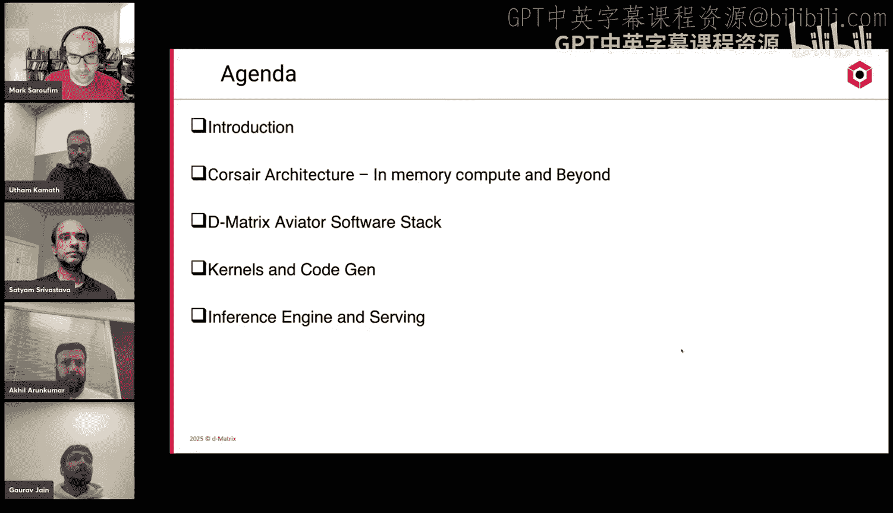

Thanks， yeah， so this graph more or less captures the motivation for the memory computing paradigm like as you can see towards the left。

 like there have been times in the past when a new application has warranted a radically new computing paradigm right So if you look at the point where it shows graphics。

 you would see that like that was more or less the time when they started becoming the more dominant workload and around that time there was this advent of GPUs that enabled us to see the significant step up in performance when compared to the CPUs。

 which were the device of choice then。

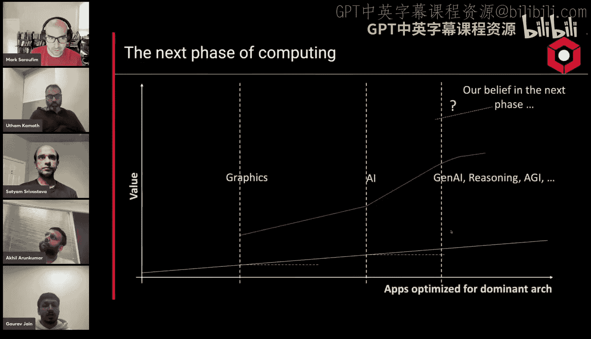

Obviously we were all happy with how Cs， what CPUs were offering。

 but when we had GPs available at that time， the scale and imagination just exponentially increased。

Now similarly as we move towards AI happen with similar underlying operations from the graphics world。

 we saw that GPUs are proven to be the device of choice as they've allowed us to train even larger and larger models。

 so essentially like in one word GPUs have bought us GPs。

So today they remain essential as like because the open level throughput。

 which has been power powering the training of all these generative web workloads and also all the Hd work that is happening behind the scenes。

But as you now move towards the extreme right you would see that like generative AI more more like the inference side of things have started to become more and more dominant there there has been this advent of like test time scaling all the advanced reasoning kind of methodologies that have been developed and also the push towards AJI where you're allowing the model to think longer and longer we believe that inference is now becoming a more dominant use case and this is where like this is what is a motivation for Coet。

So this is and our talk is centered entirely around these aspects。

So setting if if you can look the next slide。

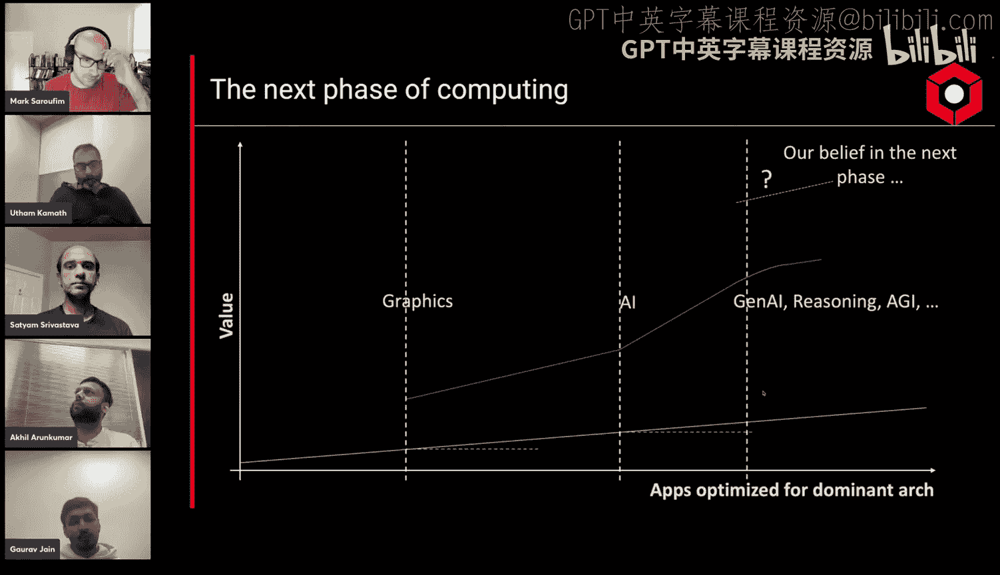

Yeah and this slide overall captures the high level system architecture for Coair so on the left it talks about the architectural advance advancements which we have like it gives us enormous memory bandwidth because of the extremely large on chip memory we have along with that we have this different kinds of interconnects the die to die interconnect and the PCI connections that allows us to scale to a card and beyond。

Then the memory compute along with the native support for Mx scaling like formats that gives us high tops as well as allows us to do inference without any significant loss in accuracy and then to wrap it up all we have the software stack that allows us to write all the custom kernels which we'll be talking about and the inference in which we have built for serving these low latency work。

And from like I think from here， like as we go towards the next slide。

 Su we'll talk about the architecture， so su few free to take over。

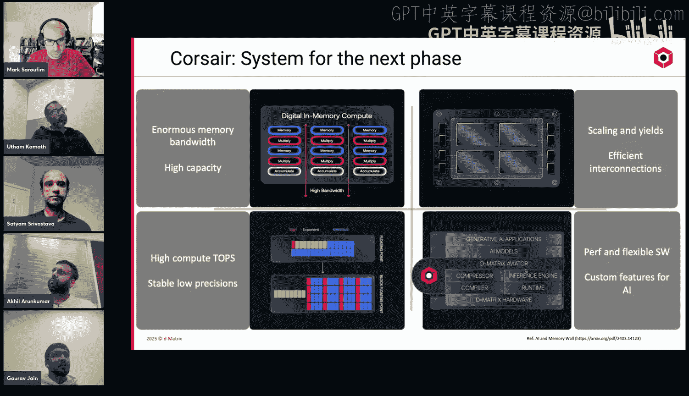

Okay， thank you Gorov， thank you everyone for joining and before we start looking at and start appreciating the architectural choices behind Cosair。

 it might be good to step back and get a motivation for the problem。

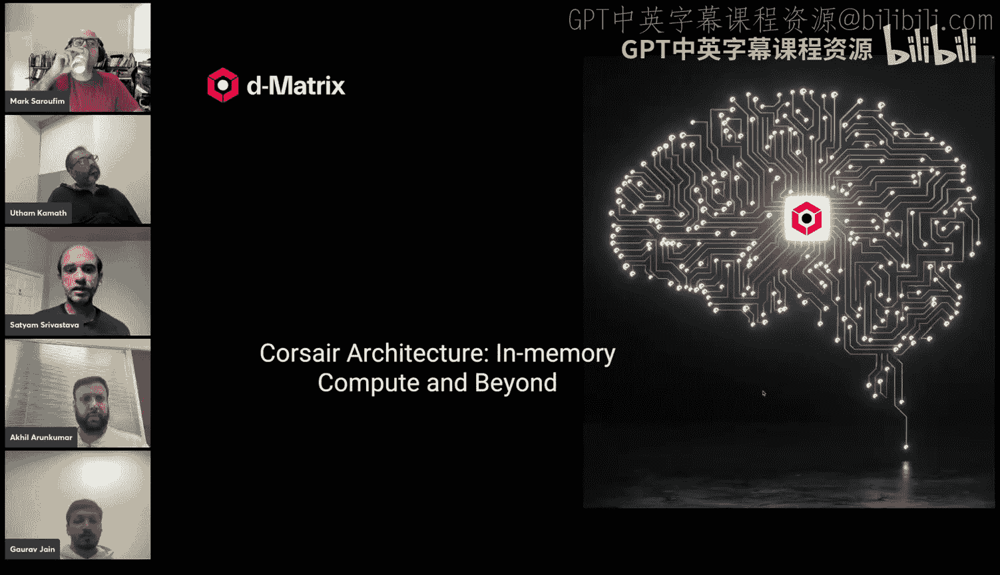

So let's go back all the way over to a term that many of you would have heard。

 it's called the memory wall。What does that actually mean？

It's a term that has been around for a while and that basically describes the growing disparity between the growth of computing tops and the related peripheral technologies such as memory bandwidth and interconnect bandwidth。

So on this graph that came out last year， it shows the steady exponential growth in the computing tops in the dominant or the latest computing technology of the year。

 whereas on the bottom of this graph you see the technology， the memory technology is also growing。

 but the gap between the two curves is growing even bigger every year。

Similarly for the interconnects， whether you are looking at PCIE or NVlink or related technology。

 it's also growing every year， it's also growing exponentially。

 but the gap compared to computing tops is still pretty significant and even getting bigger。

Now that alone may not be a problem， but you have to see it with something else and to understand that let's define another term。

 it's called AI， but it's a different kind of AI， it's called arithmetic intensity。

And it's a quantifying measure of how much workload requires in terms of computational flops versus the amount of memory transfers it needs to perform those computations。

And。A workload that has a high arithmetic intensity would utilize a small amount of data that is loaded or moved around to perform a large number of computations。

 whereas an application which has low arithmetic intensity will spend more time loading and storing the data and doing less computations on it。

These two things， if a workload has low arithmetic intensity and the fact that we are looking at a growing chasm between the compute throughput and bandwidth capacities。

This becomes the。The factor that affects user experience and the further away the memory is the more time we will end up spending in waiting for the data so that the compute。

Is able to perform its work。To further understand， I won go into the details of how LLM decoding works for this audience。

 suffice to say that we are more interested in the decoding phase of LLM inference。

And there are a handful of signature attributes of this stage。One is that。

The whole process is extremely sequential。 It's embarrassingly sequential if there is such a term。

And even within each of those sequential iterations for processing a single token。

The key operations are vector matrix multiplications。

 unlike matrix matrix multiplications in the prefi phase。Now。

 the combination of these two very key attributes makes LLM decoing or token generation very low arithmetic intensity。

 we are extremely memory bound and in order to manage the complexity of。These attributes。

 there are a few choices that。The LLM infrastructure。Typically makes one is you can pay more。

 you can get a more advanced infrastructure so that you can serve your customers。

The other is you can trim down the number of tokens that you're processing。

 but that of course has implications on the quality。

 or you can just decide that you have what you have and the longer it if it takes longer it takes longer。

Neither of these are really good answers to the problem。

 what we would like to have is reasonable reasonable cost。

 no compromises in terms of output token quality or length， and we don't want to wait as long。And。

These are metrics that have significant user experience impacts and to put it in a more quantitative terms。

 let's define a few metrics as well。So the metrics of importance when evaluating the effectiveness of an LLM serving inference。

 there are two and two other related ones， the first is called theft or TTFT time to first token。

 it is how quickly after users submits a query， they start receiving an answer。

And if you think about it， this is largely coming from how quickly can you process the prompt or the prefi and start into the get into the token generation phase。

And the second is depot or time per output token， this happens during decode during every token generation。

This is how much time it takes for any given user that in a system to obtain a token out。

And related to that， when you put the two of these together， there is the overall latency。

 how long a user would see the output generation happening after they submit a query till they receive the final token。

 that's the overall latency and throughput is at a system level if you have multiple users。

 what is the total number of tokens being generated。

P unit of time by the inference instance across all the users and their queries。

So we'll keep that in mind and keep coming referring back to these as we go through the material next。

Now， remember that we said。Decoding of LLMs is extremely memory bound。Now。

 there is a usual knob that people play with， which is batch size when it comes to of increasing the arithmetic intensity。

The idea being very simple， if you have a large amount of data to be reused。

 you would keep the weights nearby as much as possible and process more activations through it or more queries through it。

Now this works really well if you have a non-LLM workload， for example。

 the old CNNs or something similar， you increase the batch size。

 you keep the same weight stationary or in the near memory and just process more activations or inputs through it and that way you can exploit the locality and consequently you control the amount of data movement that needs to happen。

The challenge is it doesn't really work for LLM inference and why。

The core reason for that is the KD cash。With increasing batch sizes。

 we also have to account for the fact that we have to maintain a larger KV cache。

And that requires storage and that also requires data movement。

 so would one could think compared to the overall size of these 70 or 100 billion parameters models is KV cache significant。

Well， it turns out it is very significant。😊，Let's take a moment to digest the curve on this chart。

 the bottom three curves show the native arithmetic intensity of some of the common models。

 lamas and myals for a reasonably moderate context size of4K tokens。

It is evident that on the x axis as you go towards a higher batch。The effect。

 the cumulative effect of KV cash starts to dominate。Up to a point initially at small batches。

 you see a linear increase in the arithmetic intensity which means they will become more and more compute bound。

 but after a while，😊，You stop seeing any benefit at all， you can keep batching。

 you will incur higher latency， but nothing really changes as far as the throughput is concerned。

So this is where the knee of the arithmetic intensity curve happens for the native workloads。Now。

 why is that important？If you also see， there are three other curves， the horizontal lines。

 which show the where the arithmetic intensity of the accelerators are。😊。

And the idea being that if these two curves intersect the workload arithmetic intensity and the accelerator arithmetic intensity。

You have a chance to saturate the compute on that architecture。If they don't， for example。

 the hopper or the derivative L 40S。There is no chance that you can saturate the compute on that particular architecture by going to any batch imaginable。

Whereas for something different and we'll go into the details very shortly。

For a different architecture， which we'll talk about now。😊。

There is a much lower arithmetic intensity curve， and it falls very much in the reasonable range of batch sizes。

 In fact， if you see even at a batch size of 10 to 00。

These curves intersect the corsair native arithmetic intensity。

And that means we can completely saturate the computational resources on Cosair without going to crazy batches。

So。Thinking about that for a second。This requires something fundamental。

 something which is a paradigm shift we really have to think about a way that we don't have to go to HM at all。

 You load your model parameters once。And forget about HBM after that。

That is what is needed in order to accomplish the needs of LLM decoding today。

So on the left hand side is a more traditional GPU like architecture where you have the standard HBM going through eight to 10 terabytes per second interface。

 and you have the computing units which are operating at a certain compute throughput。This。

 as we saw， is going to be limited by how much bandwidth you can sustain from this interface。

 the HBM to compute interface。Whereas on the right hand side。

 the promise of in memory computing and near memory storage is that you don't have to worry about the bottleneck being 8 terabytes per second because the data is available right where the computer is。

So this is what the promise of the Corsair architecture is。So let's take a closer look。

Looking top to bottom， this is a tiny picture of an actual PCI card， the Corsair silicon。

 and what you see in the middle is one of these two multi chip modules MCMs。

And each of those MCMs contains four chiplets。So if you look closely。

 you will see these tiny rectangles inside of these。 So this is an actual deleted MCM so the。

The boundaries that you see are on the silicon， so these are slices and quads as we will talk about。

So。😊，Each chipt is further divided hierarchically into something called quads and quad becomes a unit of independent programmability and for this audience well go quite a bit into details of what that means。

Inside of a quad， we have four slices， each slice contains a certain amount of memory and the computational core。

 which we'll show in a minute。Through a combination of chiplets we are able and interconnect technologies。

 we are able to accomplish several several things first is we can scale quite a bit。

We're not limited bio sizes， we can control the cost because it's much better yields that we can get with chipts。

We can get all the connectivity we want within a package or even between packages。

And because we are aggregating the resources across triplets。

 we can get high capacity as well as high bandwidth across all of them。

And this is going to be key as we start looking at the performance characteristics of this architecture。

😊，Next， this is the detail view of the Corsair chipt， a single chipt。

 and as mentioned earlier inside of a chipt we have four quads。

 each quad is an independent unit of computation， it has its own firmware it has its own graph to execute。

 and it manages about 50 tops of compute inside of that。

A quad consists of slices that contains the Apoochores and the SRAM， the near memory。

 which is used for staging of weights and activations。嗯。

I'll go over to Apollo Core because that is the computational unit of all math operations。

And here is where I apologize for a little bit of blurred image。But in the middle。

 this blue rectangles， these are the in memory computing arrays。

You can think of as the equivalentvalence of tensor cores。

 but these are based on in memorym computing technology where we stream in the activations and keep the weight stationary into the memory and the act of loading the activation streaming the activations through the memory multiplies them and we can accumulate them and it's all done using complete digital circuitry。

Something that we've designed in house so that we don't have to worry about analog operations and instability from temperature and environmental effects。

 and we can use all of the goodness of quantization that we've developed as a community in the digital world。

So all of that is available， in addition， as Garrov mentioned earlier。

 we utilize the MX microcal block formats。😊，And that has the benefit of getting integer like efficiency of operations。

While we maintain the accuracy that we would get with regular floating points。

So that is pretty cool and in order to make it completely seamless。

 we also have a whole bunch of hardware based converters that allow seamless data type to transfer between block floating points and standard floating points。

 the standard floating points being used for vector operations， the S processing such as softmax。

 layer norms， element wise and so on。诶。So this is the view of an individual Apollochore。

 so you put a bunch of these together into a slice， you put a bunch of the slices into a quad。

 you put a bunch of quads into a chipt， and that's the hierarchy。Now。

 another important thing that this group will appreciate， I'm sure。

 is how is work actually orchestrated on this processor， on this architecture？

So here also we've innovated not only on the data plane and the computational resources but also put a lot of thought into ensuring that our control plane doesn't become a bottleneck in fact we went ahead and created some innovative data structures both in hardware and software so it it's a mirroring we have a unique representation of work called a hierarchical queue and this is mirrored in the hardware。

The idea being that we want to maximize the concurrency because were not dealing with a GPU like traditional thread based architecture。

 we can dispatch work across as many resources as we need， so there are parallel transfers。

 parallel operations， computations， reductions happening at the same time。

And the way to represent that is through the concurrent cues， which captures。

Both the concurrent nature of operations， which symbolically is represented here along the x axis。

 everything along the x axis is concurrent， whereas everything which is along the vertical direction are sequentialized。

So you can capture the concurrent and serial dependencies of workloads using this representation。

 and there is a built-in hardware support， which we call dispatch engine that manages these decisions。

 so the decisions are made by the kernel authors and the compiler and the hardware ensures that these are followed and orchestrated with minimal overhead。

Another thing which is pretty cool is because of our unique hardware software core design。

We are able to support the auto regression in hardware。

 so imagine that you have a graph whose context size is constantly increasing。

But you never have to recompile it， you compile that graph once。

 deliver it to the hardware and the hardware independently handles the increasing context size。

So that's an attribute of how we define our instruction and the control plane。Okay。

Now switching gears a bit， it's interesting to think about a chiplet and the design of the chip。

 but AI is not a chip problem alone， but AI is a scale problem。

 AI inferences require scale out and scale up and we have to handle that the same way that we handle our co design for individual chip。

嗯。A few things before we go into the topologies is that there are different attributes of different phases of computation during prompt processing。

 if we are performing collective operations， these are typically very large tensors。

 and these require very high bandwidth， whereas during token phase you're basically sending one by debo tiny tensors。

 kilobytes and these require connectivity and low latencies。

It's a careful design choice to come up with the right to apologies that can be scaled。

While not incurring an enormous cost in terms of the wiring and the connectivity。

So we take this approach of providing an all fully collected topology across 16 chipts in hardware。

And we also provide a similar library of collective operations that exploits this all to all connectivity using1hawk trees。

 so that's our extension of hardware software core design taking it from chip design to a system level design。

So our tensor part unit， and I'll show a picture in a second。

 is optimized for both small transfers because we have high all connectivity as well as for large transfers because we are utilizing。

 we're not compromising on the memory bandwidth or the interconnect bandwidth in between the chipts as well。

It increases further， it doesn't stay limited to 16 triplelets。

 we can go to even rack levels and we'll talk about that in second again。Using pipeline parallelism。

And another unique aspect of our hardware architecture is that we tend to prioritize gather based operations collective operations over reduce based operations there are many reasons to it doing it。

The obvious being that performing gathers can be done in a lower precision and therefore it incurs a lower communication cost as opposed to reductions and the second is that we have。

Extensive support for multicasting in our architecture。

 So if you have to provide the activations from a previous columnumb by sharded phase in as activations to the next Macmal。

 you can do a direct multicast and avoid a need for an explicit all gather。 So that's the kind of。

Optimizations that have been put into the hardware to support collective operations。

So with that in mind， let's look at how the scaling happens。

So this is again a schematic view of a multi chipt package。

 these are four chipts and these are connected in an all all mesh using die to dial links。

So these are based on the bunch of wire specification。

 and these provide 128 gigabytes per second byte directional。Across all the chipts。And this is。

 again， it's very conducive to creating a one hop tree between the four chipts。

And that extends to a physical PCI card where you place two of these。

 each of these four triplet groups are all to all connected and you have a PCI line going between the two packages between the two MCMs that provides and all to all connectivity between the eight chipts。

Now， this was scaling up from a chipt to multiple chipts。

We can also take it one step further and provide the connectivity between 16 chiplets between two cards。

 and we do that using。are what we call a DMX bridge。

 think of it as an equivalent of an enve link bridge， but this is a standard PCI based connector。

 a passive connector that is placed on top of two adjacent cards。

 and that provides these purple lines that are connecting the chiplets across the two cards。

So at this point， we've created a 16 chipt all to all connected tensor barrel unit which can support ultra low latency collectives for sharded operations。

So， I ask a question like I've seen like I mean I'm not a computer architect。

 please forgive my naive question， but like I've seen like， for example。

 when the B200s came out like people sort of were making fun of it。

 they're like oh you know the chip goes twice as fast because you have twice as many chips on them like being sold and back as as one So could you sort of help me understand like how come the chipt design became somewhat mainstream and what are the benefits and its like my prior critiques somewhat naive I'd love to hear why that's the case。

Yes， great question， why chipts？😊，So these individual chipts are not small。

 these are 400 plus millimeter square， these are huge by most standards and。

If we make them any bigger， we are running into the radical limits。And that affects eels some。

Some companies and some designers feel comfortable putting in solutions so that they can recover some of the lost yield。

But we feel a more scalable way and we see that happening across the industry is to go with composable architectures。

😊，The idea being that you don't have to be limited to a single monolithic chip。

 you can compose them using nicely interfacefad chiplets。

With the benefit being that you could do heterogeneous scaling as well。

 there's nothing preventing us from putting in a compliant chiplet that serves a different purpose and interface it directly with the Cost chipts so that kind of composbil is another reason why the chipt based designs are seeing popularity。

Plus， there is benefit in terms of the spacing， the cooling。How you deliver power to them。

 how they can be fit into a wide variety of form factors because PCIs as well as OCP provides some mandated dimensions for the packages so all of them becomes easier to manage when we have chipts that can be played around with。

Good， thank you， Thats a great answer。Okay。😊，So that was up to a tensor parallel unit of 16 chiplets beyond that。

We can go through a PCI fabric to scale up further within a server so here for example。

 this is showing a dual socket CPU with a PCI switch that is connecting to multiple such PC Corst cards dual cards each of the cards has a by 16 link going into the switch and these are all still auto to all connected it's just that these are not going to be for onehop threebased collectives these are primarily going to be used for pipeline based communication。

And now why stop at a single server when we can take it further so the last thing that I wanted to flash is anther ethernet based solution that can be used to extend this scaling from a single server not just to a rack but to our cluster of racks so we you do it using our own custom design network network interface card。

That is built using TCP based streaming it becomes a natural extension of the PCI based transfers that we have created in between inside a card as well as inside a server and the Nick does the transparent porting of PCI over ethernet using this using more traditional spineleaf kind of switching infrastructure so that allows us to go to hundreds of thousands of such corsair cards to serve。

largestrgge of the models that we want to serve。Now， before I hand off。The audience， I'm sure。

 would be wondering， how do you actually program that thing that looks complex。Well。

 there is some good news。All of that is abstracted away by these 15 instructions or just a small 15 to 20 instruction set。

You can take any workload， including long distance communication， including collectives。

 including synchronization， everything can be expressed using a really tiny instruction set。

 the core elements of which are shown here and a very small toy example of a graph is shown here。

So these specify fetching things from DDR， moving things from SRAM into registers。

 performing an operation using IMCs， moving data back into SRAM。

 and further flushing it back into DM。I'm sure this is something that the audience would like to learn more about and I would hand it off now to Otam to talk about the software and how kernels are actually written using this instruction set。

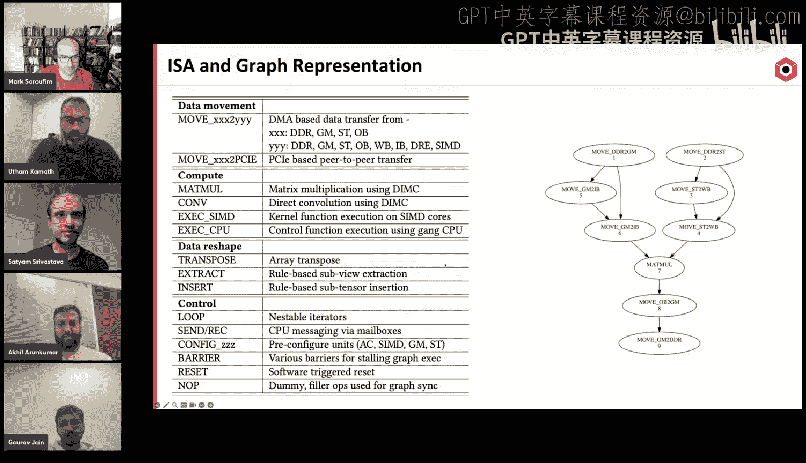

， thank you， Se them。

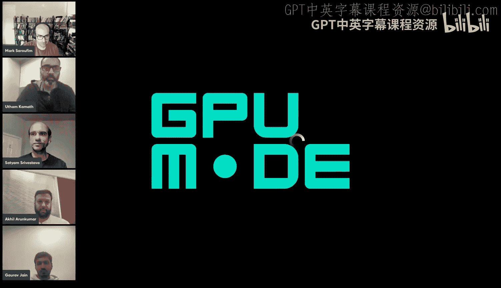

All right， so I'll be talking about the software stack that enables all of the acceleration of these large language models that Seim talked about。

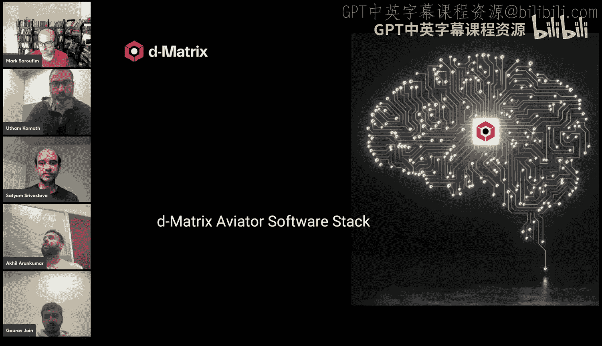

All right， so this shows an architecture diagram of our software stack。

 there are two main pieces that we'll be talking about today。

 the lowering stack and the execution stack。I'll be focusing on the lowering stack and later in the presentation my colleague AK will focus on the execution stack。

So the lowering stack consists of a couple of different pieces right at the top you see a piece that we call the model factory。

 the model factory is where we take models models that have been released by the open source community。

 the transformers package etc， and modify it a bit to work on our hardware。

 so some of the typical modifications that we might do include introducing of collectives to support communication across multiple cards。

 introduction of annotations of custom custom operations， etc。

Once we have a model in the model factory， we export it from Python to FXIR and then we put it through the rest of our lowering stack so at the top of our lowering stack are the quantization tools and these quantization tools introduce into the graph。

 various nodes which help us to quantize the model into some of the numeric formats that we talked about chiefly the microcaling formats。

And once we have that quantization done， there are two parts by which we can lower model to get it to run on our hardware the first is through a graph compiler which is an MLIR based compiler which takes in on the frontend an FXR graph and lowers it through an MLIR based proprietary intermediate representation all the way down to the ISA that Sahim just talked about in that process it can use it can incorporate small handwritten pieces of code at a fairly low level that we call kernels and use them to produce the ISA output。

A second method of loading is what we call the model builder approach where we would take these kernels and stitch them together to form a workload。

So this talk is going to chiefly focus on the kernels and to a certain degree on the model builder approach。

All right， so I talked about a kernel， so what is a kernel。

 a kernel is a method typically written in Python which converts an operation。

 the operations that we're all familiar with as part of large language models， gems， convolutions。

 softmes， things like that， and converts it to a directed acyclic graph of machine ISA instructions。

 the same ISA instructions that we showed a few slides ago。

An operation can vary in complexity so it could be as simple as the operations we know gems convolutions。

 things like that that we call fine grainined， but it could even be what we call medium grained operations。

 and so these are connected groups of these smaller operations so things like attention heads。

 decoders for models such as Lama or it could even be what we call coarsegrained operations which are decoders。

 for example decoders integrated to form a full graph such as a token graph or a prompt graph。Now。

 when we talk about these kernels， a few things to keep in mind is when we run workloads。

 as we describe in the architecture part， we have built an in memoryory compute architecture。

And what that means is we have an an extensive amount of eram on the chip and to run and deliver the kind of performance。

that people expect from a large language model， we typically use SRAM resident graphs so we try to keep the graph completely in SRAM and execute completely from SRAM so this is in contrast to typical GPU type architectures where weights are brought in from DBM。

And it differs a little bit also the sense that it's a graph execution。

 the graph is completely kept on SR and executed on the chip。

 in contrast to a typical kernel execution with a GPU which follows an eager execution type of architecture。

So this so I'm going to focus on kernels and I'm going to talk about kernels with the assumption that everything that's needed for the kernel operation。

 both the activations and the weights and the KVC， a resident on the card。

 either in the DRM or the SRM， the transfer of weights from a host to the card DRAM will be talked about as part of the next section which it's part of what we call our aviator runtime and so so we'll talk about that in the next few slides。

And so we've built this method of converting gems by a developer into these low level directed acyclic graphs of ice instruction。

 so what's the motivation behind this？This what I want to do with these kernels is provide the developer with the ability to exploit every single feature of the hardware that you can use to maximize performance。

 and those include various things like allocation of data a very fine grain across the SRAM across the entire chiplet across the entire package。

As well as allowing the user to control the implementation of various mechanisms such as bylining parallelization spatially。

fuusion of operations， overlapping of compute and communication。

 control them at a very fine grain and exploit all the hardware that we have。

 all the hardware features that we have to deliver this kind of performance。All right。

 so so a kernelel I mentioned it's a handwritten piece of code typically in Python that converts from an operation to a directed basically graphby instructions。

 it essentially consists of two parts one is the directed basically graph generation and the second part after that is what we call task scheduling。

The codeord on the right hand side shows a typical what we call a core kernel and as you can see the core kernel takes as inputs a set of resources on which the core kernel is supposed to execute so for example in this case we see that the arguments to the init function are the exact quad and chord on which this kernel will run so if you remember from the architecture discussion a chipt is divided into quads and quads are our major unit of compute execution a single graph runs on a single quad and gets dispatched and executed and so when you're writing a kernel you specify the particular quad on which the kernel is set to run。

And you can specify it at a much final granularity， such as a slice， a quar is composed of slices。

 or an even final granularity， a course， a core which is a component of a slice。In addition。

 when you run the operation， you pass input tensors and the inputs to a kernel consist of these computation resources where the kernel will run and also the memory locations of the inputs and the outputs and so these are at a very fine grain we specify where the input and output tensors lie。

 so we specify the exact the exact location on SRM where the tensor lies。

And once you execute the core kernel or once you run the multiply function。

 what happens and you can see here there is a looping over the MK and n dimensions of of the tensors and it loops through these and the activations so you can see here that we' are moving activations into compute units and we're adding the various instructions that constitute the graph。

the various instructions that constitute what needs to be done for that operation into the graph。

 similarly we're moving the weights into the compute units and we are adding the instruction for doing the weight transfer to the graph and so the graph is being constructed here the multiply unit is as the multiply function is being executed。

And once that directed basically graph， I'm sorry I said a quick question on the previous slide。

So like。Yeah， so so so first off， like I really like Pythonic kernel DSSL and they're great。

 they' like a lot of interesting ones。 at least like I'm trying to understand the programming model from your comments like it seems that like this is lower level than something like Triton because you are explicitly modeling data movements。

😊，And I'm sort of curious like， I was wondering if you have any samples of like what this looks like is it looks。

 yeah， like what does， for example， something like move activations into compute units actually look like and real code？

Yeah， so a couple of slides down we have a sample of code from the perspective of a user。

 so it's the kind of code that would go into our model builder and so that will show you how how a user would use these kernels so where he would allocate the various tensors and how he would call the kernels so maybe just hold off until then and you can see the code side by side and then we can talk about it but I think you rightly pointed out that it's much much more lower level than Triton and as we build these kernels once you'll see in the next couple of slides we talk a bit about the division of responsibilities between the kernels and then the workload writers and then the workload writers so our intention at some point in time is to even abstract that a little more that's what we。

Yeah， and this was sort of the leading part of my question。

 which was like I worked very briefly at Graphcorre before I joined Meadow and like one of the my observations there was that like basically because you sort of had this like giant like you know this like giant grid of e。

 like people didn't really know how to program so you had a very sophisticated compiler。

But the problem with that approach is that like for people trying to enable a new model。

 they're bottlenecked by engineers that work at the hardware vendor。

 it sounds like y'all took a different approach so I'm very eager to learn more about that part。

 hopefully it comes up in future size as well。Yeah。All right。

 so I mentioned the first part of the kernels is the directed acyclic graph generation。

 now once the directed acyclic graph is generated， the next step is to convert the directed acyclic graph into a set of task groups which get allocated to cues。

So earlier in the presentation， we talked a bit about the dispatch engine。

 which is a piece of hardware that is present in every single quad of the chip。

Wwhich dispatches instructions and because we have so much parallelism on that chip in terms of spatially distributed memory as well as compute units。

 we want to be able to dispatch all of these instructions in parallel where parallelism can be applied and in series where there is a serial where something has to be executed in serial in series and so the next step of this is to take that directed acyclic graph and then map it into these task groups that can be fed into into the into the dispatch engine so this part of the kernel generation is pretty much automated so once you have the directed acyclic graph。

 the directed acyclic graph represents dependencies both resource dependencies as well as data dependencies and from that directed acyclic graph it's fairly easy in an automated way to extract the the parallelism that you can apply to this directed acyclic graph and ensure that where parallelism is required we execute these operations across。

s and so overall， when we convert this directed acyclic graph into these tasks。

 the goal is to achieve high utilization and by mapping this directed acyclic graph onto these task groups we achieve the goal is to achieve high utilization through pipelinelining overlap communication and in addition to do certain things that the hardware provides so the hardware provides us methods by which we can minimize the control path overhead through various things like what we call instruction multicast where if particular operations are mapped to parallel compute units and tensors are mapped to corresponding arguments in memory they can be executed in parallel and also to minimize data path overhead so in this stage we can coalce various DMA transfers and ensure that the DMA transfers。

A used minimum amount of overhead on the knock。All right。

 so let me talk a bit about the division of responsibilities when you're writing a core kernel the kernel itself takes up the responsibility of doing certain things and few and the remaining part of the responsibility lies with the developer so if you're following the model builder approach a developer has to do these or the compiler if you're integrating a kernel in with the compiler then the compiler has to have enough features to be able to do this and so the way we look at it is the model builder and the compiler does macro resource management very highlevel resource management and the kernel does micro resource management so what do I mean by this the programmer explicitly manages tensor allocation in DRAM in the main parts of the SRM so SRAM has what we call activation SRAM as well as weight SRAM and the user the developer manages the movement of data。

From this B to the SR。On the other hand， the kernel manages the resources that are much more closer to the compute。

 so for example， when we want to do a matrix multiplication。

 we first have to move the activations into what we call input buffers。

 the weights into what we call weight buffers and once the matrix multiplication is done the output goes to the output buffer。

And so the kernel manages all of that and it's somewhat involved because this is the part where we have to be very careful in order to manage this well in order to get the pipelining and extract all the compute that we can without leaving any bubbles in our pipeline。

In addition， inside the kernel while it's generating the code， it creates a set of dependencies。

 so within the kernel the dependencies that are managed our chiefly resource dependencies because we're moving things in and out of the input and output buffers。

 we have to be careful in order to ensure that in order to avoid hazards and so the it's the kernel developer's responsibility to allocate resources and to make sure that when the resources are used。

 he avoids reading and writing hazards。On the other hand。

 the model builder or the developer who's building the kernel has the only dependency which he has to worry about are the data dependencies across kernels。

 so if one kernel wants to use the output of another kernel。

 then it's the responsibility of the developer to ensure that。

And so the last thing that the kernel does is the ISA Codegen。

 so the model builder developer deals with the interface that I spoke about。

 which is what are the resources that are used for a kernel and then what are the tensors and what are the memory locations of those tensors。

 and doesn't really need to worry about the ISA， but the kernel developer really needs to code this ISA up and ensure that the ISA that's developed。

 the IS instruction that's executed， manages the IB and the OBs correctly without any conflicts。

All right， so Mark' here's the code that I was talking about so on the right hand side you see the kernel code。

 which is the it's the same code that I talked about。

 I mean so you have a matrix multiplication the resources it takes as input the resources on which the kernel needs to run and the multiply function takes as input two tensors and those tensors have the memory locations where both the activations and the weights are。

Located， we loop over the M andN dimensions of the input and output tensors and we generate the code。

 we generate the I instructions， the GM to IB stash to WB。

 the mapmal and I instruction and then the instructions that pull the results out。

 we generate them as a graph and then we add the dependencies in there and so the output is essentially the graph that can be lowered onto the chip。

On the left hand side， this is the model builder code and so the model builder code。

 this is what a developer would have to write or this is the code that a compiler essentially would have to generate。

We have a tensor that's been allocated， a logical shape that's been specified and a physical layout that has been specified so were in physical memory which which bank and at what offset is this tensor placed and so we have it for the input tensor the activation tensor。

 the weight tensor and the result tensor and then you can see the rest of the code so the rest of the code is what we do in order to generate the graph so we instantiate the kernel and we call the multiply operation in this case what we've done is we've call two multiply operations。

 the output of the first multiplyier operation is used as the input to the next multip operation and so we've created a graph here of two matrix multiplications back to back and then we call the codegen and so once the cogen is called the output of that is a directed acyclic graph of ISA instructions with appropriate dependencies that cover data as well。

resources and it's essentially a form that can be put as input to the next step which is the task scheduling step where the individual IC instructions are allocated and put into various cues and so so Mark I mean any comments on this did this answer your question it certainly does yes one sort of specific question I I remember from Saam's slides he adds a comment around how like you natively support like dynamic shapes I'm just trying to square that with the sort of you need to determine your graph beforehand programming model。

Yeah， so we'll talk a little bit about the dynamic shapes so I'm going to cover a couple more examples of this and so we talk a little bit about the KVC implementation and so we'll talk a little bit about dynamic shapes when I do that。

So yeah， and I guess like maybe this is more of a comment for after the talk。

 but if you have like a few examples of like full kernels， like like basic ones， like even like B。

 point wise， norms， et cetera， I think people would really enjoy like checking those out in the server and trying to understand the programming model。

Oh， sorry。All right， so this sort of shows internally what a kernel needs to do。

 so we talked a bit about the compute units and then the input buffers。

 the output buffers and the weight buffers。The and the iteration through the M and N dimensions and so the the。

So when we're writing the tensor we mentioned that we need to ittrate through the MK and n dimensions and so this shows the movement of activations from the input buffers from the activation SRA into the input buffers and from the weight SRAM into the weight buffers along with the compute and because it's done in an iteration what we taught the kernel tries to do is to build a kind of a pipeline like you see on the right hand side and so this kind of a pipeline shows the various iteration so on on the first row you see the first iteration it's itrating through the K dimension and you have the movement from the from the main memory into the input buffers and the weight buffers the next time cycle has a matrix multiplication and the third time cycle has the movement of the results from the output buffer into the into the main memory and so you have this kind of。

MovementYou have this operating in multiple stages and。

So this is the kind of pipeline that the kernel tries to build okay and so also the kernel tries to do various things such as minimizing the data control path through the data path。

 the overhead of the data path through data multicast and so at the end of the graph generation of the DMAs are all coalesced as well as instruction merging so it takes advantage of the structure of the hardware and the placement of weights and activations to introduce things like multicasting of instructions to all of these compute units across across the quad。

All right， and so what we talked about was the matrix multiplication in the context of a single quad and now when you have to scale the matrix multiplication out。

 we need to scale it out this diagram shows how we scale it out to a full triplet and it can be extended in terms of how we scale it out into a single package into a single card。

So essentially what we do is we take the weights and we partition the weights。

 we partition the weights and we can partition them either in a column parallel fashion or row parallel fashion or and allocate them to the quads and then the activations we would appropriately multiclassmed to the individual quads and then once the matrix multiplication is done each quad has its own independent graph which is triggered independently。

 the synchronization primitives that we showed in the list of ISA instructions are used to synchronize the individual quads and once the quads complete we introduce a collective using the memory transfer operations and then the data can be collected and so this is essentially how we would scale it out and all of these would be written as separate core kernels which would sequentially be stitched together to achieve this。

All right， so how do we go from there to something much more complex。

 so this shows the code for a Lama 3 decoder kernel and the way we build kernels essentially is hierarchical we build various matrix multiplication kernels。

 we compose more complex kernels such as GQA kernels out of matrix multiplication kernels。

And then out of these GQA and matrix multiplication kernels， we compose a decoder kernel。

 very similar to the structure that you would see when if you were to take a look at any model on Huging face or anywhere else。

The only the key difference though， is prior to stitching things together。

 we have to allocate places on the chip where constants would lie such as the weight。

 the various weights and we have to set up dependencies across the operations。

 which is what we do when we stitch the kernels together， and once we do all of that。

 we just call the cogen function， and then the cogen function essentially generates the graph for us。

All right， and then this essentially was how a decoder is written and then what we try to do is since we are an SRM resident architecture。

 we need to move this we have to be able to scale this across multiple cards and so our architecture consists of typically doing tensor parallelism across a full card or across two cards and then doing a combination of and then building the model through a combination of this kind of tensor parallelism and then pipeline parallelism across multiple of these TBE units。

So this shows how we would typically do this kind of division for a decoder。

 it shows the first decoder being sharded in a tensor parallel fashion across two cards and a pipeline。

Operation being introduced across the two tensor parallel stages。And of course。

 in between the two stages we have to introduce the various collectives and so as we talked earlier about the model factory and that being the place where we would introduce these collectives。

 so that's what we do， I mean we take a look at the hardware。

 decide how we would like to parallelize either in a pipeline or tense or parallel fashion。

And then in the model factory， put those annotations and add those annotations and once those annotations are in there。

 this is how we would structure the kernels to scale out。So another question on this。

 like so as far as like those highle APIs for things like collectives， like does it look Pythtor chi。

 is it just like the Pythtors native calls， is it like like the lower level thing。

 is it like more of a kernel language or you manually call these things yeah。

 like just help you understand how this works a bit more is it like a rapper are you manually doing comms or not in your code？

Yeah， so so in the kernel we are manually doing we are manually doing communication so we showed a set of IA instructions for transfer of tensors between various parts of the memory the。

The what we call the activation memory and so we would activation memory and weight memory。

 so we have ISA instructions to transfer tensors from various parts of the memory through a knock throughout the chipt through our die to- die communication interfaces between chiplets and through PCIE between packages and so the ISA covers all of those so when we would want to write something like a all gather for example。

 we would write it as a hierarchical set of all gathers where we would exchange data first between two packages on a card say and then exchange that data across the four chipletts within a package and then within within a chiplet and so we would structure this all gather as sort of this hierarchy of three types of operations and we would quote it up in this。

あさ？And then we would provide that as a core kernel， just as the core kernels that you saw。

 just as the previous examples that you saw， with the slight exception that when you have to go across quads and you have to。

 you have two sets of operations depending running on two different quads depending upon this collective。

 then you need a synchronization mechanism and if you remember in the list of ISA instructions we had synchronization instructions barriers that could be weighed upon。

 and so those are used， what happens is， for example in this decoder。

 let's say between the between the attention head and the projection matrix multiplication we had an allga。

 then what would happen is and this decoder is tensor parallel sharded across let's say two different packages。

 then the two different packages would operate asynchronously until they came to the collective where they would hit a barrier and paused。

They would exchange data and once they exchange data。

 the barrier would be released and then they would progress with the rest of the decoder。

So that's sort of how it would work。Can I add something？Sure， go ahead them Yeah。

 Mark to your question there is two flavors。 One is one of them described is the lowle implementation of these collectives。

 so these are embedded into the graph。 There is no invocation from the high level but if you're talking about how do you provide introduction of a collective at a model level that would look very pi ory at our model factory level but we translate that through either the compiler path or through the kernel path and eventually there's no hostbased call for collective it gets embedded into the graph。

I guess like one thing that y'all didn't do like that you didn't you kind of undersold。

 I felt was like because like like presumably the model builder is Python， the kernel is Python。

 the graph is a string， all of this is like quite debugable。

 it seems like to me like where you can just like print the graph and like look at like what's going on and that looks really cool actually for what it's worth。

Yeah yeah that's true I mean certainly the fact that we've built this in Python certainly helps。

 I mean it helps with rapid development and also with rapid debugging we can split the graph at any point that we want to and execute parts of graphs and then we have。

I think I've flashed a set of tools in the software stack。

 so we have a set of tools that allow us to probe memory at any point in time。

 take a look at that memory and so debugggging essentially becomes fairly easy。All right。

 so this is the third example， I'll talk a little bit about the GQA attention head that we've implemented with the KVC。

So with our KV caches， I mentioned we're an SRM resident solution and so the KVC is fully SRM resident and so we have a static allocation of SRM for both the K and the Vcs and we do this at kernel build time so what the developer has to do is once you're given a model and the model has a certain set of parameters。

 the number of heads， the number of groups D hadD model context length and batch size based on those parameters。

 it's easy to figure out what what kind of a mapping you want for for your KVC。

 how many of the quads for example you want to spread the KVC across and the next slide will show you sort of how we do that but based upon these inputs。

 a developer a kernel developer would take a look at these inputs and decide what kind of a mapping he would want to use typically what we do is we take the context length and sh that across our way。

Our wave memories and this enables us to extract a huge amount of parallelism during the operations。

 during the attention head matrix multiplications， the QKT and the X Mamals。

And as as you pointed out， Mark， I mean， during the token generation phase。

 every token generation iteration has a dynamic shape that it needs needs to process so the size of the vectors in the attention head。

Matrix multiplication changes every single iteration and to handle that we have within our ISA a certain method by which we can change the parameters of an ISA instruction at runtime。

So based upon the iteration， so whether it's the first iteration or the 10th iteration or the 20th iteration。

 we can rewrite an ISA instruction at runtime and by doing so we can modify the cache locations in the instruction stream that is used to to do the attention head matrix multiplications and so that's the way in which we do dynamic shape handling the way it's done is the kernel itself must add special ISA fields which are resolved at runtime and the runtime which we'll talk about in the next few slides has to pass down into the kernel these iteration numbers and once those iteration numbers are those iteration clouds are passed at runtime we can resolve this and then we can dynamically generate the code that manages the KV cache。

So this shows this slide shows a little bit about how we would do this mapping， so for example。

 in this slide what we're showing is a case where we have a sufficient number of attention heads to map each attention head to a gang a gang is just a synonym for a quad but it is grouped attention so the group itself would be shared across multiple multiple gangs and so the group is allocated across multiple gangs and the head itself resides on a single gang which means that any query that is restricted to a particular head must operate on KVc entries across the other gangs and the way we do that is initially when the kernel starts off each individual head has its own query but what we do next is we do all gather on all of the input queries so that every single gang which has a head has all。

The queries and so now given that the Kc is spread across all the gangs。

 we can do the operations on these queries and the resulting vector would be spread across all of the gangs。

And so the next step after the QKT is to do a softmax on the outputs of that QKT。

 and so since the input to the softmax is distributed across the individual gangs。

You need to do the softmax in a distributed fashion and so we do the softmax in roughly three stages first we do a local reduction followed by and all gather of the results and a final reduction and then we do the elementwise part and so this is essentially how you would structure the the QKT matrix multiplication with a group query group query attention where the group is spread across multiple gangs and heads reside on individual gangs。

And so the XV operation is somewhat similar to this。

 so with the XV operation the Vcash is also spread across multiple gangs。However。

 because the reduction is done on the inner dimension， that's the sequence length。

 you don't need an allga at the beginning of the XV kernel instead you can because the query is available on each of the individual heads。

 you can directly do the matrix multiplication， but towards the end of the kernel after you've completed the matrix multiplication。

 you need a reduction scatter a reduced scatter in order to collect the individual results and do the final reduction。

All right， so we walked through three basic kernels， a basic matrix multiplication kernel。

 a decoder kernel， and then the GQA kernel。And so this shows how we build these individual operations。

 but these individual operations have to be stitched together to build a workload and so we have two approaches to do that the model builder approach essentially is an easy way of stitching together very large scale kernels I mentioned we have three types of kernels the fine grain coar grain and the medium grain a decoder kernel for example。

 would be a medium grain kernel we would generate the graph for the medium grain kernels such as decoders which would run across the individual quads。

And then we would stitch them together in the model builder as simple as just taking the output of one kernel and making sure that it's fed in as the input of the next kernel and so that's one way of generating our workloads。

The second way I mentioned is the compiler， and then the compiler for simple workloads can do a complete automatic cogeneration of a workload。

 however， for some of the more complex operations which involve QKT and XV type kernels。

 we do have a method by which in the model factory you can annotate these customer operations。

And then once it enters the compiler stack， the compiler can utilize kernels written to generate code at a low level IR and integrate them in with the compiler and the compiler can generate the eventual graph that gets lowered onto that chip。

So in conclusion， just to end this， I mean let me talk a little bit about the design philosophy behind this。

 so what you've seen is we've talked essentially about the kernels approach which feeds into the model builder approach。

 but we've also talked a little bit about our hybrid approach where we have a compiler which does a bit of automatic cogen but also can integrate these kernels。

And so we have this continuingum of lowering options。

 the model builder and the kernels allow us to do aggressive operator fusion and move rapidly operation from various ops to kernels。

And this has allowed us to build these kernels rapidly。

 we were able to build these kernels rapidly use them for RTL validation。

 use them preta out on emulation to check and make sure that we were able to deliver the performance we wanted to and increasingly we're using this approach to deploy models it also allows us to validate our hardware。

 make sure that our hardware can achieve the performance that we expected to achieve。

Our second approach， our compiler approach is it's more towards a approach which frees the user from having to do these low-leve details。

 allows us to extend our coverage to a wide range of ops and to a certain degree is a little bit of a digression from the GPU world where we're used to kernels and we're used to building these operations and then tying them together in fusion fusion of these operations。

 the compiler does this more in an automatic automated fashion and thereby provides flexibility and op coverage。

And something that we're increasingly looking at， which you haven't really talked about today is using a CPU fallback。

 building a CPU fallback and we have a proof of concept around this where we would take a large workload and then parts of the workload which are not implemented our on our core we would fall back to the CPU to do this to do those operations and we're prototyping this operation this feature right now and we're taking a look at it so is this like the private use like is effectively you're implementing like your own device basically within Viros rights？

That's correct， yeah， okay， I see。

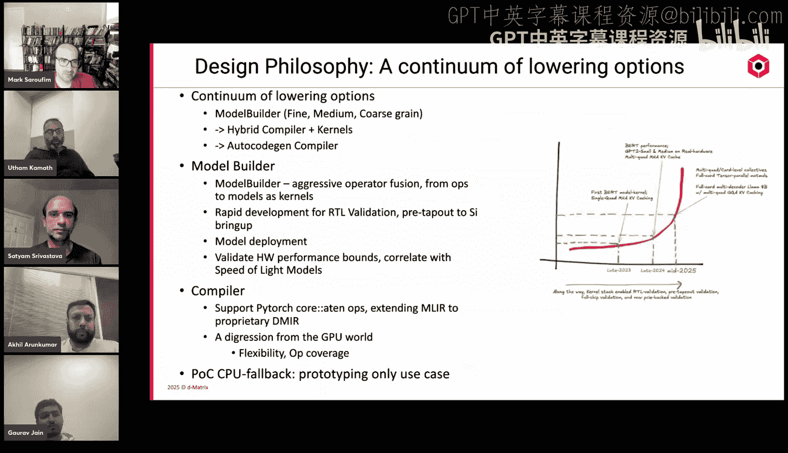

All right， and with that I'll hand it over to my colleague Akil， who covered the runtime。Thanks。

 thanks to Mark will switch screen shares。

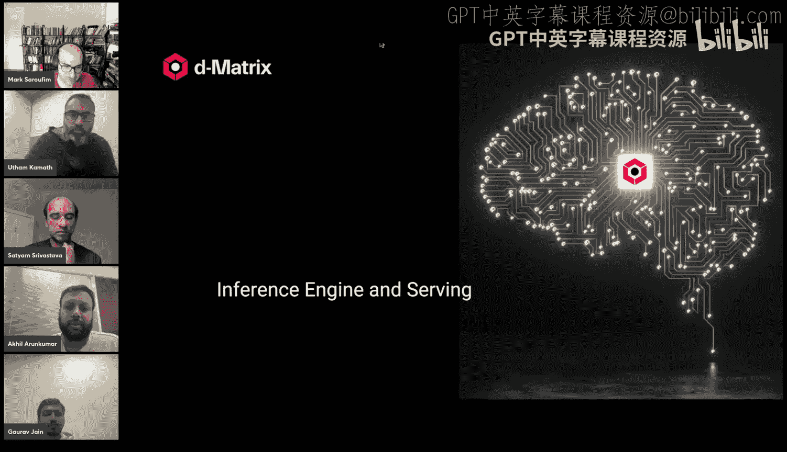

So good。Thank you， Iita the kill。

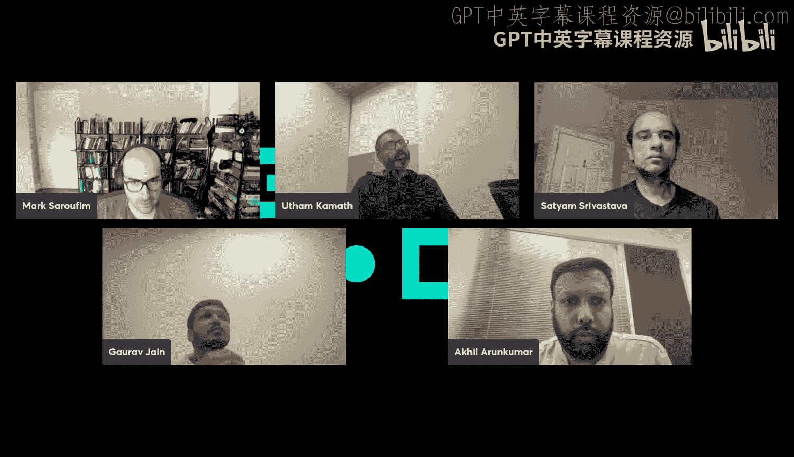

，So sorry， now maybe you can bring up the sorry it's not working all right。Do we start。

Pro also for this。

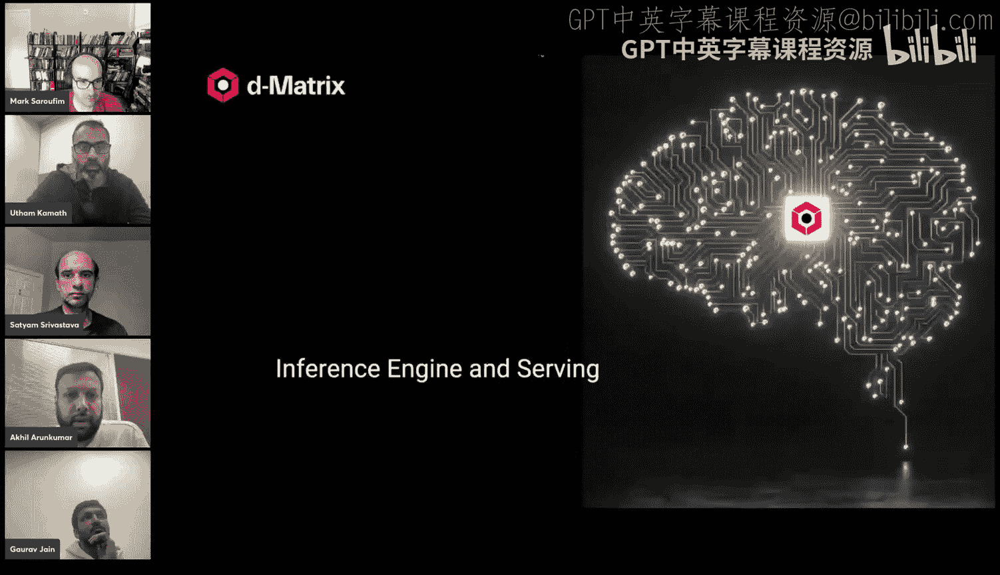

O。Thanks so we'll cover we'll move on to the execution side of ourt and cover our inference engine and serving right we've looked at the lowering side of our stack so in inference on the execution side are primarily be covering our aviator runtime which is our host runtime and our aviator inference engine so we' start with the aviator runtime so aviator runtime the goals of this you know we design this to provide a model agnostic runtime layer for our accelerator right so the idea is to basically take in take in a compute graph take in its input tensors and execute that on our accelerator and provide the output of that graph to the user right so we operate at that level of abstraction with。

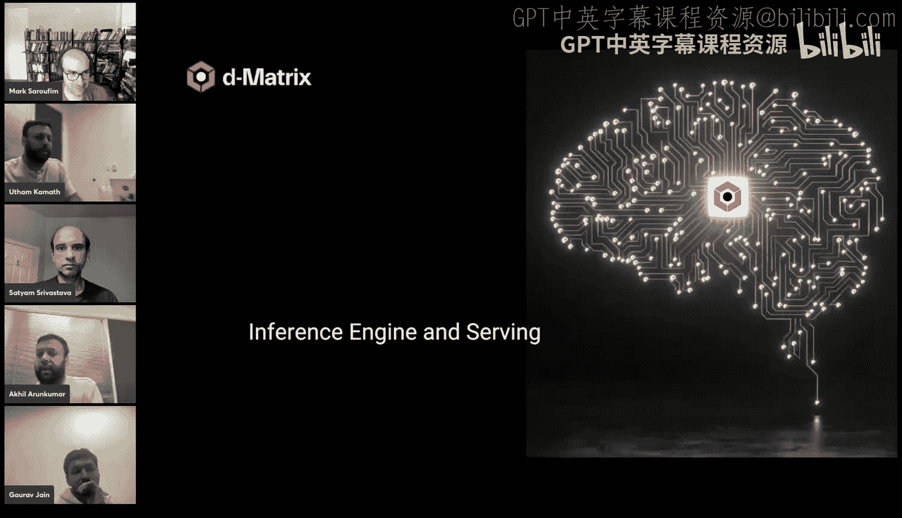

And so this allows us to basically minimize user friction when it comes to deployment and one of the goals as we do this like you saw so far right so we built the accelerator and our kernel stack to achieve extremely low latency and high throughput operation so one of the goals off the runtime is to be able to serve that right so how we do this right how do we do this we do this primarily with support for asynchronous graph execution throughout the executions execution stack and so and then for to minimize the user friction right we manage a lot of the host on deviceev memory management for activation tenors under the hood we do any necessary type conversions from top。

Native numeric formats to de matrix specific numeric formats also under the hood right so now these are things that we have already available right now and a roadmap item is to support D matrixx collectives through the run type。

So we have collectors through a different part of our execution stack， but we'll get there。No。

I want to go into a little bit about the foundations of the runtime right the first part of it is what we call DMX tensor so DMXtensor is a tensor abstraction that we can that is used in the runtime to represent any tensor that is a resident on the device right and it sort of place matchmaker between the host site tor tensor and the device site tensor so what you have in the code is sort of like the prototype of this DMX tensor it essentially manages the device memory location。

 what is the size the data type of the tensor and also keeps takes in a a host tensor and keeps a deep copy of that so DMX tensor as part of it allow you know supports the type conversions that I talked about。

Support typepe conversions in two parts two forms explicit or implic or lazy right when when it is explicit。

 the user says explicitly that this tensor should be on the device and it should be of a certain data type now what that means is that。

It will help hide any hoster device data movement so that you can as soon as the tensor is created。

 you created on the device and move set up the data immediately so you can hide hoster device data movement the implicit or lazy use case is to just allow programmer simplicity so the user did not need not specify anything just based on the graph that is being executed we do the type conversions under the hood。

And another key part key foundation within the runtime is asynchronous graph execution so what does how do we do this right so if you think about it there these are some of the key parts of our execution stack in blocks right so on the left side you have our aviator runtime and host memory and on the right side you have the device DDR and also the quad runtime that is running on the quad on each of the quads and we create this structure we dedicate a specific section of the DDR for what we call the job queue essentially job queue is the location where the quad runtime is essentially looking for work at the job queue so the device the host job is to publish as many jobs to the device as possible by writing things into this job queue and the device。

Job is to execute as many jobs as possible by going through the job queue and figuring out what needs to be executed and executing that in practice how this works is the runtime moves the inputs to device DDR and it constructs the job queue as appropriate and writes the job queue entry and then the quarter ontime basically is waiting for work on the job queue and it as soon as there is work to be done。

 it goes ahead and reads the job queue entry， understands it and dispatches the work on the computational units on the accelerator。

And on the return path right so that was the forward path of execution on the return path right the other foundation for asynchronous execution is a callback mechanism so the runtime when it knows that a graph a job completed it invokes a callback all the way to the host and the host upon invoking the upon receiving the callback you know handles whatever needs to be done for the job based on the callback that it received right so for example read the output from the device so this is how we achieved。

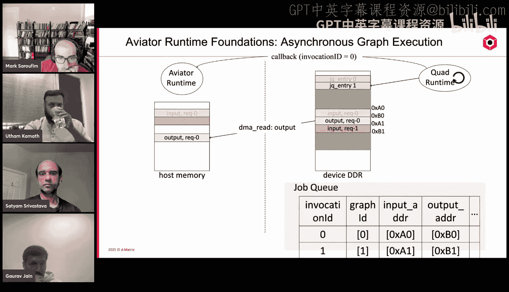

Asynchronous graphic execution。So with the runtime a typical user flow would look something like this so here you have on the right the user aviator runtime and DM extensor so the user would initialize the runtime first on this part and then the user by the time user is trying to execute something with the runtime there is already a lowered graph so the user would load the graph and say okay for this graph this is my callback function and so user would load the graph here and receive a reference to that graph and then for this graph there will be how many other inputs and user would create DM extensors for those inputs。

And along with that now the user is ready to call execute graph asynchronous execute on that graph right so it would provide the graph reference and the DM extensors for the inputs and user calls the execute graph in that planner and finally the graph execution happens on the device and the call back that was registered gets executed when the job is done so this is a typical user flow with executing through the runtime。

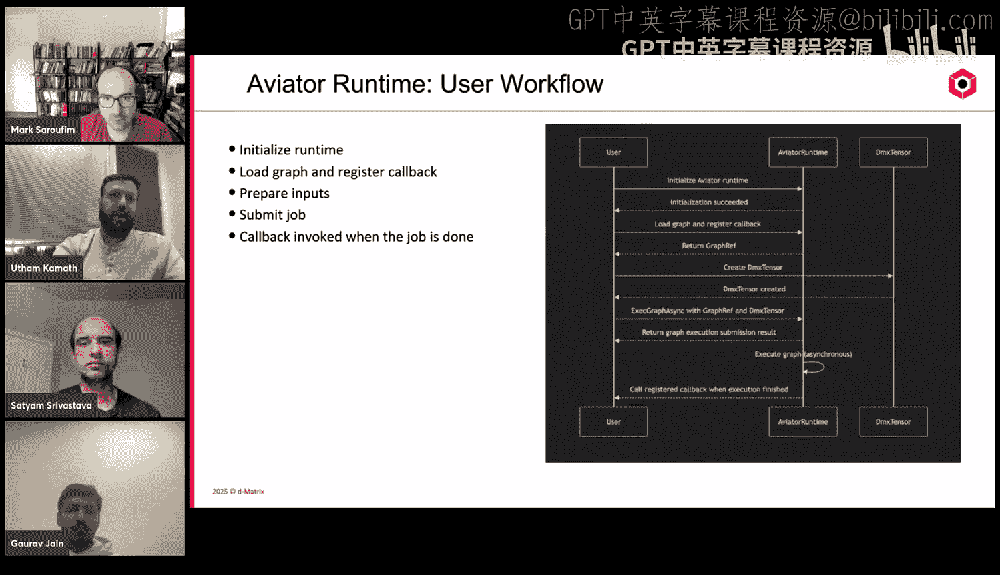

Now making this a little bit more concrete so this is how for example you would executematic multiplication through the runtime right so you just instantiate or runtime before we go into the details so actually what I'm my goal here is also to draw parallels maybe imperfect parallels to the Qa stack so to speak because what I've highlighted here is these dark boxes which semantically achieved some of the things that are achieved in the Qa stack through certain certain APIpis right so the first part what we're doing is a load graph so what does load graph do it takes a compiled graph and then registers that there is a callback for the combined graph and along with that it moves the the graph executable。

The associated constants and weights from host to device right host to device DdR So all of this happens in the load graph and when we next step after that is to prepare our inputs so collect an in create an input tensor you know create that as DMm tensor and along with。

Now this。Basically allows doing this as by specifying DMX here essentially moves the tensor。

 creates the tensor on the host， moves the tensor to the device with the appropriate type conversion as indicated within this graph right our type necessary type conversions are indicated in the graph。

And finally， we go to graph execution where。So where this graph now we had two graphs that we loaded here init graph and the execution graph so we first execute the init graph so what's happening in the in graph in it graph is where we would do things that are necessary only once per model right so for example this would be moving the weights and constant from our device DDR to on chip SR right so that would be something that we do only once per model and execute many。

 many inferences through that know through that model so we place those those things in the in graph and that executes once and following that is our execute graph where we're doing the actual operation for a given activation and we do that by calling this execute graph finally。

After that is done， right， we wait for the callback which releases this sepho here and we that's how we then we're ready to collect the outputs of our result。

So this。Moving further， right now。Then the component our runtime is the inference engine so runtime was the model agnostic execution layer for graph execution the inference engine is where actually we're building model aware intelligence on the host site right so not only is this model aware we want to support multiple models different types of models and we want to support distributed inference as we can see right all of our models especially LLMs would we would expect it to work on up to a node or rack or even beyond so support multiple distributed inference。

So the same goals of minimizing user friction and supporting low latency and high throughput operation apply here as well。

Now how do we do achieve these goals right so again inference engine is also built for asynchronous execution。

 it is built for tensor and pipeline parallel support and to support our stringent performance requirements we've been very conscious in minimizing host overhead as much as possible and。

As many of you in the audience would know a lot of this would come from inter processcess communication and inter processcess synchronization。

 so we minimize that as much as possible or move that out of the critical path and then that allows us to achieve this low latency or high throughput operation right together so this is where what are the model aware features right for example this is where we would implement things like continuous batching。

 paged attention or prefixed caching prompt caching speculative decoding so on and so forth all of these are focused on LLMs but any for other models also any model aware intelligence we would implement over here。

So I'm going to get into a little bit about the inference engine architecture so what there is a lot here but mainly there are three sections right first is our serving endpoint so this is a thin and as I described this I'm going to mainly focus on LLM serving right so a thin user facing API server and an NLM that feeds into our LLM client and following that we move on towards the quickly move on towards the inference cluster management right on the inference cluster management this is all you know stress that this is all just the host view that I'm talking about right so we have the engine right then and then we have a worker per each of the card that is involved in the inference。

Then these workers are organized either depending on the model that needs to be deployed。

 multiple workers form a tensor parallel unit or a TP unit and then depending again depending on the number of pipeline stages in the model number of sets of workers will form the pipeline stages so this is the whole distributed cluster management architecture。

 I'm going to go into a little bit of depth into each of these especially the worker reserve a little bit for the later。

 so things to note one worker per accelerator pretty typical across distributed deployments across the accelerator space。

 and then the engine is where a bulk of things necessary for surveying or the brains of the survey is happening。

Okay， moving， moving further。No。Let's look at the engine like I was mentioning engine is is the brain of the serving logic right and why do I say that because this is where most of the decisions happen most of the line this this is the also the performance critical piece and we've codesign the operation of the engine all the way up to the kernel and maybe even even up to the runtime like you said like we saw earlier right so for example things like how do we handle lot how do we handle dynamic shapes right so。

Eine is the one that decides， okay， now I'm executing token decocode iteration number x。

 and I need to for a request y and therefore the KV cache for this for this request y for this token iteration x is。

At a specific location right on SM so engine is the one that communicates all of this to the graph and then with the help of our quadrant time and how the kernel is written。

 we can execute you know we can resolve dynamic shapes at run time。And so as we're doing this。

 so engine is managing critical resources on the device。

 so KVC resources are to support pipeline parallelism activation buffers across that for communication between pipe stages and also it is the one that is executing the overarching LLM state machine。

 for example， which request is in prefill versus Vcode which request whether it needs to terminate or auto continue with auto regression and also provide streaming back to the user right so this is the high level of what the engine accomplishes。

No。Then we come to the workers right so the workers are designed to be very thin and lightweight so engine is the one doing a lot of the logic of orchestration and workers are essentially following the commands from the engine right so as we described earlier host overhead a big chunk of it comes from communication so we have tried to be extremely efficient with communication so essentially what in our design what we've accomplished is basically no worker to worker communication right pretty much throughout the critical in the critical path right and also all the control communication for pipeline parallelism happens。

Outside of the critical path only at any time or to propagate errors right and finally for like others have also mentioned for collective communication for tensor parallelism right while it is on GPUs it is host driven right here the host is not involved in collective communication collectives are baked into into the compute graph and the only host side inter processcesed communication is between engine and worker。

So by doing this we were able to add very little host overhead on a per token basis right so and we've also designed this with a layering and suppression of concerns in mind so like I was saying engine is the one our workload we can define them in stages right or we can call them as stages like what Oham was talking about a prefill stage。

 a decode stage and so on right so engine is the one that Aer states。

 the workloads execution through the different stages。

And for a given stage it calls on to a block called the stage runner that executes a given stage right and stage runner essentially interfaces with the runtime that you saw about right a stage can have multiple graphs for example。

 so stage runner is going to go ahead and execute one graph at a time by calling on to the runtime and runtime handles the lower level management of graph execution。

诶 so。Yeah， this is what I had about our execution stack and going in then I wanted to give a quick peek into research at D matrixtrix。

 so research we are also know while being a startup we actively focus on on research and there is multiple group that are working on different areas here you know the ML teamwork and the numer team works on quantizations and model optimizations in that form and there is a broader systems focus as well and the hardware team also as active research and publishers and we have some of these publications here at you know at ICML。

 DAC， MLCs， etc and we have an upcoming I micro。That describes our cosair architecture and the system will scale out in a lot more detail。

So， yep。

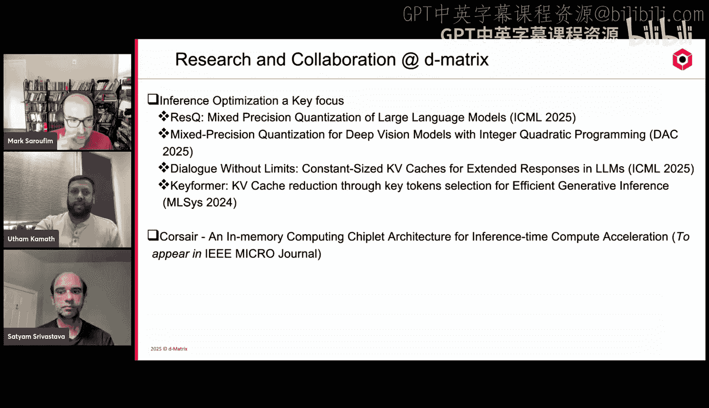

I think this is what we had， is there any questions we can answer Mark from。

From the stream or from you。I was muted sorry about that。 Yeah。

 I think Clia has been doing a very good job answering all the questions in chat。 Thank you。 Like。

 I really liked how comprehensive this was。 Like， I think on， on my end。😊，Well， I mean。

 I sort of have like an obvious question and， and， you know。

 which is for a lot of like hackers and researchers， at least that I work with， like if。

 you know I when I know like when I go to your website， there's like a form we need to click。

To get access and so I'm wondering for researchers that you've collaborated with。

 is there like a PCIE form factor that they can just plug in into like a gaming PC。

 if people want to get access like you know， like there's sort of a lot of interesting builders and the server that I think would want to sort of play around with stuff and see。

How well it goes for them？Yeah， so we do have plans for a developer cloud coming up in the next couple of months at this point in time I think we're working with a few select customers and it's more sort of large scale deployments that we're looking at。

 but we do have a plan for a developer cloud to come up in a few months。

 then then I guess I have a feature request， which is that like it would be great if the developer cloud has access to like low level hardware cons。

Otherwise， it's pretty much like impossible to do any interesting performance work。Yeah。

 I'd love to try it out when everyone' ready。啊そ。All right。

 well I think then there is a good time to call Uam Saam Akil and Gorov thank you so much for joining I like how comprehensive this was like I think I want to especially go back to the beginning session like my I'm not as much of an expert。

But thank you。 I really appreciate your time folks， and I'll see everyone next week。 Thank you。

 Thank you。 Thank you。 Thank you。😊。

