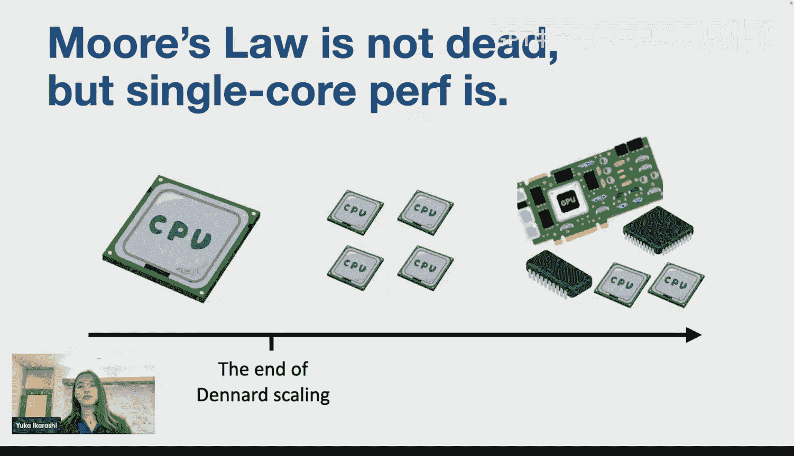
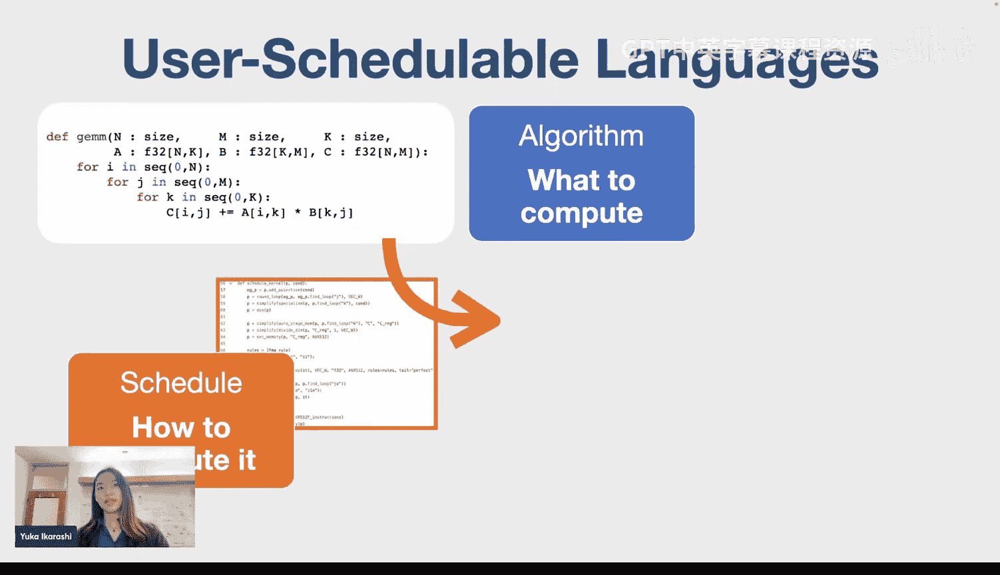
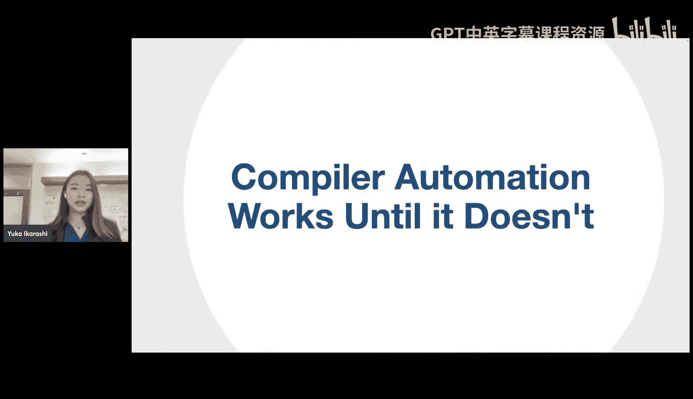
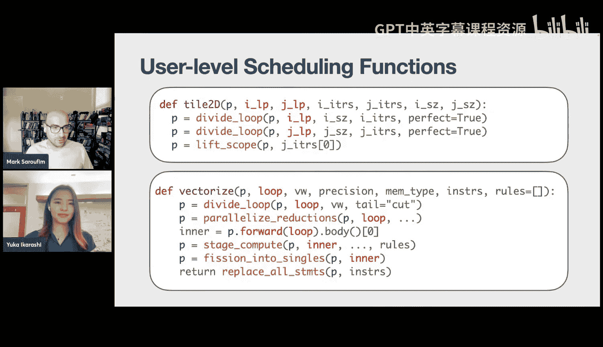

# GPU MODE《CUDA、GPU编程54-87｜GPU MODE》中英字幕（deepseek-v3.2 p09 -20250628-Lecture 62_ Exo 2 Growing a scheduling language.zh_en -BV1xbmQB3ETC_p9-

Yeah， we're live Okay， amazing yeah， so right now Yes。

 well welcome everyone to another episode of GPU mode today I'm like really thrilled we have like Yuka who's here to talk to us about Exo2 the reason why I liked I really was curious about inviting Yuca over was like typically for and a lot of like ML compilers like schedulers are sort of like given to you by compiler authors sort of like like God given And so when I saw Yuka is doing something like very different and like how to grow them and how to get more people contributing like I figured I'd be really really curious to hear from her so I hope you like this if you have any questions I feel free to put them in chat and Yu least take it from here。

😊。

Okay awesome thanks Mark for the introduction and inviting me here so as like Mark mentioned I'm Yu and a fifth year PhD student from MIT and I'm here to talk about our programming language called ExO for writing hydro ox kernels and I suppose a question like you should ask question on the chat and we will address them after the talk and I suppose that our audience today had diverse background so I'm going to try to motivate our program problem first。

😊。

So as we all know， Singapore core CPUU performance used to increase exponentially until the end of the north scaling in the mid 2000。

 so that industry had turned to multiple architectures and specialized accelerators。

 including GPUs to drive performance improvements。😊。

And for example， modern hardware like Apple M4 has many specialized accelerators like GPUs。

 Ne engine for MLs and video encoding and decoding accelerators， so this is nice and very exciting。

 but all of those cutting edge hardware are useless without the right software to leverage their potential。

😊。

So I'm showing my broken Android phone here， it might have very impressive hardware。

 but it's only being useful as a paper rate at best。😊。

So my point here is that hardware is a brick without the right software to leverage their potential。

 and we need software that can maximally exploit the capabilities of the modern hardware and of course the question is how to do that。

😊，So let's consider this simple matrix multiplication and the computation itself is really simple。

 it's like C plus equals a times Sp， it's like what you would expect。

 but if you were to implement this directly in Python you would achieve less than 0。

1% of peak single core CPU performance。😊，And even with C with the highest optimization settings。

 the performance won't exceed more than 1% of the CPU's potential。

 and this is because the gap between this straightforward code and the optimized code is huge。

So industry leading gem implementations like Openban BL has to draw these diagrams to design intricate blocking strategies。

 which ends up in pages and pages of the C and assembly code looking like this。

So optimizing one kernel was already complex and time consuming enough。

 but it's not like you as a performance engineer only have a single kernel to optimize on Earth。😡。

So for example， basic linear algebra subroines or BL is a linear algebra library spec。

 which I'm sure you're relying on every single day while you're the other。😊。

This spec B has many kernels specifying different vector and vector vector matrix and matrix matrix operations。

 and each of them has different kernel specification and different dimensionities。

 including operations， data types， parameters， and so on。😊，And for example。

 11 kernelron spec of level two turns out to be a 50 kernel variant for supporting these dimensionities like transpose lower or upper matrices。

 and this is not even including different hybrid targets。😊。

So it's important for our performance engineers to optimize many kernels productively。

 not just one kernel。😊，And the good news here is that they are existing many programming languages to help performance engineers become more productive and those are of course like different languages and approaches with different obstructions。

 but all of them have to balance this tradeoff between performance engineers wanting control over optimization to reach the peak performance that they want and compilers automating other concerns to improve productivity。

So there is an inevitable tension between which decisions should be automated and which decisions should be left for the performance engineers and all the programming languages I mentioned in the previous slide try to define a good boundary for their obstruction and application。

And for example， one example is of like this kind of boundary decision is a functional equivalence。

 so compilers can ensure the functional equivalence of the original and optimized code so that performance engineers can spend time doing actual optimization instead of debuing the indexing bugs。

😊，And those languages are called user Sch languages or USLs in short。

 and they became popular over the last decade。😊，With USLs。

 users first define the specification of what you compute as an algorithm。And just as an example。

 in our language called Exo， the algorithm specification looks like this it's basically a vanilla Python loop。

 which maps trivially to C。😊，And in addition to this algorithm specification performance engineers also provide you can' really start to interrupt you is this like actually Python or it just looks like Python Oh it's a Python embedded DSL so it's Pythonic but not Python Yeah okay。

 thank you。😊，L worries， so that was the algorithm specification。

 but performance engineers like writingri USLs also provide these schedules that describes program optimization or how to compute the original algorithm。

😊。

And optimization can be described using those primitives like reorder and split。

 which describes again the cold transformation of the algorithm， like for example。

 reorder literally just like reorder the inner and outer loop like this and split will split a loop into outer and inner loop without some pacase。

 and those are usually called loop level optimization which USL usually supports。😊。

And very importantly， the equivalentvalence of the transformation where those primitives are checked by the compiler。

😊，So when the low level complex target code is generated by a compiler taking in this algorithm and schedule。

 we know that the input algorithm and the optimized code are functionally equivalent。

And this is very important， not just for aesthetic， like an OPL mental exercise。

 but for your productivity。Having schedules with guaranteed equivalents let performance engineers focus on being creative and actually optimizing programs rather than fixing cryptic indexing math。

 especially when getting all the indexing maths right for accelerators is generally very hard。😊。

So this was the high level overview of what USLs are and this is great。

 you know we get functional equivalent but USLs like other programming language paradigms have a big problem which is that compiler automation works until it doesn't and when the compiler automation ceases to work。

 performance engineers have no choice but to actually write a low level code in C or assembly。😊。

So let's take actual like USL example， a popular USL called Heide Heide gives performance engineers the control to navigate data locality。

 parallel and redundant computation and it autos other concerns like bound inference and instruction selection。

😊。

And this is nice and Ha life proved to be very productive for many of the use cases。

 but it doesn't always work well。😡，So for example， even as a very mature system。

 highlightlight instruction selection had to be improved in recent years with papers called break and Pework and this was because fundamentally when a hilllight performance engineers comes up with a better instruction selection then the highlightlight automation they have no choice but to fix a compiler itself or give up and just write a seekA directly。

 so this puts a lot of pressure onto hilllight developers to constantly improve their instruction selection。

😊，Also， even to this day， Hlight does not support Tensor accelerators like Tensor cords or Gemini。

 and because this is in general， accelerators tend to expose more control to software。

 which makes this separation of control automation boundary very nontrivial。😊，So for example。

 tensor accelerators and modern GPUs in particular expose like super complex memory management to software。

 whether we like it or not， and handling them is crucial to achieving the peak performance。

 but you they an open question of should USLs automated automated generation of those explicit memory management instructions。

 or should they expose this memory management instruction to performance engineers？😊，And if so。

 like how should they get exposed？And this is， I'm not going to answer this question right now。

 but just to give you a sense of how nontrivial defining this boundary for accelerator instruction could be。

And when we turned to the other side of this boundary on the left hand side。

 prefetch and storage folding were automated when Helight was initially designed。

 but it had to move across this boundary years later because performance engineers using Helight just wanted to control those decisions by themselves because they could do better。

So in reality， my point here is that even in mature systems。

 this control automation boundary is not perfect and is' often blur。😊。

And this is because when things go wrong， like the existing automation not workinging and Paans engineers wanting remote control。

 there's no way but to modify the compiler itself。😊。

And another drawback of this design of existing ESL is that they're not really designed for the code re so these are hilllight schedules for Harris corneror detector and answer masking and you can see that there are code duplication not only across two kernels but within one kernel as well and this pattern of stored compute and vectors is not just a random pattern but it's called sliding window optimization and it's a very common optimization pattern in image processing。

😊，But without a way of reusing those optimization patterns。

 you have to write a lot of similar but subly different scheduling logic over and over again like this。

And you can imagine that like this becomes a nightmare for supporting things like B because again。

 you have this Cartesian product of dimension ID and writing a lot of similar。

 but subtly different schedules will be very painful。😊。

So the design of a design goals of existing USLs is that first they support a fixed set of scheduling operators that are designed very carefully at the ergonomic level and this is for a specific application or a class of optimizations in mind so this control automation boundary were designed to be fixed。

😊，And the next point is that USLs traditionally didn't have a good facility to support the reuse of the scheduling code。

And as a result of having this fixed set of operators。

 adding a new hardware target required non trivial compiler change。

And another way to look at this is that existing ESLs were most useful when writing individual and relatively small kernels。

 kind of like how scripting DSLs like OC are very good at writing quick or small one off tasks。

 but they struggle to scale to large programs。😊，So this was like the overview of existing USLs。

 but know our design goals for ExO is different。In ExO。

 we prioritize giving performance engineers max control to achieve optimal performance。

 so we shift this boundary all the way to the right。😊。

And we think that compiler automation should be minimum focusing on a safety analysis while allowing performance engineers to make key decisions including instruction selection。

 which is usually automated in other US cells。And the key reason for this design of giving maximal control by default is because performance engineers cannot get more control than what a naive compiler building has to offer so one analogy is that if you want to get more control then C has to offer when you're writing S you need a drop to writing inline assembly which is of course another language。

😊，And this approach， of course， comes at the cost of reduced automation for performance engineers because now they have more things that they have to control。

And instead of baking automation into the compiler itself。

 we propose that automation should be built into the user code as libraries。

And this lets us provide automation for things like recization， bond inference。

 and even defining a new hardware target， and all of them are typically built in and baked in the compiler in like an existing compilers。

😊，So our design goal is kind of like C buffer USLs。

We think that compiler should offer maximal control by default and provide obstruction through a bunch of libraries。

And we call this design exo compilation and we implemented this exo language to restate our design high level。

 instead of having this fixed set of scheduling operators。

 we want to make a scheduling operators user extensibles。

 which means that productivity from automation should be achieved by user definedfined libraries。

 not by compiler built in。😊，And as a consequence， our primitives are designed to be as low level as possible。

 and this is because libraries can provide more automation， but not less。😊。

And this allowed XO to trivially support a new hydro acc curerators and skill to support large programs like full Bs。

😊，So this is kind of it for the like overview like motivational section。

 and I'll take any question like before we dive into a more technical part of this talk。😊，So yes。

 it's interesting like basically， I think one of the main things you're。

you're saying is like like typically the boundary between performance and what you like basically like the programming language and the compiler is historically like a clear boundary between like developers of programming languages versus like users of them。

 and you're sort of suggesting that perhaps boundary should be like more lower level。Oh。I see。

But which is， I think already happening in existing languages like C++ like， you know。

 C++ libraries provide， you know more automation like in a cuts or you know， code+ or whatever。

 like you know， they're not proposing a new language or just like，😊。

Providing automation via like kuda libraries， right， which was not really possible in the。

Field of like user scheduleable languages so I think we are coming from like that perspective but like I don't think like this idea of like okay let's start from like lowle language and build up automation via leverage is like I don't think that idea itself is new it's already happening you know from like 1960s or something。

😊，Yeah， I mean， at least like trying to map it to some areas where I have like a bit of experience like like for example。

 like users of Torch compileile will often come to us like asking for like。

A specific like optimization pass， so whether that's something like padding your input padding your inputs their powers of two or like usings QKv projections。

 they tend to be fairly specific things that are solvable。

Either via like template matching or via sort of pure functional transformations。

 but that's about it， this is sort of like the extent of。

The ways I see people hack on the compiler today。I see， I see。Okay， cool。

 so so there is one question from Gmoni， which is that like put it on screen。😊。

Lower level precision data format and user defined formats are increasingly important yeah this is like a really good question so right now built in types like the different precision types are baked in in the compiler but I think quantization is just like very important problem that like we should like also solve from a compiler perspective and we are looking into it。

😊，Is life。Answer。Maybe one last question on my end as well， which is maybe more of a new question。

 so could you speak a bit more about index code Gen and why this is something that should be optimized by compilers only。

So index co is。😊，Like in a way you write like a kudda code， for example， like in you have to， I mean。

 index cogent is just。😊，Laborious like we just think that like you know that shouldn't be like handwritten by users because it's inherently like will break your functional correctness of your kernel like if you get it wrong but it's also like handling index indexing math like correct is not really the center of a performance engineers job description right like you know we just want to like automate those tedious math in the compiler because like compiler are really good at like reasoning about like know polyedural indexing math and know it's like really trivial to do those you know symbolic analysisis in the compiler but like if like users try to do it manually it's just like very painful right so we just think that that is a good kind of clear separation between what is compiler's job versus like what is a performance engineer's job。

 sounds good。 Thank you。Cool thanks for asking a lot of questions and so there are like two parts of this talk。

 but first I want to talk about like how you can implement a new scheduling operators like vectorization or bond inference in the library code。

😊，To kind of ground us a little bit better， let's look at this concrete vectorization process in XO so this is a saxB code in XO where C stands for sequential loops and buffers of x and y are in DrM and we want to try to vectorize this scalar sB code and target eVX2 instructions and the single precision vector with its8 so let's divide this loop into two IO and II loops like this。

😊，but this still doesn't exactly look like a vectorized loop because x and y are still in D and are just scalrs。

 but to use vector registers， we need to stage this computation to eVX2 registers。

And then we can expand this register dimension to eight and fission loops so that each of those II loops looks like retro instruction kind of like the first II loop is loading from y to var1。

 which is eVX to register and the second loop is broadcasting alpha to var3。

 which is you know another eVX to register。😊，And finally。

 we can replace those vector instructional looking loops。With calls to actual vector instructions。

 so finally we get this vectorized code in Exo and we can trivial lower this code to C and run it on aVX2 machines。

 which will be much faster than the original scalar Saxby。😊。

And to recap like what we just did is that we started from this very simple scalar Saxspe code。

 transform this code four times so all the intermediate code were of course in exo and every step of this transformation preserves a functional equivalentvalence and again this functional equivalentvalence is very important because we want this vectorized code to still compute the same saxby and no anything else and this process that I describe here is actually exo scheduling process that transforms this simple starting code to its optimized version by applying those scheduling operators like split and stage compute。

😊，And the actual scheduling curve looks like this， taking the scalar saxby as input P。

 dividing the loop by split， staging compute and replacing the loops with vector instruction。😊。

So this is a user scheduling process， and we just think that it's more productive way of optimizing the code than writing this final vectorized code manually。

😊，So。Here， like we managed to vectorize one kernel saxby。

 but saxby is actually just a tiny part of flo。So this is like you know to remember from the previous slide。

 BL had many kernels and many dimensionities and saxV is just one of the level one kernel and you as a performance engineer has to optimize all of those dimensions productively not just one saxV。

 so let's look at a different BL kernel called Sc and Sc is multiplying the vector by a scalar and writing to the same vector X while saxV was accumulating to a different vector Y。

😊，So Sxsby and skull are different kernels， but in fact。

 we could apply the exact same scheduling sequence and get a vectorized code for both of them。😊。

So this is nice， but it's not very clean because we don't want to have those duplicated code everywhere in your code base and a natural thing for a software engineer to do is to encapsulate those common scheduling patterns in a function like this。

😊，And maybe we can name this function simple vector and call it from those sB and scale。

So high level Excelo allows users to define a new scheduling operator like this simple vectorize completely in the user code and okay this might seem like trivial。

 but it wasn't possible to do this in the existing ESLs like Heide and we want to call this a user extensible scheduling language D。

😊，And we identified three key design features of user extensible scheduling languages。

 so the first schedules somehow need a way of transforming or modifying the object code。

 and we call them actions。😊，And compilers need to offer some built in or primitive action that offers this safe low level transformation。

😊，We call them primitive actions and we supported over 60 of them and we checked their correctness of this transformation by polyhedro dependency analysis using SPs over these3。

 but I'm going to talk about the analysis a bit more in the next section of this talk。😊。

So this is great， we check the safety of those primitive rewrites。

 but you might wonder how the checks for the user defined operation might work out。😊。

And this was an obvious idea in hindsight， but because each of those primempitive action is guaranteed to preserve functional equivalentulence。

 user defined functions like simple vectorize， which is a composition of those actions。

 is also guaranteed to preserve functional equivalents just by composition。

And this is very powerful because we can build up more complex operations from a simpler operation and get safety check basically for free and actually those scheduling operators stage compute fi into singles replace all are also user definedfin operators and not compiler printers so this is kind of just trying to show like how we've built up this library of operators by composing those smaller functions to define a fairly complex operations like simple vectorized。

😊，So we talked about actions and when performing actions。

 we sometimes need to ask the question about the code like is this buffer F32 or F64 so we need a way of question question about the code。

 which we call inspection。And finally， it might sound very basic。

 but we need to be able to point at or refer to part of the object。😡。

And let's talk about references now， and for a second， we're going to forget about exO and USLs。😊。

There are many kinds of references in programming languages like a pointer to values， strings。

 arrays or function pointers or other data structures。

 but what's like special about compiler is that references in compiler points to another piece of code and know compiler of course。

 need to refer to the code that they're manipulating so that you it can modify that。😊。

Cung calls it AST Mats and LVM calls it power matchch。

 and they're used in various ways in the compiler。And pointing to the code is you know very fundamental mechanism for compilers like LVN and let's just like say that we have this initial LVN IR where this outer triangle and this outer。

😊，Round rectangle illustrates this entire LVM IR and the inner rectangle and this like highlighted triangle denotes this substrate in the IR。

LVM used this pattern match to point to a sub like this。

 and it will simplify this instruction if it can。And this works for LVM。

 but there are some limitations。Because pattern match is a onetime reference。

 which means that you have to recquery the entire IR with a new pattern like A。

 if you want to apply further optimizations。And the problem here is that you always have to know exactly how the code structure looks like at every point in this process。

 so when you explicitly requery the IR with a， your pattern matching only for the concrete IR a and no anything else and with this it's impossible to parameterize this onetime reference by definition because you always have to know exactly the object code structure at every point in this scheduling process。

😊，So for us， for USLs， onetime references are insufficient and we need a stable reference。😊。

And let's say we have this initial object code P， and P is pointing to this entire tree and a reference C pointing to one solidut tree like this。

And each Exos scheduling operation takes a Pro P and a reference C like this， and reorder loops。

 reorders the loops that we saw in the previous slide。

 so the code looks like this after applying this operation。😊。

And the updated P will point a new object code like this。😊。

And we want C to keep pointing at the same substrate after the transformation。

 because this is going to be obviously convenient for scheduling because you can keep using the same reference without knowing the exact structure of the transform IR。

And in Exo， we proposed this thing called cursors to support this stable reference。

And a cursor is represented by pass which records the navigation of the ASD。

 which is quite simple and for example， this like bottoms shows this pass representation of a cursor that is pointing to this object code Y and body one means a second statement in the body so it's pointing to this loop。

😊，And body zero means the first statement in the body so pointing to this assignment and right hand side is you know right hand side of this assignment。

 left hand side is the left hand side of this binary operation ad so you know y is represented by this cursor pass representation。

😊，So okay， this is not that difficult， but what happens after this code gets modified by the schedules right so if you unroll this J loop this past representation for y becomes invalid basically so the past representation representation itself is not quite stable and we need you know something other than this。

😊，So the next feature of cursors that provide this stable reference is called forwarding。

 which defines how the pass should get updated after none action is a form。😊，So。😊。

We can take those two statements and replace them with a single statement like this。

 and when we do this， like we want a cursor that's pointing to those statements to keep pointing at this replace statement even after the transformation。

😊，So the forwarding rule for this might look like something like， okay。

 we preserve the existing path to other parts of the sub and the path to the old tree should remain valid。

😊，And we defined this forwarding rule for all 60 of the compiler built in Pres。

So that's like how we achieve like a stable reference through cursors。😊。

But we want to see like how cursors could be used in actual scheduling process。

So let's say that we have a scheduling library function calledF on the left and the function argument P is pointing to the object Hill procedure looks like this。

 C is pointing to this I loop and another cursor D is pointing to this if statement。

 so the entire tree might look like this in this a C downward traersal cursor pass representation。😊。

The first action reorder loops， will reorder the loop C is pointing out so it will reorder loops I and J so after the rewrite it will look like this。

😊，And after that， see the body will point to here because C was pointed to the eye loop and fission will fission after the cursor。

 so it will look like this after fission。And reorder before takes a cursor D pointing to this if statement。

And reorder before， reorders this statement before the loop， so it will look like this。And finally。

 replaces this eye loop that cursor C is pointing at to load so it becomes like this。

And so the object code here， like after this full scheduling process might look like this。

 cursor C is pointing at this load and this might be a cursor pass representation for this object code。

😊，But important thing here is like recall that C was pointing to this eye loop at the beginning of this function food。

 and somehow the samecursor C managed to stably point to the same substrate throughout this scheduling process on this transformed Pro P。

And this is achieved by the thing called cursor forwarding that we defined。

So we want to see a bit more a realistic user level scheduling function。

This code tile 2D is very simple， consists of three primitive calls。

 two divide loop and one lift scope。😊，V price， this is a bit more general version of simple V price。

 it's a bit more complex because vector itself is calling into other user defined functions like parallel reduction。

😊，But the point here is that we can build a fairly complex operators like Tau2D and Vize in the library code。

 and importantly， like all of those user level functions like VR are also guaranteed to preserve functional equivalentence as I explained。

 just by composition and this is possible because of those cursors that are highlighted in red provide a stable reference throughout this scheduling process and it allows parameterization of those scheduling functions。

😊，And collections of those individual user defined functions eventually becomes a library。

so I can pause here for a quick question before we'll switch gears and talk about like defining how target in the library。

😊，Oh， thank you， if folks have any questions， please go ahead in the meantime I had three。

So you mind going back to your previous slide？でそ？Another one before。Yeah。

 so here like like considering this is Python， this is not like an eager execution model right so you're not like actually executing this line by line。

 right？😊，So the Le hand side scheduling function are written like this is a pure price on。😊。

So it is executing line by one。Oh， I see and so then like can you also make send match like Python features like here like could you just like or is this like or are these like only the functions that you can call here are the functions that are in the DSL。

Sorry， can you articulate what you mean by mix and match Python functions So mean what happens if I add a print statement what happens if I oh I see I see what yeah in that sense like you know you can yeah totally interact with other python operators like you know print like know we use print for debuing all the time but the one kind of like。

😊，Constraint is that like those。Operators like reorder loops fission like those are compiler built in actions and the compiler built in transformation encode code this forwarding rules so forwarding rules like tells compiler how to how to forward this cursor to like a different part of the scheduling process and so you cannot just write your own like a rewriter on P and just like return like aly you know rewritten procedure P and expect the compiler would forward it like if that makes sense it does yeah which sort of brings me to my third question around like correctness which is that like you know like reorder loop I'm thinking like well that probably is like a fairly safe thing to apply but something like reorder before like there is no guarantee that the program is like functionally equivalent and it's up to the author of these libraries to sort of like make sure that their optimization are correct。

So that is like you know slightly inaccurate so like you know you reorder like like reordering two statement right like you know just changing the execution order of like this statement and this like are visually is like know of course incorrect and that because like you know so exo internally has a very like heavy weight unlic mechanism and for example for like you know like so we determine if it's correct or not to reorder two statement and you know if you are talking about reordering two statement like we check a commicivity of two statement blocks so basically the rule is like if all the right of a statement one and all the read right and the reduced effect of statement two the intersection of those two effects are empty set then you know and vice versa like all the right effects of like statement two and all the。

rite read and reduce the effect of status one or empty set then we can reorder this statement right so the checks of like is it like you know safe to reorder those statement or not is handled by static devices in the compiler。

😊，Okay understand yeah that sense so you don't allow people to write incorrect things or shoot themselves in the foot basically Yeah exactly makes a yeah as long as like users use you know compiler provided like these are low level like very low level prims and you know we expect like users to write more complex optimizations like you know vectorized by themselves but like as long as they're using those like building blocks provided by compiler we guarantee a functional equi of those operators and also we handle the forwarding of those pointers。

😊，Basically got it， yeah， thank you。Cool， so we talked about vectorization as an example of like how users can define their own optimization in a library。

 but I want to like switch gears and talk a bit about like how to define your own hardware target as part of library instead of making it inside the compiler。

😊，So existing compilers implements like new hardware target inside the compiler itself。

 so it's all compilers writers to support a new hardware target when it emerges because the hardware target code is literally embedded within the compiler itself。

And in Excel， we think that this responsibility should be externalized and shifted to users or library implementers。

😊，And we think that this externalization is nice when dealing with proprietary hardware interfaces and during this development of a new hardware because the ISA is very unstable。

😊，And by externalizing the hardware definition， you don't have to modify or you you don't have to modify the compiler repeatedly。

 you know get full every night and try to like keep up to date with like the main compiler development and I think having a modular compiler system like this is quite necessary especially during now where we have like so many commercial accelerators and all of them get substantially updated every 12 months。

And so we want to define hardware targets externally as a library and we do this through instructions。

 memories and configuration state， and we're going to use this Gemini accelerator as a running example。

😊，So Gemini accerator is a historic array based accerator developed at UC Berkeley and that has been taped out to ASI used in like a different projects in research and industry。

 and it only has three key instructions that are relevant in this talk， which are load。

 MaMo and store。😊，Okay， so the load instruction can be defined like this and this is just how you would expect to define normal exoars as procedures and the only difference is this at In decorator instead of at Proc which is a procedure and this indicates that this is a hardware instruction。

😊，And now we want to define like aelerator memories。

 so array buffers are annotated with memory space specification which indicates which memory this buffer reside in。

 so for example Ge scratchtch here is a buffer annotation for Geminized scratchpa memory。

 so load is an instruction that takes source in D and loaded to test in Geminized scratchback。😊。

And those memory classes are defined in user library as regular Python classes and it lets hardware design and specify memory details like sizes。

 aed precision， and other relevant memory parameters。😊。

And the final thing here is this thing called configuration state。

 so Ge and I has a hardware configuration registers that dynamically alters the behavior of basic instructions so for example。

 stride parameter has to be set to control the stride of data that is loaded from main memory to the scratch pad。

😊，So on top of what we defined in the previous slide for the load instruction。

 we have to add this assertion to the load instruction to specify that the stride parameter has to match with the first stride of the source buffer。

😊，And just like how memories were just modeled as Python classes。

 configurations are also represented as classes tagged with@ Config keyword。

And now I'll walk through like how configurations are actually used because I think this is what makes Exodes onlic quite unique。

The left hand side is a pseudocode for more for Gemini， but actually as shown on the right here。

 these load and compute and store instruction actually rely on setting those configuration states like config load and config comm and so on。

😊，But resetting this configuration state every time before each instruction is super expensive。

 both because it clatuttered our inner loop and also because it flushes the other hardware pipeline。

😊，So ideally we want to hoist all of those configuration instruction out of the loop like this for efficient execution and you know you might think that okay this optimization is like really Gemini specific and it's a great candidate for a library function because like if you are developing a software library for Gemini you want to do this kind of optimization again again like in different kernels so we can encapsulate this hoist configuration instruction to a library function and that's indeed what we did which I'll talk about in the next section but here I want to talk about the underlying safety reasoning because is it like actually safe or unsafe to hoist the configuration instruction like this and that is quite actually it's not safe this is functionally inevalent because the transformation would lead to。

😊，correct behavior for our loads because both A and B loads would use the same configuration from B。

 the last set configuration rather than their respective configurations。😊。

So we ultimately resolved this dilemma through hardware software code design。

 so we asked Gemini Hy designer to expose different version of the load instruction to the software interface and that allowed us to set independent configuration state for two different loads so Con load one is only affecting load one。

 Cong load two is affecting you load two。😊，But the question for a program analysis is is that how did we determine that original code like this was incorrect。

 but once the hardware feature got modified， the transformation became functional equivalent。😊。

And the standard approach for looping code over array arrays is to perform a dependency analysis using polyhedral set over iteration spaces。

 but such analysis do not handle the problem of global mutable state。

 which is what a configuration state is。😊，So specifically。

 when there are multiple redundant configuration on the same parameter。

 we need a value sensitive analysis to identify those redundancy。😊。

And this is like value sensitive analysis and how exO handles it is a complex topic on its own。

 I'm very happy to talk about this like offline if youre curious。

 but in summary we integrated this value sensitive analysis to all the scheduling primitives that we talked in the previous slides。

😊，So to recap， we like in this section， we really talk about like how hydr targets can be defined in the user or library code and it's external to the compiler。

😊，So like for a summary， exocompilation philosophy is all about defining hybrid targets and optimization strategies outside of the compiler in the user defined library code。

😊，And we think that this approach makes writing high performance chronos like plus much easier。

So if you remember from the earlier slides， BLS has three levels and is' a Cartesian product of many different dimension9s and one of our initial motivations was to be able to productively optimize large programs like this and not just one kernel。

😊，So we optimize all the dimensions of last levels one2 and gem and we have even more graphs in the paper if you're curious。

 but each draft shows one level or one architecture and each row shows one coronal variants。

 so there's like 50 coronal variance for level2 and this row for example。

 means that single precision triangular matrix spectraor multiply with lower triangular non-transpoposedse known unit as operational parameters。

😊，And green is better and red is first performance for ExO。

 so you can see that our results were generally competitive across the board。

 even when compared with MKL， B and Open Gs， which are written by teams of fulltime engineers。

 companies like Intel。😊，And this was done by a few students over a few months。

 so we implemented those scheduling libraries with functions like simple vectories。

 which is much less than 200 lines of code in total and using those library functions we implemented application kernels like Gen V and Gen with all the different variants like transpose and nonunit and so on and again it's a few hundred lines of code in total so as a comparison open glass lines of code for level1 dot is 244 lines and Gen V is 1800 lines of code and that is a code count for a single kernel for a single hospital architecture but again the table I'm showing here supports 180 kernelron variant on three different vector machines aVx2 aX512 and neon so around 240 kernel variants in。

😊，ほど？So I think it was fair to say that we could make this process of optimizing boss way more manageable than handwriting C assembly。

In the next case study， we implemented Helight like interface as a s library because X's scheduling primitives are designed to be low level。

 like we wanted to show that we can recover the obstruction of other user s languages。😊。

So this is a blur scheduling code in Heide and this is Excel's blur scheduling code using this Heide like library。

 so you can see that we kind of try to mirror the Heide schedule and all of those functions like Heide tile Heide parallel are implemented as this user level scheduling operation in Excel。

😊，So with this interface， you can also enjoy the benefits of headlight obstruction in Excelo。😊。

So with this interface we achieved a similar or better performance than the original headlightide on blur and Ancho masksking and with similar lines of code。

 but perhaps a more interesting result is that this is a number of raw exo primitive rewrites and because each exs headlight like function is a user level library function they're composed of many primitive rewrites and this just illustrates the magnitude of productivity gain that we get by encapsulating those common scheduling pattern in a library function。

So the previous two case study， blast and Hide like library were on vector machines。

 so those were run on like aBX2 and neon architectures。

 but we shouldn't forget about accerators because that was Exo's initial motivation。😊，m。

 so we want to be able to support like exotic matrix austerative like Da night。😊。

So recall from the second section that there were Gemini specific optimizations like hoisting this configuration to the top of outside a loop and we encapsulated those common scheduling patterns as a set of user level scheduling functions and optimized MaMo and comb with a few dozen offline code H so you know this is of course while achieving the PFA loanss and compared with the existing Gemini standard library our MaMo was two to three times faster and a result of convolution layers were similar。

😊，So this is it for like the performance result， but I want to talk a little bit about like external impacts and some ideas of exO got transferred to other domains so on the academic side external researchers from Spain。

 Japan， Berkeley and so on publish their high performance computing papers using Exo already and there are other labs working on building their research on top of ExO as well in the industry I had the opportunity to spend a total of one year is years like doing internships at Amazon and Apple trying to like help them adopt exO and it resulted in ExO generated code used in iPhones and Vion Pro。

😊，Also， this is kind of like a very interesting application of like scheduling process。

 scheduling design to like completely other domain。

 but we basically adopted some of this exs idea for scheduling and knitting machine。😊。

So it turned out that we can actually use those ideas from ExO's rewrite based scheduling to define scheduling operators that preserve the topological equivalent while manipulating the knitting assembly。

 so starting from this fabricated object， we can schedule this like knitting assembly instruction to this pleated tube like using fewer needles and this rewrite is a direct application of this rewrite based scheduling system in ExO and similar to how we define those rewrite rules like you know reorder statements split in ExO。

 we could define those rewrite rules that works on knitting machine while preserving the topological equivalent。

😊，We also formally specify those rewrites and we prove that we can schedule all meetable objects that are expressable by this meeting assembly。

😊，And we even extended this idea to another follow up work that supports scheduling on the instruction graph level instead of the assembling level while preserving。

 again the topological equivalent。So finally， I want to talk a bit about challenges that I think is left for ExO and USL in general。

 I think first like it's like pretty true that USLs have steep learning curve because meta programming is just in general you know less direct way of doing programming and you have to think like a compiler engineer and ExO tries to address this problem by raising obstruction of your libraries but obviously like we need more work in this area to help this scheduling process becomes more intuitive。

So like if scheduling is hardly right， then you know。

 we have to think like what is more human intuitive way of communicating this optimization process？😡。

Another point is USL compilation time tend to take a bit longer than other compilers like C just because like we have to reason about function likevales and various compiler optimization techniques might apply but you just doing more staticizes like having more former guarantees might be a hurdle when USLs get more widely adopted。

😊，And finally， like another common criticism of USL is that it has limited expressivity and I think the challenge is that USL at least have to think about you know this functional equivalentence during convolation and while in no USL language like programs can just write whatever they want and were working on addressing this limitation like especially the third the limited expressivity。

 so we have many ongoing projects that are pretty exciting actively working on GPU backend these obion and interpretationbased value sensitivity analysis is like you know is trying to address this like limited expressivity problem in USLs and they are like other people from other universities working on various projects as well。

😊，So this is like my final slide， not really a research project but like just wanted to kind of put it out there and mention it because like I think some of like this audience are interested in like using LM for cogen like GPU cogen or like other hypohoco cogen so I mentioned like briefly in the previous slide that like I think like steep learning curve for your is being hurdle for limitation so for adoption of USLs so I experimented with like using national language as an interface to do a user scheduling so you can like watch this and decide you know if this is nice or not but so this is who is my starting code and I'm saying like divide a first loop by eight and so LMs can synthesize this divide loop。

😊，Scheduling operation in Excel and then I wrote something like no add perfect equals shoe so it added this perfect equals shoe which。

😊，Yeah， which like you know generated this optimized code without the tail case and then I say， okay。

 like yeah， divide that J loop by8 and reorder with II loop。

 which you know sync society this schedule and so on。😊，It kind of goes on okay。

 like you know stage this like A and B， I'm going stop here but basically you know this is just kind of trying to show that you know maybe having this like natural language English interface and letting like LLM or whatever。

 like generate those scheduling operation and you know let compiler actually parse and analyze those like scheduling operators like ensures functional equivalent like throughout the optimization process might be you know one kind of future direction of like how you know scheduling languages are used and also like how we as you know programming language community can interact with you know random text generators like LLM。

😊，Okay， so so those are my amazing cultures like know who worked on Exo with me and that's it so ExO is open source it's been around for a little less than five years now so it's like relatively stable and we have you know some external people using it as well so you can try it on this Godbo link if you want。

😊。

And that's it， I think I'm running off on time so going of stop here well you go。

 I think you meant five months though， not five years， right？😊。

Oh five years yeah like you damage five months yeah it's been like around yeah like like five years you actually said five years just like because when I noticed on Github the first release was like in November or so looked like almost I'm oh that that was 1。

0 actually I'm mistaken Yeah okay， oh I see I see February 28 2022 okay。😊，Right， very cool。

 So so I guess like there's a few more questions。 And yeah， so maybe let's go over them one by one。

 This is the first question by Alex。 I'm going to put it on screen。😊。

That's good。Yes yes okay let me go back to my earlier slide yeah you're absolutely right that you know you mentioned that flexibility comes from code composability yes and。

😊。

So those are like T 2D and vectorizer like user defined composed operations right and you also asked about primitive set of ops that are defined and that is on this slide。

So those are the set of primitive actions that are offered like those are compiler built in transformations and we check the correctness of like you know those primitive actions like we designed them to be like in a very low level like okay like you know swap2 statements and so on and you know we build up those like T2D and vectorized by composing those primitive operations。

😊，Does that answer your question？I mean， like I had a similar question。

 So I think at least it did for me。 I guess yeah， like the other two questions I had were I was wondering if you go back to like。

 I think you had two slides on like Maximal benchmarks on GPUs。Not on GPUs。But versus Hall light。

 right， that's what that was。Oh， versus Ha， so this is on sharp masking and b。Yeah。

 I'm certainly curious to ask you about GPU support in general has this been something like y'all have been considering like if so yeah yeah。

 were like we have been working on GPU support for like a little bit less than a year now and you know you will hear more update as we you know publishlish our paper but you know it's going to pretty well。

Okay， sweet very cool。 and I guess like the the last question， like。

 I guess this sort of relates to your demo as well near the end， like with the I was like。

 are are there like any。😊，Actually， maybe before we go there。

 I'm going to go over Alex's question first again， he has another question。

There a special way these transformation were defined。

 as in these ops are probably useful or cover some useful set of transformation。

 I don't know how exactly to think about this。Special way these transformations were defined。

I'm not sure what you mean like are you asking about like function signature difference between primitive ops and user defined ops if that was your question then my answer is like you know from a end users's perspective it's like completely opaque so let me just analogy is again C so you're using like you know sine function like or cosine function like whatever function that is defined in like mass dot H in C right but like you're not really aware like oh like is this function like defined in this this standard library or is this like you know C built in it's like not what end user has to worry about too much so my answer is that like when users are using you know library definedfin operators like you know like picture。

For example， the fact that V rice is a library function， not a compiler building function is like。😊。

Oaque to users and users can just use this like a library function as they're using like a primitive like compiler built in actions。

Hope that answers you a question。Okay， all right there might be some lag with chat but I guess I think you guys in the chat and on Twitter so like maybe just like follow up for more questions I guess I maybe you can also ask you like the last question before we close are there sort of like any contributions you're hoping to get to the project like whether it's like new kinds of ops like new ways of using exo is it like making it easier to use like just any like what do you think would be a good fit for people trying to use the project for the first time？

😊，De on what kind of users we are always like， you know if you are performance engineers like you trying to optimize you know some specific kernels for like your own harder target then like yes like we would love to support those people you know like if they wanted to use it for like their own like hyper computing project like that's like you know something that we you know really do support you let me know like if you wanted to use exo if you wanted to like contribute to more of the compiler side of Exo that's more like in the realm of that's more like in a research and you know that needs a little bit more kind of like you know hands on tutorialtor to like get on board with like compiler development and。

😊，Yeah right now like I'm not really sure like if like we usually like on board the people who we have like connection with in terms of like contributors。

 so we're not like actively super looking for like compiler development。

 but we're always like you a very happy to support like users if that makes sense。😊，Yeah， I mean。

 that's exactly the audience like I had in mind， which is more people doing interesting performance work that are not happy with the existing languages。

Cool， well thank you so much for coming on Yuka I guess like for next week we have the factor learning environment folks。

 but in the meantime if you have any questions about XO like Yuka said it's an open source project go to the GiHub and ask questions and thanks again Yuka。

😊。

Okay， thanks a lot for inviting me， this was great。😊。

