# GPU MODE《CUDA、GPU编程54-87｜GPU MODE》中英字幕（deepseek-v3.2 p10 -20250712-Lecture 63_ Search-Based Deep Learning Compilers.zh_en -BV1xbmQB3ETC_p10-

Yep， looks like my life。All well welcome everyone to another episode of GPP mode today I'm really thrilled to have like Joe Foddy here who's going to be talking to us about like something pretty different。

 which is his project and company Iminal， which is like a project I'd been following that has like a different approach where like instead of like writing kernels you search for them。

 I figured it might be like a big interest to people like used to compiler based approaches and so I was like pretty excited to have Joe come on yeah Joe please without further ado。

 please go ahead。All right everybody everybody I'm glad to be here。 Yeah we're luminal。

 my co-founders and I made luminal and it's basically an ML compiler and we take a search first approach so there's some other ones out there now that are I think more recently trying to use like LLMs to generate kernels we're more of like traditional compiler route where it is like a deterministic codegen compiler and yeah I mean really initially I started it because I wanted to run LLms on my laptop really fast and it does that now but a lot of people in the community started using it for cloud and so we've spent a lot of effort getting this to run well on cloud as well and you know really I think that the whole sort of title of this talk is a radical simplification through search and I think that really that is like the overarching goal here that like the ML ecosystem is like pretty complicated especially at the low level you know you have coUa。

DNN Kubloss nickel Libtorrch pytorch on top of that transformers on top of that and that's only in the coUuda ecosystem and so it's just like a very fragmented approach it relies on a ton of handcrafted kernels and everything which are very labor intensive and so you know we set out to see if we can get a compiler to automate a lot of this stuff and so yeah I'll jump into the slides here I think everybody should be able to see these slides yeah so fundamentally I kind of came at this as from like a first principles approach and I thought like you know what are neural networks what is deep learning fundamentally and you know everybody knows that it is mostly just linear algebra and it's very simple linear algebra in fact and so if you can like basically handle like scrs vectors。

 matrices， tensors and dimensional tensors and then do some simple operations on。

The like you can handle most neural networks out there。

 most at least relevant neural networks that people are using today and so basically yeah。

 those are the primitives of our。Library here so if it is so simple though why why are the existing solutions so complicated Well PyTtorch has something like 1200 operations and it supports I think 15 different data types now and it runs on all these different devices and so CPUUs。

 different types of GPUus I think it does run on TUus I'm not sure about neural engine maybe with coreMl but the basically the number of implementations that you need actually scales multiplicatively as you scale up these different things and so it's not number of ops plus number of data types plus number of devices it's number of ops times number of data types times number of devices and so you just get this massive explosion and complexity where it's like for every new op you add you have to support it on all these different data types on all these different devices and for every new device you add you need to support all the ops and all the data types etc and so。

It ends up being， I think Pytorrch is over 3 million lines of code now， and Tensorflow is worse。

So really， we came at this and said， like， how can we do all of that in ideally 1100th the complexity in at least1/10th？

And so yeah， like I said， we come at this from a first principles approach and we said what operations do we absolutely need And so we built luminal just to use these 12 operations here and so actually these are 11 here and so basically we have like on the left hand side here the unaries so these are basically unary operations that just operate on a single tensor at a time and they just do an elementwise operation so we have x two log2 sign or and square root and then in the middle the middle column we have our binaries so these take in two tensor inputs and produce one output add multiply modo and less than。

And then we have our reduction offs and we only have two of them。

 so we have some reduce and max reduce， basically you just reduce one dimension of your tensor by taking either the sum of all the elements on that dimension or the max of all the elements on that dimension。

And it turns out like this is basically all you need， you can build like LLMs。

 you can build mixture of experts， you can build diffusion models。

 all of this with just these operations。So we basically build like very complicated models and very complicated operations just by recombining these simple operations and so this keeps the core of our library very simple。

So。You didn't even see subtraction on this list of operations because subtraction is just multiplication and addition combined so you can instead of doing a minus B。

 you can do a plus negative one times B same with division as long as you have reciprocal and multiply。

 you can do division and Mamo is a little bit more tricky。

 but as long as you're able to broadcast tensors and then some reduce them。

All you really are doing in a Mael is you are doing a broadcasted multiply and then a summer reduce along the K dimension。

And then a convolution is just as long as you're able to track shapes。

 you can do a pooling operation and then do a mapmo with the current。And so yeah。

 these are the fundamental core operations that everybody expects a ML library to have and we don't have them because we're able to just use our simple ops to do them。

So the other， I would say reason why。Modern Ml libraries are complicated is because they are very dynamic fundamentally。

 This was one of Pytorch's big selling points is that they would be super dynamic and nothing would be static and you'd be able to modify anything you want at runtime and that's that's great for development there is a pretty significant performance hit and complexity hit you take once you once you commit to going full dynamic And so what we've actually done is we've taken the opposite bet And we said that you know these these models once you specify them are super static they're basically just data flows through this graph of computations and then。

Those those graphs don't change。 Maybe the weights change。 Certainly the activations change。

 So the actual data flowing through changes， but the graphs themselves don't change。

And so we can specify all these modern neural networks just as these directed acyclic graphs of computations here。

And so in front of us right in the middle here， we see what would be basically a Mamal。

So we load in the tensor as one of the inputs， we load in the weight for that layer as one of the inputs。

 we do our broadcasted multiply and then we do our summer reduce， and that's it。

And then on the right hand side， you can see， I believe I want to say that is a。Transformer layer。

 it might actually be a subset of a transformer layer。

 but it's you know you can see that these these graphs can get quite complicated。Um， and then yeah。

 once you specify it like a full language model， it's like so massive that you can't even see individual nodes anymore。

So like the consequence， the main consequence of taking this pretty indifferent approach is that our core library is actually extraordinarily simple。

 the entire core library is under 5000 lines of code I expect it'll stay that way。

But it's not fast because if you're doing instead of a subtraction。

 you're doing an addition and a multiply every time you want to do a subtraction。

 that's obviously going to take a performance hit and you know if you're doing a ton of maybe like 10 or 20 different primitive operations just to do one complicated operation。

 there's obviously a performance hit So the first time I ran Lama 7b。

 I had to wait all night for it to generate one sentence So it's like about two and a half hours per token。

 it was yeah， not breaking any speed records， but that's okay you're not meant to run these these graphs of primitive operations。

 the point is that all of this is really setting us up so that we can compile our way back to speed。

 and because we're dealing in primitive operations。

 it's much much easier to write a compiler for our representation than it is for much more complex representation like you would have in say Pytorch。

So here's another view of the sort of simplification that we're working towards。Traditionally again。

 you'd have like hugging face transformers on the top and then that would sit on top of something like exformers and pitorrch。

 which themselves sit on top of like Libtorrch and all these handwritten kernels。

 these handwritten kernels would then use like coy andN or coubloss and then that sits on top of。

 of course raw kuda， but since we are directly generating couda kernels。

You basically are using luminal and then you have kutuda right beneath it and you know we're working on developing a ptorrch back in and so can you can keep your pitorrch code if you really want to and then you could basically it would ptorrch would just call luminal instead of calling lib torch。

So like I said yeah， aluminum is slow by default， we're using these primitive operations。

 but we're not meant to actually run those primitive graphs。

 so what we do is we transform those primitive graphs into much faster graphs and what would we call a program that transforms a very slow high levelve representation into a very fast low level representation well you'd call them compilers and so most of our efforts are on building a really。

 really， really great ML compiler。So we're not the first one though to come up with the idea of using compilers for machine learning and certainly compilers have existed for a very long time in general programming。

 but I would argue that，The amount of complexity expected in your input program。嗯。

Directly translates to exponential complexity in your compiler because as you you take just general purpose programming languages。

 you can basically specify any possible any possible computable program in these general purpose languages。

 which means the compiler needs to be able to deal with any possible program coming in。

 so I'd argue compiler complexity scales with the complexity of the assembly coming in or the assembly that is produced squared or maybe cubed or something。

And really in the ML world here we're going for peak performance I've worked in hardware for a long time and to get really peak performance ideally you want as simple of hardware as you possibly can have so you want everything to be statically scheduled you want everything to be decided ahead of time by software this is one reason why CPUs don't perform all that well with M it's because they are extremely complicated complicated pieces of hardware because they can't really assume very much about their software so the more complexity that we can push into the software the less we can push into the hardware。

 the more hardware we can dedicate just to computation so we want again static scheduling static allocation static prefeting all that stuff and this sort of boils down into a hardware architecture known as VLIW very large instruction with and so there are you know legacy systems that have tried VLIW in the。

The most famous I believe is Intel itanium tried it I think in the 90s and it didn't work out very well now I argue that that the main reason for that is because they were a general purpose CPU trying to do this VLIW stuff。

And again， like I said， if you're dealing in the world of general purpose computation。

 your compiler is going to need to assume nothing about the input and so your compiler is going to be extraordinarily complicated and that's one of the reasons that ittanium failed。

So that is the standard VLIW paradox， the compiler just needs to be way， way， way too complicated。

So our core insight here is。We've seen how other teams have solved extremely complicated problems in the form of games。

 and so Alphago for instance， is a pretty interesting example where the developers of Alphago were not these go super geniuses。

 they weren't these amazing go experts， but what they were able to do is program a machine to search through all of these different go states and they basically posed the go problem as a search problem。

And so we thought， you know， what if we treated the GPU kernel compilation problem as a similar type thing where we are searching instead of searching through game states。

 or searching through the space of equivalent， logically equivalent GPU kernels？嗯。And that way。

 we don't really need to be super clever about our heuristics or rules that we set up in advance。

 we can basically just search through every every decision that we have to make so what is the correct size of this tile or is it good to unroll this loop or not I don't know Our answer is we don't know。

 Let's search through all of them。And so search really eats up this complexity in the compiler。

So what we do our approach is we represent these models as these compute graphs。

 then what we do is we take the compute graphs， we convert them to what's called egg log expressions。

 we'll get to a log and what that allows us to do。We use these rewrite rules inside a log to transform this expression and build out this big search space I think we have a pretty unique way of storing this search space we use this thing called an eGft but we'll get more to that later。

嗯。And so we build out this supermassive search base。

 the search base can have potentially millions of possible kernels in it。

And then what we do is we actually go through and we generate all of the different kernels in the search space and then we profile all of them's really straightforward and simple。

 and it depends how big your search space is， but you can get really fancy here and you can use things like MCTS to prune down the search space tremendously you can use stuff like beam search we're actually looking into using some learned guided search in a similar way that like Alphago used but the simplest way to pose the problem is we're just going to do brute force search。

So。

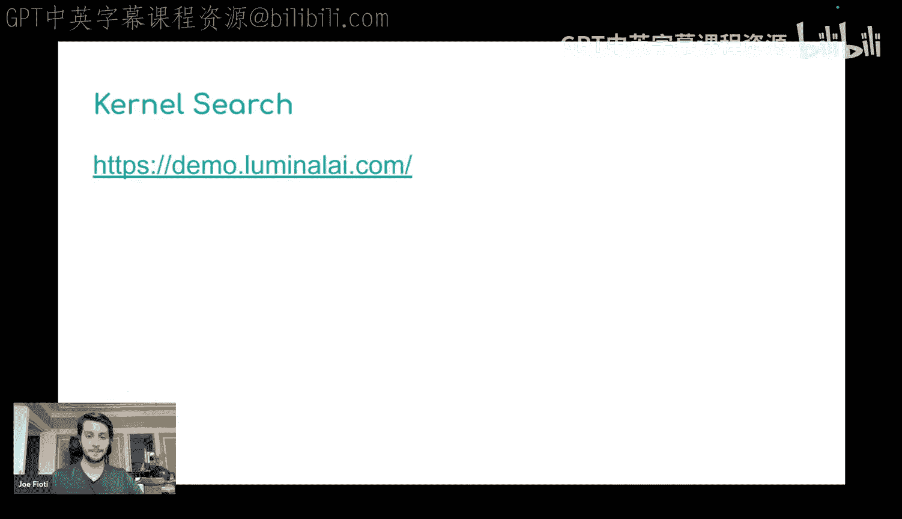

We have a little bit of a demo here to sort of show that search process this actually we just launched it this morning。

 but yeah we have like you can just choose from a number of different possible kernels here let's just do the square map Mo here。

And。Then we will hit compile。And what it does is we can see some of these rewrite rules or descriptions of rewrite rules going here and we're building out this search phase here and then we get a ton of these different logically equivalent kernels but as you can see like the kernels themselves structurally are quite different the only thing that really matters is that they do produce equivalent outputs they do still produce the correct outputs。

 some of them might be faster some of them might be slower and so what we do here is we keep track of the best performing kernel and then we go through a whole bunch of candidate kernels here and we measure how long they're taking to run。

And so we track that best performing runtime over time， and then we get out an output。

And so once it's done compiling here， we will get our output kernel， there we go。And yeah。

 that's so that's that's our little demo there， you can go to demo@ luminalaii。com and try it out。

 but it's just supposed to be a simple visualization of the process going on。

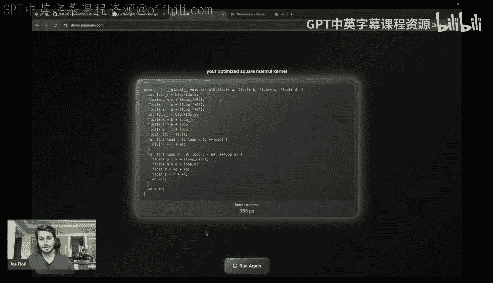

So yeah， that's that。And then so what is actually going on in the back end to search through all of this stuff Well we have this thing called an intermediate representation。

 it's pretty standard for compilers to have and what our IR looks like is these graphs here on the left hand side and then we have the actual generated kernels sort of as like a direct translation of what this IR turns into and so you know we have a very simple computation here we take in a vector of 10 elements and then we want to exponentiate all of the elements and then take the sign of all the elements and then save that as a output vector and so what we do is we have a global memory pointer at the top here it's pointing to some memory in。

In global memory and。We basically have a loop in which says that we're going to loop for 10 times and Z in this case is the stride or yes sorry the stride and so basically you can think if you have like a four loop and that four loop is stepping through elements Z would be like your iterator and so because our stride is Z basically as we iterate one by one by one we aren't multiplying our iterator by anything and so we're just stepping through single elements at a time if it were z times two。

 we would be stepping through every second element but since it's Z yeah we're just visiting every element sequentially。

And then once we're inside loop in， we do an X， and then we do a sign and then we do a loopout and our loopout also has a stride and that basically tells us how should we step when we're saving our elements to back to global memory。

And so this allows us to do like extremely complicated schemes where we're loading transposed matrices or we're loading just very complicated access patterns we can we can load a matrix we can do some。

Computation on it， and then we can save it in transposed form all by just manipulating strides here。

But yeah， on the middle area right here。This is what that kernel actually looks like when generated into Kuda。

And so basically it's just a standard kuda kernel and we pull in A and B and basically A is our input and B is our output pointer and so then we get our block index and then we basically move step our pointers by our block index so each thread is visiting a unique element from the memory。

And then we go and we dereference our input pointer here， we take the X， we take the sign。

 and then we save it。And it's just basically this is our kernel grid。

 our kernel thread block we're not using any shared memory and then we're outputting 10 elements so and then here's like a slightly different rewrite of that and basically what we're seeing here is that instead of having one loop where we do both the X and the sign inside the body and we're doing two loops basically we have visionsioned out that loop into two loops and so we are loading in a here we're looping into it and then inside the first loop body we're taking X and then we're saving that to some intermediate buffer in this case that buffer would live in global memory and then we're reloading that intermediate buffer and then we're doing sign and then we are we are saving it back again so in all likelihood this would be far slower than this because it just makes sense to fuse those and then not need to do that extra round trip to global memory。

So but yeah， this is what that would look like when rendered out into real kernels。So we take our A。

 we you know that this basically looks very similar to the original one。

 except we don't have the sign step， the sign step is down here。

But the point is that this is a very simple deterministic process to go from our intermediate representation here to concrete real kuda kernels。

So that was a simple example of an IR this is what a matter maybe Joe sorry to interrupt you。

 but but like I had a question there's also an interesting question from Cho。

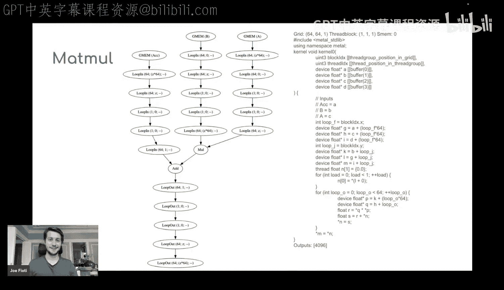

So Joanni's asking like there's sort of like a practical difference when you're doing rewrites between things that are like mathematically equivalent versus like equivalent roughly to floating point arithmetic on real GPPUs and so like do you take into account like numerical stability and like when yeah or generally when do you need to versus not need to and doing yeah yeah yeah when we when we're doing the profiling runs right now we basically just check that the outputs are within some tolerance for numerical stability。

What I would really love to do is have some symbolic way of computing that ahead of time and then just not need to profile any kernels that are not within that tolerance of numerical stability。

 you know we just haven't figured out how to do that yet so we just since we're already profiling the kernel we might as well just check that the output is within that that tolerance。

Okay， the other question I want to ask you was like。

Like sort of around like defining like just because like I'm a beginner as far as like search based compilers go。

 but like like typically the way I've seen this like within。

 let's say deep learning compilers like To compile is like you basically have some notion of auto tuning where like there's like a very fixed set of decisions you need to do and then you need to like iterate through everything and then see what's the fastest and people sort of complain about compile times。

That's probably so like just like in this regime the set of decisions is very simple。

 but here the set of decisions is like relatively complex and so I'm sort of trying to understand like basically is this like rewrites to the IR or like like does this like work like it seems like more complicated for me the reason to Yeah yeah so you can kind of think of it as like auto tuning on steroids though or basically instead of auto tuning just like one axis of you know say tile size or something or auto tuning is on。

You know a million different axes at the same time and so like one of the one of the things that we can auto tuneune is like auto tuneune in this case is you know whether or not we should fision these loops so whether or not this should be one loop or two loops and so yeah the point is like we're doing these rewrites on this intermediate representation here and then you're right compile times are a real concern。

What we're really going after here is targeting production what we find is you know we mostly get like 9010 or we get like 90% of the speed boost with 10% of the time and then to get that extra 10% of the time you need to you need to spend a lot more time but you know within like five minutes or so 10 minutes we're able to compile like pretty fast implementations but yeah like I do see a world where it's worth it though to compile for say a couple hours because if it does help your runtime at the end of the day like if you're running the model a lot more than you're compiling it then it's still it's still pencils out so so a lot of this is like dependent on like how generic the output of kernel is so for example if the kernel is like shape specialized。

And then you' like you know you sort of like you're running sort of like batch batch size in and friends and broad and you might expect different kinds of like batch sizes Yeah all of a sudden you're like oh no。

 I need to recompile versus like you compile all the shapes versus you right like one kernel that is shape and dependence absolutely that would have been a problem and and this was like something that I realized would be a problem early on and is something even that like people complain about with torch So what we do is we represent our dimensions symbolically so they're not concrete numbers always so what that means is you can have dynamic dimensions and so batch size your batch size can literally just be a variable representing batch size and that will be compiled into the kernels and so if you don't want batch size to be fixed you can just keep that symbolic and then you're going get a kernel that works with all different batch sizes but if you're if you're say。

Yeah if your batch size is say fixed， then you don't need to keep it symbolic you can just define like some concrete number and the point is that we want to specialize these kernels as much as possible。

 but then still give you the levers to keep what needs to remain dynamic to keep it dynamic because you can imagine like you know sequence length if you're on like a prefill stage of an LLM your sequence length might vary radically and so you definitely want to keep that dynamic and so yeah we just achieve that through keeping all of our dimension sizes symbolic。

Yeah， and presumably in practice， I would imagine that like， for example。

 the output kernel that you show on the right would just have like sort of symbolic variables instead of like the where it says grid 111 little stuff exactly exactly so we can make 10 we can instead of doing 10 here。

 we can have it be like B and then B is set at runtime and you don't need to recompile anything when you change B。

I see also in chat like A pause is making the comment that you can also do shape dependent and pads and then create a bunch of specializations to dynamically dispatch over。

Yeah that that is basically then when we do our search we we you're able to pass in some like example sizes as well that you want to target and so say you want to you want good kernels for shape batch size one and batch size 64 because those are like common ones that you might see you can keep batch to be dynamic。

So that you you always will have the freedom to change the batch。

 but the search will be ran with those batch sizes in mind and so when it goes to profile it needs to make some concrete number out of that symbolic。

B variable and so it'll pick one of your examples and then you will get kernels out that work quite well for those。

Like this is going to sound like a meanme proposal， but considering。

There's only like a few models that people care about。

 Then you could imagine that like you could have just like one giant meica megi cashsh of all the。

Shapes and kernels people care about and then just like have like one giga cluster produce them all and then everyone else just like consumed them Yeah yeah yeah yeah to have like some cloud。

Well， you can like connect to it and just have like a kernel cash or something。

I've thought about that。 Yeah， that that would be a pretty neat idea。 I don't know how。

Willing people are to connect their compilers to a cloud。

 but indefinitely I see I could see a world where that makes a lot of sense。

All right maybe enough digressing on I let you keep going Sure yeah so again。

 this is this is the Mamal intermediate representation Yeah。

 basically we just have two global memory inputs and then we have a global memory input for our accumulator as well but that will just start off as zero because we want to initialize our accumulator to zero so we have our a input B input and then what we see here is we actually have five layers of loopins So in this case the first two layers are the M and the N dimension and then we have two padding dimensions in there I'll get to why that is and then we have our R dimension as our last loop in here and so you'll see that basically we do our broadcasted multiply here and then we are adding with our accumulator and then basically you know this isn't actually a great visualization because this stride is one this stride。

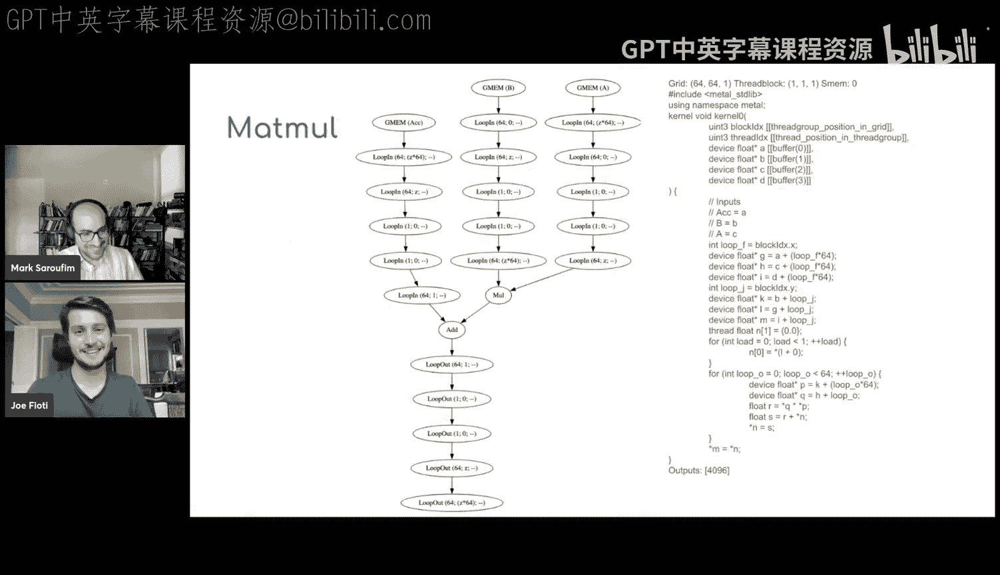

It's rendered out as one， but it actually is a special stride which is an accumulate stride and basically what that tells the cogen is that this last loop here。

 this k loop shouldn't be parallel， this should actually be a sequential loop and we should take this output here and feed it back in as the input so we shouldn't have any sort of stepping as we iterate our loop we basically should just keep reusing that same accumulator and that's how we are able to do like general purpose accumulation。

So we actually are replacing like max reduce and some reduce with this form because this allows us to do like any form of accumulation。

 it doesn't need to be like some or max， it can be like super super complicated。

 you know modular reduce or something whatever。And then yeah， we have our loopouts。

 and so we have our two padding loopouts， and then we have our N loop out and then our M loop out and you can kind of see how it's。

It goes like outside， like this loop out matches with this loop out or this loop in and this loop in this loop in。

 and then it sort of like goes from like outer to inner where the loopouts and the loop ends all correspond with each other。

And so when we actually go and we co Gen this we get this kernel here。

 this is just a really straightforward mapmo kernel here we have our grid。

 so we're just assuming a square mapmle of M and N equaling 64 we don't use any Sme or anything and we're not using our thread blocks so in practice like this would be quite slow but just for demonstration purposes you know we have our input buffers coming in here。

 we are stepping our pointers by the M and N strides and then when we actually go and get our final input pointers here。

 we initialize our accumulator here， you can see kind of some some like compiler。

Some compiler remnants here because for some reason。

 not for some reason it's initializing the accumulator as an array and then it's doing this like generic array copy operation but it really is just one number and it's just it should just be like setting it a single single value but yeah we will honestly coupa compiler might get rid of this by itself otherwise we'll just have to touch up our code gen that looks prettier and then this is our k loop here so this is we're actually looping through the K dimension it's 64 elements long at each stage we're basically grabbing new input elements here by stepping this this is our stride and so you know for this I think this is B。

 we are stepping 64 elements each time because we're stepping like over a row each time as we go down the matrix and then for loop A we're just stepping over column so we're just stepping one element and then。

We have our dereencing here and then we're doing a multiply。

 and then we're doing an addd with the actual n is the accumulator here。

 and then we're setting n to the result here。And then once we're done with that。

 we stepped M M is our output pointer， so we actually have to set M to the accumulator results。

And so yeah， we get 4096 output elements here， so standard mammal。

 but this is how it sort of looks in IR versus actual couda。

So I mentioned we use aG and we use an eGph as our underlying data structure。

 it really provides a way for us to do this， build this search space in a pretty robust way by writing these rewrite rules so you guys should absolutely check them out this is their website eGrafts good GithHubio I and then there's like a really cool demo here so if you go to the demo link like you can basically just pick a demo and you can run it and it'll show you like a visualization of what an eGra actually looks like and you can just modify this code here and it runs right in your browser super great I highly recommend this。

U。And so let me close that。Yeah， so but we use eGra and we basically when we take our IR in this form。

That is basically written by the front end generated by the front end， this very naive IR。

 we render that into a log code， which is like kind of a dialective lisp。

 you can think of it as and then we have our rewrite rules written in this a log language and then we run it for a certain number of iterations and basically what it does is it takes every rewrite rule and it applies it in every possible order to build out this this search space here So there's like a very common problem in compilers known as the ordering problem。

 which is to say like you have。A couple different optimizations that you can do to a given program and you can either do optimization A first。

Or optimization B first and maybe the best route is you do B first and then you can run a on the output of that and so really what you would want to do is go B and then a。

 but ahead of time like that's very dependent on the program sometimes it should go A than B and there's no there's no right answer here。

And so what we do using this thing called quality saturation。

 this technique called quality saturation， we're able to apply all of the rewrite rules simultaneously and build out this big search space and so it really doesn't matter if A first and then B would have been optimal or B first and a would have been optimal we try them all in all orders maybe a and then a maybe there's a sequential application there and so really what this looks like is you know in this example here we actually see four e graphs and you can see they are similar to directed ascyclic graphs but they actually have an individual node can actually have like multiple nodes inside of it。

 this is called an eclass and then there's like e nodes inside it again go to this website here it gives like a really great explanation of e graphs。

 but it's a very a very robust way of doing algebraic rewrites。

And then here's like what those rewrites actually look like。

 so we have associivity represented by this very compact rewrite rule here。

 so we have like a plus b plus C and basically what we're just saying is we're rewriting a plus B plus C to be a plus B plus C。

Standard associivity and then we have another rewrite here where we're taking anything divided by one and we're setting it to itself so x divided by one always will equal x and so we can just eliminate the divide by one。

And so yeah， egglo is super great， it allows us to rewrite to do these very。

nuuanced rewrites in such a compact manner and then basically string together these very simple local rewrites to form very complicated rewrites in ways that we can't possibly predict beforehand and so the sort of core luminal rewrite set only ends up being like 20 or 30 rewites and I don't expect it to ever really grow much larger than that because we don't need to have complicated rewrites if we want to do complicated rewrites。

 we can string the search naturally will string together a bunch of simple rewrites。

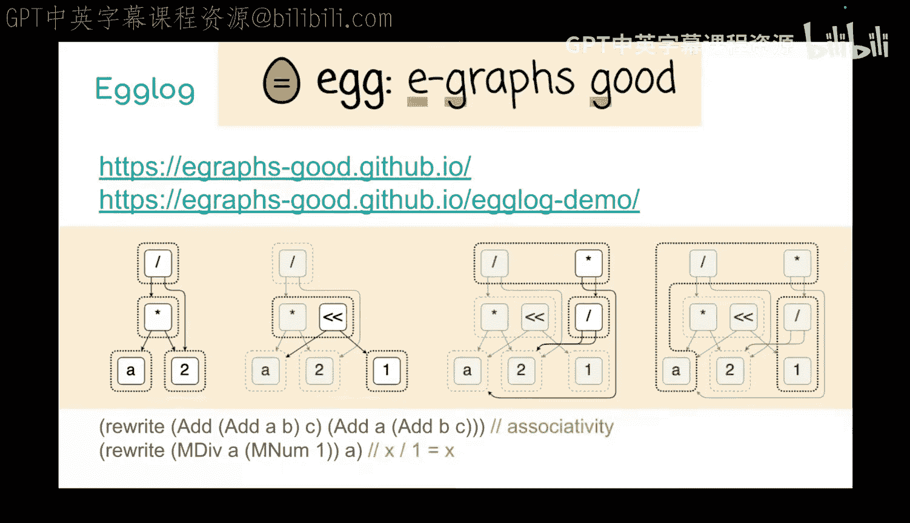

So yeah， one of the common optimizations we see here is kernel fusion。

I think a lot of people in this server probably know in this call probably know what kernelel fusion is but just in case you don't basically most of the power spent on a GPU is moving moving data around the compute is really fast the memory is really slow and so we ideally want to move around stuff as little as possible so you know if you move stuff less you will run faster usually so you know if we go back to this like sign and then X2 example unfuseed we would just load the original input we would do the sign we would write it to an output global memory and then we would read it back in and then we would do X2 and then we would write it back out and so we can kind of see what that would look like here on the left assuming you even have high bandwidth memory you would be doing a read from high bandwidth to your actual streaming multiprocessors and then writing back and then reading again and then doing the second operation and instead what we can just。

is we can load the tensor and then we could while we're in the streaming multiprocessor we don't ever need to actually save the intermediate output we can just immediately do all the operations possible right in the processor and then save the final output and so you know that ends up taking usually like half the time of the D9ive case。

So this is what it kind of looks like in practice with some graphs here we have a pretty complicated example where we're actually we have like some some subtraction at the beginning here and we're multiplying by a very particular constant and we're loading in like another input and we're doing like sign and then multiply and where we're。

act doubling the original input by adding it to itself and we're doing all this like crazy stuff here and naively this is like eight kernels or something。

 but our compiler is able to immediately fuse this all down because it's just operating element wise so we're not actually doing any sort of like cross element complicated movement。

And so yeah， we can just very cleanly fuse that down into one generated kernel。

 and then we basically just load two inputs and then we write one output and that's it。Jo Fredworth。

 I kind of like your explanation of like like you can think of like fusions as like rewrites to your model where you change the location of your loads and copy the devices。

I think that seems obvious an hi but I think you put it quite nicely but the main thing that stood out to me and also to Ge I believe which is that some of the ops here are like mathematic math like signs and others are system like metal copy to the device and I'm sort of curious how how you think about like these things because at least what you talked about with with e graphs like it seemed like very very like mathhy transformations is it sort of like all the same it comes there so we basically insert like the system ops after we're doing the rewrites and so once we want to actually like generate the codes the code you can go through like the purely mathematical graph and then pretty deterministically determine like where we should put a copy to device and where we should put a copy from device that is sort of like a second pass after the math rewrites are done and so you're right like。

think the actual search like when we actually do the search。

 it looks a lot more like one of these graphs or one of these graphs here and so it's much more in math space and then we're doing like actually it's not really shown here。

 but when we're going from this representation to this representation。

 we have to insert our actual loads our system ops。AndAnd so sort of related to this。

 like if you're calling specific hardware intrinsics。

 this would also be like post processing the math graph where you're like， oh yes。

 I call the CSM etca， Yeah， no exactly。And then we have like actual like hardware specific rewrites as well they're not like super common。

 but like say you you're able to basically do a rewrite from a pattern where you're doing。

I don't know， like a 16 by 16 MaM， and we know we're running on a GPU that has a 16 by 16 tensor core。

Well we can just put that rewrite in so that when we're doing the search process we can swap out the MaM pattern with one Tensor core intrinsic and that's obviously device specific because if you go across devices like this stuff changes and then basically you know there's not a whole lot of rewrites you can do past the Tensor core insertion there so that would tend to happen towards the end of the search process but yeah that's basically what you can do with like device specific type rewrite stuff。

Got and so by then the Mac stuff is like accelerator like agnostic and portable yeah yeah， yeah。

 it's like almost always better to not do X divided by one than it is to do X divided。

It doesn't really matter what aelator you're on。All right， sounds good， thank you。

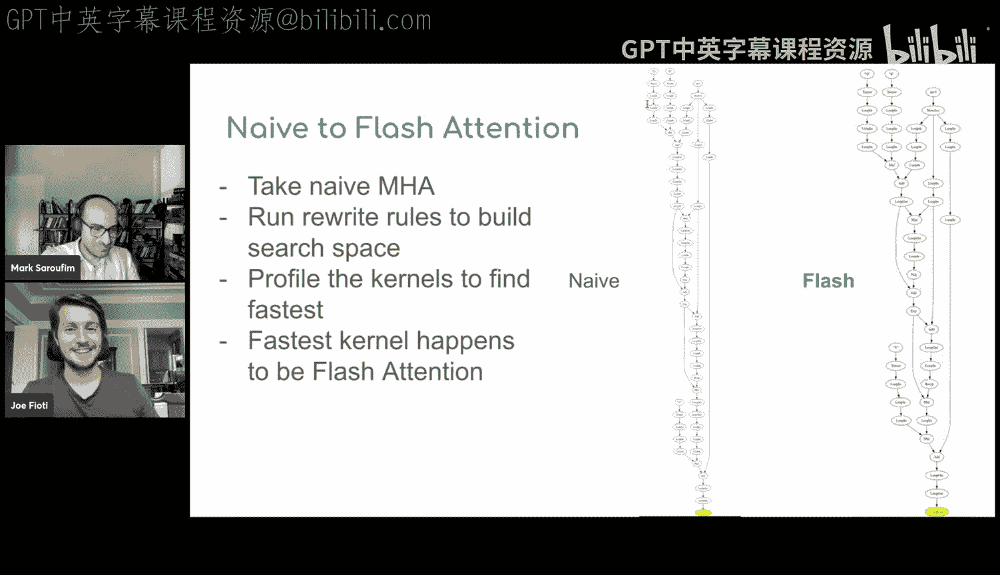

Y， so I think so something we kind of I thought was pretty cool we achieved like maybe a month or two ago was we basically looked in our search space。

 we wrote out naive attention in the search space in in like these this naive IR and then we ran our search and then we saw that the output of it ended up being flash attention and so。

We basically just through like dumb search and profiling。

 were able to discover flash attention because our rewrite rules were generic enough to expand this search space so so big that it contained flash attention。

And so yeah on the left hand side here we see the IR for naive attention and then on the right hand side we see it for flash obviously there's like a lot less loop in loopouts there's just you know basically you can say that like one of these groups of like three or four ops tends to be its own loop if you look like really closely you can kind of see that there's like a loop in loopout pair there but you can see that you know there's far fewer loops going on here and it's because basically these attention loops have been fused into one single pass through the keys and values actually this seems pretty sick I'm gonna I just want to show you one quick thing actually share my screen。

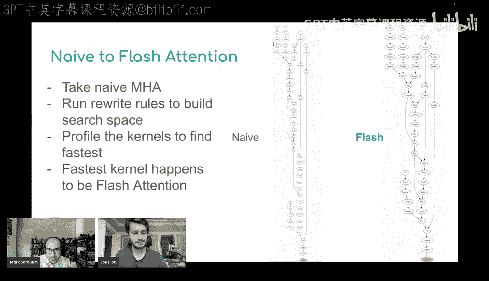

Yeah， so。I'm very curious here your thoughts on this because this is something like I've mentioned in so many presentations。

 this is like the flash attention to open review and then someone asked。Where is it？CompYeah。

 so do you think a compiler could realistically generate。

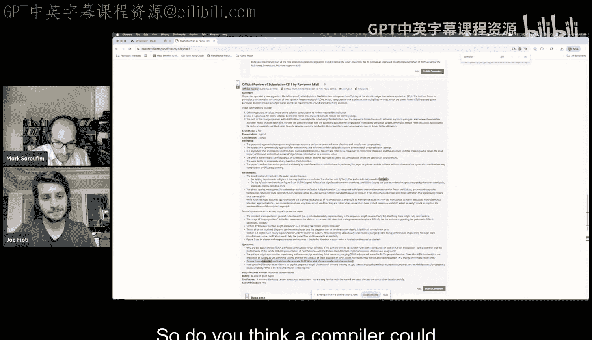

Flash attentions to what sort of cost model could be done？

And then you know I think the feedback was that well you know compilers can generally perform fusions。

 however optimizations that require mathematical rewriting of the same expression while maintaining a numerical stability or a generally harder and effectively no one really does this like effectively I think the way I've seen this work and other deep learning compilers is like via pattern matching where you go like。

 oh yeah， this seems like an attention pattern let me sort of like。

Slat like the fast kernel code and so i'm sort of curious like it sounds like you have to sort of fairly unique take here I' wondering if you could say a bit more Yeah yeah yeah。

 so I think to my knowledge when we actually did this like to my knowledge I don't think anyone else was able to do this basically this in fairness this does require like one maybe slightly non generic rewrite which is to do like an online softm rule but it is a pretty。

U。I would say it's still a pretty generic rule it's not very hand coded just for attention it's like a good optimization to basically like shrink a max loop to an online max loop but yeah。

 so basically what we found though is that like there are like。

I think it's almost like 12 or 14 different different rewrites that need to be applied in sequence to go from a naive attention to a flash attention and they're all pretty much generic rewrites here except for that online max rule but。

And it really is just like you just let the search run for a really long time and then it gets there because you can't really like guide the search。

 I mean if you guide the search in my mind that's like a little bit of cheating。

But yeah so like it really is just like you take these algebraic rewrite rules and that allows us to do this sort of like mathematical rewriting as opposed to just like pure system level rewriting like kernel fusion and stuff like that and then as long as your compiler is able to string enough of them together and flash attention does lie in your search space then it should be able to eventually find it now flash attention2 I haven't read too much on so I don't actually know the difference between flash attention one and two and I know they have now three and so you know I don't know maybe we'll discover flash attention for but so two is more of like system level optimizations on top of like one it's more incremental three is more about like using new hardware intrinsics like you will just probably need new rules that are like oh use Ts use worker consumers like so producer consumers like stuff is like。

interestteresting to me as well because you know we haven't really got into like doing that in our rewrite rules yet。

 but like I think they're using something like ping pg attention where they're having like a something produce it and then something else can it's very interesting like warp specialization stuff。

But yeah， that's definitely in the future。

So yeah， I'll pull up your screen again。Cool。Awesome， yeah， so。

Back into it here's the naive and the flash we did a little bit of a announcement post and basically we have like a flash attention demo directory inside of our open source repo and so you can just like run that example and it will do the full search for you if you don't have M1 it'll basically just expand the search space and then validate that flash attention is inside the search base but it won't actually do all the profiling but yeah can you can run that。

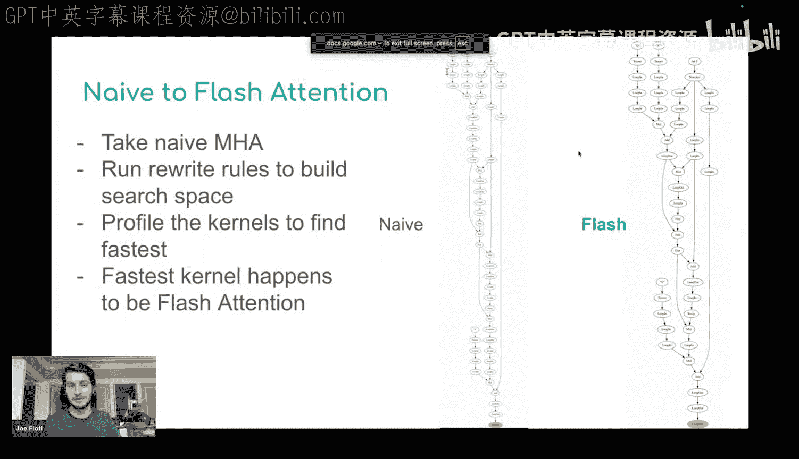

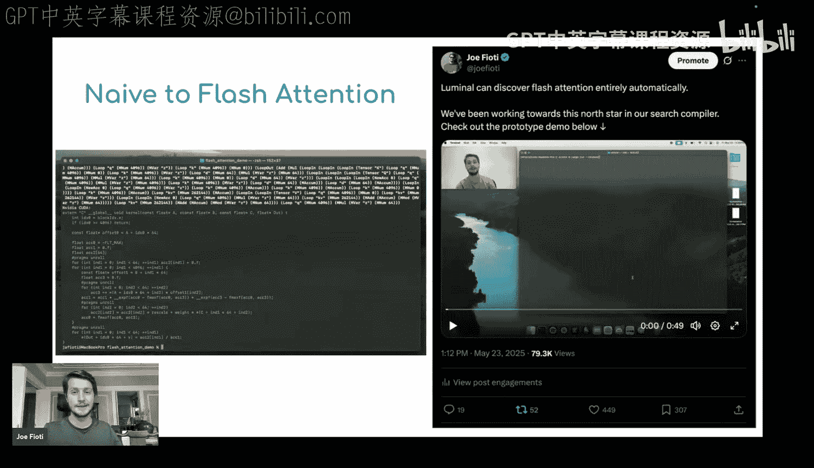

And this was sort of like a breakdown of some of the steps that needed to happen for this translation we did a whole bunch of loop fusions。

 we did that online max rule that I was talking about some other loop fusions and then we're able to do loop swapping because of the way we represent strides as long as you can basically tie strides of your inputs to the actual loop that is。

Being swapped， you're simply able to just like， you know。

s it's basically the same way that Pytorrch does transpos without actually doing transpos like they can transpose the dimension。

Something's going on outside。Sounds like you live in New York or something makes I don't know pretty quiet usually here in San Francisco but I guess yeah。

 but we're able to to do like loop swapping pretty easily there and then we have simple tiling rules where we basically split a single loop into two nested loops by some constant factors so for us it's usually eight and then we can do like loop fission other swapping and then there's actually there's like 10 more rewrite steps here that I don't want to like go through because it would be just too confusing but basically suffice to say it's just a bunch of these like really simple rewrites stacked in sequence。

😊，And yeah， there was， there is a generated version of the kernel。

 it's just pretty standard flash attention。Um， you know。

 very naive flash like a naive version of flash attention， I should say。

And then yeah so then we do some deterministic optimizations afterwards after the search is done that we basically know if we do these rewrites that the output kernels will always be as fast or faster than the input kernels so we should just always do them so basically you know we can go through like reusing buffers obviously there's no reason not to reuse buffers if you have like some buffer that has been produced and then consumed and it's not going to be consumed again you canuse that that space and then yeah basically we can we can reuse that buffer pretty deterministically。

And so。This is sort of like a visualization of that like we have a buffer and then you know buffer one buffer two buffer three by the time we need to write to buffer three buffer one is already done。

 we're not going to use it again so we should just reuse that that's pretty deterministic。嗯。

Then the other way would be like queuing kernels this is like sort of like what coagraphs does we don't want to have the CPU be bottlenecked by dispatching kernel after kernel and so basically we dispatch them all at once we render them all out we assign input and output pointers and then we put them all on a big launch queue and then we just launch them ahead of time and so again like there's no reason not to do these and so this doesn't need to be part of a search this is basically just like some postproces passes that we do and yeah this stuff works very similar on both metal and coUa so。

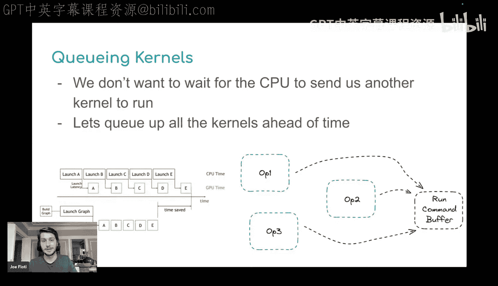

Most of this logic is shared across like metal and Kuda。

And then yeah like this was always designed for me I cared most about inference。

 this was designed to be inference first I had like given no thought to training because I thought like training would just be like way too complicated to implement however。

 I realized that like you know training is really just a fancy form of inference like there's there's some like complexities with sort of like nickel collective operations and stuff like that。

 but really especially on single device doing training you basically what we do is we consume a forward graph we have a little tiny autograd engine that because we're only using a very few number of primitive operations we're able to。

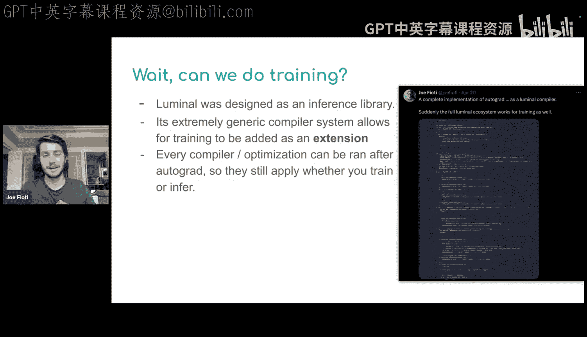

Deriveve a backward graph pretty simply just just using the chain rule and then we fuse the forward graph and the backward graph together into one unified forward backward graph and then we's that all happens before the rest of the comp compilation passes and so we get the rest you know we basically are able to fully compile both the forward and backward graph sort of like for free without any sort of additional compiler logic but yeah so this is this was kind of like a neat extension that we were able to add and also you know we want to keep luminal as as extensible as possible and so we're able to。

Actually add this training in sort of as an external crate plugin。

 which again to my knowledge I don't believe I know of any other ML framework that's able to add in training as an external extension is always usually a core part of the library。

 so I think that's pretty neat。But yeah， so and in this tweet。

 it was pretty cool because our representation is so simple。

 our auto grad is only like 150 lines long so we can fit it into a tweet。So yeah。

 that's sort of a summary of where we are right now and then sort of as far as future plans go。

 we want to add in more backends right now we support coUDa and metal and CPU we want to add in AMD we want to add in tense torn or working on a tense torn backend right now we'd love to add in GC if anybody works at Goc reach out I'd love to work with you guys and then TPUs would also be really cool to support and because most of that is just we change like the last code Gen pass and most of the search minus a couple device specific rewrite rules most of the search remains the same this shouldn't be like a tremendous rewrite or a tremendous effort already like a lot of couda metal stuff is shared logic and then we want to go distributed。

So we're like super focused on single device right now。

 but we want to support like large cluster workloads or at least single host workloads。

 single host multidevvicice workloads， and we should be able to derive a lot of these topologies or do all these top allologies ahead of time as part of the compiler and so as long as we're able to make the compiler aware of like the data latencies。

 device to device then it should be able to optimize with that in mind so that can be part of the basically part of the cost model。

So yeah， deriving data pipeline tensor parallel topologies is really cool RL。

 I've been doing a little bit of RL experimentation， I don't really have an RL background。

 but I think it'd be really cool if we can do it on graph at least certain continuous continuous environments you can put on graph just with our primitive operations。

 I know XLA has done some work on that as well I got to look into that more but that would be a really neat thing if anybody is interested in that please let me know and I don't know maybe maybe Sequoia fundraiseers us we'll build a dysyonphere but yeah and then sort of on the business side of things we have a cloud we're building a cloud basically we're going take the unoptimized compute graphs you can upload them we will do the whole compilation process for you on our cloud and then we'll give you back a serverless inference endpoint and so if you want to upload your model there。

Well， we'll run your model totally serverless and our core technology allows us to do that better than other serverless clouds with no cold start times or anything like that。

 and you don't need to figure out docker containers or hand optimizing or hand engineering any sort of setup there。

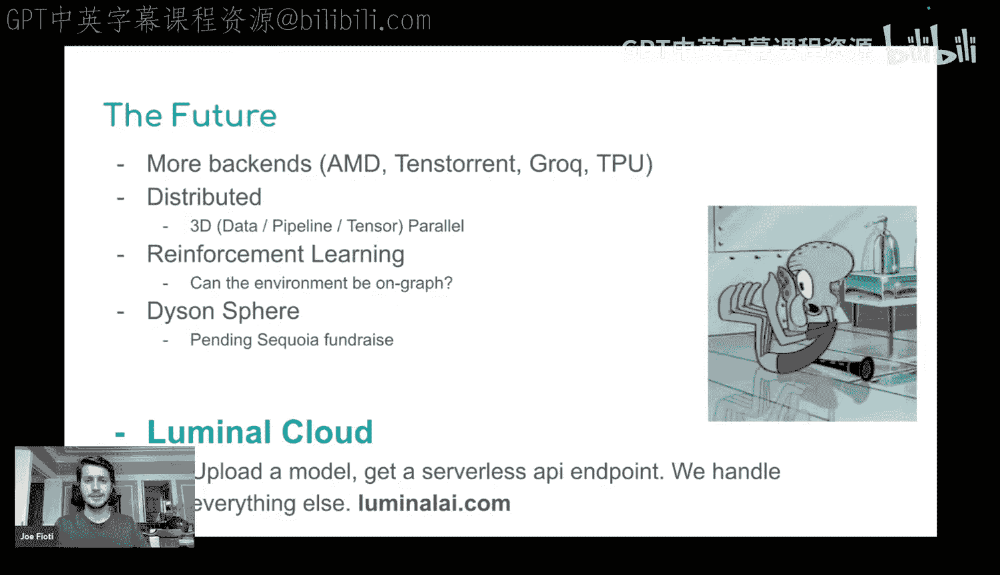

And yeah， come come join our call that's our Github link in the slide and you know we're really。

 I think pushing into what takes other。

Other softwares orders of magnitude more complexity and line count to do and we're doing that with our sort of unique approach to things the the simplicity of the core library really allows us to do things that。

Would take quite a bit more engineering effort in other libraries， and then we're building again。

 the fastest simplest ML cloud in the world， so reach out， there's my email。And that's it。

I think I've made time。One minute to spare sweet Joe this was great Thank you so much I guess y like there's a bunch of bunch of more questions in chat and folks if you have any more questions to Joe before he heads out just please post them now。

😊。

I guess one thing I'm Chris asking you is like obviously like a big part of the it sounds like you're pretty big on open source like I just saw like most of the compiler is like open source and so I'm sort of curious like where do you see good collaborations being an open source versus like more closed source I guess you do have to pay the bills in some way because you could speak more to this so you Luminal was my hobby project for a while because of this question I never really I was like very hesitant to try to start a startup around it because until I can have like a good answer to the monetization question I don't really I think a lot of other open source projects also struggle with this question and so you know what we really came up with is like a very verll style model where the core and basically everything you need to run locally is open source and that includes the compiler and the framework and all that basically anything you need to get running on your own machine and then to do deployment production deployment cloudspec stuff that's sort of our business。

And so you take your compute graph and when it's time to actually deploy。

 it's just going to be like a really simple upload。

 you upload that we compile it and then we have like our own cloud runtime pretty much and that handles like job scheduling and workload auto batchching and workload merging and all all this other fancy cloud specific deployment specific stuff。

 but yeah， as far as the core compiler technology and then the core framework and everything everything else。

 I really want that to remain open。So and for what it's worth like you're more than welcome to share like more technical updates on the server if you want like your own channel。

 just just let me know because like I actually really liked how。

simple your explanations of Bwrightites are and people are interested in sort of learning about ML compilers。

 indeed like ramping up on million line code basiss is usually like a tough sell。

Um right the goal is we want to be able to keep the core at least learnable and like ideally in afternoon。

 but at least right now or a weekend。See。Okay， I see three more questions， which is。So。

 I'll add to this question。 So， so you mentioned like you mentioned with a smile at some point that。

Hey like the you know compilation can take a while and then you know a pause talking about like well like you know what are good ways to prune the search space and I'm sort of curious like like what do you consider to be like an insane amount of compilation talk because it's all relative right like if you say so how many GPU hours are like MacBook hours are we talking about for like let's say the flash attention work for instance oh yes。

I'm trying to remember an exact number， but its， I don't remember an exact number。

 but it was like it was like。5 to10 minutes for flash attention It was like an extraordinary amount of time was like I was expecting you to take days or hours as well yeah yeah but I mean again flash attention is like a small part of a large network and so if you wanted to do an entire model you know what we're basically doing right now is we're building in a system where you have like repetitive parts of the network so picture like an LLm you have like 32 repeating layers and they're all the same operation and so you basically just put like a chunk break in between them I call it like a chunk break and then we basically just compile one of those layers in isolation we don't need to like jointly compile the entire network because jointly compileiling the entire network might take like a week or a couple of days but compiling a single layer is done in you know under 10 or 20 minutes so as long as like we do that and sort of chunking that really helps and。

As far as like speed， we are working on getting like MCTS actually working very well。

 I think MCTS Monte Carlo research will help us explore this search base much faster you know we probably only get away with it exploring like 1% or less of the full search base if we use MCTS and my hope personally is that as we improve the search it runs faster and we do things like MCTS。

 we can end up exploring or we can end up basically removing these chunk barriers and then get back to jointly compiling the entire thing at once because then that requires zero hints basically you chunking is kind of like hinting from the programmer's perspective。

And so like this is related to pause this question and chat which is like do you view things like alpha beta bruruning as cheating or are not really like it's all like anything that brus a sort space is fair game No yeah I think it's as long as it's not like very very specific to a given model or a given hardware I don't think that's cheating that's just kind of like pragmatism at that point。

All right， so okay， I see an interesting question by meep， which is that like。

I'll sort of rephrase the question for what that's with me so I so like you mean you can sort of like you know you can encode any computation as like with like Booleyan algebra or like CNFs but like obviously like no one does this and so what do you think is like a good tradeoff between like the sort of obviously most minimal ops versus hey years like 20 ops or 5 like for example to compiles like 50 in your case I think you mentioned like 20 years so how do you think about the tradeoffs when picking the number of primitive ops。

Um。I'm not sure there's like a right answer， but I think like。

You don't want to get too egregious with it because technically yeah you can get down to like four ops or three ops or some like really small number and then then you know search your graph just explodes。

 I think it's more just a question of like pragmatism what creates a small enough graph to be like reasonably searchable and reasonably manageable and you know you should be able to look at it and still。

Kind of workout what it's doing it shouldn't just be this jumble of primitives。

 but it shouldn't be like too many specialized ops And like my real thing。

 my whole thing was like I don't want ops that are only ever used in like one kind of model so I don't want like a convolution op or I don't want like an attention op or something like that as long as like the primitive operations we have are broadly applicable across most or all Ml you know neural network workloads then I'm fine with that。

So is like the core insight that like you could presumably have only like a single N op for instance and that's it but then the size of your graph is massive and a lot of these rewrite rules are presumably like quadratic algorithms and so that's what you mean by the size of your graph blows up Yeah yeah you don't you know if you basically wrotellma in our primitive graph today it would be like about a thousand or a couple thousand operations and like sort of writing rewrite rules to match on on those graphs isn't very difficult like the rewrite rules you know they'll ordinarily maybe match on like。

Under five operations because that's enough to describe some things。

 some pattern that you want to grab and replace， but if it were like， yeah， something more simple。

 you know， Boolean algebra or something like your rewrite rules would have to get way more complicated and then actually like matching on those rewrite rules would take much longer and you would need to probably match on far more of those rewrite rules and so it's it's like。

It's just like an exponential explosion in terms of complexity like graph complexity and search space。

All right， so I think I'll just take one last question where was it okay。

 so acyclQL expansion something interesting which is that like a lot of your search rules emphasize searching over mathematical things but then you often have this assumption at the system level that like you know what is the right thing to do。

Presumably like as GPPUs get more complicated like figuring that out might not be super trivial like basically what is the right like what are the right hardware intrinsics to call kind of like where a lot of like human kernel authors spend a lot of their time and so I'm sort of curious how how you view that evolving if at all Yeah yeah no absolutely you know like I said before you know you could have like a rewrite rule that just finds the 16 by 16 mapmal pattern and then insert like a tensor core intrinsic there you can pretty cleanly merge in most of this like hardware level rewriting into the actual like mathematical rewriting it basically exists in the same space I mentioned before though that like there is somewhat of a difference where we actually insert copy to copy from type things I would kind of split those into two different kinds of system operations though where in the one hand on。

One hand， if you have like Tensor core intrinsics those are kind of optional to use and so those should be put into the search space because you don't know necessarily if it's better or worse to use some of those hardware intrinsics whereas you know copy to copy from those sort of just have to be there like you need to copy the data over to to the GPU memory to actually use it and so that really shouldn't be in the search space because that's not kind of that's not really optional but yeah to the point that like I do believe that you should put system level intrinsics in the same unified search space as your your mathematical rewrites as well and definitely like this is one of the key。

Motiations for luminal is that like if you look at the complexity level between ampere and Hopper and blackwell。

 it's like these things are just getting more and more complicated and it's less and less obvious when you should use different pieces of hardware and so our solution is just like put it in the same search base and search over it and see what one does best。

As as your same source is even more relevant because like okay just because like like fundamentally the set of humans that will be able to do tradeoffs also will get smaller over time as opposed to increase that's right okay I lied maybe I'll ask you one last question have you thought about like also adding like collective ops and if so like you sort of like foresee like fundamentally more challenging tradeoffs or do you think sort of the same same idea what will work my collective ops you mean like like nickel like outside so that's that was one of the things that。

We want to do distributed here we want to。Have a graph that doesn't just exist on one device。

 It's just like this logical compute graph and。As part of like a search parameter you're basically just inputting the device setup that you have and then in the search space it decides where it's going to put those device breaks and then wherever those device breaks are like that determines what your collective ops are and then you know it basically decides like okay I have like say two GPUs keep it simple I have eight layers maybe do I want to put five on device A and three on device B or maybe I want to do four and four and then I have like some copy op in the middle there like。

Again， to that point like I don't think there's a right answer。

 I think that you just have to search over it and find it like I'm very much a proponent of the bitter lesson in these types of cases as these setups get more and more complicated。

 complicated。All right。Oh thank you Joe I think you know like that's like maybe a cool way to end things so thank you so much for coming folks like I think if you want to talk more with Joe he left his email earlier they have their own discord。

 feel free to ping Joe on our discord as well or on Twitter。

yeah Joe pleasure seeing you and I guess folks tomorrow on that note will be talking about like multi GPPU programming so and I'll be at IL if anyone wants to say hello and thank you Joe and thank you for everyone everyone watching。

I might be at ICML too， I I haven't decided yet， but I might be you should， you should come。Awesome。

All right， sounds your。

Okay。