# GPU MODE《CUDA、GPU编程54-87｜GPU MODE》中英字幕（deepseek-v3.2 p11 -20250724-Lecture 64_ Multi-GPU programming.zh_en -BV1xbmQB3ETC_p11-

I don't see us in the YouTube yet。Alright， you guys are monitoring this。

 I will just monitor stream out here。 and should be monitoring anything else by talking or。no。

 don't worry about it like we we can be monitoring stuff on your behalf Mark。

 I think we have to make an announcement really didn order。

The announcement is made on Twitter and then let me make click you yet another one。 sorry。

 an announcement is made herell do another one。O。Well， okay。

 well welcome everyone to another like episode of GPp mode。

 I know there's like an irreg like earlier time than most people are used to。Yeah。

 but we're I'm actually at ICML this week， so apologies folks is my hotel room。

 but today we have like a fairly nice lecture， so we have Marcus Strniak from Nvidia who's going to be giving us like a broad introduction to multi GPU programming。

There's a lot more lectures we're planning on the topic and so the intent of this lecture is really to be like an authoritative like first lecture that you can go to and then you can sort of like branch out like depending on what subtop you're interested in。

So yeah without further ado Marcus please take it from here yeah thanks Marcus thanks very much for having me hi everyone i'm Marcus I work on optimizing importing applications to GPU and the plan today is to give you an overview of multi GPpU programming what that means and how to get started。

😊，So first of all， why use multiple GPUs so I guess if you're here you already want to use multiple ones。

 but just to clarify the two main reasons you might want to do so is either you have a problem you need to solve but you need to compute it faster so the classical example is you have weather forecast and it's fairly useless if it arrives you know after the time you forecast for so you want to make sure it arrives in time and this kind of scaling out to multiple GPUs is called strong scaling you use more resources to solve the same problem faster。

Or you have another， let's say， a problem that increases in size and you want to solve that bigger problem。

 but you want to have a take the same time or you simply just need more memory。

 more other resources to be able to compute this and this is what we like to call weak scaling。😊。

So and also another more pragmatic reason is today's systems already are massive and they're getting bigger and so they have multiple GPUs and so just to efficiently use these parallel systems you need to be able to have your code be parallel。

 so that's also a very important reason。😊，For today。

 this introduction is meant to show you how to go from a single GPU example to using multiple GPUs。

 I will use three fairly common libraries or program models， MPI and Nicel and EnWishMM。

 I'll try to make clear when to use which of these and how to profile measure that you're getting the advantage you're expecting。

 and I also want to stress that how to you understand the critical part application goes through well latencies in the program models impact your performance and hopefully leave you with a better understanding of how to look at going to multiGPU。

I also need to point out that most of the material I'm showing today is based on my colleague Jerry Kraus talk series。

 he's been doing this for quite a while at NviDdia GTC conference。

 I've linked the two last instances of this tutorial where a lot of this content here is from so if you in the meantime want to go deeper into any of these topics I would encourage you to check out these links。

Allright so that is the motivation let's get right into it so our example today we need an example application to understand these proing models and we're going to use Jacob solver we're solving the 2Dla plus equation which is on here so essentially you have an unknown function U and you have a prescription for the second derivatives and x and Y direction on a certain domain and with some boundary conditions of the border of the domain。

😊，So don't worry， this is all the math I will need today and we are going to be just in program code for the rest of it。

 but just to motivate where we're coming from， so we have this example and the 2D domain needs boundary conditions to solve this equation and we've directlyly boundary conditions that means constant values on the boundaries on the left and right。

And then we have periodic boundary conditions on the top and bottom。

 And what that means is essentially our domain can be viewed like the surface of a cylinder that's wrapping around。

 So we are in 2D not in 3D。 So we have these boundary conditions left and right and top the bottom。

 just wrap around the cylinder if that helps you visualize what we're doing。

There are multiple implementations you can get and run readily from GitHub so the multi GPU programming models repository has a lot of these examples with all the programming models we're going to see today and many more。

 so if you want to experiment yourself and see how the actual full code looks like， please go there。

😊，But for now we'll focus on the core parts of the solver。

 so doing some of more mathematical transformations。

 this is essentially the code you need to implement the Jacobbi solver so it's fairly simple for this equation and the general flow is that if you want to do this on a single GPU you have a loop that's running until convergence and convergence is measured measured with the L2 norm if you're curious so we basically measure the distance between the last guess of our solution and the next guess and to get from last to next we have this double loop that goes over the full domain that we are trying to solve the equation on and that full domain is here on the right note our coordinate x x goes to the right y goes from top to bottom so this is basically index00 and this blue do is11 more on y we start here later but we start at index11 and y and x direction so we go through all the rows。

And then we go for each row through all the green dark green dots。😊。

This is the second loop here and to update we essentially need to average all the neighboring dots。

 So this is really what this equation means。 I will just explain the indexing a bit。

 But if you look at the visualization， you see this blue do basically needs the right left。

 top and bottom neighbors。 we add those up。😊，Divide them by 4。

 And then we have the new value for the next iteration。 essentially。 So we have a fundamental array。

 and this is in the C programming language。 So， and we want to use two dimensional indexing by essentially having a Y and then x index and the number of elements in each row is and X。

 And so this is how you get to these ind here。 So we have the current row。😊。

And then you go one to the right， Ix plus1， one to the left， a minus1。One row one row earlier。

 so the row above IY minus1 and the row below iY plus one， so that's all we need to do。

Then we need to apply these periodic boundary conditions。

 which means the left and right border here are fixed。Try to visualize this by this gray dots。

 and the top and bottom boundaries are essentially mirrors of the actually computed values here。

 So this。Mirrors， the last row。And this here mirrors the first row， so in that sense。

 this is all periodic and wrapping around on the surface of the cylinder。

So after we've done the update， we swap our buffers A U and a， do the next iteration。

 check for conversionvergent， and this is essentially all you need to do to solve this equation iterfully numerically。

😊，So far so good， but that single GPU， and if we want to go to multiple GPUs。

 what we need to do is we need to somehow do a domainposition。😊。

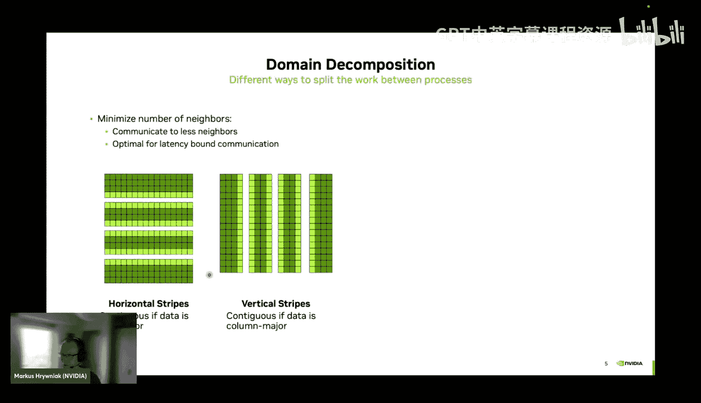

That means we need to take our simulation domain， split it up into separate chunks。

And have each GPU compute only one of these chunks。

 One choice is to divide it horizontally in stripes。 We can divide it vertically in stripes。

 You can also do kind of a mix between divided into tiles by dividing both horizontally and vertically。

 And they have each pros and cons。Such as the amount of neighbors you need to communicate to or the amount of data you need to exchange in total。

For us today we're going to choose horizontal strip because that's very simple in our model because we have contiguous data in each row。

 so we don't need to do any special packing for exchanging the data with neighbors and we also don't have a high amount of data to exchange so let's see if we split our assimilation domain in that direction what we need to exchange in our code。

😊，Actually， not a lot。So the main thing we need to do is to recognize that our local contribution to this whole solution that we want to do now starts at a different index and ends at a different index than the global amount of rows。

 so the global amount is really much larger than the local simulation domain。

But we also run into some complication because if you look at this blue do here。

 it still needs the value above， but the value above is now no longer compute locally。

 the value above is actually computed here。And so that means we kind of need to exchange data between neighbors along these boundaries and this is what we call a halo exchange。

 a halo exchange because the last row kind of shimmers over to the next rank and so on and this row kind of needs to be mirrored over here symbolized by these arrows。

 and so what we now need to do is we need to change our periodic boundary condition implementation to just really do a ring exchange and exchanging all these boundary rows between neighbors to be able to continue with our solution of the equation。

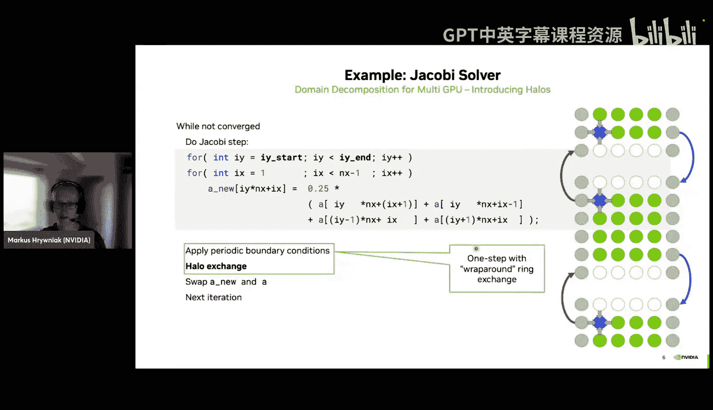

Let's think a bit how we can do that， so we need to exchange messages with our neighbors essentially。

😊，And one of the standard libraries that's available for you is called just message passing interface or MPI for short。

 you may have heard of this MPI is a library that's been available and very mature for a long time it's actually not just a library it's a standard。

 it's standard to exchange data between different processes。😊，And the API defines consists of many。

 many separate functions。The most commonly used ones are sending and receiving data。

 But there's also collectives such as reduce or reduce and broadcast and so on。

And the standard specification and more information is available on their website。

 What's important for us now is that there are many implementations。

 both open source and commercial available for essentially any language you can think of。

 So today we're going to stay more in C and C++， but you can also use it in fortran and Python and really any language。

The other thing that MPI provides besides the API is also the facility to launch multiple processes in a way that they can talk to each other and also exchange these messages。

 but we're not going to go into much detail on this today。

Just that this is an important point to have。All right。

 so now let's see how we can actually get to exchanging data between all processes here。

We first need to kind of understand how to make our process an MPI and MPI process and that is。

You need a couple of extra library calls， you include the header file。

 you need to initialize the library by calling MPI in it。

That kind of sets up all the scaffolding so the processes can call the other APIs and once that is done。

 these are the first two calls you will probably find in any MP program MPI defines something called the communicator abbreviated with comm and the concepts of rank and size by default when you launch an MP program across multiple processes each process is part of the MP commwealth communicator and inside that it has an index。

That's the rank so each process has its own unique index there and the total number of participating processes is the size of the communicator and so what we do here we retrieve these values and after that we can use them in our control flow to determine which part of the domain we actually need to compute locally on our process on our GPU when we're done we shut down MPI again and that's basically the skeleton of an MP program。

If you now go to our Jacobbi solvever code。I've expanded a bit the code we are displaying here and I will go through this alignment by line so you can follow it on。

😊，We still have this auto loop that was hint that earlier we check for some conversions and we count the iterations we've been doing。

So this map asInc is more， it's needed to reset the norm that we accumulate while we solve all part of this whole simulation domain。

 so we set this to zero asynchronously on the computed stream cota stream。

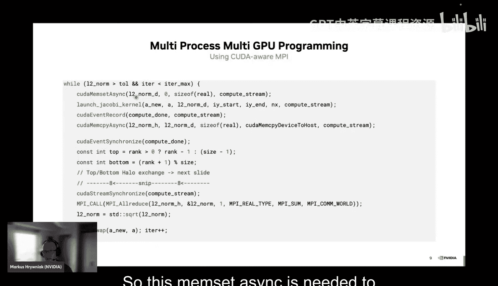

Then we actually launch our kernel that is responsible to generate a new out of the previous value a。

And we have the other parameters such as where the norm should be written to the start of our domain and the end number of elements in a row。

 and this is also in on the Kuda stream compute stream。Afterwards。

 we have the Ka event record call to put an event on the stream and that event is meant to for us be able to check when the previous kernel is done。

 so this will be important in just a couple lines further down。

After we ined this remember this is all Asian Chrons so we're not waiting for anything yet。

 we ine another mem copy and this is done to retrieve the L2 norm that's been accumulated locally here to host variable so this is why you have a mem copy device to host also on the compute stream and after we've includedcured all these four operations we finally need to do some synchronization eventually because we need to make sure that our kernel has done computing the interior part of the domain so that we can start exchanging data with our neighbors。

And so this is the first。😊，Sort of puzzle piece we need to be able to figure out where to send data to。

So remember， the rank is kind of the index of all in all processes that are running。

And what we do here is we check if we are not the first pro， so if our rank is bigger than zero。

And then the top neighbor， because our Y axis is goes from top to bottom。

 the top neighbor then is one rank glass， and this is where we need to send our message。Otherwise。

 if we are actually ranked zero so we don't really have a top neighbor。

 we instead send one message to the last process last GP attain because of these periodic boundary conditionsd that we wrap around。

And similarly， what we do for the bottom neighbor， usually it's just incrementing our rank by one。

 except if we are already the last rank， then our bottom neighbor is again the first process in the chain。

😊，So when we have figured out these neighbors， we can start doing our Halo exchange that I will show on the next slide because it's a couple more lines of source code。

😊，Let's just say we exchange messages and we now finally are ready to。

Really synchronize a compute stream because we need to wait for all outstanding operations to complete at this point we then take our local L2 norm contribution or more accurately the squares if you know how the L2 norm is calculated you accumulate the squares of the differences and then you need to take a square roots so squares can be just summed up this is why we do this all reduce which kind of takes from all processes that are participating the accumulated local norm sums them up and then。

Every rank has L2 norm。Accumulated overall， and then we can take the square root and use this for the next conversionence check just after swapping buffers and incrementing the iterator here。

😊，All right， so that is basically the full it duration。

 Now let's look at how this Hail exchange actually is implemented with MPI。Again。

 we have here our participating domains， so we have the left and right boundaries。

 we have these halo rows and we have the interior。😊。

And the easiest way to do such a neighbor exchange between the top and bottom neighbors and m is with the send receive call。

 so this is a combined scent。Essentially， the first row here and receive call the second。

And this is really just where to do the send and the status here we can ignore so what we need to do is and let me just jump one step ahead because then I have some graphical utilities to show you how this helps so our local process here needs to send the first row it has computed into the Halo row of the top neighbor so。

This means here is a top neighbor。We have flow data types we have Nx elements because this how many we have in one row and the indexing means we basically offset from the start of our array because the first elements in here are our old halo elements we offset by IY start which here is one because our halo is really just one row so we go here send these elements to our top neighbor and at the same time we post a receive operation expecting our bottom neighbor to send us their top elements into this row。

Which is essentially this second row here。And now we have basically one half of the Halo exchange。

 we have exchanged Halo with top and receipt from bottom。

 but we also need to do the complementary operation。 We need to send our last row or bottom row。

 which is this one here so。😊，These elements need to send to bottom neighbor。And conversely。

 we need to post the matching receive so that our top neighbor can send us the Halo rows it itself as computed。

So this is essentially two sent to receive calls and the nice thing about this API here is it combines both of these together so we can be sure we don't get into any kind of deadlocks because one ring is waiting for。

Send that the other cannot get post because it itself is waiting。

 so this is very nice that we can combine this together and in the end。

All of this is from the view of one local process， as you can see here。

 but since all the processes themselves execute the same scent receives just with different values for bottom and top neighbors and of course different local arrays。

 it all fits nicely together to implement this whole wraparound Taylor exchange between everybody。

So this is essentially。Just code that would have also worked on the CPU。 And yes， indeed。

 there is not a lot of things you need to make it happen to also work with GPU buffers and why that is we'll now look at because。

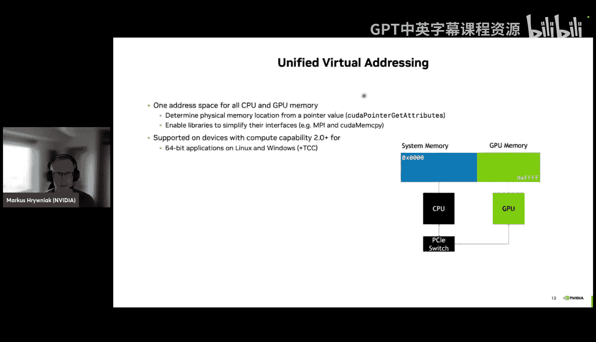

One very important thing here is that all these buffers are pointers into one unified virtual address page。

 what does that mean it means that memory that is physically belonging to the CPU or physically belonging to the GP because theres a different usually different you have a plugged in GP maybe that has its own memory you have the CPU with its RA。

 but you can。At， both of these locations were the same kind of pointer。

And because 64 bits is really a lot of bits to address a lot of memory， we can just say that some。

Basically a fraction of these addresses just can be detected to belong to the GPU memory and this is exactly what the MP library or the underlying libraries are doing when you pass it switch and buffer。

 it looks at the point of value， it can call an API like QA pointer get attributes and then do the right thing and see if this is a GPU buffer or if it's a CPU buffer and then under the hood。

 it might launch an mem copy or might do any other kind of operation without usually having to do anything actively。

Support has been around for a long， long time， so compute capability 2。

0 is really so many years ago that on today's systems you can expect this to be available。

Let's look at what else this enables because there's a range of technologies called NVA GPU direct and one of these is in GPU direct peer to peer。

 and that means if you happen to be on a system that has multiple GPUs like this one with its memory and another one with its memory and the CPUU with its memory and the GPUs are connected via enviiling。

That the data transfers can actually go directly from the memory from one GPU over enviing to the other GPU without any involvement of the CPUU in this case。

 or another similar technology， which is called GPU RDMA for remote direct memory access that allows you to take the memory from GPU here。

 and send it out over the network over Infinimement， which is here the IB short for。

 and that means the network card can just read the memory of the GPU send it out or write it on the other note which is receiving without really the GPU having to actively do anything。

And this is all what the MPI library and other libraries will do behind the scenes to make it very efficient。

One word on how you should launch your MPI processes because this is important。

 we usually expect to have one process per GPU， so if you have four GPUs on your node you launch four processes on that node and that times as many nodes as you have in your whole system。

There are different launches do so， MPI usually ships its own MPI run。

 but there are also cluster software such as SLurR which have SR。

 or S Clata and whichMM also has its own launcher， but the important part is that you remember to launch one process per GPU。

 and then the launcher takes care to access to assign a rank to each of the processes。

 each of the GPUs or S laterta and whichMM calls these processing elements or PEs。

So just that is one important consideration I wanted to highlight。

 but now let's just look at practically when you do such a transfer。

 what the scent receive will actually trigger under the hood。😊，Because we want to keep it simple。

 we don't do the center receive as one call。 we have just two ranks on two different nodes。Rannk one。

 post the MPI send from GPU buffer and rank sorry word zero post the send and rank one。

 post the receive。And then we'll see how the data travels over all the different components from memory of the GPU or node0 to the memory of the GPU or node1。

So。The best case is you have a co aware MP， such as what we've been expecting here。

 and it also has support for GPU direct RDMA， so your network card can direct GPU memory。

So that means you post a send on the send buffer， send it to rank one and you post a receive into receive buffer on rank0 from rank0 on the other side here。

 and then what happens is simply the data flows directly via RDMA through the network interface onto the GPU on the other node。

Now that looks like on the timeline， so here I've profiled profiled this with insidesight systems。

 which will show you amongst other things like GPU kernels running， it will show you for example。

 that the GPU here has a PCI Express transmit throughput so it is sending data out of the GPU。

 but there is no actual activity in this row， so no GPU kernel or me copies running。

 this is because it's really just sending data out over PCI Express with the network card which is then sending it out over the network and then the data will arrive on the other node。

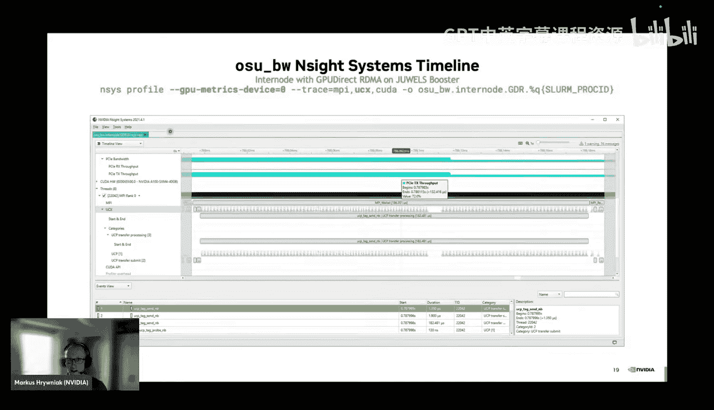

Marcus let's take one minute for a couple of questions in the chat so I think you answered one of the questions that came in can NPI send and receive data directly from the GPU global memory by any chance and subsequently can nickel to do that assuming we have some interconn between the GPU。

Yeah yeah， essentially this is what the GPU Direct does basically so if you the network card reading memory from the GPU buffer is RDMA remote direct memory access。

 what we're seeing here so over PC Express the data flows out of the GPU main memory global memory through PC Express into the network and the same reverse on the other node and peer to peer essentially just is if the rank one was not on another node。

 but on the same node then it would flow through Nvylink。

Yeah then I do have one more question to you， so you mentioned there is a requirement in SLM and other methods on how we launch a process per GPU and mapping that yes。

 you need to have one process per GPU kind of like I think。😊。

Why what is the intuition for creating such a solution right not multiple GPS per Sure so you can and it's not a not a restriction in a sense that SLurm or MPIron really prevents you from doing it it's just that the most efficient way that all these technologies work of directly Mac buffer between the GPs and so on that this works best when you have one rank that belongs to one GPU。

So you can， it will still run， but the best results for Kudware MP。

 Kudo MPI kind of needs one GPU per process， and that is simply just the most perform weighted with。

Okay there are a couple of followups on the same question one is that from Rohi who is asking there are a process on DGX machine with8 GPUs never understood why this is the case and then so you are communicating I think ty1 GPU to 1p makes that symmetricmantic adverse guarantee and it makes it very trivial for it and if you draw two GPUs from the same process you would have to have two separate heaps of memory in one single at a space and then you have to manually ensure each GPU sees the right base pointer and that quickly gets ugly。

would also yeah there's multiple reasons you would also if you have your own calls you need to set devices between and so on。

 you would need to keep track where are currently yeah so's and there's not really anything you would gain because if you have a process kernel that can fully fill up your GPU you would just do it on one process if you are launching at the same time the same first you have two context so the two processes would be computing for the same GPU resources and there's other technologies for working around this but essentially it's just the simplest and most perform way here is one GPU process a hard requirement for whatever MBI。

As far as I'm aware it is due to the way it's implemented。

But I want you to check on the details myself。So in the case of the torch are distributed。

 I believe it also goes with one process per rank。I believe this basically comes from that same restriction of the Pdi MPI case。

 but is there any other reason for it？I'm not aware of the really low level reasons for this besides that just if you have one process per GPU。

 you only have one context and so you don't need to kind of time slot or use another mechanism like m to mitigate kind of that you have different contexts which need to compete for the same GPU resources so I believe it's coming from somewhere for that direction Okay I think we can continue sure yeah like my sense is it's also kind of like application dependent like for。

I don' know for for things like data parallelism or model parallelism is's just like not really crucial。

 I think to lift this restriction， I think it becomes like more interesting in like things like post training where。

You have like the like process is doing very different things like basically you might have someone you know doing serving of VLM and then someone else synchronizing weights in a replay buffer and I think then at that point like the sort of the cracks and the system start showing like a bit better。

And for what it's worth， like I think in back in the day in Pythtorch like no one uses it。

 but we do have a data parallel functionality which does single process， single nodes。

GPpU programming and as far as I know no one uses it but yeah like I think it exists is just like the the other model one out I mean generally you can have one process multi thread to access multiple GPUs。

 but it's the。Especially in the case of MPI， which thinks about processes usually you have multiplepro communicating it's just mentally also much simpler to you know thereambigu way two is doing what if you just have one process one GPU as many GPUs per node and。

😊，Okay， is one process per GPU a hard requirement for Nel and enrichM2？So Nole。

 you can also use multi threaded with having different GPUs in the same process and just calling step device in between as far as I'm aware for English men。

 I'm not entirely sure。I think over subscribing GPUs with processes， on the other hand。

 so that you have two processes per GPUs， I think not supported in that case。

so especially if you use them at the same time。For the details。

 I would also check the documentation of the libraries here。Okay， we canwa， sure。

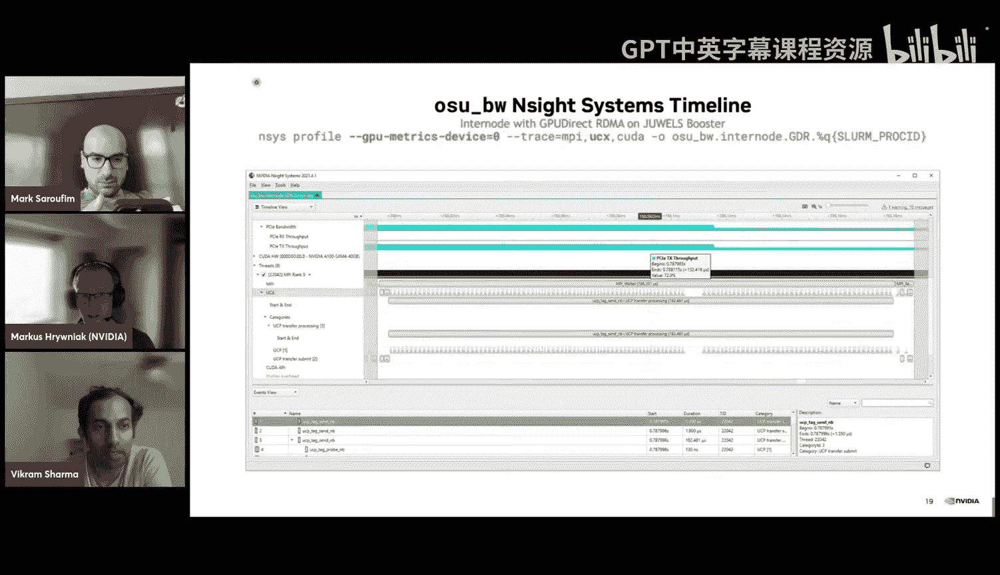

Good so just to recap here the easiest way we had basically saw the most performant was we have GPU direct RDM and move data directly from GPU 0 to from the GP on rank0 to rank1 Now we look at what happens when you can't directly move the data so at。

😊。

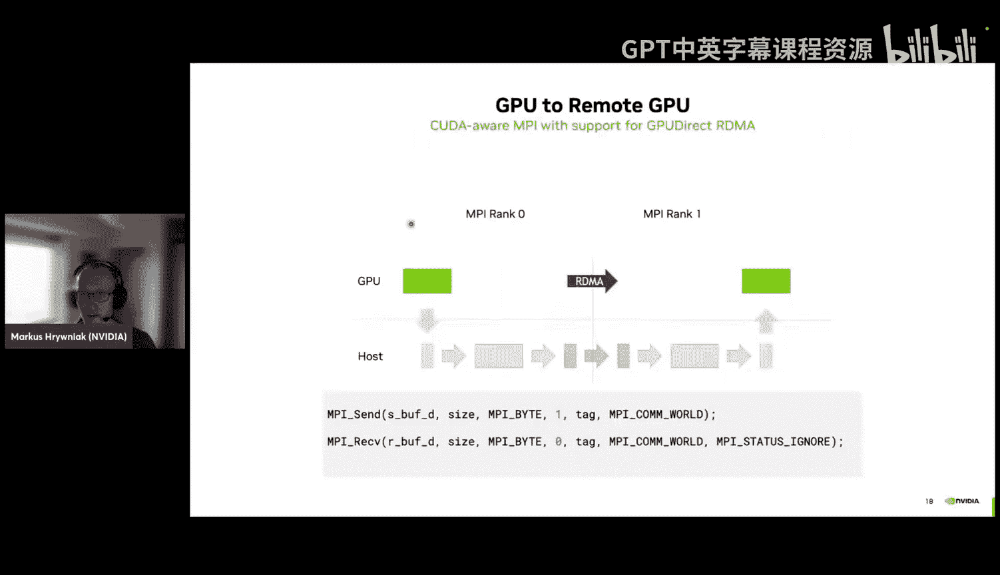

TPU where you have Kaware MP， but you don't have support for DU direct。

 potentially because your network card is not attached in a way that supports this， for example。

 And then what you need to do is you need to first post the same code。

 So the code does not need to change。 This is portable。But on the covers。

 there is a lot of extra copies because first the data needs to flow to the host through pinkuda buffer。

 then there is a copy into the fabric buffer for the network card to do the pipeline copy over the network and then the same in reverse on the other node。

 so that means you just have a bit more steps in between。

And you can actually also see this in a profile because in addition to the PCI Express traffic going out of your GPU。

 you now have the sequence of mem copies from the device to the host。

 which happens as part of the MP operation。So this is essentially then the difference when you can't use a GPU direct RDMA here and now the third case we're looking at is if you happen to have an MP that doesn't have any awareness of ka buffer so it cannot do anything if you pass it a buffer on the device and would just crash because it doesn't know how to handle this data so in this case if you do it manually you would need to have a manual KaM copy into the host site send buffer which is the same size as the GPU buffer and then you can call MP send。

On the host buffer， have this go through the network card again into the same buffer on the other rank。

 And then when the MPr receive has finished。You can now upload this to the GPU buffer here。

So you see there's a lot of extra synchronization that's needed because each operation needs to wait for the preceding one to be completely finished in this case and there's not no potential here to pipeline this in a more efficient way。

And what you will see then in the profiler is you will see。

Your own Mem copy that you called in the code， and then afterwards you will see just the MPI operations proceeding。

And if we now look at how this manifests itself in performance。

 so we have the bandwidth that's achieved on the Y axis here and the message size on the X axis invite byte。

And we have the three different variants the Kuda where MP with GPU direct RDMA is at the top。

 and in this case on this machine Jules boostster， which is a supercomputing cluster that has an HDR 200 network。

 so 2 gigabit is run about 25 gigytes per second and we are very close to that to that kind of peak bandwidth。

If you have to do this extra pipeline copy or the MPI has to do it， you are closer to this here。

 so you reach lower peak bandwidth and if you have to do the manual staging。

 you are also yet again at about 10 gigytes per second。

You'll also see that the latency is much lower if you have RDMA available for microseconds to about 24。

 25 microseconds， and that's because you have just less points where you need to wait and synchronize and so latency can be lower。

For GPU direct peer to peer， the difference is even bigger and that is mostly because peer to peer。

Allows you to use envylink。And then the link is a lot faster than the PCI Express that you would be using if you need to stage through the host。

 so this is why you have such a big gap in here also again between the three different variations。

Okay so this is essentially what GP Direct enables you to do and Ka where MPI is also as an example used by many applications in production one。

 such example is a weather and climate code called icon and this example we just have two variants of icon one of these uses here on the left hand side uses MPI through the host buffers so you have mem copies here and here and then you have MP operations。

And the other variant。Simply use a scooterware MP。Which allows the MP implementation to take care of the copies and use the most efficient way to transport the data between the GPUs and for icon in this sense。

 it means that if you look at the scaling behavior and the important thing that's being measured here is the time to simulate so one simulate a day。

 so less better and if you scale out through multiple nodes。In this case， on E。

 which is the DGX H100 cluster so you can see between 1。4x and 1。6x improvement。

 and that is just because of all the gains that manifest through the good awareness of the M and the direct copies between GPUs essentially。

😊，So where this is not all we can do and a real production application such as Ion would also employ other tricks instead of just you relying on a Kudware MP because if you look at what we did so far in going from our Jacobbi solver from one GPU to many GPUs。

 so if you essentially consider that we want to just process the whole domain。

 we effectively in overhead， we don't actually want to do communication。

 we have to because our domain is now split into multiple pieces。😊，And so one technique that。

Gins back some efficiency here is overlapping the communication into computation。

 And that works in this way， because。We have these different points that we need to compute the update for。

 but remember that they only use their four nearest neighbors。

 so that means we can independently compute the process boundary domain。

 so just the top and bottom rows。And only then。Do we start with the inner domain？

And when we have done the boundary domain， the inner domain is probably still computing。

 but we can't already do the communication operation and thereby overlapping both。

 removing it from the critical path and so gaining more parallel efficiency。😊。

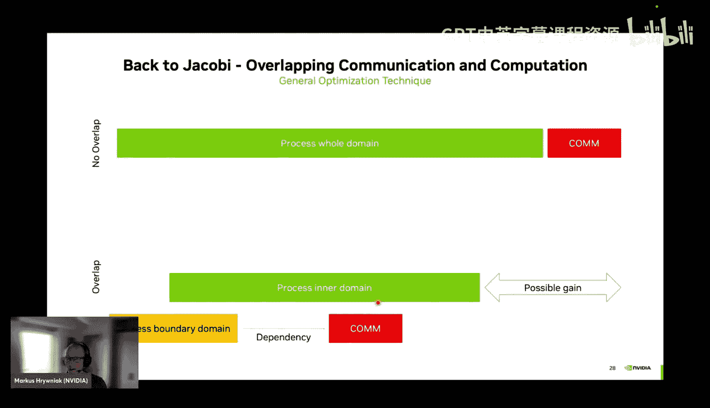

Let's just look at what our profile is before before we implement this。

So we have this MP cent receive， the cent receive， we have the all reduce for calculating the norm for conversion checks。

 and then we have our Jacobbi kernel in here。And essentially。

 we want to move these two guys just to execute here at the same time as the kernel， so they are not。

Basically in the critical path and preventing us from being scaling further out。😊。

The change we need to implement。Is this so instead of just launching the Jacobbi kernel as we did before one time。

 we launched it three times， but we launched it on a different part of the domain。

 as I suggested before， so we don't compute here the full but just one row so IY start to IY start plus one。

 this is essentially one row of the inner domain。Then we do the same for the bottom row。

 So Iy and -1 to Iy end。And then this is the actual the inner part that is needed to fully finish all the computations。

We do these on three separate streams on push top stream， push bottom stream and compute stream。

 And that means when we。Need to synchronize to do our send receive， so do our communication。

 we don't need to synchronize on the full computation。

 but we just need to synchronize on the first stop stream and then we can send our data to our top neighbor。

And conversely， we just then need to synchronize on our push bottom stream to send the data to our bottom neighbor。

And meanwhile， we hope that the computation is still running our main compute stream and we can overlap this。

😊，And in need， if we didn't look at the profile again， you'll see three things that have changed。

 you have these one， two smaller kernels， which are also the Jacob kernel。

 but now they are running before the main computation runs and then we have the MPI operations MP sent received in here that can now take place while the actual main computation is still running。

And so in a sense， we now have overlapped this and hopefully that gave us better efficiency。

 So when I talk about efficiency， let me just explain what you see on this chart here。

 so I have the efficiency just from 80% starting so this is not from 0% and efficiency means in a sense how well can you scale up when you use more resources So how does the run time when I。

😊，Kind of when I go from one to two GPTs， does it have or does it improve less than that。

 and that's essentially my parallel efficiency。And you'll also notice that this is not 100% because we compare to the best serial baseline we can do here。

 but if you now notice that we go from one GPU up to8 GPUs and we compare on the left side the MP and on the right。

 the MP overlap implementation that the further we go。

The bigger the gap in efficiency is because when we go to more GPpUus。

 the local hardware to compute gets smaller。 And so the fraction of time we spend communicating becomes more important。

 And so if we can hide this while doing the computation。

 we can gain parallel efficiency and get better strong scaling in here。

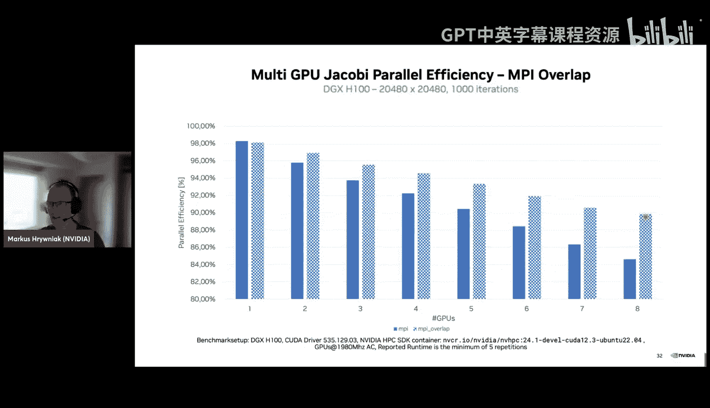

So but we are not done yet because。We still have some synchronizations that we would like to get rid of。

 but we can't really at this point， because if we were to remove these scooter stream synchronized calls here。

 we would jeopardize the correctness of our computation as MP sent receive does not have a stream argument。

 So I cannot just incu this argument on a stream and have it order automatically in sequence with the computations。

 I need to perform before I can actually send the data out。

 So I still need to synchronize streams here。And one solution to get around this is to use a library such as nickel which we'll look at next now and Nel is short for the NviA Collect communication library。

 so the name comes from the fact that when was first conceived it was essentially meant to be the fastest way to do collectives such as or on the GPU because many de blurring codes when eating these but over the releases and the use support has been added also and is present since quite a while for regular point to point and receive calls but the core fact is that niel uses GPU kernels for communication。

 so it tries to aggregate as we'll see all the kind of communications you will do into a kernel that is also running on a stream on the GPU and for us important here in this example is that we can run on a stream and so take advantage of just the natural ordering operations on a coa stream。

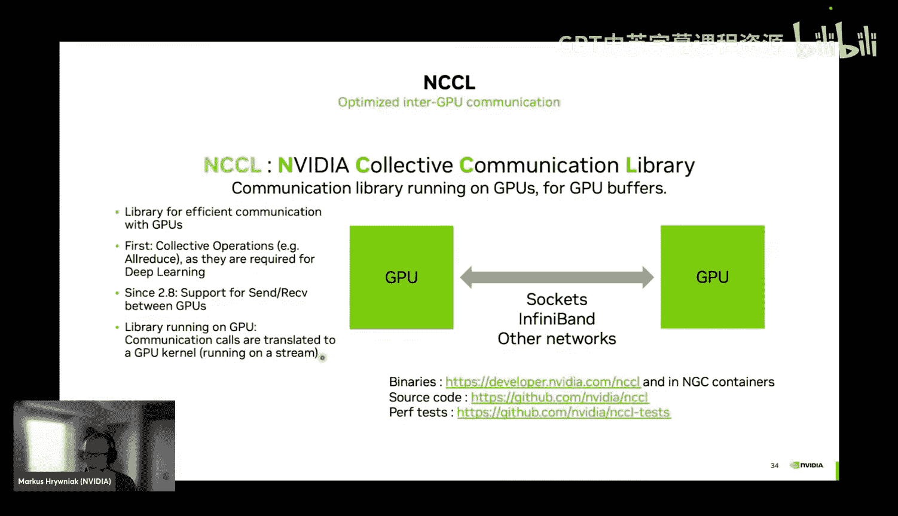

Let's look at how we can get started using nickel。There are several ways you can do it。

 but the simplest if you already have an MPI application。

 you just reuse what you already have done with MPI setup。

 so you have the MPI Conweald sizeize and rank and Nicel requires you to create a unique ID on one of the ranks here on rank0 and then it's on you to take this unique ID and distribute it in this case with a broadcast across all the ranks and our Conweald。

😊，We make every rank has seen this ID and then we can create。Consequently。

 out of this conwealt creator nickel communicator。With the same size and rank of the original MPI communicator and taken in this UI。

We can then do Nckel communication operations and finally destroy the Nckel commmunicator and finalize MP。

And that's all you need to also add Nckel because you can use both Nel and API in the same program if you want to。

So that is how to get it set up。Then。One thing that a nickel you can do is you can group operations together。

And that can be used for several things。 So one of these is because you launch a kernel to do the communication。

 If you group the operations together， you need less kernel launches and only need to pay a launch overhead at once。

 And it also allows more optimization on how to best use the available envy links and resources to push the traffic around。

So in this case here's an example of just having a follow incuing multiple nickel or reduce calls here on the same nickel stream。

 but you could also use it for other operations as we'll see in just the next slide and once you've done the nickel group end。

 the operations are posted on the stream before so take care of that if you want to in a kernel that's running on the same stream and re on the communication being complete in this case we just then synchronized to finish communicating but after the group end we are now fine to do other operations and in queue them on the stream。

And in our case， we're not doing all reduces， but we are doing point to point communication ahead Marcus sorry。

 I had some questions。So it seems to me like the scope of what Nickel does because like historically I've seen at pitch like oh this is like the optimized all reduceduce library but what you' were suggesting here is it's actually closer to a scheduling library for comms where you tell that these are the computations on run and then what it takes care of is making sure comms is overlap and then synchronizing correctly would that be correct or so so Nicholas at this point a general communications library optimized for GPU buffers it still has the goal is to have the fastest all and I think it's doing fine at that but can so overlapping communication and computation you still need to carry yourself to choose different streams I have an example on that just in a bit that generally what it is very good at is understanding that thepology of the system how your GPUs are connected and then choosing the best way to kind of move data around your whole system so inside a node across multiple nodes and you can just use things like this group start。

Group and to kind of give it more information of which operations can be batched together so they might be able to do something。

 something more efficient with this。So presumably if within the group star， I do an all reviews。

 then I do like some other animal scatter operation or something， what happens then is it？Yeah。

 so it can group those together in one kernel launch for so for once， what actually happens。

 I think I would need to refer to the。a profile or or the nickel Des I think they will also appear on this in a later talk but yeah it will just try to do the most efficient thing how to move the data that's needed for both operations around and since you've mentioned launch overhead a few times like I'm wondering should people think about it like a bit differently for single GPU versus like multi GPpU like is there more overhead and multi GPpU not necessarily because we are still just talking here to one GPU so this is each process is doing this on its own with its own GPU。

 the thing is just if you looked at the performance comparison between the MPI overlap and non overlap version so the further we go out the less computation we have when we strong scale so when we reduce all local simulation domain by splitting it over multiple GPUs and so when latencies we' not important maybe for two GPUs。

 they start becoming more important， the shorter your actual computation gets so the less latencies you need to pay for the better in this case and？

Launch latency and this is just here the case when you have some overhead to launch a kernel on the GPU because you still need to ine the operations on the CPUU and so if you only do this once。

 you only pay the launch overhead once that's just and so when you say latency。

 does this also include like startup latency as in like peers establishing each other Does that count as latency is that just like a one time cost I so so that peer establishing I think it's more a one time cost but I'm just counting general latency So I tell it to do the operation and long do I have to wait before the operation starts that can a couple of microseconds launch a GPU kernel So same for other GPU kernels basically。

And yeah， and there are other ways of course to mitigate that。 I'm not going into Ka graphs today。

 but you can also use niel with ka graphs， which allows you to。

Kind of pay even less launch overhead if you do have multiple calls and so on and kernels mixed with computation。

 But there's， yeah， examples in the other talk selling at the beginning。Sos good Thank you， cool。

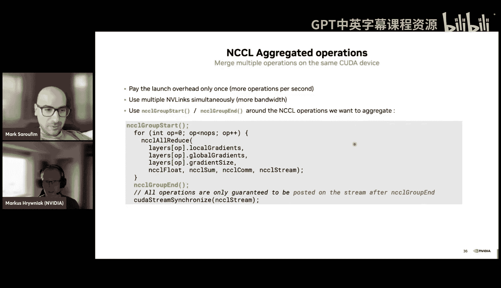

Right so yeah that's a very good question because the overlapping part we all still need to take care of as we'll see。

 but for now I just have the example what we need to modify in our Jacobbi solve to be able to use Nikel instead of MPI so we do have our kernel launch here and this is just the version that launches one kernel for the whole domain。

😊。

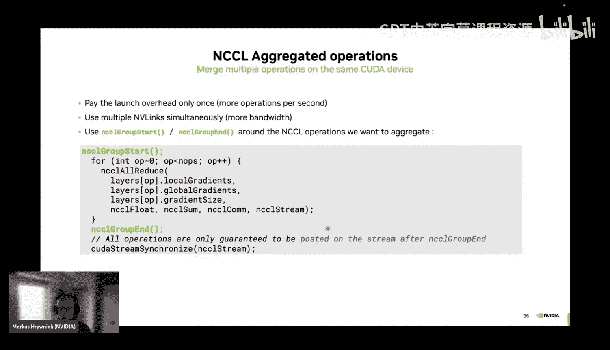

We can get rid of the stream synchronize because inside this Nckel group start。

 we do the equivalent of the two MPI sent receive calls。

 NCel doesn't have a combined sent receive call， but instead we just use this group start mechanism to post the receive and the send and another Re send for the other part of the domain and we un all these operations on the compute stream。

 so essentially we've just launched one communications kernel here that will take care of pushing the ha rows around across all ranks。

Take care that nickel doesn't have a tag parameter here to match up receives and send。

 so I do need to take care that I have them in the right order because if I just launched with two GPUs。

 I don't want to have the data from one cent landing at the wrong receive。

 so this is just why they should match up in the order here。

But this is essentially the conversion of the MPI sent received to Nckel。

And going back again to all parallel efficiency charts are still the same axis efficiency and number of GPPUs。

 MPI， MP over 11， or the new nickel version， you can see that nickel already does quite well。😊。

But as we go out further and further to multiple GPUs。

 the MPI overlap version still remains the most efficient。

 and so that shows that we still need to take care that we understand kind of what is the critical path。

 what is exposed， which kind of communication can still be overlap with computation。

 and so the next step here is that we will actually look at the profile again。

And we see that we have the Jacob Con。We have the nickel kernel now so that is new we don't have any MP operations in here and we want to try to have this nickel kernel also overlap with the concurrently running computation for the domain we use the same technique we want to try to slice off the top and bottom rows。

😊，But now we have to take care of one additional fact。

 and that is that by default all streams are equal and there's no kind of preference that we can make sure that the two small kernels that compute the boundaries are done first。

 so to ensure that they are done first。We need to use another feature called stream priority。

 We query first what's the least and the greatest priority。 And then we have two separate streams。

 compute stream and push stream， and we give compute stream the least priority and the push stream that's responsible for the boundary layer and the actual communication。

 the highest priority。And if we now launch our kernels。

 you'll see that here they highlighted kernel argument is different for the two small kernels that each compute the top and bottom row and the bulk of the computation is on compute stream still。

And then we ene the nickel operations also on the push stream。

 so thereby ensuring they are ordered and only execute after we have these boundary layers ready。

 and then if you look at the profile again。😊，We can see now that we have again this overlap so we have two more kernels。

 we have the boundary kernels here， the main kernel。

 and then after a while we have the nickel kernel for the send。😊。

And if we haven't done the priorities， it could have easily happened that all these kernels just execute at the very end because this odd kernel here for the interior computation can just use the whole GPU resources and so when it runs to completion that would be delayed to overlap this communication kernel here。

😊，So having done that， let's go back and check how we are doing in terms of efficiency。😊。

And we have now this new bar here for the nickel overlap version。

 and as we can see now we're doing quite well and we even managed to get a bit of a small advantage。

 but it's there and remember this is still just Jacobbe solveva as a toy application so。

 but we still managed to get a better parallel efficiency even compared to the overlap MPI version。😊。

All right， so。As we can see， the technique overlapping is still important。

 we still need to understand which parts are independent and how we can hide those latencies。

But Nicole allows us by using the stream ordered interface here to just also simplify and get get rid of some of the synchronizers we needed before。

For an example of how an production application uses nickel， there is a software package called VP。

 which is very widely used for electronic structure calculations。

 thinking like simulating material properties predicting them and VSP has been using foodaware M and using nickel they saw some of the benefits we looked at here so you can first do the eronous execution and you don't need to。

😊，Ensures so much synchronization between MP and nickel because you can just use streams。

We didn't use any of the collectives here， but of course you can also use them and if you need them overuse on the GPU is then much faster if you can use it with nickel。

And yeah， the streamer where interface also generally reduces the need for synchronization。

 and so if you look at the performance， they got they managed to get up to 2。

6 x increase or decrease in time needed。On 32 notes in this case。

 for this particular compound they were crystal they were simulating and there's lots more of investigations if you're curious on what kind of metrics you can think about implementing this on this blog post here。

But the one line is they think they didn't see a downside to using nickel and for scaling up out of a note。

 there was a benefit due to all these kinds of things we talked about。😊。

So this is what I wanted to talk to you about for Nckel。😊。

And now we come through the third program model， which is a bit different from the two we looked at before。

 it's called NVM。😊，And EnWMM is something we call a partition global addresserospace library of PgaS for short。

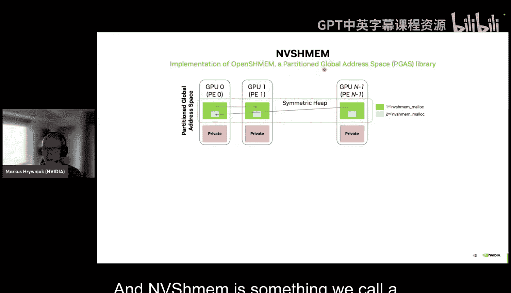

So it's an implementation of the Openchamp standard。

 but PgaAS means that your addresser space kind of pretends that it's one address space but is partitioned into multiple parts that make up the symmetric heaps so where dynamically allocated objects are stored across multiple GPUs。

The jargon is a bit different， this is not called a rank inM， it's called the PE processing element。

 and as you can see we have these N GPUs。And we have the symmetric key that's managed by EnMM and so if we want to use an object that can be communicated between these different processing elements。

 GP use， we call EnMm Maoc to get the memory for it。

 and then one rank can simply access the allocation from sorry one PE can simply access the allocation from another PE。

You can still do Kuda Maloc for private memory that's not partaking communication。

But the important part is that you have this kind of special allocator you need to use here。

And what this enables is as EnWMm is not two sided communication， but one sided communication。

 so you don't actually need to post a matching receive for your send。

 you can simply say EnWMput or EnMm get and then the data will just be marshalled over the network or over whatever interconnect is used in this case and then will appear。

In the other PE's memory space and thesymmetric key。

You can also use it at the same time with MPI so you don't need to use it as an either or and in fact the most common way to initialize can also use MPI again。

Just as an example of what else this can do because one thing that's new that we haven't had in the other libraries before is Kuda kernel interfaces so you can actually do communication from directly from your Kuda kernel。

And so if you look at a timeline from here from top to bottom of how they could look like。

 while this enables you is you can launch a kuda kernel once。

 pay only the large latency we talked about just once and wait for the kernel to complete and you don't actually need necessarily another kernel or another section to do communication as you can just have interleaved computation and communication but on a very finelygraed basis within that kernel so it can simplify implementation of your algorithm and it can also enable optimizations such as kernel fusion and that can give you a big speedup as we'll see with another application example in the end。

😊。

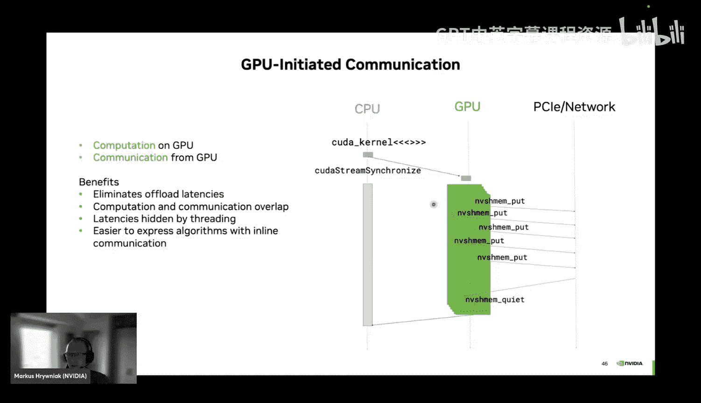

So let's say and presumably this is like the where the composability angle comes into right like people should like because I think people might think oh I should use nickel versus N and maam youre just saying like yeah are you communicating within the kernel or outside of the kernel seems to be the right framing right Yeah yeah I would say I mean NMm also has a host site API you can use similarly to niel but really the main point is if you want to internal communication although there's I will have a bit on and the end but yeah that's kind of the。

😊，Decide what kind of pattern you need and then pick a library。

 but you can also interoperate between libraries if you need to why do you need a launcher then like I thought that was quite strange when you first brought it all I'm curious。

The language meran you mean yes yeah so that's just a mechanism to make sure you have all the processes launched that are supposed to communicate with each other so I mean you if you just launch an application in a shell on node one and on node zero right how are they supposed to be known to each other so somebody needs to tell the process on the first note that there is a process on the second note that they can communicate with and these launches do basically this under the covers。

😊，So they make sure that the processes know where to reach each other yeah so I maybe I should phraserase my question it seems like the launchers you mentioned。

Are like like they almost seem like aliass of each other to me like they're the same launcher under the hood。

 I that true or or not really can be to a certain extent， I think for MP and M me。

 they are different programs， different code， but all of these also you can use if you have a cluster that uses cluster scheduling software like Sl for example or let's say humanes I mean they all are have different jobs but they need to accomplish one thing also to be able to user tells it to launch jobs spread in a certain way over the different nodes of the cluster right and then somebody needs to tell these processes how they can reach the other processes and this is kind of the commonality。

 I would say between the different launches So that you could do it manually。

 you could open a socket and rely convention you know so this is kind of but this is hidden。

 you just call MP in it and you call mmb memmoran and so on and then you don't need to take care of this very low level instrumentation。

And if you have a lot of processes， you need to launch millions of them。

 maybe it can also be quite challenging to have them all come up at the same time efficiently and so on。

 so this is one other thing that these launches need to do yeah。

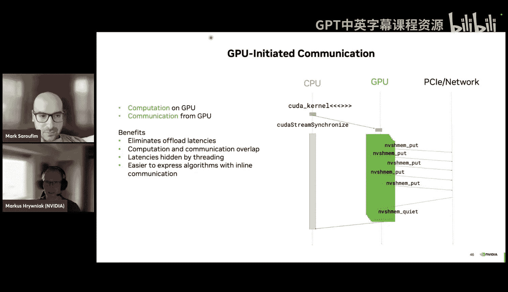

Alright。😊，So。😊，U。Yeah， when we， but at this point， we just， we are in our application。

 We can launch a kernel that's not using en mem。And but we want to run a call like and launch EnM。

 but before we can do that we need to again initialize EnMM and this is also here the skeleton that allows you to either start from an existing MPI MPI communicator so you can see we grab MPI communicator here in a variable and we have an AmmbMM specific extract where we attach this as an attribute and then we can initialize EnMm with that communicator and in the end these asserts will be true。

 so the size and the rank of the MPI communicator to correspond to the returns of how many PEs and whichM thinks there are and what rank my PE is。

There's also a way to do it similarly to nickel where you can initialize it with a unique ID。

 but then you also need to do a broadcasting and author unique ID and so if you have a different way to broadcast you can use that。

 you could also use an MPI broadcast but in this case it's better to just use the MPI specific initialization mechanism and of course because it is based on OpenSMM。

 you can also use it to interoperate with OpenSMM or SchM standard which is more for CPU set communication then。

And if we now look at an example of how that would look like in in such a kernel so in the Jacobbi kernel。

 this example is a bit condensed， so we just。😊，Just imagine that the compute part here is responsible for the update of the Jacobbi stencil。

 but what we want to focus on here is really the way that the communication has done so just that we have less lines of code to focus on here and the interesting part about en mem is that from within a kernel you can now do threat level communication and this enMm float P operation essentially transfers a single float。

From the local arrayu here in this space to the remote arrayu on another PE and the same for top Pe and bottom PE and this is done by each of the threads that make up the top and bottom rows so for MWMm you can do this now on Nvy link fabric or DJX systems for example。

 this is an efficientff thing because it maps to a load and install operation over Nvylink essentially and all you need to do then is really launch the kernel。

And have a way to synchronize the make sure afterwards for each generation that you are done communicating。

So that is in that sense， it simplifies your algorithm。

So let's look at how this looks like in Jacobbi when we implement this single element put on our DGX system and at the first glance it looks like this is a bit disappointing because we don't reach a high parallel efficiency here。

😊，But there are several reasons why we see that here。 So the first one is that in our Jacobby app。

 we really just have one single kernel and we can't use one of the major advantages that we could just fuse maybe two separate kernels together because we can do communication interlead with the computation without relaunching a kernel and paying those overheads。

And the second thing that's interesting is the baseline efficiency here is already a bit lower than the others。

 But if you look at how it looks like when you go up to HpUs， you don't lose a lot of efficiency。

 And in fact， for HpUs you。Quite close or read to the MP version。

 So there are ways to make the baseline more efficient。

 And in one of the talks I linked at the beginning。

 Jerry did just that and looked at several things you can do to， for example。

 use LinkedIn optimization to make calling these andM functions more efficient from your kernel and which recovers quite a bit of performance and makes even the jacodi version look a lot better。

But I have also a real application example in the end where we will see quite a bit of a performance gain by using EnmbM。

😊，Before we go to that， though， I want to show two other ways you can communicate from your kernel。

 So the second one。😊。

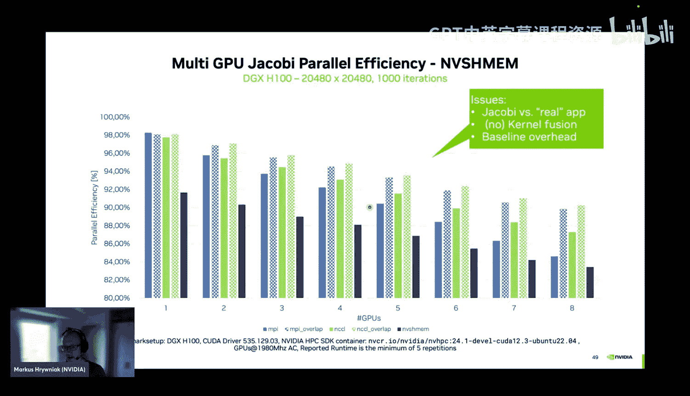

Is and please focus here on these parts。 So instead of just having one element sent by each thread。

We can also bundle up several of these operations and do communication cooperative between blocks。

 so this is why this is not called floatat put MBI block。😊。

And the reason is this API exists is because interconnects that are not aning so if you go over the fabric。

 if you go over infinni band， these networks are designed more to transfer larger messages and then this tells them to reach higher efficiency higher performance and so this is a way you can still use enWMm and still have a sort of flexibility on how finally grant you communicate。

 if you do it on a block level and yes you can see this is the parameter for many elements we transfer here so we transfer one element per threat and still the same kind of boundary exchange and still after the kernel have the same kind of synchronization call to wait for communication to complete and to go into the next iteration。

This is still having us have a host site loop to launch the kernel and synchronize。

 but we can go even one step further。And put everything just into one。Basically one giant kernel。

 and in this case， we have to do the synchronization across different bes within this kernel。

So you can see that the volume loop of iterations is now inside our kernel launch。

We have the swap bufferers and compute part and the communication part is essentially unchanged。

 but what we have to do now is we have to be clever with synchronizing so we exchange data and then we do something where we check if we are the block zero here in this case so we are if our block is in the actual row here that is exchanging data with the neighbors so in the first or in the last row。

And then we make sure that all threads are here converged and that we have finished the outstanding communication operations and then we do for one thread in each of these blocks。

 so index in x and y direction in that block is0 we do something with an enrich meatomic increment on a newly introduced sync variable so the sync variable is really just a new integer point that we passed into the kernel here at this space and we increment the sync variable on the remote top PE and on the bottom pe so on our both neighbors。

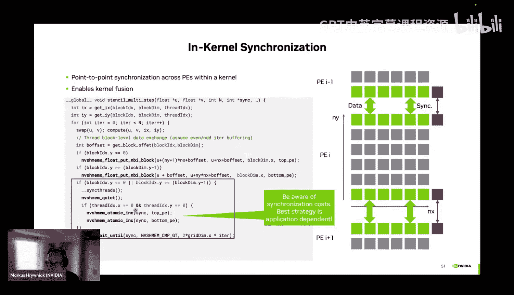

And we do this because now it enables us to implement synchronizing our nearest neighbors by just waiting until the sync variable has reached a certain value。

 So this is the sync variable and we compare until it's greater than this value。😊。

And the reason this is the value you need to wait for is because we have two neighbors。

 so we expect two increments of our sync variables from top and bottom。

Then we expect one increment per block and the number of blocks in the grid is grid in。

 X and since we don't reset this variable， we expect it to increase by this amount each iteration and so this is one way it can be done to implement such an internal synchronization。

 there are of course different strategies you can think of and what really worked well it depends on your actual application。

 but that allows you to really just have one kernel that continues running until the full computation is done and finished。

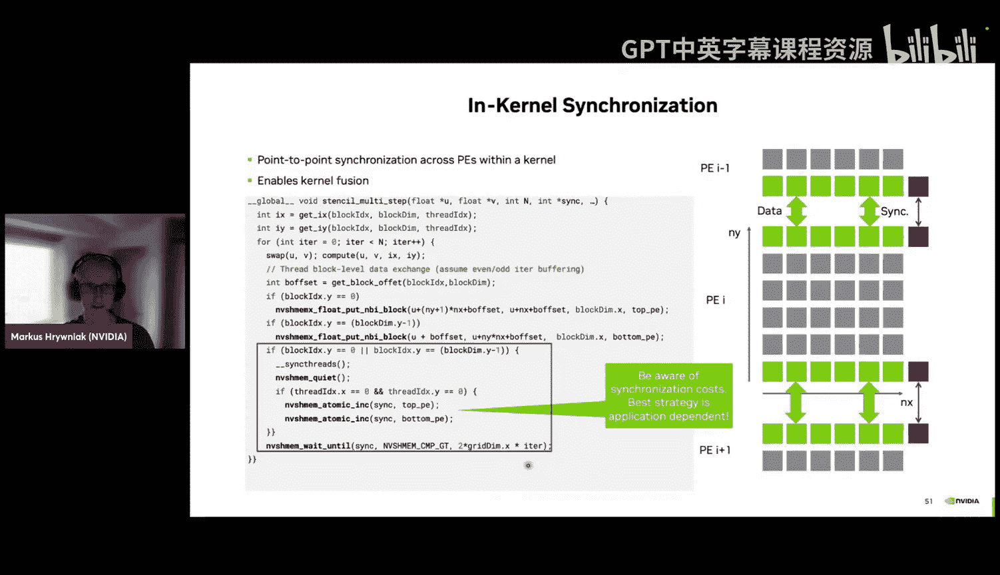

And as an example of an application that has done just that to fuse kernels and move everything into one kernel。

 there's Qa， which is a ka with a Q， which is let quantum chromdynamic code so they do simulations that have an interesting property that they need to strong scale out very far and strong scaling is hard in the sense that the further you go。

 the more GPUs you use， the more important all these communication latencies come so and they use the device initiate communication to try to overcome these latency barriers and there's a whole GTC talk on how they did that。

😊，But if you look at。What this results and what the difference is。

 So here we have just a screenshot from such a profile you can see we have in blue。

 these kernel calls for Pe and kernel。 Then we have different data copies。Through Kaware MP。

 So there still happens here overlap， even with another kernel。

 So they did to great length to optimize that already。

Then you have another couple of con calls for the exterior and some other MP calls。

 and then you go into the next part。😊，But if you now look at the difference of how they implemented this M map。

 you have a fully fused kernel。And that kernel does all of that from before and uses internal communication so you don't see MPI activity here in this row。

😊，And then the case of QA， which also uses lower precision floating point values。

 so in this case especially you have less data to work on and it gives a big speed up to further use scale out because because what this plot you shows is essentially the performance。

 Giab flows per second across the number of GPUs that the code runs on on the X axis and because this is strong scaling。

 we start out with a same fixed global problem size and divide this by the number of GPUs。

And at 512 GPUs， you see over the MP implementation， there is option 1。6，1。7 x speed up just by。

 you know， using Ammbmm and fusing those kernels， introducing other overheads。

 So this is really where internal communication can help you make your kernels faster。😊。

I want to now that we have looked at all these three programming models。

 still give a bit of a comparison between them how they look like or how they look quite similar before I wrap up so first we looked at MVI。

😊，An MPI has different APIs we look at send receive in this case we have a separate in acent receive call。

 you can use host and device buffers so we can use it for CPU and GPU buffers and it has this concept of communicators to identify ranks that talk to each other。

😊，This is very similar to how nickel looks like， although nickel operates just only on device buffers。

 you have a similar concept to the communicator and nickel。

 but in addition and this is very important we have the stream parameter so you can now have your communication be stream aware and have it automatically scheduled according to how yourQ kernels and communication into the same stream。

😊，Lastly， EnWMm is a bit different in that it also has sort of like what you could see as a send call。

 but in reality this is called one sided communication as the receiver doesn't need to do anything the receiver in PE is completely passive and it will just receive this message when it basically has arrived you can of course synchronize wait until it has arrived but you don't need to do anything special like post to receive and enVMm also allows you to do internal communication。

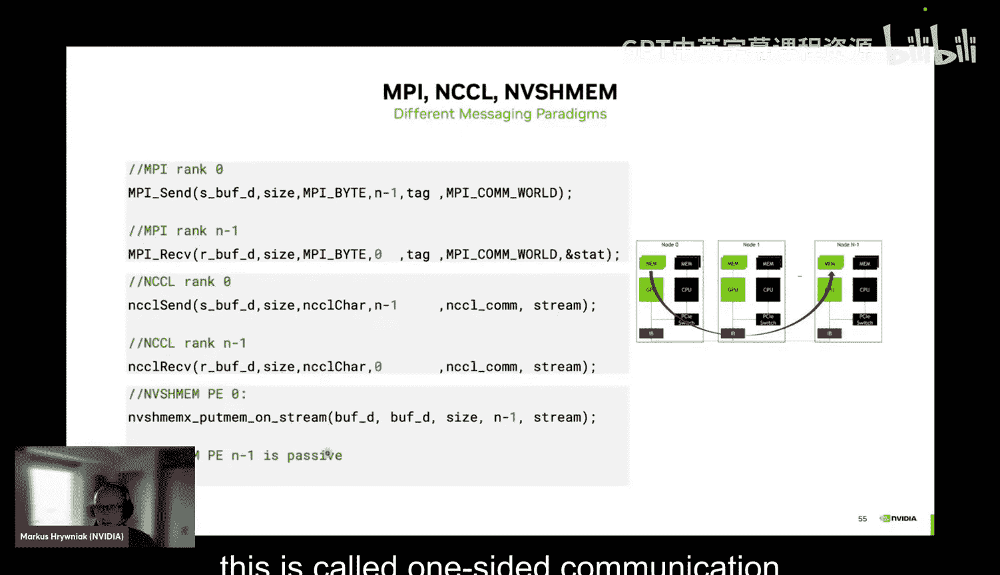

So to summarize and。Maybe give you a bit of a head start on which library to use。

 So all of these are good choices are supported and can give you very high performance。

It depends bit on if you have any extra requirements， if you should start with one over the other。

 I would say。 So if you're writing a new code， if you have an existing code that maybe already uses MPI on the CPU site。

 then it's a very easy transition to just introduce Kuda or MPI use it on GPU buffers and just get your code running more efficiently。

But then if you need string awareness。You should look at Nel。

 which you can also interoperate with MPI， Nel has highly performed collectives。

 it works on GPU w and due to the streams you might be able to shave off some more synchronizations you don't need anymore and for Nmb men。

 there's firstly the one sided communication model which might be simpler to use to just implement your algorithm and it also has the advantage you can do internal communication。

I just want to make sure that you get that this is not an either or so you can interoperate between these different libraries how you need them and it's also not fully as clear cut which I omitted in the previous slide as to make it a bit simpler to understand initially because there are also plans to add one side of communications and Nckel and discuss how streams could fit into the MPI model such as discussed by the MPI forum hybrid working group or in some GTC talks you can also look at what the plans look like for NIel。

And there are of course many， many more resources on any of these topics here on the websites in the other GTC talks and if you want to try out these programming models yourself。

 I would encourage you to check out our GitHub repository of the multiGBU programming models where you can find all of the variants of the Jacob solveva fully implement itself MPI for NCel for NBMM and also for some other。

 and you can play around for those， learn how they work and try to understand the performance behavior。

Yeah there's also another tutorial based on this that we've been doing for quite a while at conferences。

 so this is supposed to be a full day tutorial but it also has some examples with blank spots where you kind of have a to do and need to figure out how to solve it and the solutions to these exercises so if you want to do this on your own pace。

 you' are welcome to check this out and let me know if you have any questions。😊，So yeah。

 I think we're at the end of the material I had prepared。 I'm happy to take any other questions。😊。

And thank you for your attention。Set thank you so much Marcus folks I do have to apologize like the reason why the talk was shorter than expected was like just because I have to run to a workshop but but thank you Marcus for putting all the content like so neatly and I guess we'll get slides and we'll post them in the group as well we get you to PDF。

Yeah， I guess like the crumb。Well， I guess a question I have on my end is kind of like。

 what do we expect？Like so the way a lot of people seem to interact with like distributed like like libraries like Nel。

 for instance， is historically via a higher level。Libraries such as like Jacks or Pytorch， right？

Basically there like there are sort of like a few good kernels that need to be written effectively。

 like things like all reduce and so like I'm sort of wondering here。

 like with sort of evolutions like NV sharedredMm， do you sort of expect a lot more lower level code needs to be written by people or is it basically again。

 there's going to be like a few good lower lower level APIs that higher level libraries will adopt and that's pretty。

I think ideally， and I didn't explicitly point this out though thanks for mentioning it yeah。

 if you can of course stay with a high levelvel library I mean they have been battle tested and implemented to be as efficient as possible but I would say at some point maybe if you want to extend something you find you work on these libraries yourself。

 you want to work on these libraries yourself or you want to just do a project on your own that just doesn't have a library dependency or even just to build your mental model of how these kind of higherleve frameworks do the magic under the hood。

 then I think this is why I think it's useful to have an overview of these models。😊。

But if what you need to do is already implemented in any of the high levelve frameworks and by all means I would say use that and don't reinvent the wheel except if you're curious then of course just go ahead but then there are few people who go a bit more ninja to get that last 2% to 5% benefit so if you're in that category then going to the lower level gives you that benefit that you are seeking because there are a certain overheads that comes from the high level level that do not get exposed usually this happens when you have a large cluster and a tons of GPUs that you want to maximize for your cost over there saving 1% or 2% is actually a huge revenue number so those are the people who spend significant effort to make that happen。

But in my experience， there are also of people who don't need to。

Explly tell you rather need to stop them from doing that stuff because they will just go off on their own and take around。

 right？Yep， yeah， for what it's worth I'm just googling now I did notice that y'all shipped the library called NV shared me4 pi。

 which just sort of makes it like。Doesn't look too crazy specifically a Python front time for andmm so you have APIs in the C+ first now we have APIs from the Python so that quota Python and other people in that space can actually leverage and use just in the higher level itself。

 but it still is a much more lower level so but there are many people who are non Pytharch in the Python board who wants to use device initiated communication。

All right I don't see any more questions Mark， there are a couple of questions in the chat if you want to take up maybe do you want to go ahead in read them so there is one question Marcus I think this is for you most likely I'm curious on how N abuse future of interplay between Pythsymmetric memory enrich nickel symmetric memory with window API I it a matter of what user wants or would you choose one over the other what are the tradeoffs fundamental I don't really know the answer to that because I'm not so close to these teams so I would just need to ask myself just from performance perspective I think。

Their teams do what makes sense right if you want to if you need to reduce latencies from the critical path you investigate how you can get rid of those and this is kind of also how these libraries are born in the first place so you want the high performing or reduce nickel was born that way you want to reduce more synchronization。

 put better overlap get less latencies you have en them to do internal communication and I think just from these first principles is how usually libraries evolve but for the concrete plans I unfortunately don't know them for the teams。

I think there is a clarification question， do we need for any enrich collective launch the cooperative group to be made available and then you should be launching so should we use cooperative groups or not？

You can use them what I didn't show is the launch for the actual kernel so because if you want to do internal kernel synchronization you need to make sure that all the threats that need to be synchronized are also scheduled right now on the GPU so there is some more details in the En documentation which I would say is if you want to use it you will figure it out but just。

Important to point out also that this is another kind of cooperation before you actually get through the threatre groups。

All right thank you everyone for nice questions if you have any more questions please let us thank you for coming in Marcus having me question you know please please feel free to message him and if you'd like more sort of distributed talk like feel free to pm as well otherwise yeah we'll see everyone next week and thanks folks thank you again Marcus everyone by。

😊。

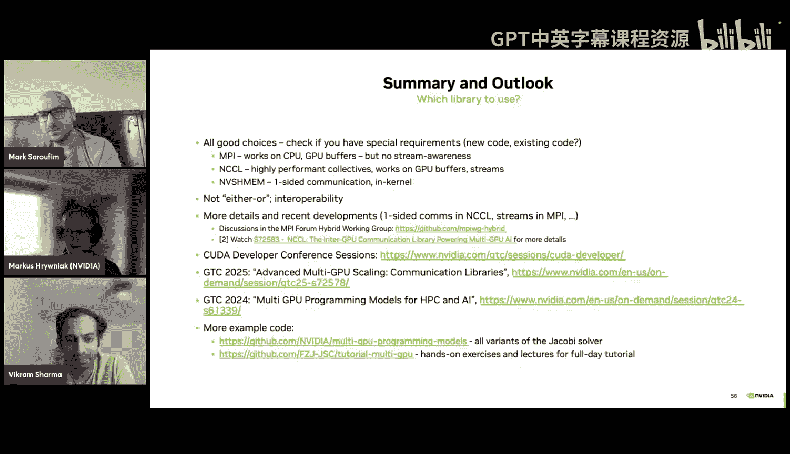