# GPU MODE《CUDA、GPU编程54-87｜GPU MODE》中英字幕（deepseek-v3.2 p12 -20250726-Lecture 65_ Neighborhood Attention.zh_en -BV1xbmQB3ETC_p12-

Tony， who's going to be talking to us about like neighborhood attentions。

 parts attention and a bunch of like interesting new things to do on the newer hardware。So Ali。

 please， without further ado， thank you from here。

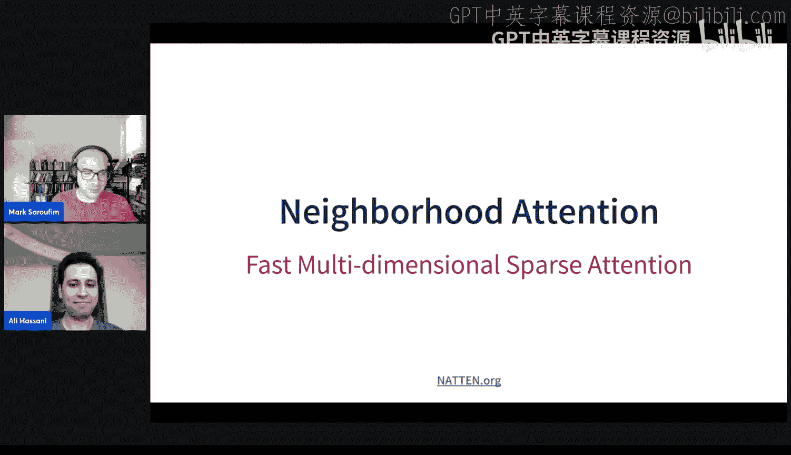

Thank you thank you so much， I'm happy to be back and to talk about this project specifically because this has been my main project for my PhD so I've been working on this since like I want to say late 2021。

 so it's been going on for a really long time I'm really excited to share some of the things that I've learned in specifically some of the things that we accomplished over the last few months so I'm going to be talking about neighborhood attention。

 which is a form of sparse attention， but'll try to I'll try to introduce it without giving away without focusing too much on the definition and applications and more on the implementation side of things since this is GPU mode。

 but I have a bunch of links in the end references for papers you can read on just the theory of these types of attention patterns also the papers that we did and the milestones that we went through and finally。

I might be I might talk fast， I typically do so if you want to ask questions feel free to stop me and just ask questions and then once I'm done with the slides we'll go over the code a little bit I'll go over。

A live demo on blackwell So first of all， why do we care about sparse attention。

 why even study this problem， Well， attention is at the core of most foundation models。

 So that's reason number one， we we want to be efficient and in attention。

Is sometimes criticized for its quadratic complexity and that's something that kind of also leads to certain workloads being predominantly attention bound。

 so in image and video world foundation models specifically the larger your resolution。

 the longer your video or at some point，The number of tokens that you have grow so much that more than 50%。

 you spend more than 50% of your end to end inference time easily on self-atten。

 So it's really important to if if you really want big returns。

 it make sense to go after the bigger the bigger piece of the pie。

 So first I'm going to talk about what attention does which almost everybody here should is already probably familiar with。

 but specifically how I define it and how I use the same definition to define what neighborhood attention is。

 So we know attention is an operation over two sets of tokens， a query and context set and tokens。

 well， depending on what your application is might correspond to different things in language they correspond to words or sub wordss and vision。

 it can be pixels or patches of pixels。But anyway， queries attend to some context to accumulate information。

 but specifically I'm interested in self-attention。

 that's what we call out that has a quadratic complexity and it's the thing that can potentially limit us as we grow the number of tokens that we have and use cases for this are the prefill stage and language models and the denoing bit in denoising diffusion models so usually 90% of diffusion workloads or higher if you really optimize things it should be like 98 or 99% or more is spent on the diffusion itself because it's an iterative process done over many。

 many steps so naturally it grows to be the biggest piece of your workload and attention。

 self-attention specifically is the biggest part of that workload but so when we conceptually try to think about what attention does。

 you can visualize attention at least the way I'm doing here， mostly on a per query basis。

At least I find it useful when I try to build up to what neighborhood attention is so over here we're kind of visualizing that no matter where the query is it attends to the entire context。

 which is the entire input so in self-atten query and context sets are the same thing。

 we just have different projections of them， query gets just gets just projected into the attention input context gets projected into your KV。

So this is and I specifically chose this example because it's two dimensionmensional and that's where the problem of doing something like what neighborhood attentiontention does gets a little bit challenging So over here we don't have a sequence of 18 times 18 tokens at least we don't think of it that way。

 we look at it at a multidimensional view or layout of our tokens。

 which is 18 by 18 and regardless of where the query token is， it attends to the whole thing。Now。

 what if I want to localize this， I want to introduce vrsity at the dot products level。

 I want to reduce the number of dot products I do。 I want to reduce that O squared complexity so。

If I want to localize it if I want to use spatial locality to achieve this。

 I can think of it as self-attention is some form of local attention。

 but one where your local window size is just 18 by 18 it's just the whole thing so let's try and slowly reduce that and we want to try and do that while we try and keep the query perfectly centered within that window of course it's not always possible because you know there might not be a center because your window is even lease sized or in this case the queries a little bit closer to the corner so it's impossible to get it to be like perfectly centered unless you're willing to just get your sliding window or window just go out of bounds and then attend to nothing but we don't really want that we want to attend to as many things as possible so 17 by 17 kind of looks like this and this is just how neighborhood attention defines it and it's a slight shift from how previous instances of multi-dimensional。

windowow attention， particularly in 2D looked like so if we keep going。

 we can slowly keep reducing this。 And as we do this。

 we're moving away from what is self-attention and we're just kind of in new territory。

 So this is not self-atten， It is just neighborhood attention where you know we localize attention and we can keep going。

 There's not really anything limiting you from changing these numbers， whichever way you please。

 as long as they're greater than or equal to one or and as long as they are they don't exceed the bounds of your problem。

So you can kind of keep doing this。 and you can even set it to one。

 But a one by one context window is just a linear projection。 So now you have zero attention。

 It's just no longer attention is just a linear projection。

 And the reason for that is if you have a single dot product per query。

 the softmax of a single element is just always one。

 So you're just accumulating the value corresponding to itself。

 So you might as well just not to attention throughout Q， not computed at all and just use V。

 So this is this is something that I usually bring up in these sorts of talks because one of the things that I like about neighborhood attention is that it allows you to do this。

 Like it allows you to bridge two operations that we use everywhere and most modern neural networks。

 at least most transformers anyway。 And those two are attention and linear projection。

 And it kind of bridges， it kind of kind of builds a bridge between them。

 So you can have something that's neither one of the two， but like closer to attention。

So that' guess that's basically exactly what neighborhood attention does is that for each query。

 it localizes the attention window， the context window。

 whatever you want to call it to a local window around it and you as the end user who would get to put this in I don't know some neural network architecture you get to decide what that window size is and well the smaller it is。

The less work you are technically doing， but actually saving you compute is going to be challenging。

 but I'll talk about that in a few slides。 So the problem with this was when we first had this idea back in 2021 late 2021。

 we just had to write our own kto kernels from scratch。

 I was just a new PhD students So not a lot of context into okay do I use Triton do I use cutless or I wasn't even in that mindspace。

 I was like， all right， we need to go one level， at least one level below Pytorch to be able to accomplish this and still get the savings that we expect again。

 you could have implemented this just with attention mass， But the whole point was well。

 how do we save memory before flash attention， one of the big things you really want it to do whenever you tried to work on something this a sparse form of attention is actually save memory and if you fully materialize the attention weights and just use an explicit mass。

 You're not going to see those savings not in memory nor in compute。But the bigger problem。

 which we later came to realize was this is no longer a matrix multiplication problem and attention is comprised of two big matrix multiplies and the reason why this is not convenient is that if you want to accelerate attention。

 ideally you want to keep it still dense computation。

 but if you go to something that is not really dense that is more a vector matrix multiply。

 then you're not really highly utilizing specialized hardware and most hardware most hardware accelerators for AI。

 keep on getting better and better and dense linear algebra。

 you want to have enough work to do to keep your utilization up。

Switching something that's already a matrix multiply that can utilize your resources pretty well to a vector matrix multiply would suffer many。

 many challenges。 So I'm sorry at least just since you could say it's okay that I slow you down at least when I look at this visualization it kind of looks like like a convolution which is a matrix multiply So where does the vector part come in here like what's the so yeah。

 so your query， this one query is one vector， but the context that it has so the reason why it's a vector matrix multiplication technically is that the query right next to it。

 if you move by one， the window shifts right so you have one vector that's your query。

 but your context， your Kv changes depending on where the query is So if you want to implement this the most straightforward way to implement this is with a vector matrix multiply。

 but then as we'll see later you can kind of you can kind of compute this as a matrix matrix。

Multiply as long as you have masking so it's a vector of three elements。

 Basically the three channels of the matrix right Well yeah， well here we don't introduce channels。

 but yeah， whatever whatever number of dimensions your attention would have whatever your attention like head dimm would be have a number So this is kind of just to illustrate that suppose this is a feature map so yeah。

 but yeah， that would be the vector matrix multiply you have to multiply query vector by local window which you can you can pack into a matrix and then you have to take the softm of that and then multiply by the corresponding values and then you have your output。

 Sos that's why it's a vector matrix multiply。YeahGo。 thank you。

Thank you but so a bigger problem with this， like even before we decide whether this is going to be fast or slower。

 what performance it's going to have is what about global context like one of the big points of using attention is that it can you can see everything you can have global interdependency modeling and you give some of that away by localizing and the more you localize the more that you give away well at the time when we were more slightly more application focus。

 our solution to this was well we brought over sliding windows why not dilation from convolution and this actually works pretty well so we defined the dilated form of neighborhood attention and this actually has a pretty good advantage compared to convolution is that in convolution it's a lot harder to do really large dis without increasing your memory footprint if you're doing a convolution with the same padding which is pretty typical in today's neural network architectures。

So if you want to do something that doesn't downsample your feature map。

 you always have to pad by something that is proportional to kernel size times dilation。

 So the bigger your dilation or the bigger your window size the more you have to pad。

 but with neighborhood attention you don't have this problem because and this goes down to this boils down to just how attention and convolution or different things with convolution。

 you can implement the same idea， but what you would get would be repeated pixels in your feature map or repeated vectors in your feature map we discuss this in detail in that Dynap paper a little bit。

 which is referenced in the end so if you're interested in why this wouldn't be applicable to convolution in the same way。

 you can look at that paper， but so yeah， our entire goal at that time when we did that paper was。

Okay， let's suppose we can train models with this and we did train models with this with whatever implementation we had back then。

 but then we realized that okay we're giving up a lot of this global context。

 how do we improve performance and so we found that when you take a VT because at the time the focus was hierarchical vision transformers。

 things like Sw transformers So those were already dealing with local attention。

 So of course compared to those this would give you superior performance。

 but we also took ViTs and just localize their self-attention to neighborhooded attention not for any performance gains because it wouldn't be much at that scale and then you would see a drop in like image that accuracy。

 but then when you introduce dilation like every other layer and you mix dilated and non-dd forms of it。

 you actually get a pretty decent boost you get closer to self-attention level performance So this is like one way that you can deal with it and in a lot of follow-up research that we've done which also drop links to there's's。

Like a lot of evidence that using a combination of dilated and local neighborhood attention is actually almost always a better choice。

 both if you care about speed and if you care about accuracy， it's almost always a good decision。

So the advantage of this form of neighborhood attention is that as long as you don't change your window size compared to the localized one。

 the cost is the same the flops are the same in practice this actually is usually even faster and I'll be happy to clarify why but I won't get into sorry was there yeah so you might be answering this later but like I'm just sort of is the spoiler the dilation typically it needs to be like within a two force spa ratio to be fast on modern hardware or is this like no not well no no。

 so the point is so the way so originally we didn't implement dilation this way but since a year ago we've been implementing it this way where so dilation is basically standard neighborhood attention on top of a partitioning of your input so we just pre-partition our inputs according to whatever dilation factor it is and then we move the the additional dimensions to batch。

You get a smaller neighborhood attention problem， but with a larger batch so just the level of parallelism goes up so this this ends up being this ends up being the the reason why it can be faster because the more you do dilation。

 the more likely it is that I don't know it is actually possible to。So so for instance。

 if your input size is evenly divisible by both dilation and window size。

 then dilated neighborhood attention is just that partitioning plus self-atten So over there you still end up being a little bit faster because you can skip the attention masking as well。

 So lots of reasons why it ends up being a lot faster， but also there are some limitations to it。

 but but typically like doing dilation is either going to deliver you similar performance or better in most of our current implementations and which papers you discuss the partitioning like idea So yeah。

 so the partitioning was in last year's faster neighborhood attention paper I'll discuss that in a few slides and also there' there's also a link there but not in too much detail today if you look at Na and it's like pretty clear that we do this because today the way we also design our kernels has changed so it's pretty like。

Cl today how like dilation is handled but but yeah。

 the original like the time that we figured it out and worked it into the implementation was last year's FNA paper。

So any other questions？No， that's it。Great， fantastic。 so this gives you like I said。

 this gives you some sparse global context， but with the same cost。

 but so now I want to talk a little bit about implementation because there was an approach that people had already been using before we started working on this and that was blocked attention。

 So this was like de facto standard way of doing local attention in vision specifically starting 2021 made popular by the famous swim transformer paper And so this is really easy to implement in pytorch because all you have to do is partition your inputs again。

 similar to how we do dilation partitioning， but over here you're doing a contiguous partition versus dilation。

 which would be kind of like interlaed I might be misusing these words a little bit。

 but I think the idea is clear like over here we're just taking contiguous elements and putting them into a partition where it in dilation。

 you skip a few elements。 but anyway， so block attention is really interesting because all you really do is cut up your inputs into chunks into blocks and then you do a self-at on。

😊，Top of each one， which can be done very easily in parallel。

The reason why one of the things that's so great about this is that you don't necessarily always need to modify your attention implementation。

 you don't need to change anything at the kernel level to implement this。

 which is why it was so popular。And also another advantage is you're still doing dense matrix matrix multiplies on each one of these blocks。

But then the problem， the potential problem with this is that you lose translational equivariance or depending on what the block size is。

 you either relax it or break it like the more fine-grained in the smaller your block size is the harder it is to tell the difference。

 but so this can lead to inferior performance compared to sliding window or neighborhood attention and we both found this empirically in some of our work and has been shown in some other follow-up works where they specifically experiment with blocked versus neighborhood attention and it like how much better the quality is is highly application specific how much training data you have on what scale or're doing the training but some tasks are very sensitive to this and for that I could name out there's this startup in the Bay Area called Winborne and they're actually developing a model like a weather prediction model where they're dealing with huge problem sizes and they need it like a multi-dimensional。

Of sparse and local attention and one of the applications where they did find this to be true that blocked attention was simply inferior to neighborhood attention for them was one of their models and actually include a link to their block post because it's very interesting at the end of these slides when I share them but anyway I'm gonna to move on to implementation so again it's no secret that pre2022 most attention implementations were with just simple batch matrix matrix multiplies and since then fused kernels like flash attention have become the standard so then the question is how do we introduce sparsity into these fused kernels and so it's almost pretty much almost any method that introduces sparsity at the dot product level meaning you're just skipping computing certain attention weights and that's where you get your sparsity if you're doing something like that then you're most likely going to use block sparsity a technique called block sparsity to introduces into yourfusesed attention kernel。

And the way it works is similar in both the forward and backward pass kernels except the problems transpose in some other details。

 but so in the forward pass， if we just want to consider the simple case。

 the forward pass of a fuse attention kernel， you tile your query because you load in one query tile and you produce one output tile corresponding to that query input tile。

 so that's going to be your outer loop and that's where you get your parallelism。

And your inner loop is usually done on the same processor on the same chip on the same SM。

And by and so you have an explicit inner4 loop in your kernel that goes over these tiles。

 you might have a scheduling unit it doesn't really matter。

 but the whole point is if by the time that you're loading in your Q tile you can predict which one of these tiles you're going to visit are going to need to visit and which ones not you can skip the ones that you're not going to visit and by visiting I simply mean if I mask out an entire tile like here and I don't have a single dot product in it that I'm going to use that my attention mask is just going to get rid of。

 then there's no point in loading in the K or the V and doing the dot products so I might as well just completely skip those iterations and this is basically how block sparsity works and this is also the reason why and especially our most recent works and papers I specifically avoid using flops as an efficiency metric。

 especially when you're comparing multiple different sparse methods that all。

Apply sparsity to attention via block sparsity because flops don't really tell you anything flops。

 your savings are never in terms of flops you either skip a tile or visit it。

 And if if you even need a single dot product in that tile。

 you're going to have to pay the cost for all of the flops。

And so the advantage of block attention and why it doesn't need some modifications at the kernel level to accomplish this is that if we think about what it does。

 like I said， it's a partitioning and then if we just look at these partitions and we kind of align them this way。

 you can kind of see that the block sparse mask， if we consider like the block sizes match。

 the tile size in your attention kernel。You can kind of see that the block Sprse mask is only lighting up on the main diagonal。

 So whenever that's the case， you simply don't need to really modify the kernel as long as。

Because again， like if you're just interested in this main diagonal。

 you can kind of when you don't need these interactions。

 you can move whatever dimension is representing these four tiles into the batch。

 And then you're just compiling these four on top of each other。

 I don't know if that explanation made sense， but this is the reason I bring this up is that。

This is why anything beyond blocked attention is going to need some modification at the kernel level so for instance。

 if I wanted my mask to be able to compute these values as well。

 like these tile visit these tiles as well， I really need to modify my attention kernel。

 it's no longer really eaten and so easy like just to transform this problem into a parallel attention problem and then not need to do anything at the kernel level。

So now I'm going to talk about how do wefuse sliding window attention methods like neighborhood attention and the only additional element is that in addition to block sparssity you're going to actually before for you going there's sort of like a few related questions in chat like which are so in some sense like this like all the neighborhood attention techniques are basically like somewhat like directly competing with techniques like flash attention and that it's like a different like methodology to reduce like the amount of memory you're materializing right I know you're making a face but just let me finish the question。

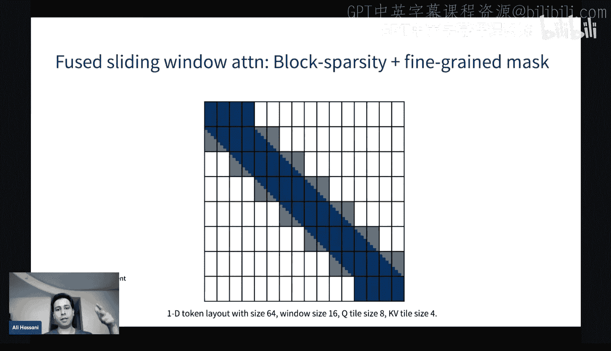

And so like so so one aspect of the question is like， well， how do you do head to head？

And then the other side of the question is， can you reformulate the？

All like basically all these attention variants you're describing and essentially like preprocess your input such that you could just call flash attention and have things like really fast so the first thing that you said I I might have misunderstood。

 but I don't think this as an optimization that would be like competing with flash attention these are all different forms of sparsity and what I'm so on an abstract level。

As long as there aren't too many so so basically what I'm talking about here are changes that you would need to make to a just a pure FMHA or flash attention kernel that doesn't have any sparsity support built into it yet these are the modifications that you're going to need to make to add sparsity support to it so yes to your point。

 as long as support for all of these unique things that you need to be doing is included in those kernels。

 then yeah you don't really need much else but then that's kind of the problem is that there's many very specific things that you need to do which i'll explain a little bit further when you step into multidimensional domains so basically what I'm trying to say is that if you already have there's already at least some iterations of flash attention that I remember that had sliding window support those are all in1D and if you want to do 2D sliding windows it's not going to be so simple and those are exactly the slides that I have。

Next so I don't know， does that answer both questions。

 I don't if that does yes does actually yeah you great。So any other questions？ great。 so so yeah。

 so the way you you go ahead and implement this into a fuseed attention kernel is by having just both of those components block sparsity。

 figure out which blocks you're going to need to visit。

 skip the ones that you don't and find grain mask once you visit each block that you know to be。

 you know not fully dense if there are elements that are massed and you're just going to have to run traverse through all of those elements。

 find them and mask the ones that will be masked off so that you don't accumulate additional values and and numerically match the original sparsity pattern。

😊。

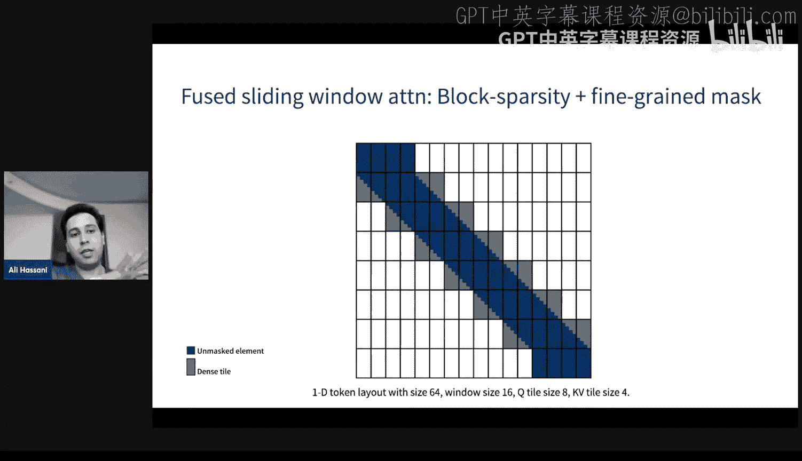

And so this is actually pretty simple and easy to do and the first successful example of it was Mstrol 7B a while back and if memory serves me right。

 the Mistral team contributed both of these features that I mentioned block Sprsity and fine grade mass into both flash attention to which was save the art at the time and the ex formerers FMHA kernel so and since then I believe it's kind of caught on and it's in most packages you can either find it or it's super easy to implement and there's also been other success stories of just localization working in large language models like coherce command A in deepses native sparse attention although that one uses sliding window as one of the methods they use Lama4 was based on blocked attention so I don't believe actually I don't know I never got to find out like I think maybe it was implemented with flux attention or maybe that was just the inference so I'm not gonna to guess but these are all to me success。

Well instances of block sparse attention or some form of attention that is block sparse that you implement with block sparsity in the language space。

But the thing that all of these share is that they still live in that single dimensional token space of language models。

 meaning you only have query sequence length， Kv sequence length， Everything's an integer。

 everybody's happy。 But then when you step into multiple dimensions， it's going to change。

 So this is this example that we just saw in 1 D。I'm also including something here which is to say okay over here so the specs of the problems the problem is this so we have 64 tokens with a window size 16 and so this is like a quarter right so you would expect a 4x speed up if you were to go just by flops right but if you actually go ahead and count the number of tiles that you end up saving then you'll see that the upper bound performance as long as like your Q tile is8 and KB tile is for these are very dummy examples。

If you go and calculate your speed up based on just savings and tiles。

 you'll see that it's actually 3 x。This this is like one key inefficiency。

 you can think of it in sliding windows is that this will always happen。 This is unavoidable。

 You will never really hit that flopwise speed up。 So unless you absolutely care about those inductive biases that sliding window gives you。

 you might not really care about it and you might go for something like blocked attention。

 But then again， it would be good if there was a tradeoff between those two。

 So here's what I mean by it gets complicated in 2 d is that if you look at this in 2D。

 if we take the same example， and we say， okay， our 64 tokens are actually on an8 by8 grit。

 And I want to do 4 by four sliding windows。 And my tile sizes don't change。

 then the expected speed up drops from 3 x to 2 x。 And the reason for that is what we label the curse of multidimensionalality。

 which is that if you're still doing your tiling in 1 D。

 then you're going to inevitably load a lot of。Basically load a lot of tokens into memory that corresponds to somewhere that's on the other side of the multidimensional space that you're dealing with。

 but the only reason you're loading it in is because like spatially like in memory they're close to each other and that's how you're doing you tightly。

So this can actually hurt your user experience a lot and again。

 the only the best way to understand why is just flipping between these two examples。

 So over here you can see that we're using many， many more tiles we're visiting many。

 many more tiles and this is what limits your speed up So that was kind of the whole point of the faster neighborhood attention paper where we introduced the FNA methodology or  fused neighborhood attention and it's again。

 it's again an FMHA kernel we took the Exers FMHA kernel and we made some changes the first one was multidimensional tileling So if you're dealing with a one dimensionmensional attention problem you just have a 4D tensor literally。

That's， batch sequence length heads and head them。You really don't change how tiling is done。

 but then if you step into the 2D problem where instead of a sequence length。

 you have two dimensions， you have like an X and Y axis。

 then you no longer apply the same type of tiling where you go， okay， this is one tile。

 This is one tile， This is one tile and you do it like that as if you you had flattened your entire 2D grit。

So what you do is you just look at what the tile shape in the kernel is。

 the tile size and the kernel is， let's say it's 64。

And you reinterpret it as a multidimensional tile， like an8 by 8。 If you were doing 3D。

 you could reinterpret it as 4 by 4 by4 or pretty much any numbers that if you multiply make up the original tile size。

 So by doing this， you're kind of making a hack in the kernel so that the tiling is done differently。

 But then the rest of the logic in the kernel。again。

 it's super hard to do this in newer FMHA kernels for like Hopper and Blackwell。

 so it's not always a super easy thing to do， but in that particular kernel it was like somewhat easy because it was still in the cutlist 2。

X API， so it was really easy to do really hacky things。

So what this ends up doing is it loads in tiles of Q and KV that still preserve spatial locality。

 so this minimizes the number of tiles， this just reduces the number the number of dot products。

 the number of flops that you waste， the number of dot products that you mask。

And a second thing that we implemented was dynamic KV tileling。 So like I said。

 if we go ahead and tile our entire context with some tile size。

 as long as there's even a single dot product in each tile that is not mass。

 you're supposed to visit it。 So what this basically means is that for this demmy problem here。

If we consider that the Kvs that is going to need to produce the attention outputs for just this one Q tile looks something like this。

 which it will because this is sliding windows。 So the Kv region that you're going to be interested in is always going to have is always going to be like a haload version of your query tile。

 So if we need all of this， we don't save of any compute we end up visiting all of these tiles just to get the small region that could probably fit in a two by two or like four tiles。

 So we visit nine tiles， all nine tiles instead of four tiles。

 So the solution was we did dynamic Kv tile， which is you first go ahead and just crop that region out of memory。

 not explicitly you just offset your pointer and then when you're like building your tensor object。

 you kind of pay attention to the fact that its bounds are now changed。

 It bounds are no longer the shape that your QkV was it's something smaller because're like localizing it。

So it's basically a different expression and an offset of the same tensor。

 So what dynamic Kv tiling gives you is well its it's a pain to try and visualize a block sparse mask for dynamic Kv tiling because you no longer like different Q tiles depending on where you are you no longer agree on where the tile bounds are because everybody gets their own unique crop out first and then they start tiling it。

 so it's a little bit painful to analyze， but it saves you more compute like in this case it could very well just save you a lot of compute by skipping visiting all nine tiles and only visit like four tiles。

And then the second element of it was just the mask right we just took the same formula that we've been using to define neighborhood attention and you basically plug it into the softmax slash masking stage of your attention kernel。

 you just traverse everything， figure out what the original Q and KV coordinates were and figure out whether this should be masked or not。

But the problems with it were， first of all， like I said， we started with the Xformers FMHA kernels。

 so that was great because we could and still are supporting GPs as old as Maxwell in Na。

 which is this package that we ship all of our kernels and so that was great at the time， but。😊。

The state of the art， even at the time for Ampere was flash attention too。

 So because the performance upper bound of F2 is better than FMHA。

 even if you're doing self attention with an FMA kernel， you're going to see worse performance。

 So you're going to have to do a lot more sparsity to even compete in terms of speed。

 That was one problem。 Another problem was the overhead of this multidimensional tiling。

 if you just implemented in software can be very high。

 And the reason for that is it introduces a lot of software predication overhead。

That you simply cannot avoid N is。Really difficult to optimize。 I didn't try too much。

 but I I did make an effort for a while to further optimize it。 And it was really difficult。

 And so in newer architectures， this wouldn't be a problem because you have hardware predication things to things like the Tma now。

But at the same time， it still complicates the overall design of your kernel。

 You need to change a lot of code。 You need to familiarize yourself with literally every almost every line of code in what was C plus plus kernel。

 So it's a big headache。 You have to a lot of things just break many other assumptions that are made in the kernel。

 So it introduces a lot of it requires you to make a lot of changes and it's really difficult to。

Optimize and and one way you can actually observe this is if you try to run those original fN kernels and just give it like a two dimensional or three dimensional problem。

 but then switch it from like actually being flattened out to 1 d to 2D to 3D。

 What I mean by that basically is like let's say give it I don't know 10 to the I don't know。

16 k sequence length and then reinterpreted at something that's 2 d and then 3D。

 you will see the runtime increase just because of that extra hardware software predication cost。

 But then the second biggest overhead was fine grain masking。

 It's a lot of integer operations and in a very， very critical part of your kernel。

Especially in newer architecture， so fine grain masking itself can introduce some non-zero over to your kernel and so the problem with this was while it was a massive improvement on kernels that we had previously been shipping in Natan。

 which were our old naive kernels and later our gem base but still unfuseed kernels。

 it was a massive improvement on those， but still to people who are interested in realizing really good speedups compared to the best attention kernel that's out there。

 it wasn't simply doing enough， especially if you were to run this on Hopper or blackwell。So。

I'm going to talk about the problem in sliding window attention in general that waste flops first before I talk about how we address the issues in that FNA kernel。

So like I said。Just this fine grain masking。 It's kind of easy to see that it hurts your throughput because you're paying for the flops。

 but you're not using them and you don't measure them in your flop measurements， right。

 So because of that， naturally， any type of sliding window attention is going to hurt your throughput。

 You're doing the same flops as something that's not a sliding window attention。

 Let's say some form that's perfectly blocks spa。 So you're not。

So you might be doing the same flops in theory， but you're going to have a different through。

 but you're going to have a different runtime because the other one might be wasting a lot of extra flops。

So the way we attempt to solve this is by saying， okay B attention is probably an extreme case so can we do something that's kind of in between sliding window and block attention and that's actually super easy to do like the research had already been done in 2021 in this paper called Haonenet again included in the end highly recommend you read it because they have an extended discussion on how how applying this effect trades off translational like covariance。

 but sometimes you just have to do it for efficiency gain So what we do is we're adding we added a new stride parameter to neighborhood attention so we had kernel size we add dilution and now it has stride and I seriously mean this it could use padding like I envision a padding API for it as well that might be like required by some applications so what strideide does is basically has the same effect very similar effect that convolution does strideide does in convolution。

So it basically introduces a delay step in your sliding window。

 but another way of looking at it is that it groups queries together in that multidimensional space that we live in and then those queries get to attend to the same window So they are forced to share their neighborhood So by that and so the implication of that is if your stride is one then your query groups or your stride groups are just made of one query in them so you'll still have standard neighborhood attention but then if you set it to something like two by two。

 then as you can see these this like two by two these two by two groups of queries get to share their entire window so that effectively introduces a delay in the sliding window again similar to convolution you can increase it further and how they get to decide what their neighborhood is is they elect some middle query which again can be arbitrary we just don't have the APIs for it yet but you get to decide who's going to be the leader query it's going to pick what the neighborhood's going to look like。

And if we take it even a step further， just like in convolutions where you can increase stride up to the same value as kernel size and get non overlaplping windows。

 you can do the same thing here and the non- overlaplping windows here。

 surprise it's just blocked attention it's just Windows self attention。

 so this basically means you can implement blocked attention even though you don't need to implement it with Na and you can implement it with Na today with neighborhood attention。

 just set stride to Windows size。😡，So that was like the first goal of this project that we did called generalized neighborhoodighorhood detention。

 which was we wanted to unify all of these patterns's it's no longer sliding window or blocked is just no I want the entire family I want to decide exactly how much of that translational equivariance I trade off for performance and I want to make sure I do get better performance which is what I'll talk about next。

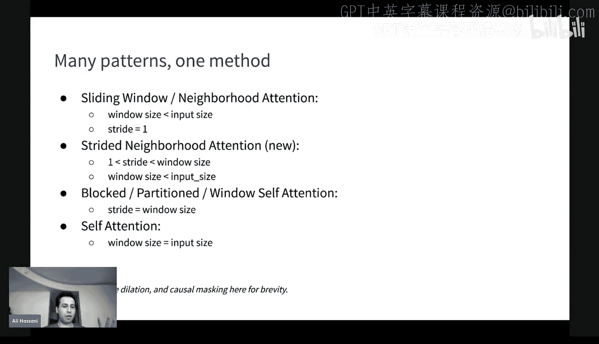

So basically all of this is implemented and supported through， like I said。

 our Python package Natan today and the freedom that it gives you is you're in charge of you can decide what your token layout is going to look like in 1 d2D or 3D in this case。

 like a 3D example， so again， we don't have an integer sequence length。

 we have a layout for our tokens or really a shape that's 12 by 16 by 20 like a 3D feature map。

And for each dimension， you can freely choose your kernel size or window size as long as it's smaller than or equal to the input size。

 if it's equal， it's just self attention。You can freely choose your stride value。

 which should be less than or equal to the kernel size and you can freely choose your dilation as long as dilation times kernel size is smaller than or equal to your input size。

 and you also have causal masking support， which means you can， for instance。

 in applications where you your your token layout has like time dimension like let's say videos you have one time dimension and two or more spatial dimensions。

So you might want to have causal masking across time and not space and you might not even want locality across time where you might want less sparsity a long time。

 but you want more sparsity in space again， all up to you。

 you have the freedom to do that and we thoroughly test all of these against reference kernels to make sure that all of the kernels that we build and ship all of the implementations are actually correct。

And so let's talk about the effect of stride on speed。

 I'm going back to a 1D example because it's so much easier to understand it in 1 D。 So this is。

 again， the same problem that we saw before it's 64 tokens。

 Windows size 16 Q tile size 8 Kv tile size 4。 So if you go ahead and just write this out just just count the number of tiles you save。

 you're saving。84 tiles out of 128。 And that's why you don't get quite that4 x speed up is because in order to get that。

 you have to save 96 tiles or， you know， three quarters。

 whatever your whatever is proportional to your savings and flops。 So with stride 1。

 you can't do that。 Now， let's see what stride2 does。 Well。

 one thing that's immediately visible is that the effect that strideide has is very clearly just more is just coarsening the sliding window effect。

 So it's really fine now， if you keep doing it， if you keep increasing stride is going to make it coarser and coarser。

But the problem is。It's not a guarantee of saving you more compute。 as you can kind of see。

 the actual speed up or the expected speed up is decreasing sometimes with with increasing in stride because the number of tiles we're saving is decreasing。

 You can kind of see it happens right here。 like there's these two new ones that just because of these pesky tokens here have to suddenly visit that entire tile。

 So strideide isn't always a plus。 and it's not a guarantee to be。 So at some point， though。

You might end up with a stride that saves you more compute。 And in this case， this is。Excuse me。

 this is actually the perfect example because you achieve。

Full block sparssity and what this means is you waste zero flops。

 you don't even need the fine grain mask， you can even disable it。

 save yourself some of that overhead。So this is actually pretty interesting。

And this is also not blocked attention。 So it's not blocked attention。

 but it can actually give you fl proportional speed up。

 So why even do block attention in this context。 And that's why strideide is such a powerful new parameter is that there are。

There are forms of local attention that are less coarse than blocked attention and the more the coarser it is。

 the less the quality， that's at least the argument。

 So you can if you can have something that's less coar trades off less quality then blocked attention。

 but saves you the same amount of compute， why not just use that。

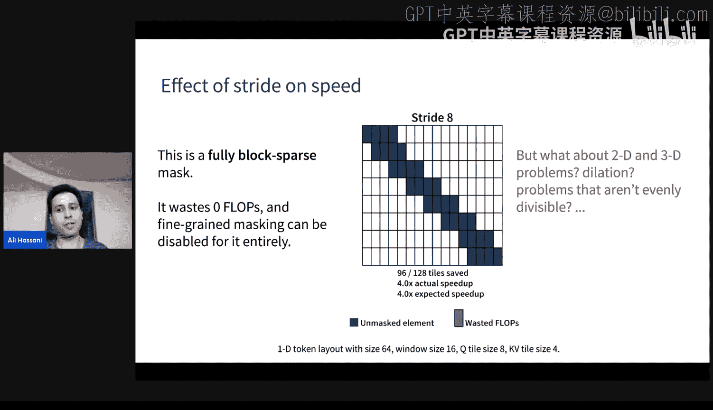

But this is where it gets complicated with 1D， no dilation， nothing like that。

 it was pretty simple to see， but what what about 2D and 3D problems。

 What about when there's dilation， what about problems that aren't evenly divisible by these tile sizes。

 What if I do something like dynamic KB tiling in our old FNA kernel versus static KB tiling。

 What if I'm not even doing multidimensional tiling， What if I want to do a study。

Do we even need multidimensional tiling， let's say。 And I haven't done that study， by the way。

 But so what if we want to do something like that。 And we have so many parameters in G or neighborhood attention。

 Natan itself， you have you're in charge of what window sizes try dilation causal masking。

 that's also assuming you know what your input sizes are。

 you might just be the architect like a deep learning architect of a new architecture for some application and you might have some freedom over what your input tensors are going to look like。

 could you measure into your I don't know， preprocessing or something like that。 But anyway。

 you have a lot of variables that that are that determine how much compute you end up saving。

 So we really wanted to be able to study the performance implications of these without having to write kernels and actually run them or even having to having to run kernels。

 So before we even started working on any new implementation or kernels。

 we started with this analytical study。 And so what we came up with is a simple program that we call Natan。

Simulator。And what it does is it takes in all of those variables， your use case。

 what are your tensor shapes， window size， strip dilation， etc。

And it also takes in kernel design choices， it can be for a kernel there already exists。

 it can be for a kernel that you're planning to work on， what if if it's pretty reasonable to ask。

 okay， let's see what the returns can look like before I decide if it's even worth my time to work on this kernel。

And all that this program does is given those variables。

 it's just going to report the number of inter loop iterations or Kv tiles for each query tile and you can use those statistics and I don't know。

 you can average it or take the maximum just the worst case scenario if you're if you're issuing only a single wave then taking the maximum makes sense。

 but in some other cases and might not but you know it's the worst case scenario。

 So you can safely take the maximum of these inner loop iterations or Kv tiles over all query tiles and then use that to compute a speedup over full self-atten。

 which would visit all of those tiles and so the entire argument here is that your actual speedup that you're going to feel if you write something with very limited implementation overhead is going to be very close to savings in terms of tiles and not flops obviously so that was the whole point that of doing this and。

It's actually pretty effective， so excuse me the visualization that we're doing here。

 which is from our paper。We're applying a very strong filter。 So in this case。

 we knew our target was， let's say Hounian video。 It's a popular video generation model。

 And we knew we wanted to， let's say introduce 91% sparsity。 We knew a few details about， okay。

 what if we implement this kernel on this hardware， The hardware in question was blackwa。

 And we knew some things about the tile sizes and shapes。

 But what we did not know once we settled all of those is what stride we were going to use。

 So you can simply run the simulator。 Just run an entire sweep on all possible stride values。

 It's not going to even take that long。 And you will have results for that。

 But then visualizing all of that。Can be confusing at times because like we just saw。

 an increase in stride is not a guarantee in speed up。

 So we applied a very strong filter here so that we only see cases where an increase in stride is at least giving us better performance。

 So we're just going to exclude everything else。 And as soon as you hit that perfect speed up that that Fwise speed up that you can't even get better then。

Then there's no point in even continuing the search。

 So as soon as you hit the smallest stride that can give you perfect blocks vrssity， you whim。

 You have a stride value that you can go and experiment with。 Now。

 if your application is too sensitive to this， then you can choose some of these stride values that make sense to you and do so many experiments and see how far they'll get you。

But then again， the point of this is you don't need to run the kernel over and over again if there is a kernel to figure any of this out。

 this is just giving you speedups and you can use these speedups very easily to you can translate them to end to end improvements and that way you can justify whether you need a new kernel。

 whether the existing ones are going to be enough for you because once most of these details are settled out。

 you can just go ahead and run it。But anyway， so this is what this simulator can produce for you and it's actually pretty useful。

 so now I'll quickly shift into our new Hopper and Blackwell FNA kernels unless there's any questions with everything else and the new design choices that we're adopting。

Yeah， so Lee， like the main thing that popped in my head is you' were talking was like you're talking quite a bit about like not doesn't seem to be like a。

Like a kernel， it's like more like a kernel generator， like basically given like an algorithm。

 like generate like the fast kernel for depending on some trade offs between like a stride and you want like block sorry whether you want blocks sparssity or like neighborhoods varrssity。

So it sounds the most similar to something like flex attention to me like and I'm sort of curious if you've thought about like the trade offs between the two libraries right so two things one。

 it's not a kernel generation tool by by any means so we take primarily today all of our kernels are in cutlas so we take cutless kernels and we modify them and we introduce this whole like today we only have few kernels So today we basically have a bunch of those fNA kernels just with different design choices that are based on。

Attention Cors from Cutlas。And so the rest of Natan is just about doing whatever extra tools that are going to be necessary to run all of these。

And so the difference with flex attention is exactly that that it doesn't allow arbitrary masks。

 you can only use masks that are compatible with like how neighborhood attention is defined and set up。

So at some point the two might converge because we do keep trying to generalize the neighborhood attention formula further and further and add new features。

 so at some point it's possible that the two might converge to the same place but my understanding of how flex attention works and I might be wrong there is well either like if you want to do something like flex attention。

 you either bake some static some static attention mask into your kernel which can be limiting or you just develop a kernel that loads in a block sparse mask or can at least do the block sparse parts on the fly and then loads in the fine grain mask for memory。

 there's a lot of design choices there so it is possible for these two to converge but where we're kind of going with Natan is that we want to approach something that can potentially give you zero overhead so you don't really so you can。

run pretty much any use case that fits within that family of attention patterns and at the same time you don't have to need to compile them and there's a guarantee that you don't load any explicit mask for memory or something like that like I said it is possible for the two to converge but know how they end up delivering the performance and running looks very different today but by the way we do have a flex backend to we've just disabled the compilation part of it because it doesn't pass all of our unit tests might be a bug that we're trying to figure out but sorry or you going say so it seems to me like I mean typically when I guess in your community when when you guys say block attention you mean dependencies like between the current block and the previous block but I think if you generalize like let's say arbitrary blocks plus you allow a neighborhood attention which can go from a neighborhood of nothing to a neighborhood of your whole matrix it seems like you can cover a fairly。

Powful range of attention masks with just blocks sparsity and neighborhood attention right yeah exactly you can So with neighborhood attention。

 you can like I said， neighborhood attention itself without stride is never fully block sparse unless like you're doing selfattention with it so unless certain conditions are met it's never fully block sparse but yeah today it gives you the freedom to like enjoy speedups again on Hopper and Blackwell。

 you can actually realize that with respect to modern kernels on api it's a little bit limited when working on that but so it is it gives you the freedom to run whatever you want and unless it's some edge case where you have a really huge window size that it's like impossible to get any kind of savings out of that unless you're one of those exceptions you're also going to see really good speedups over it but no it's still not an arbitrary mask because there are a lot of patterns that you can come up with。

That are not implementable today。 Our hope is that we can support as many of those as possible。

 but then at some point， you might just want to pick your sparse pattern at runtime。

 like if you want something that's like circular or something like that。

 then it really falls out of out of what the neighbor and attention formula gives you。

 So there's there's still some assumptions that we make with respect to what our block sparsity looks like that again。

 over time we're going to try and relax， and I hope theres。

 I hope I can work on this project long enough to support arbitrary mass and at that point it will be really interesting if this and flex solutions like flex can kind of come together and just be one solution。

Oh thanks El， that's it for me first great， so so to talk about these two kernels。

 which I believe I personally myself believe that I would sooner graduate and finish my PhD than be able to work on both of these。

 but so a while ago we had a curious thought and so it kind of originated from seeing a few implementations of NATin and flex attention。

And that kind of already actually that actually started with a conversation I might have had from anyway。

 it doesn't matter。 So what we， what we kind of thought about is that。

If if we could simplify the design of our kernel a tiny bit by paying the tiny cost of like a small memory operation ahead of the attention operation。

If we could afford that， then we could then we should really consider it because it would simplify the design of the kernel it would simplify a lot of things it would open up a lot of doors。

 So that's what we considered。 And at the time we were dealing with only the cosmos and Hoian use cases。

 so we basically executed I believe Ky and and or cuts attention at the time on a black hole GPU on those problem shapes and so we collected the runtimes。

 then we figured okay， if you were doing FP16 and if we consider the size of your QKV and output tensors and the data type there in all of that。

 if we consider that we can write a memory copy or just a copy kernel。

That can almost fully saturate the eight terabytes per second bandwidth that you have on a B200。

Then it would take less than 1% of the full selfattention time to rearrange all of your tokens once。

 And it doesn't really matter that it's really difficult maybe near impossible to fully saturate that 8  TB per second。

 at least in all use cases。 but 1% was still like really small。 And again。

 in some the more you don't improve it， the worse it's going to get。

 But at least on the scale of problems that we were dealing with。

 it seemed like a pretty reasonable cost， considering that if you don't do it and you try to do token perm。

 even though you do hardware predication， you don't know if that's going to be without any overhead。

 And not to mention you're going to have to change a lot more in the attention kernel to get it to happen。

 So at any point you might introduce some unavoidable overhead。

 So that's basically what we thought about and。So the way you actually do this is relatively simple。

 at least conceptually， is that you can perform that static multidimensional tiling。

And just apply a copy operation to kind of flatten those tiles。

 And this kind of simulates the multidimensional tiling without the kernel actually even being aware aware of it or having anything to do with it is more accurate。

 So in this example， for instance， suppose this is our 2D grid of tokens， it's 4 by 4。

 And if we take just this one tile and flatten it and store it in memory like this。

 Then we know that whatever tiles our attention kernel ends up loading are going to preserve spatial locality。

 So that's pretty much all we need to do to break that break free from that course of multidimensionalality。

 So。Pros of this are makes your implementation simpler， like I just said。

 so you can make very little very few changes to your FMHA kernel and get this to pass all of your tests and at the same time there's no more extra software predication it doesn't even matter if you could relay it to hardware you just don't need to do it because it's a memory operation that you do ahead of time the problem with it though is well you always have to do that memory operation and it's repeatable it's exposed and it might be hard to get rid of in some cases。

 but in many cases， you can actually reduce this to only occur twice in your model you do permutation once in the very beginning and unpermute once in the very end because many use cases might not as long as you're not using dilation basically and as long as you're just dealing with a typical transformer you're just doing attention MLP attention linear layer etc。

 then you're fully invariant to permutation or echovarian might be more correct。Anyway。

 permutation really doesn't matter so the rest of your model doesn't really care。

 The only thing that cares about it is the neighborhood attention in it and even self-attention wouldn't care about it again。

 unless there's padding you need to do there are some exceptions but in many cases you can just factor out this token permutation do it once in the very beginning and then undo it once in the end and this will minimize the overhead from that memory operation。

We don't do that ever in practice yet， but there's a lot of work to be done on optimizing token permute。

 But anyway， so we were able to just by changing our approach to how we implement FN kernels。

 we were able to develop kernels a lot faster。 So very quickly we had blackwell kernels and then we had hopper kernels。

 And so now this is kind of what performance looks like is that in a lot of these cases that we studied in the G paper。

 you can actually if you exclude the memory operations。

 you can get speed up that's proportional to your sparsity level。

 And the reason why this is interesting is that it's effectively showing that there's very little overhead from just implementing that extra block sparsity。

And that's what we were really aiming for because like I said。

 the memory operation a lot of times you might be able to minimize it and again。

 even it might not even be that big a percentage in your end to end workload。And on blackwell。

 it looks a little bit similar。 the speed ups that you get do decrease a little bit in some cases。

 but again， in all but one use case， you still hit that flat proportional speed up。

 This is all operation level。So how much can it be end to end well。

 like any other sparse attention approach？😡，Or most is more accurate。 if you're prepared to train it。

 you can introduce more sparsity naturally， right， So the larger the share of selfattention or workload and the higher sparsity you can introduce。

 Well， the more your returns are。 But if you can't train。

 then the amount of sparsity that you can introduce is going to be limited。

 whether the percentage of sparsity， or whether you consider how many layers you introduce it into or attention heads or in case of diffusion models。

 diffusion steps。 So I'm including a table from our paper here where we show this kind of on cosmos。

 different settings， not as many settings as are possible， huge。

 but primarily four different settings。 So two levels of sparsity， roughly 50% and roughly 90%。

And then two settings， one where you apply sparsity to all the diffusion steps and one where you hold out a few self attention steps just to get better quality。

 and these will have different visual results， and some of them might be more acceptable than others and some of them less。

For instance， with cosmos， we couldn't introduce too much sparsity but with Hounin it was more。

 but anyway we're more curious about the speedup that you can get and so in the paper。

 another thing that we did is we also report it are expected flopwise N to end speedup so if we were to assume that these are all 56% sparse attention layers then your speedup would be in terms of flop would be super easy to calculate because you can calculate your flwise sparsitys just one over one minus 56% or 100% minus 56% but anyway we specifically include to show that it is really easy to have multiple different sparse attention methods which is kind of the whole point of stride it could implement block attention for you too and their flopwise speedup is going to be identical but it's not really a good measure because you should really look at how many tiles you save what percentage of block sparsity you achieve basically and so that's why that up。

Being very useful and it was also a useful measure for comparing our actual end to end runtime to some analytical figure to see。

 okay， how much more improvement can we make to this thing？And so with cosmos， like I said。

 it was more limited with Hu and what was also interesting is that the percentage of the workload that was spent on those memory operations was so little that we didn't even have to make any optimizations in a lot of cases we would achieve a speed up that would basically the speed up the difference between。

The theoretical versus actual speed up would be within the margin of error of each runtime that you get So in a lot of cases。

 we basically got flat proportional speed up at least end to end that we were expecting and so I'm going to talk about one use case that we did recently was part of my summer internship at NviIDdia where we took the recent cosmos predict two models in this time we trained it with sparsity and this was kind of a case in point that if you're prepared to train you can kick things up a lot。

 So what we did was we use both types of attention that at least in terms of receptive field that neighborhood attention can give you both local forms of NA and dilated forms。

And the the approach we had for introducing this into the existing architecture was we just took the model that was trained with full self attention and we。

Basically started measuring how much error is introduced by various sparse attention patterns。

 most of which we got from just the Nat and some program。

 So we had a curated list of different sparsity levels different were the reforms that were dilated there were formss that were a mixture of dilated and stride there were various kinds and all of them were block sparse。

 So we basically just looked at how much error would be introduced with respect to self-attention at each layer you can make it more fine-grained and do headwise。

 we just didn't have time to do that so if you do had layerwise。

 it's still pretty successful and then experimentally we came up with a threshold for that error where we said okay anything thats within this threshold we're just going to pick the highest level of sparsity that is within this threshold and it was actually pretty successful。

 like you didn't even have to train it that long typically for a fraction of what the original model had been trained for but you just resume training and it relatively quickly recovers the addition。

Loss that's introduced and the end result that it gives you is and this was cross GPU architecture so we had measurements for various hopper GPUs and also the B200 which is the black hole GPU and of course there were variants there's a 2 billion variant and a 14 billion variants the tension workflows were different。

And there was a 10 FPS and 16 FPS variant too， so lots of different variants。

 but you could get really good speedups like with the 2B variant， you could get anywhere from 1。

9 to 2。6 x n to end speedup and with the 14 B 1。7 to 2。1 x。

 that's just because the share of attention was just lower in the 14 B model。So it went pretty great。

 at least in terms of these statistics， but quality wise， we also observed that， well。

 while they can't reproduce identical videos or worlds that you can you know take the difference with and do further analysis on because these are different checkpoints of the same model quality was seemingly mostly not affected in a lot of the samples that we went through and and even in the benchmark scores that we had。

 So if you're interested in this， I'll include a link to this project as well in the end and keep an eye out for。

Further reports on this。And so I'm just going to quickly skip through the slides here that kind of share the samples。

 but I feel like there's a lot of videos out there that you could just refer to for that。

 So that's that's the end of my slides if there's any questions I'll take them now otherwise I'll just move on to going over the code in the live demo。

Thank you Lee yeah， I think a lot of the questions have been already responded to by your colleague the Kae and chatd so I think we can probably keep going Okay great so perfect so let me okay I'm still sharing this window let me go ahead and share my terminal。

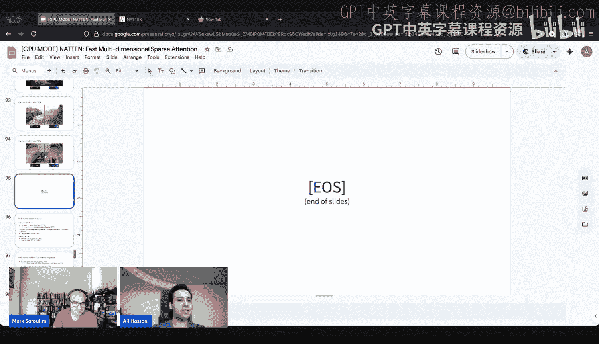

嗯。Okay， so are you using my terminal？Os what happened is everything readable do I need to make the font size bigger maybe thatdd bigger？

That's it that。Okay， so its okay， great So I'm just gonna quickly go over a few things in Natan。

 there's not enough time for you to go through all of it。

 but in case you're curious about any part of it。 So the organization of it is relatively simple we have a CSRC directory where it's all of our couda C+ code that we build into what we call Libnatan。

 if you're not a couda user， you're not going to be dealing with this because the only implementation。

 the only backend that we have for non-kuuda users currently is just our flexback and that's just in pure Python pythtorch And then there's our Python package here you can choose to run our unit tests and mess around with them。

 especially if you're trying to add an optimization PR are very welcome。

 but also there's some scripts that can help you change the autogen granularity to generate more build targets or fewer to like optimize your build time or。

😊，Basically stamp out instantis with tile sizes that we don't currently ship Nain with。

So I'll quickly just go through Natan itself as like just if' if you're an end user。

 we offer obviously like the various neighbored attention functions you have maybe sorry I'm just thinking maybe it's easier to just go through these quickly if I share my browser and go through our docs so if you' if you're an end user interested in Na I go ahead and share this I hope everybody's seeing my browser at least that what it looks like there okay so if you' if you're an end user。

 please visit our website， it's just packed with documentation and we try to keep improving this as much as we can so if you're an end user what you would use is either our torch modules or operations we have like 1D2D and 3D neighbored attention functions that you can call do back on whatever you want and then we have just standard attention and the reason why we pack our own attention kernels like fold self。

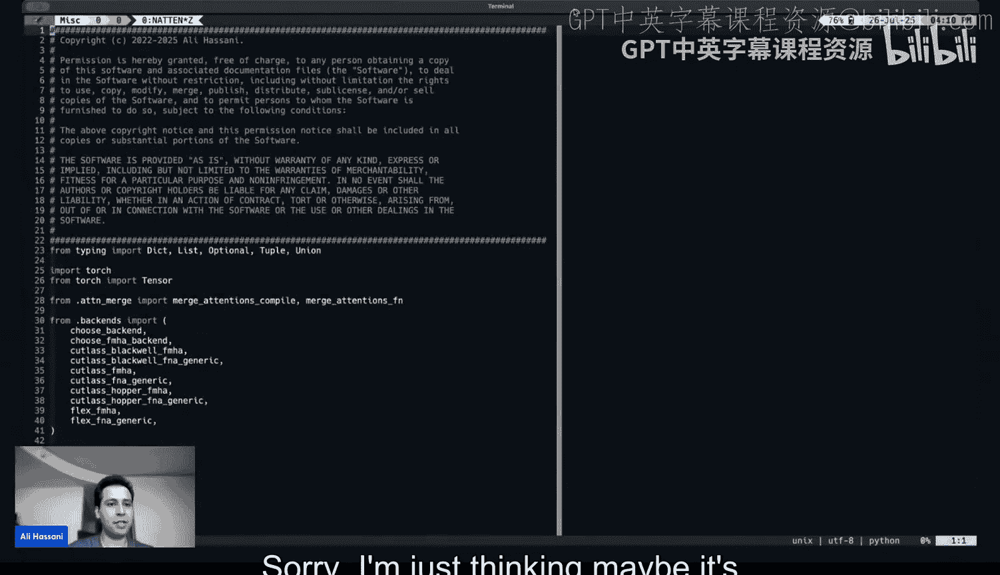

kernels is that we have some APIs for doing neighborhood cross attention。

 which is just standard neighborhood attention， some cross attention。

 and then you do merge attentions similar to what you would do with context parallel So we offer APIs for those in case you want to run those we also have fast path so if at any point we detect that your problems actually a self- attentiontention problem。

 it's just going to run a self- attentiontention kernel instead of like like an FMHA kernel instead of an fNA kernel so but anyway。

 like whether you want to do 1 d2D or 3D problems， you can just simply call these operators or use our torch modules。

 whichever one fits your needs better there's some examples of what like the signatures are in how you're supposed to pass arguments to them。

And then you have like some primary parameters that are just related to just the attention。

 the type of attention that you're trying to run。 so obviously kernelnal size stride dilation causal what have you the attention scale that additional cross attention that I mentioned and there's also other parameters。

 these are all performancenobs and some of them apply to only certain backends that we have and so if you want to get the best performance you would go around and play with these。

 we also have a profiling toolkit that kind of automate some of that eventually we're going to just keep improving the experience of this so that the defaults give you close to what's the best performance。

 but you know you can obviously always go beyond that。

And so primarily the things to look out for are what's the backend and like I said。

 we have our cutless FN slash FMHA which is the same fNA kernels we did last year that I said。

 well obviously has that token has that software predication overhead and so performance might not be as good as you might expect we also note then on our backend pages but then there's also our hopper FNA or FMHA backend and blackwell backend and these can get you very good performance and there's also we also have both functions that you can call with your input tensors that can return a list of all the configurations those are mostly just tile sizes and some additional knobs if the kernel has them。

So you can use these interfaces to figure out what tile shapes we even support currently。

 And if there's some tile size or shape that might be valid that you might want to try。

 that's not currently support it， we can obviously add those you might be able to just add those and build that in from source。

 but anyway， like this will be like an entry point for that。 But again。

 like the profiling toolkit also gives you that。 This is just an easier way to do it through Python code and not have to deal with the CLI Similarlyly with our flexbackend we have like similar functions where that give you these valid choices for these performance knobs。

That you can use。 So the the biggest thing that I encourage folks who are interested to play around with is our profiling toolkit。

 which is not anything too complicated。 It's using the Pytor for a filer under the hood。

 But what it does is you can give it problem shapes and problem sizes and and window sizes and strides in all of these pretty much most of the use case information and knobs that we support。

 you can give it and you can just experiment and and see what the result looks like。

 It has a dry run mode that just prints out all the like I said。

Valid values for those performance knobs that are supported for every backend that supported for your use case。

 you can run the optimize mode， which will basically pick the best backend for your use case that's available and run through all of the performance knobs and select the best performance once with some backends like our cutpllas FNA of MHA backend where we have a lot more configs。

 it's going to take a lot of time to do that So use it smartly。

 But eventually then the simulator program that we use。

 we intend to integrate it into the profiler so that instead of running over all of these configurations。

 you can。

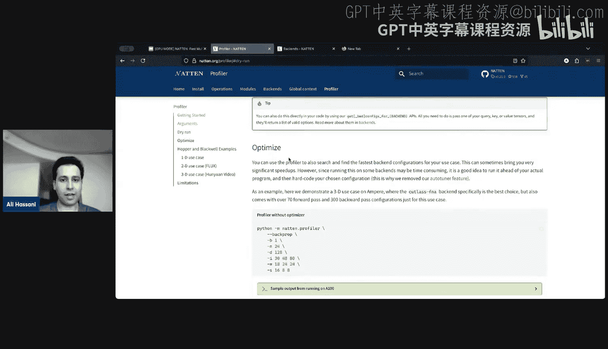

At least reduce your problem space a little bit by figuring out at least what tiles give you the best statistics。

So I'm going to stop this here and just go back to the terminal now， but if there's questions。

 feel free to ask。

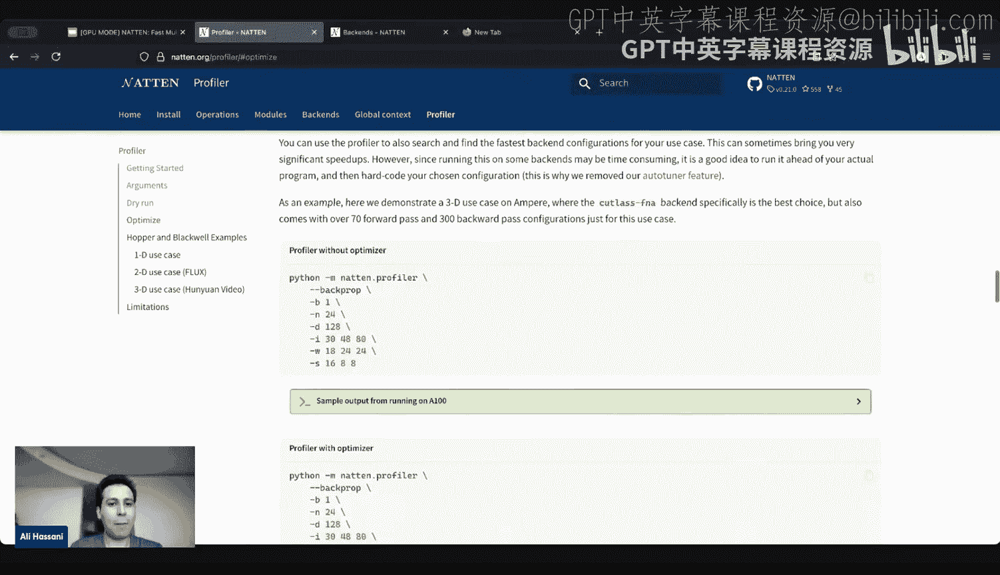

嗯。There we go。

Okay， so I trust my terminal is visible again。 Okay， there we go。

 So so within that and how we kind of separate out all these concerns is that the entry point。

 those that attention and neighborhooded attention functions that we have basically just check all of your inputs and make sure that the backend supported if you're specifying a backend and if not we'll select a backend for you。

 And then eventually they'll call into the individual functions for those backend。

 So if you're if you choose blackwell F Mha in your device supports it or if it's chosen for you if you didn't specify anything。

 it'll call that and similarly everything else。 But then the backends themselves。

 we like separate out into this。Part of the package where well， they might have their own。

 they actually do vary a lot in even how their autograd functions are constructed。

 So like the original FN doesn't have token permute in it。

 So it just like it autograd function is pretty straightforward。

 It just calls in the C plus plus function that is going to launch the kernel for both forward pass and backward pass。

 like I said， it doesn't do any explicit memory operations implements pretty much everything like a champ without even raising any issues or needing any extra operations。

 That's like the mindset。 But then if you look at something like let's say blackwell FN。

 then it looks a little bit different because。Because we have this token permute bit right here so in your forward pass。

 you have to do token permute and token permute is comprised of well。

 you might need to pad it first before you can do the permute and then the way we define token permud which I'll later show you is specifically checked to make sure that we perform one memory copy operation and nothing more and like I said。

 it's in pure Pitorrch right now， we might end up having custom copy kernels for this to utilize more of the bandwidth because I think on blackwell。

 especially it's like not that great it's like one8th of the bandwidth that's available but still like it might not be as easy as we think。

 but again， if you're curious and you're interested in copy kernels and you're interested in contributing。

This might be one area you can improve。 And so anyway， once we perform token permud。

 we basically have query， you value everything， a permed version of them。

 And these are all going to be 4D tensors。 So if you're doing。

If you're doing one dimensional neighborhood attention。

 you do you basically have a 4D tensor comprised of well batch sequence length heads head dimm。

 so you always have that three dimensions for batch and heads and head dimm。

 but then if you're doing 1D， then you only have one additional dimension for your tokens if you're doing 2D it's going to be 2 and 3D3 so you end up we pretty much everywhere asserted all of these tensors are like either rank  four。

5 or six。So and based on that， we determine what type of neighborhood attention you wanted。

 So the thing here is that the inputs to this kernel here that is going to be run is just going to be a bunch of 4D tensors because we're doing token permutation。

 So again， we're keeping a copy of the original QKV shape before we pad it before we do token permuter or anything。

 And later in the kernel we use this to figure out our block sparse mask and find green mask。

And then once you're done， you just token unpermute or reverse the permutation for whatever your output was in the forward pass。

 that's just output in lock and X。 And in the back。

 it's just going to its going to be gradients for QK and V。

 So and the backward pass is actually a little bit more complicated。

 and you also have to repeat token permute for some of the same tensors like  QkV and outputs and the reason why you have to do this is that there's no guarantee your tile shapes and the forward and backward pass are the same and a lot of cases that might not even end up being true。

 but like another easy optimization here that I only noticed this morning was， well。

 we can check and if the tile sizes and forward and backward pass are the same。

 you can just kind of cache that。Permuted Tensor instead of the original save yourself some time。

 but anyway in the backward passage you just pretty much undo that and token permute itself it just lives here。

 it's very simple all in Pytorch code and then like there's the padding and unpadding and then there's token permud and unpermute I'm not going go too much into details here I don't think it would be that much helpful but if you're curious feel free to read it and yeah whenever we do any kind of tensor review or transformation we specifically make sure the pointer doesn't change to make sure that we're not introducing any extra copies。

And so I'll quickly go over how we organize just the backends because I don't think going through the kernels might be again that helpful unless you have prior context。

 but so what we do is because this is all based on cutlas and C+ and specifically templated C+ no kernel is actually just a target that you can launch most kernels are templates and once you instantiate them。

 they're only good for one use case like you have to instantiate it based on tile size。

 basically anything that's static like tile size， data type and etc So we keep our instantiations under separate autogen directory and it's not useful to look through this at all because it's just instantis that's basically repeated code。

 this is just so the built system goes and compiles all of these and the reason why we autogene them is exactly that over time the number of kernels that we ship have varied so we typically try to have。

As many we try to have many build targets， but not too many。

 but enough that if you're building this on a Dgx box， which I usually do。

 you really want to use all of those threads and workers that you have available to maximize your parallelisms so they builts quickly but anyway。

 if you want to look at the kernels just go into the header directory just going to include and then couda because the rest is just the wrappers and then over there you will find like references FMH is the exformers FMH kernel slightly adapted and FMH Blackwell and FMH Hopper are the cutla examples for opera and Blackwell the naming will have to change because it is really confusing at the moment and not to mention we like in the package itself we call FMH cuttlas FMH but these are all cutlas but anyway we have like equivalents for all of these we have f Blackwell。

 FMA and Hopper fM and。Right now， there's a lot of code duplication that might be unnecessary that we'll optimize in the future。

 but primarily。Excuse me， the difference that you will find。

 I'll just let me just go through blackwell since that's what the demo is。So in Blackwell。

 what we basically do is we still have the static multidimensal key and Kv tile shape。

In addition to the original kernel tile shape that the FMHA kernel would need and so。

By having those tile shapes and by them being static。

 we can actually offload a lot of the things that we do to cutee。

 which is the reason why there's so little implementation overhead here because it's doing everything very efficiently。

 but then the only excuse me。Other thing that changes is that inputs to the kernel。

 in addition to like all the tensors and the problem shapes and everything include。

Your Q in KV shape post token permutation andlation sorry， post token permutation and padding。

As well as the original QKV shape， because you need to mask out elements that are out of bounds。

 otherwise you're accumulating garbage and your results will end up being incorrect。

But then you also have windows size stride dilation。

 pretty much everything that you would expect with neighborhood attention。

 And then the rest of it is actually pretty simple because。

The the way it actually works is that you like I said you're only going to change two things one is the number of iterations and what those iterations correspond to there's inter loop iterations and the second thing that you do。

As you do find grade masking。 And so if I want to show what this looks like in the forward pass kernel。

 I'll quickly go into thep the load collective for the forward pass。 So over here。

 basically what we do is like right when we're trying to predict how many iterations we're going to process We have this helper。

 We have this kind of mask object similar to the FMHA mask that are in both Hopper and blackwell cutless examples for attention。

 So there's this mask object that is going to have all the routines that that we need to easily figure out okay。

 how many Kb tiles do we have and and do I need to mask this element out or not。

 So we basically use that where we implement a get trip count。

 and I'm just going to open this right here so that it's visible。And it's obvious what we're doing。

So get trip count what it basically does is and this is a little bit not so this is not the cleanest code I've written fact it's very far from that。

 but I guess the job done， I'll clean it up later， but basically what it does is so you know the block coordinates of this parallel work tie of work and based on that。

 you know that，So based on that， you can you can get like the zero with coordinate just corresponds to the query index。

 So you have to map that to which query tile it is。

 So basically what you're doing is you're figuring out the coordinates of the first and last query tokens that are in your multidimensional tile。

 So once you figure that out then you call the pretty much if you go through all of our c plus plus code even even our flex implementation。

 you will see this naming pattern reappear， get window start and get window end。

 These are just formulas that we've tested over and over again that are correct neighborhood attention behavior。

 So get Windows start just basically gives you where your。Context window is supposed to start。

 It takes in your coordinates window size stride and the shape of your problem。

 and it basically just gives you the coordinates of the first Kv token that you need to visit。

 and there's also get window end likewise。 so what we do is we figure out the first query in the tile and the last query in the tile is just the first query plus tile size and then just subtract one So we figure out the first query。

 the last query first query know you need the window start and last query。

 you only need the window end， but it's easier to do window and once you know what window start is。

 if you're not causal is just an offset and if your causal is just yourself but anyway I won't get into too much detail there。

 but you figure out the coordinates of your first and last Kv coordinates and this is the part where static Kv tiling is going to hurt is that you have to floor your Kv start to something that's a multiple of your Kv tile size or shape。

And similarly， with your last ga， you have to seal it to you basically round it to the nearest integer。

 You basically increase it to the nearest integer that's divisible by your tile size。

 So what you're basically doing here is you're figuring out the coordinates of the tiles that you need to visit。

 And then you just subtract them， you take their difference。

 And that tells you exactly how many multidimensional tiles you're going to visit。

 So if you're doing a 3D problem， this is not going to be an integer。 It's going to be a two by 4。

 Let's say you're going to need to visit two tile you're going to start here and you're going to visit two tiles along。

Along the y axis or x axis and and for along the y axis。

 but so we we basically just return these two things。

 we return where's the first query that you where's the first query tile that you need to start and how many tiles do you need to visit and based on this information pretty much in most。

fewew attention kernels that I've seen。 There is like a global inner loop iteration counter somewhere。

 All you do and the reason for that is， well， for causal masking and for standard 1D sliding windows。

 if it's supported， you're going to need that anyway。

 So there's always something that is written in a way that's easy to modify so that you can get basically block sparsity。

 So over here that's tile count or mask tile count although I don't think the name is particularly helpful。

 I'm not sure if this was in the original or it's something out anyway。

 you figure out how many iterations you need to do。 So by just using size。

 you take the product of all the numbers in that number of tiles or shape tuple representing the tiles that you need to visit by just taking the product of those elements you figure out how many tiles there are So that way you just limit your inner for loop。

You you limit the number of iterations there。 And then the way you figure out which tile you're going to visit。

 that's when that's where you need to make sure that the underlying kernel does not assume does not make any there's no design choices made that simply assumes that you're always going to visit tiles in order。

 and that can kind of screw things up a lot。 So you need to whatever kernel you're working with needs to already have support for visiting tiles out of order。

 And luckily， the Tma does support that。 So it's actually pretty。

 it's incredibly easy to do with within the framework。

 So what we basically do is we create and and the hopper version this looks a little nicer because I do it with Lambda functions。

 But so what we basically do is。We figure out what tiles we need to visit and we construct a mapping via that takes in iteration index。

 that's an integer right and you always have that iteration index。

 but it maps it to a coordinates it maps it to a coordinate of the tile that you're going to need to visit and then it figures out according to the token permutation that we did。

 Where was that tile。 What's the tile index corresponding to that and it maps that coordinate to back to that index So iteration 0 might be mapped to tile number 18 and 18 will depend on like what your tile sizes are and how you did your token permutation basically but but that's basically all you need to do is that every wherever you're calling wherever you're issuing memory loads from your Kv or in the backward pass that would be Q wherever you're issuing those all you do is you modify the offset you modify the coordinates that you're accessing and that's all you。

You do， and that can be done very efficiently with very limited overt， at least in this case。

So the only part that's remaining is。The mask part。

 the fine grain masking part and this one's a little bit different depending on which kernel you look at so in some of these kernels and it also varies between forward pass and backward pass and some of them you can make some assumptions like every thread owns an entire row of the attention weight matrix or whatever tile of it we're working with so if you know you're only dealing with one tile。

 then your query coordinate is not going to change for that one thread so for that one query and this is the case in the blackwell forward pass kernel so over there we don't try to map all because it is really expensive to map these indices corresponding to Q and K back to coordinates that you actually need for your neighborhood attention masks so what we end up doing is because we can make this assumption because this is how the kernel is structured and how ownerships are structured we can actually simplify it a lot and just have the one query coordinate once。

figuure out what its Windows start and window end are and then only do that reverse mapping back to the coordinates for individual kvs that that we visit and then finally we just have this function that just checks the bounds so if it's within the Kv start in Kv and bounds。

 it doesn't mask it otherwise it ends up masking it to negative infinity and that's that's basically how it works。

So unless there's any other questions， I'll stop going over the code now and just do a quick demo via the profiler。

Think the demo lets just go with the demo。 Okay， great， so， so what I've got set up here is。

I'm just renting this cloud blackf GPU。 And so what I have here is I'm just going to run a 3D example。

 So let me just go ahead and do that。 So so this this problem So I'm calling just the Na and profiler and I'm not changing the batch from one I'm just doing 24 attention heads 128 head dimm and the tensor shape is 30 by 48 by 80 and this is the same tensor shape that we had in our Hounion video use case back when we did the G paper。

 So what I'm going to do first is I'm gonna run it by just setting the back end cooDNN So we're trying to improve this。

 but this is like support for thirdpart attention kernels So right now it only supports whatever torch SDPA gives you which is coDNN Xformers and flash attention to but over time we might add support for other thirdpart packages like flash attention itself so you can just directly run those within the profiler and like see the results in a similar。

So when you explicitly set your backend to something that's not a net and backend。

 it's just going to ignore if you give it any window size or anything， but by default。

 the window size is just the input size so if you don't specify a window size it's just going run selfatten So this is coDNN performance and I'll go ahead and just any interest of time do forward and back at the same time so in the forward pass。

 this is the performance you can get with coDNN through pytorch today on this use case it's about 140 milliseconds。

And if I enable back， so forward pass is another reason why we kind of started shipping this is that I find it useful to like categorize all of these to make sure I don't have to rely on reading the symbol or the symbol name or operation to figure out what kernel this is。

 So the back attention kernel is about 532 milliseconds forward is about so it varies actually a little bit。

 So like 130 to 140 milliseconds。But then let's just take away that backend。

 which means it'll just try to select the best backend in Natan。

 which in this case because its attention in its blackwell， it'll be cutla's blackwell FMHA so。

This should give you like somewhat similar performance。

 It's actually a little bit different so the forward passes kind of a wash a little worse probably。

 but the backward passes a little bit faster。 So these are just the cutless FMHA forward and backward kernels and with Ky and and I'm sure there's like some further auto tuning that can be done that either I'm not familiar with or might not even be in the SCPA。

APpiI， so what I want to do is now start localizing this。

 And I'm gonna just work on that one use case from the paper， which was like roughly 90% sparsity。

 So I believe the window size was 1824，24。 but I'm going to double check real quick。

 just to make sure Yes， it's 1824，24。 So I'm just going run this。Again。

 without changing any of the defaults， so I'm not even touching those performance knobs that I mentioned。

 So can you can see like runtime in the forward pass and you can also see these extra operations。

 these are just token permute a lot of these some of these might be related to padding。

 some of these might be token permute might be and some of these actually because this is backward pass one of these might be workspace initialization anyway。

 So over here， if we want to just look at operation level and not include the the cost of the memory operations。

 our baseline is like 131 and we're accelerating it down to like roughly 43 milliseconds。

 that's like roughly 3x speed up so pretty much what we expected and in backward we're doing 396 divided by 79。

57 that's roughly like 5x So you can kind see with 90% sprsa you're not getting your 10x with standard sliding window So let's go ahead and introduce。

So the stride value we used for this that was perfectly block spores was 168 to8。

 so let's go ahead and try that real quick。So you can see there's a huge drop in the forward pass。

 also in the backward pass， but actually yeah， in the backward pass it might be close to yeah。

 in both cases it's like close close to almost like 2 x， maybe 1。9。But like let's at this point。

 I'm going to just rely mostly on the total runtime everything included。

 And so you can see over just our own base language is the FMHA example that's 529 milliseconds roughly and so standard neighborhood detention gets you roughly like 3。

75 x。If you consider both single forward prop and backward prop。

And if we compare to the strideed use case， that's like 90 almost 94 millisecond。 So that's like 5。6。

 But there's also the optimized feature。 So I'm just going to quickly demo the dry run feature。

 which doesn't run anything。 It just reports all the knobs that you have。

 So it goes through and it says， okay， your use case is compatible with blackwell FN。

 meaning I have a blackwell GPU and this problem size and and everything else is compatible and data type in everything else pretty much。

 And it gives me all of these performance knobs that I can use in Na。

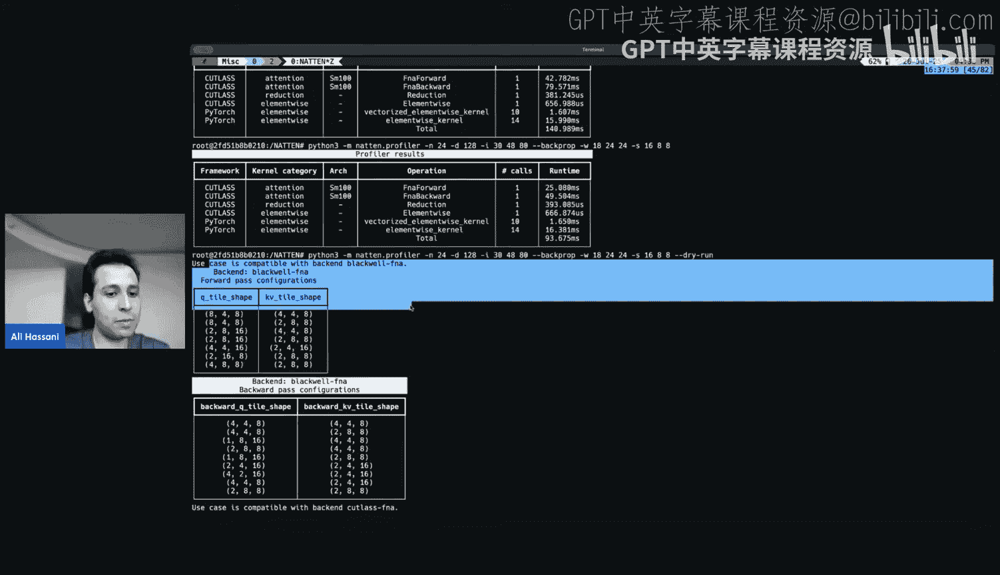

And， you know， I can choose to search these， however I like。

 I can later when we have the natan semiio later， you can。

 you can just run that through it or you can just pick one that you think would be best Sam thing with cuts FNA backend。

 which again is compatible。 although we trunccate the results because there's too much of them again。

 just read the docs。 It's super easy to explore all of them。

 And then also almost everything's compatible with flex。

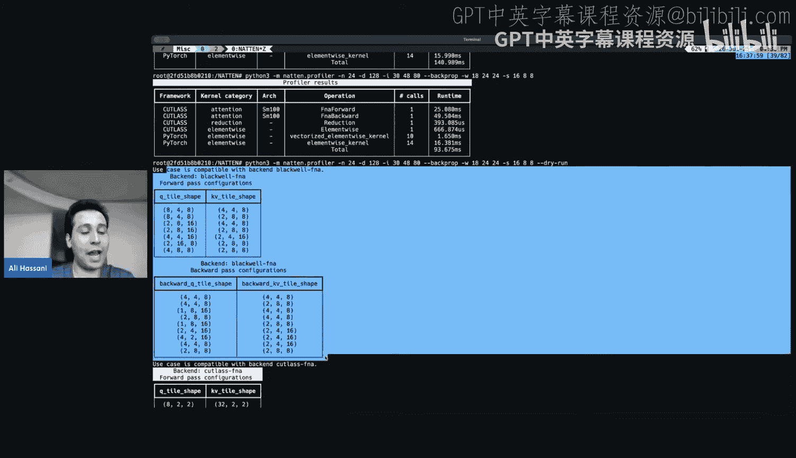

But then let's try。 I don't want to even think about this。

 I just want this to run all of them and pick the best one。 So if we do that。

 it's just gonna search through all the valid configs that it can find for forward and backward pass。

 and it can sometimes make quite a bit of difference especially if there's padding effects and things So our runtime used to be 93。

94 milliseconds and now all of a sudden is like less than 70 milliseconds like the forward pass runtime drops from 25 milliseconds to roughly 14。

 which is a lot same thing with backward pass。 And the reason why I chose this example specifically is that I know this would happen because the default tile sizes will introduce a lot of padding into this。

 But also because I know this from from the paper if you run this use case with these。

With this configuration， it is fully block sports， which means again。

 we completely skip the fine grain masking， saving that extra overhead。

 and this is how you can kind of approach flat proportional speedups。

So I think that's pretty much all I wanted to talk about， so unless there's questions。

 I thinkll I'll stop here。Sweet thank you so much Li yeah folks I guess I don't see any more questions than chat。

 but if anyone has any more questions El like I think can out on Twitter on Discord so please let them know and Elly thank you for coming again the second time Yeah of course happy to thank you cool see everyone soone bye。

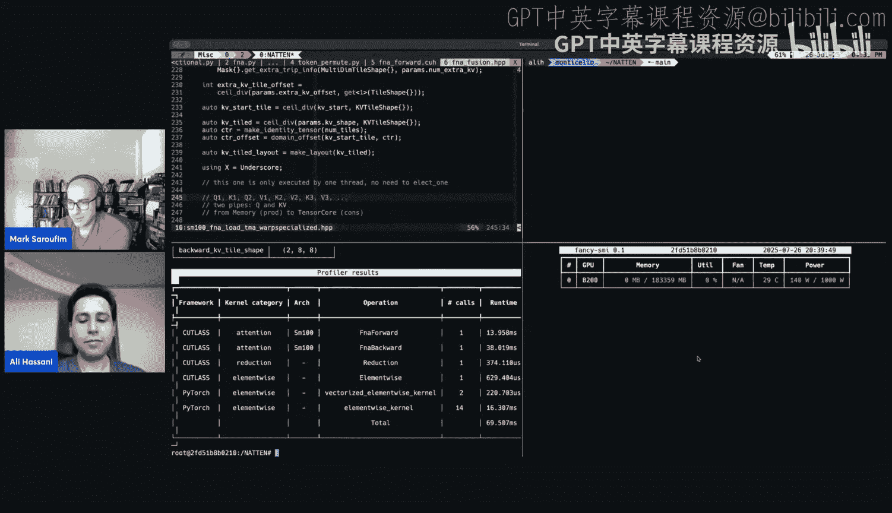

