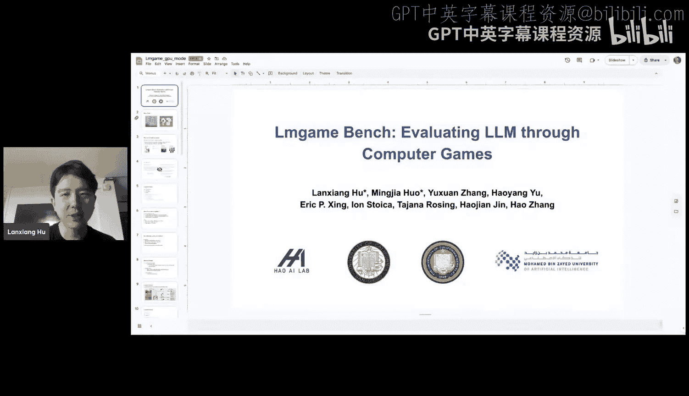
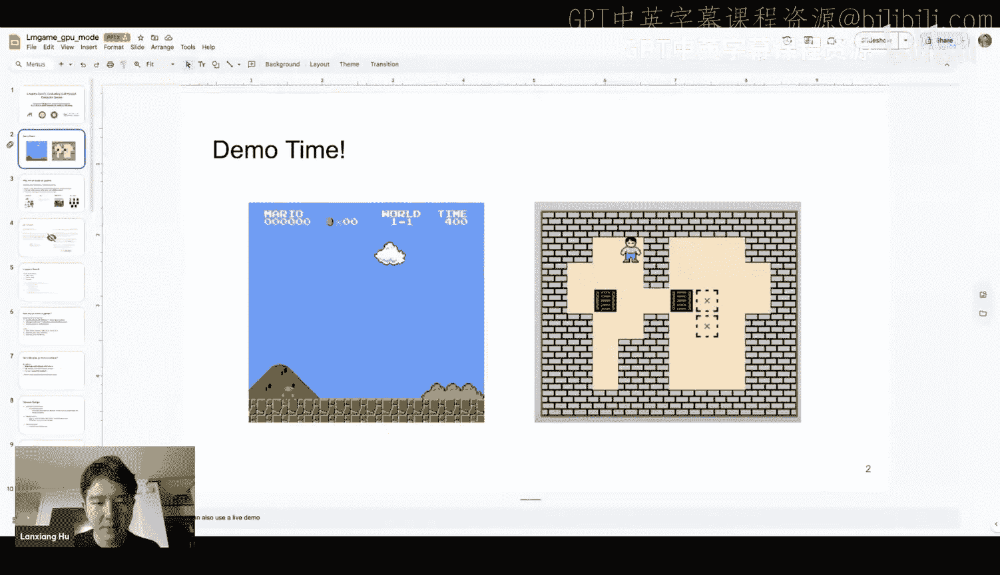
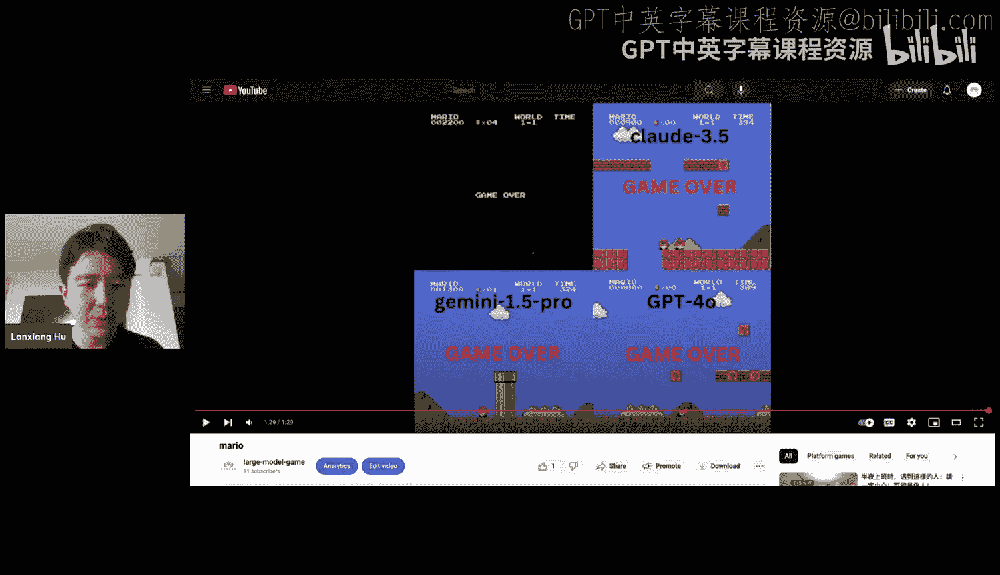
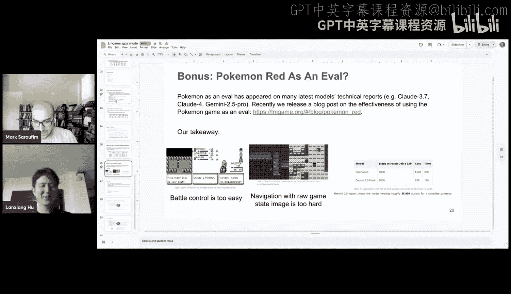

# GPU MODE《CUDA、GPU编程54-87｜GPU MODE》中英字幕（deepseek-v3.2 p13 -20250806-Lecture 66_ Game Arena.zh_en -BV1xbmQB3ETC_p13-

Welcom on to another episode of GPP mode today I'm really thrilled to have Ln Shanghu from the Haal lab at UCSD。

 who's going to be talking to us about something pretty different today。

 which is his project around Alum Game benchch， which is evaluating alums through computer games。

Well， this isn't like I guess like the typical making GPUs faster kind of talk。

 a lot of these topics I think are very relevant for people to think of in general if you're an ML system so yeah。

 I can't wait for it so thank you Ella Chang and please take of me。😊，Thank you。

 Thank you so much for the kind introduction， Mark。 Hi everyone。 My name is Ln Xianghu。

 I'm a second year Ph student from UCSD。 I'm working on。😊。

Efficiency problems for large scale machine learning workflow as well as we're trying to bring news perspective to AI model evaluation。

 so today we're going share our recent work on how to evaluate and training LOM on games and why we think games are gaming environments are important。

So over the past few months， we have been working on recycling a lot of the conventional。You know。

 very classic gaming environments and use ST for AI evaluation and we have actually some pretty interesting results I want to show today。

 maybe we can first start with a few demo and we can take a look at why we use gaming environment to do evaluation and some lessons learned along the way。

Okay， let me share。Screen。Yeah， so this is an example where we use the Mario game。

 I think everybody' is quite familiar to do a side by side comparison amount different models。Okay。

 so as you can see call 3。7 won in the game and so this evaluation was done in March during the time so that was the state of our models we have at the time of the evaluation so you can see actually for so like when when it was in February and March when those models were there are people。

 the assumptions are the models are are still very good at a lot of math and coding reasoning task。

 but you know that was also the time that agent evaluation starts to pop up a lot of the agent evaluation are just get used computer use agent evaluation to use agent evaluation。

 but there hasn't been work on evaluating the models on the gaming environments。

 so games are very intuitive and relatively easy task for humans so we all play games when we were young。

But how about the models so what if we put the models in the gaming environment actually this is pretty surprising right you can see like G40 just it just came over straight away when we put it in the game and call 3。

4 and 3。7， they didn't last long neither they were good， they were better in generally 1。5。

 but you can still see there was a very big gap。Okay， so let's go back to the slides。

And then it brings up to the questions if we goes to a higher level why do we work on games so in time back in the time when those agenting models starts to pop up when people start to use reinforcement learning to train on IOMs we start thinking about the questions like before the era of LOMs there were a lot of environments people use for RL trainings but not on IOMs on those conventional RL agents like like deepQ learning and stuff so in the good old days people use gaming environment lot。

 for example there's this repo called open eye gymnasium and open eye like stable retro where they recycle a lot of the conventional game classic games popular classic games and the vantage of those gaming environment are they have very well definedfined states actions and verifiable rewards。

In this way， you can easily calculate the rewards for your rollout and the advantage for your different rollouts in this way to train the models。

And also very importantly， there are just tons of games that are there and they're popular。

 people are familiar with it， people know how they work， people know what their rewards are。

So it's very easy to scale， there' are just so many gaming environments。

So building upon this motivation， we start thinking about the question of。

Why don't we just use those environment first do benchmarking to see how they perform？

And along the way we found just putting the games in the gaming environment actually doesn't work well。

 it doesn't provide meaningful evaluation and that's why it needs this what we call harness design。

 we'll go into a little bit deeper later and with harness design。We with agent Gen workflow。

 how do we do evaluation is the final question。So the first question and I think the biggest question very important one is how do we choose games so we actually it was actually harder than we thought because the games has to be of moderate difficulty levels across different Ls for example。

 if we。Put all the elementss into League of legends， right， they won't be able to play or like dota2。

 They won't be able to play because they are just too difficult for the models right now。

 They don't have a very good physical sense。 And also another important question is we want to have diverse enough game types。

 So the difficulty levels need to be moderate。 and also the game types need to be very diverse。

 And we also want to use common games were popular games。

Such that the results are very are very understandable for not only the AI researcher but also for the general audience。

So we choose games across a few different genres， this was during the time we wrote the paper about in May。

So we have a few puzzle solving board games。Like Sobon 2048。Candy crash Tes。

 those are obviously people are very familiar with。 And for some， some games like Silcovan and 2048。

 they require more of long horizon planning because you have to push the box and leave space for later this way to make sure all the boxes are anchor at the dock and also for 2048。

 you want to make sure your。Hard numbers tiles， they stay in certain corners， right。

 You need to plan your space strategically。 You know， for candy crush and Tes， Actually。

 they require a lot of spatial reasoning， especially for Tes。 you have to rotate your。

Tes pieces correctly。 and to place them into correct positions。 This is actually very hard。

 We didn't see the models。To get to steadily clear lines until until 03 pro came out actually03 pro and Go forward they actually did pretty well and if you are interested you can go onto our YouTube channels。

 on game YouTube channels， we have a few videos on how the models they were able to clear games。

And we also have some real time。Like motion games super Mario bros and we also have visual novels。

 the games where it's more tax heavy， it's like a detective style games。

 you need to solve a detective puzzle along the way when you're interacting with a lot of different characters and people usually call this kind of genre visual novels and this is the game Acetonny which was also a very popular game。

Okay。Okay， so then with those gaming environments， if we just put the Lms out of the box。

 just put them in the gaming environments， actually they they just。Aren't able to。

Get a good performance why mainly because of three reasons， the first one is。

It has a very weak vision perception capability。 We can show a demo letters about how the models get confused。

 And the second one is a lot of the models， especially reasoning ones。

 they have super long latency right， So depending on how you build agents or how you do evaluations。

 if you use computer computer control style agents and。

Let the model control your keyboard and have the gaming environment run as a parallel process。

 The latency is just too long。 maybe after and two responses the super Mario time out it's the。

ItHas already timed out， the game has already over。And the third one is many times。The。

 the models just make repetitive mistakes。 They make the same mistake again again and again because they don't have memory。

 right， That's a common issue for LM don't have a。They don't have a memory mechanism。

So that's why in order to distinguish the model capability well。

 actually evaluating models with gaming environment require an agent workflow and that's what we call gaming harness。

And we designed actually a modular gaming harness in a modular way。

 this way we can study how different components what the。

How different components contribute to model gambling performance。So when it comes to harness design。

 we have three major components。 The first one is vision perception modules。

 So the vision perception module is where。is to tackle the weak vision perception issue because the vision perception module。

 they convert image to text， they either read game state from the backend or query another VLM to convert image elements into text show descriptions right for example if you have a so band game you have the box pushing game and if the models if we just provide with the image。

 sometimes module can get confused， they recognize a wall a wall as as the box or they recognize another box as the wall they have this perception issue。

 but if we read the game state from the backends to provide with the ground truth or as another the latest the strongest VLM to extract the elements it can mitigate the perception issue。

The other module is memory module。 This module is well recognized important components for for agents。

 especially in games， because let's also take Socovan as an example if it doesn't have a memory。

 Imagine it doesn't have a memory for human for human， we usually make a plan about say okay。

 I have the two boxes in front of me。 I want to put now I want to first push the box A to certain location and then I want to come back and deal with box B right we have this kind of long horizon planning。

 But for Ls， we observe， they actually don't We need to。

We need to design this memory mechanisms to prevent it from verysitant。

 very hesitant decision making， because otherwise it will just。

Jumping back and forth between box and A and box B， it't。It doesn't know how to proceed。

The next it doesn't have this long horizon planning。 But if we record its gameplay history with how。

 okay， in the next move in in the previous move， we you already decided to deal with box a first。

 then it knows better。 then it has a more consistent planning。

The third modules we introduce is reasoning modules。

 so this one basically integrates all the information from revision perception and memory modules。

To synthesize all the information it has， the outcome would be to generate an actions。

 and there's some choice about either to turning on or off the long chain of thoughts reasoning mode。

And here's a schematic overview of how we design the benchmark we first design all the game environments as a with gymt API is an observation space action space and also the game states represented in either。

In either a textual， like a tabular representation or just an image。

 right So the game stay will be fed into the models。 the model have can selectively turn on。

The agenda components， the scaffolding component， right， this。Memory module or perception modules。嗯。

And they will generate an action， the action will be then fed into the gaming environments to drive the state change and the next states will be generated and this keeps going and going。

So Dan becomes the question， how do we do evaluation in different games in the board games like great games。

 we found。LMs， the biggest bottlenecks are。Big biggest button。

 I guess I struggle with game state understanding if we just provide it with an image so。

We actually prepared them with textual format。Because in the board games represent we can also represent the game states with textual formats like 2D AsI 2 table right or object list。

 you just have a list where to tell the model， the block is at a certain coordinate。

 the player as a certain coordinates and you enumerate all the coordinates， you tell where。

 where is where。And for real time games， the challenges are different。 The challenges are。

Because those games， they are very latency sensitive。 You we need to specify what like。

WhenWhen the models take an action， how many frames it changes， right。

 let's say the Lm execute an action， say jump。 And then we need to we all the model also need we also need to specify how many frames it corresponds to with the with that action that that that corresponds to like imagine you're playing a super Mario game with a joystick。

 Sometimes you also hold different keys for different amount of time， right。

 So you want to map this behavior to。Action taking as well。

 So we can see we dictated it to generate in a format like jump 10。 That means like。

HePss the jumping key for 10 frames。And also we observe an interesting phenomenon。

 what we call the knowing and doing gap。For example， in many cases。

 the album actually get a very sensible planning in in in natural language。

 Let's take that this look， Let's take a look at this example。 right， It's able to reason this。

It's able to make a very reasonable plan， like in its reasoning process， in its reasoning trade。

 it says to safely navigate the pipe， barrier should maintain momentum and height， however。

When it comes to execution， it doesn't。Many models aren't able to map this kind of planning to the exact actions。

 like control different keys to very exact frames， so that's an issue。And also， there's a low。

Fram per second issue because。The arms are only received the state changes。

 the new stay after action finishes， right so。If it doesn't provide it with a memory mechanisms when the mar is in the air。

 it doesn't tell if's what's its momentum is and what's its。So basically。

 what is its trajectory in motion？In other words， the gameM states harder game states inputs are two spars。

 so that's why we also need the game state mechanism。

And the other genre is this detective games I think it's very interesting because it iss a very different genre acetonone is the text-based quoroom games right so you first interact with different characters to get to know your core case and then you collect different evidence you go to the quorooms the judge asks you different questions you confront with other peoples and you want to present your evidence strategically in order to justifyifies your core case to subdi case in those in those kind of games the challenges is actually data contamination issues because those games are tax heavy and during LM pre traininging chances are a lot of the game information has already been exposed in the like say the game forum so they are part of the pre traininging。

We run this small experiment to test the data contamination these kind of games。

 for example like in this case we asked the models the same questions about what's the plot in round one right and we found the03 models generation output are actually basically exactly the same as with the Wikipedia text so there's a very very severe memorization issue。

Basically before the model gets to know any of the。Ploot is's already able to generate。

 It's already able to record the entire plot。And we run this experiment about。 So， okay。

 so now we see there's the memorization issue。 Does the memorization issue actually translate into gaming performance。

 We run this correlation study， and we see the red line is where。

It shows there's a strong correlation between the memorization and your gaming performance right。

 so on the X axis， it's total similarity。 So how we do this is we employ sentence bird models to compare your ground truth with the Elms generation sentence by sentence。

 and then you can have a similarity score that quantifies your memorization。

How well the model the de memorization of severity， right， And then you have also have this rank。

 The reason why this rank is negative slope is because。

Lower rank means higher performance right because like let's say you perform the best and usually your rank is number one if you perform the second of the best is you'rere your rank is number two。

And so that's a very big issue for this kind of games in order to mitigate this data data contamination issues we have we employ several methods。

 first of all we do an entity replacement basically we replay the explicit name in the games。

 let's say a attorneyney Phoenix right with just a attorney8 and with evidence certain specific evidence with say evidence one evidence two those generic generic names also in the prompt we explicitly instruct the models to。

Do reasoning over memorization， The other is before we conduct evaluation。

 we rewrite the background context， the game。In game text in a different way， we reward it。

So after all this mitigation strategy apply， you can see the curve now becomes the blue one where there's a still memorization going on。

 but it's less correlated with your gaming performance。

And suggesting a reduction of induction in the memorization effect。In affecting gaming performance。

And okay， so after。Mentioning how like different games so different games they place different challenges right and that's why we introduced the gaming harness and after introducing the gaming harness。

 does it work， we study we conduct this harness effectiveness evaluation。In other words。

 we compared the model gaming performance before and after you apply all the。Gaming hardness。

 you can see。The delta is actually pretty significant。

 especially if you look look look at percentage deelta， In other words。

 how was the percentage model improvement。Before and after， applying the。

The gaming harnessness in comparison with the baseline。

 so you can see if we do a statistical hypothesis test on whether it's significant to whether the performance improvement significant you can see the P values are large and the exception of supermario bro because in supermario it's a partially observed vocal games it's kind of sarcastic and harder for a lot of the model there are they still don't have a good physical sense about you know how long to press each key so even applying the harness。

The randomness still huge。 The， the gaming performance variance is still large。

 It's not statistically strong enough to say， okay， the hardness resolve all the question。Okay。

 and then so after we come up with all the games and， you know， design。Addressing the questions。

 the data contamination issues by adding the gaming harnessness。

 we have leaderboard and the leader boards are twofold。

 It has this model leaderboard where we don't apply any hardness。

 And we also have this agent leaderboard where we apply all the harnessness so I can show a bit about。

What's the status of the leader boreno。Yeah， so we welcome everyone to check our leaderboard so it has two components right this the first ones or your model leverboard。

 you can do a side by side comparison， see how normalized score compare among all different models across the six games we provide。

Currently，03 models do the the best03 pro actually performs better， but03 pro the cost is huge。

 It's still huge。 Were aren' unable to do end to an evaluation across three runs。

 So for all those metrics we report we run random models on the game three times and we calculate the mean the variances for03 pro。

 we aren't able to do it yet。The agent leader board， we apply all the gaming hardness。

03 is still the best and Gei 2。50 pro basically follows。Okay， let's go back to the slides。okay。

 so the first goal is the benchmarking and after benchmarking the second important goal is okay now we have all those evaluation results。

 we have the good leader for how do we understand the gaming performance right we have so in other words an important question we think is。

What does good gaming performance mean if you have a model that perform well on gaming environments。

 If the models are trained on the gaming environments， what does it mean。

 So we study from those two perspective。In the first perspective。

 we want to study the relationship between。Gaming benchmark or your gaming performance with other benchmark。

 with other existing benchmark。So if we compare。If we compare our bench results。嗯。

On different games on Soco band Tes 2048， they each have a ranking right and if we compare them with other reasoning benchmark such as math and code。

 we actually can see some pretty interesting results so we collect a models on 20 benchmarks each benchmark then you have a model ranking you compare this rankings with other benchmark and you can calculate the experiment correlation。

And this way， the benchmark can be represented as a vector of model ranking sorry。

 each benchmark can be represented as a vector of model ranking and you can calculate the spamar correlation。

You can see。All the games， all the games， if you look up here。Right here Socoban Tetriris 2048。

 they have a strong correlation with puzzle solving games this is expected because so puzzle solving game more explicitly I'm referring to these two so you can see you have my E and NYT connections。

 those puzzle solving。Benchmarks。Because those for those benchmarks that evaluate。

Their distribution are more similar to the gaming environments and some other interesting observation is for。

For sobin， let's take sobin as an example， you can see you also have a pretty strong correlation with。

With some of the math and coding benchmark with live code bench coding as an only exception for left bench coding。

 the ranking is pretty different， somewhat different from the gaming ones。

And we also want to study how individual capability control contribute to gaming performance， right。

 So basically after looking at this， we can see very clearly gaming performance actually a composition of different types of capability if we put together the coding capability math capability。

 spatial reasoning capability like puzzle solving。 you can see actually correlates to quite a few benchmarks。

 So we can regard gaming performance， more of a composition of existing capability people care about So so I a question like at least like like which games have we found most correlated like。

 for instance， like I've seen a lot of like my friends who are like very good factorial players tend to be like very good programmers。

 and I'm sort of wondering if you notice like any sort of like peculiarly large correlations that you found interesting。

Yeah， yeah， yeah， yeah。 so so I think the example I just mentioned Sobin is definitely very correlated。

 It's require a lot of long horizon planning and so。So the visual novel game。

 Acetons are they're very related to language benchmarks right the darkest one shown here it's the live code bench language so that's very sensible and for so bands very related to math and for 2048 relatively it's also so math are also more important。

 Yeah， so that's just by looking at the correlation matrix and we have we have another way of studying this yeah after going to the next slide we can talk more。

How we yeah， what's the takeaway。So we break down the capability into several categories。

 we have physics category where we use Emma Ph fee benchch， also math categories。

 we use those commonly used benchmark， AME25， of course， Ma 500 like Ben math。

 and also called benchmark， MBC， animation benchmark， VisTta language benchmarks。

So an interesting question is what if we can， is it possible to learn a polynomial or linear model that can predict gaming performance based on existing benchmark or existing sorry a ranking from an existing benchmark？

If it's possible， then we can learn a set of model weights right that contribute to each set of capabilities。

And this provides insight into。What perform good on different games means。And after break。

 after doing this kind of categorizations， we actually learn a linear models with。

 with the data we have from。Across all those evaluations， we see interestingly Socomanttris 2048。

 they are all very correlated with math en codingding and R the correlation。

 especially for Socoman andtettris， you can see the R value is very strong as shows a strong linear correlation。

And for acetonone of course， it's related to language for Super Mario and Candy Crush。

 they're very related to spatial reasoning and the physics benchmark and I think this is pretty interesting because for Super Mario bro it requires you know a good physical sense about controlling the character doing certain type of actions for certain types basically a b。

It's kind of a simulation of real world physics for Candy Cru， it requires spatial reasoning。

 and it's also。What is important like one aspect reflected in the physics benchmark？

So those analysis they're more of looking into what gaming performance mean in relationship with other existing benchmark and we also employ other techniques to study the im behind using gaming environments that's what we call like more of training oriented analysis so we train models on So band andtees to see how well their perform are able to generalize across different games sorry at across different other types of task。

So what we do here is because the reward from gaming environments there are discrete screen numbers right so in order to do model updates on discrete screen numbers on sparse rewards。

 we use policy gradient， we use multiter RL so it's very simple we concatenate the state response reward from each turn into a super long sequence and we calculate the total rewards for each rollout and basically a positive reward will mean you're making progress in this game or use success。

Or you succeeded on the other hand， if youre you have been playing the game over and over again with many terms。

 but no progress。It corresponds to a penalty after。So the penalty accumulates basically。

 so the small penalty is applied after each action is taken。And。And the response。

 the format is of course like common to all those reasoning model。

 we have first the reasoning trace sections， the thinking sections。

 and also the action sections where you can take a sequence of actions。And we train。

We train the model the model we use to for training is Qn 2。57 billion instruct。

Which in the model with maximum number of step of 20 steps byside 32 and some other hyperpara。

 Another important thing to mention is。We are only training IMs， not VIMs， in other words。

 the game states are only textual tabular representation。

This asI representation you can see from here。We're not doing any VM training yet。Okay。

 so after training them on Soman touches， the first thing we want to see if it's if the model performance is able to generalize with it with it game。

 right， how in other words， what's the in domain generalization and out of domain generalization。

On column on the second row， you can see for the model train on Silcobin。

It not only the biggest performance is， of course， is Socobon performance on the six by6 environment。

 which is the one it's trained on， has a significant boost from about 11% success rate to 24% success rate and also generalized to harder So1 with a by8 grid sites。

I improved around the 3%。And you can see actually interestingly。

 also the performance is also generalized to chat Tes， so in other words。

 the model isn't trained on Tes， it's only trained on Silpi。

 but you also see a performance boost in Tes as well， especially the easier Tes variant。

 the one type， where you only have one Tes piece because yeah all those models actually they are pretty poor on those kind of game that the environments are harder than we thought so they can only perform they can only play like basically one Tes piece type game or twotes piece type game。

And another generalization we see is on planning task。

 so this blocks world blocks world is also a kind of a game simulation where you have different blocks and you have a certain task。

 you need to arrange your blocks in the correct way to to finish your。To achieve the goal。嗯。And。

And we see like basically on games， it's able to generalize not only within the game。

 but also on other games， not only on the game， the game， it was trained。

 but also on other games and also planning task that are very similar to games， however。

 for math andcod the improvement， we didn't see a clear improvement。

 So there's a small performance degradation， not a huge degradation。

 but there isn't a performance improvement。ForFor other agent tasks like agent webshop。

 it does' improve the multi interaction capabilities and the performance improvement is actually pretty significant right for webshop。

 success rate improves from 7% to 20% around 19% around 20%。And okay。

 and then another question we think of is， so we train them all on single type of environment。

 What if we， what if we would scale up the environment type。

 What if we include not only just one games， but multiple games， What if we include math。

Data into the reason So so each batch as well what we do this kind of data mixing is the able。

 is the model able to generalize better。So we found that if we trained on this kind of data mix。

 the performance on odd。Our benchmark improves， but not as good as training on a single。

Single environments， in other words， if we train on math and ts， if we train on GSMAK and Tes。

 performance on both GSMAK and Tats improved， but its upper bound is not as good as GS training solely on GSM aK。

So I think that's still a challenge that we're currently studying。

 we're currently trying to see how well scaling different types of environment could help。

 whether there's a good data recipe that brings a good generalization across all different settings。

Another interesting observation I want to share is here in this experiment。

 we actually explicitly removed this thinking format because qui 2。

57 billion the vanilla model doesn't come with reasoning style right so when we're doing this kind of training there are actually two things it learns the first one is its performance。

 the reward， its trainer， the second one is actually it it format right so。

So we actually found if we train the models on this format。Its initial performance is a lot worse。

 you can see a very significant performance improvement， the improvement is there。

 but the initial result is so basically we have a performance degradation first because the format is out of distribution you got to learn the format first we suspect this is the improvement isn't caused by the model is actually learning something new but actually just picking up the format。

嗯。So all those experiments I show in this table， they conducted with all the thinking。

The thinking token， the thinking tech。Yeah， okay， so this is what this slide is trying to present。

 So adding a thinking token at least to a very significant performance difference。m。

Even before the training。So。So you can see before。The thinking tokens are applied。

Before the thinking tokens are applied。On。On soccer版。On so band of the。The performance is around 20%。

 right， So without a think tag， its performance is higher。 It's on the second column。

It's on the one where we have a。We cross out the the thinking format one， so it's 21。1。

 but if we apply the thinking formats it's actually 11。3， it's actually a allow worse because。

Thats this thinking tag is just。Out of distribution format for the models。So after training。

 you can see even on math and codingd， the performance still improve。

 but we're suspecting it's more of。Learning the thinking format to mitigate this issue。

 the experiment we're thinking about is we do first do a softine tuning on a thinking data。

 then run ourL。 this way， first learn the format， then it learns the actual rewards。

 So this is our next to do。Okay， so another bonus interesting evaluation they want to talk about is Pokemon RA。

 so in some of the latest model technical report like Cloud 7。 3。7 cloud 4 and Gemini 2。

5 pro you see they all evaluate on Pokemon， but is it really a good e I think the short answer for us is no。

 this is because the Pokemon read that we found it mostly involves three tasks and all those three tasks they have their own problems。

So the first big component is battle control。 The battle control only involves in navigating your cursor to and to take different actions to use different capabilities。

 But this is too easy。 And the second task is navigation， but navigation is actually too hard。

 This is exactly the question we just discussed。 spatial reasoning。

Model spatial models vision percent capability are still too limited。

 So interesting thing is when people evaluate the models on Pokemon red。

 they print out this grid right， they print they overlay a very explicit grid to your Pokemon game It tells the model whether each tell is possible and what is the coordinate for each tell。

What's the property for each tell， whether the Ta will tunnel you to a different place or not？

And the third task is long horizon planning for building a strong Pokemon team。

But this one is super costly。 you can see the first checkpoint。In Gemini 2。

5's technical rapport is to reach this Oaks lablab。

 so basically where you pick up your first Pokemon。And both03 model and  2。5 flash。

 they spend 1000 steps just to reach the first checkpoints and the costs are huge。

 the amounts to $50 bucks to $120 and also take a lot of time because we're using reasoning models generate actions。

 right？So one interesting aspect we're thinking is。

Instead of just letting the model take very lowle actions。

 we might we an alternative way as we ask model to call some tools， say an Astar2。

 if we provided with an Astar2 so every time the model won't just be taking like a step moving upward leftward downward。

 you can just call this tool and you can find a path to a specific location to the next level to the next location。

The model wants to go the number of step then can drastically reduced。 And in that setting。

The evaluation target S is actually models to using capability。

So that's another aspect we want to look at moving forward。Okay， to draw a conclusion。

 gaming environments offer a very rich set of。嗯。you know assets so basically can serve as a good task spa for evaluating and training AI agents。

 more specific AM based agents， and with gamingm harnessness and our mitigation strategy。

 we provide some we look into some current limitations of the model behavior and LMG bench reviews the strengths of LM limitations strengths and limitations of AOMs。

And we also used a training free and a training oriented method to study what gaming performance actually means。

嗯。And currently， we're also working on finding a new training recipe for。

The training recipe that train on gaming environments with a good generalization。Yep。

 so I think that's it。Do you have any questions？Yes， thank you。 L Shane。 Yes。

 if folks have any questions in the chat， please go ahead。 Otherwise， I I had a couple。

 so I was wondering， like， if we think about like sort of the more on the perfth side of things。😊。

Like at least like when I'm playing video games， like I'm rarely thinking move by move。

 like at least within strategy games， there's this idea of like macro and micro where you like have some sort of high level plan and then you sort of like automatically execute it。

Is this like something like people are like experimenting with like basically having like an alum like batch like a long series of actions and only revisit it when it needs to kind of like system one system two？

I see。 Yeah， I think I think that's a very good point。 I think Ja actually has disintegrated。

 So let's also take Pokemon as an example， right， so they actually have a。

 they actually provide a star search as a tool they can' use。

 So the L M is more of generating a high level planning about where the model should go what's the coordinate。

 the model should go to the next。 If you provide with a map。

The element is just to make a high level decision where which coordinate I should go like which house I should go to the next right it's not no longer needed it doesn't need to do like very lowle action taking it just need to say okay go to a house one and that I call this a star search it provides a path so I think that's what people starts to work on and I think this brings a new aspect of evaluating models to using capability to calling capabilities yeah I think it's emerging directions and I think it makes sense to me as well。

Yeah， and I guess like one example where maybe this is not too relevant is the like Phoenix right game where it's like basically effectively turn based and。

hi's actually like you know one of my first like one of my first thoughts was like well。

 if you're looking at a game like Phoenix Rights， well。

 it's not like a I don't think that those games aret necessarily like open as in a you can't like mod them to turn them into an RL environment and so like how do you typically recommend people basically turn their favorite video game and add it to like like a gaming L on gaming benchmark marking suite？

I think first， yeah， I agree。 It depends a lot of。 So we recycle。A lot of the existing assets。

 existing infrastructure， say open air build for their stable retro， where as long as you have。

But usually I read only memory file for for the games you can have an emulator right where you can if you provide it with different random seed it generates slightly of different games so I think all those kind of emulators are there if you want to add your own custom game just require more engineering so I would recommend if you're interested start start out with the games that are already well supported。

Okay。Yeah。All right， for the eighth。For the acetonone example。

 it's extremely yeah I agree it's very it's extremely hard to hack。

 It took us quite some time to figure out， you know， in the read only memory file。

 different memory address corresponds to different。Againt status， right， I see。

 were you guys using game sheet for this， Like， I think there was like。

 that was the one piece of software I'd use in the past to like。

Understand like a specific location on the screen， like what like let's say a score。

 what like address of memory does this map to？Oh we're， we're just using。

 we're just using stable retro， stable retro again。

I usually have this ML and we look into we basically just do a manual inspection。

 like do an inspection ourselvesse， what different memory address could be what fields are in different memory address。

And then I guess I have two more questions， which is so regarding like harnesses， like I'm。

 I'm sort of like， maybe this is a， I'm I guess I'm swaing for your opinion， which is that like。

 how much of a harness would you consider to be cheating。Can otherlums build their own harness。

How do you think about like just again， like the bitter lesson for gaming， really？Yeah， I think。

 I think that should evolve over time。 My opinion is at the end of the day， we won't need harness。

 harnessness just a temporary solution。 At the end of the day， if we believe AI can be strong enough。

 they shouldn't be there。 So we will harness only for the sake of distinguished L capability at this moment。

 So we employ as minimal gaming harness as possible。

 And we want to run statistical tests just to make sure it's we provide harness to a degree that can distinguish model。

 And that's it。 that's why we don't think Pokemon red is a good evaluation because。

Because the hard is just too much。It's more of evaluating harnessness instead of evaluating your engineering。

 right， like cloud doesn't have as good as good a harness versus Gemini。

 So it's I think it's more of evaluating harnessness than the model itself。You thing。All right。

 and I guess like my last question is that like the games are obviously very broad。 Like。

 for instance， like when I think of like the early sort of like open AI， like era of AI。

 like the open AI 5， like with the do bots and the deeps like Star bos。

 like basically I think a common critique of that was that like。

Getting good performance on games like doesn't really matter because。m like。

It doesn't correlate to like other tasks， but like I know you sort of talk about correlations briefly。

 but maybe my question here is that like。There are like some forms of video games that are commercially useful。

 like for example， like if you think of the games like。I don't know， given 100。

 make as much money as possible or like be the best in the Kale leader boards。

Is this like a direction you're exploring and why am I not really love to hear more？

Yeah that's a great question I think there are a lot of say economic simulation games strategic games that have real world potentially real world use case right they're more relevant to our I would say I don't know maybe decision making in business scenarios or like more of game theore games。

I think those are also very interesting and we're we're definitely looking into it into it。

 so currently we're actually doing multi agent evaluation， in other words。Like。So let's say。

 let's say monopoly， right in those kind of games， you have a lot of competition and also like game。

Game theory based reasoning going on there or Kaan or this metata diplomacy games。

 all those games were， I think it's a big future direction for us。Yeah。

 I guess what's interesting about monooppoly is like。

 I've heard anecdotally the best strategy is you just buy everything you come across。Like that's。

 I think the sort of like optimal strategies within then I guess like it's easier to measure if you're doing well or not。

Okay， cool like well thank you so much lunch for coming on and folks if if folks have more questions to him like after this talk。

 I think he's on the Discord already， so thank you for joining。😊。

starting next week folks like we have a long series on distributed computing happening like with four different talks of this is if you're you know curious about multi GPPU programming like we're hoping to create like a nice accessible intro there so thank you for joining today and see everyone next week。

All right， thanks so much， thank you。

