# GPU MODE《CUDA、GPU编程54-87｜GPU MODE》中英字幕（deepseek-v3.2 p14 -20250816-Lecture 67_ NCCL and NVSHMEM.zh_en -BV1xbmQB3ETC_p14-

All right and we are alive well welcome everyone to like the first lecture of like hot distributed summer today I'm really glad I have like my friend and colleague and co-host like Mattte who's going to be here with us and the main speaker part today is going to be Jeff Hammond who's a principal engineer and N video and he's going to be talking to us you know hopefully giving us a tour of all the different kinds of like programming models in a video so thank you Vicr for making the introduction and Jeff please take it from here。

😊，Thanks， so I said I'd introduce myself a little bit。

 so I am part of the Nel NV Schmm team at Nvidia and obviously I'm talking on behalf of the work of 45 other people I'm not a developer of nickel and NV Schmm at this point I'm just trying to help the team get in the right direction and then explain this stuff and what I've done most of the year is right code and try to come up with the ideas that need to be out there and learn things but I've been doing HPC communication stuff for about 15 years。

Worked on Blueje back in the day and I've been a part of the MP forums for 15 years now and have contributed to the last three releases of that standard and so when I say bad things about MPI I do it out of love MPI is fantastic but it does have some shortcomings and those shortcomings will be part of this talk and part of the history of nickel so I'm going to do my best to teach everybody what what I've learned and what I think is interesting there's you know many hours on this。

 obviously GPU mode has covered this topic before and they will cover it again in the future and there's some content online that I'll refer to GTC talks etc ce so you know if you're watching this video on record you know you can check out those links if you want to stop in the middle and get more background from my colleagues if it helps but but hopefully this will be self-contain。

So the questions i'm going to try to answer today， so we have two communications libraries not one and folks may wonder well why do you have two what's different about them what what do I need to know how do I choose one or the other and i'll try to answer that。

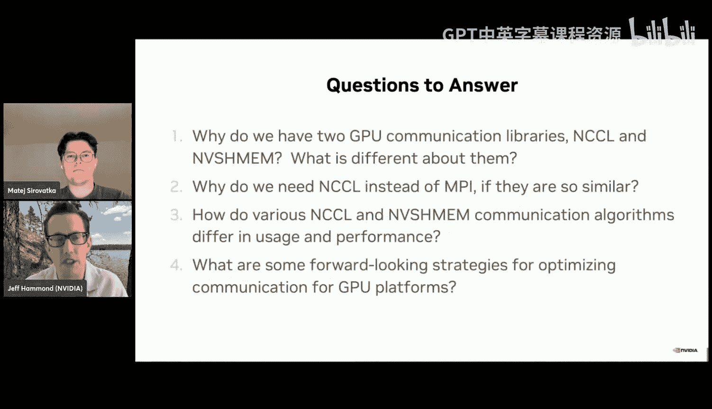

People who saw Marcus's talk two weeks ago， you know I remember there was one comment I thought I saw it was something about you know well why use NIel if MPI does the same thing it looks fine and you know so they're similar and there's a reason they're similar and I'll try to explain why why Nckel exists and why it wasn't sufficient to use MPI in the context that nickel gets used。

 I'm going to show a bunch of experiments I wrote a bunch of code I don't teach code that I didn't write myself andt didn't debug and painfully learn and I'm going to show the code that I wrote which isn't perfect。

 I didn't finish every possible example that I thought I could write but I got a whole bunch of examples that I think are interesting and all of that stuff is on GitHub I won't merge the pull request this morning so you can check it out and if the code is confusing you can hit me up on GiHub or these guys Discord channel and ask for help。

And then lastly I want to talk about forward looking strategies for optimizing communication。

 this is inspired by what the AI community has done recently with NV Schmm which is really interesting because NV Schmm wasn't created for AI users but it has turned out to be really really interesting for a couple scenarios and I'll explain what those scenarios are and why NV Schm got used and then you know what does that app to do with nickel that'll be at the end。

So I'm going to give an overview that I'm going to give a historical context。

 this is the thing I think hasn't really been said before a lot of people who are in the AI world just know that niCel is awesome so they talk about nickel and know our documentation refers to MPI because there's you one of the lead developer of NCel is himself an expert in MPI as well but and there's a historical tradition sort of inherited from MP into Nckel but but I don't think people appreciate that and there's also a historical tradition for Y NV Schm is the way it is and this gives us a context for reasoning about their differences talking a little bit about GPU and MPI issues then I'll show my experimental stuff I'll start with explaining it in terms of MPI and Schmm I know that maybe those two things are less familiar to the AI folks who just learn nickel or something else from the cloud world but。

I think it's important to start there if you're an HPC person that might make you happy I'll show the experiments I wrote I wrote some benchmarks with collectives and point to point and one sided and load store on my DGxH100 and I measure it and you can see the differences and we can learn from the performance of these experiments at small scale and then reason about how they scale and then I'll wrap things up。

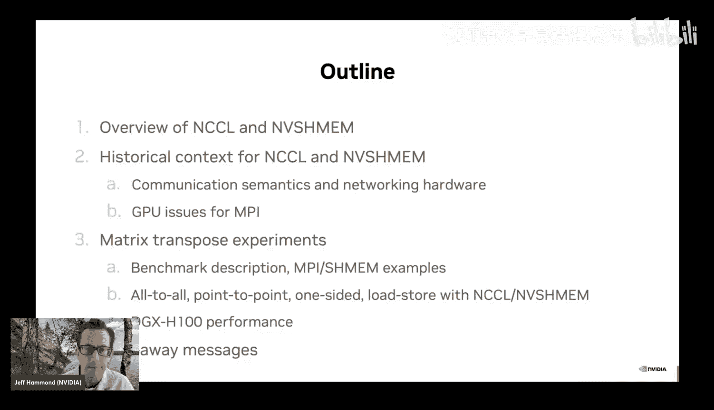

So these are short overviews one or two three slides each there are our long talks at GTC on these so please go check those out i'm not going to try to be complete here but i'll try to get the big picture so nickel is designed to address the major patterns of AI training and now much more inference as well so you know in the beginning it was all about all reduce and the ring algorithm and you know coming up with multi GPpU solutions at small scale but that was 10 years ago so nichols just turned 10 I think about a month ago and it has evolved a great deal so it's got support for all the different collective patterns you can use it for all the different types of AI parallelism you know。

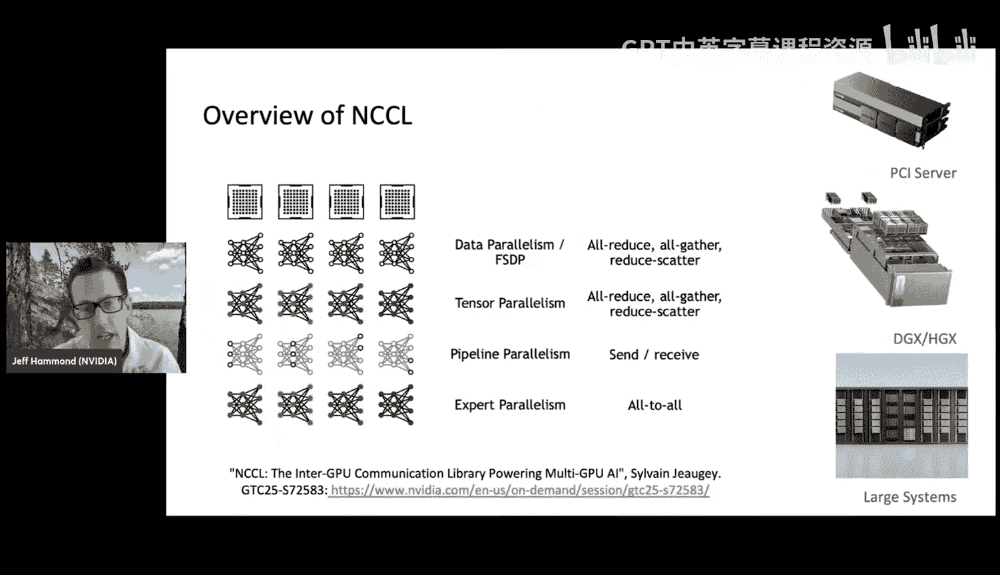

Data parallelism， tensor parallelism， pipeline parallelism and expert parallelism are all captured and of course we also you know it's our job to support all the system so you can use it on your multigpU workstation。

 you can use it on your DGX box your NVlink domain however big that is which of course folks know is a lot bigger than eight now and you can use it on very。

 very large system so people run AI training with nickel on thousands of GPUs on a regular basis and nickel has evolved to a great deal to support those use cases and so Sylva who's the lead developer of nickel gives a GTC every year to explain these things and you should check out his talk and he'll describe in much more detail these patterns but today I'm only going to talk about the allall pattern I like it and also it's related to expert parallelism which I think everybody knows is a pretty big deal in the AI world and I'll try to。

A little bit of where that's going and what you can do to write code for it if you're going to write your own。

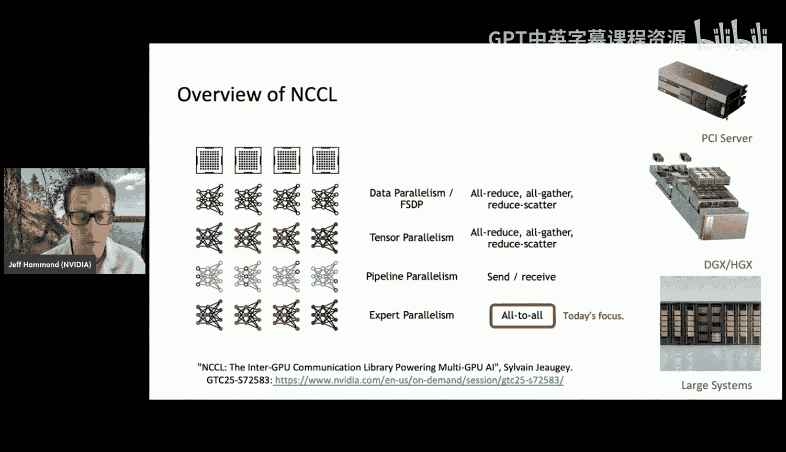

Obviously the nickel ecosystem' is quite large， it's basically everywhere it's in all the frameworks。

 you know most people I think probably use nickel because they're using Pytorrch distributed but it's obviously the advantage of the nickel ecosystem is it's all the frameworks。

 all the models and all the clouds pretty much are going to run nickel and therefore it's a really good thing to learn because you can use it everywhere it's not going to be some niche thing that only runs on one network or whatever。

 obviously we support ethernet Infinnaand and AWS has a support for their EFA network and a plugin an HP and Klingshot also has a similar plugin capability so you can use it essentially everywhere。

So NV Schmm is a different model its if you understand the history of HPC this is more comfortable for you。

 but NVSmm represents a partition global address space model and the global address space part means that you can think of indexing using pointers into all the memory。

 all the GPU memory not just yours， but all the other GPUs memory and the partitions implies that you can't think of it just like a shared memory domain you do have to think about the fact that there are different address spaces that are combined together to form this model and then the symmetric keep is this idea of allocating memory within。

This this combined address space of all the GPUs and then you can communicate you can send data from your private space to remote data or you can do a collective operation a clock across the symmetric memory in all the GPUs and I'll explain more later why there are some interesting advantages to this model so there's a GTC talk from a couple years ago Google this is the one Google found for me maybe there's a more recent one but this is a good one by Akeel who leads the NB Schm team and and Jim Dynan who used to talking about the whole history of it and all the features I will also note that at hoteye in a week or two my coworkerers are going to give a tutorial on nickel and NB Schmm and I think it's free so if you're into this stuff I know they have a great tutorial plan and you can check it out。

So the really important thing to understand with NVSm APIs so the historical Schm API you'd have put which you look at this function signature it's basically memcopy except it's got this PE index and that just says you know which GPU are you going to copy more too and that means you can you can do basically memcopy to all the GPU's memory but there's also more obviously like nickel there's the stream the stream APIs and that's really important to integrate with the coa model to be able to incue this stuff and not have to block but the thing that makes NVm really really special and the reason why it has been unique in its role in the GPU ecosystem and the reason why it's used in some of these moE models is it is the only model that supports device initiated communication so if you want to do。

A kuda kernel and actually go from that couda kernels without you know without returning and going back to the host。

 but straight out of that kernel to send data either to the Nv link domain you can do that or you can even send it across the network and you can do this at the thread level with with the putMm or you can do this at the block level with block and put mam across with the warp as well and the reason the block and warp exists is folks probably know at this point that GPU memory access needs to be appropriately coordinated and coalesced and。

If you want the threads to cooperate on one of these operations you can do it at the warp of the block level call it cooperatively across a group of threads and they they will behave like basically like a multithreaded mem copies so they'll but they'll be appropriately synchronized to work together in the way that they need to to generate efficient memory access so you you know this is just the put mam APIs obviously there's a bunch more APIs there's get and there's。

Other other operations， the other thing you can do is you can do device initiated collectives and that's。

You have to be very careful you have to use cooperative group launch because obviously collective synchronize and so you need to have the forward progress guarantee from a cooperative group launch。

 but if you do that appropriately then you can actually have say an all reduced or a barrier or whatever you want inside of a coa kernel so all the GPUs can be running couda kernels persistently and doing communication and synchronization between them without having to return back to the host and you if you really care about latency this is a big deal because you know kupa kernelnal launch has been optimized like crazy it's really really fast but it's still more than a microsecond and and if you want to be doing really fine grain things interleaving communication and computation as I think folks really want to do this is the way to do it and so NB Schmm is solving this problem uniquely today。

It won't be unique by the end of the year， but I'll get back to that later。

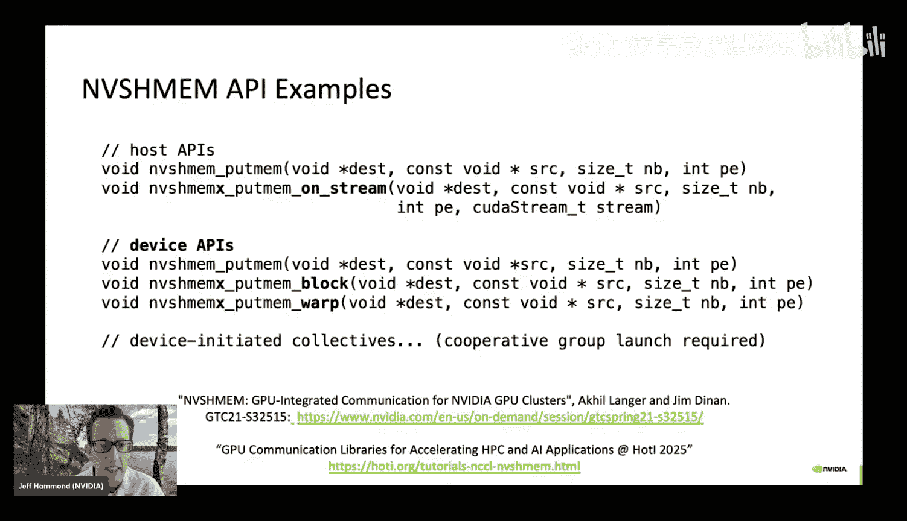

So NV Schmm has historically had CAAPpis， but one of the things my coworkers have built this year that's this pretty neat is they've built a Python based frontend for the NVchm APIs that was in part because what we noticed is that the CAAPpis were getting wrapped in Python by AI users and used in their Python based AI frameworks and you know it seemed to make sense if we could build a Python APIs and ship them then they could be systematic and complete and we wouldn't have to count on our users writing their own Python rappers everywhere they went and we've seen a whole bunch of different interesting use cases so folks are doing expert parallelism in MoOE deepse and perplexity are both doing that obviously they've both been public and describing what they do Deepses wrote some great papers and perplexities some great blogs which I'll cite later perplexity published a benchmark where you can read how they do this and what it looks like you can put it in。

Docker and run it yourself and learn from it you can also do you know fused compute and communication kernels obviously that's the whole point of having device initiated communication there's also a lot of support for latency optimizations and for zero sm so obviously if you if you're really wanting to be efficient with your AI compute and your communication one of the best ways to do that is well don't use any ss for communication if you can get away with it and so Nv smm can use the copy engine and do collectives that way and that obviously takes。

Doesn't take away any SMM resources for moving data around。And then of course。

 consistent with what it is in its history， NV Schmm has one- sided communication everywhere。

 whether it's on the GP or on the host and I'm going to talk about one sided and two sided in just a second so there's a lot of ecosystem adoption here maybe not as much as nickel but but certainly theres there's support in the major frameworks including Pytorrch if you want to check this stuff out。

 I will also say that we NVIdia use both Nckel and NV Schmm internally in some of our libraries both for AI and HPC so if you're into the HPC side of things and you do 3D Fast freeier transforms and say fluid dynamics or molecular dynamics CFFT multiproces is based on NV Schchm and gets ridiculous performance compared to sort of traditional hosttorian solutions because of that。

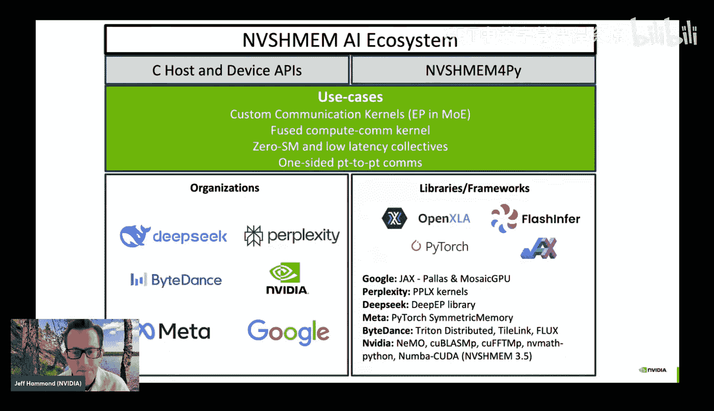

All right， I'll pause here in case the host want to interrupt me with any questions。

 otherwise I'll continue。Okay。So I'm going to give a brief history so the world that we see today with AI comms is heavily influenced by the 1990s。

 you know， which for me was I was not doing a lot of computer programming in the 90s outside of the TI82 but。

There was a lot of interesting stuff going on， so the two paradigms of HPC communication one is MPI so MPI is a lot more than just sendend receive collectives now。

 but in those days it was basically send receive collectives and it was message passing is synonymous with two sided communication send receive we use all these terms interchangeably the MP forum started in 1993 and they didn't come up with any new ideas when they were doing this what they did is they took about 10 different similar APIs that had been built and said well what's the right way to standardize this because everybody including the vendors wanted to not have to keep building one-off APIs for every new platform the vendors hated the lack of portability to their competitors and the users hated writing10 different versions of the same darn thing especially since you know back in the day they might have been writing in fortran it was a little bit more annoying to do this then。

The other thing is that the design of MPI with S receive is essentially universally portable。

 I'm not aware of any environment， any reasonable computing environment that doesn't support it。

Because you can map it onto something like Possic sockets and that's pretty much going to be everywhere so even if you don't have a fancy supercomputer MPI will work and do a reasonable job you know token ring ethernet whatever it is you can do it and so the power of MPI has been that it made absolute portability one of the primary goals and so it got used everywhere because everybody knew they could use it everywhere。

Some of the interesting downsides that we look at in MPI are because MPI was designed when CPUs were relatively fast compared to most networks and so there were some things that were like。

 oh yeah that might cost you know100 cycles but who cares because we've got a whole lot of time to do the CPUU compared to the network that's less true now and so some of the things that are in MPI some of the generality is annoying and it's particularly annoying on a GPU where the singlethreaded performance is not the same as a CPU。

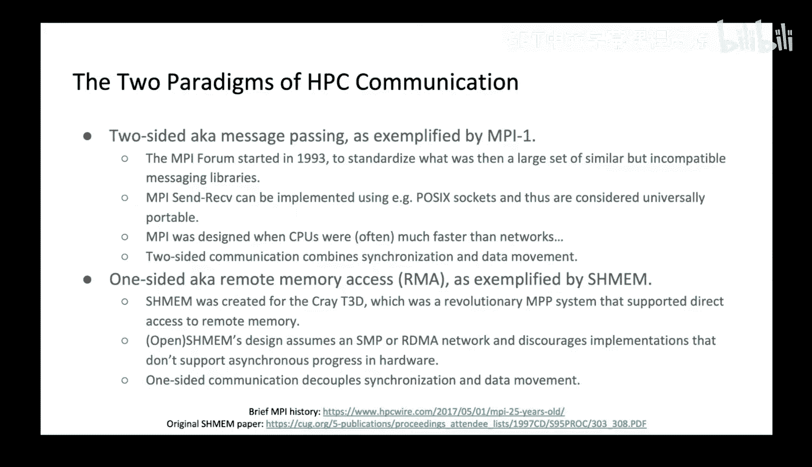

And this is neither a good nor a bad thing it's just an important thing to understand twosided communication combines synchronization and data movement so what this means is if you're going to move data from one place to another and you need to know when in terms of programmatic ordering it's going happen you will know you will say at this point of the program send will happen receive will happen and you'll know that when the send in the receive happen that creates some sort of ordering in the program in terms of execution not just that the data moved at that point and that's in stark contrast to what we'll see with one side it which is also known as remote memory access or Rma in the MPI world and it is really exemplified by the sm model so Schmm was created for the T3D I don't know every single thing in the cr T3D that was totally original but it was an absolute revolutionary system first tourist network as far as I know and probably the first sort of。

Distributed load store network basically you had you I think it was a deck alpha CPU or something like that and you know the memory controller could inject into the network and this this meant that you could do a store to remote memory in 90 nanoseconds and today you'd be happy if you could do that in 900 nanoseconds just because systems are bigger and hairor but this meant that the system was somewhat goldbl addressable and Schmm was a really great model for that hardware。

The legacy of Schmm is that it's turned in and been standardized as Openchmm which really captures essentially all of the historical evolution of Schm from 199 394 and it is standardized so that it works everywhere but it's interesting philosophically it says in the Open standard。

 please don't do a bad implementation， they want people to use it in a way that assumes forward progress in the network and usually a hardware implementation of that because when you assume that you write code slightly differently and it makes it more portable if it's sort of either good or doesn't work as opposed to being good or bad because then programmers start programming for the bad cases so that's sort of a philosophical difference but I think one of the elements of this is that the design of Open Schchm is designed to be very lean from the perspective of what it takes to implement。

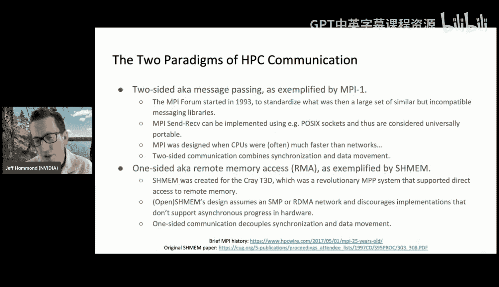

It assumes。Either shared memory load store or noncoherent and RDMA。

 but it doesn't try to assume much more than that so if you have a lean RDMA network you should be able to implement it properly and this actually matters for when we go to look at how we do GPU communication。

So one side of communication decouples synchronization and data movement what that means is you can write to data and have no idea what the state of execution is on the other side。

 so you better if you need to know that you can't write into a memory location until something has happened on the remote side you need to synchronize yourself you have complete control but now you have to do the work so this can add complexity to programs and make it harder to the reason about into debug on the other hand that once you get control of this you can amortize and remove a lot of synchronization and just get data movement going which can lead to eyeperformance and we'll see a little bit of that here and you can read read the links in the footnotes if you want to know more。

So send receive， so this is the essential part of send receive is that there are two halves you think of it like a puzzle or a lock and a key that the sender knows some metadata。

 the size and the data type and the tag which is just a random index to get things to match up and then where it's sending to。

 but only it knows the input buffer address。And then the receiver knows the output buffer address and it'll know the same metadata。

 but there's something called a matching protocol that causes the send received to get lined up so that the input data can be written to the output data and regardless of what happens under the hood there is an implicit or explicit handshake that's going to happen to wire these two things together so there's a natural synchronization flow between the send and the receiver somewhere in the wire this thing is going to line up。

So one of the ways this looks like is the sender will send something over to the receiver and the receiver will。

 for example， register the memory that it's going to have written to with the network and then if this is IB the memory registration key and it'll send back that information as a permission to send and and the sender will say okay well now I know I can write into this data so then it'll RM may write into the receive target buffer this is one of many protocols you can read a great paper by a friend of mine from the em pitchitch group from many years ago on all the different ways to optimize send receive with RDMA on IB to see different version of this protocol but this is just one of the examples and if you think about this from the perspective of what we're going to do on a GPU you having this extra rendezvous thing go on can be kind of complicated。

Sometimes we might just want to go straight to the network with the data。

So one side of communication you can think of just cutting the send receive half so instead of a send and receive you now just have a put and nothing so the receiver does nothing。

 the put knows the input buffer and the output buffer address for the offset and it just writes across into the target location it knows what it's going to do it knows where it's going it has that information and it just does it there is some setup involved and I'll show that in just second so there's this preliminary setup operation that makes this possible but that setup can happen once somewhere else in your program and your puts when you get to it if you're on the critical path all you do is send the data get is the opposite of that it does obviously it pulls so you do read from wherever the remote memory location is and you read it unconditionally you don't know what the the other side is doing you're going read from its data because you have enough information to do that。

Again， because permission was already granted in this setup process。

 which you know in Schmm it's a mallik so there's a special malloc call that's a collective operation that says this is memory that everybody can read and write to when I give it to you and so that does among other things of memory registration there's a whole bunch of setup that happens there it's not a cheap operation but the beautiful thing is you do it once and now you have this big slab of memory which is globally indexable to the whole system and then you can know fire off as many puts as you want and the data will just go without any additional work。

So。This matters and it matters it's always mattered。

 but it matters more now and especially in GPU so if your send and you receive don't line up the processors may idle sometimes things happen the background it depends on the hardware it depends on the system software stack but it is possible if you're not lined up that these you'll wait so if you have a blocking send and the receive hasn't been posted。

 you will wait and until the receive is posted before something comes back in the same manner if you post a receive and the send isn't ready yet the receive will just sit there and wait if you turn this into nonblocking then you have to worry about background progress obviously we don't want these things any of these serialization bottlenecks to get in the way of GPU compute you don't want to have a GPU idling while the host is waiting。

For something for something to happen with the network or whatever。

 and even if we can put this on the GPU you don't want to be synchronizing blocks and threads just just to wait around on doing some metadata exchange or whatever you want you want to be moving data as fast as possible。

The other thing is we want to pull out everything that isn't data transmission because the data transmission is usually something we can offload to specialized hardware。

 obviously infinimand and RDMA in the networking space and then GPUs have copy engines and these are really efficient ways to offload data to special widgets。

 keep it out of the way of the compute engines， there are ways to offload some of the message matching logic。

 but it tends to be a lot more difficult and so we'd really like to to get that out of the way if we can and the big motivation here is even if it's possible to make all the send receivece stuff run really nicely。

 there's just no reason to do it if you don't need the synchronization primitive that's implied there because essentially all AI and HPC communication patterns there's a persistence so you're going to do something iteratively。

it's you know iteratively training or looping over a tensor operation or whatever it is。

 if you're going to do communication a million times。

 why would you want to do the send receive rendezvous a million times， just do it once upfront。

 set everything up and go。So sorry， Jeff you do you want to do questions please I I already add like six。

 but you know， maybe before I get greedy， what， do you want to go first？

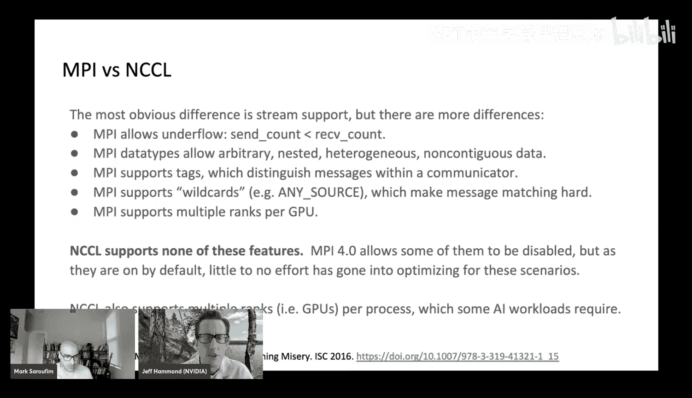

Yeah， I just have one that was written and just had in the chat before and it's regarding like the first slides and it's about the difference between data center GP and consumer graphics right Yes so the chatter was asking about。

The division between communication protocols and stuff in between those two。

Mainly that some algorithms work on data center PPUs but do not work on consumer GPUs and like is there any process like get rate of this division and so on well yeah so the first thing is and because nichols having its10th birthday right now we've been talking about a history a lot so the original version of nickel actually went through and just optimized for PCI E peer to peer between GPUs in a box and we still support that so so even if you have you know two G forces 4090s or whatever in a box niel will work obviously the enV link is a data center thing and that does change significantly the performance and I don't know off the top of my head all the protocol dependencies I actually。

I don't have 24090s at home， so I mostly look at NVlink so I can't tell you internally what nickel turns off if it doesn't see NVlink。

 but i'm not aware of any features that don't work， it's just how NCel does protocol selection。Yeah。

 it was also related to not like features being turned off。

 but then like algorithms not working properly like the question was regarding aingTP。

 which is kind of communication heavy and you kind of can't do it on consumer graphics。Yeah， yeah。

 and I guess at some level there， you know， even if we could do it would it how well would it work if you're at PCI EG5 versus you know。

 which is on a good day 50 gigs and enVlink is 900s or 450 I guess if you do unidirectional so yeah。

 I'd love to hear more about it in Discord if you can if you can post the details because again I haven't seen much of that topic。

I'm going to ask you drone through a couple more questions so Jeff on the topic of history like you mentioned like quite a lot that like MPI like one of the reasons why it like sort of conquered the world for so long was primarily because of its portability and backward compatibility where there's sort of like any things that you think they really got right in those early days that are underappreciated。

well I。I did a whole lot of work on MPI3，4 and5 and I think we've gotten a lot of things right over the years so one of the things and niel looks a lot like MPI because we appreciate MPI so we understand that the design of the collectives having collectives as a firstclass object is really important because you know if you think about all reduce if you want to do an eight byte all reduce。

 you do a very， very different algorithm than you do if you want to do a one gigabyte all reduce and what you want is for a user to say here's an all reduce here's here's a byte size。

And then the implementation will go figured out you do not want some user deciding whether they should do a tree。

or a ring or a multi ring or any of that business so exposing all of that logic as firstclass prims to the user was incredibly important you know Send receivece is a really good way to write a lot of algorithms I know I just bashed on you know sendend receive a whole lot because calling sendend receive from a GPU would be a bad idea but but the concept and the host initiated version of it is a really good way to very general purpose way to write code very safe you know Rusty Lusk who had a huge influence on MPI for its entire history you know used to talk to me about performance transparency that when you write an MPI program it's really easy to look at the code and say this thing is going be fast this is going to be slow and this is what I need to do to fix it and in contrast some of the stuff that makes everything look like。

Single memory space can sometimes give people bad ideas and they can start doing you know8 byte accesses across across a network that's you know10 meters long and and that can be a bad idea so there's a lot of good stuff in MP the thing that the thing that that I'm going to talk about on the next slide is just that it has too much goodies too many goodies in it for GPU execution but the other one right is consistency MPI has with maybe one or two exceptions I can count that no one cared about we've never broken backwards compatibility and actually the thing I just spent three and a half years on was we now have a standard API which will be a big deal so we're doing a lot of things to make the usability high so。

So speaking of the programmability of these things like I kind of didn't fully understand like what does Schm do very well in the sense that like when you were pitching NVM you were saying something along the lines of like you can initiate like device site it comes directly obviously for Schm that's not the case because everything of the CPU so what were the applications where Schm really shown where Schm did a really good job sorry yeah yeah well Schm doesn't have a up until if you don't count NB Schm and the AI use case Schchmm is known for having a pretty small but very。

 very serious user community in a particular branch to the United States government and they write very very large scale unstructured data analytics applications and and the operative word there is is the unstructured so you know Marcus gave a fantastic tutorial on。

tencil which is structured right when you have a physics code you do a domain decomposition and you say。

 okay well I've got Cartesian physics and I do X Y and Z and I can pair all these things up and I can build this beautiful graph of communication and map it onto to MPI and MPI will just do a great job with it and so historically MPI has done a really good job with structured programs the unstructured stuff you could do it but you sometimes have to resort to patterns that are not necessarily the most efficient and that most efficiency。

Matterters when you're doing really large scale applications and so so good example of this is。

If you're going to do sorting on on a supercomputer and you're going to， you know first you do。

 you know， you do a local sort and then you do a histogram and you say， okay。

Some of these keys are going to go to different buckets and you know where these buckets are so then you start flinging these buckets out to all the different remote nodes。

 but the thing is only the initiator knows how much data it's going to send to a given remote process because only it knows what the keys are and it sort of them and it can see that histogram and say okay here you go and so you can't really write a nice happy code where that information you is known where it needs to be known in advance and you can basically do a rendezvous so if you want to send receipt you have to either do polling and say well I'll accept whatever data comes in or you have to do well I'm going look for a specific thing and if I see it then I'll wait for it and go get it and so you have all these ping pongs going back and forth to exchange whereas if you do it Schmm you basically just say well I've got I don't know one。

byte worth of distributed memory aggregated together for my target space and I can just spam the whole system。

 put everything where it needs to go in chunks and not wait at all and actually what I just described right is。

Is actually the reason NVshm is used in MOE because what's happening is you have this routing function and the router knows where these keys are going or whatever they're called tokens are going to go。

But the expert that's getting hit with them doesn't know which data is coming and where it's coming from so what you do is you just write it over there and then it'll go look and see what's in basically what's in the mailbox and go start working on so it's the unstructured part of SchEM that has been killer for many。

 many years it's just that historically you know the MPI was used primarily in the physics domain for a long time where it was better。

 but I mean I think they're good at both but you have to it's sort of like which is a more natural thing if you really only care about one app you might pick one or the other。

So okay I think we might need to keep going。 I have a lot more questions and I saw the questions in chat。

 so we'll just get back at them at the end of please be patient with those folks you no problem all right so MP versus nickel so Marcus talked about and I think everybody has seen it before you know the stream support and he gave a good example of well if you want to if you want to do an MP send after coa kernel you have to you have to synchronize and then you do send and obviously nickel you could just send because it goes on the stream and the coa runtime sorts it out MP6 may solve this but we don't have it yet the other things that MP allows that people don't think about as much unless you're an MP nerd you can do underflow in MP so you can have the receive one gigabte and the send can be8 bys and you that can matter means you can't do protocol selection independently only the sender can do protocol selection so the receiver has to。

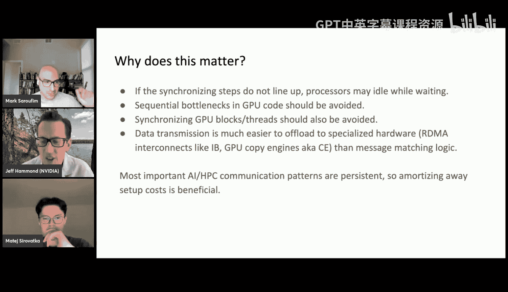

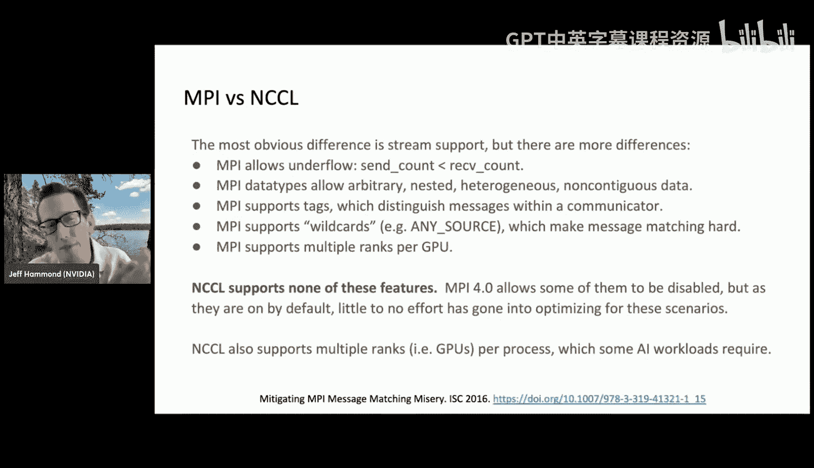

Get some information and this adds a little extra logic。MPI data types。

Allow you to do basically anything you can havestructs ofstructs ofstructs。

 18 level deep noncontiguous all sorts of weird stuff and the data type engine is really really powerful。

 really beautiful and elegant but not actually something I think is a good idea to run on a GPU you don't want to have that type of generality to do GPU processing you might be able to do it。

 but it's not a good idea MPI sports tags which isn't a huge deal but it means that you have to distinguish messages based upon some idea you can't just say well I post a receive and it hear's aend I can line them up the thing that everyone hates unless you have to use it or the implementers all hate but the users all know is sometimes critical is is wildcard and what this means is if you didn't have wild cards you could post you could basically separate the。

Maching logic into bins and you could say well I know that I only have to look over here to match a message I know that this message won't match with me so I can I can do this in parallel but the any source is essentially a global synchronization in your message queue processing and this one of my cos in the team Jim Dynnon with two other folks wrote a really good paper on this explaining why this is hard and hard to do in hardware among other things。

And and so again hard to do on a GPU because the logic the other thing is MPI supports multiple ranks per GPU and this makes a lot of sense and I use it all the time in you know physics codes but it greatly increases the complexity so if you look at niel Nicel and N Schm both don't support multiple ranks or PEs per GPU and that means that things are a lot simpler for the implementation and in most cases users don't mind but but it's something that is a restriction so NCel has none of these things MP4 allows you to turn some of them off but I asked and nobody's optimized for them yet so we're still we're still sort of in theoretical land with MP for these optimizations the other thing is that niCel supports multiple ranks or GPUs per process and MPI doesn't allow you to do that although I'll propose it for MP6 and some mayI work。

s like this we have customers who will say you know what I do not want to do multiproces on my my CPU workload because i'm doing this gigantic data analysis file read thing and I don't feel like doing NP parallelism or whatever on that I just want to do that all in shared memory with threads but i'm going to have the GPUs act like independent endpoints in communication so nichel does support that。

And so these are some of the more interesting differences why the feature set of MPI and Nckel don't perfectly line up。

 and I think actually the last one is probably underappreated that the AI community just wasn't really interested in having to go all in with MPI run launching if they were running on a workstation and Nel doesn't require you to do any of that if you don't want to。

All right， so now I'm going to switch gears， that was all context and now this is I'm going to describe a benchmark and I'm going to show you a lot of code and a lot of performance measurements and hopefully all the things I described conceptually will start to fall out looking at the code and looking at the performance。

So I'm going to focus on matrix transpose I happen to like it a lot I think it's cute and fun it also relates to a lot of things I've done in science with tensor operations and quantum chemistry and it also generates an allall communication pattern so this is this is of course the trivial you know version just to show you obviously in this animation by the way cursor made this I actually didn't do this I just told cursor to make me this animation and did a good job with it so what I'm going to do in this benchmark this is this you know single whatever single process version I'm going to do an accumulating transpose so this I'm going to take BJ and add IjiI to it。

And then the other thing I'm going to do which is a little bit different。

 which isn't transpose is I'm going to increment the a matrix。

 the input matrix every time and the reason we do this in this benchmark is for verification because if you do transpose twice you get back what you started with and it makes it really hard to be absolutely certain that you did everything correctly if if basically if whatever you did wrong is invertible you won't know it and so we've learned the hard way over the years to add this add this extra work in transpose so that we can always do elementwise verification and I will say I really do appreciate this because I didn't write the code correctly in all cases the first time was inBmm and it's a lot easier to see when you can do this so this is a matrix transpose you can go through it a bunch of different ways columnwise rowwise blocks everything but this is what we're going to be doing obviously on a very big matrix。

So I'm not going to focus on the GPU implementation of matrix transpose Mark Harris wrote a beautiful blog post。

 I think 2017 maybe in which he describes the right way to do matrix transpose on a GPU in contrast to the wrong way and it has to do you shared memory and do coalescing and the like so all I'm going to tell you is that I implemented all of Mark Harris's versions and confirm that there is a bad version that gets 500 gigabytes a second or less and there is a good version which gets three terabytes a second on an H100 you can read my code on GitHub if you want to confirm this and look at the blog too so the important part of this is I'm going to use a matrix transpose kernel on the GPU for each GPU operation that gets three terabytes a second and therefore when you see it you should expect。

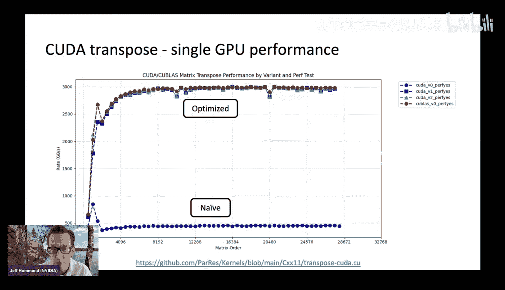

You know8 GPUs 24 terabytes a second is what we're going to get is the peak throughput for the single single process execution so that's all i'm going to say you can read all the details on Github but now we consider this a black box。

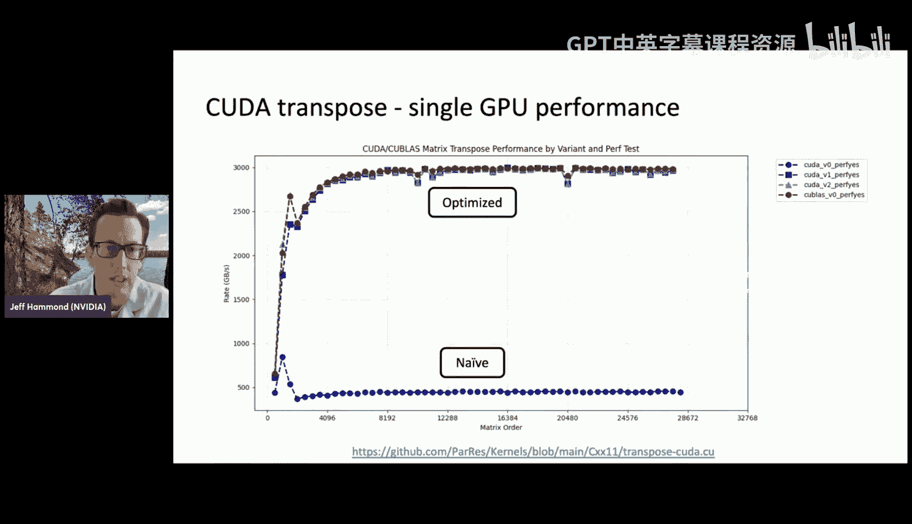

So distributed transpose。So a long time ago， when I was in another role。

 me and some friends wrote a paper on all basically all the different ways to do distributed memory matrix transpose and we ran it on strong scaled it from one CPU up to multiple cabinets of a C supercomputer at NRSk and you know we learned a lot of things and saw some interesting stuff and so we have an MP version a whole bunch of MP versions in a Schm version and so we had some expectations。

 or I had some expectations about the behavior on GPs from having benchmark this before in a CPUU context。

 so if you want to know about a little bit more about the benchmark or the project I'm building this off of you can check out the links。

 the important thing is if you're waiting for where all this stuff is it's in the lower left GiHub link parez kernels which we call the PRKs。

 this has absolutely everything all。I ran in this is there。

 it's almost trivial to build it and if you want the scripts I can send scripts to reproduce it later。

So I'm going to run a whole bunch of experiments kind of like this and try to learn stuff from it。

So when we think about the distributed part of this we're going to have eight GPUs so I made eight columns and this is not element columns is think of this as blocks right each one of these squares is you know whatever a 1024 by 1024 block of elements and we can think of each column as owned by a different GPU and when the。

Transpose is going to occur。 You're going to have to take those blocks and scatter them to all of the other GPU。

 So if your' GPU 0， you'll have8 blocks， and you'll send。

Seven of those blocks to the other processes， one through seven。U。😊。

And everyone will do this and so this is everyone is doing a scatter which is equivalent to an allto all pattern。

 although you can implement it a whole bunch of different ways， so now I'm going to do that。

 but this is what's going to happen we're going to generate all the all communication by having every single GPU send data to every other GPU and then they're going to do the local transposition and the local update and then we're going to just keep going and measure the performance of this。

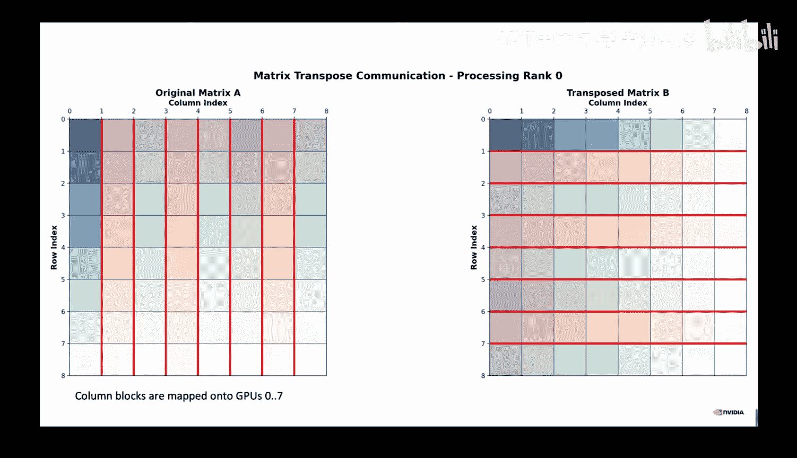

So this is I ran everything on the DGX H100 in the basement of the Helsinki office because I can su do there and do whatever I want and you can read more about the hardware。

 the important part of this we have eight H100 GPUs and then we have a pretty large envylink switch or multiple switches but it looks like one obviously you can read more about it at hotships in the link below the important numbers here are the local memory bandwidth of this system is about 24 terabytes I mean it's 26。

8 but I like numbers that are nice and round so 24 is my goal and obviously 3。

6 terabytes peak bisection for the switch which I'm going to round down to three and say that that's when I do the old all I can probably get3 terabytes a second through that switch and so I know。

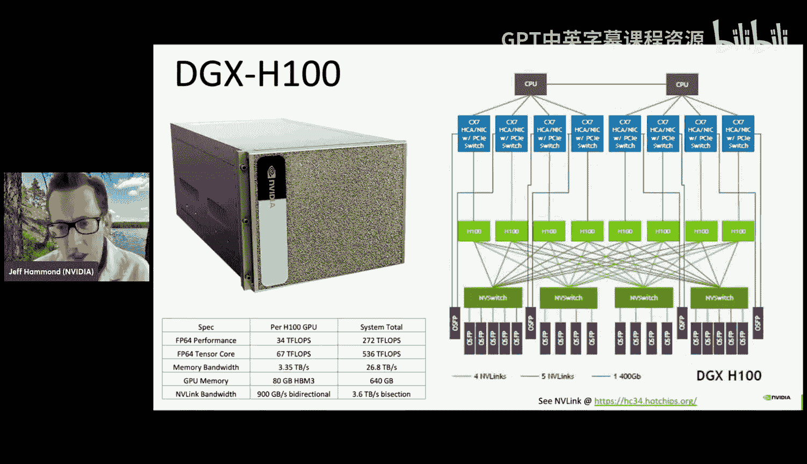

First of all there's a ratio of eight though so that's a nice number。

 but these these are my sort of loose or you know loose upper bounds on what I'm going to expect I want to see 24 terabytes a second in local ops and three terabytes a second in network ops and when I combine the two I'm going to get somewhere in between that's the performance goal and we'll see how it goes。

So I'm going to show the MP version first just to make sure you sort of settle in before I throw GPU stuff into the mix again like I said so we each GPU has has one of these column column blocks and we're going to do an all all this is this is just a wrap around MPI all all think of it the same way the only difference is I do type inference and assume comm world because i'm lazy and it's a benchmark so i'm going to transpose this column block into a temporary that is now a rowb and then I'm going to go over all the blocks in the row and i'm going to do the local transpose and then i'm going to increment everything so this is。

Three steps， all to all。 then I'm going to transpose the blocks and then do the increment。

 So three steps separate in the all to all version， and then they'll get fusesed later。

 We'll see that in just a second。So the point to point version of this。Is。

This is this is sort of an interesting one so in the beginning I said that one of the powerful things about MPI is just exposing the high levelve primitive of the collective and not telling the user to do it themselves and so this is actually a version where the user me tries to do it himself and there's a reason we have this algorithm in our implementation one is it reduces the temporary space which I don't think really matters and the other thing is you are now interleaving communication and computation you're not overlapping them but you're interleaving them so if you look at the previous version。

All the all， everyone blasts the network and then everyone does something local and everyone does something local。

 so you're going to you're going to hit the saturation point on the network and then go to the next two steps。

 whereas in this case， because you're doing send received between pairs and transpose it's possible that when some pairs are doing send received between each other。

 somebody else can be doing a transpose locally and therefore。

We can we can get you know we're not we're going to hit the speed light on the on the switch and then and then not go any faster so maybe don't flood the network so this is sort of user manage flow control is fancier ways to do this I could have done a lot more interesting tricky stuff but the goal isn't to do everything possible that's tricky it's just to show the concept of interleaving。

So the other thing we do here is we do ciulent shift to avoid the hotspot so we don't we don't have all the GPUs communicate with zero and then one and then two。

 etcter。Tranpose the block one at a time and then increment。Okay。

 so the Open spam version and I like Git there's a reason it doesn't matter it's just because I've been writing gett instead of put for a long long time and put is sometimes better Git is sometimes easier so i'm going to show a lot of gett stuff I didn't have time to finish all the put implementations that I wanted but but。

It's a great idea to play with that if and what you'll see in the moe stuff is they use put。

And you can read out they do it elsewhere so in the in the get version it's pretty straightforward you just get the block and transpose it so it's it's basically the same pattern except you're doing a get rather than a send receive pair and so you can do the get regardless of what the other process is doing so potentially the other process might be doing some local compute and you can pull data from it and then do your local compute and so maybe this will perform better in some cases。

The other thing here you'll notice is that I had to add these two barriers and this is that whole thing about separating versus combining synchronization and data movement is because get doesn't synchronize there is absolutely nothing in this program in the communication data movement steps that will stop these processes from running over each other and so we have to make sure that we don't update a until everyone has fetched a and that we don't。

Transpose or pull data into a until everyone has done their updates so you could do this stuff more pointwise but at least it's in a relatively well behaveved program that runs without too much load imbalance doing a barriers and killer if you have a load imbalanced algorithm you do not want to do barrier you want to do this all with pointwise synchronization in Nb sm and Schm it's called put with notification all the moE apps use it and you should you should learn more about that but that wasn't in the first hour of what I was ready to talk about。

All right， now it's time to switch to GPU versions。

So the nickel all all version and I'll show you why it's in quotes this one looks exactly like the MPI version except for the GPU part so I'm going to show two versions one is bulk and not and so this this not bulk version is the first one I wrote。

And it just does exactly the same thing as the MP version the difference here is unlike a CPU where function call overhead is basically nothing。

 I'm firing off a whole bunch of different ka kernels and it's better not to so I wrote a bulk version which goes and iterates does all the block iteration on the GPU using the Z dimension and it now I have one kernel launch it's a little bit faster but it's mostly invisible especially for large problems Lastly same thing I do a ka kernel to increment everything so this is one to one with the MP version。

嗯。And just for reference， so I did nickel all to all myself because we don't have the all the All function call in there yet。

 but nickel is designed to do all the all with send receive so you just create a group you put all the send receives into it and then end the group and this goes onto the stream and so you can you can look at the nickel doox they'll show exactly this pattern I just copied it and put my Q wrapper around it so I'm doing a nickel all the all here on a stream is just implicit stream argument。

So what we see here is we get a slight bump from the bulk as expected and the approximate performance is seven and half terabytes second throughput which is neither three nor 24 so I broke it down I ran the coupa event profiling to get it through and what you see here is when you're doing the all all you're running at about 2。

7 terabytes a second which is close to three and when you are doing the local part you're getting about 23 terabytes a second which is close to 24 so this is right in line with my expectation。

 so the reason you get seven and a half is because some of the time you're at 23 and seven of the time you're at 2。

7 and you can obviously you can't average the bandwidth you have to look at the time and then invert it and all that but you can see this from the time breakdowns that things make sense your bottleneck now by going through the switch as you would。

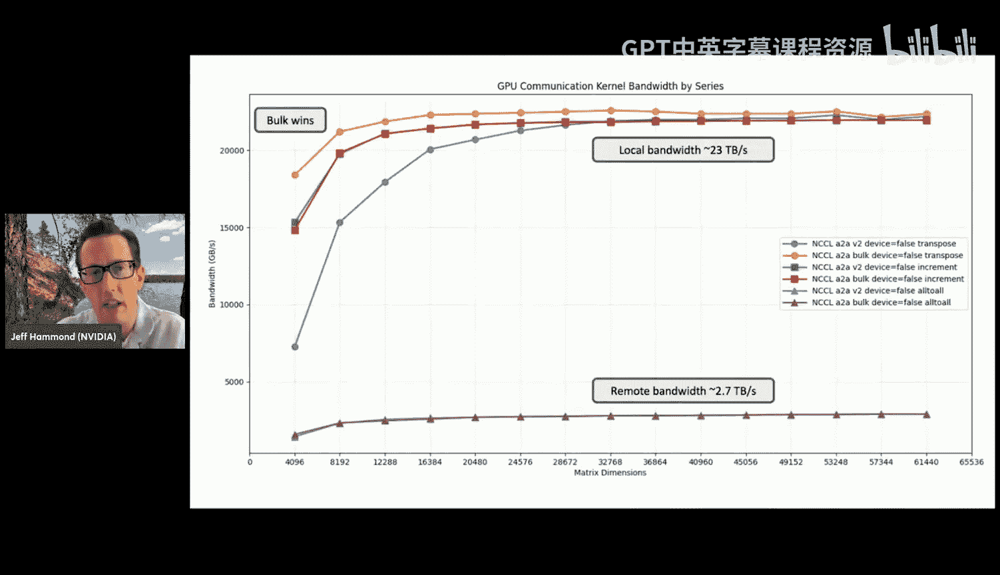

from basically all performance models of distributed memory。

Now I wrote the niel send receive version and this one's interesting because this was a bad idea and we'll see this in just a second so I'm attempting here then to do my own user levelve flow control on send receive and be cute and it turns out this is bad and this is an important thing to understand why this is bad so you see these stair steps here where the point to point version that does pairwise isn't anywhere near as good as just dumping them all into the network at once。

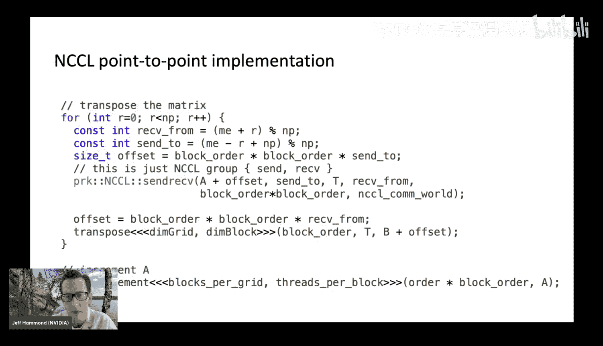

And the reason is that nickel sendend Re is designed for developing custom collectives and essentially all of those use cases involve more than one send receive pair and so nichel says I think you're probably going to be writing your own all to all your own gather gather V etc。

 I'm not going to blow everything in the network as fast as possible because that might you know overwhelm the network and end up being slower and throtling it so。

Nichol is sort of fighting with my attempt to be nice to it by by you know， using its own。

 it was going to be nice to me and now we're both set。

The good news is that you can work around this so you can use multiple streams and basically you know Nicel will then not apply this logic and if you are interested more in this my coworker Joshu Romemerro has this CUDcomp library that does a whole bunch of auto tuunning optimal scheduling tricks for the alldo pattern in a 3D like 3D FftT type problem and you can read the code online and Josh was telling me oh yeah you can do all these different tricks to get this to go away and I learned that on Thursday night so I didn't have time to redo everything。

Okay， so now I'm going to do NB Schm and I'm going to start with all all just to show that it's the same one thing that's interesting as if you are an MP programmer and you go and use Schmm or NBchmm you need to know that all the all doesn't mean the exact same thing so in Schmm they're trying to avoid synchronization at all costs and the all the all primitive in sm and Nbmm is assumed to be implemented as everybody does a put to all okay so one sided scatter and what that means is it will not wait until the target is ready it'll just right to it there's no synchronization involved there so you have to put a barrier in front of it to make sure that you don't blow over something that was in the middle of being updated locally as the pattern of my algorithm requires same pattern as before we have the bulk transpose the not bulk transpose and the local increment。

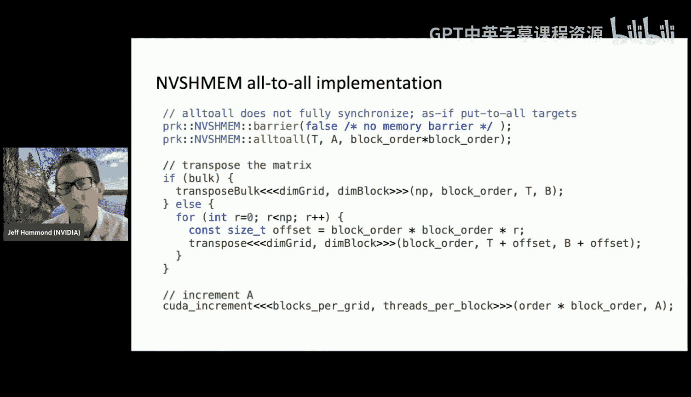

So now we see here all to all is about the same so and I apologize nothing interesting has happened yet。

 but I promise it gets interesting in just a second。NVmm wins by a little bit。

 I haven't looked at the source code enough to figure out exactly what protocol switch is going on。

 but NVSmm has been optimized much more heavily for latency。

 which is why the smaller cases are more different， obviously asymptotically， they're both identical。

So the one sided get implementation is a little bit more complicated and I will say I wrote this one second after the one I'll show you later。

 but i'm doing this in order， so there are two two versions of get here so the first one looks a lot like the code we've seen before with a loop over blocks doing a get doing a local and then the barriers and then doing with the increment in between。

But because this is Nb Schm and I can do device initiated communication。

 I can take this entire thing， this loop over blocks and the gi and the transpose and shove it all inside of one ka kernel and fire that thing off on the device and let it run。

The bad news is。I was I sort of ran out of time and didn't do all the bookkeeping so I did something that I discourage people from doing。

 but hopefully you can learn from my error it's not the worst thing in the world but it's not the best so you can do a block and a warpwise get and I should be doing that but I didn't because I I was trying to get this in real fast and so what you see here is I basically put an elementwise get operation into the place where I normally would have just done a load so replacing a load or an equalstein with essentially a mem copy adds a little bit of overhead although this will get inlined on envy link it'll get inlined and mapped to a store but there will be some logic that shows up in this kernel that didn didn't show up in the load version and so this isn't perfect so note to everybody。

Don't use element wise gi inside of your kernels unless that's your pattern amortize everything。

 do a whole bunch of arithmetic， but we'll see later this is not actually the best way to do this I'm going to show you the good version that was actually the goal here all along。

But you can if you want and you can see examples of it online both in our docs and in perplexity's benchmark of using fine grainin communication and fine grainin synchronization on the device in moOE and that's absolutely the right way to use this stuff。

 but this is just here as a reference to compare it to the load store version I'm going the pointer version' enVchmm pointer version I'm going to show you in just a second the other thing is that because I'm on an envylink domain this get isn't so bad it's going to map to an enVlink load if this is going over the network this is going to be not the best way to do things at all and if you're going to do enVmm across the network you want to be smart about how many GPU threads you actually have touching the network and you'll see in the MoOE folks they do that stuff smartly in the docs describe it in more detail。

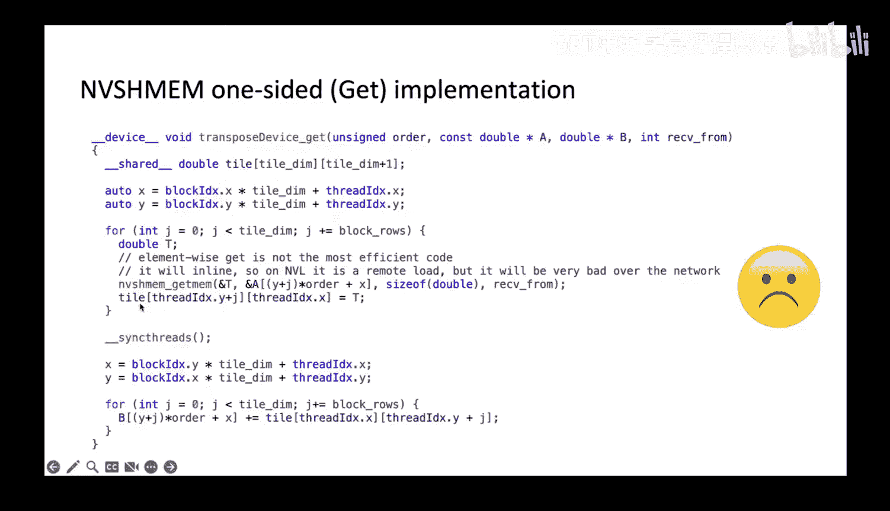

So this is the one that I wanted to show and this this is the exciting one you know this is exciting because enVlink is cool but it's super exciting because enVlink is a lot bigger than a node now so you know I ran this on an NV link8 domain in a DGX box but we are shipping NVl 72s that have obviously a whole lot of GPUs in them connected by a single NVlink switch domain that that allows this to be indexing the whole rack and that's what i'm trying to demonstrate here so in this case I start with the version that I had before where I was going to do。

You know， blockwise communication， except the block communication now is replaced with EnBman pointer and all that does is say what is the remote address of the start of the block that I was going to get with communication。

Make a pointer out of it。And give it to the kernel so there's no communication happening here this is just look up and then it gives this remote pointer to the local compute kernel and the magic of NV link takes care of it。

courseour， I can do the same thing in the big fat kernel model， which is what I'm going to do here。

 so this is the one that's going to be really cool because I'm basically going to call one kuda kernel and it's going to inside of it go over all the blocks。

 look up all the pointers and do everything as if it was local memory。😊。

So there's a intermediate kernel that you don't see。

 you can look it up it's just the loop over blocks part。

 but what you see here is that for each one of these blocks you grab the pointer。

And then do the device side call of the optimized kernel and then sync memory so you don't blast SLM。

And then you just go， so you basically now have have eliminated communication from your code。

 there are no send receives， there are no old alls， there are no puts， no gets。

 there is the barrier that you'll do later， but this is nothing more than give me a remote pointer address。

So now we look at this so remember seven and a half terabytes was our standard number and the get version for the you know for the small problem sizes ramps a little bit faster。

 but in general。It's about the same as all all and point to point。On the other hand。

 if we do this with a pointer， direct local or direct remote access。We're now 30% faster。

 so we're at nine and a half terabytes a second。So what this means is we were able to improve the communication efficiency an enormous amount while also making the code a heck of a lot simpler because there's no communication it's just envlink to do your thing and calling local compute so this is I think this is a super neat is kind of like if you're if your're old school and you remember Kx 1E or other fun supercomputers where you could do this this is kind of a magical thing and's and it's even crazier that you can do this over 72 GPUs on one of those racks。

But this is a significant performance difference to take advantage of NVlinknk and remove this separation of communication computation。

So I should emphasize that you know the enV Schchm pointer access version only works with an envy link domain。

 so I asked cursor to draw me a picture of this and this is what it came up up with which was。

A heck of a lot faster than the PowerPoint drawing I would have made。

 but maybe not the most beautiful， but the point of this is you can have multiple env link domains and between those env link domains you can use env Schm put and get but within those domains you can use pointer access so and this is this is actually why folks in moe space will。

We'll do this so'll use NV Sm because it's portable across this whole domain。

 whether you've got IB or NVlink， but it gives you this immediate way to take advantage of NVlink as a load store network and eliminate explicit communication and NV Sm is basically the only model out there that can do anything like this you can do the NVlink domain part with Kuta IPC if you want。

It's a little bit more complicated， most people figured out， but it's complicated。

 but if you really want to combine the two， it's very， very difficult。

All right so just to summarize this is absolutely everything all on the same thing you know here's our direct access here's our everybody doing a pretty good job with all the all and here's our unfortunate throttling situation which we know is solvable but happens if if you if you you can be surprised by this if you don't know what's actually going to happen behind the scenes and then you have to go mitigate it so in general don't try to be too smart just just right all to all。

And all all will do about what you'd expect to do， it'll saturate the network and then it'll do the local stuff。

 whereas when you fuse that network step into the compute， you get a pretty significant benefit。Okay。

 I'll pause here because there might be lots of questions about the experiments， maybe。

you like girlfriend first。You can we I need to improve my thoughts all right all right so one question I had like while you were coding all this stuff up is it wasn't too clear to me how to think about the programming model of like Schm versus like the regular sort of memory hierarchy so is it sort of like like when you sort of do get inputs like those can again be in arbitrary locations and memory can you say I want this I want to get for example。

 this location and shared memory or is it basically you just say I want some memory and then it's up to like the other GPU to figure out like what memory to give you exactly。

Well， so so the Schchmm concept， the symmetricsymmetric keep everybody takes the same size slab and contributes it and if when you initiate communication you are doing you are in control so NB Schmm will make it so you don't have if you do an NVchm put or a get you don't have to think you can do a put to PE myself and just load it out of your own memory you can do a a put in a get to another GPU which is Nv link connected and it'll also be load store and NV Schchm will basically go in and do some point arithmetic to give you the right。

Your virtual address view of the other GPU's memory。

 which might have a different address in their thing。

 it's you know one of these just it's two different virtual address maps that point to the same thing。

It will NVchm will also go in and determine oh， this is outside of an envylink domain and therefore I need to do the right network operation which that's a lot more complicated and goes through a couple different code paths sometimes involving the host。

 but NV Schmm really hides all that and it's just saying as long as you know which GPU you want to talk to you can go talk to it however。

 if you're smart you will actually want to sort of hoist this logic into your program so what you can do and I don't do it in a hybrid way but I show both versions if you call NV Schm pointer on a segment of memory at a remote PE。

If it returns to you a valid address that means you can load it if it returns to you a null pointer。

 that means you can't load it so if you want to be really tricky what you'll do really smart is you'll try the NBM pointer and if you and then say if not null do it as if it's local else。

😡，Issue the put or the get。And then let the network take care of it and understanding that there's going to be a performance difference between an envylink load and a network read or write is important if you really want to tune for peak performance but you can start with it just works and then you can do a hierarchical optimization for you think of it like Nuumma or whatever。

 or intra nodeode intra node but the good news is when you go across that network domain you never need to think about what network you're using and I think that's one of the really important things that NV Schm is doing。

So I have a longer question by Ru Demar so i'm going to put it i'm going to read it I don't know ifki can you see it noll it I'll switch。

Yeah。Yeah， so what I mean is。Some networks blue gene was was such a network。

 you could basically just spam the network and there would be no。

No sort of no real punishment for it I mean the data would move as fast as it could move。

 but you wouldn't have some sort of degradation by saying i'm going to give you all of my messages all at once they would just go through in the order that they got in some networks most networks in fact。

😡，If you have a queue。And you inject like a million messages into the queue。

 the queue will run slower than if you only inject 100 messages at a time， so there's is a。

Common trick in you do when you do collectives in all the all of doing some sort of windowing where you say。

I'm not going to just go from all one to n。Send I'm going to do for one to batch。

 send weight one to batch or you know whatever you batch it through right And so what I'm doing with the pairwise exchange is I'm saying I'm gonna batch it one big message at a time because I know that I can't move through the network faster than the data moves。

 why should I pump more into the queue and what we're learning in this scenario is that nickel is actually smart enough to do that when you give it that group。

 nickel goes in and says okay I'm not going to go dump all this stuff into the network all at once。

 I'm going to schedule it intelligently because it's expecting me if I do one group on one stream with with send receivers。

 it's expecting that I'm writing a collective。 So nichols helping me but when I try to help nickel it's a negative interference So there's a workaround。

 but is this is basically。Nickel has this logic in the send receive itself and this is not true of mI so I know of no mI implementation where we're doing a whole bunch of send receives。

Will trigger a flow control if you want that flow control you you call all all and it's built in。

 that's why you call all all。But but send if you want to spanm the network。

 you can do that with MI S receivece and so this was sort of counterintuitive for me， but now I know。

I have another question from Marin。Yes， this is a great question。

We know of some users of envy Schmm who use enV Schmm for。

Strictly for allocating envylink pointers because you do enV sme Minet then you do enV smm Malik and the pointer you get back from NV Schm Malik has all of the enV link you know address mapping and has you know all the IPC stuff it has if you have enVlink enVlink sharp it'll also do all those mappings basically it's a universal Malik for all the all the GPU networking goodies so some people literally just call enVm Malik for that purpose and they don't actually use enV Schm communication at all they just do load store with everything so。

This is a good observation NBchmm is a very nice convenience function for all that capability on the other hand some people say no I'd really like to write all the kUuta to set all that up because I don't want a dependency and I've seen both and it just really depends on what users want to do。

All right， I have another question， this is a two part question from Angelo。

You stated that columns are eliminated and then the second part is the are yeah。嗯。

I'm not sure I thought I said en Schmcoms were eliminated when I switched to pointer。

 but maybe I misspoke can we come back to that one and maybe。Maybe I'll remember what I said wrong。

All right， I guess Matt， any other question or should we keep going Yeah I have a rather random question you had a graph unlike the first。

Second or third slide of the second part。Like comparing all the methods of matrix transpose on different。

It's like they're rather old so no， no， it was like on different scales。Oh， the cray numbers， yeah。

 yeah， exactly。There we go， yeah， yeah， I was wondering like you can see that here like Schmm actually scales very poorly with like the number of course。

 like why is that like is it because the because of the lack of synchronization the network？

So Schmm is doing a fantastic job here up until， and this is when I give the talk on this stuff。

 I explain this。It's because。At 1536 cores， the message size is at。

 I think it's about 4K and 4K is that everything above 4K is pretty efficient in an RMA network。

Once you drop below 4K， it gets less efficient。 And so what happens at 1536 is that all of the models that are doing one one communicating endpoint per core start to get into the small message regime where where the network's less efficient。

 So at 12 I can't remember it used to be on the slide， but at 120288。

 it's it's like 64 bys or less per per message。 Okay that's that's too small to hit line rate or whatever。

 What you see in the MP curves that go up。 Those are all hybrid。

 meaning MP is going to do one MP process per node or per socket and do threads within it。

 And so that the communication。Volume is the same， but the message size is much larger so mI keeps going because it's still communicating kilobyte messages and this is just sort of an artifact of messaging stacks and networks and CPU domain decomposition we don't see this。

Well you can see this in a GPU that's why if actually when we look at the NV smama we have block and warp and thread right you really would like to do a block put if you can do the arithmetic and get it done because then everybody's working together if you do a warp well that's still good you get coalescing if you get thread put then every single thread is sending a single piece of the message and you're not getting that coalescing behavior or you're not getting the networking aggregation so this is this phenomenon will show up in in NVmam but I just don't have the example for it yet sorry。

Yeah， thank you。 I also have one question like to circle back to Nicole and you said that like。Well。

 Nco chooses the algorithm or the protocol for real based on like the message size， the。

The architecture and so on， is there like a way to actually tweak those like for example。

 say that I want to go with the memory， the bandwidth oriented protocol。Yes。

Yes we do and they're all attributes in the communicator object and there are some environment variables as well however my team when I said I have in there the phrase trust nickel they said yes yes please tell everyone to trust nickel and don't try to tune it yourself because we do have a whole bunch of tuning options but the whole point of our team that does a whole lot of work on this is to make sure that most people shouldn't have to do that so i'm going to tell you that they exist and there isn't Nvidia developer blog by some of my colleagues about tuning nickel that was written in the last month but i'm also going to say please don't read it I mean unless you have a really good reason because nickel is going to try very hard to do the best protocol choices for everything and if you start making those yourself。

You might find that on one system for one application for one job size you're going to win。

 but now you're going to go into non portable hell where you have to go retune and rediscover all the right with you know whistles for。

For every for every use case and and then you might be sad and you might say well nickel's slow well it's slow because you changed the default and didn't let it make the right choice on a new machine so yes we have them but you know use them as a means of last resort。

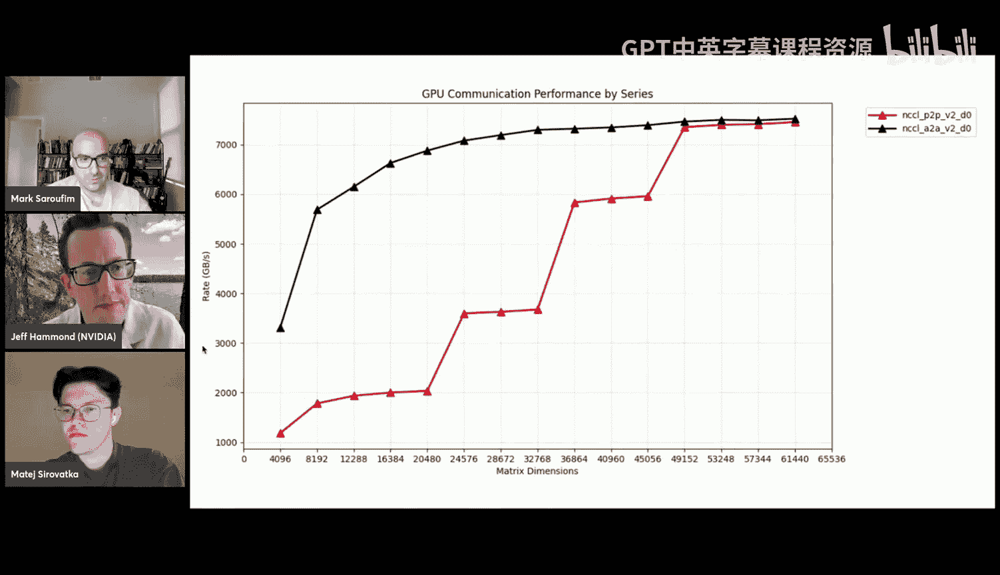

I think we should get going， we might need to bot some questions near the end because like there's a lot more questions in chat for what it's worth。

 but I'm really sorry if you want us to ask a question just ask it again near the end。

All right so now i'm going to bring this all together with the stuff that really matters in AI workload so this is taken directly out of the perplexity blog please read their blog they did a great job explaining this stuff I talk to these folks it's great writing really nice benchmark that you know once you get your head around it you can learn a lot from so this is expert parallelism you know so you have you multiple requests to different GPUs coming in and when they hit the router it's going to then scatter。

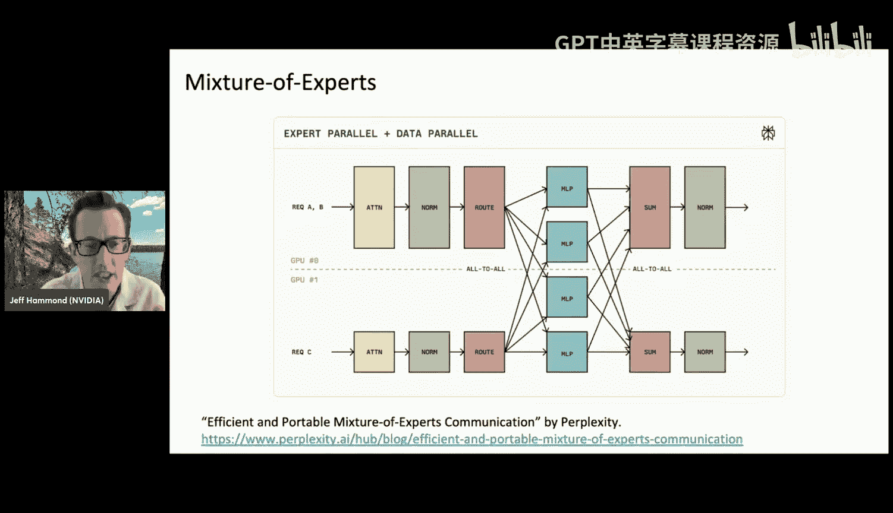

You know， some of these tokens to other GPUs， obviously this is just two。

 but there may be more MOE domains are getting bigger and that's going to be an all to all pattern and it's actually going to be an unstructured all to all pattern。

 which is why even though you see all to all and you'll see send。

 it's all done with Nvis Schmam put because the router knows where this stuff is going and it knows what memory it's allowed to write into on the other GPUs but the other GPUs don't know what's coming in until until it lands and then they go look and see。

 oh I've got some tokens I need to chew on for a bit。So if you look at the code。

 you'll see this dispatch and combined where you you know you have a whole bunch of things happening。

 you have a dispatch send step， everybody does this and then you have the receive。

 this is implemented with put put notifier， there's a counter。

 I think you just increment the counter。And then there's the other part of this which is the combine where you do the same thing in reverse and then you do some summation and this is all written with on deviceice enV Schchmam so that the router doesn't have to return a bunch of metadata and then have the CPU kick off some comm ops it just says I'm the router。

 I know where things are going I have the data I'm going to send it into the network or enVlink and then we go and then the synchronization is carefully managed to look at this stuff when and there is a barrier at the end but there's a whole bunch of things that don't have a barrier in them。

And this is of course the real punchline， if you look at this。

 I don't know what the original implementations that they did with all the all look like。

 I haven't read that code， but you can see obviously the bar size is pretty significantly different and what they've got in their fine grain enm version of this。

Is you know significantly lower performance obviously there's two different IB protocols and one of the things that they do and they explain this more in the blog so DppP actually is a little bit faster and this is a fascinating story just summarize briefly so the folks at deepse。

Did some very specialized hacking of NV Schchmm on IB because they had a very special use case。

 they knew they were only using IB and they knew they were not going to require some of the things that NV Schm was going to do for them and so they punched through and cut out a very small amount of synchronization that made a really big difference but perplexity because they run on IB and on AWS EAFA。

 they were not willing to make these assumptions， so they published these IB numbers for direct comparison but they say in the blog that they care about portability to other networks and so they stuck with the NV Schm you know public API it didn't do those fancy tricks so that they would be able to get almost as good performance but be able to do it in any cloud they want to run it and there is some stuff coming in the future which will I believe allow the DPP trick to be done to be done without。

doing the really creative hacking， the deepse it， but this is obviously if you look at the numbers。

 you know， this is at least a 10x performance improvement relative to what they were doing before on MoOE and that's a big deal you know。

 if you're like me and you type perplexity queries all day long trying to try to learn stuff you want the latency of those tokens to be 10x better if you can do it。

So lastly， so this is the roadmap and this is an important thing because I talked about why NV Schm had all these cool features in it。

 I didn't say that they were in nickel and that might you know make people say oh boy what you know should I stop using nickel and start using NV Schmm because I'm doing MoOE and it turns out no。

 so we have already ruled out support for symmetric memory which is the first step in doing the NV link thing that I described you know with remote pointers and this GiHub preview went online yesterday I saw it a couple hours after the announcement for my talk went out and I haven't had time to read the code because it's been my weekend but the device API。

Is is in that version or is a preview and then multi nodeode envy link symmetric and then you know you see here on the next version after that doing put and get from the host so we're learning from NB Schm which pioneered on device communication but we know that there's a bunch of reasons why folks want to be able to do that stuff from nickel as well either they're already using niel or they want to use some features that nickel has that NB Schm doesn't which I didn't get into here but there are some。

So now you can do this so what this really means is with niel getting some of this one sided and symmetric support。

 you're free to choose one or the other you know we obviously care deeply about both and continue to develop both of them and you know enVchm has all the collectives and onstream and whatnot as well so if you like EnVm you can use it and if you like nickel you can use it and do essentially the same things in both of them so the feature parodity is essentially going to close and then it becomes more about sort of some of the nuanced differences in the runtimes and ecosystem if you're already using nickel or NVmm。

So this is the very end， so just to summarize you know。

EnB link with NBm today is easy fast and you get portability on the network part and this is really neat so the easy part is。

It's just a pointer use enV link you don't have to care let the memory controller take care of the magic it's fast as you can see I was able to fuse the communication into the compute and get something like a 30% bandwidth improvement with code that's actually easier and simpler to write。

And then as perplexity demonstrated， you can mix and match these things and you can get put and get working on different networks as well as NVlinknk and so you can write one version of the code and scale it across and then if you want to specialize as I said before you can do the pointer you can look for a pointer and try to use it if you can otherwise let the network do its thing nichel。

 of course， as I mentioned the roadmap will'll bring in this NVlink stuff this year and add on to of course all the existing stuff which is all the collectives at scale and all the support for AI workflows and some of the elasticity and RAS stuff that folks need that is really important for AI and less so for HPBC as I noted we belabor it a little bit but but trusting niel not trying to outsmart it with protocols because it's going to do that for you and then please check out the preview that went online yesterday and look。

For all the symmetric and device stuff that's coming down the line。

 that will hopefully make it possible to do all the neat device initiated tricks with nickel。

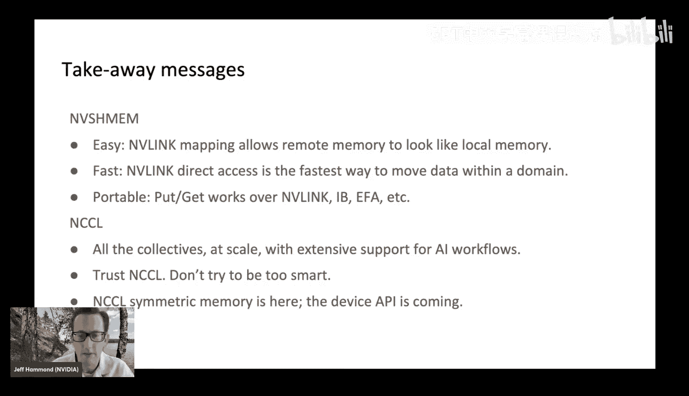

So， that's it。See， thank you so much， Steph。I guess yeah like we have a bunch more questions。

 maybe I'll start with one while more we' asking。So like you mentioned how like MoEes are kind of like a nice like sweet spot for NV shared and I was kind of curious to ask you about like other areas where maybe like the SMD programming model kind of shows its cracks I think I'm also asking this because you mentioned the sort of multiple multiple ranks per process and I'm thinking out loud like things like post training for instance where you have like you know like one process doing inference another one like holding a copy of a cache another one doing training do you still foresee like N shared men being like useful in the setting or is it like there's used to a completely different set of libraries so so this is actually this is one of the key motivations for bringing this feature set into NB Schmid so so NB Schm。

We have done， you the creative design and how to map it onto the GPU。

 but that API is the Open Schchmm API and the concept of the symmetric keep。

Is both powerful and restrictive so if you go all the way back to the beginning。

This philosophy of Schmm is if it's not fast don't do it and that's a really great philosophy' it's you know how Kuta started I mean back in the good old day right you could you couldn't do much with Kuta but what you could do with Kuta would be blazingly fast and then Kuta has gotten more expansive right so fast or nothing is a great philosophy but what it means is enB Schm's notion of the world right those processing elements。

 there are end processing elements， they all run together they all do collective memory allocation and they do collective synchronization you can create teams but you can get away from the worldwide collective memory allocation and what this means is if you want to write a heterogeneous application you just can't have some of your processes allocating memory and some of them allocating or not allocating or allocating。

Different size of memory that's that symmetry is what makes all the logic inside of the communication lookups order one super beautiful。

 but that rigidity means that heterogeneous like application building is complicated Now some of the cloud people can figure out how to do this and you can do out of band you can do an you can do NVmm cliques that are separate from one another and wire them together with some other communication if you want but that's that's just something that you know adds more work on the user nickel obviously has the MP communicator concept and one of the things if you look at the symmetric stuff it's like well。

 wasn't it easy well no it was actually quite difficult to design it because we had to go through the design phase just like MPI did of how are we going to build this one sided shared memory。

Our short shared address concept。In a communicator world so that we can have one communicator and two communicators and maybe the overlap。

 maybe they're disjoint， but they need to be able to do their own symmetric memory and their own one side it and that's a lot more arithmetic inside the runtime you want to do it efficiently so if you want to compose one of these heterogeneous workflows as people do with nickel where you have different levels of parallelism you know Tensor and data and all that nickel is designed to let you do that and now when we bring in the symmetric and device stuff into nickel you'll be able to bolt that on where you want to bolt it on but not necessarily use it across the hold domain me so it's a great question and Nvy Schm is awesome but really quite restrictive in ways that we want to get out of。

I see a few more questions I'm sitting I to go through them so from Angelo I think Ya。

 can you see the screen？啊。Well， yeah。Everything is sensitive to bandwidth right so if you're going if you go through PCciIE。

It's it's 50 and if you go through NV link it's 450 and if you go through HBM its it's 3000 right we were talking about this the other night when I went through the talk and and those are the magic numbers right those are different by almost an order of magnitude and and you absolutely see that so I showed everything within NV link domain and I get NV link domain performance。

The moment if I did the same thing and the moment that I went over two nodes with IB。

I would now you know if I'm running over eight rails of IB I'll get I'll get pretty nice bandwidth but it won't be the same as ZVlink so you really have to think carefully about this you know with your performance expectations your rate limited by the slowest step or whatever you know the rate limiting step in the network but you know this is where the hardware comes into play the reason envylink domains are scaling up is because you want to scale that type of bandwidth to a much larger domain because obviously as these experts get bigger as the tensors get bigger you need to have the NVlink bandwidth property within that to do some of this stuff so。

we do our best to keep up with the hardware but the hardware will ultimately be limiting you can also think about the algorithms right if if you you know if you can keep your tensor parallelism within an NB link domain that's a good idea and then you can do something that's maybe a little less communication intensive between those domains and of course that' it's some of what moOE is about right is about chopping up one big MLP into multiple MLPs that don't talk to each other as much so it's part of the application design as well to figure out where the bottlenecks are and not hit them as hard as possible。

Another question is here from Lucas。I haven't done it， but I would expect it to be really。

 really good and the reason is and maybe I'll ask Marcus and Jerry who worked on that tutorial as well to update this for next time one of the things that's kind of nasty about about a stencil halo exchange right you have this square and one of those dimensions in memory is contiguous and the other isn't and so when you go down that noncontiguous thing you're going to send basically one element of the halo one by one all the way down because they're you know1 thousand elements apart and obviously that doing that with communication calling even envy Schmm put as a little latency as it is for one element to the time going down the line isn't going to be as nice as if you just hit that with a load store operation and let let basically the warp hide the latency so I would expect it to be。

Noticeably better if that halo exchange is the thing that limits your app。

I think I see one more question to Ze。So yeah， this is the one we talked about with you really can't do a team symmetric heap I know there was a proposal in Open Schmm for that I don't think it's in the spec yet but I haven't read the spec in a while but I think I would have heard about it。

 and I don't think I saw it in NV Schmm Docs either so this sort of sub subworld or subcommunicator symmetric heap is really something you'll get from nickel。

I think that was it for me， Matt， any questions on your end？Yeah， for me as well。Hey Jeff。

 thank you so much for like this was awesome by the way and your slides are awesome and your code is awesome so like it seems like you kind of made I think me and probably a lot of other people curious to go dive through the history of a lot of these standards so thank you for this this is amazing。

😊，All right， well， I guess we'll see everyone。