# GPU MODE《CUDA、GPU编程54-87｜GPU MODE》中英字幕（deepseek-v3.2 p15 -20250823-Lecture 68_ Landscape of GPU Centric communication.zh_en -BV1xbmQB3ETC_p15-

我的。I can folks hear me okay is there echo。All right， there is no wonderful Okay。

 we can actually get started now All welcome everyone to another episode of GPU mode。

 this is our second lecture lecture lecture in our series on distributed compute Today I'm really thrilled to have like Professor D De from Co University it was gonna give us like wonderful survey wrote called the landscape of GPUcentric communication I first came across this paper when the them was presenting it to the Pro scheme What I really liked about it is it really went through like the entire history of all the different like Coms libraries like their tradeoffs like what they do So if you're really like looking for crash course。

 it's like quite comprehensive historical like I really hope you enjoy this current lecture So please without further ado to them take it from here。

😊，Thank you Mark for the invitation and I hope this will be a useful presentation for you all Okay so today we will be talking about GPU center communication by the way I don't see anything else except my slide so let me know if you have any questions or you don't see things clearly everything in I'll be monitoring the chat for questions and interrupt you somewhat randomly so yeah you can just focus on this slide Okay sounds good Okay so before talking about GPU communication let's motivate first GPUs and under communication so。

😊，Since the early 2000s we moved to this multicore era and we had to learn multitreaded multiprocess programming and we started teaching them at schools as well and in 2007 first QUDA was released and it became popular and actually my PhDTsis was using QUDA for scientific computing and that was very rare thing to do at that time and then in 2010 we started having first GPUbased supercomputers which ranked first in top 500 systems and people realized that now they have to learn GP programming not just the threaded multiprocess programming we added GPU programming as a challenge and with today's GPUs are our ubiquitous Im from HPC world so I'll give examples from HPC quite a lot。

I out of 10 supercomputers， top by founder supercomputers are GPU based。And so today also。

 you know data centers and AI picked up this a bit later than HPC， but the L frameworks。

 they have the advantage of productivity benefits because they tend to use Python as a programming language。

Okay， so basically we cannot escape from GPUs。And another example is that this Exscale supercomputer。

 which was kind of a milestone in our field is a frontier supercomputer。

 this achieved Ex scale 10 to do 18 floating point I mean double precision performance per second in 2022。

 this is an AMD based GPU。And it has like these eight GPUs per node and then there are 10。

000 GPUs in the whole supercomputer， so soon you realize that you know not just programming single GPU is not sufficient we have to program you know multiple GPUs and quite a large number of them。

Okay， so all of these over the years when those things are happening well。

Most of us came to conclusion that CPUs not no longer is the central processing unit。

 even though CPU stands for central processing unit。

 this is similar to GPs no longer graphic processing unit so compute has moved completed to other devices and GPs gain more autonomy in managing their own computation and communication tasks and switches can compute became smarter and some of the control is still on the CPU side like you still need CPU for operating system and certain tasks so CPU has become more。

Advanced memorymo controller。And this is a system balance， I like to refer to imbalance plot。

 I borrowed this slide from John Mecalpin from tech。

 so on the X axis you see the years on the Y axis you see ofLos word ratios。

So what this plot says is。嗯。The trend in compute capability increases improves much faster than improvements in memory bandwidth network bandwidth or latencies so if we had a flatline which means which would mean that the increase at the same amount like if you get a 2x next year you will get a 2x and latetency solar bandwidth but that's not the case that actually we have a slope going up that means the gap is widening between the compute capabilities how fast you can compute versus how fast you can move the data around so moment of data is the communication basically or the memory accesses right。

So because the gap is widening， the communication optimizations improvements become more and more important。

And if you think of you know training costs of you know a megatron model。

 I'm giving a simple example here， I'm sure you have， you know more more recent examples。

 but this model train over use 3000 in media GPUs $100 GPUs and perform 1000 that love。

 this is 10 to the 21 Fls and the cost is if you want to do this in a single GPU which you wouldn't do it will take 700 years and this also cost 6 million assuming you pay per hour so this tells you that you。

Not only in just GPUs， you also have to run on multiple GPUs and the cost is pretty high if you optimize things but you can save quite a bit of money。

And time， of course， so I also try to plot the same version of this John McCalpin's system balance or imbalance for Nmedia GPUs。

 this is Tensor core FB16 fluabyte ratios， again in the X axis we have the year on the YX Y axis I plot flu toyte ratio。

So over years starting from 100 to be 200 less than 10 years。

 Tensor core going from wta to a blackwell and there is a 36x improvement in performance。

 but and milling even though it doubled its performance， I mean bandwidth every year。

It only improve6 x over the years， so this is also an example of widening gap between the。

The compute versus the net or data moment speed。So we related to these， we have an article online。

 it's called the Per and Challenge of Data Ex scale E if you're interested you can look at and it talks about this data moment data locality issues in recent years。

Okay， so this all brings me to this GPU centric communication so what is GPU centric communication we loose define it as the reducing the involvement of CPU in the critical part of multi GP execution as much as possible because anything anywhere that CPU involves it introduces overhead or synchronization or communication overhead or control overhead。

So can we give more autonomy to GPUs initiating posting， launching， synchronizing communication。

 and all of this talk is actually some of this talk is based on the landscape of GPU Centered communication survey that Mark was referring at the beginning of the talk。

 so if you want to read， you can find it on archive。

 we will probably release in a couple of months at the updated version of it。ok。So so。

This is kind of the timeline of mostly media technologies over the years but AMD kind of follows the same trend communication technologies。

 the timeline and availability to when they become available and what they support so we color coded them there is these green ones。

 the memory managers and then blue dots introduction of GP direct technologies and then there is enmealing and misvicch and user level libraries and the libraries so in the rest of my talk I will try to touch some of these and then hopefully it will be informative and useful for you。

Okay， so。First， I would like to define some intran node communication types and internal communication types。

 so in the intra node communication types， there are four types but we'll come to those so we differentiate the communication types based on executor of each operations performed during communication。

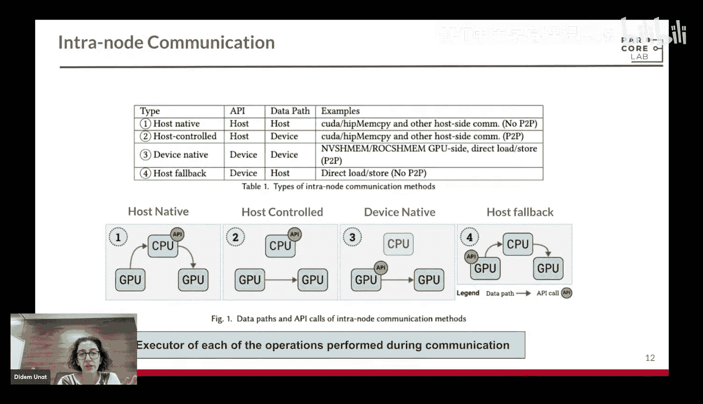

So for example， here API。I defines where the communication API call is made by the programmer or by the library。

 it can be on the host side or device side。By the way。

 right now I'm just showing the intratrono where you have multiple GPU cards attached to single hose and they are managed by a single or multiple processes or multiple threads。

 but we are still in the shared memory of you know no。

So and then the data pad we refer to as who participates in data moment and shows the corresponding the data pad so the green lines here I don't know if you can see my mouse can you see my mouse or no。

I can see her Mo。Yes， okay， this shows the data path and then the API calls we show the green circles。

Okay， let's start with the first type that we will define， we refer to this as host native。

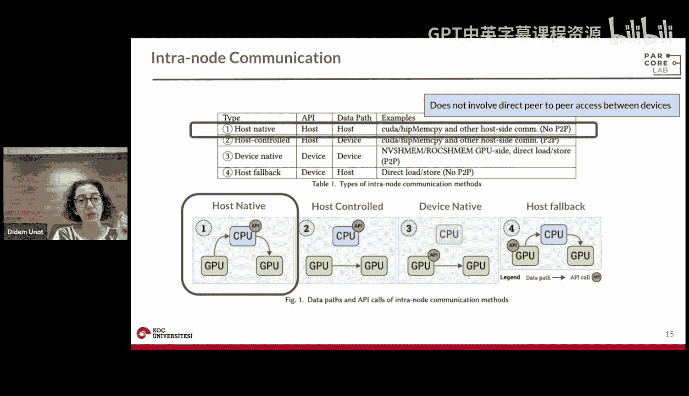

Host nativeative is when there is no peer to peer access between devices so there's no P2P communication。

 so this is the old days how we will program we will send the data to CPU and then CPU host will send the data to the other GP so both the API is on the CPU side and then datapa is also going through the CPU side。

Okay and the second category that I will talk about is the host control。

 so with the introduction of GPU direct 2。0 which introduced GPU peertope accesses over PCI bus it enabled direct GPU GPU memory aes within a node without the host copy so going from you know two copies we reduced the one copy and now GPU can read or write directly to make a copy to another GPU directly。

So the communication passes directly through PCI at Naling or infant fabric interconnects in these cases。

 and most of the libraries that I will refer later like GPU NPI， Nckel， MAMcopy operations。

 they have whole site APIs， so they either in category1 or category2 perform on one of these。Okay。

 continuing with device native in a device native so we have with the direct peerto peer member access。

 we can you know perform the data pa just on the device。

 but also this moves the API to the device as well。

 So this green circle is now on the GPU side very specific examples for the API being on the device side is in introduction and they both offer host side and device side API so they can be either type 2 or type 3 I was just inform that niel will introduce also device side API is pretty soon it doesn't currently superb it will in the future。

Nicole will be in this category as well， so it will have both device side and host site APIs。

And the last type is the host we refer to as host fallback。

 which is when the peer to peer access is disabled in this case。

 co still takes place like you can do direct load stored to another GPU remote memory an API can be within the device on the device side。

 but。In this case， because peer to peer is disabled or there's no peer to peer communication。

 then it will fall back to host and then still communication will take place。

 it won't issue an error or something。Okay， so these were the intra node communications now let's move to internal node communications so internal node before you came going I set a quick question。

 which was。So one thing that wasn't too clear to me it's like for NV sharedM， for example。

 I've heard some people describe it as， oh， like this is a way of doing comps from like within your kernel like basically the way you've described it and then I've heard other people say like no。

 it's different it's like you have this like shared memory model and all the GPUs can access like the same sort of like global shared memory and so like how much of nickel and NV sharedM are necessarily the vice versus host coordinated versus just like it happens to be a property of it。

So are you sorry， I couldn't follow the fully question。

 but you are saying the API versus the host API is that the question versus niel versusishman yeah so for example。

 like the question is like。Must Nckel be a device or host side API or must NV Shadman be a device versus the host site API。

 and if so， why， why or what not？Well okay they both right now niel provides the host side API so you have to make the call on the host side so that is kind of an there's an implication on this because if you are running the kernel you cannot issue a communication you need to go back to the CPU to issue that communication call or you will put an S stream and then。

Actually， that will be the same so the communications that the kernel boundaries when you do the API call on the host。

So the kernel has to finish to you know issue the communication。

 but in the device side API you can issue the communications within the kernel so you don't need to go back to the whole so let's say you produce some data you will just you know send it with a misM let's say you do an nonblocking put or get and then you will resume your kernel operations and thenche its completion later on so there is this distinction between device side and whole side APIs。

So clear so that's clear I think like my confusion was like when you mentioned that like Nicel is considering adding some device side APIs and I will I don't know how look honestly I actually recently heard this and I don't know how they will do it honestly I don't know yeah so the details are not announced yeah and then one more question from chat this is from the Po Sherma they're basically asking where does synchronization happen at this boundaries like is it like implicit explicit that it always happened so how should we think about yeah that depends on the communication library。

 I'll talk about that a little bit so if you use NPR or Nicole you will because they are using send received the communication and computation is kind of so communication and synchronization are together but in N misman。

If you like the communication and synchronization are separate because in enM communication is really kind of a memo access so it's load stored that like in the code it will appear as load store so explicitly as a user or programmer you need to introduce the synchronization so synchronization is more related to the user level library it's semantics。

Which I' will talk about them later in my talk。All right we can keep doing that okay so this is more abstract way to present things so even you know we represent GPU Nik and CP small square boxes so this is more of a like you know simplified view because I'm using these for my teaching as well so I try to simplify it so that students can get abstract view will fit and then we talk about details of the libraries and you know going to the details of them okay so from going into the internal communication going from from one to five you will see that more things move to the GPU side and there are fewer links or fewer arrows so that means there's an improvement in the data pad so there are fewer copies data copies is happening and then another difference is that now we have this purple box which is。

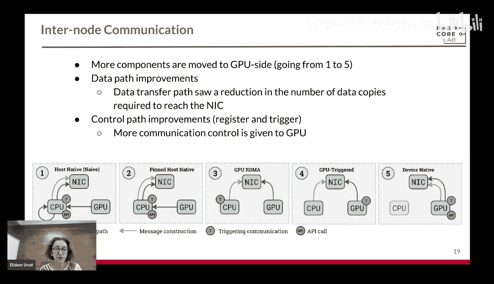

Nick as because we are going off node， Nick is involved so and I will introduce two new operations in addition to API and Datapa。

 these are register and triggering operations。So we still have the API and data pos API is on the host or device or both either it's supported from the programming language or not and then the transfer is a stage true hostse before it reached the NIC or not so that's the data po question and then there is register and trigger so register is who creates the message and registers to the NIC before sending of node and trigger is who rings the doorbell to Nick who signals the NI to issue the transfer so these are two operations that we added to the Inter node。

So first is again， we have host native， everything is done through the hostse， all the data paths。

 and then message construction， registering and triggering what I want you to be engineer Di3 green arrow seer。

But when we move to the pin host native with the GPU direct 10。

 it introduced this shared pin memory between GPU and Nick before GPU used to transfer to kind of a host buffer and then from that host buffer。

 another buffer and then Nick can read from the second buffer。

 but with this shared pin memory GPU can put the data in this shared region and then Nick can read directly from it so this remove the extra copy on the host。

Of course， removing the extra copy reduce the latency between GP and NC data transfers。And the third。

 which is kind of the milestone， I think for of node communication is GPR DMMA。

 he was introduced KDda5。So this allows the NIC to read and write directly from GPU Me over the PCI。

 so this GPU Me exposed to the NIC through the bar region they have to be in the same PCI root complex。

 but this further reduced extra copy if you look at it we have the twoarrow here now be reduced the one because NI can directly read from or write into GPU memory so this eliminated another data pads and this is commonly used mechanism when you do of node communication in MPI and NRMm in Nel recall all of them for GPA air communication。

Okay， so the port category is not like well the first three we improve the data path and then the port category it improves the control by allowing GP to trigger the transfers。

CPU will pre register the messages and GPU will signal the via doorbell saying that the message is ready you can transfer。

So now this is the GPU Direct ASync technology， and it's also known as GPU trigger networking。

There is actually a very good paper from AMD published in 2017。

 it's called GP Trigg Networking for Inconural Communication。

 it has very nice figures and explain things， so I would suggest reading it if you're interested in。

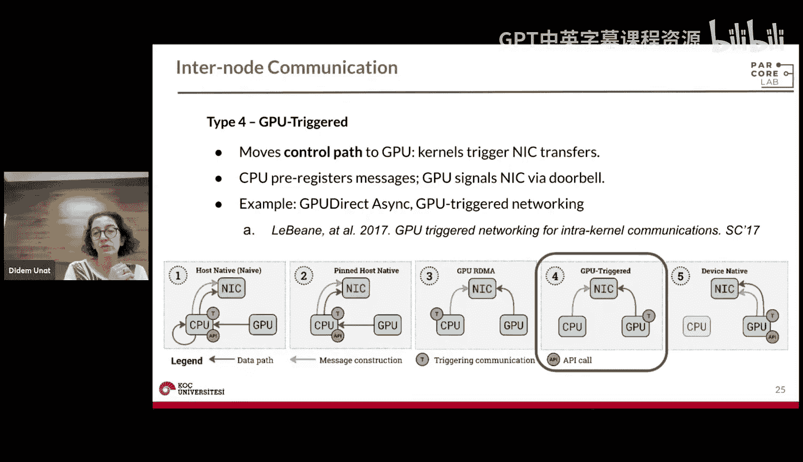

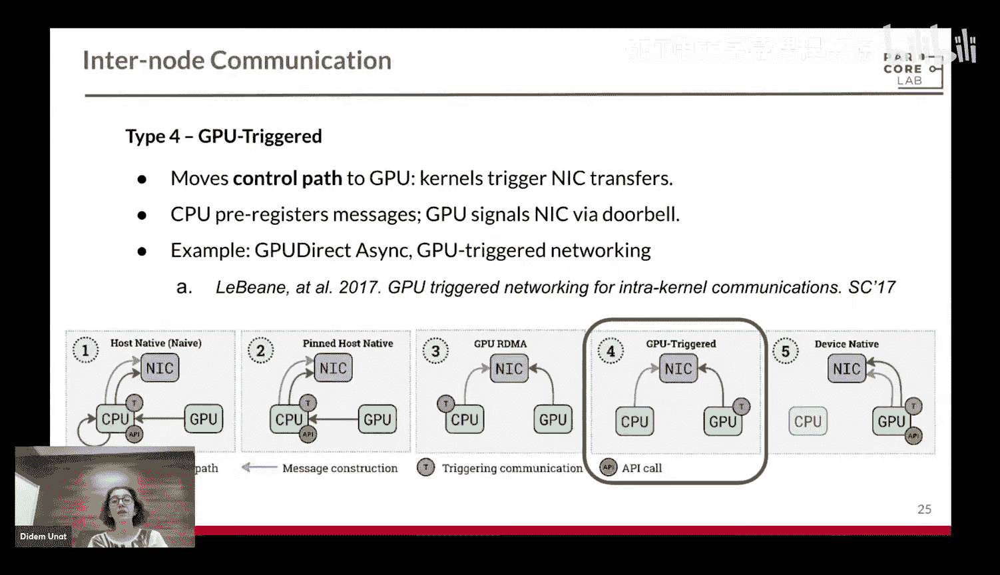

So。With this GP triggered networking， there is still this CPU proxy thread that runs on the host。

So the last type is the device native this is truly CPU free communication and it eliminates the proxy threads。

 it moves the API triggering message registering etc cetera。

 all of them to GPU side as you see that CPU is like great box here its almost like。

It just had there for the initial kernel launches but then it's not involved。

 so this is supported in Finnnneban GP direct ASnc IB GDA in NMishman。

But we realize that this is not configured in most supercomputers to enable this feature that tend to use three or four。

Type three or four， if you have your own system， you should check whether it's configured this way or not talking to your system admin。

Okay， so these are so sorry just a good question you want going back slide Yeah so again because I'm not an expert on Ns so like you know my baseline understanding of networking as like you know like lookup tables on like a home router but but like the kinds of mixs you're describing here seem fairly sophisticated like they can allocate memory they can like effectively like schedule things and so like I'm just wondering like could you describe a bit more like。

😊，What these Ns actually are， like what they like sort of surprising things they might do that might not be familiar to someone who just knows what a single GPU does。

Yeah， so I'm not an expert in NIC as well so either so but the NIC for example。

 were referredier from let's say Nmedia Connect X or blue field。

 I think it's called so those are smartNIC so they can even do some computation buffering staging data and so it's like mini CPU。

 they have a compute unit etc， so。Yeah， I don't know what else to say to your answer to your question。

Oh yeah okay。Okay， so this is now we， I think covered some of the boxes here。

 Now I will start with some of the。

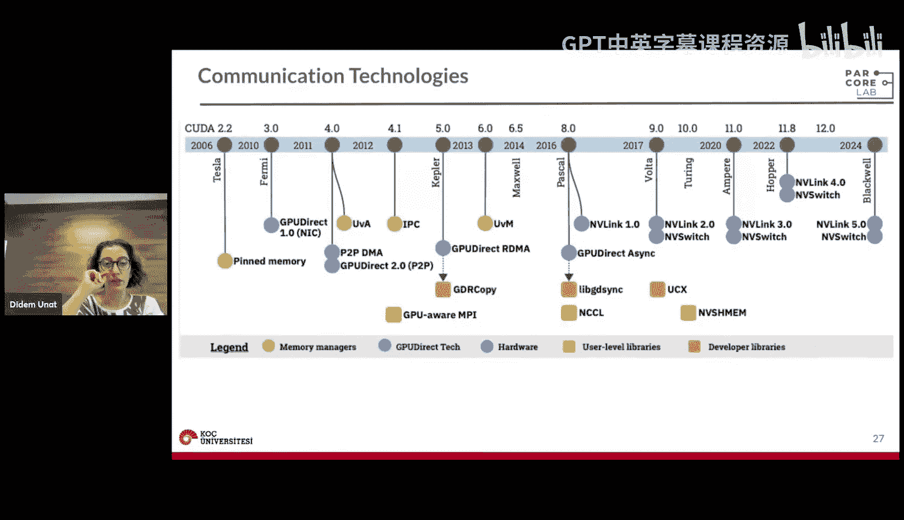

TheThe purple circles so these are the endmeing and mis switch so you may be familiar with the PCIE but it's late like bandwidth is not very high。

50 plus gigabyte per second， but so andlink provides much higher bandwidth and much lower latency enables efficient you know GPU peer to peer communication and every generation and usually doubles the bandwidth rate。

 like 900 gigabyte per second in 800 and then 1。8 in B00 blackwell GPUs， but。

So GPUs can in order to have fast communication you need to have all to all links。

 but and milling it's not possible if you have a high number of GPUs and milling is not subroted so it requires an intermediate GPU to ro the package。

 so NVD introduced these and to do this routing and now it has all to all routtting。

 which makes a very fast connection if you have 72 GPUs， let's say。

 and AMD has Infin fabric link which is kind of mimics and milling。

 but as far as I know there's no and switch alternative in the AMD GPUs。Okay。

 so now we will go into the user level communication libraries。I mean。

I'm covering more stuff than just the libraries so if you want to know more about Nicole and En Richishm there was like a week ago I think Jeff Hammond given a very nice talk in the GP mode as well so I highly recommend watching that in addition to watching this talk okay so。

Let started with GP Air MPI because you I came from the HPC domain。

 MPI is you know the library parallel programming library that we teach we use know there are so many league called using MPI and it works it works when you run 10。

000 GPUs or 10，000 core or million cores however many cores you want it scales。

 it's portable so that's why considerable effort went to into MPI to make it work with GPU。

 but MPI wasn't designed when it was designed in 1993 so it wasn't designed GPU in mind so the other like solutions came much later after 201113 I think so what does GP air MPI means it refers MPI implementation that can differentiate。

Hos and device buffers so what does this mean if you have sent or receive operation and then it will look at the buffer and it would say oh。

 this is a host buffer or this is a device buffer so we'll do the transfer accordingly and it uses GPU direct RDMA and recommendRDMA。

It simplifies quote by know， removing this host staging。

 otherwise you will go to host and a host will transfer to another host and then that host will transfer to the GP。

So this basically GP awareness reduces this extra buffer copies and API is always。

 hass been always on the host side， so the API calls are issued on the host side。

So I'm now showing some of the technologies enable GPUA awareness over years， so for example。

 UVA and IPC， which I will talk soon， theyre prerequisite for GPA A MPI and theres GDR copy and GPU direct。

 they improve the performance of GPA A MPI。

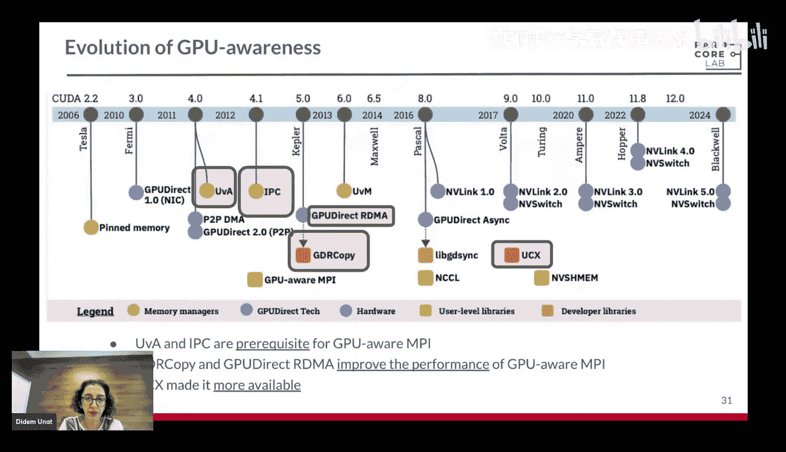

And then UCX made it more available accessible。Okay so what is unified virtual addressing so prior to UVA device host and device vice transfer you need to specify the direction of the copy but with UV you have unified virtual addressing which means if you get a physical me location you can infer which device it belongs to so you can do device attribution based on the location or the address values so it allowed the MP calls which buffer for programming in early years they will still stage through the host at least the programming was easier because you can just use the device buffer directly。

And then there was IPC introduced。IPC is interprocessed communication allow processes to share GPU memory and basically GPU will allocate and memory it will pass the handle to that address to another GPU and then by using this handle it will be able to access the memory from located in the other GPU so this again avoided hostaging and it's using GP aware libraries in fact this is the common way of most common way to communicate within the note at the moment there is also the GR copy which。

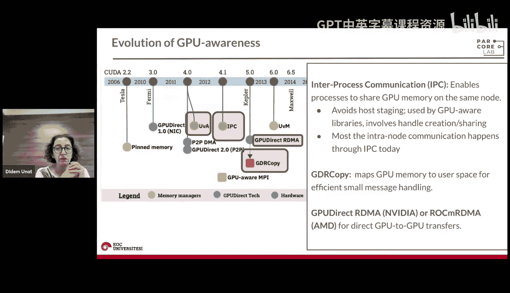

🎼Is mostly for the small message handling because it doesn't create this handle。

 but it memory maps to user space and then it can handle the small messages through the host。

And GPU direct card we already talk about， which allows GPU GPU transfers。

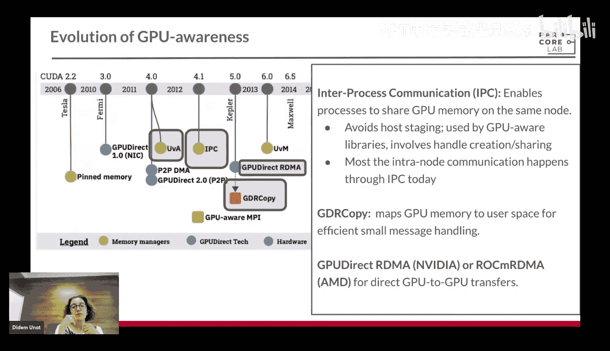

So I would like to show an example of it。A toolol that we develop in our group which visualizes the communication and transports used。

 we refer as UC trace， it visualizes could they bear MPI communication。

So here what you see is communication graphs， so this is a communication graph with a metrics。

You used in a sparse solve， this is another communication matrix as a result of running the sparse solve so you see a lot more traffic here。

 a lot more links going between nodes so each node here is GPU or I think maybe a process or GPU the same in this case and then these regions are your nodes so there are multiple nodes here I think 16 or eight nodes。

So when you look at within a node most of the communication our tool shows that it's true could IPC and then if you go offn it uses this reliable connection that the driver to do the offn communication transports and then in some cases here we see that GDR copy is used for small messages and this graph there's a lot of small message communication that's why we see higher GDR copy and actually our tool can show the top contributing transports as also could IPC for example。

 55% of the communication happens through the could IPC and only 2。

5 is the GDR copy and then offn communication attributes to 41%。

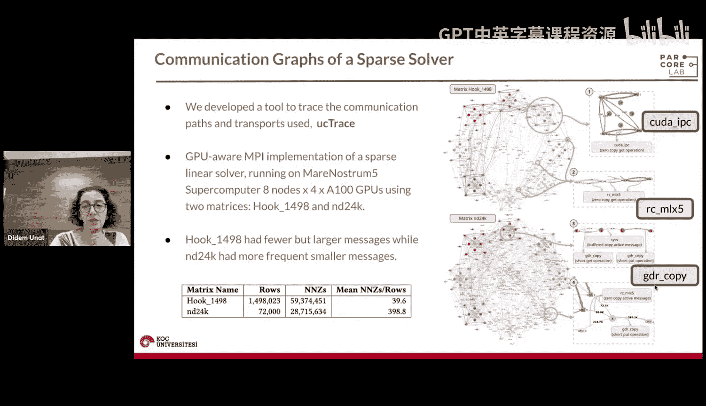

Or slightly more than that。 And then this is the second input metrics we use。

 and then the numbers are slightly different because of the。

This group does more peer to peer communication than this one。Okay， so speaking of you UCX。

 I mentioned UCX in a couple slides back， so UCX is kind of a communication framework and it's try to unified the communication protocol so at the top you have the communication libraries like MPI。

 Schm or Nicel and then it has a communication protocol API which those。

Library APIs are lower and then you go from here there's a unified communication transport which kind of abstracts multiple transport technologies like infiniban RDMTCP。

 GPU direct IPC etc， so it will choose the appropriate transport depending on the configuration message size。

 whatever hardware is available etc ceter， so it's kind of that abstraction。

 so our tool UC Trase works with UCX communication framework。Okay， moving to nickel Riel。

 these are the vendor provided collectors。I think if you're in AI you're probably vva of Nicole Rico。

 you use them for collective communication， they emerge as a collective communication libraries。

 but then send receive is pretty important so they edit peerto- peer primitives as well it supports a collective operation as like a firstclass citizen and fully optimized for Nmeing PCI and Micivi and Finnibban GPU direct all of those technologies and the different main difference from MPI is MPI is not stream area so it doesn't know these Q as streams so what is a stream stream is kind of a queue that you put operations and the operations in a queue or stream is kind of order so you don't need to add synchronization in between because they will execute in the order。

They are put in the queue。And this is important for overlapping communication and computation or other operations。

 but MPI doesn't have stream support yet at least。And Rel is the AMD source counterpart to Nicel。

Its API is very very similar so if you have a nickel code it's kind of very easy to switch to recall they're almost almost the same I don't know if it's as much as like control app replace but。

I heard it's very similar and so yeah this is probably everyone knows it and Nicel is it also selects you know best algorithm depending on the benefit。

 latency of the network or whatever whether there's an handling or not et cetera。

 so it will choose the best let's say all reduced for your given architecture and configurations so I put an example code here comparing K MPI and niicel to kind of have a。

Feeling what's the interface look like so MPs and receive base。Nicel as well。

 there are send receives， so they are both hostide APIs at the moment。

 at least So the difference is I mentioned there's streaming。 So each operation in nickel。

 you also say which stream this operation belongs to。 So this means this。

Is put in the stream and then the other one and under one so that means they will execute in this order。

 but in MPI there is no such thing these are you know all asynchronous and and received so before you do that you have to do could a stream synchronize to synchronize operations in a stream so there's an additional synchronization required for MPI。

So there was a questionnaire earlier about the synchronization， so this is where we discussed this。

Okay， in the GPU sman or we can say you know， enmi Schm Ra Schm or Intel Schm。

 maybe they called Mon Shiman so these are。You knowIf you're familiar with Ps partition global address based languages。

 libraries， this is that so you have a process as it private region and a shared region and a shared region is shared with other processing elements they call it and it uses one sided put and get so put and get you can it's removed memory access it's kind of a load store but it's a remote not your local memory but remote GPU can access the other GPUs memory through get put methods and it support both point to point on collective operations。

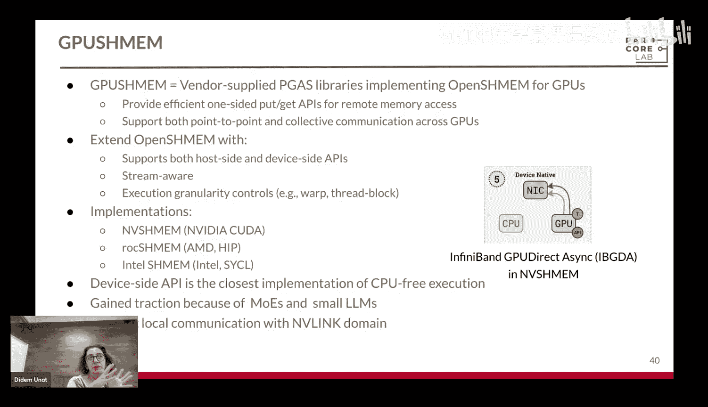

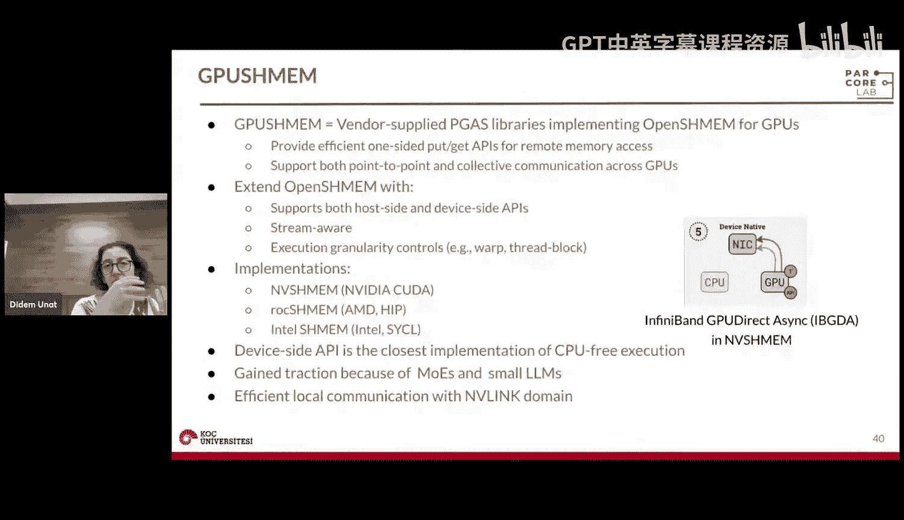

And it has both device side API and host site API， its streamware and these operations memoract remote operations can be with different granularity。

 a warp or t or treadb can perform those operations。

And the side API is the closest implementation to the CPU free execution。

 so it's pretty autonomous execution。And like EnWishMM particularly gained traction because of the mixture of experts and small LLMs because you can do efficient local communication within and milling domain and access other GPUs memory as if it's all it kind of simplifies programming but it also can introduce errors because you're touching other GPUs memory。

 you can introduce race conditions， so I'll show an example here again the same code with the Nckel and NPI but this time I'm showing for EnWishM。

And this is device side API， so you have these put signals and then this is again related to synchronization。

 this is yes you put something you write into the remote memory but then you might the other process can be in the middle of something like it might be reading and then you're writing and then it may see half the results or you know so or you may be reading a stale data you should read after that process writes。

 etc ceter， so that's why it can introduce race conditions in order to prevent those you need to use signal weight。

 some sort of synchronization in enM to make sure the me ordering or state communication ordering is correct。

And another thing is you need to use this collective launch so that you can use the signal rate operations on the device side。

So honestly， and Miam。Coldts can be。People say it's easier because you just me access。

 but at the same time it can easily introduce these synchronization or bugs and that you know be overlooked one more thing I think we also find and I think we need such things as and mism communication analysis is kind of difficult because they appear as a me access or you know you need to。

Let's say you want to time the communication versus computation currently there's not a good way to do it because again the profiling is done outside of at the kernel boundaries outside of the device I think there's a question。

Yeah I had a question and there are questions from chat as well so so what does NI stand for in the calls on the devices non blocking I think that N right you said I believe it's non blocking but I forgot what I is。

All right， and then okay， the other question I see is from a use， which is。

like how would you benefit from like this low level granularity and control and high level higher level frameworks like Pytor maybe this question is getting at what are interesting application I mean andman this fine grain controlman yes okay yeah so there are many benefits actually if you know how to program it so andman really gives you the very fine grain communication is it let's say。

If you have the data ready you can ship it like you can send it immediately。

 you don't need to wait this kernelnal to finish， return to the CPU to send the data as you know a big chunk and this is also good for you know kind of flood control like when you return back to CPU it will just send let's say large big message here you are sending maybe smaller but more messages which can kind of benefits in terms of network congestion also you can overlap things here like。

You can have a like one of the block is doing some communication and the other ones are doing the computation。

 so you're using the other SMs for computation so you can easily overlap thingss and in put get methods if your application is very unstructured there a very unstructured fine green communication that's when people use usually sant type of communication this is you know before enchm like if you have the PgaS models they were advertised for you know unstructured communication if you have those they are good fit。

I guess those are the things come to my mind。Yeah。So。Those are the benefits， but in terms of。啊。

Programming support like the tools， I think there should be more like profiling or race detection or helping developers to debug and analyze and mis quotes it will be there's a need for it。

Okay， I'll go to the next slide or。Just， let's see back。

Yeah okay so at a high level if you compare these three options。

 first of all it's not easy to switch from one library to another it may require instruction of the code a little bit let's say you're using nickel and then you want to switch to enman you won't do in a day it will take some time to do that transition and so MPI and nickel is。

TwoThere is one side support， but it's basically send to receive APIs。

And then Schman is one sided and asynchronous put get model。

 so you need to be careful about these signal operations and you know because you're touching other GPUs memory you need to make sure that you sync with them and not read or write in a stale data etc and a stream support MPI Les stream support。

 maybe there will be in the future I'm not sure there were some proposal research ideas how to edit but I think it's not in the standard yet but Nicel en we Schman supports GPU streams natively and with Nel it has these grouping of communication calls maybe I can show so here you have the group start and group and you can basically cu these operations in this group and Nicel。

Decide when to send those issue actual transfers by monitoring the load， the size of the messages。

 et cea， so it has this congestion control a bit inside these grouping calls and Michel introduces kind of additional complexity because you're mixing kernel code with communication。

 so debugging or you know profiling can be challenging but those are you know if you're getting extra performance。

 those can be overcome。Okay so I'm sure you're curious about performance differences honestly I refrain from showing some performance numbers in this talk and similar thoughts I gave because optimal performance changes depends on multiple factors like your workload whether you're doing frequent communication or one big communication your message size or library configurations library versions driver versions and then whether the communication occurred within the node cross node or you're in in meal link domain or there's no in meal link you have to use PCI etc。

 so these are very important factors if you do the literature search I will suggest look at all of these factors before committing one of the libraries so I say you do not generalize these numbers and so I will talk about some research from our group in minutes。

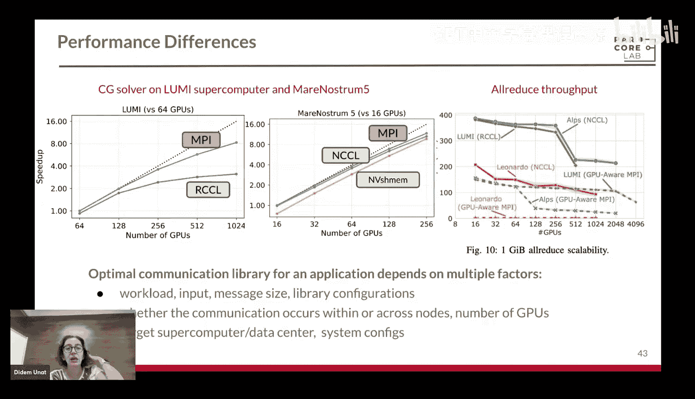

That we try to unify these libraries as much as we can， we'll see how successful that will be。

 but we also have these profiling and visualization tools we think that they are necessary to understand what's going on behind the scenes。

 I put two papers if you're interested in looking at the more performance numbers the second one will be available soon in our group but if you want an earlier access I can share it with you after this talk。

 the first one is published in 2024 by Daniel deensi。

Coll of mine Okay so some projects in our group so we because of the complexity of these different communication libraries we said can we have a uniform API that will run all of these and it's stream error doesn't introduce much overhead and we can support but host1 device side API maybe without changing the code that much so this is our initial attempt and this paper will appear in I cluster in two weeks my student will be presenting so the dash lines are the native library and then the solid lines are our unicorn library if you don't see dash line that means it's good because its the performance is the same so we don't introduce extra overhead so if you're interested in。

The code will be released also in two weeks when my student presents at this conference in the first week of September。

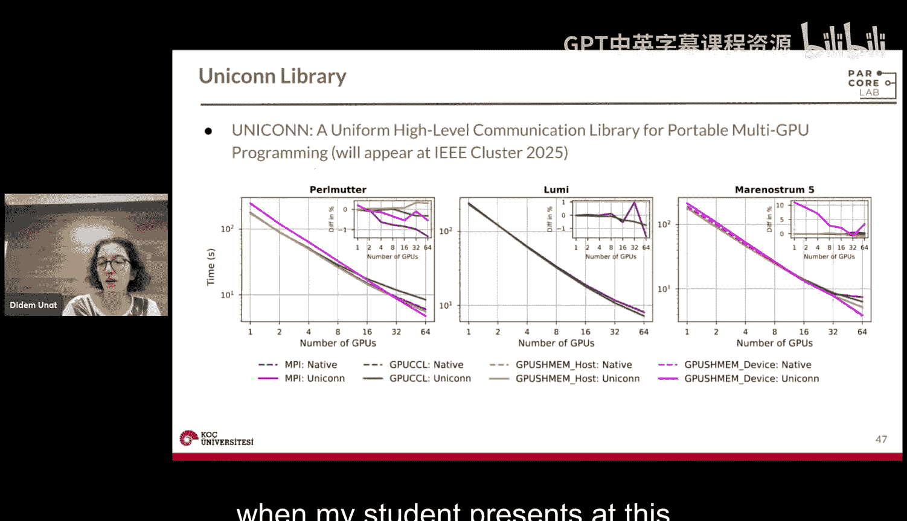

And we also have these two visualization tools that are being developed， some of them， we have Sopy。

 we have a version， you see traces， it's going to be released soon。

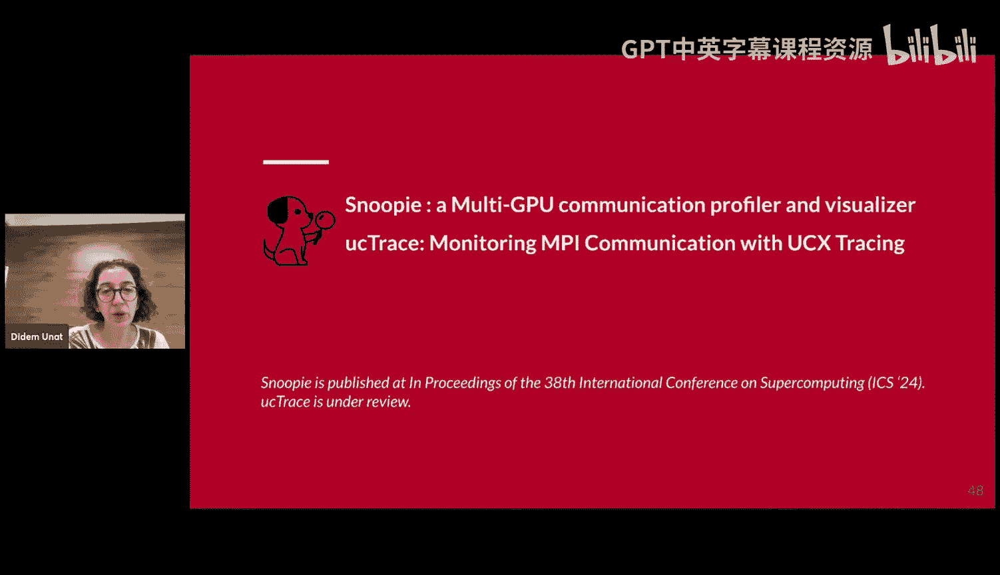

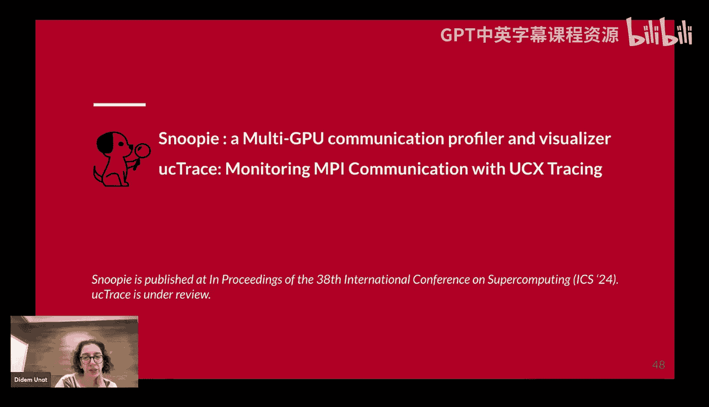

So I mentioned this peertopeer accesses and then direct memory loads and stores to remote memory。

 but if you try to use， for example inside system to visualize these it will just show you theres some ameing activity here but it doesn't tell you who is doing the communication how much data is sent and so we decided to visualize these communication graph and communication matrices and then also attribute objects to these communication calls like who's involved in communication or which data structures etc and we have these source code view as well。

 which tells for example， in this line you do 8% of the data transfer happens here if you look at it it's not obvious that this is。

A communication because it's。You are doing a peer access and this flag is in another GPU and you're accessing that's setting a flag in another GPU's memory。

 so it causes communication a data moment。The other that was Sop， the other tool is UCtrace。

 this is designed for KdayV MPI applications here what we wanted to see is what is transport layer used in addition to how much data and then visualizing it etc。

 so you can see the NIC host and GPU and then it's clear that this is a node an off node you're going here so there's a link going off node。

And as spars software that I show in my previous slide is also used generated by UC traces。

 this is for example， to MPI libraries how they handle their all reducing algorithm and here for example。

 you can see that there's only one node going odd and in accepting incoming and outgoing traffic。

 but here to，Two NICS are actually responsible， one is kind of outgoing traffic。

 one is incoming traffic， so there's a better work balance here in this version and the library configuration。

Okay， so it is my last slide as a summary I showed why communication is the bottleneck today and a little bit bottleneck in the future and then I presented this timeline of and media technology is relevant to communication and then we try to categorize them in an abstract way and then I talk about you know the userle communication libraries that we can use to program these a little bit of research projects that we do in our group and if you're interested to download the paper there's a lot more discussions there and。

And watch for the version two， we will probably have it there in this call。

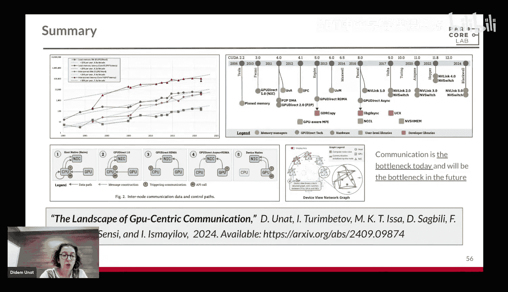

Okay， thank you very much。 I'll stop sharing or should I。

Or maybe this is this is good I can now see you as well the summary I say we can keep it so thank you this was wonderful。

I guess I had a question and there was like a few more questions from Cha。

So the I think maybe I'll batch one of my questions with Ays。

 which is like what are sort of like the lower level details about these tracers that your team developed worked。

 was it like you were just using N systems or？Yes。we are not using Sight systems its we are intercepting the UCX calls and collecting our own trays so it's not build on insight systems it's completely different if you are interested you can send me an email we will make it open source but we can give you early access if you're interested in and are also we have paper in draft I can probably share the paper draft with you as well if you keep it to yourself yeah that sounds good and I guess when publish it please come back and give a talk on that。

So similar to sort of the tracing mechanism like I think a lot of the interesting work that you guys did was like about sort of showing like there was like this slower level API that was called would that give you good guesses as to which algorithms would be used like for example。

 if you're like using like nickel and you know that you're on this hardware but this hardware of thepology with the size could you predict pretty reliably which algorithms were being like dispatch to is this even a secret as far as like niel goes you can see actually in niel you can select the algorithm you want。

 the tool just verifies let's say the selected algorithm and what one is matches for example。

 I think with Snoopy we have we say some nickel test we run with the ring and I forgot the other one and you can clearly see that it use the ring versus the other algorithm because we visualize what's going on and you can verify。

And especially you Ctrace tool， I think it can be used by different groups of people like a programmer can use it to visualize its own communication。

 let's say it has two matrices and one is doing terrible and the other one is doing well and then you can visualize their communication。

 but also if you're a system admin you can use it to check whether the transport layers used or what you were expecting or you didn't configure the system maybe correctly。

 or if you're a library developer， you can check I versus renewal protocol。

And whether what you expected is what's happening in the transport layer。

 so these are things that you can use sort of verification， maybe performance debugging purposes。

 you can use them。All right， sounds good I think that's on question then thank you to them this was wonderful please come back when you're like ready to publish I guess some of the other tracing work Yes。

 thank you and we'll see everyone tomorrow as well we have like we're going have the team on quat on for bit training for alums so thank you so much to them and see everyone too thank you bye bye thank you。

😊。