# GPU MODE《CUDA、GPU编程54-87｜GPU MODE》中英字幕（deepseek-v3.2 p16 -20250823-Lecture 69_ Quartet 4 bit training.zh_en -BV1xbmQB3ETC_p16-

All right， well yeah apologies for the technical delays folks welcomele everyone to like another episode of GPPU mode as part of like our distributed lecture series like I'm really thrilled to have both like Robertto from Andre and Andre from the ISTA lab in Austria so for those of you that aren't aware that little lab that tends to like consistently publish like some of the most interesting like little bit and sparsity work So if you're in theO you should know and I'm really thrilled to have them today talk about like a result that I didn't made the rounds on Twitter like a couple weeks back。

 which is Cortet， which is on how native FP4 training can be optimal for large language models So yeah without further ado。

 Roberto and Andre， it's awesome to have you。😊，Yes， thank you。

 thank you for inviting us and thank you for the warm introduction and yes without further learning ado。

 let us get into the discussion about how N before training can be optimal。

 what do we even mean by this and to sort it off well have to discuss how models are trained to begin with and when we talk about machine learning models we usually mean it has some sort of parametric functions that are trained to optimize that are optimized or some sort of objective and with the optimizationsimization we usually use some sort of gradient based methods either like gradient sense schastic gradient say A so Premiermeion or any other fancy kind of optimizes but in its core what those methods need to optimize this parametric function is to be able to calculate a gradient with respect。

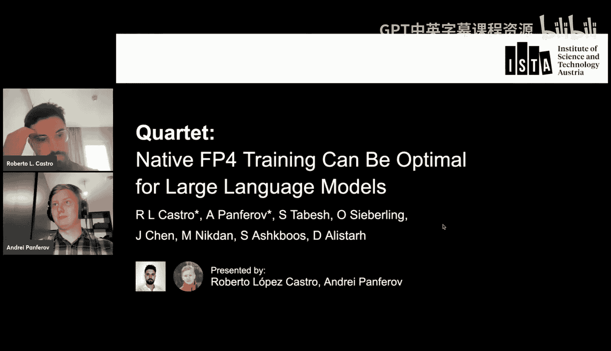

To these functional parameters of some loss function and as such naturally these parameters are used as real numbers because real numbers。

 parametric functions can be made differentiable and it's easy and straightforward to apply gradient steps to those serial parameters but in real life can represent real numbers because it's infinite it set so we have to use some sort of approximations to be able to numerically represent inside the computer and what people usually use represent real numbers is the floating point numbers。

 which is an approximation that consists of two parts Man said an exponent also sign that encodes a very wide range of real numbers maybe from like treatment from each to from 10 the power of 38 to 10 to the power of minus-38 with accuracy as high as 10 decimal points and essentially it makes。

For good approximations for real numbers because it both has an extremely wide range。

 meaning that it will probably never or flow normal operations on numbers that are within some reasonable range and it also has accuracy high enough such that when adding two of those numbers。

 the result would be pretty much also good approximation for the addition of those two numbers and in general you can count on any operation sometimes such as metrics multiplications。

 normalizations， attention operation or applying the gradient step on those numbers to give a very good approximation of what real number of those。

 that's why they're used for training machine learning models and theyre used as some parametric representations of parameters of machine learning models。

But one thing we know from some theoretical results， specifically on large language models analysis。

 we know that their capacity in terms of how much actual knowledge they can store inside of their parameter that are being optimized that are being stored as high precision floating important numbers we know that it's usually closer to one or two bit per parameter。

 meaning that the real amount of knowledge that these models can encode into their parameter is much much lower than the data type that's used to optimize these high precision floating point numbers and this creates some sort of discrepancy between the optimization procedure that we use and the end result that we get with the optimization procedure using very expensive。

 very high bit with high precision floating point numbers and the end result being that not nearly as much information is being encoded into them and as such。

People have been experimenting extensively with alternative data types that are somehow more rough。

 more basic， more rough approximations of real numbers that have way lower bandwidth with。

 but might possibly still allow for efficient information coding and more importantly for efficient optimization procedures to be performed on them and for machine learning models be trained in those data types。

And naturally the simplest of those representations would be just some fixed subsets of real numbers that would be much smaller than the entire range and accuracy covered by high precision floating point numbers but maybe it can still allow for efficient training and information andcod into these numbers for their use of machine learning and let's take a look at some low precision data types that have been used recently by different companies in different accelerators for example。

 Apple with their latest iPhone and iPad chips include not only high precision FP32 numbers but now standard half precision Bf16 numbers and the integer 8 numbers as well and when I say that they included them it's not only that they can store them in memory because you can pretty much store any bitsing memory but more importantly they provide a kernel support for these numbers allowing for their efficient use in machine learning models for metrics and operations。

And for efficient enco and anticoding as well and if we take a look at qua recent processors。

 they took a slightly different approach where instead of Bf16。

 they use normal P16 and instead of integer rate they used on site integers and in general this chain has become somewhat complicated in recent years。

 especially from a site where not only they include the FP 32168 and even4 B float important numbers。

 but they also include default float numbers and even some integer numbers and they often add or drop support for some of those data types and as such their exist need for a more robust framework for comparing machine learning training schemes to be used over those low precision data types to be able to tell more accurately which precision work best and which and the tradeoffs that these precisions。

Create for low precision machine learning training and as I already mentioned。

 these precision aren't just a way to store data on device。

 but rather hardware support precision for operations that are often used in machine learning more specifically。

The majority of support for these soil procedure data types comes from metrics multiplication operationss because these operationss usually constitute the majority of computations inside neural networks and as such。

Supportsing metric multiplications effectively allows you to run almost the entire model in low precision and this is what we'll be focusing on in this work that is quantizing the matrix multiplications operations that is linear layers inside large language models to try and show that lower precision can lead to better acres to speed tradeoffs but the speed theoretically be as high as proportionally faster than higher precision data types that is FP4 can in theory be as faster as4x faster than FP16 or to x faster as FP8。

But。Those speed ups come at a cost of decreased accuracy more specifically。

 it has been shown numerous times that as you lower the model training precision。

 you start losing accuracy at some point。 and you can see it on this plot that as you decrease the。

Accuracy jumping between the curves， the curves start to rise up。

 meaning that the final loss of model strength and that precision starts to become higher。

 meaning that we lose some sort of model capacity or model capability as we decrease the precision in which these models are being trained in and。

This creates a trade off between the accuracy between the accuracy that we lose when we decrease precision and the speed up that we can gain from lower precision for the hardware supported lower precision data types that can lead up to theoretical speedups but。

In practice， it depends more on the concrete setup that you're running your model with。

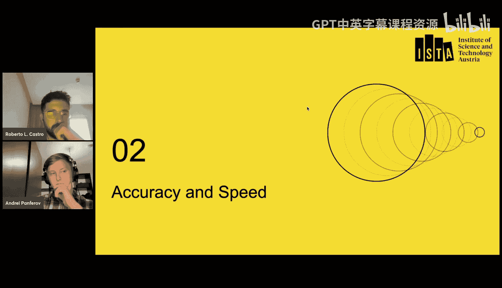

Let's start with describing the accuracy， and in general。

The simplest thing that we might want to do when designing a。Well precision training method。

 the simplest way we can demonstrate its optimality is just to demonstrate that it loses no accuracy while providing speedups and in practice many of the recent papers that proposed new low precision training methods showed exactly that where they just aimed to show that they almost don't lose any precision or don't lose any significant or how much the lossess and statistically significant or much less that then you would lose from otherwise small per orrb patients in your data or whatever and at the same time they show that they can get some speedup for example。

arithmic and biocoetization only shown like a few percent drop on accuracy on various tasks while saying that they can get some speedtos from lower precision。

The leverage score sampling from training transformers with integers said that they have competitive accuracy on a wide range of tasks while showing a real speedup of around 30% over higher precision jetfire also said that they incur node degradation whatsoever while demonstrating some and to end speedup and of the more recent methods Ha also mainly stated that they have close to baseline accuracy while showing some real speedups and in general。

 this is one of the two easy comparisons you can make when comparing inside this tradeoff because the basic in condition for this tradeoff is that your method is faster but has exactly the same accuracy which I have been showing for a few slides where they mostly claim that they fully recover the model performance while providing some speedup or rather wind condition could be that it has identical or faster speed while having。

equ， which is somewhat hard when comparates the baseline because one would expect that you cannot beat an unquantized baseline within your training within any quantized training method and please correct me if Im wrong because the best of my knowledge there aren't any methods of quantized training that can be that quantized baseline。

And there's a problem with this comparison that first of all。

 it's based on a very specific setup in a sense that in these papers。

 the authors usually train a specific model， measure a bunch of tasks for it show small degradation in all of them and claim that they almost don't lose anything and they provide speedups for this specific model and。

Say that the speedups basically come for free when using all precision training， but in practice。

 it doesn't answer any questions with regard to what would happen if you， for example。

 increased the model twice in size。 How would your accuracy drop change。

 How would your speed up change and to provide these more specific comparisons。

 you would need to somehow aggregate the information about both the performance and the speed between different speed ups and make a comparison that would take both the accuracy and the speed into account and as such a new model is needed to build these comparisons and。

Yes， what we want from our comparison model is to be able to first compare。

Using information from many different training rounds to be able to more robustly estimate the actual jobs that you are getting we want to also be able to use this comparison model to extrapolate for the setups that we haven't we haven't tested。

 for example， what would happen if we scale the model 10 x in size what would our high existing hold and this is very useful because if your model is robust this extrapolation。

 you could use it to predict which procedure would be better before you actually train the model to kind of pick the optimal training hyper parameters before actually training the largest model you can to more efficiently device compute and。

You want this comparison model to also very accurately describe the accuracy speed trade off for different setups for different model sizes and for slightly different methods that provide different kinds of speedups。

 for example， like forward quantization， which mainly。

Which can be done in one precision providing certain speed up and backward commization which can be done in the same or different precision provided different speed up and。

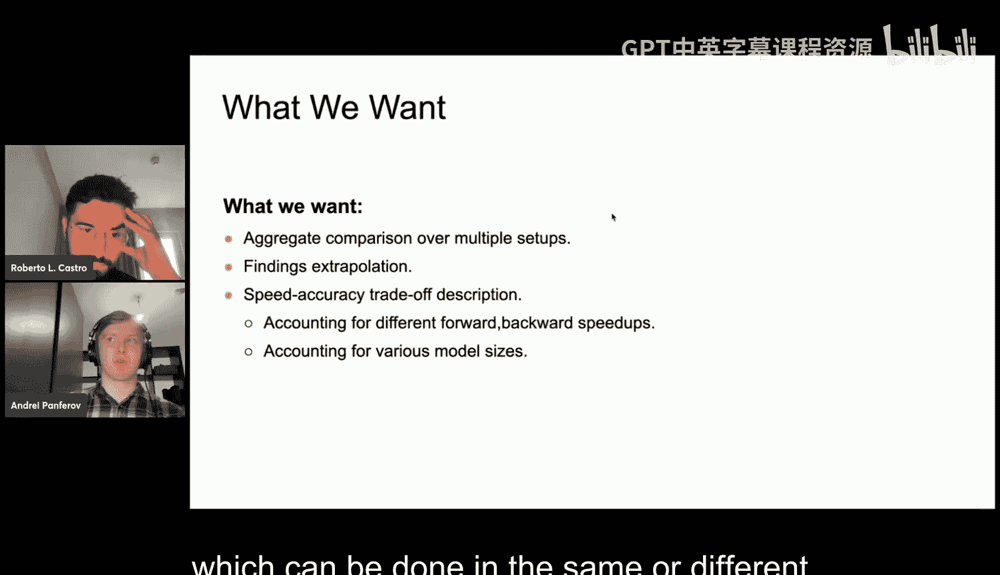

Let's start building this comparison model and to start with let us first learn how to compare acuracies in a more robust ways and to do this we employ scaling loss and when we say scaling loss。

 it means that if your training setup in a broad sense， like a family of models。

 for example that depends on the model on the model size and the amount of data that it's be trained on has consistent performance with respect to those hyperparameters。

 meaning that it has sort of predictable loss after training for a specific model size and talking count what you can try to do is you can try to fit this predictable loss。

 a parametric function of your model parameters， for example。

 a very famous example of scaling law for LLMs is the scaling law of Hoffman and authorss where they predicted the validation loss of function of model parameter。

Account and the number of tokens it been trend in to。

Where they utilized this form then decoupled the。Parrameter count of the model term from the data term。

And this scan logo has been validated numerous times in the literature and reuse for different purposes from compute optimal training to。

呃， to comparing to。To de some data saturation thresholds and general providing better intuitive for which setups would make more sense of under different constraints。

And。We can extrapolate this idea to include precisions into the equation。

 and this is the scaling law that were used in the end for our own description of quantized training performance as a function of parameter count D a number of tokens o lamps were trained on parameter account1 number of tokens D。

 forward precision P for a certain training method and backward precision P backward for a certain training method and like break down the scaling law。

 so in the first of all， it's sort of similar to the previous law of hop and coffers in the sense that the parameter count and the data coefficients are still somewhat decoupled and the only interact with each other through this additional constant gamma。

And if we look into in more detail into what's happening here。

 then we can see that the forward precision。Here affects the parameter account and only the parameter account as a sort of multiplicative factor on the parameter account。

 And naturally， since contest training cannot outperform the base length of precision training。

 This effective multiplier is between 0 and one。 and it falls in line with lot previous word that model the impact of quantization on training in a similar way has a multiplicative factor。

 and it also checks out with the observed losses。 So this is more more like an。Existing。

More I can already exist in way to modify the scaleal level to include the forest pest quantization。

The other part of this came andgo that we。See that actually in causing information about the backward pass is the effective multiplier on the number of tokens。

Here we choose to again deco it from the parameter account from the simple idea that if your model was traineded to situations。

 then from optimization theory， we sort of know that。Backwards pass quantization only doesn't。

Necessarily include any consistent biases into your optimization method。

 but rather just makes your gradientestim procedure a little more noisy and from the。

Optimization theory literature we know that under this noise， the optimization problem。

 the convergence can still occur to the same loss， but it would be lower for nois or gradient estimations and from this scan law proposed here。

 you can see that the effect of multiplier on the number of tokens doesn't change which loss the models the quantized nonquantized backward parts models would converge to。

 but rather only changes the convergence speed， and again we see that it checks out with the data we observe where we see that the gap between the forward the quantized nonquantized backward parts closes as we increase the data situation。

 meaning that as we train for longer here you can see it as the gaps between adjacent lines on this plot become closer together。

As such from comparing for a single setup， we now can compare for a whole family of models trained for different durations and from the form of this scaling load。

 we can see that we can compare different methods with it by simply comparing the effectiveness factors。

 meaning that if one method has both better forward effectiveness factor and backward effectiveness factor that is the parameter account multiplier and the data。

Anmount multiplier are higher for this method than this method would produce slower loss across the setups。

 and we could say that it's better in terms of quality。But again， it's not only about quality。

 it's also about the speed ups。

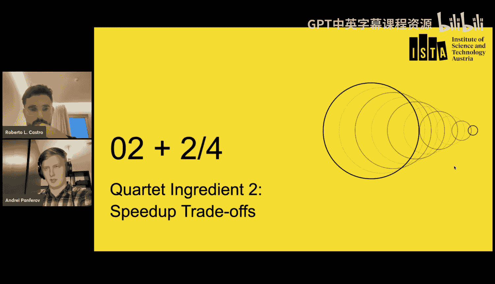

And。If let's think about how we can take speedups into account。

 so one thing we can think we should start from is the idea that speedups for forward and backward pass are not madeequ in a sense that forward pass predominantly affects the inference of a quantized model in a sense that during training quantization of the forward pass and affects one of the three gems for every linear layer。

 but for inference all of the gems are quantized for a quantized forward pass。

Background pass on the contrary， mainly effects training。

 meaning that if we quantize two out of three gems or during the training on the backwards pass。

 we would obtain faster training， but it would have no effect on inference whatsoever after the model has been trained。

And here we can see a simple table that shows what the forward backward and training path would be under an ideal model if。

Going from FP4 to FP8 was a2 x speedup。And for a certain forward pass backward pass precision。

 what would be the speed up of this mixed scheme compared to FP8。

 And you can see that quantizing just the forward pass mostly affects inference。

 quantizing just the backward path mostly affects training and quantizing both， it has affects both。

And。With this in mind。We can arrive to idea that we have a separate notion of in costs for a model and a training cost for a model and。

Quanization schemes can affect those in different ways and let's try to formulate this idea about the cost。

 so let us pick some baseline precision。And for a baseline precision under a fixed precision。

 a way to characterize the inference costs， inference cost would be the parameter account of the model because naturally the parameter。

 they both the compute for a forward pass， meaning for inference and the memory movement for forward pass for inference is proportional to the parameter account and as such you can。

Easily linearly characterize inference budget in a sense as the parameter count in some baseline precision and to account for the fact that different precision can have some sort of inference speedup denoted SP forward here to the baseline。

To have an inference cost normal wise。Model in a different precision。

 you can pick the parameter account that would be proportional to the speed up。

 meaning that if your data type is 2x faster and you want to have a model that runs at the same inference cost as model with N max parameters in baseline。

 you can pick a model with two times more parameters with2 x faster data type arriving at exactly the same inference speed。

I can apply the same idea to training costs， which is proportional to both the number of toancy the model is trained on and the number of parameterss and here normalization is a little more complex because you have to normalize by both training and inference speedup because of the changes in the parameter account again。

But with this， you can。Conduct is a cost comparisons。

 meaning that you can compare different precision， such that they both inference cost and training cost are the same。

 And then you can account for the loss in。The accuracy via this plugging these precision which would yield certain effectiveness parameter accounts。

 effectiveness multipliers and the scaling laws and thus this formalac is both inference and train and compute normalized comparison for different precision and the way we use it is as follows so we have a bunch of precision we want to compare we hit the scaling law for all of them then we pick a baseline precision and we benchmark the speedups of every other quantization method against this baseline method。

Then we for basically any training and inference cost that we can， for example。

 parameterize by the parameter count of the baseline model and the data saturation ratio of the baseline model because these are。

To functional independent variables that still encode kind of both the inference and run and training cost。

And then for each of those， each point in the grid。

 we can actually predict a loss with the scaling loss and we can pick the lowest one to say which precision。

 which exact training scheme would be the best for given inference and training computes and we can actually plot it like this。

 as you can see on this plot， we have the parameter account of the baseline model on the Y axis is going from 100 million to 100 billion。

😊，Transformer model parameters， and the data situation is going from around 20 around Shiinhio optimal to around a little more than 1 thousand0 way beyond。

The Shiin Shio Op training duration， almost a data situation and here we compare four different training schemes that is the baseline FB8 training。

 they forward only F4 training meaning that will only quant forward by5 before and backward as stillF8。

The forward pass IPA backward F before training and the full F4 training and on the plot on the right you can see these regions plotted under the real measure speedups for the kernels that we produced。

 meaning that these regions。Show under real world inference speed， which。

Compute cost normalized method would produce better accuracy under certain compute constraints。

 and you can see that we plotted some of the models that have been published recently such as Lamma 3 or Q 2。

5 or Gema 3 on this plot we can see that many of them fall inside the regions that are either FP4 for the for tone quantized or full FP4 equalization and this is why we claim that FP4 can be optimal for a La pretrain because。

some of the models that make sense in practice and that people have trained fall into the region where they would have yielded better loss if they were trained fully enough before。

 or at least that's what we predict from the scale loss and the speed ups that we obtained。

And this comparison scheme。I just demonstrated that we can use it to compare real kernels for a lamp pre training with scale loss fitted on a lamp pre training。

And we can map out real pre trained models on the obtained regions to demonstrate the usability of certain precision in certain training regimes。

But in general， this。Comparison schema allows us to conduct scaling laws based budget normalized comparison for a very compute specific setups。

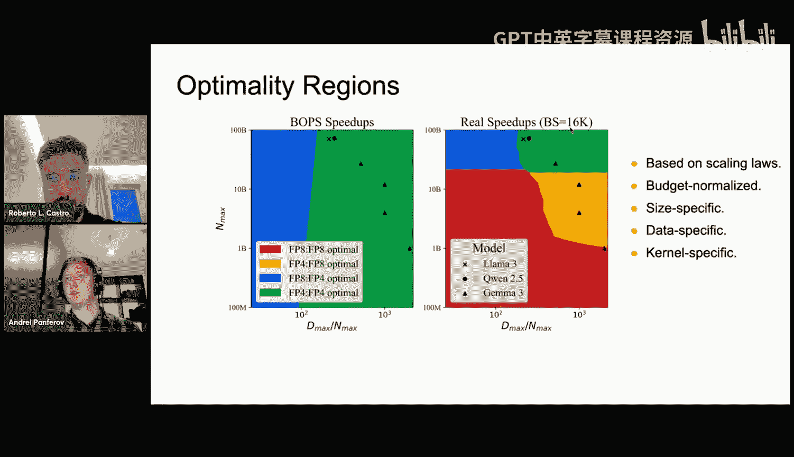

And。To maybe discover。What how we can actually apply this schemechema even further is that we had this notion of better effectiveness leads。

 meaning that the method is better under fixed。

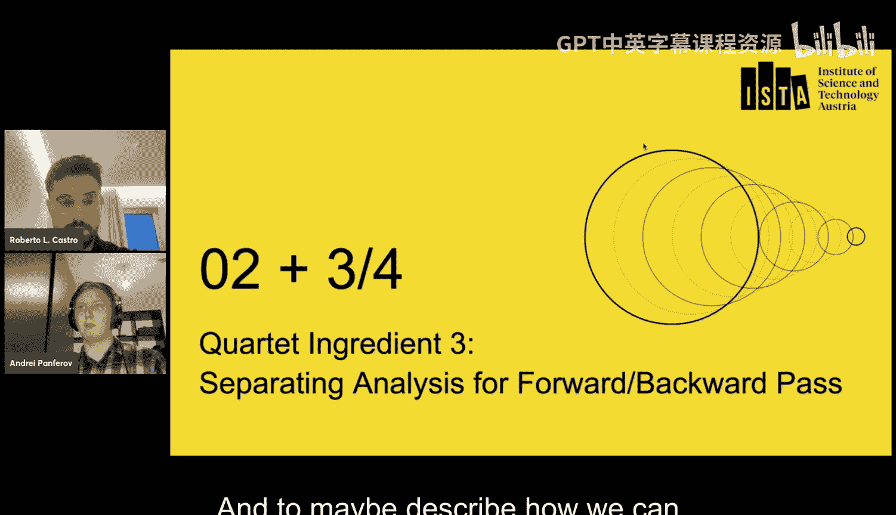

Which is true under fixed interest budget and in general， what it can fixed in。Okay。

 under fixed compute budget and what we can say even further is that mode methods that run the same precision usually have either identical or very similar compute budget because they utilize the same data types and in general very similar kernels。

 we need that if we wanted to design a method which is the best for fixed precision。

 we can use those effectiveness factors directly to compare methods。

And this is what we did in our paper so the third ingredient of our cur method is that we use this kind ofical coefficients directly to pick the optimal backward pass and forward pass schemes and to not go into too much details here we compared the number of schemes such as stochastic round in for biased the backward pass grade estimation and Emack rounding scheme and quest standard deviation based round in schemes from our recent previous papers of ours and here we can see that the stochastic round in yielded the best performance for the backward pass and Que yielded the performance for forward pass and I think I'll skip a little about the background I'll just mention that Que is a method from the previous paper of ours which uses standard deviation based scale and how transforms for normalization and the unbiased except before。

Pa method we used was actually originally proposed by Albert San and Carterths。

And the also is the hardwaremar transform and the kinds of crown with the produced by the gradient estimations。

And the whole algorithms looks like the like this。 So in the forecast pass， we do the quest rounding。

 as well as。Some。Clickping of the values。 and on the backward pass。

 we do additional Hadamar transforms for gradient normalization。

 We perform the matrix multiplication lower precision。

 but then we have to do a number of additional operations like masking and in Hadars transforms to update unbiased and accurate gradient estimations。

And with this， you can see already how complicated this method is。 and since the。

The optimality regions that I showed before depend。Primary not only on the accuracy of your method。

 but the speedups， the fourth and arguably one of the most important parts of our paper is the kernels that we provide to actually allow this method to be optimal and here revert to takes stage to describe the kernels that we wrote。

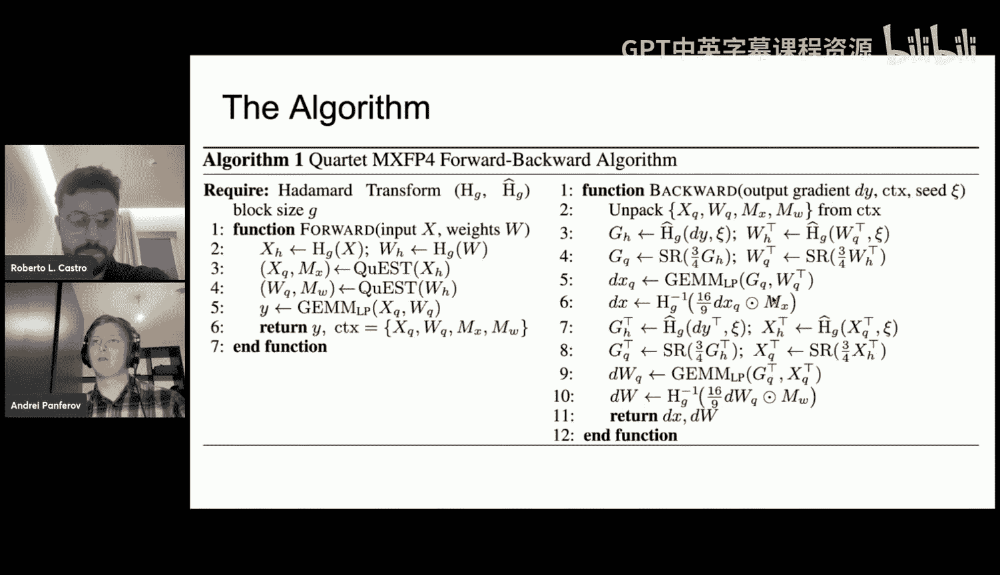

sorry folks before where it goes。 I like a couple of questions。

 and folks from chat have a couple questions。 I think Oh sure。 yeah。

 I think would be a good time to answer them。 Yeah， go ahead。 okay， so first thing， sorry。

 that is like a very new question。 But like and some of your slides， You had something like S F W。

 What does S stand for So S just mean speed up。 let me find speed Yes。

 so here you can even see it in this table So you have forward inference speed up that we call S forward and backward speed up speed backward and training speed up SR。

😊。

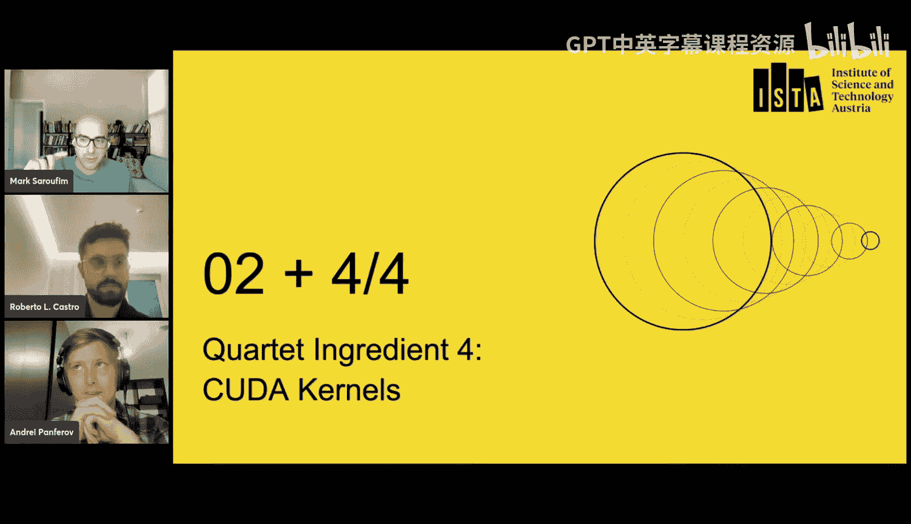

Yeah， so basically we need these speed ups to normalize the compute cost to obtain kind of the normal the real parameter account from some normalized compute cost that takes speed ups into account。

All another question which was like about a year back around the time Lama three came out I remember a lot of labs had trouble doing post-training quantization on it because and part the argument I read was something along the lines of the model is over parameterized because there's a lot of data and so if you quantize like it just like forgets everything and then people were predicting the death of quantization I'm sort of curious like with the benefit of hindsight。

 well what do you think about this argument now and like which parts of it were correct so I think in general this argument is very much a fal to what we're doing here because what people described back then was posttrain quantization which is some sort of operation perform on already trained model and yes people have demonstrated that the more trained your model is the harder it is to quantize in a sense and it sort of makes sense because the more trained your model is the more information effect onto it but also it cons to a more stable equilibrium of some sort and that's why quantization。

Wwhich is naturally some sort of perturbation on top of your role as a trained model would make you lose more information。

And here what we'll do is somewhat ortho togonal because here we're training this quantas representation from the start and。

What we observe is that the。We don't see this effect and the performance is pretty consistent with how long you train。

But but there does seem to be some strong relationship here because like one thing you mentioned was like basically information per parameter。

 so like if you're training in FP4 then there's less information per parameter so then when you're doing inference in FP4 you've lost less information and so like there is some sort of I think relationship in your arguments I feel。

Let me think about it， so。So the lemma model was trained in higher precision and still encoded some as people somewhat shown lower information like the amount of information per parameter forlemma was still pretty low。

 but probably the representations that you are obtained somewhat over overturned to the。

Data type that you were using。 so the model sort of encoded slightly more information of it。

 but still way less than what you're a quantizing it to。

 but by encosing more information it became more fragile in a sense to these post stringion preturbations and。

And。Not that familiar with the literature that tries to quantify how much information exactly you lose for with post training quantization in general。

 it correlates a lot with additional things people have observed like the existence of outliers neural network。

 which is very hard to combine with quantization both conceptually and in practice and I think this is somewhat orthogonal research direction of how you can quantize to not break down existing models versus actually train in quantized models from the start。

All right， then last question。 I see a couple more questions in chat。

 Maybe we'll save one all the end。 So when't I think it go to your pseudo code again like the algorithm code near the end of your slide a here it is sorry to just like this basics like what is quest rounding exactly and why do a lot of quantization people love the had mark transform I was wondering if you could spell that So quest rounding is basically rounding I think it's better explained by this slide So it's round in as such to minimize quadratic error over a normal distribution So it's standard deviation based scaling that was the optimize basically quadratic error and this is also and then an answer to the question about the Hadmar transform because the mark transform acts as a normalized around your distribution So the transform makes your distribution Gaussian and the round in。

Chosen us to minimize the quadratic error over this distribution。So this is a very request。Okay。

 name makes sense。 Okay， thank you， Andre and I guess Roberto， please， please go。Okay。

 can you switch to my screen， maybe。

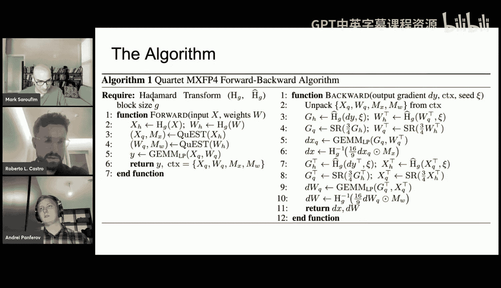

Okay， thank you。Yeah， so in this second part of the presentation。

 I'm going to cover the fourth and last ingredient of our recipe which is related to cota kernels that basically is we have invested a lot of time and we continue to invest a lot of time here because as Sandre mentioned the real speedups of our kernels are going to shape the optimality regions of our method over here。

 so the better the speedups， the larger these optimal region is going to be and the more models are going to fall in this optimality region so that's the reason why we continue working on them to optimize them further。

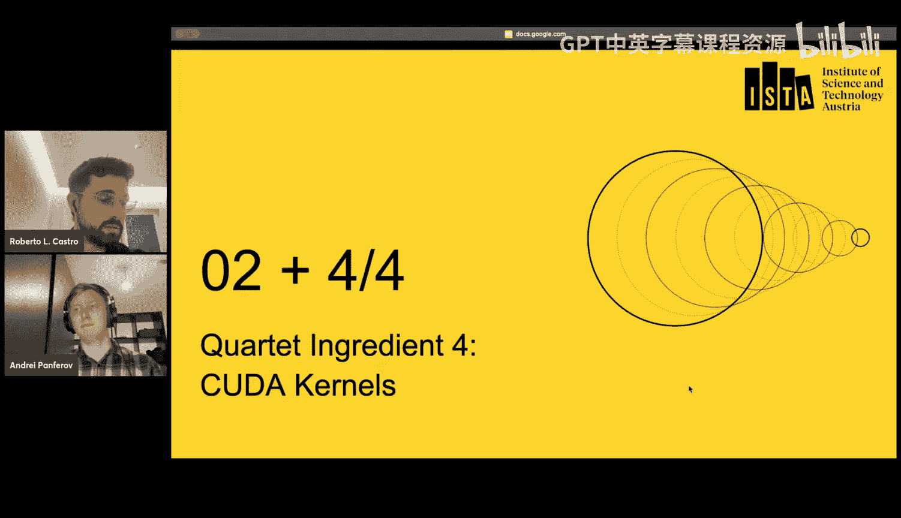

So before starting with the kernel details， I'm going to give a brief overview of some details that I will refer to in the following slide so we will just refresh this information so。

When we refer to MxFP4， this MxFP4 type， which is the FP4 type that we have used in our quart paper。

 basically that means that we have our values represented by this E2 M1 format and that means that we have one bit related to the sign and then two bits for the exponent and one bit for the mantea and then if this matrix on the middle is our matrix for each column each group of 32 elements is going to be assigned to scaling factor and this is scaling factor is for this MxFP4 format is represented by an FB8 value with these represented of E8 M0 and that means that。

8 exponent， the exponent is basically represented by these all the eight beats are represented by exponent values。

So in this way， in this new blackwell architecture。

 we have hardware support to execute this kind of operation where for a specific a matrix and B matrix as matrices to B multiplied are going to be additionally represented by a metadata information。

 which are these scaling factors。And this scaling factor is applied to the inner dimension of the matT mole。

 so for instance， for this a matrix over here， the K dimension is going to be divided by 32 in the case of MxFP4 because we assign a single scaling factor to each 32 elements right for MBFP4 that will be 16 but that's not the target of these presentation or paper so let's continue with MxFP4 remembering that we group 32 elements。

Right， so in terms of hardware， that means that we are going to have two matrices and in tensor course。

 we can execute these matrix matrix multiplication with one new instruction。

Which is going to receive not only the input matrices。

 but also this metadata information to produce this output matrix， right？So。

One of the points that Andre already highlighted is the impact of the mat moles in these large language models。

 so。Most of the runtime of these models is represented by these matrix matrix multiplications in linear layers。

 so that means that they are a critical operation that we have to optimize to optimize as much as possible and these requires careful tuning but also this implies that we have to avoid the extra overhead of additional operations such as these Hadar operations that we have just been discussing so in this plot over here the matrix matrix multiplication in4 bit will be these blue line and then the black line will represent the online let's say quantization that we have to apply to the input matrices in order to compute our result so we have to implement these overall idea trying to reduce。

As possible the distance between this blue line and this black line， right？

And this is something that we just mentioned and we discussed with this last question。

And one of the reasons why I mentioned in this is that the Hama transform is one of these operations that introduces。

Extra overhead to our method。 and we have to carefully tune and also implement in order to reduce this distance or minimize these overhead。

 right。The Hadamama transform behaves as this normalization that Andre just described。

 and if we focus on this Hadama transformation， the size of this Hadamama transformation is critical。

If we refer to runtime， right， So when the Hadomer size is less than 256。

The problem to solve is memory bound when it's larger or equal to well this depends a bit on the architecture to use。

 but here in these slides or in this 5090 GPpU， for instance， the breakpoint is it's 256。

 So if it's 250 seat or larger the problem becomes compute bound and yeah basically this is the overall result right so for Hadamama size of 32。

Solving this Hadam mark transformation as a matrix matrix multiplication， which is just faster。

Because it's a memory bond problem， but when we move to Hadamar solve 256。

 then we have this fast worst Hadamama transform that is able to solve this transformation in complexity on n log n。

 right？So the time it takes to apply this how much transformation is going to be determined by the time it takes to load our matrices right because it's a memory bond problem and that means that if we move our data really efficiently。

 our method is going to be much faster。So that also means that the Hadama transformation can be hidden in some sense。

By this matrix loading， right？And we already have to load these matrices because we have to quantize them。

And since this is。AMem bound problem that means that we don't necessarily have to apply Hadamama transformation。

 but any kind of transformation can actually be applied here if we want。

So this alpha projection is also memory bound and we solve this problem with a catalyst fust kernel for Hadamar sizes of 32 that are actually really small Hadamar sizes。

 but we found that they are they just work right they just work。

 so we don't really need to use larger Hadamar sizes here to make our method work。

So when we refer to this dense Hadomer transformer。

 what we actually have is this kind of block diagonal matrix for a specific group size。

And if all these blocks in the diagonal are basically the same。

 what we can do is to transform this previous problem to this one。

And since we are focusing on Mx F before4， we can justify this Had size of 32。

 And that means that in instead of applying this。32 by 32 block to each block on this blue matrix。

 we can just transform this problem to this one。Because all the information is contributing memory。

 and that means that this Haama transformation can be applied as a normal gem， right？

So taking advantage of these alternative way of。Solving this Hadamama transformation。

 we have defined a custom catalyst jam template right， to execute these in the following way。

 So the inner dimension， which is this one over here。

Is going to be fixed to 32 right and then all the remaining elements are going to represent the outer dimension of this left hand side input matrix。

 right？And then we can just define these tile shapes in the following way， in this case。

 128 for the M dimension， I'm going to talk about this a bit later。

 but basically the M dimension and the K dimension here are 32 because it's never going to be larger than that。

And then the following。The following configurations just depend on the specific hardwareware architecture that we are using such as these MMA shape over here。

Okay， so what we what we have done over here is that we have two Bf16 input mates。

 one of them is the matrix to quants and the other one is the Hadama matrix then we apply this dense Hadama transformation with this custom cutless gem template and the accumulation of these separation is going to happen on FP32 right so the output is going to be stored in shared memory then what we have done is to define a custom epilo to produce the following three results so the first one is going to be the beus quants to this E2 M1 format。

Then the second parameter is going to be the scaling factor that I just mentioned in the second slide with this E8 m0 format。

 and the third parameter is the clipping mass that is going to be used in the backward wire propagation。

So this is just a binary mask。And one very important information over here is that this custom epilogue is almost for free。

 almost for free。Because it happens locally。 We don't need synchronizations here。

 because let's say that each thread is going to contain all the information needed because we。

 we work with these groups of 32 elements， right， So no synchronizations are needed。 We just need to。

Take our information after the Had after the the the Hadama transformation。

Compututes open elements and just write them back to global memory。

 but no extra synchronizationations are needed。Okay。

 so this previous slide just describes the fused quantized kernel that we have implemented and right after this before the matrix matrix multiplication。

 we had to add an additional method that is this scaling factor rearrangement。

 this is not related to quated or to our implementation。

 this is just related to this new blackwell tensor cores。

That requires the the met metadata information to be stored in specific way。

 that is this layout that I show on the left。And this is going to be applied to the E8M series scaling factors that we have computed in the previous step。

So overall here I show an example of how these three methods are executed。

 so this example represents the forward path， the forward paths of our method。

 so we are going to receive input and the weights which we are going to quantize on the fly right。

 so these forward quantize method applies the Hadama and then computes these three outputs that are the FP4 bays。

 the FPA scales and the binary mask。Then with these scales， we call these two blocked function。

 which is going to rearrange the information to this specific format required by this new black wall tensor course。

 and then we are ready to call these kla。F before MxF before gem， right？

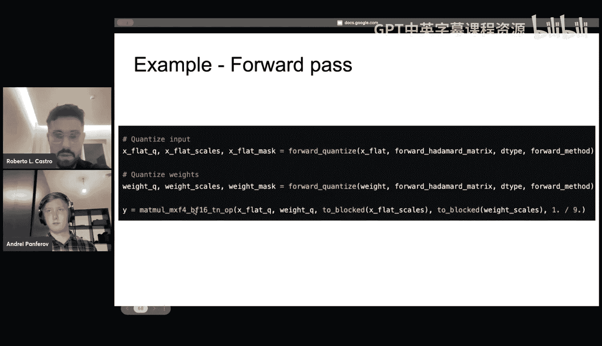

So here I have a performance breakdown for some layers of Alma 70v model。And here the y axis。

 the y axis shows the percentage of the runtime that each of these three methods take right。

 so we can actually see that for larger matrices， the matmle represents important。

Percentage of these runtime， but the smaller the matrix。

 the more the overhead of these quantization related operations。

 this is not actually related to kind of related to our implementation。

 This is just that as we increase the arithmetic intensity。

 the matm is just going to take longer and we can hide these quantization related operations。Easily。

 right。Then I'm going to describe first these first few on the left。AndHere on the title。

 you can see that we have choose 32 by 32 thread block tiles。

 and this is related to this slide that I showed over here。

 So this first parameter is the is the parameter that we tune to 32 or 128。

And this is related to the tile shape， right？The larger thist style shape。

 the more efficient we can manage these data as and as this is a memory bound problem。

 this is just going to accelerate the performance of our kernel and so that's the reason why we increase the performance from this first figure to this second one and the third one is just adding a tritton MxF before rearrangement kernel instead of just pytorch level a Pytorch level method。

But actually， this rearrangement function， as you can see。

Already represents a minor percentage percentage of the total runtime。

 One additional optimization that we can apply in the future is to fuse this rear arrangementrangement in the fused kernel right that all contains the Hadmar and all the quantsation related operations。

 But as it represents。Fairly a small percentage of the runtime we didn't invest too much time on this fusion。

 but this is something interesting to do in the future because we continue working as I said。

 in the optimization of these kernel。So。One thing that I wanted to refer to here is this cutas library that we published。

Like one month ago or something like that。And here is the this is the repo that is going to contain all the kernels related to Quart and also quantization related products that we have for these microcaling formats。

 we already included a bunch of kernels for the forward path on these GiHub repo。

 more specifically not only for these quarted paper， but also to some PTQ project。

And we continue working on optimization on the inference， but also on the Bgware Pass。

 and we hope to add the Bware Pass kernels in the following weeks。

Here I have some speed up numbers end to end for two different models。

 we can discuss them later if you want， but this is the the repo where all the currents are going to be dumped afterwards。

And then on the backwardware pass， I'm not going to go into more details because basically all these optimization and tricks that I have been talking about in the previous slides can also be applied in the backwardware pass because we have Hadamas everywhere as well and these Hadmas are also memory bound we just have some additional transpositions that have have to be applied on the fly。

 but the kind of tricks of these memory boundness。Can can are basically the same ones。

 And we can have also some additional masking functions like this one that we can fuse on the epise of our kernels。

 But as I said， this is still a work in progress。And here I have some speed up numbers。

For our kernels on the left， this speed up is of M X F before4 with respect to FP8 on the right。

 with respect to B F 16 for3 from layers extracted from three different models that are well。

 the sizes these 800 million70 v and52 v right we can see that the speed up of the forward pass with respect to to FP8 is around 2。

2 up to 2。2 the bikeware around up to 1。5 or something that。

And the difference of the performance of the forward pass and the power pass， as I mentioned。

 is that we have invested a lot of time on the forward not。So much effort on the backward yet。

 but we are working on it and we are going to release the kernels soon and also improve these results。

嗯。Yeah， and then this we already describes this， this over here。

 So I think that's all from the kernel perspective。

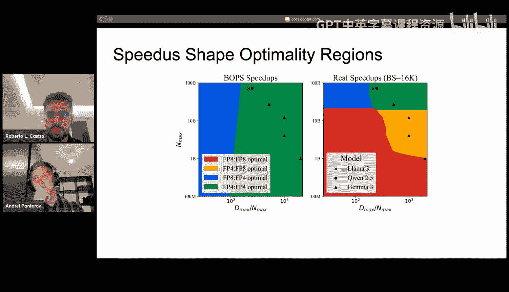

嗯。I don't know if you want to continue to have some questions about this。

So there's a bunch of questions in chat like like how much content you guys still have have fun？

When we have a few slides， like some reason and comparisons and then basically just a recap。

How about we do that and then we do questions in the end。13。Yes。

 so at one point I already mentioned that we can use the effective multipliers from the scaling loss to compare methods that are the same precision and this paper wouldn't be full without a proper baseline comparison and to do this would do exactly that butique a bunch of four bit methods that were proposed in the recent years for four bit training of LMs or otherwise deploy learninging models that were adopted for the lamps and we fitted the scaling loss for them we obtained the。

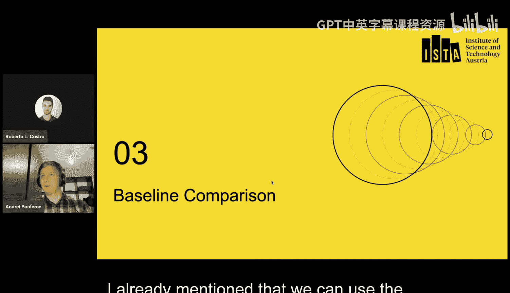

Efficciency factorss and from these efficiency factorss。

 we can see that the quality the composite method we designed with these sorts of skill loss in mind using the latest available methods that came out within last six months。

 Beo， all of the existing baselines such as this LQ jet fire halo。And assess in general。

 this is the best you can get for a bit training at the moment。

And one other thing that I should notice is that we build our comparison so top of scale also of a very specific thing that is the validation tray validation loss of pretraining of other lamps and to build a proper comparison of models based on this one number。

 we can we need to show that this number is actually consistent with some sort of downstream performance of other performance metrics of other La here we do this with。

A number of zero shot tasks， such asaswak， Vina Grande or A。

 and basically what we show here is that this zero shot performance is consistent with validation loss。

 meaning that the pairwise comparisons like which loss is smaller。

 we get from our scale loss from which we build up some multi regions actually translate into zero shot performance and again。

 we we show it only for the pretraining and flourish language models。

 because things like instruction tuning or policy optimizationization are way outside of the scope of this paper and mostly depends on some additional tricks or data mixtures that would be selected for those as opposed to simpler pretraining setup where you have usually one data mix and validation loss from it and here we we simply demonstrate that these one validation loss consistent with some other performance metrics of OMs and our comparisons still stand。

And to sum up what this paper is about， we proposed a novel method for comparing differentquiization or training methods that normalizes the training and inference costs and use a scale loss to accurately predict performance in terms of accuracy and make an easy compute comparison of different precision and methods to be able to tell。

In advance which training method would be the best for a certain training setup like model size and compute budget？

And to do this， we fitted a bunch of scaling laws and demonstrated the robustness and we also tested our method for pretraining a model that is way outside of the scope of the models we mainly trained So mainly we train the models from 30 million up to 200 and actually up to 800 million parameters。

 but for one additional a we trained an 80 billion parameter model just to see that it still converge st and that our methods still performs reasonably there as well。

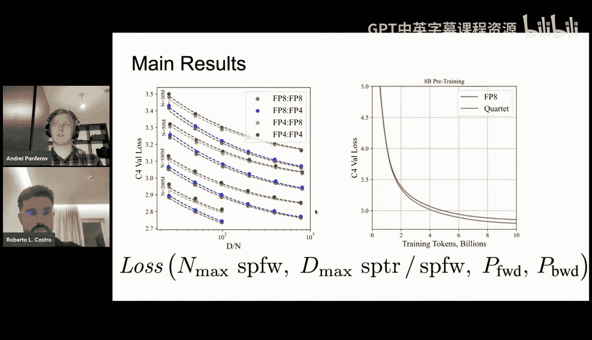

And I guess that would be all and we will be happy to answer any of your questions。Wonderful。

 thank you， Andre。 Thank you， Roberto。 I， I guess what I'll do now is I'll just post the questions on the screen and then let me know if you can read them。

 Can you see this Yes。😊。

So， I think。This one's for your Roberta。What new features would like do you see in the future UP architecture to further accelerate your kernels？

Oh， that's a very good question。That's a very good question。 that not。

 I don't always ask myself this kind of question。 I just adapt the kind of。

Implementation that we have to the panels available。

 one thing that I kind of miss from the previous architecture is this one bit support。

That to some point， it's discontinu in in these new architectures。

 at least from the documentation perspective。 And then this kind of， for instance， this kind of。诶。

I think that these kind of micro scale informants are really important。

 not only from the kernels perspective， because previously we had to implement them by hand and from scratch。

But I think that maybe support these kind of microcaling formats to lower bits can。

 can be an interesting。Future to support in Harvard。嗯。Yeah， I don't know what else。

One interesting feature will be talking about micro scale informants。Support。诶。

Other group sizes than 16 or 32， like 128 or even larger， we founded。

This can be an interesting feature， depending on the application。

 So talking about micro scale informants。I think that extending this support to other group sizer or half in general。

 more flexibility。Over here will be a very interesting future to have。

I think I have something to add here that there is this very interesting idea that not for this project。

 specifically， but for some posturing quantization， we had a sort of trade of that。

Exponentate Mona0 microscale in scales have enough range to cover any quantitization。

 but they're not fine enough。 and FPA microscale in scales are fine enough。

 but don't have enough range And maybe one interesting thing they could do in the future is do microscales for microscales where you have like the kind of the microscale that has a lot of range。

 and then you have microscales which are a little finer。

 And then you have the actual values that are other D type and you can mix and match and build a pure innovativenova。

 Yeah， that'd be interesting。😊，So。ai，Thank you， folks。 I guess like this another。

 I think might be another question to Roberto。呃。Tense gem plus Had Eo should be compute one in theory。

I mean， the thing is that here， the epio is always。Prologue， not epilogue to the dense gem。

 So I don't really understand the。I think this is generally a question about that our method kind of doesn't make gems not compute bound。

 Yes， it's still compute bound， it's not about the gems itself。

 it's about kind of the additional methods we build around them and were trying to build them memory bound as to not slow the gems slow down the gems itself Of course you wouldn't be able to kind of make gem memory bound because the compute you have to take a steel there it just everything we try to design around it。

 we try to minimize the amount of compute you need for it。嗯。This is a longer question from thepo。

Okay， so the easiest way you can see why this happens is let me open this slide。 is that let's。

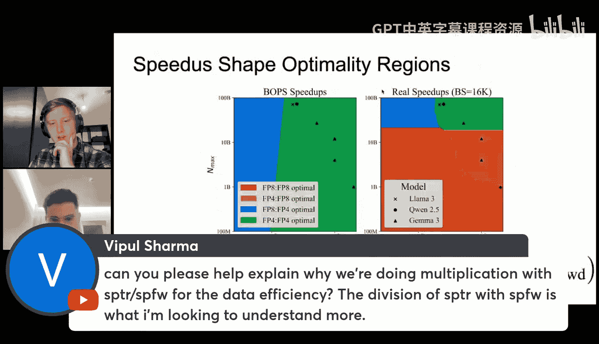

Where was it。Here， so yes， why we multiply by one and divide by the other so imagine if both your training and inference speedups were two x then to normalize for inference speedup。

 you take a model that's twice as large。Meaning that your training budget also just grew training budget under fixed talking count also grew up by to X。

 And you have to。Cut the tokens， but then you have the training speedup that again expandends your budget and youve matched the exact training budget。

 So actually this division by forward speedups can come from the fact that you actually behind you're actually increase the model size itself And if your training speed up doesn't match your forward speedup then you will actually train on less tokens because your model is larger but not as fast on training So this is just if you write out the actual costs that is kind of training budget is proportional to the two youll see that kind of when you multiply these two。

 you get exactly n times D times training speedup which makes sense because you just kind of increase compute exactly by this SP training but you have to multiply by this kind of。

So yeah， if you just do the math carefully， it comes out like this。

 and I think thiss going to be the last question。Okay。

 so this is about some sort of maybe even neural architecture search where you're trying to come up with smarter strategies for quantization。

 maybe like not quantizing certain parts or quantizing but to higher procedure and in general what I would say is that。

It can probably still be described by the same scaling law， but again。

 if your training setup is consistent， it can still produce consistent losses meaning it can still be fit with the scaling law and we expect that still some sort of capacity would be there and this form would probably be good for it but it might yield significantly different effectiveness as factors while not changing the total bit width or latency by too much。

 we haven't experimented with this a lot， but we still believe there would be some notion of capacity in there that you could exploit to use the same comparison scheme we propose here。

Actually， I lied， I want to ask you guys one last question for let you guys go so assume it since you're using Blackwell。

 I'm kind of curious how come you guys didn't explore like the NVFP4 data format and why you stuck to MXF4。

Okay so maybe I can start with this one， so we started this project before anyone actually got the first black hole chipps and sort of one sort of no one knew like if it even existed and what it would be and Max before is like a well documented format for Bus specification has existed for a few years and we just picked the one that made sense and we did all of the initial operations and the quantization and then when we actually got the GPUs。

 yes everyone realized and before is not simply better but TM before is sort of a more standardized format for Bus specification has existed for longer and we're actually looking at getting Max before support in other accelerators such as some Chinese accelerators or Amazon accelerators so it's maybe a little more future proof as well we'll see about that one。

But I guess your hypothesis like the curves would maybe go like a bit down or a bit up but you would yes since it's sort of a capacity of representations。

 its it mostly depends on like your inner data type and it's still left before it still roughly the same bandwidth with so we expect it to not change by much yes。

All right well I think that's it for me and for chat folks if you have any more questions Senator Roberto please feel free to message them on Discord or shoot them an email thank you so much guys like I really appreciated this and you're more than welcome to come back again in the future so it was great having you thank you。

😊，Thank you。 Thank you。你 have a good day。

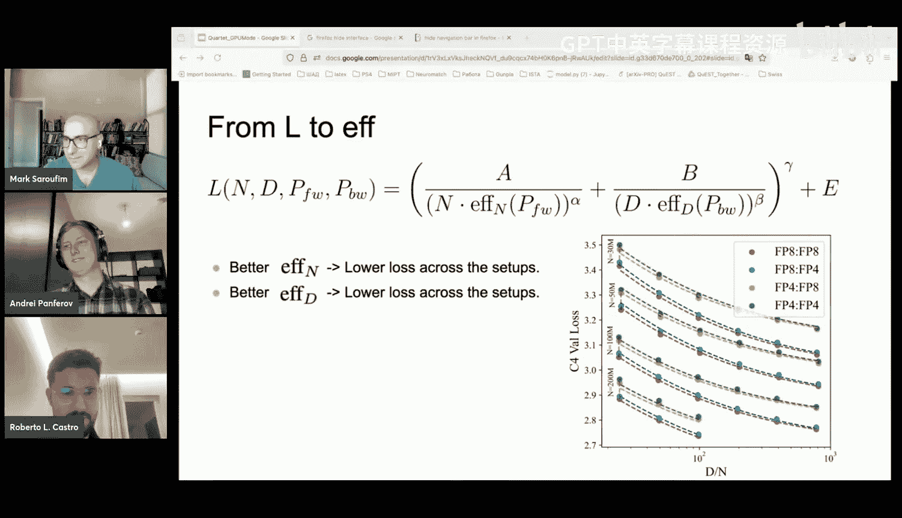