# GPU MODE《CUDA、GPU编程54-87｜GPU MODE》中英字幕（deepseek-v3.2 p17 -20250830-Lecture 70_ PCCL Fault tolerant collectives.zh_en -BV1xbmQB3ETC_p17-

Okay， I think we're live all right everyone， welcome to the last lecture of Lake hot distributed summer。

😊，Today like to sort of close things off like I'm really thrilled we have like Michael Kalinger from like Pri E Michael and I sort of consistently published with some of the most interesting like C++ and low level systems content that I see。

😊，On on Twitter， I don't think this is necessarily a talk really about GPUs。

 it's more about like pickle and just generally fault tolerant collective communication revenues over IP so you know no GPU required I guess。

So yeah， and you know， and I'm joined today as well by another co host like Mattte。

 who some of you might recognize from Colel Bod and accelerate so Mattte， so sorry Michael。

 please without that for adodo， please go ahead。Yeah thanks for having me。

 I guess yeah today I'm going to be talking about PCL， the Prime Collective Communics Library。

 which enables Far and collectiveive communications over IP。

 which is the library I've been working on at Prime and select。😊。

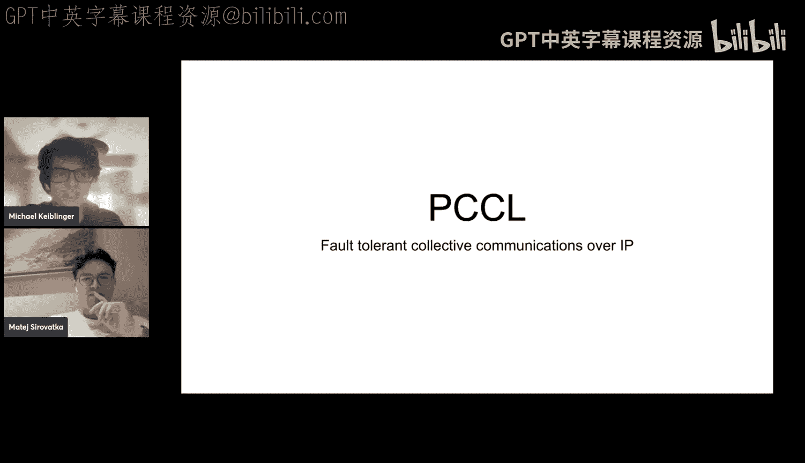

So yeah， maybe as a sort of chapter one， why even do this。

 so the motivation of course is to perform all reduces across the internet and tolerate and unwind basically all possible IO failures and expose primitives to implement many different distributed optimization schemes ranging from naive DP to Diilico streaming Diilico or eager Dilicco with delayed application where you actually do have slightly mathematically questionable but application of 30 gradients where you actually do have full communication computation overlap。

 which in many situations is still very fine。And of course， one of the sort of。

Big pluses I guess with PCL is that we can guarantee bitwise identical results on all peers of all collective communications operations and what this sort of allows is to facilitate independent advancement of the shared state which includes model and optimizer state to precisely the same end state such that actually hashs will match and this sort of just eliminates a whole category of problems as relating to are these two sort of checkpoints the same and it just sort of like rules out peer drift in that sense and one might sort of start to wonder here。

 well okay wait GPU andmin indeminism this and that。

 but we'll get to that in a second as to why it's not actually all that unreasonable to assume that and in many cases you can just facilitate perfectly deterministic shared state advancement even on the GPU with some fairly complicated kernels involved。

So what does PCCL enable PCCLL enables and this is sort of a mouthful from the paper。

 zero copy bitwise deterministic interruptible pipeline quantized asynchronous collective communications。

 so I guess zero copy meaning that we want to not copy on the way to the actual send call at which point we are of course at the mercy of the kernel。

 whether or not theres going to be more copies on the way to the network card。

 but at least on the way there we want to make sure that we don't copy the data and ideally directly reference the data from the user provided tensor and bitwise deter deterministic meaning of course the collective communications operations guarantee the same result given the same inputs。

 interruptible， meaning that if some IO failure were to occur because the neighbor just turned unresponsive。

 for example， then we want to be able to interrupt the all reduce unwind properly and return of failure status to the user who then can。

Whether or not to retry the operation and pipeline， meaning that we're just implementing a textbook。

 MPI pipeline all reduce。with a reduced scatter and reduced gather phase and because sort of the properties of the share phase。

 as it's also known， we can guarantee these a bit less deterministic results and quantized meaning that we of course want to send in a lower precision than we actually have in our source array if that is so desired and while we do accumulate in higher precision internally as you sort of move through the n minus one pipeline stages of the overduce where n is sort the world size。

The idea is basically that you sort of get a better and better statistical estimation of the quote unquote。

  truee gradient， let's say that we're reducing as the number of workers grows to infinity。

 even though we're only ever like sending， let's say。

 innate reduced contributions that which are deco quantantized internally。So yeah。

 and as's inchronous meaning that we want to launch potentially many collective communications operations and want to await them at a time of our choosing。

Whether that be this step or a next step that is basically up to the application developer。

 and this is sort of like very important for sort of overlapping。And yeah， like I said。

 I'll pierce obtain bit identical all reduced results and what this sort of enables the second order effect is that the shared state is fully rederivable from all performed reduced results and an initial state。

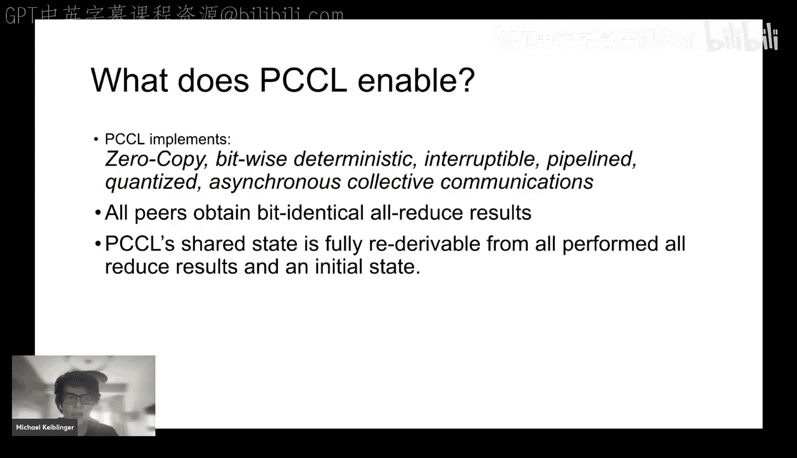

So I guess let's sort of go to the programming paradigm， so every sort of PCL application。

 first thing you want to do is of course initialize PCL but then create a communicator and pointed to a dedicated master so PCL employs sort of a lightweight dedicated master which doesn't really do a lot and doesn't really transfer a lot of data it is really just there for acting as a essential source of truth and。

Facilitating or basically storing connection information and sort of facilitating the state transitions of the protocol as to make it really obvious what sort of to transition into and unwind once a failure actually does occur。

 so this is sort of just I guess a crucial sort of design decision to just make fault turnsrrs more practical。

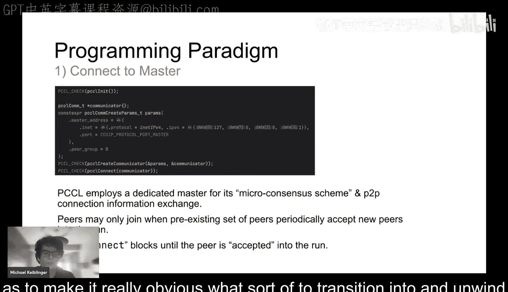

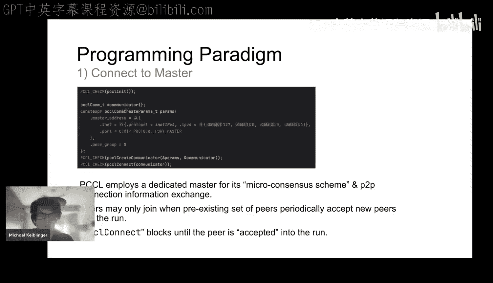

And yeah， so every sort of it implies what we sort of internally refer to as a microconsensus scheme。

 meaning that basically many blocking PCCL API calls facilitate sort of basically a barrier。

 and also agree to do let's say some operation next， let's say accepting new peers。

 which gets us to the next point， which is that peers may only join when a preing when the preexisting set of peers actually deliberately accepts new peers into the run and this sort of happens periodically。

 let's say once per step where every peer just calls PCL update toppology and at this point the world size can actually increase。

 whereas throughout the rest of the code you can just expect that world size will only ever decrease due to sort of ungraceal failures but never increase。

And PCCL connect and will basically from sort of the connector's point of view will block until you actually reach the accepted state。

 which could potentially take some time， but it's sort of a safeguard in that sense。

So yeah let's get to the shared state so the shared state is essentially it references all weight and optimizer state and is synchronized periodically。

 but one really shouldn't sort of think of this as data transfer that occurs periodically if content hass and revision match so because we do actually hash the contents of all those tensors。

😊。

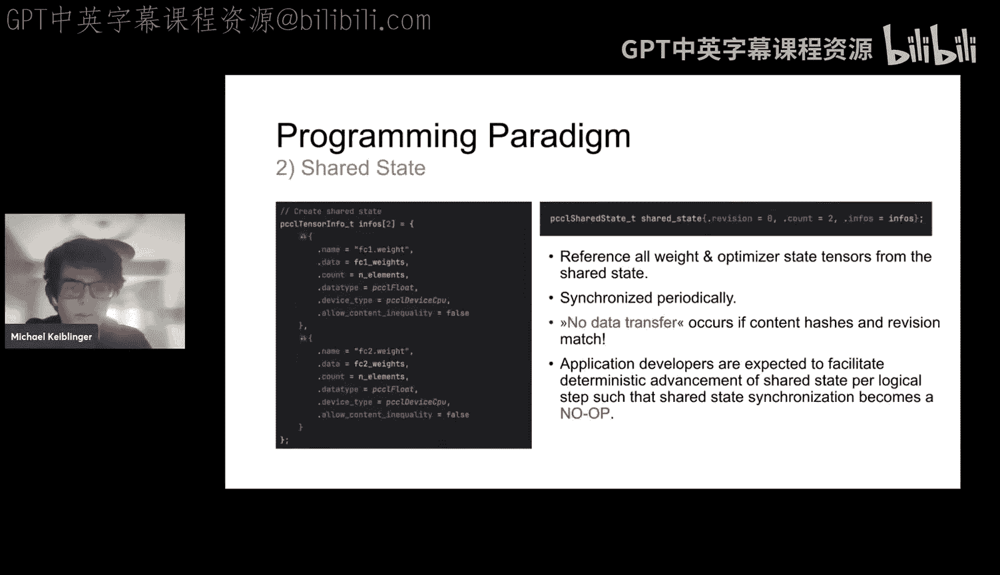

And basically sent those hashes to the master which then says okay great does this match or does it not match and if it decides well that doesn't match then you will be paired with a random peer that does have a popular shared state and then you will basically be sort of paired to reobtain the shared state but ideally application developer or sort of expected to facilitate deterministic advancement of the shared state per logical step so that the synchronization actually always is just a no op in that sense and so the reason why this is sort of reasonable is because like I said we're getting the same or reduced result in all peers and if we sort of conceit that we already have some initial states。

 let's say some initial model weight state that is the same with all peers then we just apply that update and if if we can sort of do it once then we can do it end times and therefore we just sort of rule out a peer term sorry we just rule out peer driftri。

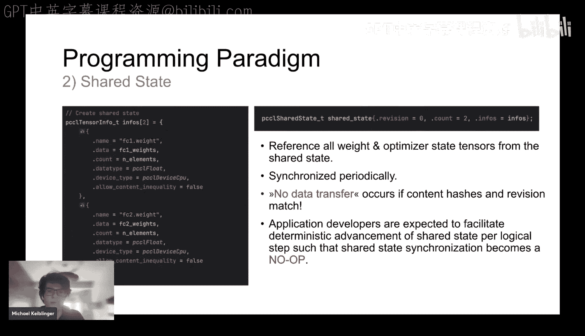

And yeah， so let's move sort of on to the main loop。

 so a typical PCCL application sort of consists of the following sort of stages if you will first we accept new peers so this is a deliberate call at this point all peers agree to let new peers into the run because the world size may have changed changed it is best to ideally run topology optimization which will launch some speed tests and sort build a bandwidth matrix and reachability matrix and based on that we then form an optimal tour if that is computationally feasible and yeah。

 afterward synchronize a shared state but again this is sort of ideally a no op and is really sort of just there as a guard and and of course there to sort of make newcomers fall in line which of course have a fresh model state。

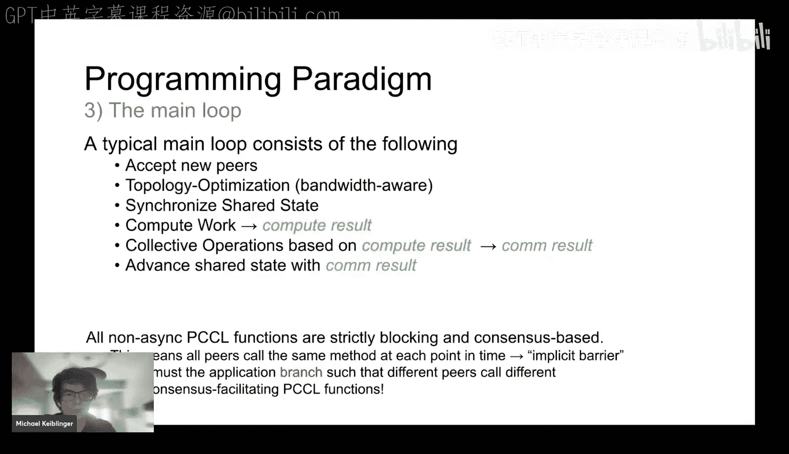

In that sense， it's sort of solving two problems at the same time。

 sort of an initial checkpoint sort of obtaining system， if you will。

 and a periodic guard in a sense。Yeah， then we can do some compute work。

 which may involve model a model forward pass and backward pass， which will yield。A compute result。

 and then we will do some collective communications operations based on that compute result which will yield a communication result。

 and then we advance the shared state using that communication result and ideally if everything goes well。

 then the synchronized shared state call of the next step will actually be aO opP unless of course a newcomer joined in which case we could be transmitting shared state but it should never be the case that we actually are for some reason receiving some bytes because what that would mean is that our shared state has become unpopular or dirty。

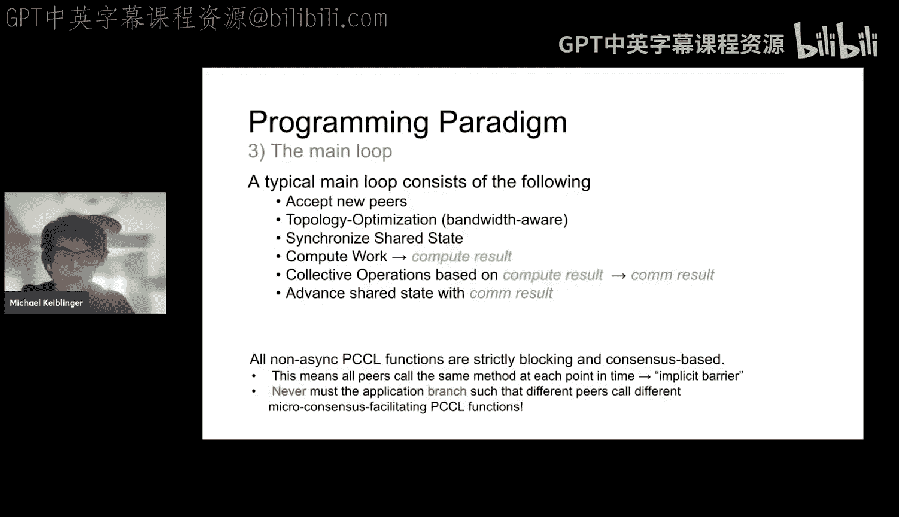

Yeah， so additionally， all non-async PCL functions are strictly blocking and consensus based。

 so this sort of means that all peers must call the same method at each point in time and sort of act as an implicit barrier and sort of an important rule is that never must the application branch。

 such that different peers call different microconus facilitating PCCL functions so sort of the worst possible case that you could do is say something like if random do next rule in the first case PCC update topology and in the case call something completely different like PCC a synchronized shared state that is one way to dead log yourself。

嗯。

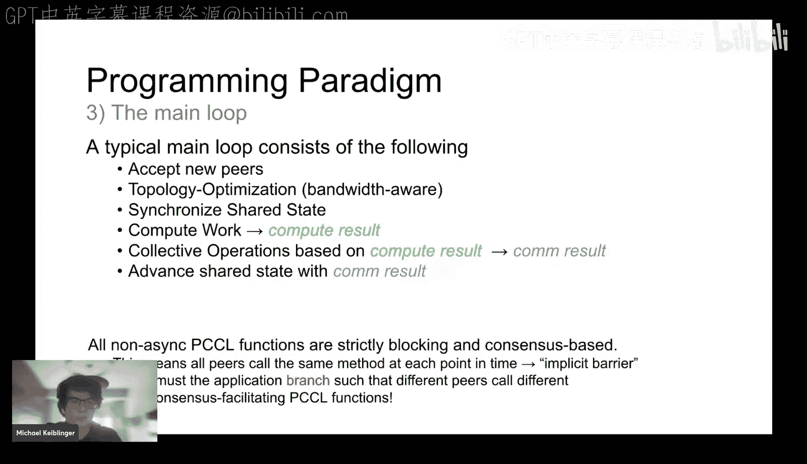

Yeah， so and this is sort of the first part of the main loop in action sort of what we sort of refer to as as the accept pump and invo an location of the topology optimization like I already sort of mentioned peers cannot connect to the master peers can connect to the master at any point in time。

 but they remain in the register state sort of in sort of a waiting lobby until they become accepted and this happens when the preexisting set of peers calls PC update data topology and at which point you will be accepted into a run。

 the connector will unblock from PCCL Connect and you know that every。

Every other peer at this point is inside PCC update topology and this is also sort of really important for sort of reasoning sort of like where're in the control flow you are when writing such an application。

Because。We'll get to why in a second， but there's some strange foot gunns that when if you're not careful you can sort of accidentally deadlock yourself and yeah after having accepted a new peers we of course call optimized toppology。

 which could take some time depending on how many peers you have and how many new peers joined because the edges that we do not yet have in the bandwidth matrix will be requested by the master and then sort of a whole bunch of speed tests will commence and once we have that data then an ATSP solver will either form precise or heuristic solution and yeah。

And of course， you can add something like sort of a min world size sort of guard here and sleep ideally or something like that if you did not yet reach some minimum world size that you set。

 for example。Now it's actually really important that this sort of looks somewhat like this。

 so if let's say you were to do something like okay great I'm going to have outside my main loop before I even fall down into the main loop some second loop where I sort of wait for my core world size to be reached and only then fall down into the main loop then。

This has some very interesting quirk so for example let's say you have a minimal world size of four then to leave but those two are already in the main loop and now those now if there was another newcomer that would be peer 3 who thinks that he has to wait while the preexisting set of peers is not in a control like is not from control flow point of view in at a line of code where it actually cares about that limit so again it will by chance just call some PCCL function next。

 let's say a synchronized shared stage or something and which will not match what the other peer wants to do which is update topology and then you sort of have a deadlock so it's again sort of really important to reason about that that even in the case where you don't explicitly branch you can still accidentally branch。

Yeah。So yeah， and already sort've talked about this shared state， what this has looked like。

 it's just basically a call you call it shared state and there's a few strategies。

 there's PCCL enforce popular which will make the popular hash or the most popular hash will get distributed to all peers essentially。

Yeah， there's some others like send only where you deliberately say at this point。

 I should only ever be sending shared state， which in some cases you want to do and you actually do want to have that error in case the master can not actually facilitate that。

嗯。😊，But yeah， during shared synchronization， all shared state content is hashed using a sort of simple non cryptographic purpose built GPU optimize hashing function。

callled simple hash internally and yeah again if we sort of have constant mismatched then retransmission occurs to prevent peer drift this is like this is not really a very strong hashing function it's really just there to just that sort of peak memory bandwidth to the point that that's possible reduce over some data with some very trivial bit shifting operations and just obtain a hash which is good for the purposes of detecting slight data mismatches。

嗯。😊，So yeah， a best practice application should of course assert that after an initial sync。

 no further shared state reception occurs， so as you can see sort of right here after we've exceeded the after the initial sync has already run。

 then we assert that no further bytes should ever be received for any future shared state synchronization calls。

 it might be the case that we do transmit data， so TX bytes。It might not be zero。

 but all that really means is that we were chosen to actually like distribute our shared state to somebody else who just joined a run。

Yeah， as the next thing， let's get to performing collective communications operations。😊。

We want to basically because this is Falter and we want to rery collective communications operations until a successful status is achieved now this might fail for many reasons。

 let's say if a peer drops then we want to unwind correctly to the user's call site here and return an errors status。

😊，Sorry， excuse me that the user can respond to by either retrying。

Or deciding to abort and quantization can be enabled， as you can see right here in in8。

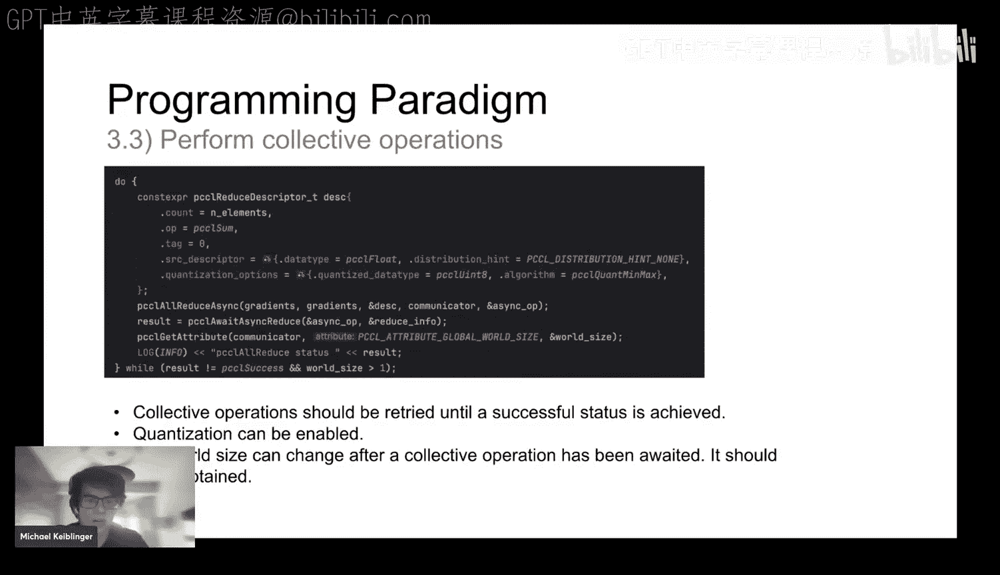

And yeah， this is sort of a trick to say bandwidth。And like I said。

 world size can change after a collective communications operation has been awaited。

 so it should be reobtained， so you don't want to have any sort of dirty application state where let's say your world size doesn't actually match the actual world size。

 which if you're branching based on that world size might result again in sort of like this accidental divergence in code pass。

So yeah， what's the motivation behind topology optimization， which is this。

This word that I've already talked about so what you can see right here is a good topology here we have some sort of locally connected peers and they all of them of is connected via a sort of slower one link it's not like any like there isn't a full any to any reachability matrix here like every one of those peers can talk to any of the other peers but is it wise to do so if what you're doing is a ring reduce and the answer is no so you want to minimize the amount of times you want to you're doing a hop over the slow link or here you can sort of see okay we're actually sort of doing that only once and I guess sort of the wraparound at the end which is implied by a tour but this is a very good topology what would be a bad topology。

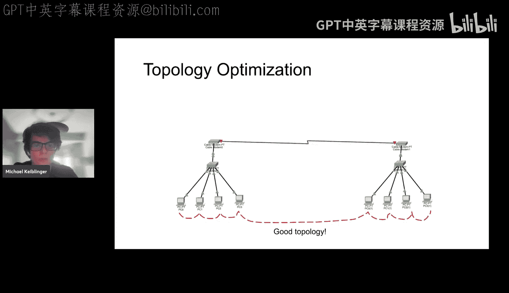

Yeah， sorry， is this。And so in this case we literally have a hop over one basically all the time。

 but if that happens to be just the joint order of the peers and if all doing is just keeping the order in which peers join as our sort of tour order。

 then this is sort of what we're going to get， which is very subopable。

Now we don't just actually care about sort of the very obvious case where peers are locally connected and there's sort of a slow one link but also sort of cases where okay。

 great， there's some peers in Europe， there's some peers in the United States and point to point speeds can vary drastically so we just sort of want to route around sort of the speech test characteristics of the specific set of peers that take part in our run。

And yeah， also data centers often have high speed ethernet and often bind to public IPs directly。

 so what that means is that that packets addressed to computers in the same data center can very often be delivered locally without bouncing the gateway because the switch really doesn't care if there's a private IP or public IP into header as long as it learns the IP Mac address combination。

So this is in many cases， you can sort of just run PCL on public IPs and still sort of like get this hybrid benefit of。

 okay， great， some of those actually， like some of the hops of the properties will actually be just fully locally delivered。

And yeah， PCL will also take partial peer to peer unreachability into account。

 so let's say if a peer A cannot ping some other peer B。

 then the route will be constructed around this sort of unreachability if that is possible。

If that is not possible， then the peer that attempt to join that sort of brought us into the situation will be kicked。

 which is sort of the only reasonable thing that we can do。So yeah。

 faultalterance means falter falterant as a word gets thrown around a lot。

 but it really actually means faultalterant， we can't have a situation where a run is brought down by some random IO failure we on the internet things can go wrong packets get dropped all the time random timeouts everywhere so we want to really tolerate any sort of O failure and all error paths must be handled correctly and gracefully which is easy in theory and hard in practice。

So yeah， we'll get to sort of the the the difficulties there in a few slides。Yeah。

 so the headline sort of for PCL was 45 gigabs all reduce or the public internet and when hearing this one should naturally sort of go how and the answer lies in something called a per flow fairqueuing so when you're establishing。

 let's say crossconental TCP connection when usually observes really low speeds like sort of in the hundreds of megabits but this isn't really because you don't have fast enough internet he might just perfectly have perfectly fine up link。

😊，But it's just that Rogers decide to say no， and this is usually because packets associated with the same flow or connection don't get to sort of monopolize the bandwidth。

 which is sort of by design but also secondly what's sort of influencing this is that just TCP window in itself gets less efficient as roundtri time increases so the famous example is that the fastest TCP link to the moon you can establish with the default 16 bit TCP window limit is like 0。

22 Mbit so and even sending UDP datagrams is not sort of the best alternative because。

Some routes really heavily deprioritize your traffic if you're sending UDP。

 so the solution here is really just opening a lot of connections and by just internally dispatching to a lot of connections PCL can sort of achieve these high throughput rates and you can sort of see this almost comical scaling law of throughput as the number of connections increases。

And yeah， because we don't necessarily care about order it's it's like we're just dispatching some fragments to a bunch of connections and the probability that any one of those actually is not stalled because of package reordering or something like that a sort of the likelihood of such a stall happening decreases with the number of connections increasing and so this is sort of the the。

In the middle ground that the PCL targets。And yeah。

In sort of the more distributed case of just the US and EU we get question Michael did you mind if we just pause for a few questions yeah。

 thats great。

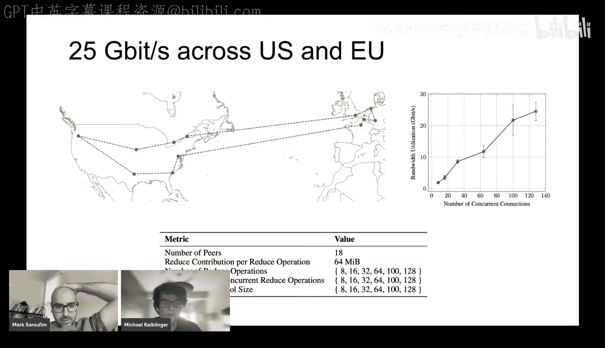

So yeah， I do have a few questions， as you were saying。

 there are specific strategies for the synchronizations。And like I wonder， like。

 did you observe some specific scenarios when one would be way more useful than another and why would that be and which one would that be？

I sorryrry， I'll just like to， let's say like you just want to train a like pre train a model。

 like which one would you choose and why？So the shared state synchronization strategy is really just there as a as a means to essentially assert that at a particular site of invoking synchronized shared states you should never be let's say receiving shared states so for example。

 if you're doing something like eager Diloco where you sort of have sort of a pipeline that is started essentially one step in advance。

 you sort of have to properly insert the peer and for this scenario actually one shared state synchronization is not enough because you sort of need to eesdrop on the sort of a result of the previous already you were not a part of because you just joined and that already started last step so in that sense you need actually two shared state synchronizations once to sort of obtain the way before and on once after the。

Dirty update was applied and in this case the site that is providing the shared state should never be a scenario where it is at sort of the other side of hash popularity so one might imagine a situation where more peers join in a single step than pre-existing peers and then in that case you end up with a scenario where you would essentially be destroying a shared state because you're now outpopularized by the newcomers which if they happen to have。

 let's say some set seed then this will essentially destroyed or run。

 so the reason why the strategy exists is to specifically navigate this problem that you say no the newcomers receive only and the preexisting peers send only and the master must facilitate that this is the case ignoring any notions of hash popularity that might interfere with that。

Okay， thanks。Also， I do have a question regarding the topology aware optimization。

 like is that aware of only the topology of like the network itself or can you somehow specify like for example。

 when you distributed algorithms some are more what wait and see。Latency。

 like latency is more important some bandwidth and so on， so forth。

Yes right now the only thing that actually counts is the speed test that we perform I guess there one could sort of replace this with a ping。

 but that is currently not supported but yeah in most cases you really want to sort of maximize bandwidth and sort of have as as much data sort of in flight as possible。

 as you can sort of see the number of connections is as you scale that you do get most of the bandwidth if you have。

Excuse me， a good uplink and this is sort of the regime that you want to be in。Yes。

So I had like one last question I think then we can go we can go to YouTube chat which was the so you talked a lot about like bitwiseise reproducible training and one thing I found interesting was like you know at least like this is not something people really expect from even like GPU programming where there's less things that could fail and so could you sort of maybe help me bridge the gap between like you kind of seem to be demanding something harder and even harder to。

And so like what's going on is it just that like in GPpU based programming。

There's a skill issue or is it like there's certain of things that people are thinking about yeah like with what's going on here It's really just about sort of being careful with torch operations like you can perfectly do this with torch just fine like there's many examples in the PC Get repository that is literally use the actual atom class and still accomplish this so it's really just about like being really careful with sort of the logstepping that the PC sort of actually by design sort of force upon you and if you sort of follow the best practices you sort of get it for free so in a sense the signatures were basically designed around like。

😊，Guiding you there such that you always have something that fails in a very discernible place if you don't quite get it right yet。

 but in essence， elementwise operations sort of in the most trivial case。

 elementwise operations don't really induce any true GPU and determinism。

 so it's actually not that unreasonable to expect that and I have some slides on that topic later。

 but the TlDR for now is that at least for for Adam。

 it should be sort of it shouldn't be that surprising that this is possible that if you have some gradients and you drive an optimizer with those gradients that this is essentially possible without GPU and determinism。

Okay。One question in chat as well， so they're asking how do you ensure the RNG are seat that corrective when you have a dynamic working group？

A。So the RNG for let's say the model initialization I think that's what that means I mean it's sort of like the API is sort of designed around this not mattering it just matters in a sense that you don't want to accidentally get out popularularized by newcomers which all have sort of the the same shared state if you do have a set seed so in a sense it is potentially wiser to use random seeds because basically the very first shared state synchronization that happens will choose one of the possible peers to sort of be the designated shared state and that will be distributed so in that sense it doesn't really matter too much how you see the RG。

Yeah， thank you。I think we can，意。

Y，All right。So yeah， so in a more sort of localized scenario in sort of Western Europe。

 which I guess sort of for in terms of distance is not really a lot。

 but you can achieve 45 gigabits and I guess this was likely because of the 50 gigabit ni of the machine that we tested this on but as you can see as you sort of get more co located。

 you need less connections， less concur connections to achieve high throughput and yeah。😊。

And yeah we talked a lot about fault turnsns， but like what does fault turnss actually mean。

 so I guess the best way to sort of show this is with a video， so let's see if that。Please。

 I think it does okay。So what you can see right here is lots and lots of processes spotting and they contribute to a very。

Tiny I drawn here which or the step takes quite a short amount of time。

 so it's a very high frequency training loop so any sort of IO failure that occurs from those peers randomly getting killed must be handled in such a way to not cause any hiccup and as you can sort of see from the prints there are no hiccups which I should say in this case is sort of a little bit cheating because the socket APIs behave a lot nicer when you're doing stuff of a local loop back because you sort of more instantly informed when a peer drops but the same principle occurs or basically applies when you're actually dealing with wire except that it just takes a little bit longer to actually discover okay great that peer is actually dead。

But yeah， so this is at least showing the lower level bound in a sense that if there wasn't just this nature of socket APIs being soet APIs that。

This is essentially the amount of pure churn we can sustain without any hiccups。

So yeah let's get to sort of chapter two agony， so what does it take to create something truly fault torant？

😊，And the answer is if you're building something based on top of socket implementations。

 well you're dealing with a set of loosely related serial looking APIs implemented on various operating systems that all vaguely promised to implement the same thing that is UDP and TCV connection a communication in ever so slightly different ways。

 and if all you want to do is just open the connection and data then I guess you would be sort of fine and you will not hit any of the rough edges but every OS has some also important revisions as to what started out as the Berkeley Sockets API even though you know。

Microsoft basically only implemented WSA the Windows Socket API by accident。

 which essentially copied the Berkeley Sockets API because Microsoft is Microsoft with a completely different error handling system。

 but yeah by accident I really mean accidental because Microsoft never really planned on supporting the emerging internet they really just sort of had slight solutionss of grandeur in the 90s that they were going to do sort of their own thing so the fact that they adopted this API is actually sort of a miracle。

But and basically by copy that literally being copied so there's a reason why you have an E hostt file in your system 32 Now one could sort of proclaim Victor and say hooray。

 all major operating systems use roughly the same socket API heritage it's really just that it heritage and the implementation of course is vastly different on every operating system and if you think that Cody wrote on Linux will compile on Windows you would be mistaken even though the APIs look strikingly similar and even if the code does compile the behavior you encounter might drastically be different for example here's a basic examples of demonstrating account misconception about how sockets work so for example。

 when you're dealing with an actual normal file descriptor when you issue a right at least after flush you know that it has hit the disk or at least the NVME's DM cache or something like that so unless there's like a power out or something like that it's persisted。

Now for Sock file the scriptor， this looks a little bit different。

 so here we do some basic validation on some packet data that we receive and then decide whether or not it's bad data and sort of send the courtesy error message and closer connection as a result。

And now in this case， we sort of do already know that the client is malicious。

 so we don't necessarily care to what happens to that client。

 but in this case this data that we just sent in sort of the sort of leading up to the close。

might not arrive and the reason for that is because we issue a reset and causes the other side to essentially drop all handling of any pending data and this is in some scenarios very bad because essentially some non very well defined region of previously issued sends as potentially a jeopardy just being of just never arriving。

And so you want to do a more graceful shutdown， which where you use the SO linger socket option。

Now there's even some quirks with that because like how long do you linger around for the other side to accurate your data and the answer is sometimes。

For a very long time， so you want to also potentially place a timeout on that so they're just even more fun。

And yeah so let's maybe get to another very fun pattern。

 Socket implementationationquirks hashtag2 let let's say you have some some thread which receives data from a socket and you want to do that basically forever until you shut down but you want to of course have a method to actually commence that shutdown so here you have an interrupt function and in this case we simply close the socket FD。

😊。

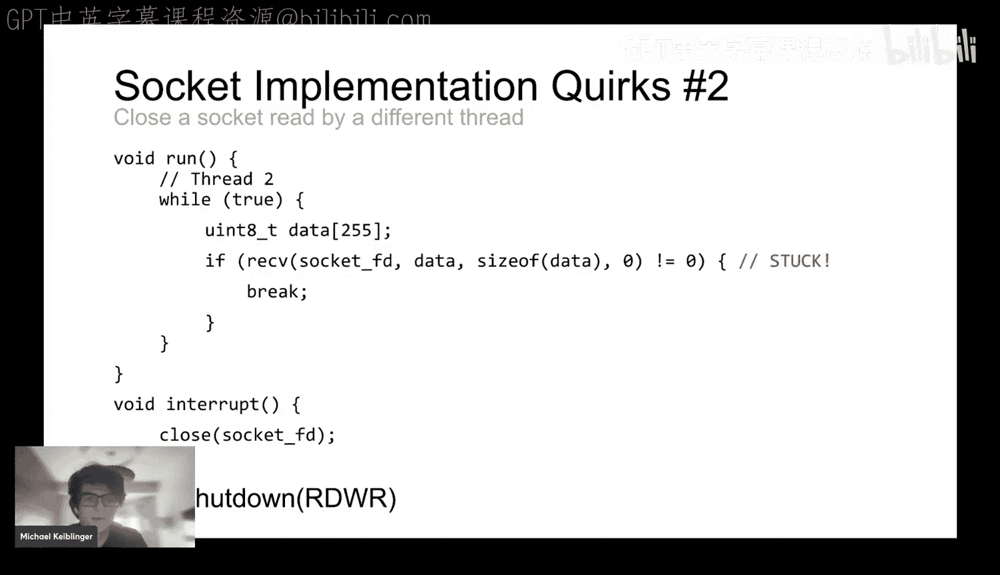

Now you can't really kill the threats there's not really such a thing you aren't also really supposed to and and many。

 I guess many higher level languages may pretend that you can。

 but if a method is truly blocking in kernel space you have to get the kernel to voluntarily relinquish control and so you either the kernel voluntarily gives you back control or you're never seeing that next line So any sort of like if not running break kind of thing that you might want to do will be of no use at all。

So， but one might sort of imagine surely if you close the socket。

 then it doesn't make sense to receive more data， but the answer is that's not what happens on many implementations。

 you actually need to add shutdown readwrite and only that way be actually unbed。

And I guess this is sort of like a really sort of important thing to highlight that or a reason why you should really have CI on every operating system when you're writing something like this。

 because you might sort of prematurely think that this is fine on some operating system and while it does compile on the other one surely therefore it works and the answer is no。

 you really truly have to test all of these cases on every operating system because you might encounter even something you might even encounter behavior differences inside Docker versus outside。

 it's really strange。

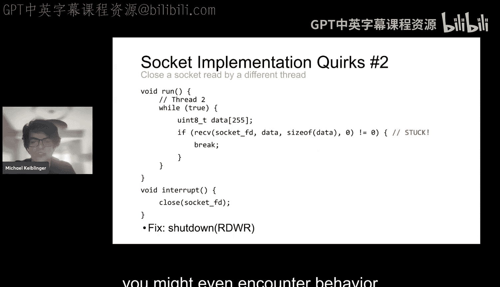

Now in practice， how you actually close the socket it looks even。Even more horrible than that。

 so you want to even add a recv timeout， which actually has an influence on how longO lingers around and only then do you close or do you shut down the both sides of the connection and then do you close the socket。

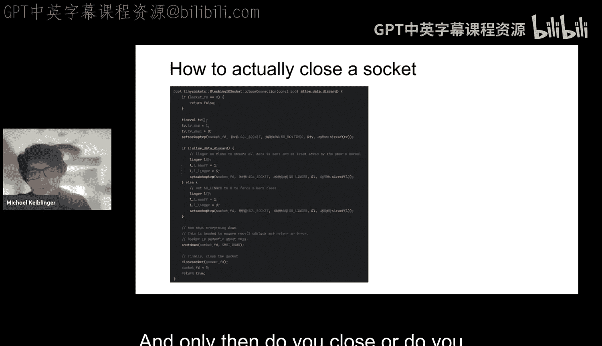

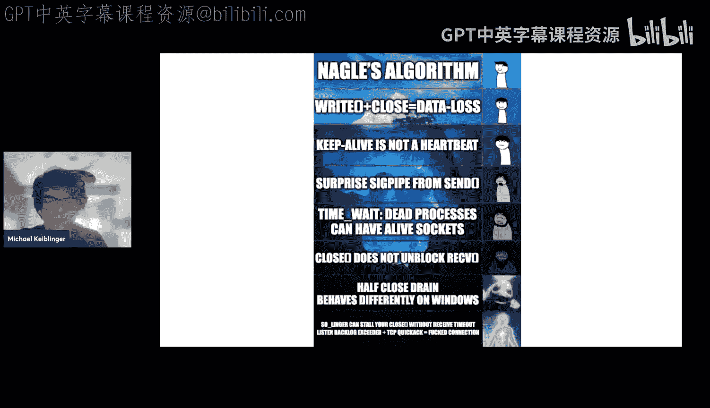

Now in practice， this is really just a tip of the ice figure socket implantation quirks and it can report there's way more fun ahead as illustrated by sort of this meme here。

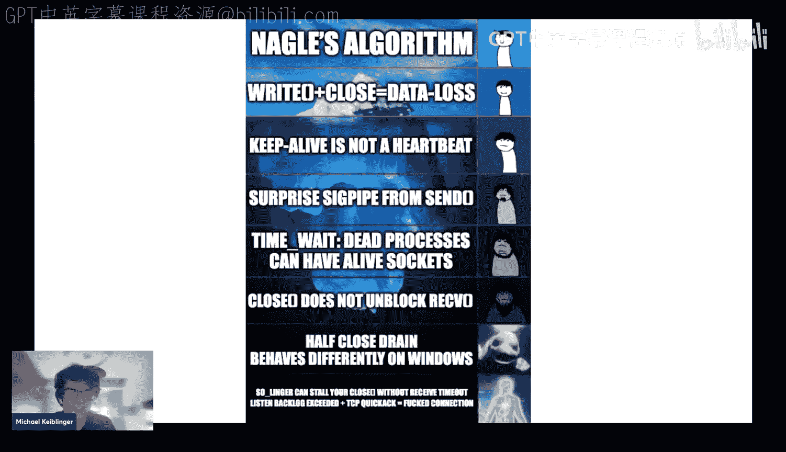

But this alone of course is sort of still not enough for faultter and so just being aware of these quirks doesn't make things falter and even though by now you might sort of recognize some of the patterns of sort of like network applications failing in particular ways which might sort of plausibly be explained by these sort of API quirks which may not be handled properly in the code。

 but that alone is not sufficient to actually create a faultalterant system that can actually recover from all these failure states。

 if you encounter any failure condition， you must properly unwinded。

 and this sometimes isn't just as simple as return to call。

 sometimes you must initiate some very complicated recovery procedures and make sure that you do not leave any sort of dirty state behind these sort of application state。

 you must be exactly。As sort of if you found it before you issued your call。

And sometimes the recovery procedure might even involve some packet sending for， for example。

 if you are doing a ring reduce you have exactly one one neighbor or sorry two neighbors you have one predecessor and one successor and you're basically sending and receiving to just two sockets here now when some other peer at the other side of the ring decides to become unresponsive you're not necessarily informed of that you're not necessarily aware of that unless you're explicitly informed of that via packet。

 so this means that you actually do need to in the case where you discover such a failure condition report to them after say this guy just became unresponsive。

And then the master can reconfigure the topology accordingly and then basically tells the peers to reestablish peer peer connections。

But there's some sort of there's this a lot of sort of foot gunns with these sort of cross connection packet handling chains as a。

As a sort of potential foot gun because you essentially have zero guarantee of sort of cross connection arrival order。

 let's say if some peer A sends a packet to the master which then sends some packet to another peer。

 which then let's say initiates its hair down of the connection with that other peer。嗯。

That peer might not yet be aware that we're about to tear it down connections the chain from peer A to the master to peer B might be faster then even if you're just sending in rapid succession。

 it's really it comes down to ping。So then， then any sort of。嗯。Scennaa where the packet。

 I guess this is a little bit complicated to illustrate。

 but essentially you must establish your consensus for basically everything otherwise you sort of get spooky packets from that might seem unsolicited and。

Yeah， so this while this sort of might seem obvious as just as a consequence of ping。

 the implications for how you structure your protocol are not immediately obvious and so this is also a reason why we do have these very sort of predefined sort of state machine E transitions as orchestrated by the master and yeah。

😊，And no one might answer or might ask isn't this sort of trivial isn't this just good programming just handle all the errors bro and the answer is yes and it's one of those things that's easy in theory and extremely hard in practice and in some scenarios if your system is too permissive it cannot even be faltered theoretically for example the first attempt at implementing PCL allowed peers to join at any point in time so this meant that sometimes peers would join while collective operations were already sort of ongoing so to continue the application loop they would essentially have to partake in those that are yet to start and。

Needs to have a valid update to contribute into the all reduces that are yet to come。

 but the only way for that to happen is if you know the weights that that update is based on which you obtain with a call to synchronized shared state but that only runs once per step so and in this step that phase has already passed and before you know it you have a literally unimplementable API。

And through really this really just happens a lot quicker than you may think。

 just through some innocent API declarations you' have accidentally implied promises that you simply cannot keep。

And now within sort of the world of ML， I guess people are certainly no stranger to sort of declaring overly ambitious APIs and then have no shame in throwing exception in your face if even though you sort of would perfectly within reason to assume that the code just wrote it is actually legal。

 but I guess I'd sort of take a moment here to appeal to reason for a second I hope that we as an industry sort of stop doing this because I think Em has sort of grown out the just a bunch of dirty script sort of phase into serious infrastructure and I think we should start to hold ourselves to the same standards as the rest of the industry and don't just randomly fail。

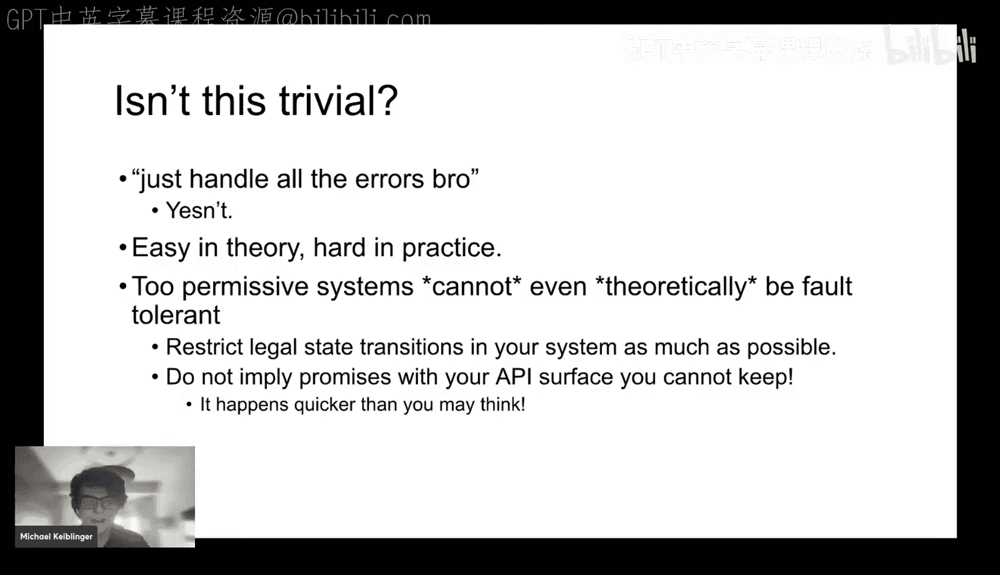

Yeah。So yeah， deterministic advance of shared state so PCL can guarantee bid identical results on all peers and what that of course allows one to do is facilitate a fully deterministic advancement of the optimizer state and this is of course sort of trivially possible with most optimizes that are simply elementwise expressions and yeah because those very trivially do not induce use any GP and determinism but even matrix multiplications asserting same block size kernelronch at anything that is sort of like relevant from the autoho point of view would be deterministic in many cases。

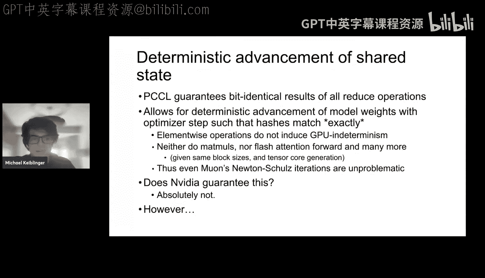

And so it's flash attention forward， by the way， it's right there in a read me。

 it says it's deterministic， and even there's even a flash attention backward that is's deterministic。

 but that needs a little bit more memory and is a little bit slower。

But even something like the Muon Newton Sch iterations are actually unproblematic and will result in deterministic independent advancement because sort of these iterations are really just map malls and element wise ops Now you might be wondering doest video guarantee this and the answer is。

Absolutely not explicitly， but we can be extremely certain that this is de facto the case。

 so I guess after 27 slides in a GPU Mo talk we actually talk about GU stuff as opposed opposed networking stuff but in short we find that VxF behaves identically across GPU generations from the GTX and AI all the way to the B200 and for NVXF the potential surface of breaking changes is actually much larger because it's actually is's actually implement in Li deviceizedBc which is an LVM bit code module which decomposes into quite a lot of smaller NvVM LVMR instructions which then mapped to actual PTx instructions so we're dealing with somewhat of a high levell construct here and yet the behaviors a fully deterministic and the XY mapping persists across GPU generation so as you can see if we sort of hash the input output space of all possible bit patterns。

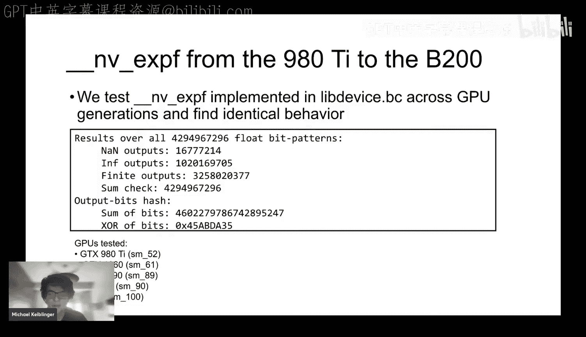

Um，And sort of how many ns you get， how many Ns you get along with a checkum。

 then we would get the exact same output on GPUs ranging from the GTX NA ETI all the way to the B 100。

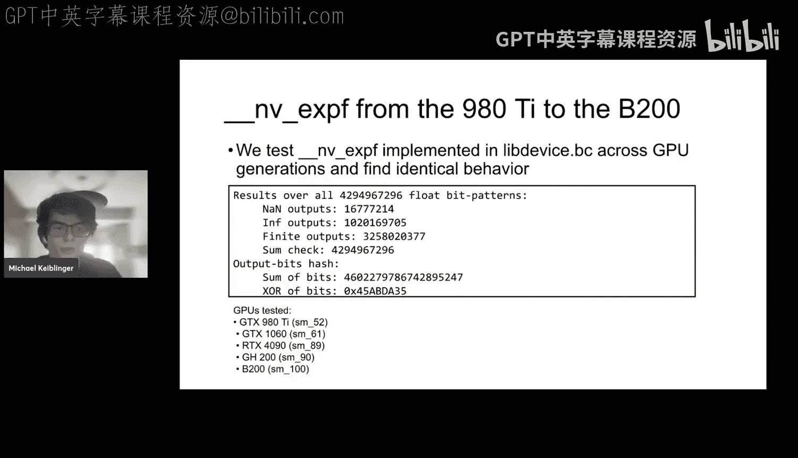

And you can sort of push this point a little bit further if one truly sort cares if one avoids certain classes of kernels。

 for example， those that rely on atomic contention for reduction。

 let's say then you can achieve fully deterministic training on GPU were're basically the run will always result in the same hash for the weights after some N epochs in and here you can see a ko implementation of MN training on a 490 in a fully deterministic fashion despite utilizing Kub+ gem kernels。

 now in this scenario hashes will actually differ between GPU generations because of the behavior of tensor course。

 but MMA instructions in this respect are actually sort of a rare exception among PTX instructions so and as far as I know at least in parts the motivation behind TIR was to sort of partially restore some of the compatibility that was lost there。

 but I would still not sort bet on the numerics， but at least then the。

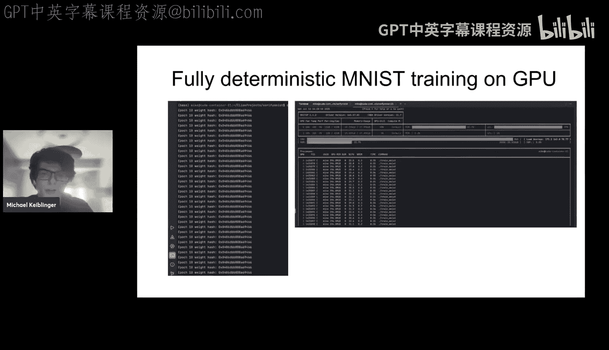

A't literally different。😊，So yeah， theoretically， this could even be scaled to transform your language models if one truly cares when you use a deterministic flash attention backward and yeah。

 while PCL only really relies on the optimizer step being determinist like you can have data load to indeterminism like as much indeterminism there as much as you please that isn't really a concern to PCL。

 but it's just if you truly own the training loop and sort of can rule out these sort of very unfortunate sort of things that might induce indeterminism it's actually very possible。

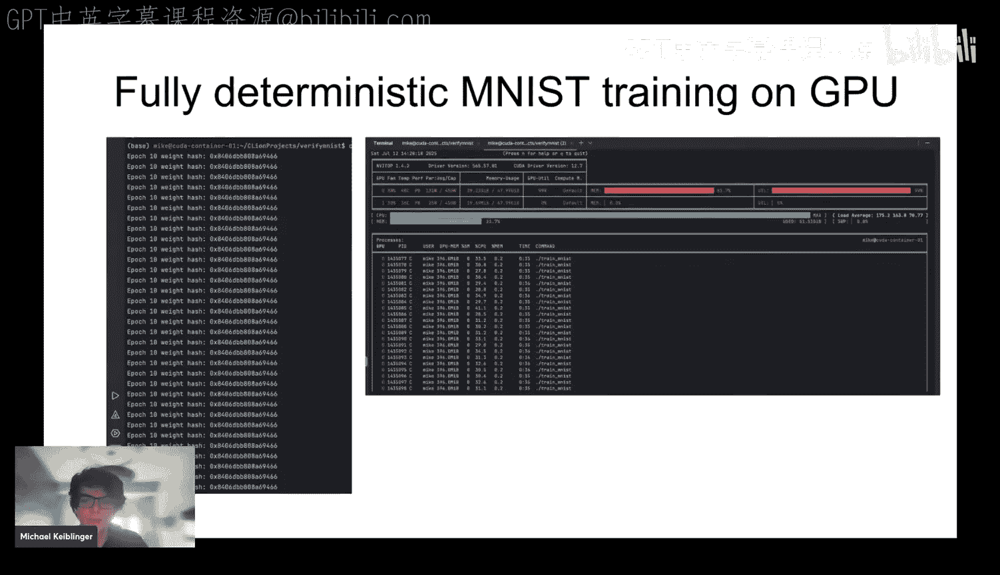

And I guess with that， I'll leave to some more questions， I guess。Great。

 so folks have any questions and chat like I' was the chance otherwise okay I take it yeah if I may like you were saying about the like compatibility between systems and distributions like this might be just like last time I did this was in my networking class which was few years ago and I was quite a new big then but I remember that having like a let's say compatible behavior even between a distributions and like versions of Linux was quite painful I remember we had on a server we had some weird BSD like distribution。

😊。

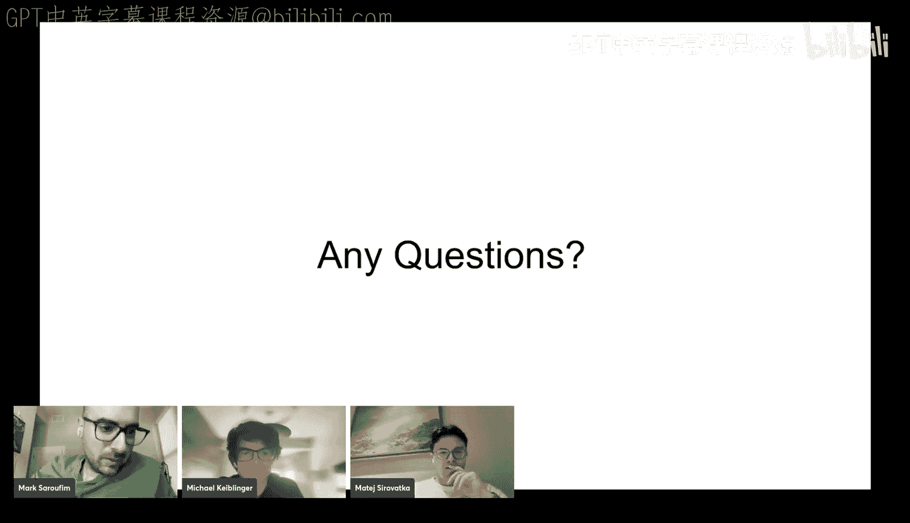

And I just report my Ubuuntu code there。So yeah， we how。Compatible， it is。 like through some。

 to what extent， I guess。So PCZL actually runs on Windows， Linux and Mac OS。

 so we actually just bit the bold and just basically just we have C and every single operating system。

 some libraries we use actually are even tested on open BSD I guess but。

That's sort of the only way to。First of all。Trust no one don't use libraries and test test test。

 that's basically the way to go。So this question might be a bit self indulgent。

 but like I was wondering if you could walk us through the iceberg that you showed for a soccerck yeah。

So I guess yeah I guess the first sort of the tip of the Iberg is Nagg's algorithm。

 which essentially is grouping packets so if you send lots and lots of small messages this isn't really obvious this is this isn't really optimal so this will sort of internally grouped things together and let's say in a game loop this might cause trouble where you're sending like some very tiny packet that like says the player just moved and it's like 12 bytes or something because it's just a motion vector or something like that and it will just get grouped and now then you get these bursts of packets essentially of like lots of movement happening all at once sort of yeah right and close resulting in data loss is sort of the thing the situation that it already talked about。

So yeah， issuing rights and just unsafely closing places。

 some rights that happened in the vicinity of that close at jeopardy of never being received and yeah。

So and the next thing I guess is keep alive is not a heartbeat so by default you will see some very strange behavior if let's say yes some peer dies and you're stuck in a recV and you're sitting there wondering why after like literally two hours you get your first time out this is literally what happens if you don't configure anything so yeah this is sort of。

ThisThis right here， so you do actually have to properly configured keep alive。嗯。And yeah。

 surprise S pipe from send， so one might sort of imagine that。

 well what could possibly go wrong sending and the answer as well if if the peer literally dies。

 then it's not just that you don't it's that you don't just get like a return code like the sort of primary means of error handling for socket as is that you get some sort of error code that is below zero。

 but for send you actually sometimes you just get sick pipes， which is an actual signal。

Wwhich will basically kill your process if you don't handle it or you specified explicitly that you do not wish to get this signal with a flag and again this will sort of just be and this will happen on some operating systems。

 so for example on Windows you have essentially' this whole different WSA error handling system where you say okay great well the the rec status is smaller than zero。

 but in reality you still have to obtain like actually like the WSA get error code to actually figure out what's going on whereas sort of the same failure state will be represented differently on Linux where it would just be well okay it's minus1 on Linux or something whereas on Windows is just like yeah it's some random code that happens to be less than zero or something but you also have to query this other thing or sometimes I think I even remember sometimes they're just not being a status in the WSA error being set which was some very strange behavior but I wasn't able to。

Fulfully reproduce what was going on there but。So there's some very very interesting error handling quirks so I guess and the sort of the example that is most sort of presentable I guess here is the surprise Sigpis it's not just a return code is like it will literally kill your process and the next thing time that process can have a live sockets it might just happen if you don't use so reuse address that you launch some server which binds to some port you kill the process and you do LS off and the port and you see something is still binding to that thing how to fuck does that happen and the answer is that socket is still in the time weight state。

So the only thing that you can really do is not like you can even get rid of that socket。

 you just bind over that socket with reuse address and the operating system will just decide to dispatch to that new socket and no longer forwards to that old socket。

 but it's still there and it will eventually exit but you will have two things binding to that same port and that's basically the only way that you can guarantee sort of like an actually non-annoying loop where you can just control see your server and make it restartable without just like having random bind errors。

So that so there so so so there is that like an API for like because I run into this like sometimes where like I'm like just like there's like basically like like I used to I used to call them like immortal processes or something like ors like immortal sockets。

 is there like no API to kill this like like basically what do you what do you do in the situation if you're stuck in a time with。

I'm not sure if theres there's like any way to actually get rid of time the time weight socket。

 but the solution and practice is always you literally just reuse the combination so this is literally the solution in that case like most most servers do actually use reuse address when they bind。

So this is a fairly standard practice。But this is so the reason why and yeah closed does not unblock rec is another one of those sort of foot gunns potentially and yeah half closed drain behaves differently on Windows so there's sort of like this pattern that you shouldn't really be doing I guess that is a potential replacement to so linger where you shut down one side of the connection and drain all data that is still yet to come and that sort of guarantees the same thing that is so linger does sort of but I'm not sure fully what's going on but there's something where like Windows is sending different TCP messages and resulting in different timeout behavior which is really strange so you shouldn't really be doing that。

And yeah， so and I guess a so link can stall your clothes without a timeout and I guess at the very bottom。

 the list backlog in combination with TCP QuickA can result in like literally sort of half established connections where the quick app connection thinks it has a connection and the server is like nope。

 Ive rejected you because of backlog。So that's sort of one very strange thing that was really a nasty20 bug。

But yeah， that's sort of the tip of the iceberg， I guess are the tip of the iceberg all the way to the bottom。

 I guess。😊，Although I'm not saying there's more。Yeah， I， I have a question like。😊。

Kind of related to this like how do you test these things I remember that being a real pain in the as for my network project again。

😊，Like I remember saying that like I don't care like the teacher is not going to test these。

 I can't even simulate it like they're not going to do that。

I guess the answer is the name of the chapter， which is agony so the the the basically just。😊。

Trying to explain every sort of behavior that you see。

 trying to reason about the system from first principles。

 just what do you expect when are your assumptions violated in the ever sub slightest ways and then just working backwards and。

Yeah sometimes just if that means okay great， deploy on the random machine that this happened on。

 see if you can catch it a debugger， even if it means like hitting pause in the debugger if like with sort of like some some I want to catch this timing now like the specific point in time but so it does involve some fair bit of trial and error because most of the time the only thing that really the conclusion is usually just like you ignored something that you shouldn't be ignoring so in essence it's like once you sort of know what to look out for it's like well then writing Dakotas is。

Simpler in a sense， it's more like that when you're just sort of like from a principle of least surprise point of view using the APIs that the code that you write initially will not actually have sort of will not handle errors gracefully。

 yeah。Yes， there were two more questions in the chat and that is first one was what about using an orchestrator to handle fail along a sick pipe。

 I suppose it's related to this mean。And的是。I guess what that would mean then is that we have to like that we just conceit that the process die。

 I guess which we don't want to do like we don't want to just kill the process like air handling schemes that are essentially。

You know， some sort of recovery procedure where you launch another process， it gets really messy。

 You never want to go like you never want to sort of like。

Be in that regime so you always want to stay within okay I have my process I will just handle the air and deal with it you don't really want to be in a situation where it's like okay rightable the process failed but like I can like started or something。

Like I'm pretty sure like Torch FT does something like they launch like a subprocess that actually does the NCCL reduce and they just kill that thing like once the NCL state gets corrupted because of you know when an actual failure occurs so that's sort of like not the way that you want to approach things like this is just I think we should call it it what it is it's just NCL just not being very like very well implemented and it should be handled at a different layer。

 it should never propagate that far。诶。Yeah， and there that kind of。

The last question was PCL or how does it integrate with like comb's libraries such as EnWishMM or other transport wire solutions。

 I guess？I guess PCCL is sort of like a standalone product in a sense that you can't there are Python bindings for it。

 you can use it with nup and torch， but it's really just like this thing that is not almost deliberately not trying to integrate with too many pieces of software specifically to sort of reduce the surface area of things that can go wrong。

 and I think the course would be if there is a feature that we do need。

 then it should be implemented with with respect to the existing sort of a fterance sort of mechanisms that exist in PCL。

 so if you sort of mix and match sort like things like even if you do something like K grade。

 I have FSDP on one dimension and PCL on the other dimension。

 where essentially you have like this 2D grid which is something that I talk about in documentation。

Where you have just FSDP dimension over NCCL and a DDP dimension with let's say Dilicco over PCL。

It's it's sort of a little bit， it does reduce fall turns in some sense because if let's say you just hit the watchdog timeout from NCL because well。

 you know， some peer diet of the。Of of the actual FSDP group then well I in PCL can't really respond to that it's just a blocking thing that I do not have control over in a sense that would could stall or run it of course eventually will sort of unb once once you hit the timeout and but that does sort of reduce the f terms if you't do not actually disable this so this sort of trade tradeoffs with everything that has sort of implicit behavior like that and and sort of the implications of that。

So Michael， before we let you go， I do have one question。

 it might be a bit of a bait question so forgive me but which is like I'm sort of really curious like for your hot takes on like where you think Nicel could be doing a better job。

 is it like a burn to the ground kind of thing， is it like more of a there's a few things they wish they paid more attention to to make the life of you know people that do fault tolerant research a bit easier？

I think it's just as simple as that just errors should return errors statuses and not fail in any other strange ways。

 I think that's just the only sort of general piece of advice that I can give。

 this has a lot of sort of implications for how you structure your code around that。

 but like I don't really want to like tell people how they should like design the systems when they deliberately decided to sort of like not handle something potentially for good reason。

 but I would say I might recommend it， but I wouldn't explicitly sort of say， well， you know。

 this is what we should do。Yeah， so from that point of view。

Just errors should return errorero statuses and not fail in any other strange ways and design your APIs around that。

Yeah。Yeah， I have a ice， I would say great question as well Like why why PCL like now you're risk people that call NCCL Nel。

 which is me and the parentoid Mark as well calling you pickle which oh，' the name。

 I guess like like pickle I think is already partially in use so。😊。

So I guess it sort of like collides with the unsafe serialization library from Python。

It's terrible to have two pick in my code base， you know， like yeah。😊。

All right well Michael thank you so much for coming on so folks we do not have a lecture planned for next week we had six lectures this week so there's just should be more than enough content to carry you over we have a hackathon happening in New York called James trees if you're interested you know in these kinds of topics like I think you'll really enjoy and you should apply。

Otherwise we'll see everyone in two weeks to talk about mega kernels and again Michael。

 thank you so much for coming on， we really appreciate it。

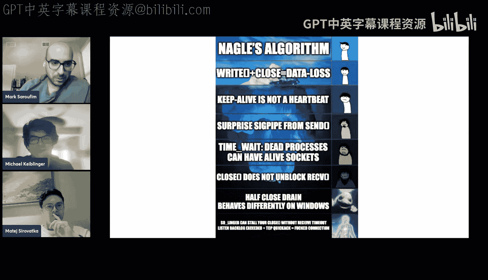

Thanks。