# GPU MODE《CUDA、GPU编程54-87｜GPU MODE》中英字幕（deepseek-v3.2 p18 -20250831-Lecture 71_ -ScaleML Series- FlexOlmo_ Open Language Models for Flexib -BV1xbmQB3ETC_p18-

Yes， okay， are we are alive。So hello everyone bear with us I guess as we kind of figure all of these things out。

 so I can kind of go over just for today like the main speaker will be coming in 10 minutes but we will be giving kind of a brief intro of what this all is what you guys can expect for the coming few days and yeah。

 so basically this series is going to be as you already know on the YouTube channel for the next five days。

 the actual starting time is going be slightly different every day just to accommodate the speakers but in general what we're going to be talking about during this time is roughly like how certain components of these kind of frontier large transform models have evolved over time and each of the speakers is going to be talking about one particular component and some of these components。

😊，are relevant to things like GCOSS some of them are not directly relevant。

 but they're sort of the architectural or systems level changes that kind of like underpin all of the recent advances and all these different models and so you'll get a lot of really really cool talks from authors of a lot of these works but yeah so also we are going the three of us are going to be organizing most of this so I'm Alex in case you guys don't know if you guys want to give a little intro Oh I'm Joe。

And'm yeah and there from the Scaml side I'm from the GP mode side so basically like what is kind of going to happen throughout this week is you're all probably familiar with the base kind of transformer architecture from the attention is all you need paper and a lot of you are probably also familiar with some of the kind of newer architectures and so what we're interested in exploring this week is kind of like what has changed in the past like eight or so years especially from these like original kind of decoder only models like what sort of components have been replaced and what sort of components have evolved over time and so to give kind of like a brief overview of what's going to happen so today we're mostly going to be talking about Moes there's going to be some other stuff in the context of flexolmo but basically like looking at the feed forward layer and how this has been。

kindind of replaced with mos for larger models tomorrow we're going to be talking about attention sinks and other stuff that are kind of related by one of the main authors of the paper the day after is going to be about quantization。

Mostly in the context of these like large models so it'll cover things like MXFP4 and some of the like newer kind of data types that are being used for training and inference Thursday will be by Songland on positioncoings and also path attention and some other works that she's been exploring and then finally the last day is going to be everything related to GPU programming acceleratedccelator programming and things of this nature so we actually have two speakers that day and this is like the full schedule so all of these very very wonderful speakers will be giving roughly hour to hour and a half long talks on topics that they are experts in or that they themselves kind of founded and so I think this is going to be a super super exciting time。

I hope you all enjoy and the other thing， by the way。

 is that you can ask if you're not familiar with this like GPU mode format。

 you can ask whatever questions you want in the chat and during certain times in the middle of like a specific speaker's talk we will basically ask your questions for you we'll put them up on the screen。

 stuff like this and if you have any follow ups you can just continue to ask the chat and they're feel free also to answer questions as well in the chat if you know and we will try our best to as well。

So yeah， all very， yess Yeah， so we're going to talk about make experts today。嗯。

And make sure of experts have been one key dimension in which models。

Or one key technique that I have enabled models to scale， you can go to the next slide。

And if you think about it， we know more parameters are nice。

 but the thing is that it's also expensive in terms of flops， right？

You can think if my model is like training on so many different tasks， right。

 these foundation models are really like true multitask learners。For a specific input。

 do we really need to utilize all the parameters？And that's not the perspective that MoOEs take。

 which is we can just use a subset of the model's parameters per input。You know， intuitively。

 you can think about it as what if these experts have like different specializations。

 although they're in practice they won't have like a clear semantic cut of specializations。

It just allows you to grow your model size but not have to pay as much of the。

Flops as if you had like a dense model activating all the parameters。

So as you know in like the GP OSS model， there are two versions， the bigger one。

 the smaller ones and in the bigger one that's around 120 billion parameters。

 only 5 billion are active and similarly like in the small one， only like three are active。

 three billion parameters are active。Go to next slide。嗯。Wait， this was the older slides。infer。

 I think Joe， or you have a question in the comments。嗯。Sorry， I was muted， I didn't realize， yeah。

 they can't nerf me， asks， don't you pay all the flops at training time though？

Don't you pay off of plops at training time， though， well。Even in training time。The each token。

 if it's routed to like a subsetstan of experts， it's not routed to all the experts， right？

So you do also save some compute there We can。Go one slide with be。Yeah， and so yeah。

 you can just see in this picture here that。In the GP OSS model。

 what happens is every token is going to be routed to a subset of four experts。So in the large model。

 there's a total of 128 experts。And every token is individually going to route to four experts and just to be clear。

 these experts are actually the MLPs of the original transformers So in the original transformers we have the self attention。

 then MLP layer in the one block。And。What happens now is inside just having one MLP。

 we're going to treat the MLP as experts and create many of them。Many separate。We have a piece。

 and then every token is going to go to four of them。 So if we go to the next slide。嗯。

What I hear what I did here for like educational reasons is I took the actual code from GT OS。

And I'm just going to step through just the MLP block of the code and specifically the forward pass。

 and we're going to just go through it line by line just so that we have a good primer before Saun presents。

Her talk。So pretty standard， we have our tokens X coming in for now。

 it's just for pedantic reasons we're just going to treat it as one individual token has a hidden dimension of H。

We're going to do the armis norm。Now， what we're going to do is we are going to。

This a small typo should be WT， but anyway， so we're going to project this token to a space that has the number of experts。

 like a linear projection。And。This is gonna give us like our after softm top Ka， softwareware。

 we're gonna to get to like which this gonna tell us which experts are we going to pick。

 So specifically in the G O S S G is going be。If we take the large model， like a dimension of 128。

We're going to now pick our top four in the illustrated reasons I just drew two。

 we're going to take the two largest ones。Which is indicating the model is saying these are two best experts。

For this particular token， so we're going to get the indices of these experts so we know which ones。

 which which of the MLPs we're going to choose。And after normalization。

 we'll also have their respective weight。嗯。So now what we have for the token。

 we now know which experts we're going to pick。 we also know how much we're going to weight their experts outputs by so we can go to the next slide。

So now this is kind of like more of the。The meat of the Me。

 the the router is quite a lightweight layer， but the Ms actually take up like like around 90% of the。

The MLPs take up the majority of the parameters of the transformer。And。Because of this。

 we're going to actually use Tensor parallelism。So what I drew here is just imagine we have two GPUs。

So。Our normalized token tea is going to come in， and the forward pass is。

Its going to be running on each GPU in parallel。So I'm just drawing this all like in a parallel view。

 but like our token T comes in and it's sent to our respective experts。

 we picked expert three and five based on the top K routing previously。

 so our tokens sent to these two MLPs。And the code I've highlighted on the left side。

 so like I've color coded the code with the corresponding section of the figure， green， red。

 purple blue， so the green part is we're actually going to just do the normal MLP computation。

 so linear projection， sweet glue and another linear projection。Now， for this part。

 I want to touch upon the briefly the tensor parallelism， so if we look at just for example。

 just the first projection of the MLP in the box above in the top left。I have described how， well。

 this isn't the code， how it's defined。And you can see that。It's for every expert。

 it's actually just going to shard up on the output size。

 so each device is containing all of our experts， but only a piece of the matrix。

 like of the projection matrix。So。What we need to do is we're going to pass our input through all the devices。

 they're all going to each use this sharded matrix and multiply by our token。

 and at the end it's going to like gather and sum all of them。

As if it's doing like one normal matrix vector multiplication on the full matrix。So yeah。

 the green part is we're going to each device is going to do a like a sharded。Mulipplication。

And then， at the end。After our device have done this， we're going to do it all reduce。

 So the devices are going to communicate and we're now going to sum some and each device is now going to have the same copy。

 like the。Like our tensor T efforts is went to expert three and five。

U so now we have these two outputs coming from our two experts and again， just to reiterate。

 it's it's going to be the same values on all the devices。And finally。

 we're going to just multiply them by our expert weights， which is like highlighted in purple。

 so we're going to do this weighted sum。Which is just saying how much to weigh each expert。

 And then finally， we're going to add the residual connection add our original token X back in。

So this is just like kind of giving you the overlay of how it's implemented in GPOSS。

 it's like quite a standard implementation top K routing。

Now some important details that are not included in the code are actually the load balancing function。

 so one are the one of the biggest issues when training these ME models is actually the router collapsing。

All so you can imagine ideally we want for like a whole diverse variety of inputs。

 we should be using different experts right under the notion that you know these experts are having like some specialization。

Um， it would not make sense if we're sending all of the tokens just to like a tiny subset of experts。

That's kind of like defeating the purpose。But during training， the router is randomly initialized。

 the experts are randomly initial initialized。嗯。There's no incentive for the model to spread its tokens across。

 and that's why we have these auxiliary loss functions added such as load balancing。

 which are intuitively， there's many many variants of these but intuitively they're just trying to make sure tokens are getting spread across。

Experts。And。I can see there's a question， could you say more about comms versus computational trade off？

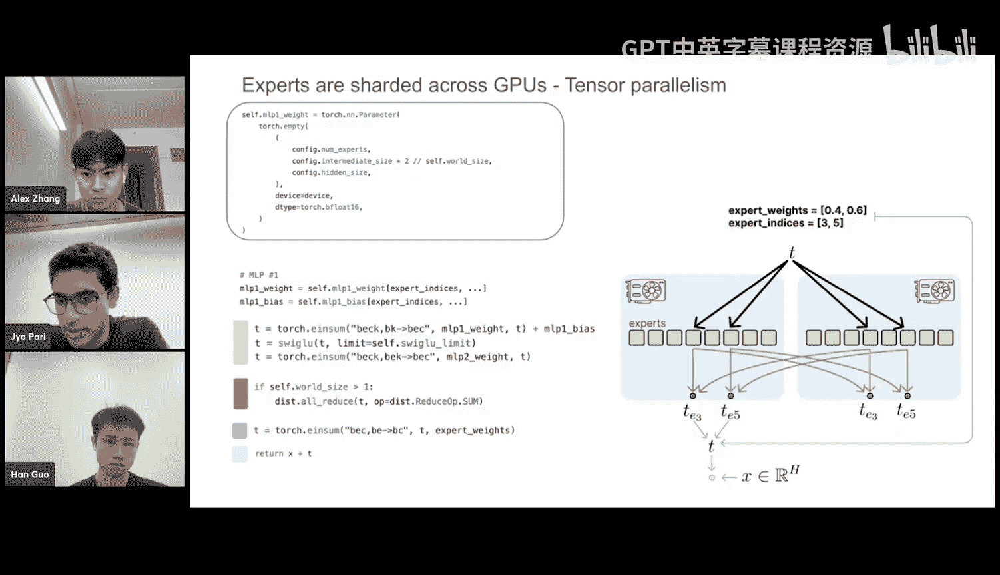

嗯。Han， do you want to talk about this， I think Han is。Yeah。

 and another question can I say more about communication versus competition。

 trade off term tensor parallelism？So I think for Tensipism， I'm assuming in general。

 so for general testipism has our。

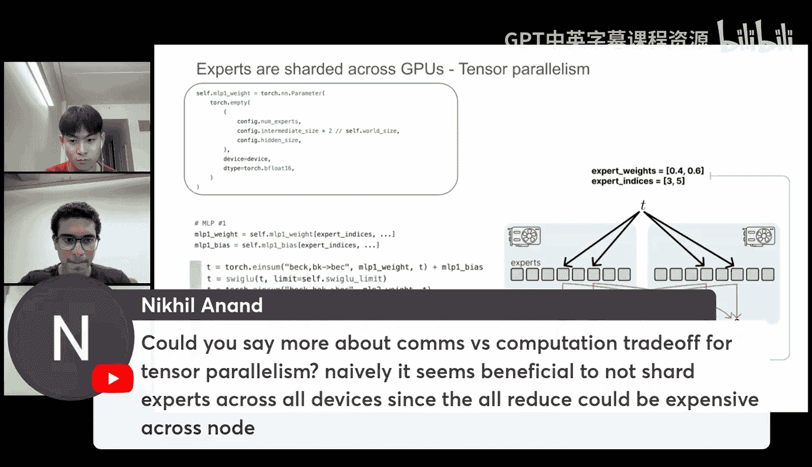

Tenssor pals are designed for reducing the latency。

 though the price you pay is you pay for the extra communications as a result for inference。

 usually people use a lot of Tensor parallel to reduce the latency。

But the price we pay used to pay because there a parallel is。

 especially during the passes for the model， we actually had to do a lot of communication between different different layers so if in a community。

😊，Network bound cases， actually Tensorpoli is usually not recommended because you actually pay a lot of prices for doing this。

 but if you care about just making the like tiny first second extremely fast。

 that's really the way to go。In the cases when you have a network bound and you care about through proof。

 for example， sometimes in some cases， there's a lot of factors regarding the actual infrar setup。

 there's actually cases you might need to prefer different type of parallellysis and based on the specific cases。

Nice。Okay， so we can， I think we can move on to the next slide。So。

This is coming more stepping back from just like the the very fine rate details we just talked about。

 which is。In a lot of these existing moe models， there's a fixed number of experts and it's like it's almost like a hyperprintner you just fix them。

 you train them and it's。It's static in the sense that you can't add experts continually。Right。

 and for the purposes of just like， you know， if you just want to train train one model and you just want to use it on inference time as is and not change it。

 this is great。But I think the whole point of like MoEs is kind of， we want to， you know。

 start making your models efficient and also like dynamic in the sense that it's intelligently routing to the right subset。

But utilizing a lot of this machinery， we can think about what about experts could actually be introduced dynamically？

What if you and I like I say Han trains an expert， I train an expert。 Alex trains an expert。

 each just now has also like a very clear semantic。嗯。Skill。You know。

 how do we now create a model that's able to allow us to pull our experts together， right。

 I think there's a lot of。There's a lot of capabilities you can gain when we can treat our model as more dynamic and people can continually add。

Experts that have specializations。And it comes into more of this idea of decentralized training。

 which Sawin's talk is going to talk in full fledge about。嗯。But。呃。

This is just kind of setting the stage for Seywin's talk and who unfortunately is going to be there in like around 7 minutes。

 There was a fire in her building， and shes driving to her。Home now， actually， she is here。

She's here， I think so it said she。I can't find her on the thing， but actually while we're waiting。

 Ashish had a question。

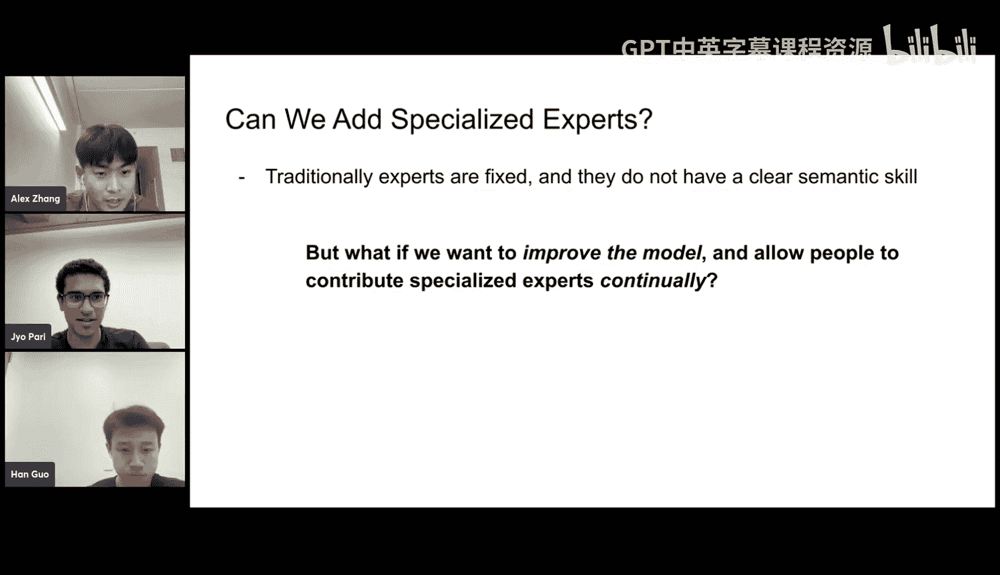

Can you talk about shared versus non shared experts and their trade offs？

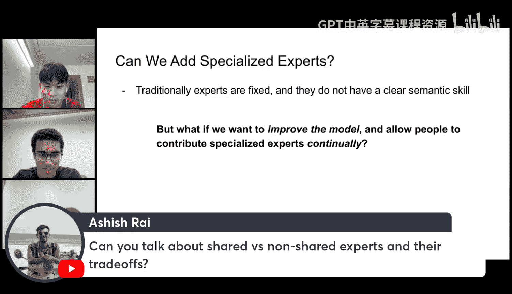

Okay， I can't talk in too detail。About this。 But a shared expert in the high level is。

When you're going to have some common， I believe it's when you have like a common set of experts。嗯。

Because like in the original top top K routing you could be choosing completely different sets subsets of the four for every token right if you're doing k equal goes four。

 but some people have experimented with like oh， what if you actually have some fixed MLP like。

Like this MLP will be always routed to。And some can be selected with top gate that's what I believe is I don't know too much about their tradeoffs versus non trade offs。

But。Yeah， hopefully that answered something， yeah。Okay， and Se Wun is here。Oh okay， yeah。

 let me try to share the screen。

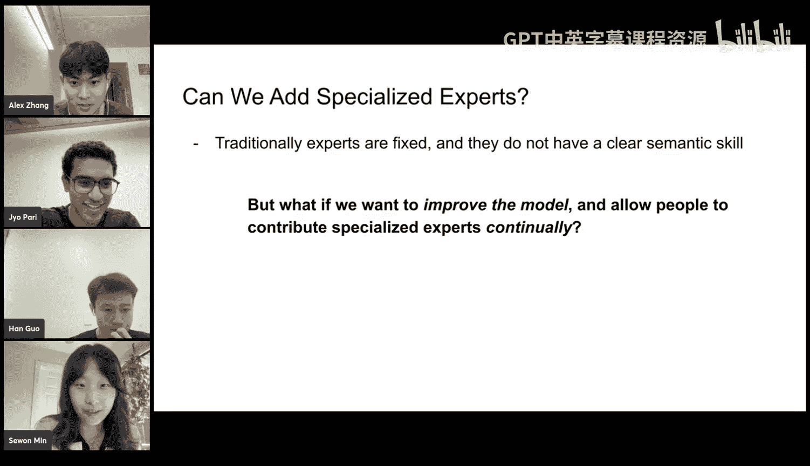

Yeah， hi everyone and I'm sorry for being late， we had an emergency fire alarm in my office for research I just came back home for presentation so just to introduce myself I'm7 I'm an assistant professor at UC Berkeley ECS as well as research scientists at AI2 and today I'm very excited to present our work which is about mixture of experts but for addressing a different problem on training on distributed datas。

😊。

And actually， I cannot see people when I'm sharing the screen。

 so if you have any questions or want to raise anything， please let me know。

 please just speak out so that I can hear And also， I would like this to be interactive。

 So if you have any questions， please just feel free to interrupt me。😊，Cool。

 so I'll get started and before I get started， I'd like to mention my course， Wei J Shi Kevin。

 as well as other collaborators who has made all of this possible。😊。

So what is this talk about so previous I believe in the previous slide you learned that you learned about standard mix of experts which where the key idea is to activate a few parameters instead of all parameters for training efficiency as well as inference efficiency but mixture of experts also have other benefits like it naturally provide modular architecture。

 so the question we want to ask is beyond efficiency。

 whether other benefits we can get from this modular architecture。😊。

And in this talk I'll present our particular work called Flexoma where we use Mi of experts to enable training on distributed data sets owned by different parties and different parties do not want to share the raw data so it's very difficult to pull all the data together and train one model but we'll tell you that because mixture of experts naturally have modular architecture。

 it's possible that different parties train different parts of the model and they can be merged into a single model so in the rest of the talk I'll first clearly define the problem setup and convince you why this is an important problem to solve I'll also talk about whether the alternative approaches either not using mixture of experts or using mixtureshift experts and I'll also talk about what challenges there are in those approaches and then we'll talk about our method which is using mixture of。

Experts will tell you how we are addressing the challenges that I mentioned previous approaches have。

And then yeah， and then of course， I'll tell you about the experiments and the results we get compared to the model without any distributed training like this。

 and also compared to the upper bond model that is trained jointly on all data sets altogether。Cool。

 so let me get started from the problem set so in standard language model training。

 we typically assume we have centralized access to all data throughout training so model developers should have access to all the training data and train one giant model all on this data and of course。

 here we assume that data access is binary， either available or not available and we take this as granted and if we hear about it。

 it sounds very obvious， but I want to argue that these two conditions may not be optimal in practical scenarios。

For instance， in reality， data access may not be binary， it is rather a spectrum。

 there could be data that model developers may not have direct access to the data。

 although they can potentially use the data or there could be restrictions like data should be stored in a very specific location like GCP or AWS and cannot be transferred in which case pulling all the data together and training one giant model is very difficult and these are some of the examples of restrictions。

 there are more restrictions in practice， for instance data may be available at different times。

 you may have to opt up some data later on or you may have new data coming in later on so that you want to incorporate them and you want to do all of this without needing to retrain the whole model from scratch because that will be very costly。

So what we want to do is to propose a model that can support modelular distributed training and here is the exact problem setup。

 First， we assume we have some stellar model that is a shared model trained on public data only So this is a data someone could pull all together and then train one type model on that。

And then we have a set of data owners who didn't release their data publicly。

 they want to keep their data local， but then they take the shared model and then the training on their data independently from each other so here the boxes here means this training is completely local and independently you don't even need to share the data and this training can happen asynchronously across different data owners。

Once you do that， then what we want to do is to have a combined model by combining model trained by different data owners as well as a shared model that we use as a st model and have a single unified model。

 so this is kind of like a collaborative training set where different data owners are collaborating to make a single model。

 but without needing to share the raw data and also without needing to coordinate for synchronized training。

Is that clear？Cool， so this paradigm have two unique properties。 The first is， as I just mentioned。

 it enables data contribution without sharing the data。

 And I think this is very important in practice because we all know data is highly valuable。

 and it's very difficult for data owners to publicly release the data because they know this is valuable。

 they want to remain having full control。 So with this training algorithm。

 data owners retain having full control over the data and they can still contribute to the single combined model。

I think the other thing that is very important is that to support easy data addition and removal without needing to retrain all the model and this is possible because training is completely modular and independent from each other for instance is one of the data owner say New York Times want to opt that from this combined model that what we need to do is just to remove expert or model parameters contributed by New York Times and the rest of the model is guaranteed to not make use of New York Times data。

And this is very useful because data of that can happen very frequently and previously there was no way to do this in a guaranteed manner so another thing that is equally important is data addition naturally we will have increasing amount of data some data may come later or we may discover some data owners a valuable data only after training is completed if you have new data what we need to do right now is to include it in the data pool and retrain the model either from scratch or from mid training but with this we can just let that data owners to train their model and then contribute to the combined model and this can be done without need to do retraining from other data owners。

Is this two features clear Yeah， I think there was a there was a question in the chat which is can this framework basically be used to add like other modalities like into this model yeah。

 that's a great question and thanks for Thanks for speaking the question and yeah that's a great question so in this paper we only did text only。

 but I do believe this can essentially be useful for multimod models too。

 especially because these days we are now seeing increasing number of any to any models that has some sort of mix of expert architecture well this is a we'll talk about it later about our architectures basically mixture of experts so if we can build a multimodel model with mixture of experts model we different experts or special lives for different。

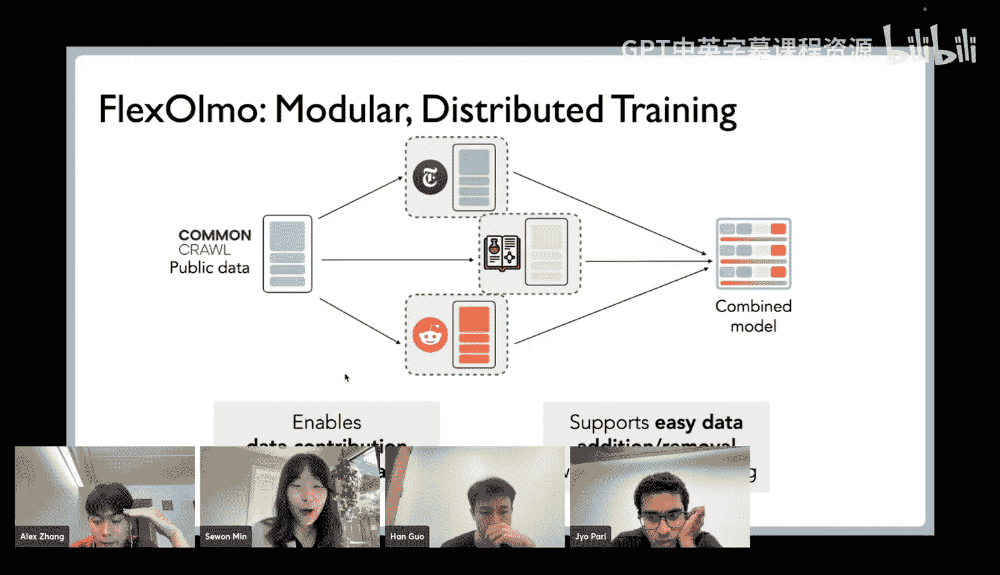

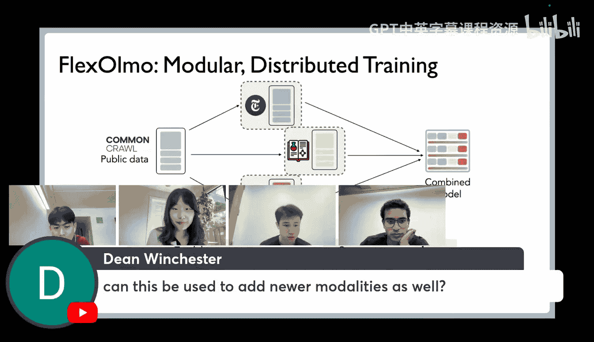

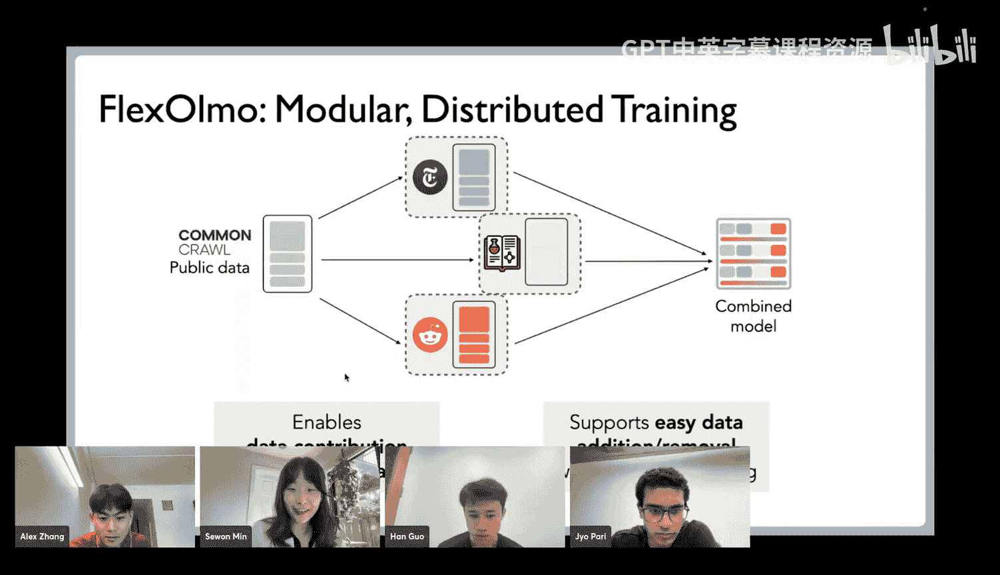

Modality than it is possible。 and I believe we are increasing seeing increasing number of those kind of model。

 I think people call it mixture of transformers。 I think there are some papers some。

 and also by then bagel model is also in that category。 So yes。

 I think theoretically we can apply that for multimod setup。I see。 I also had another question。

 which is basically like。Are there some kind of constraints or bounds on like a。

 the number of modalality or not sorry not modalities number of data sources you can add like before it gets bloated and then also like in a specific data source like do you need there to be some like heuristic amount of data present or like for example。

 like what if all of the data contributors were only contributing one data sample or something Yes。

 these are all great questions。 So for the first question about if we have constrain on how many experts or how many data sets to add I think this is an empirical question。

 theoretically， yes， it's not bounded， but empirically， I think there are a few challenges。

 The first is the routers， So we'll talk about it actually later。

 but there's a router that has to decide which experts for every layer and if you have。

More data owners then that means your candidate is larger so that means there is more likely to have some errors on that So that's one issue。

 the other issue that I actually included included as limitation at the end of the slide is right now as you have more data owners。

 the models size sketch very large very quickly so even though you're not activating all experts。

 you have to load all these experts into your memory and that can be a big bottlene In fact this is also the limit not a limitation but downside。

 the standard mix of experts also have then they have a large number of total parameters even if you're not activating all that you need a lot of memory so I think there are some practical limitations that that prevent it to scale so much but I think this is issues that we can solve in the next generation of。

まろ。I see， I I think you have the second question。 So of good a remind。 Oh。

 I think you mentioned about the data size。 Yes， like。

 is there some requirements or something about that。 Yeah， yeah， that's also a great question。

 So in our work， we'll talk about this later。 But one data owner is basically training one FFN。

 which is pretty big So in this particular architecture， you need enough data to train one FFN。

 However， I think in the future， if you use a fine grain mixed of experts where each expert is small enough。

 then the the required size of the data will be much smaller。😊。

I see I see there are two more questions and then I think we should just move on after just for time so mateteay asked the follow up about the different modalities thing。

 which is like basically does the model does the original model architecture have to support like all the different modalities from the beginning or is this something that can be added on so like for example。

 if you trained a text only model like can you add on other modalities or does this have to kind of be baked in from the beginning yeah。

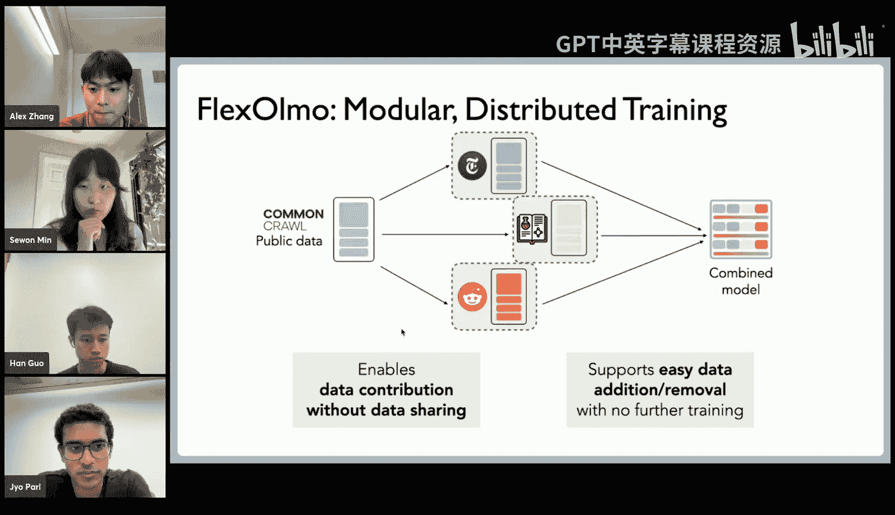

Yeah， that's a great question。 So I guess for this work。

 our our motivation was that the data has to be completely distributed and there is no sharing。

 if we keep that constraint， I think the original model has to see some multimod data because otherwise the model has only syn text only the model has only seen image only and they have never seen them jointly。

 so I think that can be limited， However， if we say we don't necessarily worry about no sharing or no joint training at all。

 We just want training to be efficient by doing some sort of modular training。

 then I think it's okay for the st model to be text only In fact。

 I think the existing models like mixtureer of transformers or bagel that is that has a few experts。

Specialize for different modality， most of them start from the text only model and then add vision model later。

 but they do some sort of joint training on multimodal data。I see。

 And then the last question is Raov asks basically like when you're training with this paradigm。

 do you observe some kind of training collapse or like big lost spikes or is it relatively stable that's a great question I think this is relatively stable and that's an interesting question because it's not this work but we also previously had a mixture of expert model that is standard mixture of experts and we call it OmoE I'm not including in this presentation but we did it last year and for that for training a standard mixture of experts we actually saw a lot of low spikes and making training stable was extra important compared to the dense model however in this model。

 we are not actually training all mixture of experts jointly it' either just dense model or a small mixture of experts with two experts so because of that I think training is more stable。

还行。Okay， I will let you move on。 yeah。 any questions。 And hopefully。

 as I go go through the more details about the method， things are more clear。 So yeah， I'll continue。

😊。

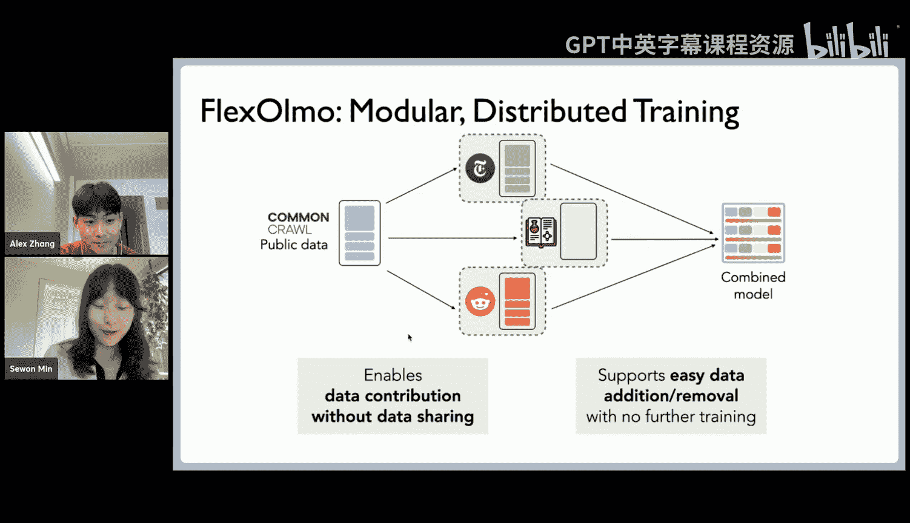

Okay so I talked about the problem setup but another question is how what are the existing approaches or alternative approaches without using Migraph experts that can solve this problem and in fact this exact problems that wasn't really started previously but there are some existing techniques that could be applied to our problem setup so let's survey that and one of them is model merg there is a huge literature or model merg where the key idea is you have a set of end models trained independently and then merge that into a single model to boost performers so if we would like to apply model merg then what we would do is as I said we start with a start model then each data owner take it and continue pretrain on their data so in the end we will have four models in total from this figure and then we can apply model me techniques over these four models。

Model merging can be broadly categorized into two different approaches。

 One is called model soup or weight merging， where the idea is we do weighted weight merging over all parameters into a single model。

And then the other is ensling which means you keep each individual model separately。

 but then when you have a test input you you get output probably distribution from each model and then the weighted unsettling over them。

So both model soup and enseling are actually standard practices in standard language model training for boosting model performance。

 so for instance what people often do is they have a pretrain model and then for me training they have a set of slightly different data mixtures train on each of these data mixtures independently and then the model soup that is a pretty standard practice however one big difference from those setups and our setup is that in our setup each data sets are completely disjoint from each other they have very different distribution whereas previously how people have been using is that they share similar distributions although there is small difference and in our experiment we will show that later on but we found that merg models train on completely disjoint data sets is very hard and they typically have some performance drop。

This seems to be because when models are trained on completely different data sets。

 their weight space can divert from each other so much so that it's very difficult to merge it back。

So that's one option moral emerging。 The other option that I'll gonna describe is mixture of expert merging。

 So here we are using mixture of experts So what is mixture of experts I'm sure you just heard about it from organizers。

 but let me give you a brief recap So this is a dense model that is not mixture of experts I'm showing a standard transformer block that consists of some normalization layers multiten and then FFN and normally FFN is the model that consists of most of the parameters in mixture of experts what we do is instead of having one giant FFN we have a set of small FFNs and we often call it expert or expert model So in this figure this has n number of FFNs and then the key idea is we are keeping all an FFNs。

 but at inference can we will activate only a subset of them for instance， if we have。In total。

 64 experts will activate eight of them and then you will notice there is a thing called a router this router can be seen as an nway classifier that decide which out of which8 out of 64 experts to activate and because this is quite important just to zoom in this router weight is basically a router matrix like this so what happens is before this mix of expert model there is an input that is coming from the previous layer it's basically an h dimensional vector and then we need a router matrix that is h by n matrix where n is the number of experts and then if you do matrix multiplication your output will be n dimensional vector and then you can think of it as like each number here represents how likely each expert should be chosen so once you have this output vector what mixture of experts。

Do is to take aig max K where you find the indexes with top K scores and then activate them。

 whereas the other ones are not activated。 So we'll talk about this later。

 So I wanted to give a brief。Brief overview of how mixture effects per the router group。

So how do we use mixture of experts in our problem setup so again we have a st model that is a regular dense model only has one FFN and then each data owner takes it does continue pretraining on for training their own model and then we merge it through mixture of experts and what we do is first we keep each FFN separately so they're not going to be merge so they serve as individual experts and mixture of experts and then we have a few shared layers like normalization and multi attention for this we do model soup or weight merging which is just averaging parameters from different data owners so that's how they make mixture of experts so the nice part here is that architecture wise it exactly identical to standard mixture of experts so you can think of it as a different way of training on。

Mixer of experts， but for inference or for serving。

 you can use existing serving infrastructure for serving standard mixture of experts。

 which is a great benefit。However， there is one limitation which is it requires training on all datas jointly after merging happens。

 so it's not that after merging you can use the model as it is。

 you need to do some joint training over all data and the main reason that we need that is because of this router as I mentioned earlier this router is needs some parameters to train which is the router matrix。

 but then when we merge different dense models trained independently we don't really know how to form the router so they typically need to train this router or all models all parameters of the model on a union of all data。

 but as we discussed earlier in our problem set up the key restriction is that each data should remain local we can't really have a union of data and train a model jointly。

 so these method as it is cannot be directly applicable。To our problem set up。

So now the key question we want to ask is we do want to leverage the mixture of expert architecture because it has this nice modular properties。

 but can we remove the need for joint data access so that each data can remain completely local？

Is that clear？Yes， there was a question in the chat sorry I have to keep going forth so Elsie asks basically does this set up in general I guess option one or option two work better when the data is like the data sources are precllued and like is there some sense of like homogeneity or heterogeneous data that kind of affects performance or like was this study at all I that's a great question so in our setup we assume the data data sets that are independent from each other is based on the sources for instance we consider already data as one data set and one Pf as one data things like that but that's a great question and there has been some prior word that take all the common Cal data like public data but then they clustered based on the domains using Ks clustering and。

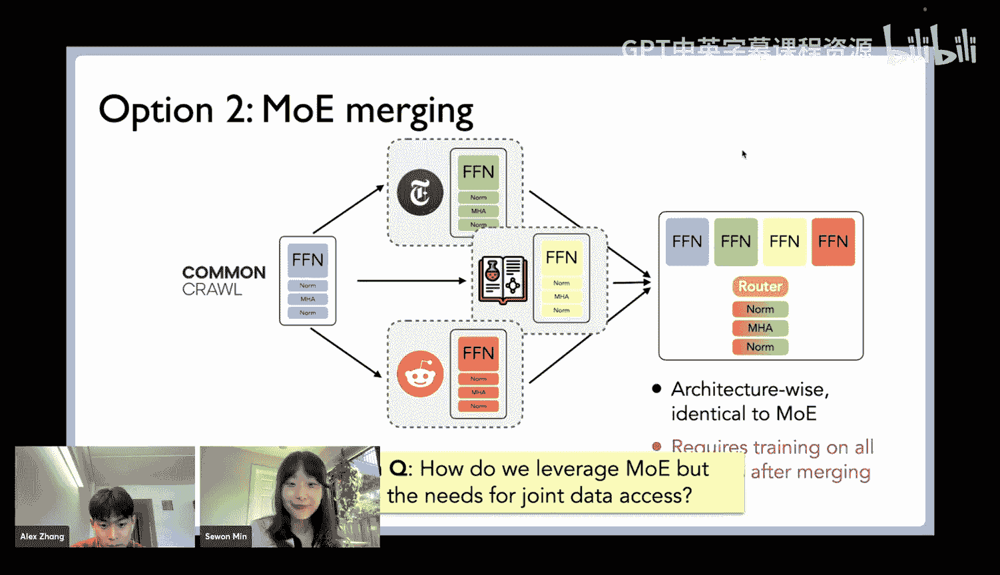

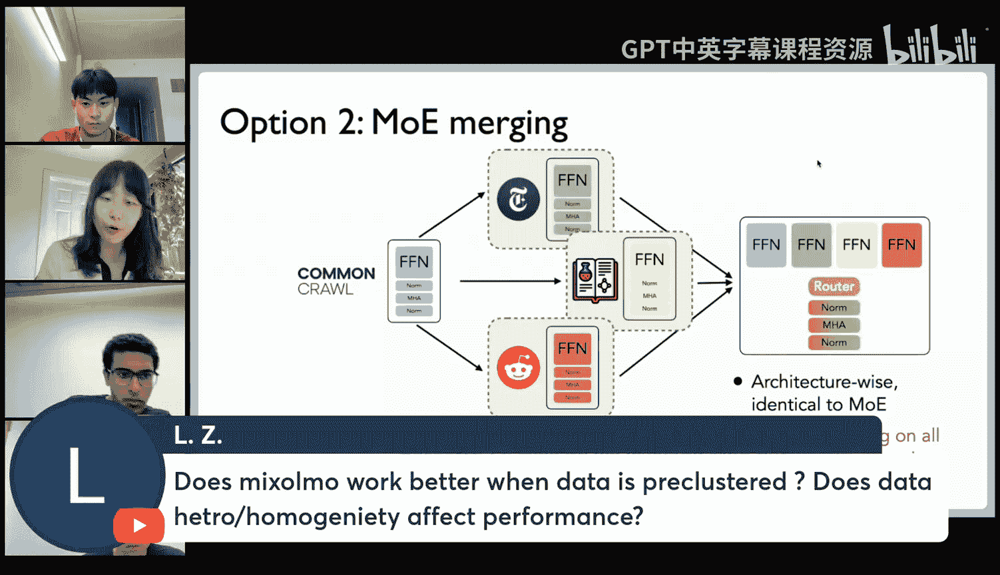

Then apply a similar approach。 Their model is not mixture of experts。

 but I think what you're describing seems very relevant that paper is called branch train merge if you want to take a look。

Yeah， so to go back to your question， I'm not sure if people have exactly compared making different data sets more distinct from each other versus not that's an interesting question and I can see the reasons for both so yeah the answer is we don't know。

I see And then also like after for the the limitation part is the issue。

 maybe like I'm not fully understanding this， but like if， if you were to do training。

On like the common crawl data afterwards instead of like training on the the union of all of these like kind of more private data sets like is the issue more about like the the model that gets merged in the end is like not able to do anything or is it just that it actually just can't perform these specific Yeah yeah。

 that's a great that's a really great point So like to repeat your question basically I did is after merging。

 you can still do training the all experts to but using common crawl data because that's the public data and we've tried that that didn't work very well And the main reason is because this blue one is trained from common C then the router will be just biased toward just choosing blue one It wouldn't really choose the other experts because they're out of distribution from the public data。

I see， I see。 that makes sense。 Co。 Yeah， I can go over our method and then take more。 Yeah Co。

 So these are two approaches。 And as I just mentioned。

 what we want to do is to keep mixture of expert architecture。

 but have a better training algorithm to remove the need for joint access of the data。

 So how do we do that， we came up with two different solutions to address this。

 the first one is called learning to coordinate or I often call it mixture of experts aware training。

 The idea is once you have this thorough model。 and then you are one of the data owner。

 you want to continue freetrain on that。 then instead of doing normal continue pretraining。

 we should override all of these model parameters。 you make it a mixture of experts with two experts。

 So you're duplicating FFN， and then you're gonna to add the router， So it's like mix。

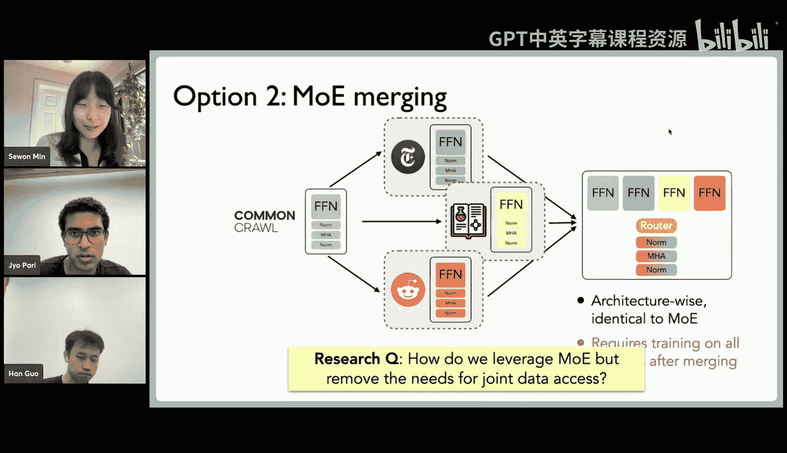

Expert， but just two experts。And then this blue one will be frozen you are only training the this second FFN during training so it's equivalent to have adding a second expert where this expert is initialized from the previous expert and your training on this we'll talk about the router later on so let's ignore that for now。

And then after this training you can the other data owners can do the same and then we can merge it into a mixture of experts。

 so again we can ignore the route but these FFN is coming from the ster model。

 this FFN is coming from New York Times and there are other FFNs they are coming from different data owners and they can be merged。

So why this is good， there are two reasons first， because we are freezing the shared layers。

 we don't really have to do model soup， which has these issues of。

Wage diverging from each other so they are already synchronized so that's one benefit the other benefit is that this model is already trained to be mixture of experts so when this green FFN is being learned they already know how to complement the public model that is already trained。

So this can help the model to know that you need to coordinate with the other expert and you're doing it with one expert only which is a public model。

 but hopefully when you merge and you see other experts， they need to generalize。Is that clear？Okay。

 so we talk about F only， but we didn't talk about the router。 So how do we solve the router problem。

 So as I mentioned， this router is basically this router involve training a router matrix that is H by n。

 where H is a hidden dimension and n is the number of experts。 So in this figure， N is basically for。

 And what were going to do is we can actually。We can actually decompose this matrix into n number of h dimensional vectors like this so if we look at the final model then this router can be decompposeding into four vectors where each vector is h dimensional and then each vector will correspond to each expert so we have blue router factor that is corresponding to this blue FFM we have green one that correspond to green FFM and so on I'll just call it a router embedding for now。

From now。 And then once you decompose it， then what that means is each router embedding can be trained by each data owner separately。

 So when New Yorkrk Times train their own expert， they need to train a router and that again。

 a two way classifier with two by H dimensional matrix。 but in fact。

 this can be seen as two vectors where one vector is responsible for the public expert。

 And then the other vector is responsible for the new expert we are adding。

 And then when we train the model， this public vector will be remain frozen while we are only training this R1 the new router embedding。

 So just to summarize when you are training your own expert。

 you will freeze all the blue part and train。Green part only which is one FFN and one router embedding per layer。

 and then once you do that then they can be merged into a single mixture of experts for FFN they will just keep separate just like standard mix of experts for the router embeddings they can be concatenated to make it a single matrix and again because this RP is frozen。

 these are already synchronized and then the R1 R2 and R3 can come from different data owners。

Is that clear？

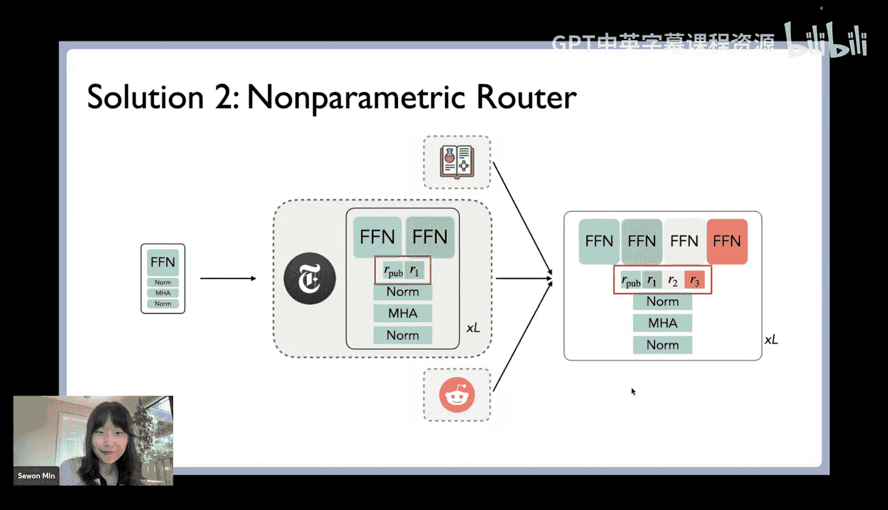

Yeah， yeah， I think there was a oh sorry， I guess the the question in the chat。

 they answered it themselves。 I was actually wondering one thing， though。

 which is like the the so if the public router is fixed like it's it's fixed across all of。

Like for all the different private domains you fix it right our p is fixed I see and so then when you train the new routers or like for the the the specific data sets。

Is there like。Some kind of。Potential bias going on here。

 I'm not sure like I guess maybe the confusing part is the router。

 the public route gets used at the very end， like with when all of the kind of the domains are combined。

 but the way that you train it it's only with respect to one other router。But yeah。

 does this make sense I don't know if。It's like the way you normalize them is different in the individual setting versus in the full setting because it's with respect to more experts in Yes that's a great question So first one thing I want to clarify I think you already know that but like just in case it wasn't clear even if you're training the green part only and the remaining part frozen we are still using them during training so during training the data can be routed into blue part it's just that they're not frozen so I think in the end it's not like only the green one will be chosen they are we actually find there pretty balanced I think we also use the load balancing to make sure it's not just the green one that is being chosen but I do agree that the limit the problem you mentioned is valid because we are only training a model to choose from two candidates and that in first time you thought only have so many candidates so this model can be。

No， I think that happens a lot， and。Actually when we do this analysis。

 the error cases mainly came from suboptimal router decision if router was perfect then the performance can be much better。

 but the router was still they were not optimal I wanted to mention this in some of the open problem section later on but one way to di issue is to make the st model to be also mixed of experts and in particular fine grain mixture of experts so that they already have router and then when you add a new experts then now it's not just two experts you need to choose from it's probably n plus one experts where n is the number of original experts so if you can see more experts and more router embeddings during this independent training then I think the generalization issue that you mentioned can be much better。

I see。 I see。 And then someone asked the question。 They said。

 I'm confused how the R pub is generated to begin with。 Oh， yeah， yeah。

 sorry That's one thing that I should have mentioned。 was skip。

 we initialize this router embeddings from domain embedding。 So we already have the data。

 We use some encoder to map each data point into an H dimensional vector。

 and then we average them to create the domain embedding。 And then for our pop。

 we use it as it is because we are not doing any training for other router embeddings our one or two and R 3。

 We use this domain embeddings to initialize the vector， but then we convert train on them。Okay。

Cool yeah， yeah， so so these are two ingredients and just to summarize the big picture。

 this is how flexible works。 So we start with a model that is trained on public data only so this is shared across everyone and then each data owner take it and then do some modular training locally on their data and in particular what they do is to make it a mixture of expert model with two experts by duplicating FFN and then initializing the router from domain embeddings that I just mentioned and then they keep the the half of the model frozen so that theyre still public model and then the expert models which are one FFN and one router embedding for every layer they are trainable。

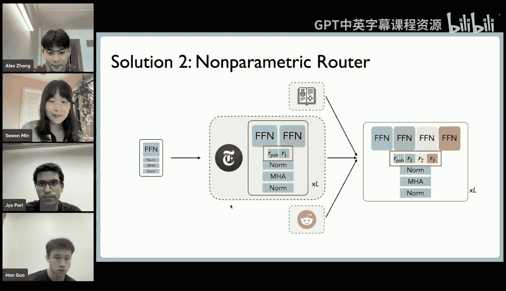

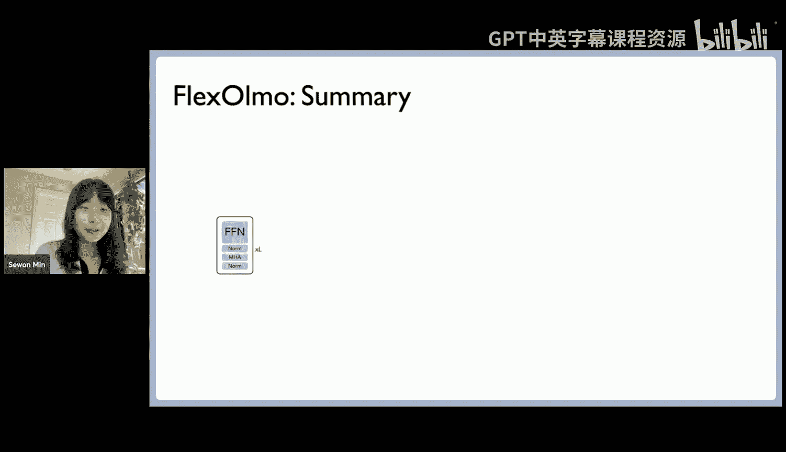

So each data owner can do this training completely independently and then once everyone is done with their training。

 then they will be merged into a single mix of expert model and in particular the shared layers like multi attention can be just brought by the public model and then each FFA will be kept as separate expert and then for the router we do it by concatenating all the router embeddings into a single matrix so that it can be a single anywayway classifier。

That's how Flmo works。 And as I mentioned， if new data owners come in。

 then we can incorporate them by adding their expert models to this architecture if one of the data owner want to opt out later on then we can do this by removing the expert models contributed by that expert。

 So for instance， if New York Times want to opt out。

 then New York Times contributed the green parts of the model so we can simply remove the green part and if the rest of the model is guaranteed not to use any New York Times data。

Cool so that's a summary of the method and I'll now move on to our experiment before talking about the result i'll describe the setup first so the first thing we had to do is to define the data sets for our experiment in particular we need a public data as well as a set of private data sets so for public data we use Common C and then for private data sets we use a set of domain specific data sets including math code creative writing papers。

 news readd and educational text。One thing we try to be intentional is that some of these data sets are actual proprietary data sets where data owners have some restrictions。

 for instance， a lot of news data these are actually extracted from Common Crow that was downloaded a few years ago but it has been known from a few papers that a lot of news providers are now applying the paywall restrictions so that Common Crow cannot have that and then Reddit also have similar restrictions we downloaded this Reddit a few years ago when there was no restrictions so it was completely fine for us to use this data but now people cannot download the Reddit dump because Redit now have some restrictions that we cannot download the data for model training so these are semire realistic scenarios that we try to incorporate and then for other data sets in the first row they are simulated proprietary data meaning that。

They're actually public， you can download it today and then they're completely fine。

 but there are realistic domains， meaning that we choose the domains that gathering high quality public data sets are known to be very challenging。

 for instance， the math and code。And then these are the training setups I'll not go over all the details here。

 but just to highlight a few points， we did experiment on 7 billion scale meaning each expert has 7 billion parameters so when we merge mixture of experts I think in total they have about 50 billion parameters and then we copy the typical model config from the mixture of experts for training we pre-train on the public data for1 trillion tokens to have a public model that can be shared by everyone and then after that we assume that each data owner does continue pretraining on each of their private silo data set for 50 billion tokens。

Okay， so now I'll talk about the result， we in the paper we included many data sets。

 I think about 50 different data sets， but for this presentation I just brought some of the representative data sets as well as the average number and in particular MMLU Pro and HIEL are some of the general purpose benchmarks that are vital used and then Ma two data sets is actually the average of two math dataset sets。

 GSMK and Ma 500。First， we show the result of the public model。

 this is a model that is shared across everyone trained on public data only and this desired the result。

Next we compare with specialized experts and what that means is the model that is fine tuned from the public model trained on each individual data only and in particular I show three of them here。

So what we found is that continual pretraining on some specialized data helps in domain tasks。

 for instance， in math data set we see that the math experts are getting very good performance。

 which is not very surprising however， we also found that it can hurt out of domain data such for instance。

 for MML pro all experts are getting worse result in the public model because they are only good at their specialized domain but it's not good overall。

Next we compare with prior model merging method that I briefly described as option one and option two in the earlier presentation earlier。

 in particular we have model soup which is averaging all parameters into one model。

 we have PTM its a short name for print train mergech that is using enseling and then we have PTX that is using mixture of expert model but requires joint training after merging。

 so we actually did the thing where we do joint training on public data because we cannot have joint access over all private data set。

So if we look at the result， we find that overall they do help if we look at MML Pro and HIVL。

 they do help over the training on public data only so theyre effective， however。

 they're not very competitive， especially when it comes to specialized experts， for instance。

 if you look at the numbers on math data such than all model me methods are much worse than specialized experts like math experts。

And we did some analysis on this and find that this is exactly the issue that we discussed on their own on model which diverging from each other too much。

 so when we have math experts called experts and other experts。

 individual of them can be good on there in domain data。

 but when they merge then they do have some collapse issues so that they lose the ability they learned from specialized training。

Yeah and then finally we have our model which is called Flmo and we found this is better than all the prior model merging method。

 it's achieve 41% re again over previous public model in particular for the general purpose data such like MML Pro and HIFL they are better than prior merging method as well as specialized experts and then for specialized domain like math it is getting very close or outperforms the specialized experts like math experts so when we do averaging over all data sets that are significantly better than all the other baselines。

😊，Cool the last result that I wanted to present which was personally more exciting is that we also compare with on restricted mixed of experts this is a mixture of experts that is up cycle from the public model but then is trained jointly and to end over a union of all data sets so we can think of it as an upper bond model and so this model is obviously better than all the models because it doesn't have this restriction of keeping every dataset private。

 but also flexmal retains 90% of the benefit of fully unrestricted training I thought it's pretty exciting because that means if you're willing to pay for 10% of the performance schemes then you can have lots of exciting benefit such as modular training。

 keeping each of your data private and also being able to opt that later on or add new dataset afterward。

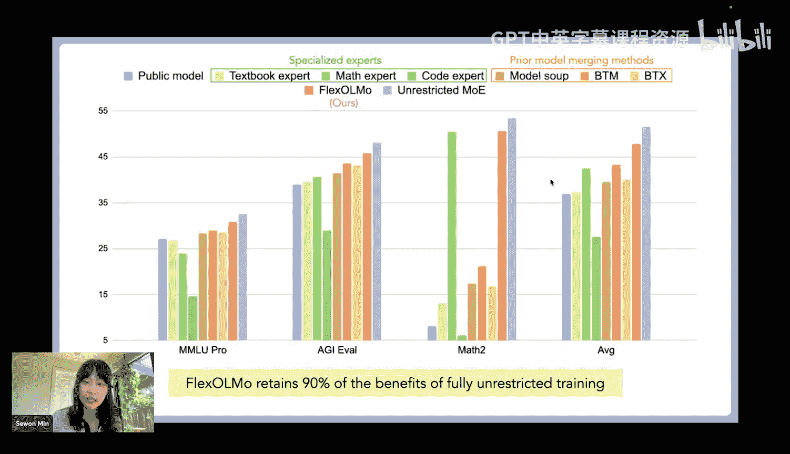

Any questions on the result？

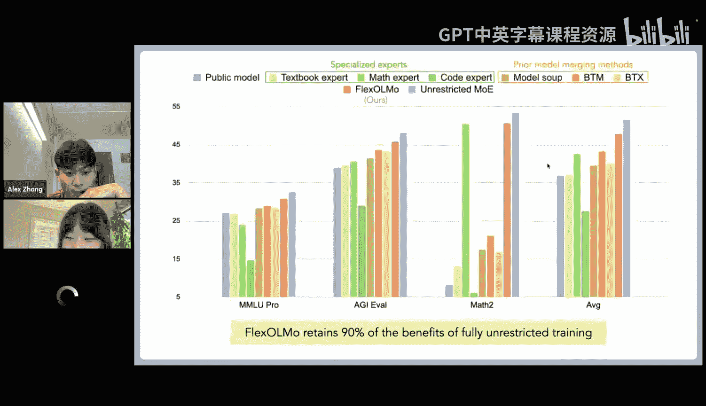

Yeah， I had two questions。呃。Okay， so the first question was from a bit back when you talked about the opt out and so opt out is a nice feature to have。

 but。It requires us to keep the training completely paralyzed like what I mean is like。

If we think about it like kind of like a GiHub model。Where like we have the base model first。

 everyone like forks off。 they train it on their specific data set。

And then we consolidate it at the end。 and this allows for opting out to be easy because everyone's data is kind of kept。

Something that's removable， like you can remove the FF N。 You can remove it from the merged。

The like normalizations and I mean， the attention layers。 But anytime we think about， oh。

 what if then， you know， after we have this ensemble。

 someone takes this ensemble continually trains it with。

Like retrains all the parameters a new data set right， So it's like the opt。

 it seems like the opt out feature kind of imposes this constraint of keeping training completely paralyzed and like doesn't allow us to like sequentially also。

T model so that's something I was just thinking about when you told it when you just mentioned that like what do you how do you like how do you think about that Yeah。

 I think that's a great point Like for instance， if you already release the model which publicly like on hoing face so that people can download and fine tune and then some people download it and fine tune on them then you already have dependencies to that data and then if you opt out then you can probably remove that model from the model that is uned on hoing phase。

 but there are still models that are fine tuned and downloaded So you're not entirely opting out in distance。

Is it right？Like， is it what you're。 Yeah， I guess like。

 it's hard to do like a real like complete opt out once we want。

 because like from a practical point of view， it， it seems like this。

The at least like correct me if I'm wrong， But the visions。

 it seems like very similar between like like a gi for models， right， Yeah， yeah， yeah。

 looking for train contribute Yes like anytime we have like like the sequential nature where someone uses someone else's like use a previous version of the model that had prior data and someone trains and the new checkpoint now is like using like has all this like dependencies。

It's hard to like remove like remove this dependency out Yes that's a great question I think you're right that if you publicly released the model and then someone else took it and then fine tune on it you have dependency and then if you opt you can opt the specific checkpoint but models that came after that additional artifact wouldn't be wouldn't have complete opt I think that's right my understanding it in practice still being able to opt the original checkpoint is a big deal because currently we even cannot do that and I think it this is the same when you un a data that is a collection of data set and when you want to opt a subset of them later on then people will then the party that unloaded this data can remove the problematic data so that the unload version will be clean but if someone downloaded that。

Data already and then train a model on that。 And that artifact effect is not in their control。

 So there's nothing we can do with that。 but I think that is already。

There is already a big benefit that you can remove that from the public version I think another thing that we can do is if the data is so sensitive and we want complete opt。

 then maybe that model has to be served through API access rather than releasing the model wage so that you cannot really you can so that you can have control on which model checkpoints have dependencies so that maybe you can retrain them。

Yeah， yeah， that makes sense。 Yeah， it's very interesting thing about。

How to kind of like fully scale this to the public The。

 the last question I was thinking about is what do you talked about the unrestricted Me， so。呃。

Have you noticed there being like evaluations that are utilizing like multiple different experts？

Actually， yeah， Wait。 So stepping back， what is like the top K value for flex Omo。

 Like are you averaging at this in this evaluation， Are you averaging multiple export outputs。So。

 so we have in total 8 experts， and we are activating four out of 8。 Oh Okay， okay， Got it。

 And do you notice like the。嗯。So between the routing routing in the unrestricted case and the flexOmo case are they like similar or is in the flexOmo cases is it more sparse and the unrestricted more uniform like like yeah how much mix so that's a really great question we haven't actually compare flexOmo and unrestricted MOE in router behavior so we haven't done that one thing though is one thing I thought that might happen in flexOmo is maybe for every layer they always choose the same experts like if we are evaluating on math data maybe they will always choose math。

Expert， but surprisingly that wasn't the case， so when we look at every layer they may activate slightly different sets of experts。

 so I think we are making use of the ME architecture indescence because you don't have to be restricted by just using one expert or two same expert。

Got it。 Okay， thank you。 Yeah， that's very useful。 yeah。

 there are like a few questions from the chat。 I guess we can go them quickly Yeah actually。

 I'm almost done。 I only have a summary slide Oh then go for and we can then and we can get chance after cool so that was the result。

 I wanted to mention one more analysis really quick， which is of experiment。

 So I mentioned earlier there that you can opt one expert to remove the impact of the update out data while the remaining models can remain unaffected so we try to see if that's actually the case。

 So we have eight expert model that is original and then we opt out news experts train on news data so that we now have seven experts and then we try to see how much impact there is in a few down from task And what we found is that for news generation task。

 which is definitely relevant to news there is a performance。😊。

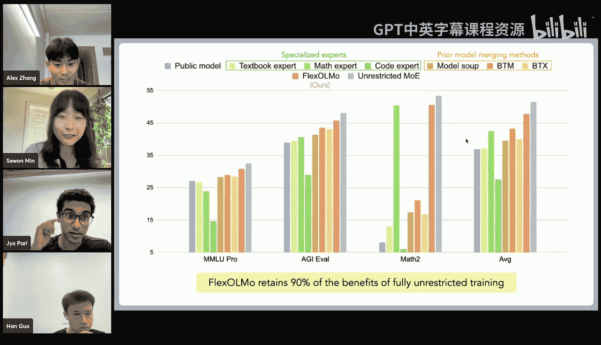

F which is expected， however， for other downstream tests that are not relevant to use。

 then opting out news experts have minimal impact。 In fact， in some cases， it can even improve。

 likely because rather now have fewer candidates to choose from。

 So this is a demonstration that show that opting out experts have minimal impact to other experts。

Cool， so I guess that's almost all just have two slide for summary so just to summarize we learned previously the standard mix of experts have this nice modular architecture mainly for improving efficiency in training and inference but I argue we can also use it to enable training on distributed data set where different experts can be trained by different parts without needing to share the raw data or even needing to have a synchronized training over overall model with data owners and then once these experts are trained independently then they can be merge into a single model I mentioned a few challenges but I mentioned the way we address them is moE orware independent training where each model is trained using the public models as an anchor model so that they know how to coordinate as well as the nonparmetric router where we。

Pst the router into a few vector that can be trained independently。

And then we also show some results where we show our model can significantly outperform training on public data only because it's making use of this additional data sets that we could have not been able to use we are also approaching joint training on all data sets which was unrestricted MOE I didn't mention so much earlier but it actually also significantly improved training efficiency because each data each expert training is now modular so you don't need to do joint training over all mixture of experts which is typically very expensive and also provide free opting out for data owners as well as easy addition if you want to add new data。

I also wanted to mention a few limitations of our current flexoma as well as some open problems One is can we make use of fine grain mixture of experts to enable fine grain data addition there are two reasons I think this is very important and I think this is related to some other questions we had one is we want to scale the number of data sets that we can incorporate right now every time you have a new data owner you have to duplicate the original public model so the models size can go really quick go very large very quickly but if we use fine grain mix of experts this can be mitigated the other reason I think is important also related to all their question is right now we assume each data owner have at least 50 billion tokens which could be quite a lot and the main reason we need this is each expert is pretty big if we can use fine grain mixer of experts each expert model can be much smaller and data。

also who have data with mobile size can also participate。Yeah。

 as I mentioned scaling the number of experts， such data such is very important。😊。

I think another thing that I'm very excited about and I'm kind of hinted but we didn't necessarily demonstrate it in the experiment is can we leverage this architecture and training method to allow continual learning where you start with some model that is not good yet。

 but you gradually add better data search over time so that in the end you can have much better model。

 I think this can be very useful and exciting to develop a model that is continuously improving。😊。

Finally this is a more technical problem but how to train a better nonparameter router is a big issue。

 as I mentioned earlier briefly we found that still a lot of other cases come from suboptimal router decision the main reason is because the router was trained to choose from two experts but that influence them that helps to generalize to many experts so how can we have a better training method that can improve this generalization aspect can be an interesting open technical challenge。

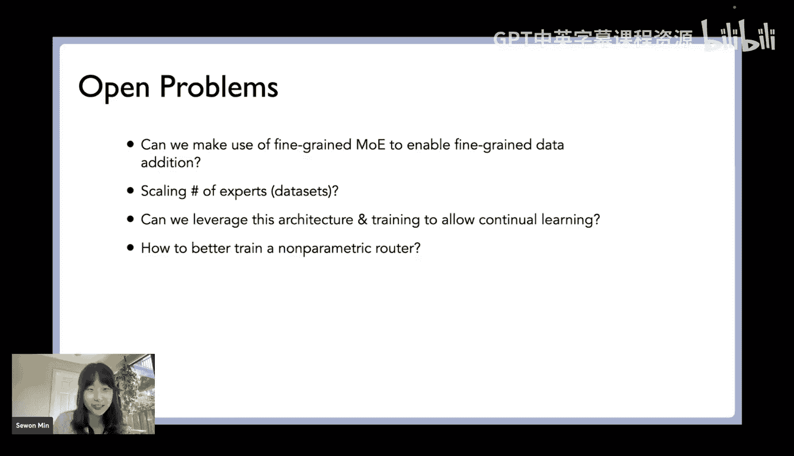

Yeah， I guess that's all and thanks for listening and staying with me here。

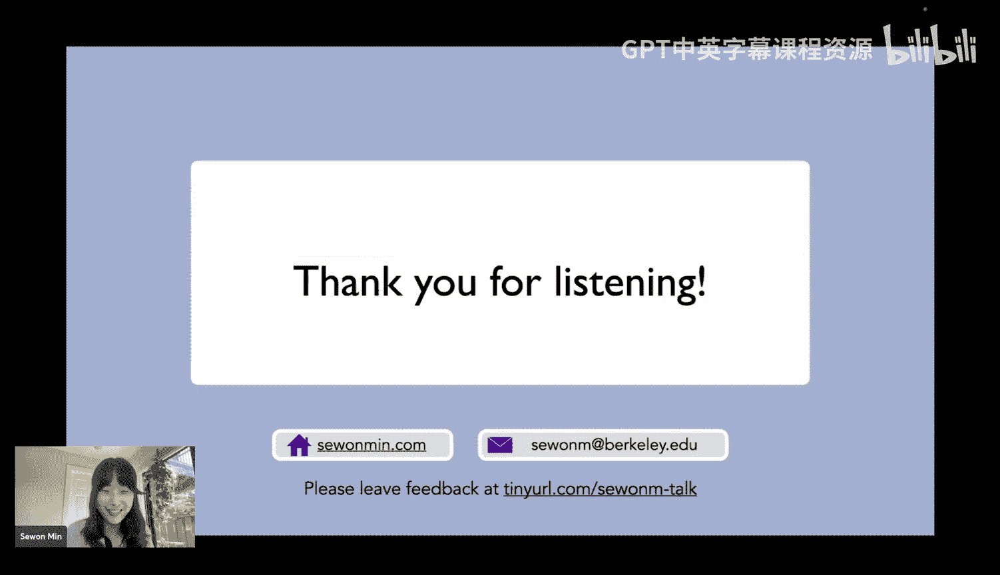

And I can take more questions though。Yeah thanks for the very nice presentation actually I actually have I'll say two questions that's slightly different from the technical content of the talk。

 so one you can easily imagine sort of the application which have algorithm or method can be sort of a have sort quote unquote online platform of where people contribute data and you can have different routers to different experts。

 but interesting to application sort of two implicationsplication of this which I'm which is something quite interesting to think about which is。

😊，I think there doesn't really work Stanford， where you basically are able to sort quote unquote evaluate the price or the evaluation of a data points。

 imagine， say in the case in your times， provide the data。

 I know if you've ever ever thought about how do you quote unquote evaluate how much how much value the data that your time provides provide actual value to the quality So that's the first question So the second question is which sort of a sort of interesting question in terms of sort game theory。

 sort incentive question， which is imagine have an open platform which is a quite questions how would you able to sort incentivize people to provide the data。

 you pay in specific price or on the other hand。Easier way to prevent people provide quantumqu malicious data if I am like someone who want to attack up the model。

 I can somehow provide data that are malicious I just intend to be bad in some definitions of that and somehow had a model train to do some bad things how have you thought about how to prevent such malicious use cases and or unqu incentivize better behaviors。

 Yeah yeah， these are all really great questions thanks for asking them I think these are very。

 very important for like practically applying this for actual like platform as you mentioned these are really great questions thanks for asking So to answer your first question about data value yes。

 I think eventually these would be really great if we have a way to evaluate the value of the data and use that to motivate data owners to contribute or be able to compensate them I don't really have ideas for what specific method we can use to evaluate the data but I think in practice any。

Data evaluation method can be applied here actually one application that we were thinking is just can even be like one pathway for like data negotiation where if like for a B2 B application for instance。

 if you want to use someone else data you will have to purchase the data and then now that data will be transferred to you that's one way you can。

Like have a data collaboration or data collaboration。

 but this can be a new way of doing data collaboration where you are not purchasing the raw data but you are purchasing the expert train their data and this can be a way to incorporate their expert model into a single model and if you are thinking about application like that then as you mentioned being able to evaluate the value of the data will be very important so I'm not super familiar with the individual method how to do that but I do think that will be a really practical that will be very practical to use。

I guess the second question was about how to prevent like unsafe or harmful experts I think that's also a really great question because yeah if you imagine we have an open platform and everyone can contribute then there could be harmful expert like and then we need a way to monitor that for that also I'm not very familiar with specific individual method to identify them。

 but I think we can easily use any existing method to identify harmful experts and be able to opt that there's one additional benefit which is this also provide a natural way to do attribution meaning if you have a set of experts and then you see the router decision then you see what experts is contributing for a model prediction by seeing how much it affects the router decision so so to some。

I think any monitoring algorithm can be used jointly with our method。

 but this can be even easier to monitor because you know exactly which expert is contributing to some harmful prediction and the most experts are likely to be a problematic expert thanks for the answer this is great I think it's a very easier to think by very interesting and cool applications that we can build on top of this。

any questions or question either from chat or from organizers I think I think Alice has a couple questions Yeah there's some from the chat so Raov asks basically GPT OSS and Gema3 we're trained for a lot longer so post training is kind of harder but so for Flex Omo he asks what are the tradeoffs when training for more epochs given that we have limited compute。

Yeah great question yeah so we couldn't like train as long as like like other like GTOSs or Gemini models mainly because we pretrain ourselves and we had limited compute but I am not well I think this is a great empirical question right now I cannot think of any reasons that some of the findings we have made change depending on like how long we train the model I think maybe the public model will be much better because it's trained way longer but I think we all know that still adding some specialist data is helpful on top of that so。

So yeah， I my guess right now is that a lot of findings can be applied even regardless of how long the model was trained。

 but I think this is an empirical question。

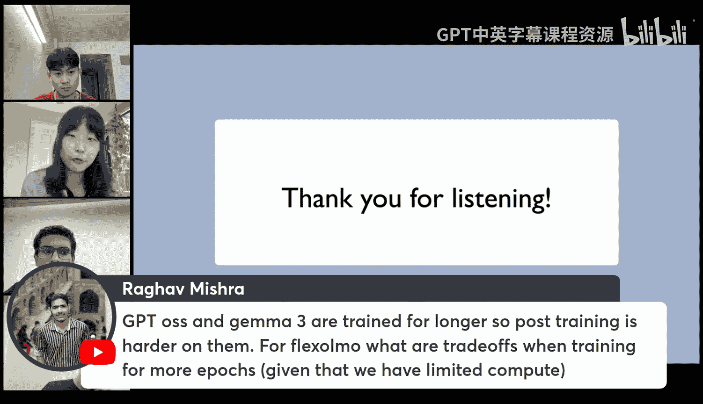

Fect。Sorry， I guess there's a lot of Lie asks， are you able to extend to post training while retaining this whole expert isolation setup？

Yeah， that's a great question。 So yeah， so to clarify our model is all like pretrain or me training。

 there's no post training。 But I think in the end we want to push training。

 So how to do that is important。 I think there could be two different answers to that。

 One is we take this flexible as like it's standard mixtureer of experts and then we just post train on it。

 just like。We would do post training on on the standard mix of experts and then I think one problem is then we are kind of like mixing the impact of different experts so for instance if you opt out one data then now you have to redo post training because you can't simply remove one expert and hope that the rest of the model hasn't seen the impact of that so there are lower limits however in some sense posttraining is significantly cheaper than pretraining so I think then might be fine in practice so that's one answer the other reason is we might be able to extend from posttraining for instance maybe the public model that we start from can be posttrained model instead of pretrain model and then we can add other experts that are either pretrain or posttrain and hopefully they can generalize I'm not really sure if that would be possible。

Can think。I think it might be possible that it generalize。

 there's also the other possibility that generalizing across pretrain model and post train model have additional challenge。

 I think that's an open problem。

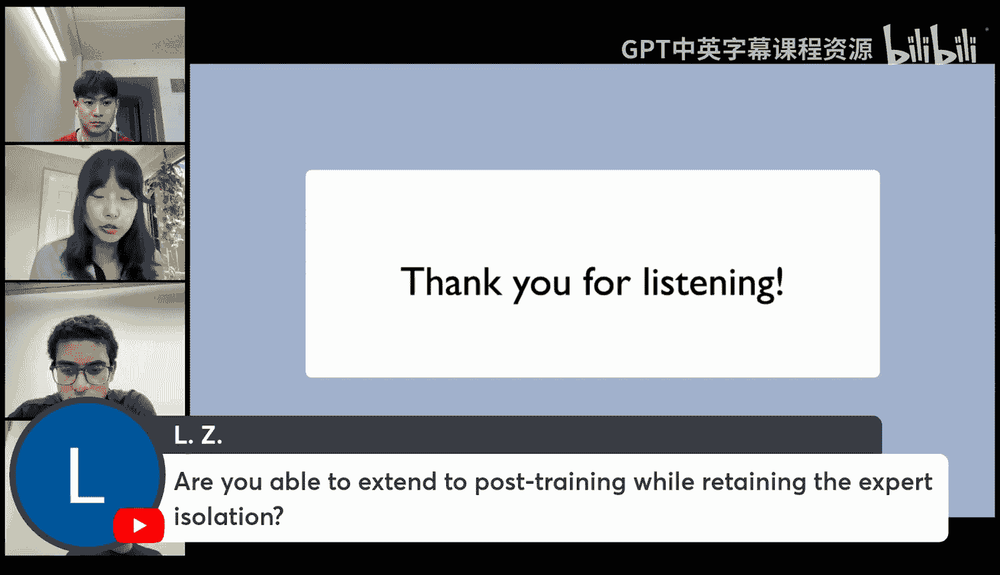

And then I guess the last question is， do you think that model soups could perform similar to your setup if they waited their contributing models better？

Great question。 So we also tried that。 So we， when we tried model soup， we tried two versions。

 One is uniform model soup， which is actually what most people do。

 And the second is some sort of weighted model soup where we have different weight for every input and。

We found some mixed result， sometimes it was better， especially when you have the right wage。

 as we mentioned， but we also find finding the right wage is actually very difficult。So。Yeah。

 it's possible that what we did is preliminary。 We followed the setup from Prince to merge on finding the weight where we use like some sort of domain prior。

 There might be more more advanced method to find a better weight。 We haven't fully explored that。

 but I think that could be an interesting open problem。 I know it's a practical。

A question that a lot of people are excited about。

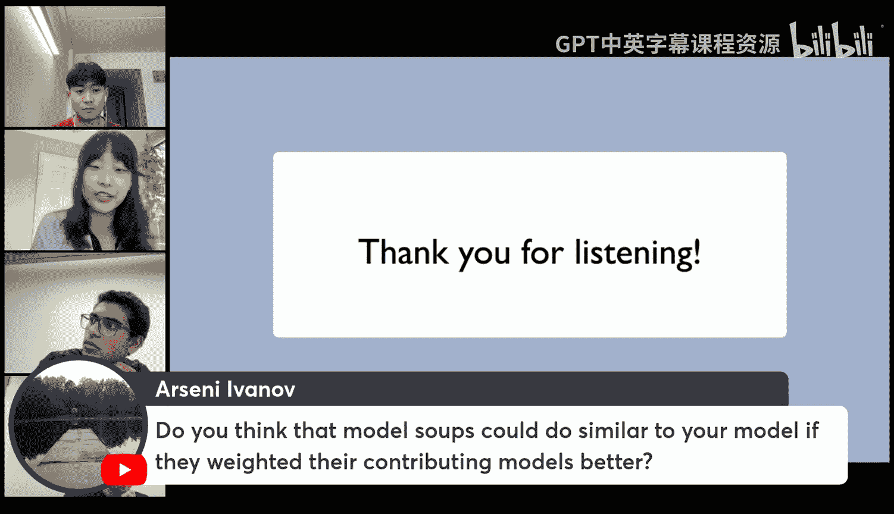

I see。Yeah， I think that's that should be it from the chat so thank you so much everyone for coming tomorrow we will be back focusing on attention sink stuff。

 but that should be it for today and yeah thank you。😊。

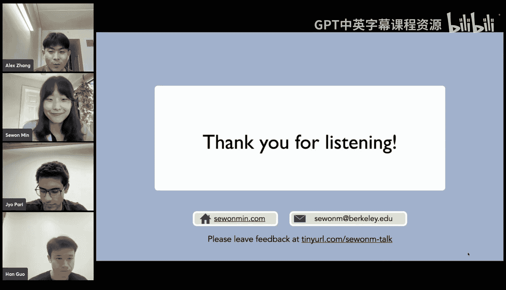

Thanks to everyone of the time。Thank you， like。唔。Okay。

