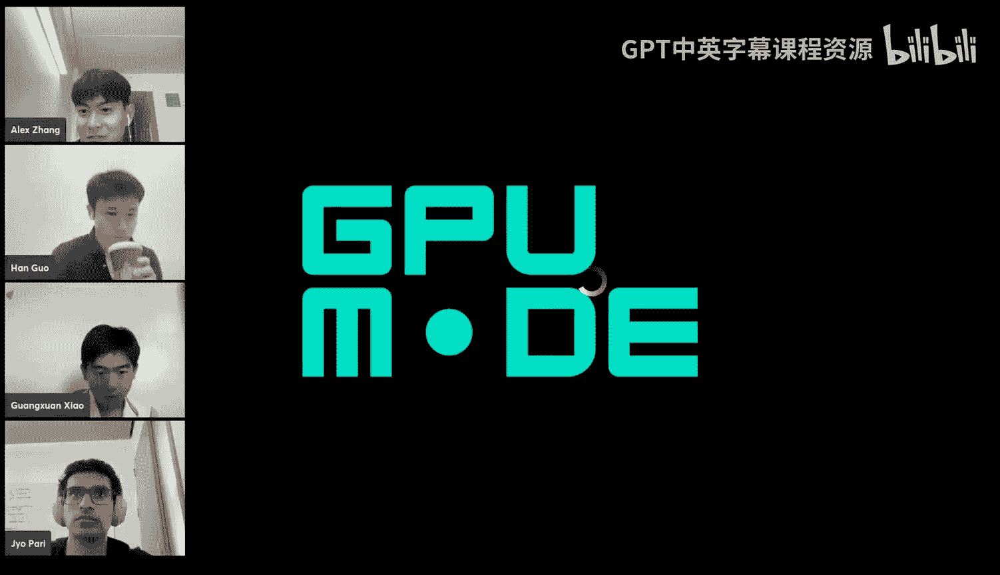
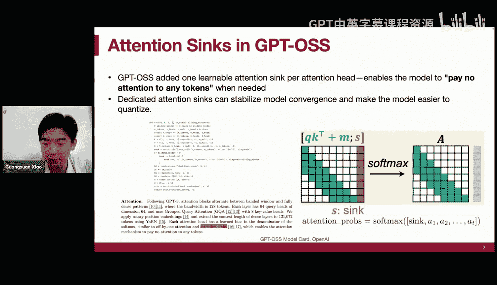
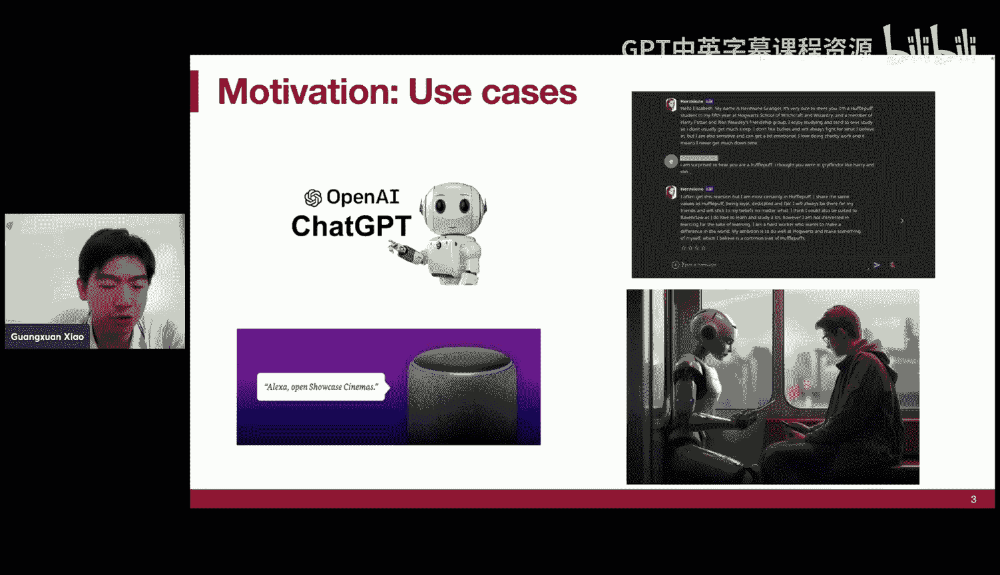
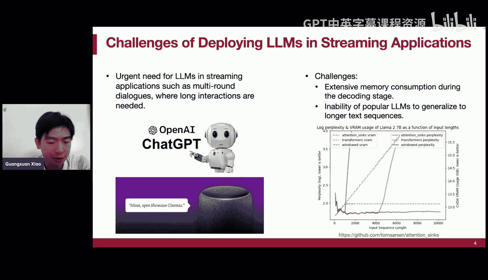
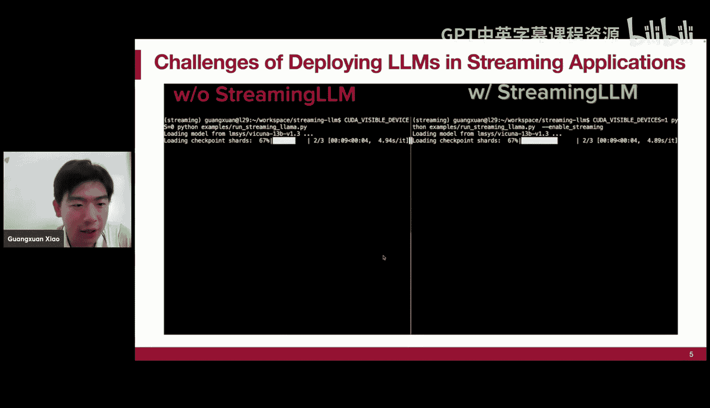
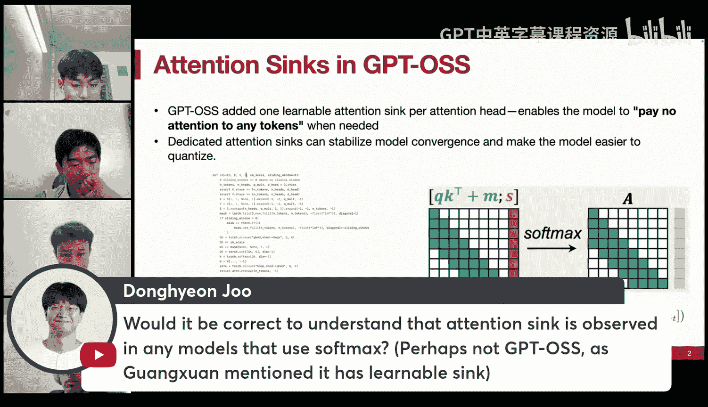
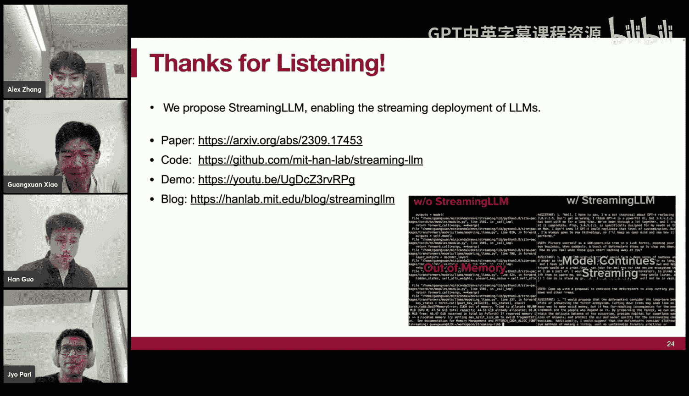

# GPU MODE《CUDA、GPU编程54-87｜GPU MODE》中英字幕（deepseek-v3.2 p19 -20250831-Lecture 72_ -ScaleML Series- Efficient & Effective Long-Context Modeli -BV1xbmQB3ETC_p19-

Okay， we are alive。OkayH everyone， welcome to the second installment for these GP scale MLl session Today we have excited have Guangs from MIT to tell us about efficient streaming model with attention S just a brief introduction for Guang Guangs Guang X is a for the student connected MIT advisor professors on Han So his research interest focus on efficient algorithm and assistance for deep learning with a particular emphasis for large foundation models his work has been widely recognized coming over 10000 stars on the GiHub and having a lot of impact including GBis as we shall see key projects center early were included smooth ground streaming L had been integrated into major industry including Tensor Ten R transformers and many others and then Guang Guang。

 please take it away。Okay， thank you。 Thank you， Han， for the introduction。

 and thanks for having me today。 So hi， everyone。 I'm Guang Xianxiao。

 I'm very happy to present our work， which came out two years before。

 It's called efficient streaming language models with attention sync and why we're discussing that today because it becomes really becomes a topic recently because the G O S has just came out and if we look into its technical report and Github ripple。

 we can find a very interesting design called attention sync。

 So actually this phenomenon is named in our paper two years ago。

 So it becomes a really people becomes reigned people's interest and people become very curious about it。

 So its very nice to be here to talk about how it's developed and the history behind the attention sink。

😊。

And whats the original research on that。 So to briefly introduce the attention sync and GPOS。

 So it adds one learnable scalar per head called attention sync for enabling the model to pay no attention to any token when needed。

 So it's just literally the words in the technical reports。 So by so on the right。

 it's it's a figure by a block post by by friends。 It's really nice。 So it's code。

 you can see that there is a think parameter to pass into the attention function So when computing attention we will append a column of number which is a scalar for each head and a learnable scalar and when we are computing the attention probability。

 we compute the softmax。Over the sink plus all the tokens attention logics。

 And then after computing the probability for the tokens， we remove out that column。

 So it's not involved in the final computation。 So what does this give is that。

It enabled the each each roles probability， not add up to one so that you can pay no attention to any token when there is anything you need to attend to。

Yeah。So the motivation of our original research was that so in 2023 we have Lama 1 and in the summer we have Lama 2 and these models are usually having we're usually having like 2K to 4K context lens and I was thinking about building chat boss that can chat with you all day long so for example。

 if we we are building some companion boss， we don't want the model to raise some error like token limit exceeded or out of memory when we chat with it to a certain period。

 so that will be very bad experience， so that's the motivation of our work。

 which is all day long and like streaming wise streaming like multi round conversations。

And we term these applications called long streaming applications where long interactions are needed。

 So but when applying language models on these streaming applications， there are two main challenges。

 So the first one is which can be depicted in the very nice figure here。

 so we can just look into the orange lines， orange solid line and the orange dash line So the first challenge is the extensive memory usage during the decoding stage so we can check the orange dashed line here。

 which correspond to the y axis on the right which is the GPU memory usage。

 so the orange dash line is the GPU memory usage of naive transformers。

 which is language models and you can see that when x axis is the input sequence lens and when the input sequence lens。

Increase there is a linear increase on the GPU memory usage。 So the longer you talk。

 the more GPU memory you need。 and to a certain extent， you don't have infinite GPU memory。

 So to a certain extent， you will exceed the GPU memory limit and raise the out of memory arrow。

 that's the hard limit by the GPU。 And the second inability is that these models are trained on fixed chunk of pretraining corpus。

 So we pretrain these models on 4K sequences like Lama2， they pretrain have 4K sequences。

 And you can see that when the input sequence exceed 4K sequences。

 there is a huge spike on the perplexity， which is the solid line。

 So perplexity is a measure of the output quality with the ground truths。 So the lower the better so。

If the perplexity shoot up， it means that the model output can no longer be trusted and is no longer even natural languages。

 So that means that we cannot deploy these models on sequences longer than the pre training limit。

 So even even if your GPU can hold 4K sequences。You cannot deploy these models on long sequence longer than 4K because your model haven't seen them。

And here is the demo。 So before we introduce all the technicals today。

 we want to show that if without streaming Im， what will the streaming application be like and what's our final quality and the application achieved by streaming IM。

 So on the left is without streaming I， you will see that the model we give the model a bunch of questions and we let the model to answer each question So we give a very long list of questions and after each question。

 we let the model decode and you can see that the model first the quality quality wise is the model performance breaks So the model start to output some nonsense tokens like like zeros and comma semi column and just not language and second。

 after a while because the model is still running in background and。

It will have a linear increase of memory usage。 And so that to a certain extent。

 you will reach to the GPU memory limit so that we will see the auto of memory arrow。

 And but with streaming on， we can see that the model continuous streaming with very good quality。

 the model can still service and yeah， so no matter how long the interactions are。

So here are the two screenshots on the failure of if we naively deploy language models on the streaming application。

 so you will see either model performance breaks and or out of memory error or both。

So to start off， we can review one of the very important optimization techniques in deploying G like models。

 So in G like models， it's autoaggressive language modeling。

 it means that the previous states are not depending on the future states。

 which means that you can actually cache the any states。

 you you encode it of the previous tokens and reuse them when decoding later tokens。

 That's a very powerful technique called very basic。

 also technique called KV cache so that here is illustration from trainingium。

 So illustration is that when you have， I love token in the context。

 you don't have to recompute the keys and values of them。

 you only need to compute the QKV for the new token trainingium and then you can compute the attention score over the entire context without without recomputation。

Then here is a more animated illustration on this。 So if you don't do KVc optimization at each step you need to compute a quadratic queue multiplied by K matrix modification。

 which is so in total， which is N cubic complexity， which is not feasible in real world applications。

 and if you have KV cache at each stage， you only need to compute one role in the in the attention matrix。

 which means that the overall complexity is N quadratic， So it's a huge saving。But here is a problem。

 So when we are deploying language model on long Kong taxes， we can actually。

 the KB cache can be very large， so it can even exceed the model side itself。

 So let's still use the Lama2 model as an example。 We can very exactly calculate how much memory that requires to store the KV cache。

 So。The Kb cache size equals to batchsh size， multiply by a number of layers and multiply by a number of K hats。

 multiplying by number of the hidden dimension per head multiply by the sequence lens And since you need to store both keys and values。

 So multiply another two。 And if you don't do any quantization。

 you if you store them in 16 B floating point numbers。 that's 2 by per number。 So in total。

 it will be half megabyte per per token。 So now these days。

 people have optimization techniques like query group query attention and are kinds of techniques optimize it is still pretty big comparing to storing raw text in computer。

 So when you store a token in computer， it usually takes several B。

 But here you need megaby level storage。And now we can calculate the KV cache under a common setting like batch size equals to4 with respect to different sequence lens。

 And you can see that this KV cache requirements grows very fast and it can outpace the model weights very quickly。

 So when we are deploying the sequence like 32 k on on the 32 k sequence the KV cache requires 64 gigyte。

 which means that we can we will use like a 100 or H 100 to serve this model。So that's。

 that's very expensive。And another approach a very natural approach is that since we see a very drastic usage of memory and decoding time。

 we how about we just evict some token in the cache and only attend to a constant number of tokens。

 So here is a very natural approach cause window attention and which means we only catch the most reason key and value states and for when we're decoding the Ts token。

 So in the figure on the left when we are decoding the Ts token。

 we only attend to the L reason tokens and evict the previous t minus L tokens。

 So this reduce the memory complexity to L instead of T。

 So when L L is a constant since L is a constant not growing， we have constant memory usage and。

During each step， we also have a constant decoding time because。

Because the context is no longer growing。 But when we benchmark this method on natural text。

 we found that the model collapses very drastically when the text surpassed the cache size。

 So so previously， when we naively deploy the language models on longer sequences。

 the model collapse when the sequence grows longer than the pretraining lens。

 But now we see the model collapse when the text is longer than the cache size。

 So this is very interesting。 So on in the figure， we depict this in the figure on the right。

 So x axis is the input sequence lens and the y axis is the log perplexity， which is perplexity。

 And it's still the lower the better and it's a measure of the quality。

And you can see that for the orange line， which is a window attention。

 We can see that when the sequence lens is longer than the KB cache size。

 the suddenly we see a paraplexy spike， which means that the model can no longer be used。

And if we think that very carefully， we will realize something is happening in the model。

 which is when the sequence lens goes beyond cache size。

 it means that first tokens are evicted in the window。

 So as soon as the first several tokens are evicted from the window。 no。

 the model can no longer function well。 So that's a very interesting and important observation。

 which motivates the following study。And there is another so we already discussed three baseline two baselines。

 One is dense attention。 we already discussed is has a very bad computational complexity and memory requirements and when the sequence lens goes beyond the pretraining text lens gives very bad perplex So we can in efficiency wise and quality wise。

 we cannot deploy models with that attention and for window attention。

 we have good efficiency for each decoding step but we don't have good quality because when the first several tokens are evicted。

 we have bad quality and there is another approach。

 which is like an oracle baseline we call sliding window with threecomp and the overall idea overall idea is that we don't use KV cache we just recompute the most recent L tokens representation when decoding a single token in the。

So that gives us the best quality because it's aligned with the pre traininging setting。

 And so because the model is pre training like this。 But the previous tokens are truncated。

 but it gives us a very bad efficiency because for each step。

 when we are only need to decoding one token。 We need to compute quadratic attention matrix for that token。

 which is very costly， and it gives a good perplexity， but it gives a quadratic complexity per step。

So let's delve into why。Window attention fail and why evicting the first few tokens are so so important to the model。

 So we visualize the attention matrix within the model and we see the attention sink phenomenon。

 So the observation is that we we the initial tokens have very large attention scores even if they are not semantally significant。

 What does that mean So we visualize the attention scores in Lama27v models。

 And you can see that beyond layer2 and layer one， So the bottom two layers beyond bottom two layer we found all attention in all attention has the audit token significantly attend to the first token。

 no matter how far they are from the first token。 So in these cells because it's causal attention the upper triangle is gray its mask and each cell each cells means the attention strengths one token pain。

To the other， the redder， the higher and the blue or the lower。

 so we can see that there is a very solid red line red line in the first column in the layer behind beyond layer2。

 so it means that all tokens very strongly attend to the first token， no matter how far they are。

So this actually so we it actually this is very intriguing。

 but it actually explains why attention window attention fails because if we write the explicitly write the softmax function into the form below。

 we explicitly get out the first tokens attention score in the denominator。

 we can see that if that value is super large when we're evicting that token。

 it means that we significantly change the distribution of the softmax。

 so it means that the model's attention distribution is no longer the same as DP training stage。

 so the model will not be able to adapt to this so it will collapse。Yeah。

 and so we term this phenomenon as attention sink because as these tokens are like sinks to attract like these models disproportionately dump some attention ir isrespec of the relevance of the first tokens。

And we want to also want to understand why attention sync exists。

 So the explanation in our paper is that softmax function limit the enforce all attention scores have to sum up to one for all contextual tokens。

 even if for some tokens， they don't want to attend to any of the tokens and they or for some easy tokens。

 they don't have to attend to a lot of tokens to decode that softmax function still enforce all the tokens to have sum up to one attention probability。

 So in that case， the model has to learn to dump the unnecessary attention score to some of the tokens to attention sink So for causal language models。

 it's very natural for the model to use the first several tokens as attention sink because since the model is causal。

These tokens are almost globally visible。 And if you don't use the first several tokens as attention thing。

 but use some tokens later， the model for for tokens be before that token。

 it cannot leverage that token as attention things。

 So it's most rational for the model to use initial tokens as attention things because we are doing auto aggressivegressive language modeling。

And another aition study is that if it's because the several tokens are semantically important for the model to dunk the attention on them because they are they usually become some crucial or summarization tokens。

 our answer is no。 So in the table below， we measure several settings。

 So0 plus 1024 means window attention， we use zero starting tokens plus 1024 reason tokens to do like sliding window like decoding and when we measure the perplexity。

It gives us a very large perplexity， which is very bad。 And we preserved the initial four tokens。

 along with the most recent 1020 tokens。 and then we measure the perplexity。 It is pretty nice。

 which is 5。4 close to the pretraining perplexity。 And if we replace the initial four tokens to four line breaking tokens with no meanings。

 can we still find that four line break tokens plus 1020 reason tokens still recover the model perplexity。

 So this concluded that it's not because the first several tokens are semantically important to make the model to highly relying on them。

 but it's because they they are happen they theyre decod in they're encoded at the front。

 So they initial tokens。 So that models want to attend to them very strongly。

So after realizing this phenomenon， it's actually very natural and very simple to propose a fix。

 which is streaming OM since these attention things， which are initial tokens are super important。

 we just don't evict them in sliding window in window attention。

 So our objective is to enable Os train with finite attention window to handle infinite text lists without any training or fine tuning。

And so on the left， we illustrate the attention， the attention map and the scheme of streaming O。

 So the yellow column is the attention thing， which we always allow the model to attend to。

 and remaining is still the same as window attention。

 The model still can attend to the most recent L tokens and the middle tokens are evicted。

So this gives us still gives us the same complexity as the window attention because we still have constant memory usage and constant decoding rate。

 but since now we have the attention thing to ground the model。

 we have very nice perplexity which is close to the pretraining setting and we can slight very long。

 no matter how far we are from the pretraining sequence lens。

 and on the right is a closer illustration of how streaming on work。

 so let's imagine the model with context than8， when we are decoding the seventh token。

 the model is just doing full attention and we are decoding as token。

 since the model is only trained on eight tokens it has to evict some tokens now instead of evicing the zeros token。

 we evict the fourth token because we preserve the first four tokens as attention sink and we。

Coding the9 token， the fifth token， and we preserve first four and the most reason for as in the cache。

And here is another technical detail on how we assign position encoding in streaming Im。

 So it's very important detail。 So since the model is trained on a sequence of 8 we are decoding the ninth token。

 We don't want any out of distribution thing happen。

 So since the model haven't seen the never seen number 8 and number 9 before。

 So we assign the position in the cache rather than in the original text。

 which means that we assign position encodings like 0，1，2，3，4，5，6，7 instead of 0，1，2，3，6，7，8，9。

 So the model will always believe that it's actually decoding the seventh token rather than decoding the ninth token。

 So this can be efficiently implemented by caching the position encoding before applying before applying position caching the KB cache。

Before applying to position encoding and afterwards we apply them back when decoding。

 so it's already supported in like a framework like Lama do CPP and Ten R TLL。

So here are some empirical results。 So we compare。Streaming on with dense attention。

 window attention and sliding window with recomputation。 and the conclusion。

 and the results is basically， we already explained them all。 So dense attention。

 which is the blue line is and we can see it fails beyond pretraining attention window lens。

 And for window attention， which is the orange line。

 we can see that it fails after the input exceeds the cache size。

 So when the initial tokens are evicted。 and the green line is like oracle baseline。

 which is we for each step， we just recompute everything。

 And and it almost overlap with the streaming on perplexity。

 So the green line and the red line are together。 So we have very stable performance and the perplexity is close to the sliding window with recomput baseline。

And we scale up our experiments to super long language modeling and more models。

 So we scale up to Lama to 7 13 B and 70 B models and more model families。

 including Pythia Falcon and MPT and MPT here uses alibi position encoding and for Lama2 Pythia and Falcon they use rotary position embedding。

 So it means that streaming OM is also agnostic to position embedding settings。

 and we can see that with streaming OM， these models can now effectively model to up to 4 million tokens far beyond the pretraining sequence lens。

And here is the efficiency results。 We can see that the only feasible baseline line is the sliding window with three computation。

 which is the gray bars， streamingm has a similar memory usage as this as this baseline because they memory wise theyre the same。

 But for each step， we already mentioned that sliding window with three computation has a quadratic complexity per step。

 So we， the longer the cache sizes， the more speed up we have。 So we can provide up to 22。

2 speed up over this baseline when we are using La1213 B on a sequence of four four 4096。

So Dix makes LO Ms for real time streaming applications feasible。

And also here are some ablation studies。 So we find out that for models， some models。

 they are trained to use the initial several tokens as attention sink rather than only the first token。

 So maybe because the first several tokens in the key representation， they are very similar。

 and but we find that keeping four initial tokens for streaming is generally enough and more tokens are have very diminishing return。

And for some models， only one tokens are enough。 For example， here， maybe Python model。

 one tokens is enough。And furthermore， here is an interesting part。

 We want to explain why the model is trained with four attentions。 things。

 can we build a model with only one attention sink and preserve it to to make streaming more stable and so that we it's like we already know during pre traininging like we that we are going to use that token S attention sink。

 Can we pretrain one attention sink， And furthermore。

 can we use this idea to improve the pretraining and which is demonstrated in G O S S。

 So here are the experiments in our paper， So during。

I think concurrently maybe a month before the our paper come out。

 there is a very popular blog post called attention off by one。

 So it's basically same observation that we want to allow the attention not sum up to one in some cases and。

Attention off by one give you。Plus one denomin in the denominator。

 which can be equivalent as which is equivalent as you have all0 keys and all zero values in the Kv cache。

 So we call that zero think we also tested that in our paper。 So here are the results。

 weing a small language models sub 1 B model and 1，40 billion parameters and 1401，40 K steps。 sorry。

 And so we compare with no attention sink， which is the blue line vanilla and the orange line。

 which is we have a dedicated attention sink at the front。

 So we use we always preprint 1 token in all training sequences。

 And we can see that the pretraining loss curve of with attention sink， it's slightly better。

 So it's converging slightly better。Than without attention sink。

 And they have so it at least it's not affecting converging。

 And when we benchmark the model trained with a dedicated attention sink on on some downstream task。

 we can also see that the model improves。 so very consistently improves on these benchmarks。

 And when we are doing streaming now， comparing to vanilla model。

 which use like two to four attention sink， now we can use just one attention sink。

 and it gives us very stable streaming performance。 and we are if we use zero sink。

 like the attention softmax off by one approach only keeping one token is not enough because the model is not fully leveraging the initial token。

 the zero in the front， it still needs for initial tokens to be attention sink。

 which means that if you give the model flexibility。To not to have some up to one attention。

 The model still needs to make some token attention things But if you give the model a very flexible way。

 like learnable token as attention sink， the model will know that will use that token to absorb all the attention and only use that token as dedicated think。

By the way， there were quite a few questions in the chat。 I'll let Hong go first。 Yeah。

 so I have a question。 Yeah， so thanks very nice presentation so far。

 So this covered in your blog post already， but I thought it would be nice to be covering in in the live stream as well。

 can you comment on the sort of the differences between the version you work on initially versus what say G using models Great question。

 So it's。Let's go to the G O S S design。 So it gives a trainable scalar at the front or any any places is the equivalent。

 So in the in each role for the attention， not sum up to one。

 So it's not attention sync token in our paper and it's also not the off by one attention in the subm of by one blog post。

 but it's like something between。 So it gives a learnable scalar in the denominator。

 And in our like if you give the model a dedicated attention sync。

 it makes the learnable scar more powerful because for each token you have you can have different sync values。

 So for some tokens， they may have larger think values to attend to they can attend to the initial token stronger and for some token。

 they can attend to the initial token less but。It requires a dedicated like if you if you do that。

 you need a very nice attention kernel to do that because you always need to attend to the first token and and also it will need some like data engineering because。

If you need some data engineering because in your all sequenceing。

 you need to pad one or replace the initial token in all sequences to be a dedicated attention sink。

 And but if you use this think approach in GP OS or attention of by one， it's not intrusive。

 So almost you don't have to do anything related to data or kernels。

 you need just need add one one sync value in the denominator and remove it after computing attention。

 but I still think that it need some like very slight kernel modification。

 but it's not as large as if you have a dedicated attention sync。

So some more sort of this almost probably get you what you would have do given what you know。

 but a lot simpler from a sort of a engineering and a practical perspective yeah it's like a balance on the like flexibility and the amount of engineering you need to implement this yeah。

Yeah， we have a couple questions。 Yeah， sorry， Alex。Oh， go first， yeah。Okay， yeah。

 so have you looked at the GP OSS models？Attention sink values。

 like to see if there are some patterns that。Paradel。

 the actual like original workki with the attention stake with the initial tokens。

I haven't done this myself， but I saw some like Twitter post or blog post online。

 So people do some analysis on the amount of attention。 And I if I remember correctly。

 they do absorb a lot of amount of attention in the sink in the sink。 Yeah。

 so they occupy a lot of attention。 And in our paper， we also。

 if you check the streaming on paper appendix， we check the amount of attention。

 the first several tokens absorb。 and almost take on average。

70% to 80% amount of the entire attention。嗯。Awesome things。 yeah。

 I'll ask some of the questions people are asking in chat。 So Dongong J asks。

 would it be correct to understand that the attention sync phenomena is observed in any models that use softmax。

Yeah， I'm going to present that。So yeah， I think I just get to this page。

 So attention thinks it's happening in other transformers and transformers is powered by attention and the attention is powered by softmax。

 So concurrently to our work people also a group in meta find the basically the attention think phenomenon in vision transformers and they called it registers in in VIT models。

 So basically the difference between VIT and also the bird。

 I also introduce Bt will talk about B in this page。 So VIT and B。

 they are bidirectional transformers， which means that they the former the token before later tokens can see the tokens can see each other。

 no matter the position like position they have。 So。

 but we still find that in some background patches。

These researchers find out that in some low semantic background patches。

 these models have very large attention spikes and high norm tokens。

 So it's like attention sink happening in these low low semantic background pixels because they are very commonly。

Like emerging and the model needs some way to dump the attention into some tokens。

 And for bird bird model and Roberta models， same wise。

 people already find out that I think around 2019 that and some tokens like the separator token and some delimminators like comma period。

 they will absorb very a lot of a lot of attention。

 So I think it these tokens are basically serving as attention things in these transformer models。

Makes sense， yeah。So Jay Lee has two questions in real applications we can prepend system prompts。

 so would this effectively solve the same problem withstreaming allLM？Yeah， if basically。

 you are using the system prompts as the attention things。

 And I actually think that's a better a more elegant way to do that。

 So if you want to do very long chat， it makes sense that you always pin the system prompt K cache in the context。

 And when you're doing something longer than the sequence。 then pre traininging limit。

 you can sliding evicting something in the middle。 And still attending to the system prompt and the local context。

 that makes a lot of sense。And their second question was。

 if the position is the only factor that matters with tension sinks， is it possible to redistribute。

 I'm assuming they mean probability mass over the remaining tokens during training。嗯。😊，Yeah。

 I kind of， I didn't get the approach here。 So it's very vague to。

 I I don't know what does distributing probability mass mean during training。

We can I also am not entirely sure， so maybe if they have a follow up for that。Yeah。

 Sidartha Rao asks， basically is there a study on understanding how much like the probability mask gets distributed towards sinks？

Yeah。嗯。Yeah， I think it's like。Like a feature that the model needs some bias or need some tokens absorb attention。

 And no matter how you did redistributed the attention mask， it's like you're making the model not。

 you're preventing it from learning。 So I， I'm not sure that if it that's good or bad。Yeah。

 that's my like very， very initial thought。And I think there's two more questions， sorry。

 there's a bit of a discussion， so I need to parse through so。Yes， Besher asks。

 is there any particular type of tokens that have to be the sink or are they basically the starter tokens？

Oh， yeah。 Great question， so。So people often ask me that whether the attention sink is just the begin of sentence token。

 we've we found in these models。 And the answer is no。 So that's because we were doing L MP training。

 We actually depending on your tokenr design， it's usually。Usually。

 adding the beginning of sentence token before we chunking them into small chunks to feed into model。

 So if you check the training sequences， most of these sequences are not starting with begin of sentence。

 So some a lot of most of the sequences are starting with just natural tokens。

 and which means that the model learned to attention sink on all tokens。

 not just beginning of sentence tokens。 and how they learned it。

 It's actually very easy for models to figure out which token is the first token because for first token。

 the model is just like MP。 there is no context for the first token。

 So the model can definitely learn which token is the first token。

 And no matter what token comes when the model realizes the first token。

 it will encoded to be the key of the attention sink。

So the answer is not not only B O is attention sink。 Any tokens can be attention things。

And the last question was by Arrssony， he asks， if you go back to the vision transformformers's example in the VIT's Need Regs paper you referred to。

 they suggested that this was global information that the model was encoding。

 so are you suggesting that this is not the case？Yeah。

 so there are different like interpretation on this。 So for maybe for bidirectal transformers。

 these tokens can serve as like global register or some intermediate information store to help the model converge but definitely for G models。

 attention sync emerges not because of that because in G models we find out that attention think are initial tokens and initial tokens can only store information by like informations about itself。

 it cannot see later tokens， so it definitely cannot be some global information puller or intermediate register。

 So for different models they may have different functionalities。

 but I think the curiosity the most interesting part here is how attention emerge maybe it's not。

Because of they want the model wanted to serve as global information store。 But it's because we。

 the model need some way to not let the softm distribution sum up to one。I see okay。

 that should be all the the questions in the chat， so I think you can you can move on from here Thank you。

 Yeah， thanks thanks for the questions。嗯。So I think it's almost， I'm almost done。 So final。

 the final thing here is that it's a it's a limitation part like we are discussing like some people may may think that streaming gives you infinite context to chat。

 but that's not the case。 So we benchmark the model's ability on synthetic task showing in showing on the left。

 So after a few line， we give the model a bunch of random numbers and after a few line。

 we ask the model what's the number， several lines before。 So， for example， at length line 10。

 we ask the model， what's the number in line 10 line 0 and at line 10。

 we ask what's the number in at line 30， we ask the model what's the number in line 10。

 So here the token distance is 20 lines。 like 20 lines here。

 So on the right is the model performance。 So。We are asking the model something within the cache。

 which means the token distance is smaller than the cache cong。

 like one when the token distance is 1840， when we are using like four plus 2044 setup。

 we have a nontrivial accuracy， which is 75。30 and if we have a longer token distance which is beyond the cache and we can see that if we token distance is beyond 2048。

 we can see that all zero accuracy， which means that anything evicted from the cache can no longer be retrieved。

 So which means that streamingM doesn't give you an infinite memory。

 but it gives you a very stable performance over very long input and the model can always attend to the thing。

Happy in the local。 But it cannot remember things evicted。

 So we have some follow up works on this to address this issue。 So basically。

 we develop some smart evicting techniques。 and or we don't even e evict these tokens。

 And we only evict for crucial attention hats for， to， to streamlining model。

 So feel free to check my follow up works。So yeah， so that's basically it we in conclusion。

 we propose streaming LM and using the attention sync mechanism to enable streaming deployment of LMs and feel free to check our paper code demo and block on the internet。

Thank you so much for listening。Yeah， thanks Con for the very nice presentation actually have some like follow up questions so this papers me now。

 I think like one two years I'm curious what are the things in your opinion that the initial draft paperper right what are the things you think the initial paper that some of the prediction about the future possibly you might want to revise some of the things going forward。

😊，And what are things you think you prediction got right， And what are the predictions。

 given what the time of two years， What are things you， you think you， you might have a different。

 different thoughts， given which you note today。I think basically， all the claims are。

Basically correct in my in my view right now。 That's nice。 Yeah。

 So that's why I'm still talking about it。 That's very yeah。

 and it's very maybe I should test whether adding a scalar training with like learnable scalar per head its can can like make think phenomenon better so that which is exactly what G has done and also several follow ups work done and basically。

 I think the intuition and the observation is correct。

 and maybe one thing I did haven't do is the trainable scar and the second thing is I haven't scale up this experiments to do to see if its still hold or it still can benefit pretraining when we make the model parameters and the token numbers larger。

 but still， I think most of the claim I think。😊，So the claims are still holds these days。Nice， yeah。

 so I'm so curious， you know， obviously， this is once the project came out， it becomes very。

 get a lot of tension and quiet effort we doing this work。

 I'm curious what's your did once the paper came out。

 does it change your own research direction about like。For the past two year。

 when the paper came out， did it change your own research direction because of this。 Yeah， yeah。

 so this is basically the question I asked here。 So after this work come out， a lot of people ask me。

 So the paper came out become very popular on hacker news because someone posted like now we have four meaning context。

 and a lot of people misunderstood that' probably a reason why this paper is because a lot of people。

 a lot of people misunderstood。 But so people are thinking that it gives you infinite context。

 But I was still thought I continue work on this problem to give you very long context very efficiently and without forgetting things。

 So that's how this work reshape my research direction from like quantization to long context modeling。

 But yeah， I'm still working on this。 It's still， I think。Challenging task。But interesting to us。

Yeah， and also for people on the on the the the the call， Guang has like put a very a couple。

 I think three blog posts， really amazing blog posts going through。

 including one attention and a couple others about various aspects of onecomas modeling。

 which actually highly recommend people to take a look。

 some of things actually including some of this about sort sort of your thoughts about attention some sort of follow our work that basically understanding quotequ science aspect of the attention。

 which actually are actually felt it's very， very nice to to read over。Yeah， thank you。

 Thank you for the comments。 Yeah， Yeah， I'm curious， also like。Obviously， I think this。

 this work and the follow ups were like all very useful and had very like clear。Impact。

 but I'm curious if there are still directions that you think like haven't thoroughly been explored for attention sinks。

 like whether that be for specifically frontier language models or even for other architectures or things of this sort。

 like is there something else that just hasn't really been done in this direction or it hasn't mostly been exhausted by this point and the point now is just trying to understand like why the phenomena happens。

Yeah， I think basically this phenomena happened because of the usage of softmax function。

 but it's hard to say that anything people develop in an initial neural network design can be optimal。

 It's very hard to say that。 So there are definitely a lot of rooms to even small building blocks can be improved。

 like I really enjoy some some paper this year or last year。

 like scalable softmax or even softmax alternatives。

 So basically thinking about how can we improve small building blocks in neural networks can can maybe fundamentally change like being being the like fundamental building blocks of future neural networks。

I see。 It would。 do you think this would happen for any function that normalizes to。

A probability distribution。 Or is it like， is softm special in some way。Great question。

 So I think if basically the essence here is that if you ask the ask the model to normalize everything into several numbers。

 you reduce a degree of freedom of the entire vector。 So the model。

 if the model wants to learn something it has to maybe it won try to restore that degree of freedom by dumping something and making something one so that the remaining part have a degree of freedom equals to-1。

 So then why not just use attention thing。 You give the model and a redundant token and let the model to freely model the remaining。

Yeah， I think that's a pretty nice approach to solve this issue。是嗯哼。Yeah。

 I think there are also a couple questions。 I see you can see in the chat。 Yeah。

 so one of the questions was。Basically， like， what is stopping us from。

Using later tokens as the attention seeks instead of fixing。A set of like starter tokens。

 like for your pretraining strategy。Yes， so if you use some later tokens as as attention sink for tokens before that token。

 these tokens cannot cannot attend to that attention sink。

 So like if you use the if you use a number token number 1000 as attention think。

 which means thousands of tokens cannot attend to that token cannot use that think。

 it makes model very inefficient。 So the model， the most efficient way to let for the model to learn is to use the first token。

 which is globally visible as attention sink。Actually。

 I think I don't think there were any more questions。 I think everything else comment。

 Yeah from but yeah， thank you so much again for this wonderful talk。 Thank you。😊，Thank。

ThanksThanks Guongshhen， for the nice presentation。We'll be back tomorrow。

 I believe at 3 pm Eastern for a talk on quantization by Professor Chris Des。

 so we'll see you all there tomorrow， but for now， thank you all。Thank you。

