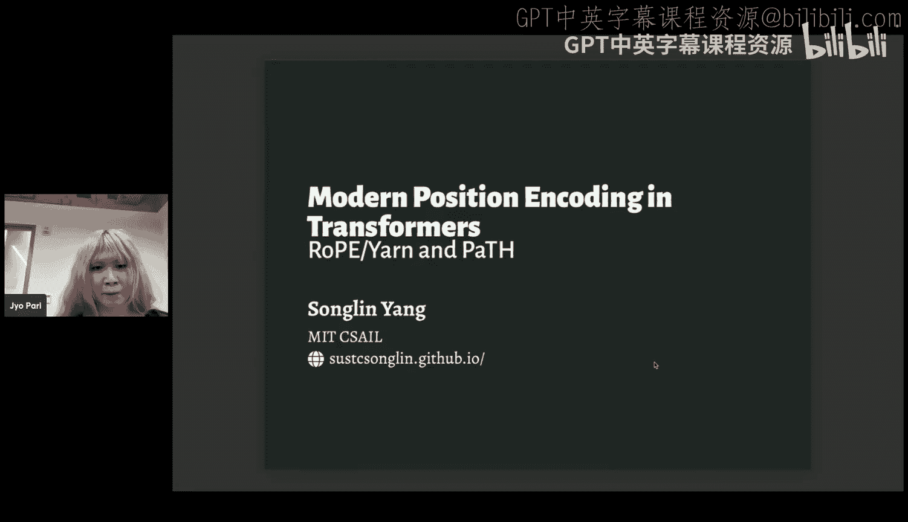
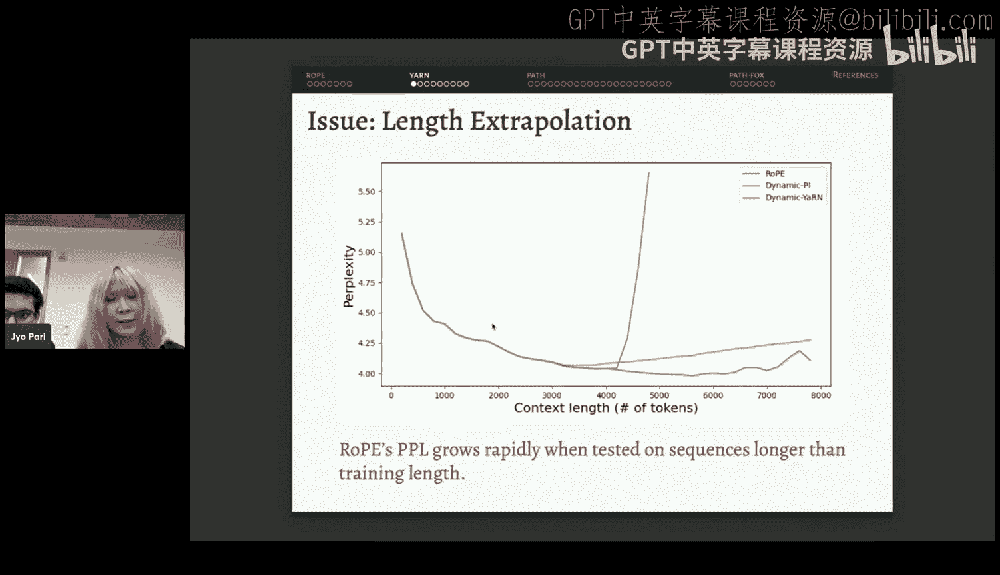
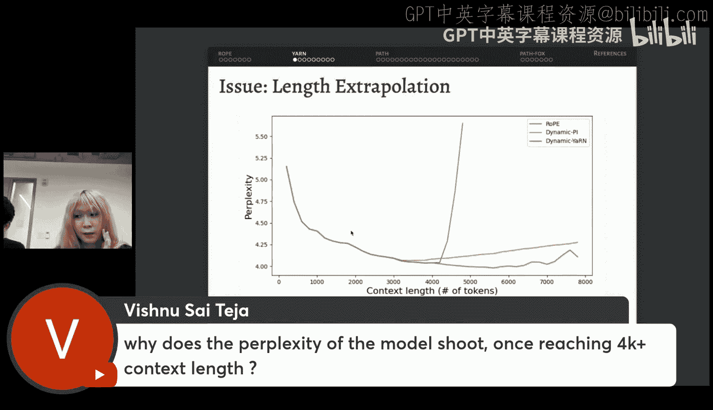
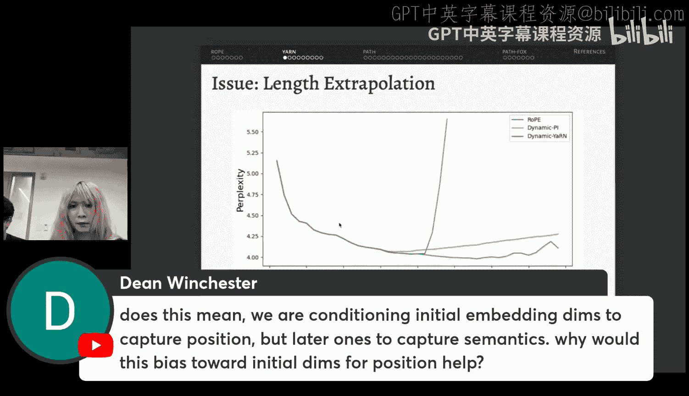
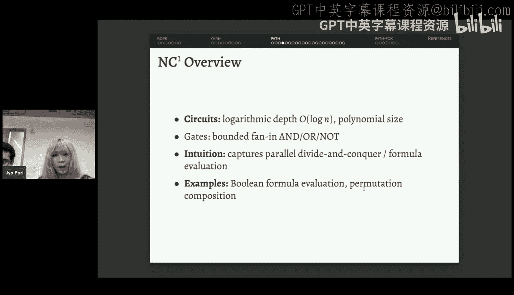
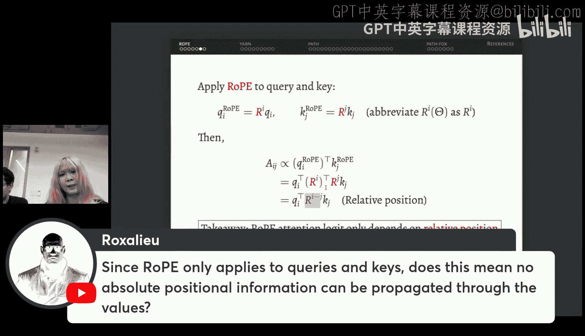
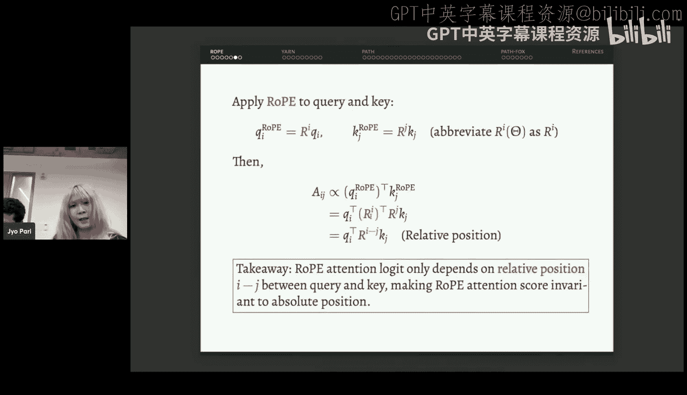
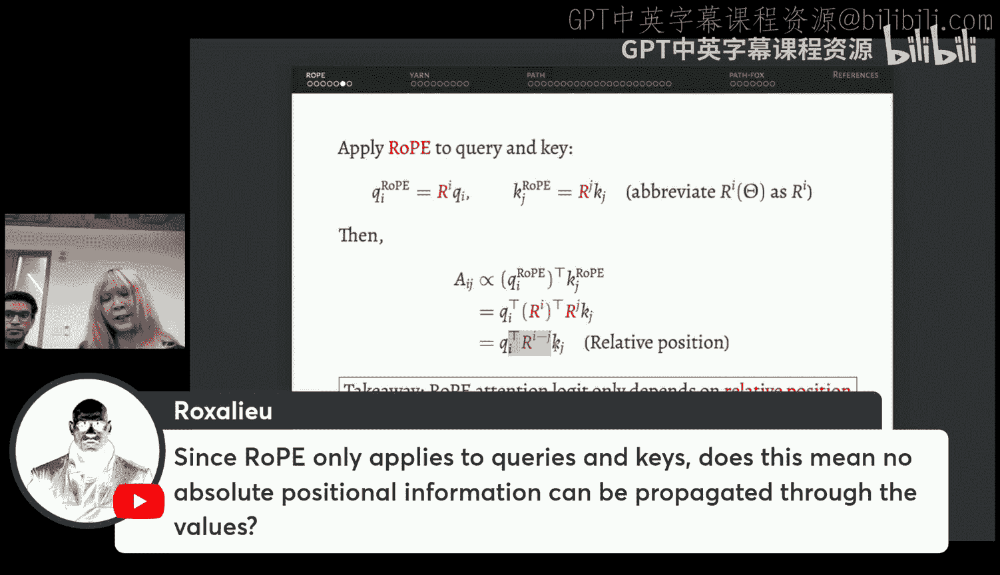
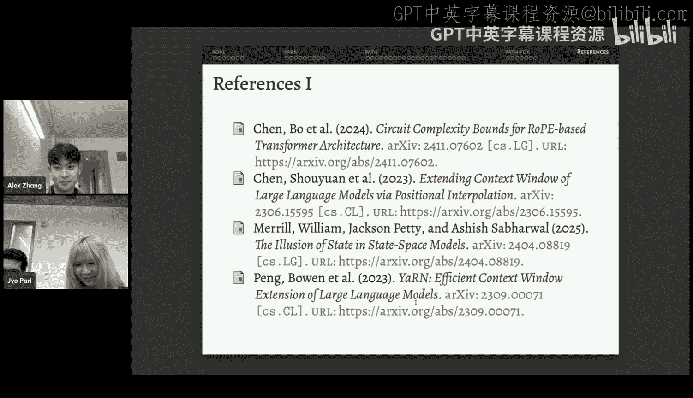

# GPU MODE《CUDA、GPU编程54-87｜GPU MODE》中英字幕（deepseek-v3.2 p21 -20250831-Lecture 74_ -ScaleML Series- Positional Encodings and PaTH Attention.z -BV1xbmQB3ETC_p21-

Okay。Okay， we're alive。诶。Let's double check the thing。 Yeah， it doesn't say we're live。

We are waiting for a mode。Alex， yes， I can。I think it。Yeah， okay， okay。Okay， so we can start。

All right， so we have Songland here with us today。So I have the honor to do a songnglin intro。

Songland is a now third year Ph student and you' going to update your website at MITC sale advised by Yu she earned her bachelor's G degree from。

SUS Tech in 2020 and her master's degree from Shanghai Tech in 2023。

Her research focuses on the intersection of machine learning systems and large language models with a particular interest in hardware aware algorithm design for efficient sequence modeling。

 especially linear tension models。And she's a strong advocate for open source research。

And you can see her work as flashling your attention and the best way to reach her through the FOA Discord community。

So take it away， songland。Okay， thank， thank you for the inter。

 Have one And today's talks is titled Mo position， including in transformers。

 And I'll be mainly talking about rope， Young and another work path。

So first， we have a motivation for the positional encoding。 so when the transformers was invented。

 they mostly did that they were used for bidirectional modeling and self attention mechanism without a causal mask trace the input can as an on set。

 So if you do not have any positional embedding and the。

Transformer attention mechanism would would act like a bag of wall model。

 It does not have the sense of the word ordering。So this is why we want to have positional embedding in the first place。

 Here。 we have a very intuitive example。 we have a two sentences and the cat set on the mat and the math of the cat And if we do not have the positional embedding and the model cannot distinguish between the two。

 when we do not have the causal mask。 and this is a precondition。In the original transformer paper。

 they add a very simple， absolute positional encoding。 So basically。

 they have this co and send function as the absolute positional encoding and this functions are have is a periodic function so they can encode certain positional information。

And later， researchers realized that absolute position， en is is not that perfect。

 It has a lot of limitation， for example， the。The content is highly coed with the absolute positions。

 so it does not directly model the absolute the right position between words。 It。

 is then some kind of like。Colation between the world and the position， which we do not want that。

So later on， researchers are mainly focusing on relative position encoding。

 and today will be mainly focusing on the rotary position embedding。

 which is the most popular relative positional encoding scheme。

Here we have an overview of the rotary position emva。So first of。

 we have the input embedding and for rope， it divides the input channels into different pairs of channelss each pair has two dimension and for each channel。

 rope has the frequency angle and it takes the absolute position I to here。

 and here we have the angle and we do this rotation based on both the angle and the absolute position ID。

Later we show this is indeed a relative position encoding。 despite that here。

 we use this absolute position I D to calculate this rotation。And after this rotation。

 we obtained the rotated quaries and rotated keys， and we put it back until for。

 for calculating the attention logic score。We do this operation separately for different pairs of China。

 So here we have another for this two dimension colored in pink。 We have another rotation angle。

 and we have a different rotation， based on this angle。

And different channels pairs act independently。 they do not have interaction to each other。

Before understanding the rope mechanism， first， we have a a brief recap of the rotation matrix。

 Here we have a two dimensional rotation matrix。And this is very simple。

 So if you want to rotate a vector by theta angle， you can use this two dimensional matrix to achieve it。

And this rotation matrix has a lot of very good property first serve。 it has the power property。

 Basically， when you do this cuummulative product of this rotation matrix。

 You do not need to actually calculate the cumulative product one by one。

 you can directly calculate the resulting ad angle and only calculate this matrix once。Second。

 because the rotation matrix is a orthogonal transfer。 And so。

 so the inverse of that matrix is equivalent to the transferse of that matrix。And also。

 we can use the negative angle to do this inversion operation。

 So imagine if you if if a vector in the two dimensional plan。

 rotate an set angle in this direction and you only to rotate back using in in the reverse direction and here the the milestone indicates the reverse direction。

Finallylony， if you want to do the composition of multiple rotation matches is is also very simple。

 algebra， you only need to sum up those rotation angle and you use the resulting rotation angle to do the final calculation。

For rope， as we mentioned before， it operates on pairs of dimensions independently。

 So we have if if the input dimension is D， then we have an D divided by two number of channel pairs and for each channel pairs we have a different attention angle。

And in total， we can write this in a block diagon matrix form。 So block diagono means okay， these。

 these part are basically independent to each other。

 They do not have an interaction different channel pairs do not have an interactions with each other。

 They do the rotation in an independent manner。And this block diagon matrix also preserve the previously mentioned property。

 the rotation of properties。And then we have this basic knowledge about the rotation matrix。

 and then we can have a matrix form to write down the rope working mechanism。So here are we use this。

As a aration for this。And then we for， for， for each position， we take the absolute position。 I D。

 for example， in the S position， we use this I as the exponent to do this matrix Exponent of the rotation matrix。

This looks like the absolute positional encoding scheme。

 but here we are going to show that this absolute encoding skin， actually。

 it encodes a relative position information。And so when we take this door product between the transferred query and key。

 we have this tu turn。And we can this， this transfers equals to the matrix in。 right。

 So we here we can imagine here we have a minus I in the exponent。 And we compose these two together。

 So we have this。We have this。angle difference and direct angle so it's basically so here we can easily see that this is totally depend on the relative difference position difference between the query position and key position。

Yeah， although here we use this absolute encoding skin to obtain the rotated vectors by taking the dopper do。

 we eventually we have this relative position encod。 this is a very interesting property。

 so you can do some very simple， absolute position based transformation。

 And then you can directly use this do do to encode this relative position。 it is very cheap。

 And this property is also very nice。 And it has been used on in many open source model like normal queen。

 etc cea。P we mentioned for different channel pairs， they have different rotation angle。

And so based on the see value， we can characterize them into two different categories。

 The first one is those high frequency channels。So they have very large theta value。

And these channels do the rotation in a very rapid manner。And for these channels。

 there is a very interesting paper called round and round we go what makes rotary positional encodings useful。

 This paper is really well written。 I learned a lot of insights from this paper， highly recommended。

And in this paper， they discuss the different functionality between different channels。

 So for these high frequency channels， it was mostly used for encoding the positional patterns。

And for example， if you want to find the the case nearest world， it it relies on this high frequency。

 China still trade it。And more importantly， Nope， which is another positional encoding skin。

 because in autoregressive modeling， the causal mask itself could be imagined as a as as injecting some positional information。

 so recently， there is a significant interest in using nope for positional encoding。

 And this paper show that for nope， it it doesn't have such mechanism to do to find this positional patterns。

On the other hand， for those low frequency channels。

 those has very small rotation angles did the rotation in a very slow manner。

 So these channels are mostly used including the semantic meanings because the rotation is too slow。

 It has minimal impact on the resulting double do value。

 So so in this the the double dot attention logic value is mostly based on the similarity between the core and case。

 So in this way， it could include more setic information。For high frequency channels。

 because it rotate so fast and double could change rapidly。 So it was use。

 It was mostly used including the positional patterns。So as such。

 we can see this division allows them to effectively balance and positional and semantic information。

Okay， Rob is a very nice relative position skin， but it still has its limitation。 for example。

 the first issue is less in the length extrapolation。So basically， for example。

 when the training sequence lens is 4K。 and if we train on 4K sequence and then if we evaluate the public beyond this training sequence lens and then the publicity would blow up in a very rapid manner and eventually will blow up to a very significant large value。

And in this sense， this is a common well known problem for rope。

 It cannot do the Nancylation very well， and researchers have developed a lot of workaround for improving the Nancy rope。

嗯。For example， in this earliest work called positional interpolation。 basically it it。

AndDoes the scaling for the rotation angle。To make sure the the the product between the absolute position I D and this rotation angle is there this resulting values has been seen during the training。

 So it does not have the so called out of distribution issue。However。

 this positional interpolation scheme is too simple。

 It it uniformly address the app and the rotation angle for different channels without and different channels。

So as we mentioned， for those very high frequency trainers。

 we'd better not modify that rotation angle because it rotates really fast and it。

When it comes to the training sequence， that China must be rotating for multiple cycles。

 and there's no out of distribution issue here。 We have two questions。So the first question is。

Why does the perplexity of the model shoot once reaching the 4K+ context window？Yeah。

 I think there are a lot of explanation for it。 for example。

 a commonly believed explanation is that for some certain rotation channels because it like it rotates very slowly and the model doesn't see the rotated angle during pretraining。

 Yeah， and we do this necessary tri， it will have some out of distribution rotated angle and the model doesn't know how to deal with it and this is a this is a most common explanation for it。

 But then if the but when when you do attention the dark。

 everything it converted into relative angles right。

 but that's something that the model probably would have saw。

嗯。Yeah， so you need to based on the China's rotation angle to decide whether how to scale that rotation angle。

Yeah， for some trainers if it that the relative gap can also start to increase Yeah okay。

 yeah I'll explain it later and then we have one more question。

Which is Dean asks。Does this mean we are conditioning initial embedding dimensions to capture position。

 but later wants to capture semantics。Why would this bias towards initial dimensions for positional？

Does this mean we are conditioning the initial dimensions of your embedding to capture the position。

 but then the later ones de capture semantics？This is related to the high frequency。

 low frequency part。That we， you just like touched upon。 Yeah。

 so why would this bias towards initial dimension for position here so。Yeah。

 I I think these initial dimensions is corresponding to those high frequency channels。

 and it does the rotation in a very rapid manner。And。As such。

 and rotated quarries and rotate kit could be changed significantly。

And the thematic information doesn't really that matter there， because the。

 the do do could be changing significantly。 So in this domain and the Do do is mainly dominated by dislocated anger。

Yeah， and since since it only depends on the relative position and for these channels。

 it could be a very good chance to use them to encode this relative position only。

And for those no frequency channels， because the rotation does not have much impact on the resulting dark product。

 So they are useful， including semantics。Yeah， in position encod， we want to。

 We definitely we want to encode both the positional information and the thematic information and the rotary position embedding scheme provides such a divide of work into different channels。

Nice， okay， I think that's all we have for questions though。

Okay， personally， we show that okay， this position interpolation scheme evenly addressed the rotation angle for different channels。

 but it doesn't take into consideration the， the， the sensitivity of different rotation channels。

So later there is a an N T K aware rope angle scanning skin。

 so in an N T K is short for neuraltent kernel in this theory it shows that the deep neural level struggles to learn high frequency information when the input dimension is low and the corresponding in like high frequency components。

And this is actually the case for positional encoding， right， the position I D is just a number。

 It is one dimension， and we use a high dimensional vector to to encode this positional information。

And then the this theory， and this conclusion could also be applied toary rotary positional embedding。

And in the N T K aware interpolation， since high frequency channels are more sensitive and is more fragile because it is more difficult to learn in a neural network。

 And then we do not want to break down this learn the frequency because they are very difficult to learn and。

Its they are really fragile and we want to keep them as it is。

 And so we do not change the rotation angle for those very high frequency channels。

 They are purely duringpolation。But for low frequency channel。

 we can do this interpolation easily because there are no frequency China。

 The rotation has minimal impact anyway。 that we previously we mentioned those low frequency channels are mostly encoded for somatic information because the rotation angle does not change that much。

And then we， we want to have a。So this is a inductive biasers。

 We want these high frequency channels to keep the same。

 and we want these low frequency channels to do the。For interpolation。

AndThen we have these two points。 we want to satisfy and we want to use the function to fit this two point and in NK。

 they use the exponential function to to fit this curve and you can input your channel ID and it will output put the scaling factor for that rotation angle and you use this scaling factor to multiply to your rotation angle。

 then then we have the resulting rotation angles for this NK adjusted rope。Yeah。

 here is the keytuition。 So these high frequency channels include the fun grand local order。

 like N grand and local syntch。If we scale this rotation angle。

 it will definitely distort this component and it will hurt the short range and short contact I you see。

And the intention is that we want to keep these high frequency channels unchanged。

And for this low frequency channel， I think previously we have a question why the population will blow up。

 and here is an explanation because by up to the training sequence and the model this rotation channel only rotates like half of the entire cycle。

 So it doesn't know how to fit this and the remaining part in this dash line and so the model doesn't know how to deal with them this is the so-called out of distribution issue with rope with this low frequency channels and in this case。

 we want to do the full inter interpolation to make sure that the rotated angles are within the branch of the training sequence。

N T K is a a smooth they use a the press N T K use a smooth function to to calculate the scaling factors of rope。

But as we show， for many high frequency channels， we do not do not want them to be changed。

 And for many no frequency channels， we， we want them to fully do this interpolation。

 We do not want them to do any extrapolation。And N T K by parts is a N T K variant。

 It is not using a smooth function to fit that curve。

 and instead it use a step stwise function and to fit that curve。

 So for some region and this one equals to0 and for some this equals to one and for the remaining one。

 it do the linear interpolation between the two。 So for those channels in the middle。

AndThey both do the extrapolation， and they also do the interpolation。

For a very high frequency China， they only do the do the extrapolation and for very low low frequency channel。

 They only do the interpolation。And here we have some function to calculate the resulting rotated angle。

And the high level idea is explained planned before。Under the yarm position。

 including skin and the full name of yarm is a yet another rope extension。

And so the Yang is basically combining this N T K by parts with a temperature scanning T。

 So they have additional turn on this temperature turn based on the ratio of the new sequence lens and the old training sequence lens。

And they calculate this temperature in this way and they do not have much explanation in their paper。

 but I think this Jenny Su's blog post is very useful in this blog post he provides a lot of insights based on this entropy variance of this attention logic score and if you're interested in understanding the intuition behind this temperature scanning。

 you can check out this blog post。And also Jenny Su is also the inventor of the rotary position encoding Soland。

 So stepping back a bit in the initial plot you gave of the perplexity over length。

 We see that yarn does much better than rope， right。

 So just like what is like the if someone didn't follow all of your like the technical details right now。

 what is like the core intuition of why the NK by parts allows or enables for better。

Lth extrapolation。Yeah， I can have some intuitive explanation。 so you can。Imine rope is like a ruler。

 It to measure the lens。 and the the maximum measurements is like the training sequence。 And when we。

 when we test on longer sequence， Basically， the the ruler is not longer enough to measure the actual lens。

 So we want to define a different mechanism， its use that that ruler to measure longer sequence length。

And就。Ro in rope because it's not uniform it's not uniform it's not uniform measure。

 So for some channels， they they are very sensitive and wed better keep them fixed like those high frequency channel because they change very rapidly if you that angle It will cause a lot of information laws。

 You can imagine those high frequency channel as the resolution。

 you'd better keep those resolution very high。 You don't want to like down the resolution。

 and for low frequency channels， they are like a low resolution and you can you can do some more。

More tweak on the rotation angle and the resulting。 And it will not impact have much impact。嗯。Okay。

 and so we know that for many recent open source model like deeps。

 like like normalma4 and also the the G O S。 they all use Y as the positional including skin。Yeah。

 and to for， for nice extension， they first， they change the rope to using this ya to adjust the rotation angle。

 and they train the model or longer sequence to better fit the and the， the very long sequence。

And this technique is very classical。And hopefully。

 I gave enough intuition for you to understand what's going on in this technique。Yeah。

 and in the second part， I'll introduce another word called Pa。

So we argue that apart from the Nancy translation problem。

 those transformers also have a very fundamental expressivity limitation。So first， we have a。

 we have two complexity hierarchy。 The first one is the T C 0， and the second one is N C 1。

 I'll explain what are they later。So for this figure is drawn from William Meer's paper。

 the illusion of state in based model。 This is also a very classical paper。And in that paper。

 they show state space models like member and transformers are all within the class of T C 0。

 So they are not expressive enough to deal with those more complicated task。

 like playing the tries like do the coding or do the doing the state tracking。Yeah。

 because these models do not have enough express power to tackle down this task。

And I think there are also some work showing that the2 thought could could theoretical improve the expressivity of transformers。

 So this is why we need thought and often very long travel thought。

 starting by deep seek hour to do more complicated reasoning task。

 And this is totally because the the back。 our backbone model。

 The transformer are has a very limited expressivity。

we have a brief overview of what is the T C0 class and N1 class for T C0 class it has it has lot of circuits and the circuit is constant depth and polynomial insights and we allow unbounded funding for this end or and not gate and we and we also allow for a threshold gate。

 You can imagine it as majority voting。The keytri is that for some very shallow circuitcus。

 it can perform an counting。And if and this T C 0， many。

 many task of interest are within the class of T 0， like an addition comparison。

 pre on priority tracking and also even this integer multiplication and division so this mathematical this basic mathematical operations mostly within the class of T C 0。

For the N C1 complexity class， it has a logarithmic depth in terms the logarithmic in terms of the input input and。

And we have polynomial on size of the gate。And in this case。

 we only allow for bonded a fixed amount of fine for this end or and lower。

The key intuition of this NC1 class is that it captures the parallel divide and conquer nature inherentitly。

 So this complexity class is very suitable for doing like formula evaluation like like this boolean formula evaluation problem is is within the class of N C1。

And also， it can do some certain permutation composition。

Stay tracking and this more complicated task than the basic arithmetic operation。Sngland。

 we have a question。 So I think the first one is not。Okay， we have one question， so since rope。

Only applies to queries and keys。Does this mean no absolute position information can be propagated through the values？

嗯。I'll go back to the slides。 And so here we have this absolute positional encoding like skin to do this rope transformation。

But here we have。So math， we show that even though here we do this absolute positional encoding。

 and then when we take this product， it is an act like a relative position encoding。

 this is due to some mathematical property from the rotation matrix I mentioned before here we have this rotation matrix property。

 and if we do this math， we are found even here we do this absolute position encoding。

 and it actually encode it just encode relative position。

And then since we do not apply any rotary embedding on the value。

 so since the attention score is only based on relative position。

 then the resulting value shouldn't have any absolute positional information。

系。Okay， I think that's good for questions， yeah。We can go back to N see1。Yeah。

 here we have the brief overview of what is T C 0 and what is N C1 These from the complexity theory。

And next will be introducing a very simple and very minimal N C1 complete problem。

 It's a five element permutation。 So here we have five elements。

And we want to use a lot of permutation。 we want to apply permutation on this element。

 and we want we want to do a series of composition of this permutation。

 And we want to know what is the resulting permutation when we apply a lot of permutation。

This is a N C one company problem。 And since each permutation could be decompposed into multiple s operation and then will be mostly we are focusing on the swap operation。

 and this is their equivalent in terms expressivity because for each permutation。

 we can use several s to represent it。And in the following we'll be focusing on this cumulative composition sb problem and we have a multiple s。

 each s like is sweptped only two elements is not doing a full permutation。

And this problem is exactly the permutation composition in the world problem called S 5。 Yeah， it's。

 it's a N C1 complete problem。Yeah we want to have we have a starting configuration。

 and we want to apply this swapwiping operation。 We want to apply a lot of this swipe operation。

 And we want to know what is the resulting configuration。Yeah， here is the problem set。And first。

 we want to build also want to build some intuition。

 Why rotary positional embeing cannot do this task。And so first of。

 we can we can need several property needed for this task。 First of all。

 this task is data dependent because， you know， like s the element A and element the position A and position B is doesn't equal to swi a two different position。

 right， it is a data dependent operation。And second， and very importantly。

 this composition of S is noncommulative。You can have a minimal example。

 if we first we do a disrupt A and position B and we swap this B and C。

 then then a will end up in at C。 But if we change a disorder of this swapping。

 and then it will obtain a different resulting configuration。

But when we look back to this rotary position encoding so first of it only this position only rotations。

 it doesn't depend on the input data and for each position。

 it rotates and the same angle regardless the content in that position。 So is data independent。

And second， more importantly， because in rotary position code embedding。

 they use the block diagonal rotation matches。And each block size is equals to 2。

 And for these two dimensional rotation matches。 there are， this is a commutative operation。

 It is not noncommutative。 And this is a contradictory to a this task requiring。

 So this is a high level intuition。 Why Rob cannot handle this noncommutative task。AndNext。

 we want to use some other linear transformation to encode this swiping operation。

 and then we we realize， okay， we can use this household matrix to encode and this swipe operation。

And so for household matrix， it is basically the it's element。 It performs elementary reflection。

And here you can imagine here we have a mirror and it map this this point to this point。

 Yeah here we have a mirror， and we can map this this point until another point。

If we choose this measure properly， then it could be used to for encoding this sweepping operation。

 because we can change the position of these two two vectors。

So here this is a very classical linear algebra result。

 We can take the difference of these two vectors， and we can use it to construct a household transform。

 And then if we use this household transform。 It is a linear transformation。

 We use this transformation apply on different vectors。

 Then we can swap on these two vectors and leave the resulting other orthogonal vectors to be intact。

And then now it should be very clear。 This household measures is very suited for encoding this swipe operation。

And if we do the accumulated reflection， we can model the composition of ss。

 this is also a basic knowledge from linear algebra。

 if you do this cumulative product of the matrix and this matrix。

 each matrix is corresponding to a linear transformation。 And by matrix product。

 you are doing the composition of different linear transformation。 And here。

 if we do multiple cumulative product of the household matrix。 Then we can actually。

 we can perform and the composition of this swapping operation。So， one question。Chen Wei asks。

 a languish model trained with rope。 Can it handle swaps with chain of thought。

 even though rope itself cannot。Yeah， travel thought can enhance the expressive power of the transformer。

 yeah。So since this swap operation is definitely is So imagine when the threshold salt is large and the salt is long enough。

 and it could tackle down all those problem in the class of P， yeah。

So fair thought makes it turnring。Yeah， yeah， are a lot of like theoretical results。

 And we know that this can enhance and can significantly improve the expressive power Add the cause of a slower inference speed。

 because we need a lot of a very long thought to do this reasoning。 Yeah。

 can definitely help help Rob to learn this sweepping operations。Yeah。And this。

 what you're explain right now reminds me of also Delta product， right。

 where they allow the eigenvalues of。A to go also negative and that also includes swapping。

 so that also allowed like the state tracking to be enabled。Yeah， yeah。

 It's very important to allow the likely wagon value for that。

 which is otherwise it cannot do this reflection operation， and it cannot model this swiping。Okay。

Yeah， here we have a general household transformation。

 And so for for the original household transformation， it only has a this beta T equals the 2。

 so we have this elementary reflector。But in many case， we want this beta T to be learnable。

 So if this beta T equals to 0， is's basically this resulting transformation is an identity transformation。

 It means that the model can safely skip that position。 It basically does nothing。

And when thista T is equals to one， then this resulting transformation is a projection transformation。

 And here we have an and this this。This picture to show this three operation。

So when beta T equals to 0 and we donouncing these factors they are here。

 And when this beta T equals to 1 and we do this projection to this dash line。

 this dash line is has a plan， and we project this black， solid line into this plan。

 So we have this very short original line。And when this beta T equals to 2。

 we do the reflection operation that you can imagine first， we do this projection to here。

 And then we project it back to here。 So this is a reflection operation。

And this generalized household transformation has been used in， in some place model。

 like an data night and the data product， as mentioned by Zhou。

So now we already know that the cumulative product of this householder which could could help encode the composition of the sping operation。

 And then in path， we use this cumulative product to as the positional encoding for rotary position includingd。

 you can imagine in the， it is a biline en skin。 And in the middle。

 we have a D by D biline weight mat。This weight matches is calculated based on the relative distance between I and J。

And then we use this relative distance and multiply each China's anger to obtain this resulting ban weight matrix。

And four path here， the bi weight matches。 This is a D by D mattress。

AndThis D D matrix was obtained by this community product of this household like。 Yeah。

 and the motivation is that we want to use this culative product to help model the swappe operation。

And then since this like some if you do swipe operation on five elements。

 it is already a N C1 complete problem。 Then if we use this community product household matrix to use this mechanism for position encoding。

 then pass is also N one complete， because it can easily solve that composition of swipe problem。

And in our paper， we have a proof that pass is N one complete under some mild condition。Okay。

 this is the past。And then we evaluate this synthetic task， which we， which I called multicho So5。

 So we have five elements。And then first， we have action next swipe the first position and the second position。

 and we do swipe。 And then then we have a query。 Ask the model。 Where is element for。

 And most must answer the position for that element。Yeah， and in the second stage。

 we also we do this permutation to swapwiping operation， and this state configuration has changed。

 And we ask the model where is element， another element。

 we can the model can we construct this data set on the fly。 So there's no predefined order。 yeah。

 and the motivation is that we want to test out if the model can track all of these five element at the same time。

 So here we have a multi queryry synthetic task we keep asking the model where is different an element。

 and the model must encode the position of each element in in in in the model's hidden state。

And it's given like no explicit intermediate chain of thought。

 It has to just do it in each forward pass。Yeah， here we do not allow for。

 Yeah here we only concern the scenario。 We do not have。

 the reason is that if the model can solve it without then then if we equipped with the technique maybe it can first it can solve a more complicated task and then to solve the same task maybe it does not require that much token so the total generation become smaller and it could translate to inference efficiency and it is very important because we have this non to have reasoning。

 but it's really expensive and we really want to have some technique to mitigate this because incorporating transfer make this study much harder So here we do not have。

Focus on this one very basic model to test out the the the the power of this basic model。

And now we use this sequence and to do the autoregressive training。

 We use a language modeling like objective to do this decoder only autoregressive training。

 and each as indicates a swipe operation。 Yeah， we encode this as 5pe all swipe operation there are up to 20 number of different swipe for five elements。

 and we have 20 tokens。And here we have Cor token， we have five qua tokens because we have five elements。

And finally， we have55 answer token， because we have up to five position。

 and we here and then the total vocabulary size is like 30。

 Maybe we also have some beginning of sentence。 yeah。And we use this to construct a sequence。

 and we use autoregressive language modeling objective to train on this sequence。

And the result is very obvious。 So for rope， no matter how many epolk we are use it for training。

 it cannot solve this problem because because rope has very limited expressivity for pets。

 it can easily learn to solve this problem without transport in in in very few apples indicating that okay。

 this pest is very powerful in maintaining those very complicated states in its internal state。Yes。

 which we are is very cool。And then we have some other state tracking task here。

 We have this flip floor language modeling， and basically it it is also a sequence of action and it has right。

 read and ignore law。So the model must record the last return bid。I does read token。

 This is also a simple task。 And we can see paths can easily list solve this task。

 And for other position encoding， they have very high error percentage when evaluation out of distribution and tokens。

And in our paper， we show path can probably solve the LM task。 Yeah。

 we have a theory to construct that proof。We also have another synthetic task。

 This is another one is very similar to the composition of swiping task before。

 This is called the a 5 water Proent task。 It was from the the illusion of state in model paper。

And we also can can see that pass when we increase the sequenceness。

And for other position in like rope and forks stick breaking。

 they need linear amount of layer to solve this task。But for passs。

 it only need logarithmic number of layers to solve this task with to the input sequenceness。

 So we can see here as the increase of the input and the number of layers required to solve this task for passs it will be significantly lower than other model。

 when we keep increasing the number of the sequenceness。 Yeah， and for context a5 here。

 the alternating group。有。We have some group。 Yeah， this problem is very similar to that composition survive。

 I found that composition survive problem is more intuitive to understand， yeah。Okay now personally。

 we have some synthetic benchmark， then if we want to use paths in practice。

 here we are I gave several recommendation。 So the first one is the the distillation pipeline。

 So there are a lot of models trend with rope， and we want to start with this checkpoint and we want to change dis attention layers from rope to path。

And then we have this two stage in the first stage。

 we we take the golden input and output from the teacher rope model。

 and we for the student model it and and the the rope was it it is replaced by path for all of the layer。

 and we have the teacher model and the student model。

 The teacher model is the original pre model and the。

The student model is is an the student models weight is initialized using teachers weight。

 and then we have some misalignment and we we have two stage to reduce this misalignment in the first stage for each layer。

 It has the golden input and output from the teacher。

 and we we calculate L two distance laws to want to minimize that mean square error。

 and in the second stage this is n to end laws we just minimize the output logic care divergence。

 iss like the vocabulary output distribution。 we want to minimize that divergence。

 This is also known as knowledge distillation。 Waits the question So。So intuitively。

 so since path allows you to model reflections right and rope。

Rope doesn't rope's all about rotations。 And now we also know mathematically。

 correct me if I'm wrong， but two rotations can model one reflection， right。

She actually is in the reverse direction to reflection1 model one rotation。I see， I see so。

For the same number， if okay， so if we're just considering the attention between two tokens。Now。

 the rope style is going to look at their relative position， but path can。Pottenial， it can。

I'm trying to think geometrically how they can be converted into some equivalence when you're doing this distillation。

Yeah， yeah this is a good question。 so if we use two household for for a single transition this is actually trying to two household for a single transition yeah if we use two household for one is very will right could one but here we we much use this function the laws will okay we want to some close reconstruction of can use some indirect way to encourage them to as close as possible。

Yeah， okay。 makes sense。And here is a preliminary result。 And the teacher model。 I take the corn 2。

57 B instruction model。 and I only use 100 million token for stage 1 and 3 billion token for stage 2 comparing to pretrain which has trillions of tokens。

 here will， I only use a very small amount of token。

 and then we I can recover most of the performance。 And for some， it is even better。

And I also have a setup called continue pre training。

 we do not have that resource to do pre training from scratch。

 then maybe we can use some intermediate checkpoint， for example。

 here we have this a small checkpoint from hugging phase and they have a lot of checkpoints and they are using some some training schedule that so in the final state。

 they feed a lot of high quality data to do this alling。

And then we can take this pre decaycate checkpoint and we can use high quality data to do this continue pre。

And here we can easily see the gap。 because here it is a fair comparison。

 We have the same training data。 We have the same training normal training token。

 and they should be totally comparable。For the previous one。

 it is not that easy to show the difference， but for this one。

 we can have a controlled experiment and it is very easy for us to do this architect research based on discontinu training。

And we can see an pathth clearly outperform a role in coding and math benchmark like GSM A K。

 human E and B， P， P。I I use some very dumb data make。

 I just use one third of the code covers and one third of the mass data and one third of the text data。

 and I only use a 12 B token for the continue pre traininging。

 and will already can see a lot of very good positive signal for it。 Yeah， especially on coding task。

 Yeah， including task， you can imagine it's also very relevant to state tracking。

Unlike you have some variable X。 And during this later on。

 this variable could be realass assigned to another value， which happens a lot， yeah。

And in coding definitely required model to have some certain state tracking ability。

And in the second experiment， I purely do the continue pre training on the math data。

 and we can see this this gap becomes a larger and clearly passes better and this mathematical and coding task due to better expressivity power。

 especially in this state tracking task。And later I show， how can we train this attention as scale。

And so here we have a recap of the tensions end skin。

 We have this cumulative product of this household like mattress to service as the bi weight mattress。

 And we use this bi attention logic computation for， for， for encoding this。

And here we have this beta because we are using the general household transfer。

 This beta can be relaxed to2 0 to 2。 and W T is L to level is also anotherable vector we use。

 we basically is very similar to Q K we we have another linear projection from the input data to con calculateulate this W T。

And we need to use this L2 normalization to make sure this transition matrix， the largest eigenvalue。

 absolute value is smaller than one。 Otherwise it have some stability issue。

 Because here we have the community product。And if the transition matches and the special noise is not bounded。

 and when you do this hum product， it will become larger and larger。

And in order to train in hardware fishermen， we must be doing some block website with like flash attention。

 right， And here we have two position I and J， and we divide and sequence into multiple blocks each block has the same size。

 and then we can so this key must be located in one block and this query must be located in another block。

 Then there could be some block in the middle。 and we divide this calculation into several part。

 the first part is that for each key it must be doing this cuulative of this household within that block。

 Yeah， so for each key within that block， we must be applied this household measures to the very final position for little use there should have some programming to reuse lots of。

Yeah， we map that into to to a shared point。 This is very important。

 and this is also very hardware aligned because。 What you mean you map it to a shared point。

For each token in the。In that we so for example， we just want to do the community household transfer up to the last position。

 Yes so each key are transferred to that position。Okay。Yeah， so for different position。

 they apply different number of household transfer yeah we want just want to make sure that they are all transfer to that point。

 Yeah， so they have a shared。Point。And then we have some communityulative product of this household mattress in the middle。

 Yeah， because these are already blockwise computation。And then we can use this。

 today is a very classical algorithm called U T transfer。

 It was used calculating the cuulative product of household mattress in a very fisherman。

 here we can use spread as matrix product and this in。

It's only to be fked out by this matrix in western because normally the block size is not at large。

 The block size is like 64。 and even this takes cubic 10。 We are doing it locally within that block。

 And since the block size is small And this cubic complexity is not a problem。

 We are not doing this cubic complexity of the sequence。 its only in the blocks size。

 So this is also cheap。 and this could be and this is a triangular matrix。Yes。

 and we can calculate this using the forward substitution。 And then for the rest。

 we can use a matrix modificationification to calculate this community product。Yeah。And similarly。

 for Corrry。For kids， we want to transfer it to some future position， but for Corries。

 we want to do this community transformation to a share point again。

 but that position is a forhand of the all core because for Corry。

 we want to do this application in the reverse direction right。And here is very similar。

 And in the paper， I do some math。 I don't want to show it here because it's very tedious。

 as show the results I did a lot ofvation in the paper So basically for each for this one。

 we call the transfer query。 and when we pack then we use this to then。

 So for each position is already query to make sure it ised from the original and we have a leftarrow to indicate the household transformation direction。

 for Corrry， we want to do it in from right to left and for kids we want to do it from left to right。

 So this head is indicates the direction。 and here we have some multiplication operation and to achieve this transfer。

 Yeah， I want to explain it right now because it tedious。

If you are interested in you better check out the paper。

 but my main point is that a lot of calculation， almost all the calculation can be written in images modification and we all know that measures modificationplication is very fast or modern hardwares like GPUs。

 we can leverage the tensor curve to do this fast memory。

And the most headache one is this matches inverse， but the block size is small。

 and we can totally accept it。 is actually is very fast in practice。

 then this thisquebic matches inverse is not a problem at all We can do this matches inverse for different block independently in parallel。

 We can average the GPU parallel to calculate the matches inverse for each block。Yeah。Yeah。

 for this slide， I want to， to convince you。 Okay， thisag is very hardware aligned， and we can。

 It is possible to change it very fast on hardwares。

And then we can adapt the flash attention aggregate to for computing this past attention。

So I colored on the main trend in pink。 So for this is like in the style of flash attention too。

 So we have this core block loaded into the share memory。

 and we do a scan from of over this key and value blocks from left to right。But here， first。

 I must change the order of the this scan because there's some an order requirement for rope。

 It is an absolute position encoding to encode thisive position。 So。

 so it doesn't matter at all what which direction you use for this scan。But for pass。

 because it's used a right position， then you must do this encoding from the nearby block to far away block。

 that we must change the order of this scan from right to left。

 and for each one have this transferred query and this transferred key we this into the share memory。

 And in addition， we have this we have this block level household community product。

And we calculate this attention logic as such。 and very similar to flash attention。

 We need to update some online of my statistics and accumulatem this is exactly the same as the flash attention。

 So I won't explain it。 I only highlight the difference。

 and the key difference is that after each block calculation。 I need to update the query。

 to incorporate that cumulative household transfer。 then during the scan。

 this cumulative household transfer was implicly encoded in this query。Yeah。

 we use some associivity priority of measures mag to achieve it so we can keep applying this community household measures on this query block yeah。

And you can see this is also not that hard， right， And we can use it for very hardware efficient training。

Have you like benchmarked the？Yeah， I have some benchmark number， but you know。

 Triton is not that easy to compare with like Fer turns3。

 I I don't think that benchmarking number is so meaningful。Yeah。

 in work 1 is like currently it like for the color wise its like twice slower than than than than the flash attentions color but I'd expect some further speedup using some more advanced if we rerite it in could DSL that will be much yeah。

 I found thating number not that informative just it Ily it and I only want to convince this blockwise algorithm is hardware and can only use some very minimal modification on the flash attention algorithm to our attention algorithm。

And for the inference， we can reduce past attention inferenceina for my attention actually so for each time step。

 we have the incoming transfer this household mat and we use this household mat to apply it on all the historical keys and in this sense you can imagine we are using future information to keep refine the key key cash literly so effectively each future step we do this refinement and then in total。

 we can have this communityulative product of this household matches。

And here we are doing some rank one update， rank one requirement。

 we take most of the this identity part。 So we may we maintain this the old key and we have this rank one update to accommodate the new information And this is also very interesting。

 you can imagine this attention there is a mechanism to dynamically change key cash。 surprisingly。

 the key cash doesn't change at all。 but if we can have some hardware efficient mechanism to dynamically address this key cache。

 this would be very interesting， right。So here we have this key cash adjustment。

 and then there is an open question， can we also apply this operation on the value so we can do this restaurantaround requirement on carry cash at the same time。

And then once we do this transformation， then you must know each historical key are already transformed to the to the latest position。

 Yeah then we just need to use this query to do thisina do and in in this stage we can reduce it to flash attentions decoding we can call arbitrary accelerated attention decoding skin to do this pass attention decoding。

Like flash decoding， stuff like that。 We can reuse this kernel。

 We can definitely rewrite it in where Im to leverage this past page attention thing。Yeah， and it。

 it's also totally possible tofuse this record one after it and this flash decoding thing into one single corner。

 and you can see the major。And the major。The major I course is the loading of a single W vector。

 is not the entire W vector。 We do not need to cache this W vectors for history。

 do have the corresponding W cash because we are using this W cash to directly transfer the key cache then this W could be discarded。

 We do not need to save it and this is so very important and decoding。

 we can like loading the query we can load this W， this is like one one time course there is no very large W cash to load and this loading is very fast and the only additional overhead。

 I think is like we need to write this updated key back to the HM。

 but I think because we this could be overlap to some extent we can load this key to share memory and we do this on。

Rnk one update and we can run it back and we can and then we can also load the next key blog and I think there are definitely there's a lot of pipelinelining into it's interesting how this would。

😊，Because there's a lot of work that。People do for KV cash optimization for efficiency， right？

And the fact that you're saying maybe we should actually change the KB cash。

As we'reiteerating like in like decoding from the transformer。

 I wonder like would this actually cause us to now change how we're doing a lot of the KB cache optimization。

 which has this assumption of fixed KB cash？I think this past attention doesn't change later of fixed KV cash。

 We are still doing a lot of， we， we still need to store the entire KV cash。

Here we are not focusing on efficiency。 We are focusing on more。

 more like the expressivity and I want to convince you， okay。

 this could be implemented in a efficient manner。 Yeah， it definitely not got be faster than。

Then than attention。 but I think like maybe if you have a more expressive mechanism here。

 you do not need that larger dimension for as deco either Yeah。

 you you you don't need that large dimension for for this carry catch。

 maybe you your carry catch could be could be comped a low dimension or maybe if if some。

Key cash are already this is like a kind of decay。 If this key cash already decay K to0。

 you can discard it and you can have some placeholder to know okay。

 that's true because this the spectral since W is normal， right， Yeah。

 and the spectral normal dish be bounded between like smaller than1， right， Yeah。

 and we are doing this general household thing。 Yeah， yeah。

 we are not doing this norm preserving operation then maybe no love， we can if this approach to0。

 we are discarded。 I there because because were always multiplying by value less than one。

 is there any vanishing。Cadians issue。I think the model can decide right the model can dynamics if the model really want to have a to very long distance。

 you know， is a is data dependent and we can make it to be two yeah this is very similar to in in attention have mechanism if the model want to to very far away history can decaying value to be zero basically no decay at all the model can it can trust the model ability。

Yeah， yeah。Yeah， and for and for some many other head。

 maybe you just use for modeling the local information and this could be decay very fast and we can safely pro those key cash and this is is one possible way to improve the efficiency。

对，待会开始。Tuch box。Yeah， obviously if we are running out of time do do we have 10。 Yeah， no。

 there is there is no， there is no just keep you keep keep this is fantastic Yeah okay， by the way。

 I I before you go on this， I'm actually very curious like。😊，If you guys have looked at all into。

 for example， like what the model chooses for W。Like。And， and what I mean by this is like。

If if you observe some kind of like similar structure to what rope is doing。

 which is basically just like like fixed rotations or if if it's like very hard to discern what's what's going on with its choice of like a reflection point。

 I'm just curious， I don't know because like in theory， it can。啊。

It can generally express rope transformations， but I'm assuming it probably does not。

 and I'm curious like how close it is to a rope transformation or if it just is something completely different。

Yeah， this is also interesting question， but I never investigate and I don't know what this network then。

 I just have this mechanism as the letter level then itself。😊，The other thing is like。

 do you think that they？Because I think from what I can understand。

 like there's a big jump between these like fixed positional encoding schemes and then this kind of method。

嗯。And there probably is another jump from this kind of method to just allowing basically freely learning what the transformation。

 this like whatever the positional encoding is like is there。

Like is there something particularly special about doing or using the householdholder matrix or like reflections in general？

Or like。I guess I ask this because like what's stopping you from just allowing the model to learn an arbitrary matrix to do these intermediate kind of transformations I think this is mostly for efficiency consideration Yeah if you have arbitrary matrix and you do those iterative matrix product you know if you have two arbitrary mat D by D and you do the matrix product it takes D cubic time Yeah it is not affordable for household mat it is a structure matrix and it has very nice property we can use the for mentioned。

U T transform for efficient calculation。 we can do for two D by D household matches。

 their product could be achieved in， in in this square time。 instead of the cubic time。

 So this is the main motivation of choosing household matches。Yeah， and later out of surprise。

 like there's a other work showing that this household matches could improve state tracking。

I think like last year， like last like， data paper called allowing negative wagon value can unlock the sales tracking capacities。

 they basically they propose this general household measures。 And in before we cook with the data。

 we do， we do not allow for negative wagon value。 And then I start looking into this negative wagon value thing。

 And I think this is very。Intuitive， at least geometrically speaking is a allows for this reflection operation and for some many task of interest。

 we do need this reflection operation， you can imagine as some discrete operation。

 trying to flip flow that memory bit and for rotary position en codingding。

 because the rotation is continuous and it doesn't allow you to do a abrupt of the memory content。

 but this reflection operation could allow you to such an abrupt an operation。还行还行。啊。Okay。

Maybe I also have some minutes to talk about path folks。 It is another warrant。

 And before talking about path for。 I first talk about the forgetting transformers。

Forge transformers is very you can also imagine forget transformers as a positional encoding。

I think everyone should heard of the term called。Alibi。

 and it is a position coding skin and for getting transformers。

 you can imagine it as a data dependent which of alibi。And here is the attention logic includingcod。

 And it has the culative product of this scalar value。 you can imagine that for gate。

 and it has this for encod the attention logic。Since this forget ga can help the model to quickly and to decide what kind of memory content and to。

To forget。 and also in their， this dynamic for is beneficial for N Asian population。

And we can combine these two mechanism as a whole。 And so by path folks here。

 we have the path spin attention logic encoding skin。

 And then we can have this cumulative product of this for gate。

U this for ga is parameterized in the under the exponential function。

 and then you can here we also have exponential function。

 We can put this inside of this exponential function bracket and it becomes a bias term then。

So in this sense， I think Aliba or forget transformers。

 they can be imagined as an additive positional encoding。

 they can be used as a bias term for this attention logic。And for rope and for path。

 there are multiplicative attention jet compute including skin， because we have this bi linear。

W which is here for this attention scoring。So combining these forks and pies。

 we are basically we are combining the multiplicative positional encoding and the additive positional encoding。

And that's also very interesting collection to the need attention literature。So for nope， we。

 we have the。We have the N tension counterpart。 It just like we have this vanilla linear tension。

 We do not have the soft Mac operator。And for frogs。

 the the corresponding linear attention model is like a member  too。 It is a very famous model。

If we remove。Here， if we remove a this exponential function and then dis forgetting transformers becomes member to。

For paths， again， for example， in this one， we do not ignore this part first and ignore this exponential function。

 and for the remaining one， it is just a datanet so for path。

 it could be imagined as datanet with the soft mass operation。And for pet voice。

 you can imagine as a gated data with the soft mass operation。

And I think these two mechanisms have has complementary strengths。

 So for Indonesia attention literature since。Since the memory capacity is highly bounded。

 then a lot of research just trying to find some more expressive attention logic。

 including skin like data to encode the attention logic。And in this sense， as we show。

 this including skin allows even a allows for theoretical expressivity separation between this N C1 and。

TC0 separation。But even though the expressive power is is is higher。

 it also has a very significant drawback。 That is the memory capacity。You know。

 for non nonlinear ion， they have really strong expressive power like Ss， like a gated recurt unit。

 They are non nonlinear arms。 They have a very strong expressive power。

 They can model a lot of thing that transformers can model。 Yeah， in terms of expressive power。

 they are better。 but the key bottleneck is like the first one is training。

 Second one is the limited recurt hidden state size。 They only have a fixed amount of hidden size。

 So they have a very small memory capacity， which is definitely problematic。

And the soft mass attention， you can imagine from the perspective of kernel method。

 a soft mass attention could map this into a infinite dimension R N and then this this these R can you can you can even imagine a soft mass attention as R N with an infinite hidden dimension。

And in this sense， we can argue this soft method operator is mainly used improving the memory capacity。

 Yeah， we have and this this point of view has also had a lot of connection with the whole neural network literature They have a lot。

 They are trying to use different activation function and。And in the end。

 they end up with the modern whole fuel level。 They use this exponential function for better separation。

 And once you have better separation， you can store more contents in that in that energy network。

 And just for the audience when Songland said the infinite softmax can be expressed an infinite dimension。

 That's when you do a tailored expansion。Yeah， if you do tele expansion。

 you can obtain the infinite hidden dimension。 If you do this truncated tail expansion， for example。

 if you， if you just take the first two order， the first or the second order。There are several。

 for example ten power linear attention。 They use this chunk tele expansion and also base linear attention from Stanford Yeah by by my friend Sim。

And they used the truated tail expansion to do dis attention。

There are a lot of connections between need attention and so much attention。 Yeah。

 they are connected by this kernel function。Yeah， ando then since we already have an this model like datanet with better expressivity and also it has a very good scalability property comparing to S T S and。

😊，And get the current unit and the motivation of this project is actually。

 why cant I just put this soft method operator back then and then this expressive mode also have a very large memory facility that combines the best of twovers。

😊，Yeah， this project， this past project is actually motivated by forgetting transformer。 yeah。

 last year， I saw this forgetting in I clear open review， and I start thinking。

 why can I just combine this of my operator and the Delta role into a single model。

And then I result in this path model。 this kind of like softm plus actually like Delta product。

 right。But here is mostly Delta because I only have one household transition they have multiple household for each transition another one unlock one yeah I use the value because I want to emphasize more on the state tracking side because I think this state tracking is overlooked it has a lot of correlation with this like reasoning and coding and mathematical property yeah。

Yeah like like before like this N model can do like a function evaluation very quickly then then this I believe this model can can better handle this coding and mass task and I also have some continue free training result to to empirically verify this。

😊，And for for ga it， I think it's mostly very useful for length extrapolation。 And in the final。

 I have some pre training from scratch experiment。 Per， we have some distillation experiment。

 We have a continue pre training experiment。 And now we have this pre training from scratch。😊。

And we can see this is a very common benchmark， the common sense reasoning language modeling benchmark。

 we can see this path and path folks performs orperform both Rob and Fox。

 showing that this Delta role this household community world is definitely doing some good thing here。

And fortro， I found this is robe。 We know that the2 sequence is 4K。 When we go beyond 4K。

 the rope has much higher public。 It This is very， as expected。And for Fox。

 is very interesting because for f is usually it and it can extra to some extent。

 And then the publicity rise up。 and until。Until intermediate point and that not start going going up。

 I found this interesting。 I think this is probably because for forgett transform。

 it just forget the historical information。 It acts like a soft ver of study window。 Yeah。

 for study window， you can do extrapolation， but you you cannot have this long term dependency when you evaluated all longer sequence。

 this probability can go up。 Yeah， because you cannot handle all those information。

And for paths without the forget， like for this task， it can also be exploding。 Yeah， and but。

 but but its behavior is much better than rope。 And so in terms of this。

 this pass attention can do better， yeah。But we are not expecting it。

 We don't expect that we do not need retrain on longer sequence data to recover this in the end。

 we need to train on longer sequence to do this nice extension to have to noncon ability but I think this experiment has some positive signal。

 especially for test plus first。 It does this acceleration very well。

 and and the doesn't have this this strange blow up in the middle and the curve is like very flat。

Here we have some benchmark number because we are this very small model。

 and we found okay paths and pass folks performs very well on this long context benchmark。

And it's also worth noting that for this variable tracking task in the ruler。

 This is a task specifically for state tracking。 And we can see an pass and pass for has significant advantage in this subcategory Then for and rope。

And thank you for listening。All right， thank you， So Lynn。We do not yeah， that was a great talk。

 Mary Dentz， I'll probably have to rewatch it later。嗯。We do not have any more questions， but Alex。

 do you have any questions？嗯。I'll leave that for offline just so yeah yeah yeah yeah if anyone has any questions you have to ask them now I guess we we have been running for for some time now so yeah we could just keep it here but maybe not because we haven't had any questions for us some time yeah。

😊，Thank you all for coming yeah this is a great talk I think tomorrow is the last day it will be basically completely focused on GPU programming which I guess maybe most of you are more familiar with tomorrow also will be longer than any of the days because there will be two speakers so I think we haven't decided yet if we're going to split it into two talks but it might just be one giant stream which we'll see but yeah。

right， we'll see you guys tomorrow。All right， thank you， song Lin。 thank you。

Okay。