# GPU MODE《CUDA、GPU编程54-87｜GPU MODE》中英字幕（deepseek-v3.2 p22 -20250831-Lecture 75 -ScaleML Series- GPU Programming Fundamentals + ThunderKitt -BV1xbmQB3ETC_p22-

All right， we are alive。All right， amazing。Okay， so for our last date in this boot camp， we have。

It's going to me be a long day， we have two speakers and our first one is going to be William。So。

William works as a performance engineer at Anthropic。

 He is currently on leave from a PhD program at MIT。

 where his research focused on making LLMs more efficient through kernel optimizations and model architecture improvements。

Last fall， William helped create and teach MIT's first ever class on accelerated computing。

 where he led design of its kUuda based programming assignments。Take it away， William。

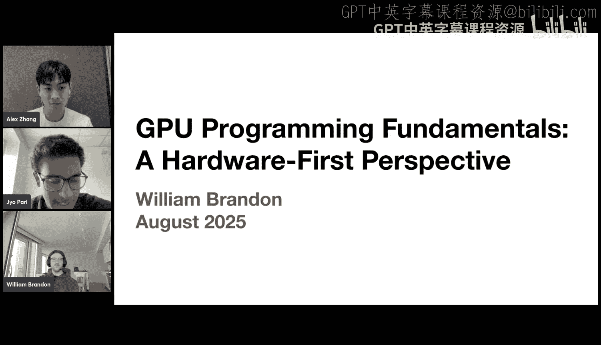

Thanks for the introduction hi everyone， So today I want to talk about sort of some like really fundamental aspects of GPU programming and trying to talk about sort of what it takes to build a really strong foundation for conceptual understanding of how to program GPUs。

So who's this talk for so my understanding。As the audience here is kind of a mix of people that are more on the system side and people that are more on the machine learning side and I imagine that some of the folks in the machine learning side may be。

are like hopeful or curious about writing kernels in the future but are like still kind of trying to learn how to do it and so I think the real like intended audience of this talk is like anyone who either intends to write a kernel sooner or might want to write a kernel at some point but you're like still trying to build the foundations of your understanding and for those of you in the audience who are a lot more experienced。

 I think a lot of this might seem more basic to you but I hope it still helps you see things at least like a little bit differently than you maybe thought about them before or gives you like。

It's just like some slight additional clarity。And since I'm going to be talking to basically how to think about the performance of GPU hardware。

 this really applies to any language whatsoever that you've used to program GP。

 so whether you're writing kernels sort of directly in NCUa or whether you're using some kind of higher level DL like Triton ors new cutlas for。

 all of these same principles applied because they are the principles of the underlying platform that you're writing。

So who am I， I think you've already heard a little bit about this， but。So before grad school。

 I spent a bit of time at NVIDdia， working on deep learninging compilers there。

 and then did got like halfway through PhD at MIT， working on LM efficiencyency research and I think one of the highlights for me was helping co-create this class on GP programming。

 and I'm currently at Anthropic working on making Claude faster and more efficient。

And the content for this talk is mostly adapted from essentially the first two weeks worth of lessons or some of the highlights from the first two weeks worth worth lessons in MIT's success say thank for。

 the course that I worked on last fall， so this course I yeah cocd it with my advisor。

 Dr Ma Kelly with another Ph student and Nikquiita Lazrov and the materials for this are all online and if you're like if you end up being like at all interested in the of this talk and want to like learn more dive moreative details。

I personally， I think we did a pretty good job putting together the labs for this course and what labs one and labs two are basically an extended version of the content of this talk。

 so yeah recommend you check that out if you're interested。All right， so we're here to write kernels。

 we write kernels in let's say KUa what is a CUDA program。

 so if you take the programming interface of the Cuda programming language at face value。

A Cer program is a definition of some function in a Clike language and then this like launch command runs which runs many copies of that function you defined in parallel on your GPU so if you've ever tried to like launch a C kernel before you probably saw that there's these two parameters you have to specify。

 you have to give it a number of so-called like thread blocks that you're going to launch you say for every thread block。

 the number of threads that it's going around and then somehow magically the GPU runs all these threads and all these blocks in parallel and it does or computation and everyone's having。

This is sort of the story that Ju is trying to tell。

So when you think about a Cer program from sort of the software point of view。

 the picture you have in your head probably looks something like that。

 so you've got sort of this array of blocks and then within each block you've got this array of threads and each of these threads is a little program that's doing some work in per all of the other threads。

So。Let's look a little bit more about ways that this model can show up in practice and we'll do this in terms of the sort of performance puzzle that might come up when you're trying to actually write and profile。

So suppose that we've got a cor， it runs reasonably fast。Slve some problem for us。

 I don't know it like add to vectors or something， and we're currently launching it with 128 blocks of 1024 threads each and it works well。

And save that now as an experiment， we try to tweak the number of block the number of threads per block pre。

 so now we say instead of a block having 1024 threads which is actually the maximum that video lets you have in a thread blocklock。

 we say we're only going to use 256 out of the 1024 maximum of the threads that we could have in a thread block。

 so you might imagine and I think there was a point when I was learning programming where my expectation was that if you sort of have the ability to run 1024 threads。

 and you opt to only run 256 instead， then maybe you're somehow like only getting 25% utilization of the hardware。

Or something and it's going to run like forX slope but but for many kernels。

 if you actually try to do this， you actually try to bump down from from 1024 to 256。

You find that they， they actually run at the same speed。 And， and so this。

 this is kind of mysterious。 What， what were， what were those like other three quarters of the threads doing if。

If running your program on a smaller number of threads each doing more serial work runs at the same speed。

 so we can ask like， why do we sometimes see this up？

And there's another puzzle that I think often trips people up when they're starting to write through programs。

 which is say we start with that same kernel again in its original configuration but now instead of tweaking the number of threads we're tweak the number of thread blocks so we say now lets we bump up our 128 thread blocks to 133 thread blocks。

 so this is not a big increase in the number of blocks， it's like a 4% increase and。

So you might expect that like okay we' we've sliced up our problems slightly differently it's now it's now running across a like slightly larger number of blocks but probably this shouldn't affect performance that much right but if you actually run this。

 especially if you run it on an H100 GPU in particular which we'll get to you in a minute。

You might actually find that that for certain kernels it runs like 2x slower to increase the number of thread blocks by 4% and and so why does this happen？

which seem kind of mysterious so I think the thing I'm trying to get at here and we we'll revisit those puzzles in a bit is that this sort of like threads and blocks model of how to think about a career program is I mean it's useful because like these are the abstractions that NNviIdia provides and you kind of have to you have to deal with them and they have some benefits but this is a very sort of incomplete view of what's actually going on from the perspective of trying to predict and reason about the performance of your program。

So I think that for beginning KUDA Program， there's often a better question to ask than like what is KUuda and how do I use it is what is a GPU and what can it do？

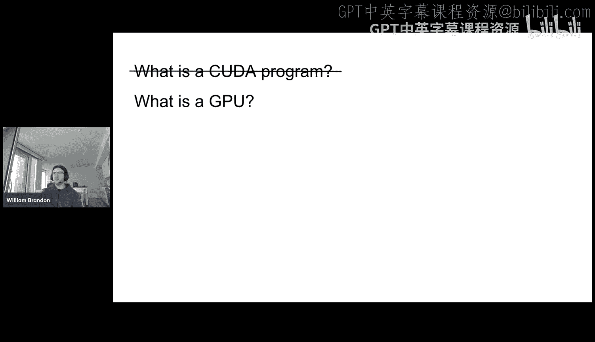

And so so here's a picture of a GPU from N videodia and and actually you know this is the board so it has like a bunch of random electronic components on it and stuff but if you zoom in on like the actual GPU chip。

 this is what it looks like。

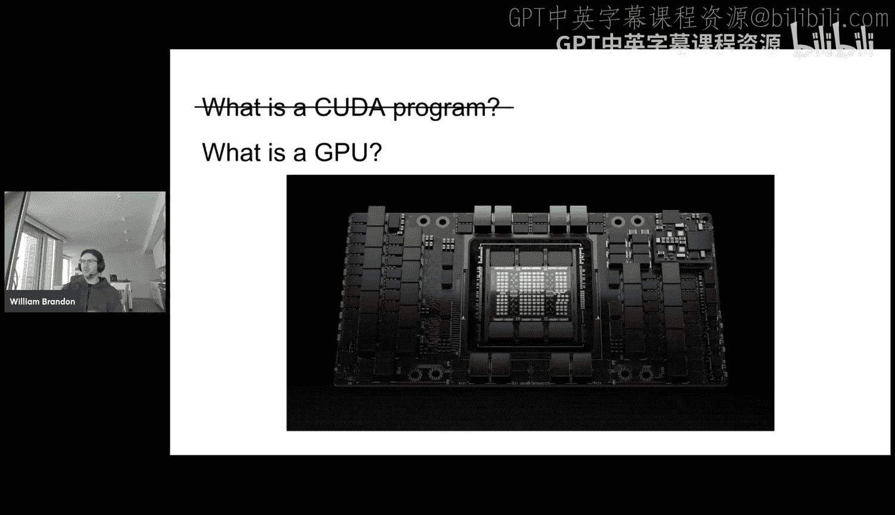

And if you look at this picture， you might notice something like maybe the most conspicuous sort of visual feature of the GPU in this picture is that it's made of a bunch of tiny squares。

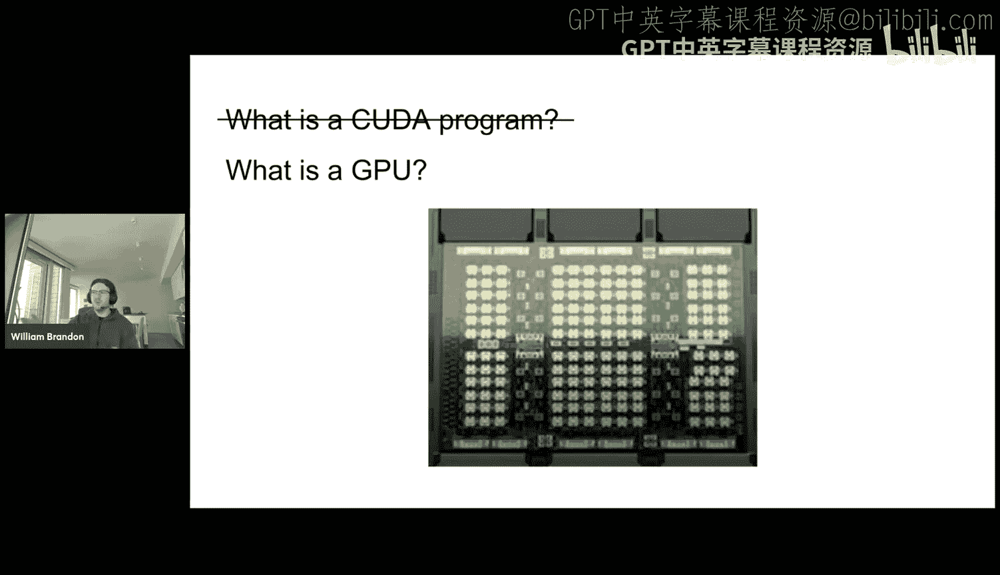

And this， I think， is actually a like if you only have like a one sentence description of what a GPU is。

 a GPU being being a bunch of tiny squares， a fixed number of them is a better mental picture to have than a GPU being like a thing that runs amorphous like a thing that runs like an amorphous blob of like blocks and thread blocks where you can like set the number of them that you have and so so GP's bunch of tiny squares like what are these tiny squares So N video calls these streaming multiprocessors usually abbreviated gene to SNs。

And how many of these do we have we have around 100 in this picture there's like 144 on the die in practice。

 if you like go to buy H from 100 and you like ask it like how many Ss do you have it'll tell you I have like 132 because some of the 144 Ss here they don't survive the manufacturing process and so of like they get disabled in software but for like most GPUs on the market you'll get like within a factor of two or something you'll get around 100 Ss on your machine。

And also this entire talk is in like Nvidia terminology like AM D has like similar concepts but different words for all these things。

 So so if you try to。Understand anD processor in these terms you might need to find some kind of like translation guide but okay so so we've got 100 of these Ss or these tiny squares what is what's on one of these squares。

 what can I do so one of these Ss it's actually four smaller things unfortunately these things even though I think they're like one of the most important like units of organization of the hard run of GPU as far as I've been able to tell you don't have a super standardized name some people affiliated with like like sort of thunderkit and Ta research world I think I've heard refer to them as quadrants some in video documentation occasionally refers to them as partitions in the cores I taught last fall we refer to them as warp schedulers but but they're basically these sort of four computing cores that you have within within one SMM。

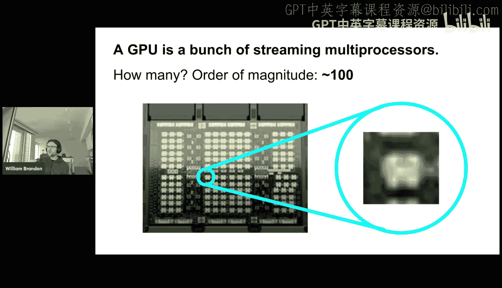

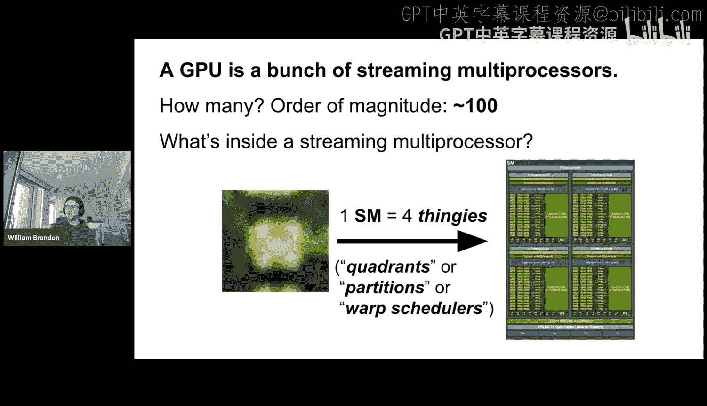

嗯。😊，And and so like how should you think of one of these things， Well。

 I think from sort of like fundamental like computer architecture principles perspective， actually。

 the best approximation that you might be more familiar with for how to think about what a work scheduler is is that it's kind of like a CPU core。

 It actually has like a lot of design similarities to a CPU core and so the biggest caveat to this is that it's a CPU core that's like really strongly specialized for running Cindy instructions and we'll talk about that in a bit。

 but it really has a lot in code。 but both a work schedule and a CPU core。

 they both issue a stream of instructions per sequence。

 So it's like on like every clock cycle it gets an opportunity to like issue one instruction and get it to like start doing stuff on the function units it has it has a bunch of like physical like state resources that it uses to store the execution state for the。

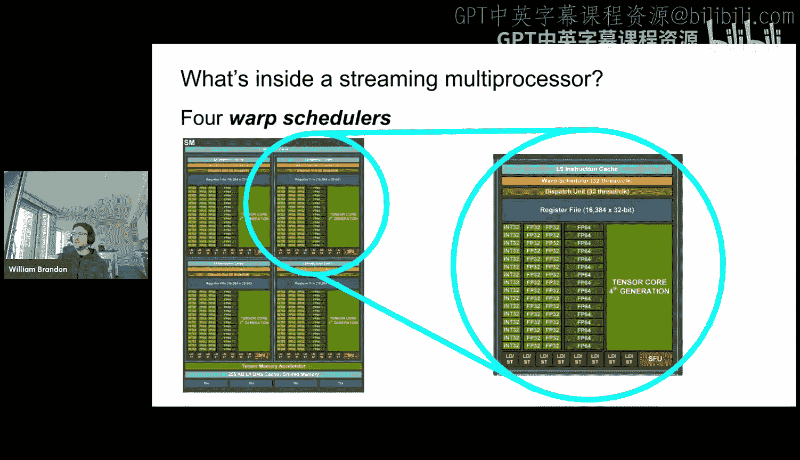

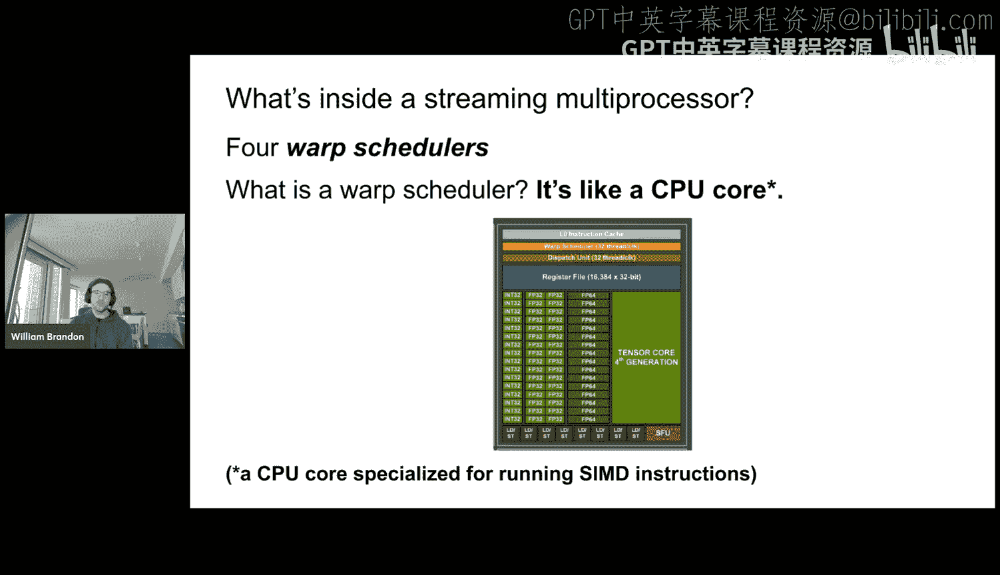

For the like programs whose instruction streams it's running。

 so that means like if you've ever looked at like if you' were taking like a CPU computer architecture course。

 like a running program is sort of defined by like the position of the program counter telling you like which instruction you're on and by the values of registers in the program。

And so in the same way it a CPU course tracking all that information in some like hardware state award scheduler is also tracking the same information。

And the work scheduler has a bunch of functional units。

 which in this diagram from the video that you see on the left。

 are kind of visualized in the stylized way where bunch of like you've got a bunch of circuits that can do like integer math and floating point math and also for the last several years。

 the thing everyone's really excited about is that it can do like matrix multiply math using some specialized hardware。

And so when the word schedule issues instructions， those instructions kind of like schedule onto the functional unit。

 so they cause the functional units to do stuff and produce new data which sounds goes back into the register file。

All right， so。

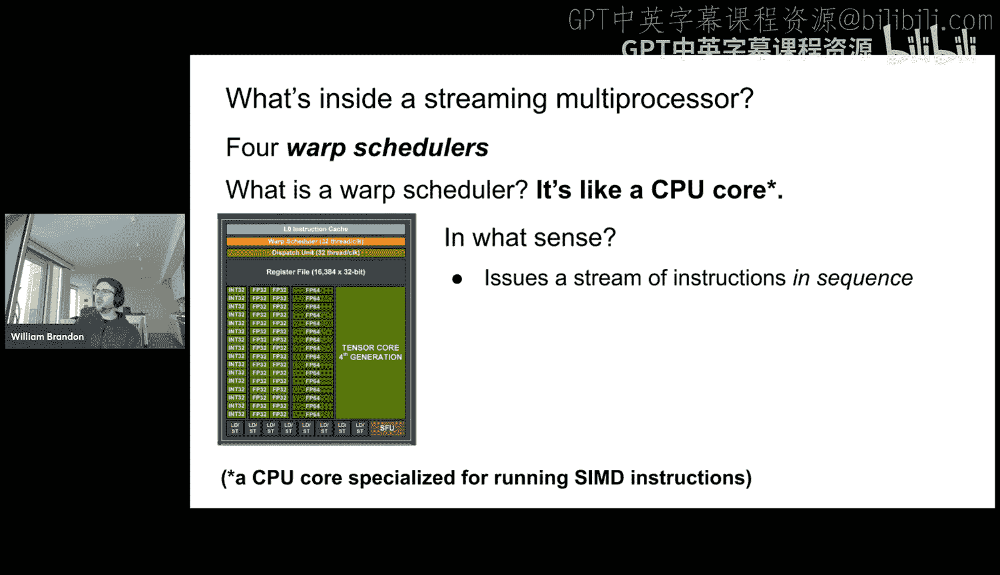

And I think this analogy like really is quite closese。

 if you look at like an AMD CPUU on the left and you look at like an inviA GPU on the right。

 it's the same basic design where you've just got this C of course and each core has like a register file it has some control and it has some functional in。

And maybe the most conspicuous difference is that on the GPU you've got this you've got this extra level of hierarchy which which is the which is the S which is grouping for work schedulers together and in this talk we're actually not going to talk that much about why that SMM level of organization exists but the short answer is that it exists。

It exists because that's the level which memories or resources are shared。

 and we can talk about the murder in the QA， if people are said。All right。

 so that thing at the bottom of the screen should have animated later， but at this point。

 maybe if you have a bit of experience with TuA or if you're like thinking about how this relates in the previous slides。

 you might be sort to get a bit uncomfortable， it might seem like there's some dissonance here because it kind of seems like the math doesn't check out on everything I just said as we talked about earlier。

 like when you're launching a kernel， you might very typically launch a K kernel with up to like hundreds of thousands of threat。

Like the kernel launch were looking at earlier like like it's launching like 120 blocks each has like 1k threads that works have like 1031。

000 threads that we're launching but we just said that a GPU physically it only has hundreds of warp schedulers and we're claiming like each warp schedules like a CP core like if you multip out like 1032 Ss on an H100 by four warp schedules per SM you get around like 500 warp schedulers so what gives like how can we be running hundreds of thousands of threads in parallel if we have these if we only have like a factor of100 fewer。

The fewer award schedulers。嗯。And so there's actually three answers to this。

 and thatll also should have animated later。呃So。One answer to this is that a warp scheduler every time it issues an instruction is not issuing that instruction in a way that serves only one thread warp schedulers as I mentioned a bit earlierre they're like a CPU that's been optimized for running CinD instruction。

 single instruction， multiple data instructions where。

You're basically operating on a whole vector of data at a time so what the hardware is actually doing is it' sort of like grouping the data for like 32 consecutive threads together into a big vector。

 like physically what's happening in the hardware and the work schedule every time it issues one instruction that instruction is going to do a sort of 32 threads worth of work across 32 sort of lanes of this vector。

嗯。And the other thing that lets us run more threads than we have。

They'll have the listll one more threads than we have。

Wp schedulers on which to run them or even even more than a factor of 32。

 more than we have warp schedulers to run them is that a warp scheduler can it's not restricted to just running 32 threads worth of worth of compute at a time。

 even though a warp scheduler on any given cycle it can only issue instruction for 32 threads。

It can like time slice different groups of threads together so on one instruction it might be around one cycle it might be issuing instruction for some group of 32 threads and then on the next cycle it's assuminging instruction for different group of 32 threads and so this means you can you have more than three or2 threads with theres sort of state resident on a warp scheduler at any given time and finally if you ask KUDa for like a huge number of blocks if you ask it to spawn like thousands and thousands of thread blocks。

It will。It won't crash， it'll instead run those thread blockss serial one after another on various Ss of the GP。

So actually， I think I have a few more slides to elaborate on exactly what all these pieces mean。

 but I think now would probably be a good time to interrupt your questions and go back and explain anything that people found wasn't clear。

I think there aren't any， there are some comments in the chat。

 but no no specific questions on what was going on here。Okay。

 comments does anyone want to tell me I'm wrong about something there is there is there are now things pouring in Okay。

 so Vikram asks， could you explain the relationship from threads to blocks？

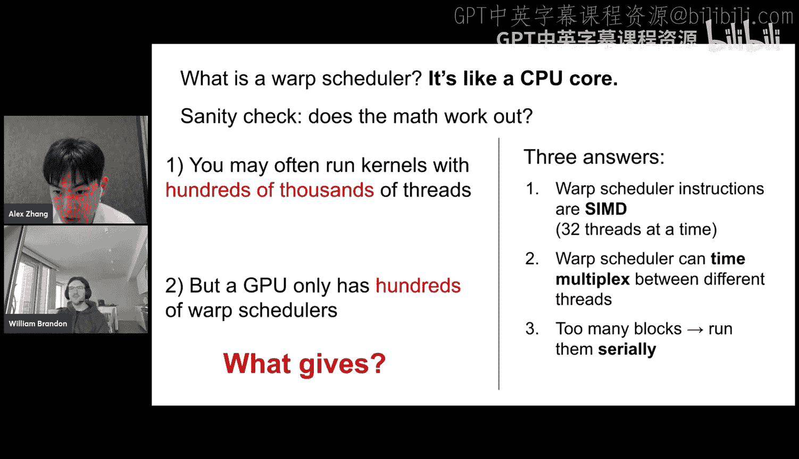

Yeah so so at the soft so I think first sort of important to flag to like both blocks and threads。

 they're like fundamentally software abstracts， the hardware is not structured in terms of blocks and threads so I guess with that said。

A。To a first approximation， you can think of a cocur as just saying I want to run a certain total number of threads and I want you to basically slice those threads up into groups of 32 and those groups of 32 are called warps。

 which is why thing called a workp scheduler and。And then I want you to map those warps onto the various warp schedulers of the gene and start running them as fast as you can。

However， there is this extra level of organization where you say in addition to having sort of a a certain total number of threads。

 we're also going to say that we're going to group these threads together into these larger units called block so maybe that we're saying we want to have like 131。

000 total threads but each like 1024 consecutive threads we're we're going to say like belong to the same block。

 and so what are the consequences of this why do we care that 1024 of our threads belong to the same block if those different blocks we're not going to get like super deep into this in this talk but the answer is basically threads on the same block they can communicate with each other very efficiently through a shared memory scratch pad shared with a sense of shared between threads within a block and they can also synchronize with each other which is kind of necessary to make the communication work and so this means you can do interesting things。

can create consumer producer cu relationships where like some warps are some warps are like writing into a queue that's stored in the your memory scratchra pad and then other warps are like popping things out of that queue that's stored in the your memory scratcht pad and they're synchronizing all of this using using some ofphos or something。

And so that's why we care about blocks， they're the unit of efficient cooperation between threats。

 hopefully that answers the question。嗯。

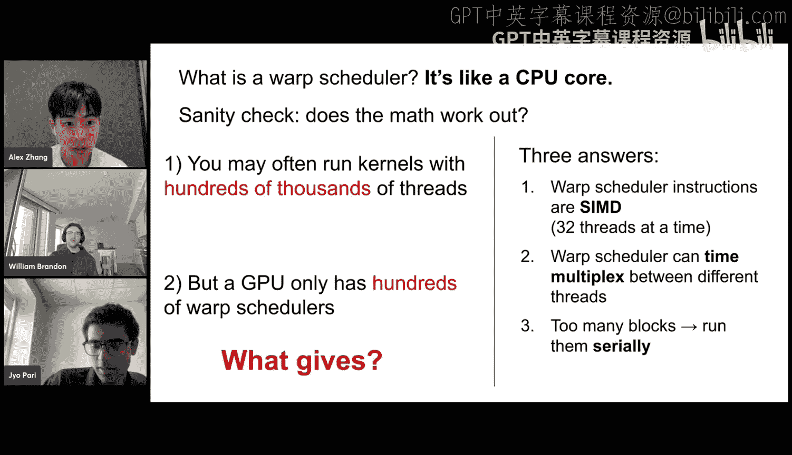

Another question was。Let me head I ask， okay， basically they're asking like。

 does the warp Schr have 32 cores to process 32 independent execution contexts or is it different？

Great question。 So it depends what you mean by a core。 So。

 so the kind of unsatisfying answer is of like some things you have like。

Some things you have like 32 copies of them or like some large number of copies of them depending on exactly how the hardware is tune and like some things you like essentially only have one of so what do you only have one of the most conspicuous thing you only have one of is like the sort of like instruction decode an issue logic that can like decode an issue one instruction per cycle。

And so that means that。It is like physically impossible for the work scheduleular hardware to issue like 32 different instructions for 32 different threads on one cycle it just can't do it what it can do is issue one instruction that does like the same math operation say on 32 independent units of data so it might be that it issues one to add instruction and then that add instruction is going to pull it's going to pull like 32 lefthand side like scalar operations in the register file and then like 32 right-hand side scalar opera in the register file and then it's going to and it's going to add those elementwise and then put the 32 results back in the register file。

And then then a natural question that you can then ask here。

 especially if you're familiar with the way that Cic code actually looks is what if I try to get the threads to do different things what if I have like an if statement that says like if my thread indexes even that I do this and if my thread index is odd that I do this other thing and the short answer is that the harbor is basically going to use masking to to make sure that it's only ever actually issuing like one single instruction at a time and that those instructions are just like sort of operating on the right subset of threads for everything to work out in the end so concretely if I say like I want my even number of threads to do an addition and I want my odd number threads do a subtraction what's going to happen is that you spend one cycle doing an addition。

 you spend one cycle issuing an addition that sort of。

Acts on half the threads and you spend another cycle ising a subtraction that acts on the other half the threads and as you can imagine。

 if your threads end up doing like very different things。

 if like all 32 of the threads in a work or doing like 32 different things。

 then this is going to have a huge performance cost because you have to。

Because you have to spend like 32 cycles issuing like 32 different instructions to service all the to make progress on all the different threads in the work。

And then in terms of what state is being tracked the。The register file is kind of tracking。

 it's tracking separate like state for data registers on like a per thread basis。

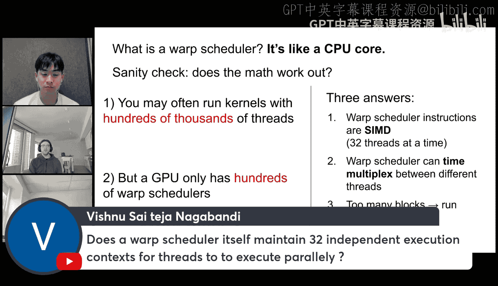

hopefully that I think that yeah yeah， yeah I think that's that's a very good answer Another question。

 oh， there are more is why specifically the number 32 and are there trade offs to running more or less threads as a warp at a time？

😊，So it is a。

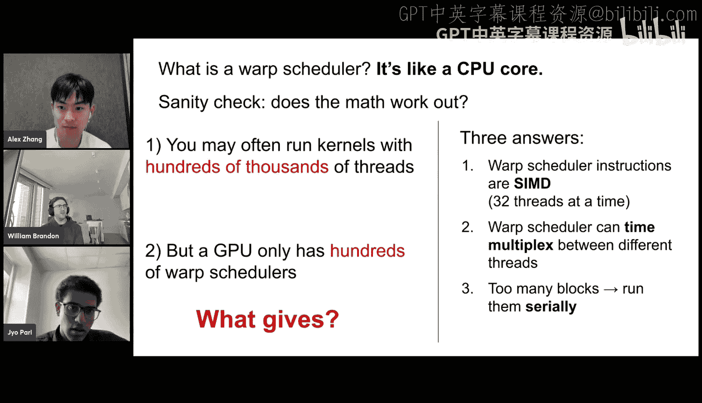

It is a fixed design decision in the hardware it has been for many years that。

That the the unit of warp scheduler like Cindy execution is 32 threads I think this has been true basically since the first。

This is the first programable of GPPU is capable of Vancouvera。

I think an interesting question is like as a hardware architect designing a GPU。

 why would you choose 32 and I think the answer to that is not obvious you need to have sort of like。

You need to have a theory that like here's like some corpus of programs that you want to be able to run efficiently and then you like do a bunch of empirical analysis on like here's the costs and benefits of choosing different work sizes in terms of like。

Like。So basically the two forces pushinging in either direction here are on the one hand you' like your war you'd like your warp graing la to be as small as possible because gives you that gives you as much sort of freedom to have weird control flow without incurring performance palalties as possible so if the warp size were like eight threads instead of 32 threads then then it would be。

Like then you could have like。Differentent groups of eight threads all doing different things at a time with no performance penalty。

 whereas if you try to do that on actual video hardware。

 you'd end up incurring like a factor four like instruction issue。

 like performance penalty because you'd have to spend four cycles issuing issuing four different instructions for the four different groups of eight threads in your work。

On the other hand， from an actual physical circuit design perspective。

The control logic is associated with like issuing instructions and tracking dependencies between them and so on。

 that is expensive that uses like that uses area on the chip and it uses power and so the more threads you have at a work。

 the more bang for your buck you get on that control logic the more data you can process per sort of unit of control logic process that and these two things together like create some kind of view shapepe curve that like there's like like NVIdia believes the minimum。

Of some kind of expected cost measures is at 32。

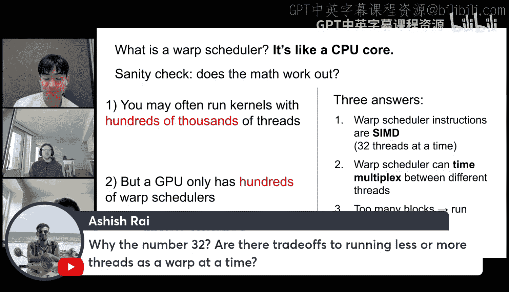

In interest of time， I will just ask two more questions。 We can。Socle back to anything later。

 one question was basically the term scheduler implies some kind of scheduling of a component and they're asking like what is the lowest level of component that is like directly used for operations or computation on the GPViU？

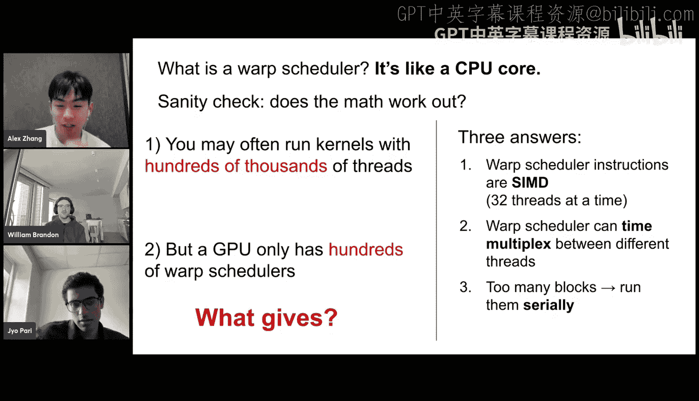

嗯。I'm not sure I entirely understand the question。Like yeah。

 what' does asking him for like the lowest level of component？

My guess is they mean like what is the hardware component that is actually being run。

But I'm not sure。Yeah， so， so like the the the， yeah。

 if you mean lowest level in terms of like levels of abstraction like。Like the warp schedule。

 it's it's like a physical thing that exists on the chip。 So so in a sense。

 it's like as low as you can get in that like there's。There's sort of no。There was like no illusions。

Like intervening between you and the work scheduler like there really is like if you could look at it with a microscope。

 there like really is actually like little like like one fourth of one of those little squares is like one work scheduler and and it's running your code I think there's also separately this question about scheduling。

And yeah， and I think I'm also like not I'm maybe not entirely sure what's being asked there either。

 but it's something that might answer your question。

 if your question is basically like like what concretely what kind of scheduling is actually going on the sense in which the warp scheduler is doing scheduling is that it's basically keeping track of dependencies among instructions and it's ever and basically try to issue instructions as soon as their dependencies are ready or available。

So for example， if I try to issue like an ad instruction and then another ad instruction that depends on that ad instruction。

 I believe on most of it all in videoGs， an ad instruction has a latency of four cycles。

So basically the work schedule is going to like issue the first ad instruction and then sort of like try to run the next ad instruction。

 but then find that it can't because like four cycles have not yet elapsed that would like supply the data that the second ad instruction depends on as its input and so the work schedule will instead sort of make sure that the second ad instruction only gets run after the。

After the first one's output is guaranteed to be available。

And I can make these scheduling decisions in fairly sophisticated ways because。

Like because of this time multiplexing thing that we like mentioned in the slide。

 we'll talk about a bit in a few more slides。The warp schedule is actually sort of like juggling like multiple warps worth of instruction streams at a time and while one is unable to make progress。

 it'll like try to schedule instructions from the other ones and this lets you sort of keep the hardware at high utilization。

And so so that I hope that at least gives a flavor of the kind of concretely the kind of scheduling that's going on inside this thing。

 and I hope that at least partially answers your question。

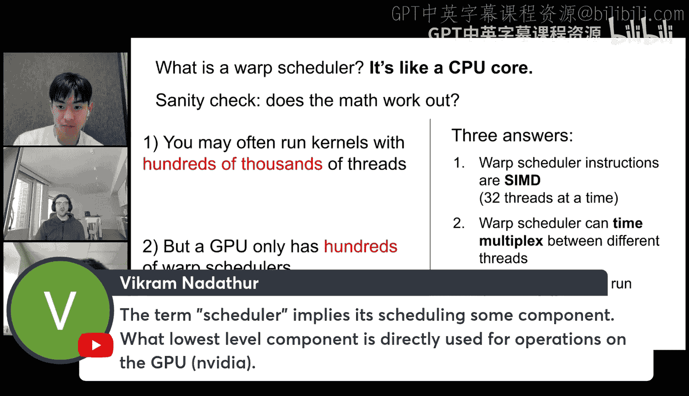

And then the last one before you can move on is just to follow up from the like the thread divergence example。

 they're basically asking like if you have that like that branching case is the throughput of the scheduler cut in half。

Essentially yes， yeah， like if your even number threads or all trying to do one thing and your odd number threads are all trying to do another thing。

 then you're getting sort of only like 16 threads worth of work done per instruction instead of 32 threads worth of work done and any ends and so it is basically going to copy your like instruction issue through put per thread in half。

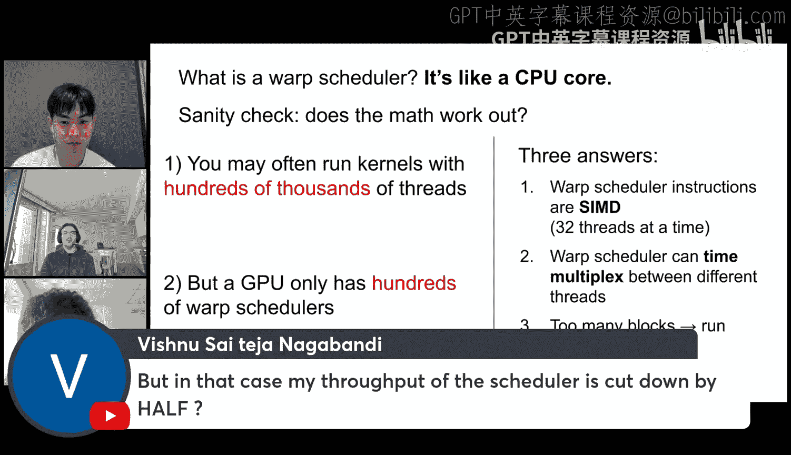

Okay， thank you so much， I will let you continue and yeah。

 feel free to keep asking more questions in the chat and we'll get to them。

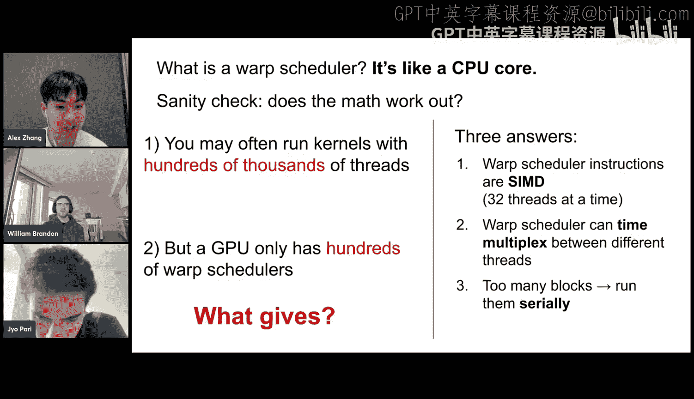

好 great。All right， so I guess just elaboratelaborating on some of the things that were on the previous slide。

So what concretely do we mean when we say that the work scheduler is running these like Cindy instructions。

 so I imagine some of you might have at some point maybe in like a C programming class or something if nowhere else encounter this idea that on pretty much all medium into highend modern CPUUs you have these kind of obscure but very powerful instructions available called CIinD instructions that typically they do like math operations or other simple like integer logical ops or things like that。

 but but with a twist that instead of operating on just on just like water like a few scalar values at a time。

 they operate in these wider vector registers that let me process like many elements in perel so this is sort of pseudo code。

 this is like not a real CID API that exist as far as I know but you could imagine。

AndIf you're writing a C program that's to write that's trying to do attendity operations。

're you're making these variables whose data type is like vector of 16 32 bit floating point numbers or something like that instead of doing the sort of more naive thing of operating on data types。

 which you're like a single 32 bit floating point numbers。

And then you're going have these special instructions that operated these vectors and will do things like do like 16 edition operations at a time。

If。If you like explicitly use the API。嗯。And on CPUs。

 this is very powerful because you can just get like much better like like arithmetic throughput if you use these instructions that do many things at once then if you than if you insist on like doing everything in terms of individual scalrs and and this is like exactly the same at the hardware implementation level。

 this is exactly the same trick that's being used to execute all GPU basically so so the。

The like underlying physical design constrained reasons for why you'd want to build this feature into your chipA are the same between CPUs and GPUs。

 the only real difference between what the GPU is doing and what the CPUU is doing when it runs CID instructions is that for one thing the GPU can kind of only run CD instructions it's like the instructions such as doesn't have any non-CinD instructions and for another thing the way that this is exposed to at the software level is different so if you've like ever written K code you know that like conceptually what you're doing is you're writing a program thatscribes the behavior of a single thread。

But we just said that single threads don't actually have their sort of own independent control logic。

 and instead it's like 32 threads at a time， sort of all step together and execute the same instructions。

And。And so if you want to have an accurate mental model of what the hardware is doing。

 you kind of need to translate the code on the right here in your head when you see it in a career program into the code on the left or I mean。

 you'd have to replace the 16 by 32 because that's how GPUs is tuned but conceptually writing what looks like the sequence of like scalar operations here。

 is actually physically going to cause the GPU to do like 32 scalar operations in parallel on like 32 independent copies of this program that you wrote and so this means that you kind of have to take this perspective shift of like。

When you're reading Cupa code， like not really taking it at face value as。

As having the performance that you'd expect of like a C program that looked the same。

 you really kind of have to in your head， think like the processor and imagine how。

How every group of 32 consecutive threads is going to step together。嗯。All right。

 we also talked about how the warp schedule tied multiplexed between different threads。

 So so this is， I think， actually maybe。In my experience as someone who like learned Kuda a few years ago and also like like teaching this course。

 I think this is actually one of the like hardest and most subtle points to grasp in。

In like in like really understanding the sort of。Like performance。

 like the metal model that you need to have for reasonable about the performance of GPUs。呃。

The kind of key idea here is that a warp scheduler more can be tracking state for more than 32 threads at a time。

 like like even though the warp schedule are on any given cycle。

 it can only issue an instruction for like 32 consecutive threads and a warp。It， it can。 it can。

Even on the same cycle， still have some like register state sitting around and some like program counters sitting around for threads that it is not assing instruction for on that cycle。

嗯。And。The reason that the hardware has this and and what the work schedule will do is it will'。

it will like somehow try to juggle these like multiple warps worth of instructions that it needs to issue so like it'll run like instruction from one thread from one warp and then an instruction for another warp and then an instruction for the first warp again I think up to actually like quite high numbers of warps I think the max I think the maximum the number most GPs if I recall correctly it like eight warps at a time that it can be like juggling in instruction stream for and so like why can the hardware do this like it's not actually obviously to me it wasn't obviously when I first learned about this。

Why it's beneficial to have its features opposed to just doing everything within a single warp if the instruction issue through is same。

And basically， the reason is that within a single warp。

 you might have like dependency chains among instructions that mean that you would need to be spending some time stalled。

While while executing that instruction industry， right， so。

 so so so say of an instruction where after we issue it。

 the results aren't available like immediately on the next cycle。

 you instead need to wait like you instead need to like wait an extra cycle， say before the。

But before the results are ready and any any dependent instructions can execute so so if the pattern of instructions that you're running within within a single thread or a single warp has this kind of like long serial dependency structure to it。

 then running just one warp is going to leave the warp schedule stalled for like potentially very large fractions of its runtime。

But if you have other independent warps that。That can whose instructions can go and like fill in the gaps。

 then you can recover the sort of full throughput of the hardware and so if you as the programmer know that you have a bunch of independent。

Work to do like you want to like you have like some like many million element vector and you want to you want to do some independent operation on every element of that vector or something then。

Then you can map different units that work onto different warps。

 and then the Warp Schr will use work from warps that are ready to make progress to fill in the gaps in the schedules for warps that are not yet ready to make progress。

And I think an important sort of。Piece of the picture to keep in mind for this is that。

You also have this sort of finite pool of functional here。And the functional units do things like。

It's like a bunch of circuits that are like floating point multipliers and adders and like integer bit shift circuits and like interfaces that like talk to main member you to do like loads and stores and a bunch of stuff like that。

Different types of functional units。Have have different have I would expect for different throughputs and and have different limits on like how many instructions they can be like helping execute at at a time。

 so so I think it is the case， for example， that like floating32it floating point addition on an Nvi GPU I think you can basically you can basically issue a floating like a3tit float like addition instruction on like every cycle and。

And you will like never overwhelm the you will never overwhelm the like floating point adder units。

 but there are other instructions like for example I'm pretty sure like like 64 bit floating point edition that the SM is provisioned with many fewer resources for and so and so if you have like independent warps that are that are like all trying to run。

Like 64 bit floating point addition instructions they're going to interfere with each other from a performance perspective like they're all sort of contending for this one scarce resource。

 which is the like 64 bit floating point functional units and they'll。

And like having four warps all trying to drive the like 64 bit float adders。

Like it's not going to just like magically run 4 x faster than if you had like only one work trying to do that because。

呃。Because going you're going to hit the underlying group of limits of these share functional units。

Like like for any given workload， this actually like it was like。

Like analyzing all this stuff goes like pretty deep and is like not trivial and you have to like pull up lowle in video documentation and like consult tables that tell you the like throughput of like different instruction types and sometimes you need to run microbriite sparks like reverse engineer things that aren't documented in in docs but I hope that at least this sort of rambling spiel gives like some flavor of the kinds of considerations that are useful and keep in mind when you're trying to reason about the implications in this kind of time multilying behavior and also by the way。

 like the cores of your CPU in your like laptop or phone or whatever。

 they can do this too typically not with this high degree of concurrency it's it's commonly like。

It's commonly like just two threads at a time per CPU Cor or something。

 but this is also very much a consideration in CPU performance engineering as well。All right。

 I think now's probably a good time to take more questions because I yeah。

 I actually I actually get to like maybe minor questions。 So one is the。

Is the program counter the same for all the threads in the warp？Yeah， so this is a。

So the answer to this is actually pretty subtle。To a first approximation。

You should kind of imagine that the answer is yes， at least for the purposes of instruction issue。

It's like for。For instruction to issue。It's like you have some。

You have some instruction that at least one thread in the warp wants to execute。And。

That is identified by some program counter pointing into the program binary。嗯。

And then you issue an instruction for that one value of the program counter and the state of like which threads like are or are not like participating in that instruction。

 you can imagine it as being tracked by like a Boolean mask。

That that has like a stores like a bit for every thread saying like is this thread like currently active for the for the instruction that we're that we're executing where this gets more complicated is when you do like。

Like。weird patterns of synchronization where like some of the threads in your warp try to like block on like some semapho reaching a certain value and then like other threads in the warp need to make progress beyond the point where there's the first set of threads blocked in order to unblock them。

And actually like the behavior of this has changed across across GPU generations and is also like。

And you also need to be careful we like different kinds of instructions will like treat the semantics of like somewhat differently from other instructions so basically the short answer is like there are edge cases where the。

Where the processor actually does need to track independent program cover state per thread in order to avoid deadlocks。

And if you're interested about those， then like。Email me after talk we can so I guess like if you're if you're writing in Kuta like you wouldn't really care about this right it depends what kind of synchronization you're doing like that there are cases where basically you can you can write programs that that would deadlock if the hardware were not capable of tracking independent program counters per thread。

But they do not in fact deadlock and it's because the hardware can track independent perform independent program counter per thread I see。

 I see。 and then the second question is just like are the the particular like thread indices or like whatever unique identifier always grouped to the same warp so like in this example here like are thread  zero to 31 always grouped to the same warp。

Yes， but basically a warp yeah， threads have these like ingers and a warp is definitelyly 3032 consecutive threads。

With the start of the interval aligned to a multiple of 32。Yeah。

 with like consecutive so like so like the threads like zero through。

Thread 0331 are like always definitionly like part。

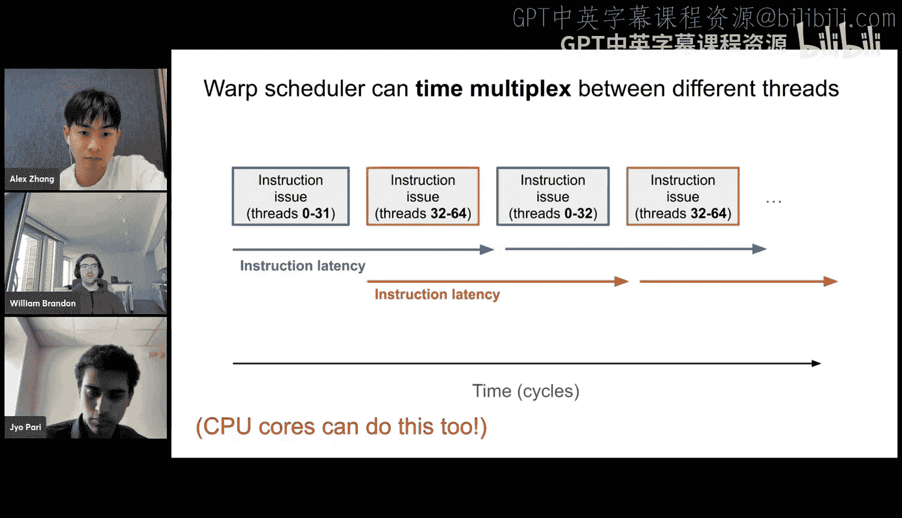

seeOkay， I will ask some of the other questions in the chat。So one question is。

 is the time multiplex on the warp scheduler？On the level of4 N warps in a thread block。

 thus in the same kernel or about concurrent kernel launches using different contexts。

So this is all within one kernel that's a great question and I think from actually from some like some conversations I had recently listen and folks。

 I alleged believe that an undocumented limitation of。

InVo's GPU hardware is that a warp scheduler can't actually like run warps from multiple different hs at the same time。

 so I think if you want to get this time multipleplexing you have to do it within one kernel。

And I think also like another thing to keep in mind。Is that the。

Is that the four warp schedulers within an SM， they're actually able to do this like completely independently each other so you can think of each one as just like。

 I mean I think that they often be running programs from like the same binary。

 but but it's like you can think of each one as its own totally independent core with its own control logic that is like as independent of the other warp schedulers as like one CPU core is independent from another CPU core。

And so that means that you're， yeah， you can get like a pretty fine granularity of inter leaving here wheres where it's it's on a per world Sch basis and not on a per SN basis。

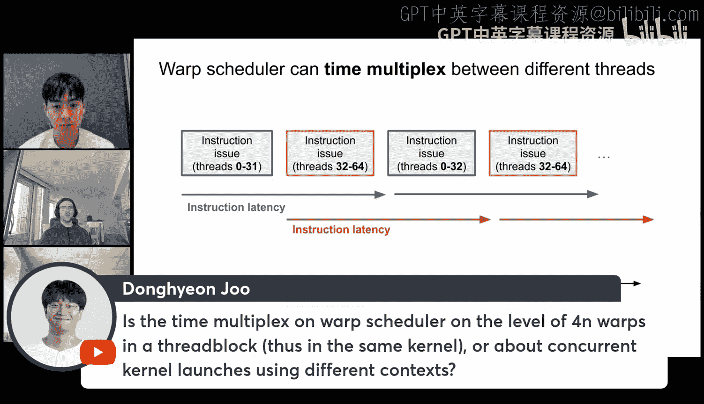

And the last question is kind of a more general thing。

 what is your mental model to avoid cash misses and take care of data locality。

 I guess they mean in your code？

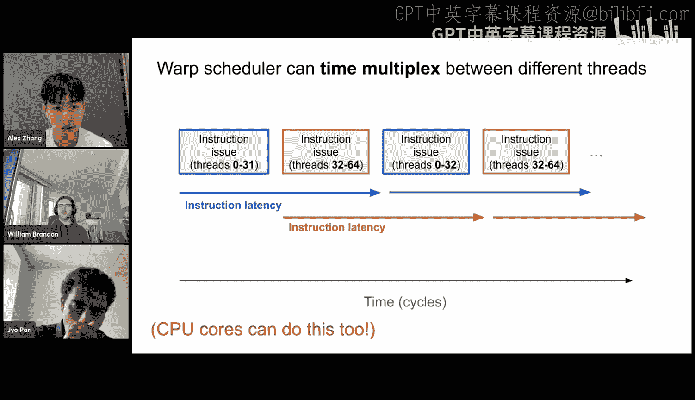

Cash wases， yeah， so so I。I unfortunately didn't really include anything about memory in this talk because it's just like it's like a huge topic and I didn't think wed have time the short answer to that is that there like is no short answer and it just like depends on。

It depends a lot on like the particular on like the structure of the particular workload that that you're trying to implement。

 I think like like。A general rule that I follow is。Don't try to rely on the implicit。

L1 cache much at all， and instead prefer to use the like explicitly addressable shared memory scratch pad in order to get like a data locality and reuse。

Yeah， I think that's maybe the one sort of like。Like easily stated like generalizable transferable lesson。

 But but short of that， it's like， yeah， you just like you just like got。

 you got to think about the specific currently writing and think about like what could be use where and how and then and then you know after you get experience with that there's patterns that show up over time where where like anything matrix to multiply flavor。

 you find that you want to like break it into roughly square tiles and then maybe like pipeline loading of those tiles with like computing on not other tiles and things like that。

 So there's like there's like。Yeah， there's like a bunch of patterns that show up， but unfortunately。

 I don't think we really have time to get into them。

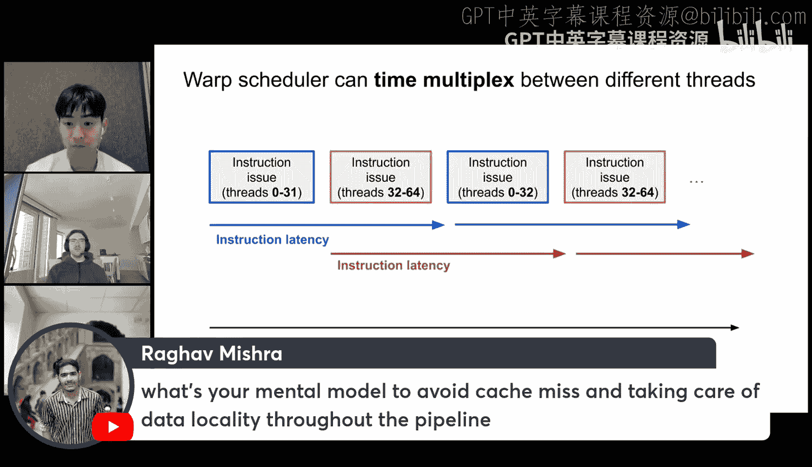

Okay， yeah， I think you can move on from here。Cool。

 so one other thing is just I think worth explicitly pointing out about the second instruction and like latency hiding and like overlapping behavior is that if your code conforms through the right patterns。

 you can also get the same kind of latency hiding， within a single work。

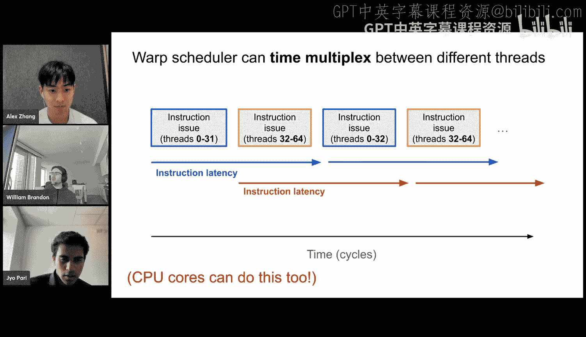

And it just all depends on what sort of the dependency graph among your instructions looks like so if you have a bunch of instructions in a straight line where each one depends on the previous one and you have only a single warp per warp schedule and then you're out of luck because you're just going to be like spending a lot of time stall waiting for the previous instruction to complete。

 you can start the next one where it gets interesting is if within within a single warp your dependency graph does not look like a straight line but rather looks like some kind of branching and reconverging like wider graph where some things can be done like independently of or looking parallel with other things。

So。And in cases where you have multiple like independent instructions or then the one instructional stream。

 the warp scheduler is actually pretty good at sort of filling in the gaps own in your single warps。

Instruction stream with other instructions from the same work。

And so this means that're if you're sort of like thoughtful about it。

 you can actually often get away with having a like relatively small number of works and still run the hardware at like full utilization you just need to you just need to think about whether you're sellinging the process sort of long serial chains of dependencies or not and so like so a way that you can take advantage of this。

I you can like unroll your loops and so maybe it's like within a single iteration of a loop body。

 all your dependencies are basically like serial dependencies， one after another。

 but maybe across like two iterations of your loop body。

 those two loop bodies are actually like independent of each other。

And they're like operating in like disjoint elements in an inner array or some pattern like that and in those cases through a combination of like manual effort and the compiler doing its job and the Warp schedule are doing its job if you know what you're doing you can you can get like interleaving and overlapping between the latencies of like different instructions belonging to like different iterations of the unroll loop and anyway so so this is like this is like a somewhat more advanced class of optimizations but。

But I think it's important to know that having multiple independent warps is not your only recourse if you find the warp schedule getting installeded on a lot of serial chains of construction dependencies。

嗯。And CPUUs can also do this too CPUs in fact are much better at this than GPUs because they have to achieve good performance because CPUUs have like many fewer threads and much less like independent work。

 and so the only way to get good through but is to like really。

 really aggressively try to try to extract parallelism from the instructions of a single thread。

All right， so I guess to recap some things and think about the implications of what we've been talking about。

 so I think one useful number to have in mind when you're doing K programming is how many threads do you need to keep an SM and the minimum value for this you can compute is just like four warp schedulers on the SM times3 to like threads per warp scheduler you need like at least 120 threads on an SM in order for it to not have some like idle warp schedule is basically。

嗯。And。And then also sort of an analogous question you can ask is how many threads do you need to keep the entire GPU busy and this is going to depend on the number of SMs on the GPU so let's take look at an H100 as an example。

And H1 100 has like 132 Ss， and if each of those SMs needs 128 threads in order to keep it busy then you need like 16。

 you need like like around like 17，000 threads in your kernel in order to have like in order for to even be theoretically possible that you'll like saturate the throughput of the GPU again。

 in practice you might want more than that because you want to exploit the time multiplexing behavior somehow now。

 but this is kind of like a bare minimum。嗯。And yeah。

 so it's often better to have more workss per work scheduler， but this is what you have to。

This is the waterabout。All right， so so let's let's， let's return to some of those puzzles that we。

Talked about it at the very beginning of this talk so so the first puzzle we mentioned is sometimes you'll have a kernel where you can like decrease the threads from a maximum down to some like much lower value and I think doesn't hurt performance nearly as much as you expect and we're now like pretty well equipped to explain this from our like understanding of the hardware which is that。

Both of these two configurations stand a good chance of being able to saturate like 128 full Ss。嗯。

And oh I guess one constrain I didn't mention is that。

All the like because blocks are intended as the unit of like。

Communication through shared scratch pads。In。In a kernel like the threads of to block and talk to each other through a shared scratch pad at the physical implementation level。

 that means that。All the threads in a thread block need to live on the same SM you can never have a thread block that crosses SMs like this current launch here it can schedule across like at most 128 Ss so like at an age 100 it would be a guarantee to not be using some Ss and then within each of those SMs it's going to try it's going to try to like partition its threads among various war schedulers。

But I think this is kind of interesting that you can。That， that because you only actually have like。

Because you only have four warp schedulers， you can saturate them with 1024 threads on an SM。

 but you can also very plausibly saturate them with just like 256 threads it' usually pretty safe and you can sometimes even go as low as 128。

嗯。Alright。And then there's one final effect we talked about for how kernels can end up running many more threads in total than you have like like warp schedulers on the machine and that is that if if you ask co to to launch to occur with a huge number of blocks so say I say I ask for like 396 blocks on a GP with 132 Ss then。

Then the GPU is just going to schedule those blocks serially on AndreSMs as they become available so here like 396 is like exactly three times 132 and so if I try to launch a kernel like this like probably what GPO end up decided to do is to is to have each SMM be responsible for running three blocks worth of work。

 one after another。嗯。And this has some implications for the second puzzle that we talked about so the second puzzle was why is it that if we have just this 4% increase of the number of blocks that we try to that we try to allocate in our kernel from 128 up to 133。

 why I'm saying an H 100 might this like tank performance like 2x force and the reason for this is that you've crossed the threshold from having fewer blocks than SMs so that every block and run on just a single S to now having one more block than you have SMs which means there's going to be a strgger basically you're going to process the first 132 of 133 blocks all in parallel with each other across 132 Ss and then the 133rd block is going to need to at that point' start and then run to completion on just one S。

嗯。And that single final block is going to end up sort of。

Tying up the entire GPU if you don't have other kernels available to run。

Until it finishes and so it is so the other like 131 ss which just can be city idle well the one SM process the last block so this is another example of how like the coa。

Programming model at the software level really kind of obscures important details。

 so it feels like this number of blocks parameters is this like continuous parameter that you can just kind of tune arbitrarily。

 but it actually has these like really discrete threshold effects that you can only explain by by sort of thinking in detail about the actual like physical structure in the hardware。

嗯。All right， and with that， there' there's like some other topics that I think we've actually largely。

largely addressed and then there's like weirder features that you can like talk about if people are interested that kind of complicate the simple model that I've been presenting in this talk。

 but yeah I guess with that I'll hand it over to the QA。

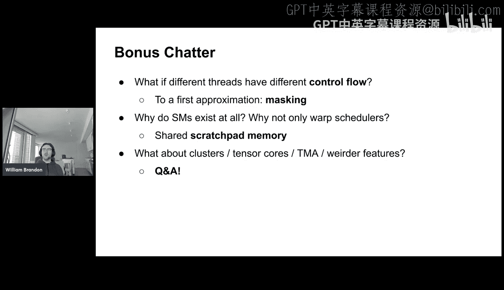

Perfect， thank you so much。I'll start with I guess the chat questions and then I have a question my own and if people have more。

 we can ask and then Simon will be coming soon， so we'll probably just cut her off when she's here。

So one of the questions is basically like how good is the coUa compiler at interleaving instructions to maximize hardware utilization without like explicit loop enrolling or on the programmer side？

So that's a really good question。I would say it's okay。啊。

I think opinions differ on exactly how much faith you should put in I'm generally pretty paranoid and and I I try to do things。

 I try to write my code in a way that believes。Little room for doubt in how the compiler was going to decide to optimize it。

And so so like like like one one great way to do that that's also like quite lightweight is like explicitly vulnerableroll because like like like like modern C compilers and by extension。

 like the the code compiler。It is extremely easy to unroll just you just write one line that says like like hash pragma unroll and then。

And then a number and it enrolls your lead by that factor。B。Automaically inside the compiler。

 but in a way like which is guaranteed in which you have explicit control over。

 And so I think there's a lot of there's a lot of lightweight things like that that that sort of take decisions out of the compiler's hands and put them in your hands。

 but but still get the compiler to do a lot of the gr work for you and I think it's good to sort to know what those are and to seek them out and to try to leverage them as much as possible。

 but I I think it is often the case that if you really want to have confidence what's going on。

 youve got to like write your program compile it and then look at the generated。

Look at the generated assembly either at the PTx level or at the actual underlying hardware IA level。

 it was called SAS。And sometimes things will surprise you where the compiler has made a decision that is like quite different from the decision that you might have wanted to make。

More questions have streamed in， so I will not ask mine I will just let them ask so one person asks。

 is it possible to basically write cota code that explicitly maps warps to a specific SM。Oh。

 that's a great question。To to a first approximation， the answer is no。 and this is actually a。呃。

This is very annoying。I think it would be a like highly desirable feature for the API to give you more explicit control over how things get mapped to particular fiscal Ss。

 but you don't actually have it something you can do and this is like。

This is like obscure and rarely done， but you can query which SM you ended up on。When。

When a block starts， there's like a particular like in line assembly instruction you can use that'll tell you your like physical SID。

And so in principle， you could use that to have every block sort of choose what its logical identity within the algorithm is going to be on the basis of its physical SMID。

 and so you can kind of take control back in your hands that way if you want to I guess it is worth saying like the reason that the APIs work the way they currently do is that different SMs are for the most part interchangeable。

's there's like a slight exception to that and I won't I won't get like deep into it。

 but like basically basically the Ss or to a first approximation interchangeable with each other。

 but the thing that I think you often want a lot of control over that coulda also doesn't really give you good explicit control over is。

When different blocks are going to schedule onto different Ss。

All the we haven't talked about memory much， but it's like an important fact about the GPU that it has an L2 cache that is shared across S。

So if one SMM tries to read data from main memory and that data then ends up in the L2 cache。

 then another SM that tries to access the data shortly thereafter will be able to take advantage of。

To take advantage of the temporal locality to get a cache in and for a lot of kernels。

 this like L2 locality thing is actually incredibly important and you really need to write your kernel to take advantage of it to avoid a a bottleneck on May memory bandwidth。

But， but then the problem with this is that like in order for the cache to actually happen the like。

The second SM needs to read that data like around the same time as the first。

 but you actually have no control you have no direct control over the scheduling algorithm it's used to map blocks SMs so you kind of have to you kind of have to make like educated guesses about what is going to run when and then like design your data access patterns around those around those sort of approximate theories of how the scheduling will work and this in my opinion is just like。

A mading way to try to program a computer， but it's these individuals that a video has given us。

Sorry so yeah， actually they clarified that what they what they were specifically talking about was mapping the award to a specific partition on the SM that's my mistake Oh mapping a warp through a specific warp scheduler I think I think at least most of the time this is basically done around Robin so it's like the first four wars go on to warp schedule is like zero through zero through three in order and then the next four wars just like start again from the top and so on。

So I don't know。嗯。I don't know if this is like explicitly stated anywhere。

 but it like it's like overdetermined that this must be how it works because there's like a bunch of more advanced features。

 especially in like recent generations of GPUs that were like the design of the API would only make sense if this were how it worked under the hood。

 and so it must work that way。I see。And S here so I'll just ask one more question from the chat they ask how do GPUs handle scheduling and context switching and how does this differ from a CPU's process scheduler Yeah so it's a great question so the short answer is that there is no context switching at least in the sense that it exists on a CPU so like a CPU you can have a process that that like accumulates a bunch of state in like registers and in like the L1 cache and then gets like preempted by the OS and has to and has to like save all that state in like main memory and then like start running some other process and then like the registered state gets restored and the cache you're just like out of luck that you presumably repopulated after you after you resume the process。

On GPUs there is no such thing once a threadb starts running on an SM。

 it is a guarantee to run to completion without being preempted or like contests reached out for a different thread block。

And the main reason for this is that is that on the GPU like for the most part。

 instead of using like an implicit L1 cache， you use this like explicit。

 like you use this like explicit like memory Sc tab and。

And so you'd need to like in order to preserve the behavior of the code when you like context switch it out and context switch it back in。

 you'd need to save the full content of that explicit local scratch padd so so that you can restore it later and that would be like quite an expensive operation and that I think。

People I think like this would make like even harder of a reason about the performance of kernels because you to you would need to contend with the possibility of these prestionions happening so basically is there is no contact switching on the GPU there's a sense in which you can think of the warp scheduler juggling different warps。

As doing something a little bit。Like context switching but at a sort of lower level of the hierarchy。

But it's really pretty different and like and like CPUs do that kind of multi threadreading on a single core where they get like time multiplex as well and like like on CPUs you like you don't call that context switchidget like at least at least I don't。

actually I want to double check like my understanding of the computer architecture terminology on this to know what the normal conventions are。

But but at least like sort of like like like OS preemption context switching and like and like multi threadreading on a single core context switching like or like very different kinds of things and on the GPU you like only have the latter one。

All right， well， that'll be it for William's talk。 Thank you so much for coming。

 I think if people have more questions， they can reach out to。😊。

All right， thanks for being patient， so hi everyone I'm Smerin and today I'm going to share our work on developing simple abstractions for hardware efficient AI kernel programming。

As a brief background， I just finished my PhD at Stanford with Chris Rayy and thanks Alex as well for the introduction。

All right， so why should we care about this problem of hardware efficient AI kernels and simple programming abstractions？

So as we all know， AI is extremely expensive and you know just NviIdia's Q2 revenue recently over $47 billion these models are in kernels that we develop are running on clusters of hundreds of millions of GPUs for multiple months across both training and inference。

 for instance， you know many of us have probably read you know the Lma papers where we can see like 405B models。

 16，000 GPUs， 55 days， something like that， just for training。And more than that。

 when we try to make one model or one set of operations efficient。

 we often these days need to completely redo all of that work when a new hardware generation comes out or from a new vendor so for instance even flash attention。

 one of the most widely used kernels and for basically the most widely used AI operation we had to completely rewrite it going from Apire to Hopper and then again going from Hopper to Blackwell and then that's just you know one hardware vendor。

So TLDR， poor software costs billion the dollars worth of compute and also our AI compute is expensive given that we largely just have one dominant player right now。

So in AI improvements have come from data efficiency， algorithmic efficiency， hardware efficiency。

 many forms of improvements， but I might go so far as to say that our biggest improvements have come from better hardware and figuring out how to extract more from that hardware so these are some of the amazing charts from Bill Dley's N V presentation a few years ago and the progress of AI has closely tracked the progress of our hardware。

😊，So in this talk I'll give a very brief introduction to AI hardware I know we just had an intro to Ka as well so we'll keep this short I'll then talk about Th kittens which is a tilebased programming language for AI kernels and then I will talk about what we've kind of learned from T kittens in terms of how we can start building AI model architectures from the hardware up in AI there's a strong legacy of going after you know quality first and theoretically driven AI modeling and hardware architecture improvements but what about if we say what is the best AI model that might run on this particular hardware kind of going in that reverse direction and I'll shed a little bit light of light and what we learned there and finally I'll talk about a couple key directions going forward。

So very basic you starting point getting on the same page we have here the simplest possible processor。

 so what happens is a processor executes instructions using different threads or executors。

An instruction modifies the computer's execution state。

 so you can see here a bunch of different registers that are sort of tracking the state of the program of values。

 variables used as inputs and outputs to operations。

And we have here something called a to code block that's sort of determining which instructions to run next and finally an ALU execution unit which actually performs the operations that are indicated by the instruction and which might modify the processors registers or computer memory。

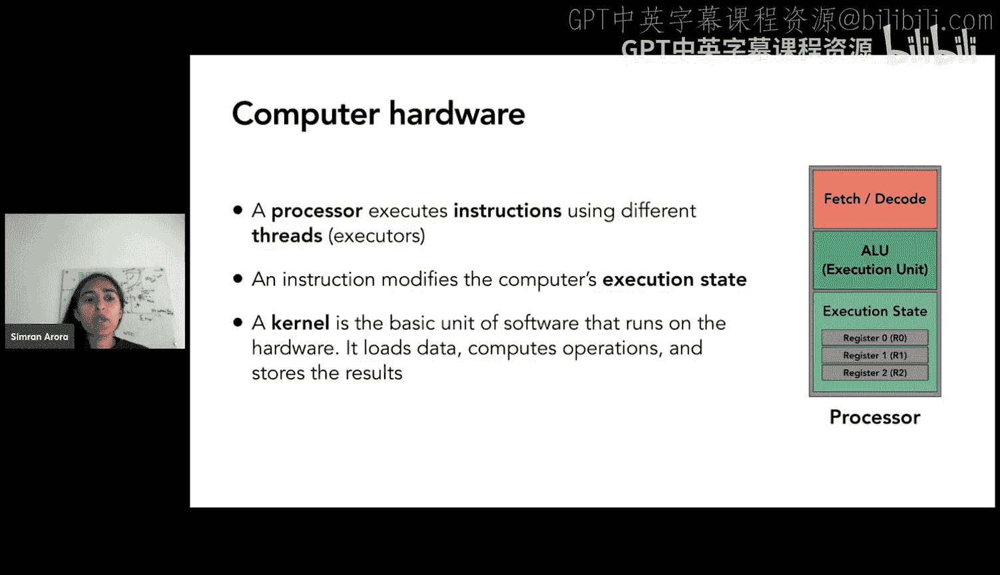

But you know as we are working in AI with hundreds of gigabytes worth of models。

 parameters and KP caches and so on， that's far exceeding the amount of space we have available in the register file or this execution state space。

 so we often connect our processors to a large amount of memory or data。

And memory is organized as an array of bytes each identified by its address in memory。So。

The latency to go and retrieve the information that we need from memory。

 put it into our registers our execution state to then be able to go and run computation can be you know quite slow and so memory is often organized as a cache or as a hierarchical formation where there are small amounts of really fast to access memory and larger amounts of slower to access memory and this just simply follows you know simple physics that you would learn in like high school where if I have a processor I have a small radius around it and small area。

 small volume around it and the closer I am， the faster it is to access and so that's you a small top of this memory hierarchy here and the farther away we go the more space。

 the more area we have but the longer it takes to reach that memory so this is the simple idea of caching。

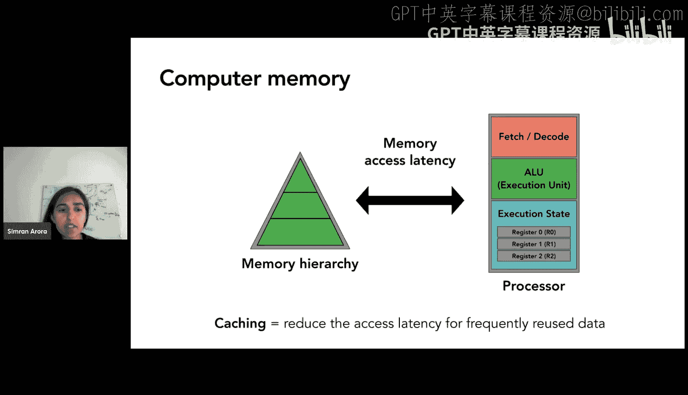

When we look at a new hardware platform and evaluate it。

 we typically talk about its performance measures in three parts。

 so memory bandwidth or the number of items that can be moved to or from a processor for memory per second。

 compute bandwidth or the floating point operations that can complete on a processor per second。

 communication bandwidth or the bytes that can be moved to or from other devices per second。

And note again that these are hardware， not software， not kernel， not algorithm properties。

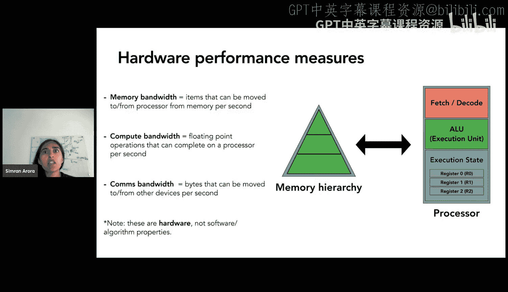

Okay， so with this shared understanding， let's take a look at a real chip， a real GPU here。

 so this is NviIA's Hopper GPU or the stylized diagram that that they often provide in their marketing materials。

And this is just a physical layout of the chip that we can start by taking a look at。

So first we can see these color dots and I think you know the prior talk also kind of walked you through this image and these are the core streaming multiprocessors。

 so now going from our simplified you know single processor that I showed you here we have something like 132 different streaming processors that are operating in together operating together on this GPU grid。

And on this per streaming processor， we have different threads that are operating together to compute our work。

 do our work on this processor， and we have tens of thousands of threads operating together on the given GPU。

Organized in a hierarchy。So around the processors， we can see a couple of other things here in this image already。

So we can see memory going back to this memory hierarchy where we have small amounts of fast access memory and large amounts of slow access memory。

 we can see spatially very close to the streaming multiprocessors。

 we have something called an L2 cache which is corresponding to sort of this orange part of the triangle here。

 which is in the medium range of fast to access and medium range of how large it is and going farther away we have these black you rectangular blocks。

 and these are slow to access but much， much larger， so 80 gigabtes。

3 terabytes per second on an H100 GPU。

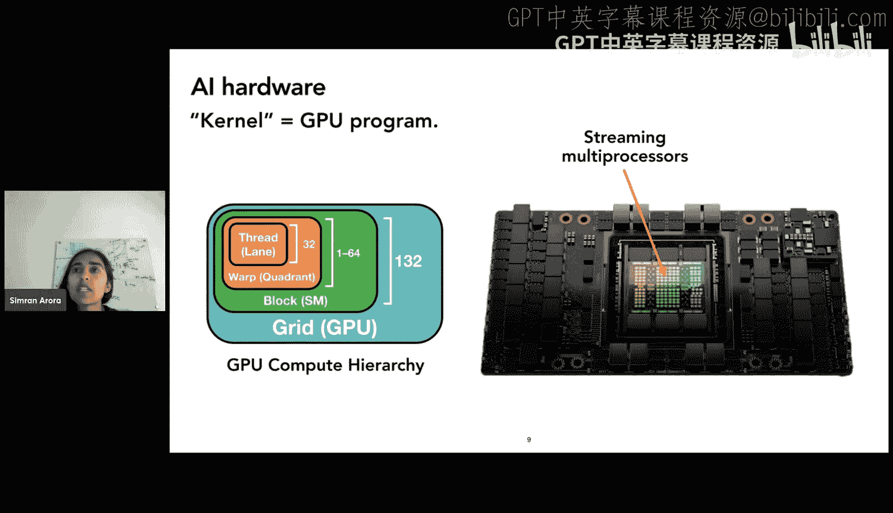

And the rest of this picture here is components that are used for managing the current。

 so inductors capacitors power staging。Alright。

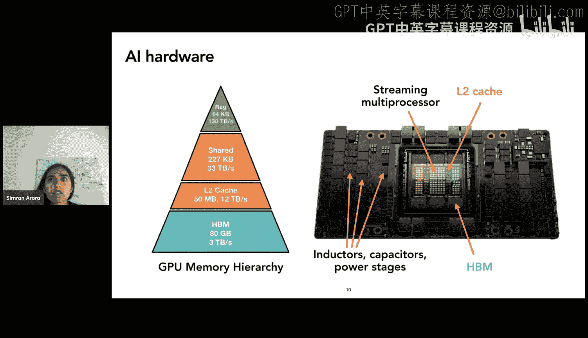

So let's zoom into a given streaming multiprocessor here。

 and again this is just for the NVIA hardware。So in my simplified diagram， we had simply an ALU。

 one type of processor。When we zoom into a streaming multiprocessor we can see that it's extremely heterogeneous。

 so there's compute pipelines for integer floating point， double precision operations。

 there's something here called the Tensor core， there's these LDST units for loading and storing related computations and then the special functional unit for different mathematical operations。

We can also see as we zoom in here， that register file。

 which was the fastest but smallest part of the memory hierarchy， as well as sort of shared memory。

 which was that second tier of the hierarchy。ok。And each of these heterogeneous units。

 when we go back to those hardware performance measures that I talked about performs quite differently。

 so using again， NviIDdia H100 as a reference point here。

 that special functional unit this sort of maroon colored block that I showed which is for mathematical functions like X operates at something like 7。

5 teraflops， or the FMA units at 60 teroflops or those tensor cores at 989terlops or nearly one petafloop。

And so a basic rule of thumb when we think about these GPUs is that essentially the GPU runs at 100% utilization when the Tensor cores are running and0% when they're not really the point here is that those Tensor core units are by far the fastest available compute we have on these processors。

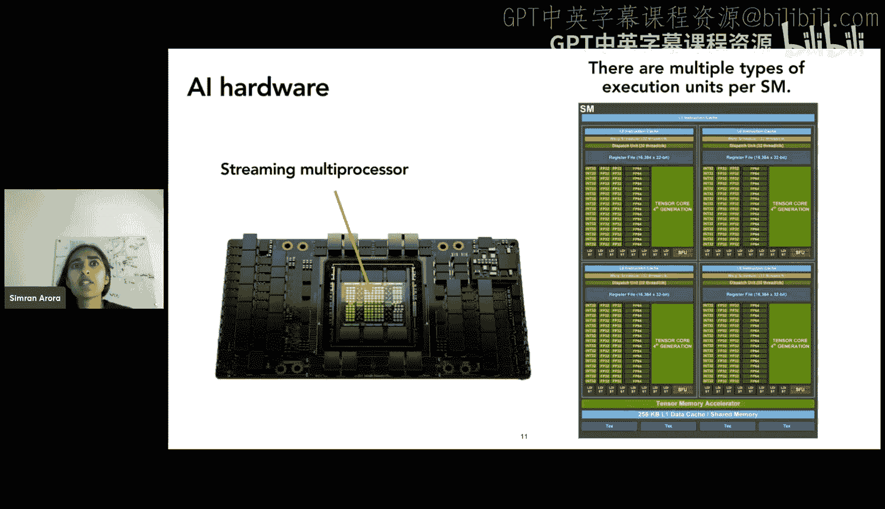

It。

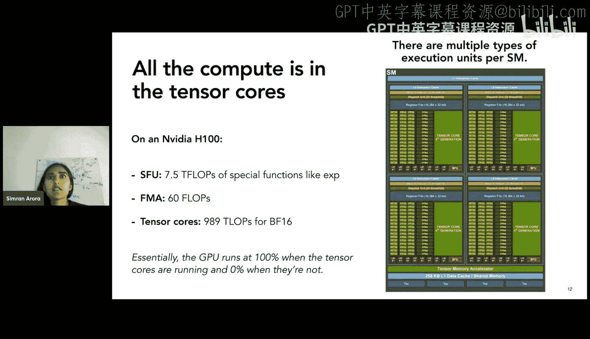

So over the years these Tensor cores and again， a Tensor core is the part of the GPU that's specialized to run matrix multiplication has gotten far far faster over the next fastest compute on the GPU year a generation on generation of this hardware。

 so that's really where a lot of this effort is being invested。On latest generation GPUs。

 it's 16 x faster than the next fastest compute in VF 16 precision。So yeah， again。

 essentially there's one rule in AI algorithm development and when we design our AI algorithms。

 we want to just keep the Tensor course fed， all the compute is there。

The challenge of that simple single golden rule is all of the work that's required to make that happen。

So in AI we have large tensors of data， obviously， so if I'm thinking again of metatas Lama 405B model with up to 16。

000 by 50，000 dimensional tensors for different parts of the model there in VF16。

 this far exceeds what we can store in these faster levels of the memory hierarchy。

And so what really needs to happen is we need to pay attention to how data is laid out across different threads。

 we need to take these large tensors of memory that we have in AI and tile and chunk them up and make sure that we're only running computation on we can only run computation on certain chunks or subsets of that tensor at any given point in time and also we're not only running matrix multiplications on tensor cores。

 we do have normalizations， reductions， different additions and elementwise operations in machine learning that we also need to care about and so the hard part of AI kernel development is just minimizing the latencies of all of these non-tensor core operations again memory in different types of math。

Right。So嗯。As we go through the rest of this， I'll talk about kind of the challenges in a little bit more detail that arise as we think about the different levels of GPU parallelism that arise。

 and then after that I will go back into thunder kittens to talk about how we kind of simplify the process of thinking about each of these challenges。

So again， starting off， tens of thousands of threads are running together on the overall GPU。

 but really these threads are grouped into small collections of， say。

 32 or 64 threads per warp or per wave on AMD GPPUs。

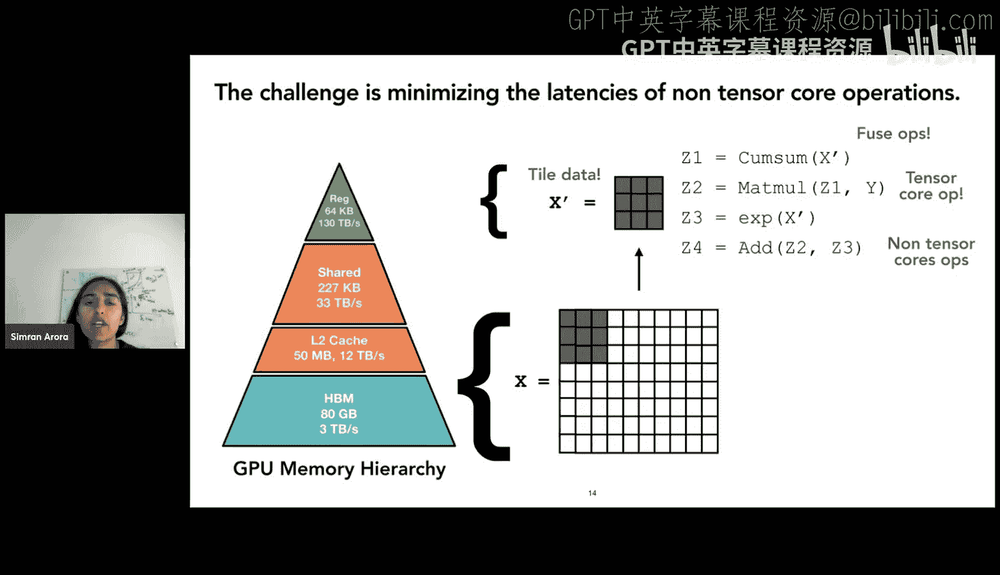

And these waves are running these instructions together in lockstep。

And a big challenge here is for us to think about how the ownership of physical of logical data elements that we care about is going to map to physical thread ownership。

 so each of these threads that are working together is going to perform computation on some subset of our tile or tensor in our AI algorithm that we care about and that mapping of which thread owns which element is actually very complicated which I'll dive into a little bit more。

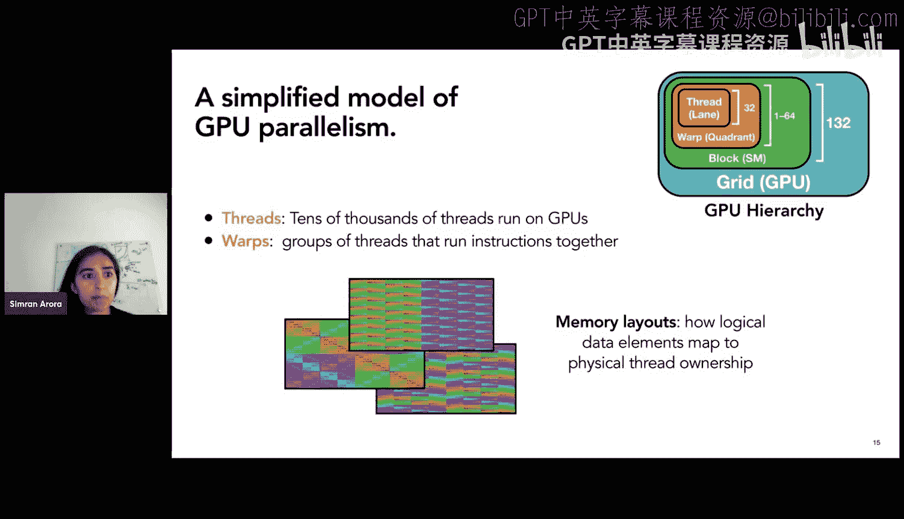

Okay， and then above that warp level of operation， we have many warps that are working together to perform some subset of our overall AI kernel or program。

And at this level of parallelism， we really need to care about how we are splitting different warps to use the different parts of the sorry with the PDF it's I guess I should wait to move the slides。

 we need to care about how different warps are assigned to use each of the different execution units on our GPU if any particular execution unit is trying to be used by too many of these threads。

 too many of these warps， it becomes saturated because each execution unit has a limited amount of bandwidth as we discussed。

And so， you know， modern GPUs have a huge number of different asynchronous mechanisms as well that they exposed to the user to allow these warps to。

kindin of perform different types of work on different types of these execution units at a given point in time and unfortunately for us as kernel writers。

 most of those asynchronous mechanisms are actually useful so we need to sort of know how they work。

One is this concept of occupancy where we can have colocation of many warps of software。

 so we can have hyperthreading or colocation of many warps of software threads on the same execution hardware。

 we can have occupancy or have different types of different waves。

 different warps go and use different execution units simultaneously to increase throughput we also have asynchronous loads from sort of ampere onwards and also equivalentvalence on the AMD hardware where one can launch a load directly into shared memory skipping registers and sort of check for completion of those loads later。

 we can also have sort of asynchronous address generation using the tensor memory pipelines。

 accelerationcc pipelines on H100s poppers onwards and we can have asynchronous stores and reductions。

 also using the tensor memory accelerator TMA pipeline。

And we also can have you know different asynchronous matrix multiplications on modern GPUs where many threads are collaboratively launching asynchronous matrix multiplies directly from shared memory so the point being here is that there are many。

 many mechanisms of asynchrony and how we can split up what different warps are doing to maximize our throughput hide latencies make sure we're focused on using tensor cords as much as possible and thinking about all these opportunities。

 how to assemble them to build high performance kernels is quite challenging given this landscape of options。

Kind of building on this idea of occupancy or having different waves use different parts of the hardware is this idea of sort of wave specialization that's very popular where we can actually have different waves only focus on doing particular types of our kernels so we can have certain warps or waves that are only going to do loads and stores between slow and faster memory and we can have other dedicated warps that are only going to do computation or fast memory movements。

And this is kind of called other words for this is called like a producer consumer paradigm。

And this might be even more advanced than what we were looking at before because。

Now we can have maybe the workers that don't actually like the workers start to need different resources out of the GPU so the GPU has very limited resources like in particular you can see here the registers which are very fast there's a very limited number of them。

 but if these purple kittens here， these load and store workers don't actually ever need to use any of those registers because they're only operating between this slow and HBM and shared memory they can actually go and maybe give their registers to the compute workers so that the compute workers can start operating with larger tile sizes and doing their work more effectively。

 so this is another opportunity to consider here。

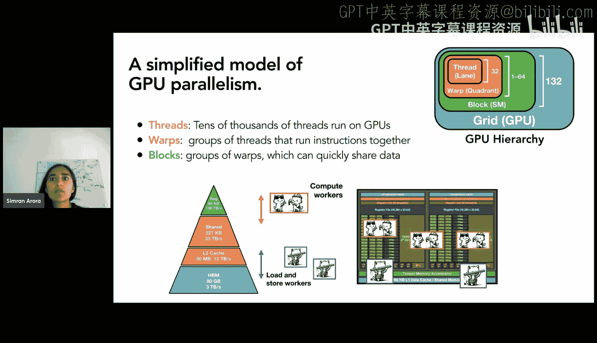

Okay， so popping up to the next level， so we have these thread blocks。

 groups of warps that are performing some subset of our parallel AI algorithm。

 and they're running on these streaming multiprocessors or these colored dots and then overall across the entire grid of different streaming multiprocessors that we have we're going to have a scheduler that goes and assigns these different thread blocks to the different streaming multiprocessors to perform the work。

For these thread blocks， there's actually a block launch cost and a block tear down cost as you clean up sort of the state of that thread block。

 and as you're really thinking about super peak performance。

 these kind of latencies and launch and tear down costs start to rear their heads。嗯。And。

On the same you level here， beyond individual blocks。

 which you can think of maybe as a particular head of attention computation or a block doing maybe a particular output tile of a gem computation in machine learning where're operating with where we're performing many different types of operations so end transformer you'll have normalization。

 positional encodings， MLPs and。Is this slide showing the correct slide？有诶呢必嘢。

Just seeing the live stream is looking like it's on a slide ahead but okay so yeah so we have different types of operations in our end to end model and launching these different operations also incurs some kernel launch and kernel teardown time so between running the attention kernel and tearing that down or between running the MLP kernel and tearing that down and these kernel boundaries also are sort of you know artificial so if a certain subset of our streaming multiprocessors is done with a kernel it just has to sort of sit there and do nothing until all the streaming multiprocessors finish running that kernel before any of the processors can start running the next kernel for our end to end AI you know training or inference。

Okay， so。Looking at the slide， next slide here， we can see just an example of what I was saying where we have an ML model with many different layers。

 many different operations， and these are example kernel boundaries that you might see for instance when you're running Lama 1B on a GPU where you have maybe a kernel for RMS norm。

 a kernel for matms for your attention， you have your rope， rotary embeddings， you have attention。

 and so on。And so this is a bit restrictive and it might not be immediately obvious why。

 so I gave you one example where the streaming multiprocessors can't go and start running the next work as soon as they're able to they have to wait for everyone to sort of finish this QKV map Mole or finish the rope or finish the attention before any of them can start the next operation。

 but to give you one example of how if we didn't have these kernel boundaries。

 we might be able to do something more interesting is。

When our streaming multiprocessors are doing QKV map mole and they finish sort of the output computation for a particular head。

 some of those processors can go start running attention right away。

 or when we're doing this RMS norm here while some processors are finishing computing that activation we can start preloading the MLP weights which are actually very large for these models into GPU fast memory while some processors are still finishing the norm computation so if we could break these kernel boundaries across the grid it offers a lot more scheduling flexibility。

 but again thinking about all of this is really hard for the development experience。And finally。

 in AI these days， obviously we're kind of moving towards we're operating on the scale of thousands of GPUs together and so the multi GPU communication is of critical importance and thinking about what we do over scale up in scale out networks。

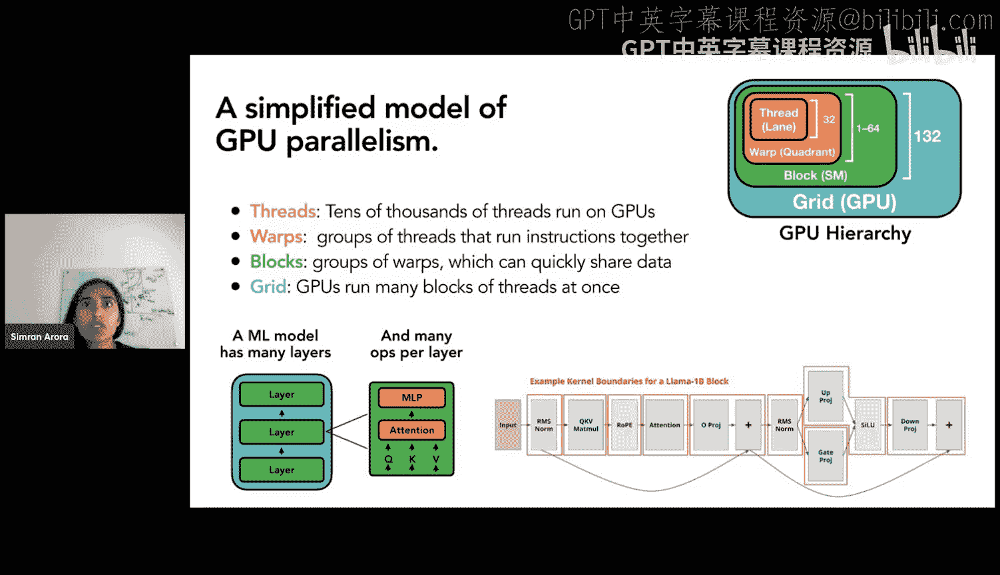

Okay， so with that overview， I will focus on the next part on talking about what we've done in Thunder kittens to try to alleviate some of the complexity in navigating this design space and sort of provide a minimal set of abstractions that one could think about while still having enough flexibility to achieve peak performance on a breathth of AI kernels。

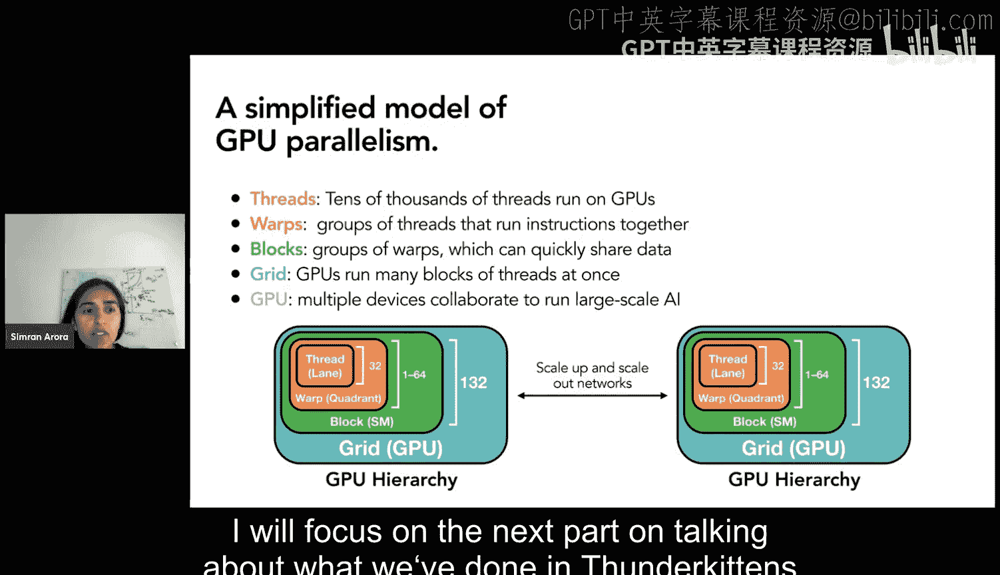

Okay， so again， why this is important just to hammer or home is a critical problem in AI has been mapping all of the AI algorithms and architectures we come up with to run effectively on hardware。

 and I talked a little bit about the difficulties with even attention before。

 but concretely going from sort of flash attention to flash attention for the hopper GPUs。

 the original flash attention implementation degraded sort of 47% in TFps or the utilization it was seeing when we took the kernel designed around the A100s and went to evaluate on the H100s and it took two years from the release of the H100 GPU by NviIDdia to actually obtain performant kernels with flash attention3 and sort of the Th kittens releases of newer flash attention kernels。

So it's been difficult to obtain peak performance for transformers， let alone new architectures。

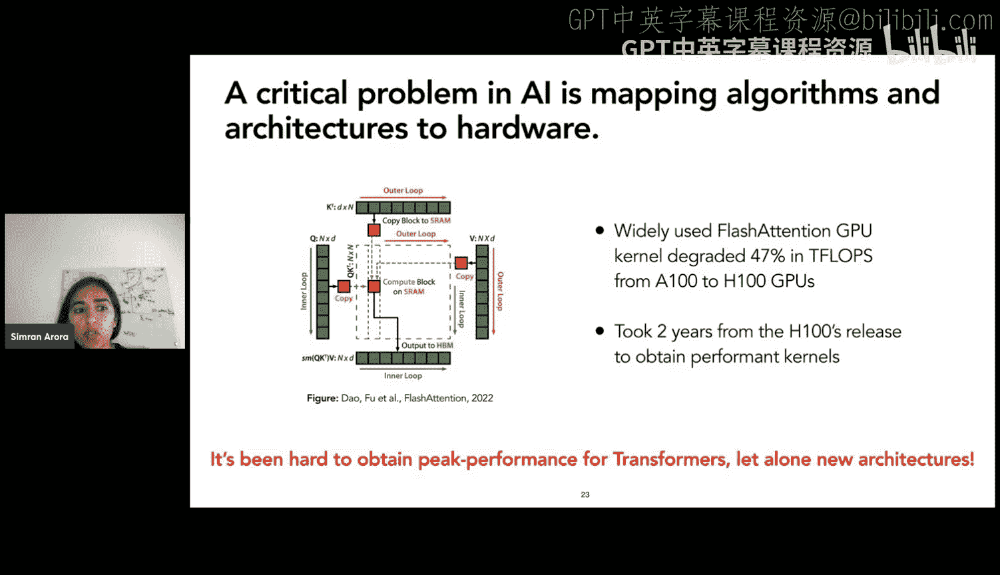

But a major question right now is whether we can replace transformers with improved alternatives or how can we achieve transformer level quality with cheaper versions and as we explore。

 you know how do we get better quality or how do we get better efficiency。

 each of these different types of architectural ideas that we've been after requires kind of paying attention to how efficiently our ideas will run on the hardware that we're using。

But you know just to hammer hammer home the challenge here。

 when we kind of take a look at some of the popular candidates of efficient architectures that have been proposed over the years and designed with sort of efficiency in mind trying to be more efficient in terms of memory and compute costs compared to transformers we can see that designing around theoretical efficiency or designing architectures that use maybe asymptotically less memory and compute than transformers in theory has not always led to architectures that actually run faster than transformers in wall clock speeds on hardware。

 and so there's this big gap here between kind of thinking about this AI theoretical efficiency and wall clock efficiency and part of the goal with under kittens is to help address some of that gap and make it easier for AI researchers to quickly prototype on UI。

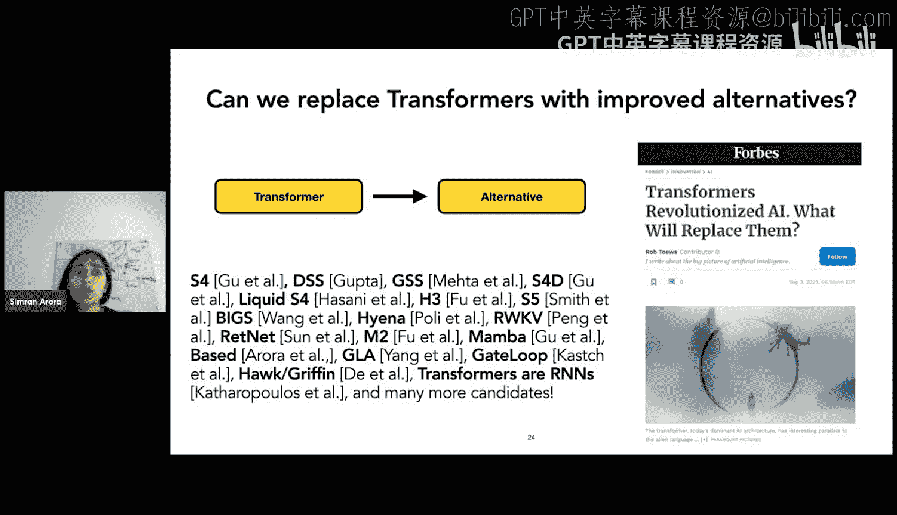

Ideas and understand what the hardware prefers。Okay。So to make the research question you know。

 precise and just hammer at home with T kittens， again。

 the goal was how concise a set of programming abstractions can we use a to support fast。

 simple kernels for a breadth of AI workloads。

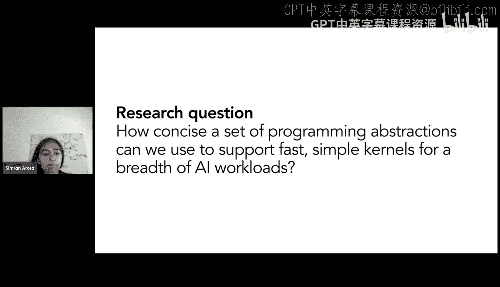

O。嗯。So here on the kernel side， what do people actually use to write the peak performance kernels right now？

So we have a couple of different strategies for you know。

 a couple slides here just on laying the landscape of how we might go about kernel programming。

The very basic level could be writing RA assembly， so you know over the past couple of months have been diving a lot into AMD GPUs which has been really fun and a key lesson there is that a lot of the peak performance kernels for instance。

 for FA3 or for gems are written in RA assembly。So here you can see two traces that I've shown these are outputs of the rock profiler if you take the provided AMD kernels and run them through。

 and you can see these different colors which sort of correspond to the greens being like matrix。

 multiplications， oranges being you shared to register loads and so on and there's extremely fine grainined interleaving of many different types of heterogeneous instructions and each of the rows here corresponds to what a particular warp is running in a thread block so you can see the warps are just sort of jumping all over the place doing mix of matrix multiplies loads and vector ops and all these different colors。

Programming at that really fine grained interlea level is high performance。

 but obviously quite difficult and slow and limited to a few experts here。

We can also see here some of the SAS or the machine code from Nvidia an NviDdia flash attention three kernels so the main flash attention three kernel and you can see here that we have。

Sort of fine grained Sasin assembly we have like kind of really interleaved fine grainined regular patterns and so I guess the point of what you can see in the FA3 cutla SAs is that there are these like regular patterns that keep appearing again and again so we have F2 FP and we have this FMle and we have that repeated over and over and over again and so when we have these repeated regular patterns it might help lead us to think like oh we should be using larger programming primitives and capture this regularity and move up a level of abstraction from thinking about this like fine grainined interleaving of these individual operations。

Another type of strategy that's used， so here on the right we have a snippet of code from Mojo's modulars sort of AMD gem code on an MI 300x AMD GPU and here it's implementing a gem and they use at the bottom you can see something called scheduling hints。

So the idea here is that the programmer doesn't actually really think about any of the write down the assembly or write down instructions in a fine grainin interleaved format。

 but instead provides hints to the scheduler to interleave the operations in particular ways。

 and so there's this whole spectrum of how we might be able to program。

 we could provide compiler hints we could use assembly。

 we could write really fine- grainined hip or coa instructions but I think the takeaway here is we want something that's fast。

 repeatable， extensible to the breadth of AI workloads we care about and uses as large a set of basic tiles or basic data types as possible to abstract out。

These fine grade details。So， you know， really the question here is where should we set the programming boundaries between sort of writing in C++ writing an assembly in line assembly using these compilers and then on top of all these building blocks。

 writing down our kernel schedules， things like producer consumer or these you know aggressive kernel fusion。

 things like mega kernels。

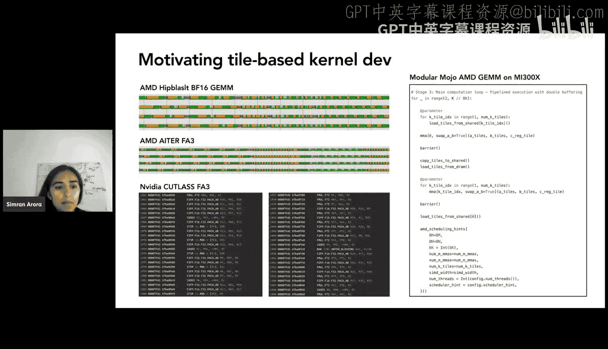

And also as we come up with these programming abstractions what insights will scale to our multison future so right now N videoDdia is largely dominant but you know we have Cres and etched and Sanvanova EMD and Traia many different types of GPUs and we'd like to really be able to take advantage of all of them。

嗯。So。Looking at the landscape holistically here， we have basically on one end of the spectrum so kind of recapping before we go into Th kittens。

 why is it hard to write these hardwareware AI kernels and why has there been this gap between theoretical efficiency and wall clock efficiency as we iterate on these new like AI architectures AI algorithms？

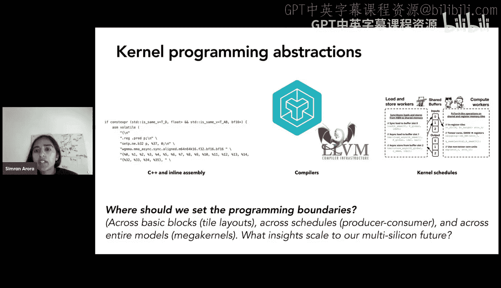

The first main reason， first main challenge has been that some of the architectural choices that we make are not actually compatible with what the hardware prefers。

 so for instance some of the architectures that are efficient in theory don't actually use the tensor cores or those matrix multiply units。

 which is just a big loss in performance and some of the architectural choices require really unstructured memory aes and are not really hardware friendly as we think about the need to have sort of coalescce and large loads。

The other main challenge has been that of the tooling and the software support。

 so just to look at the two axes here， we're going to think about what is the peak performance that we can elicit out of our GPU when using programming abstractions on the Y axis and on the X axis。

 what is sort of the simplicity and usability for AI researchers。So on the far right。

 we have things like Pi torch or TensorFlow or torch compile。

 which is the way in which AI researchers go and write down their new algorithms。

 new architectural ideas， and iterate and understand the quality。

And these are very familiar to the AI audience。So in similar spirit， using a Pythonic interface。

 there's Triton from OpenAI which is very， very widely used and it provides a lower level access to the actual memory hierarchy of the GPU and to being able to specify these AI kernels and so it has a nice ground of being simple and usable and Pythonic but at the same time by providing the simplicity the level that was chosen by Triton originally when we did this work was not sufficient enough to elicit peak performance out of the hardware。

 so for instance， Triton did not offer the ability to control what was stored and register memory or that top level of memory hierarchy and also didn't really provide the mechanisms to specify fine-grained asynchronous kernels and execution strategies that we would want。

Obviously， you know， these days we have linear layouts and glue on and new techniques here。

 but this is sort of what we were looking at when we started the Thunder kittens work。

And on the other end of the spectrum， we have， again， assembly or writing KUa and hip and C++。

 or abstractions which are deeply nested C++ templates over kuda and hip with cutlaless and composable kernels。

But you know， those latter two， despite providing some semblance of abstractions。

 are not very pythonic， not very aligned with you how AI researchers like to go about doing their work and Pytor style frameworks and use kind of these deeply nested C++ templates which are hard to think about and you know that latter point is more opinion and also kind of talking to many people who try to write these kernels。

So with Thunder kittens， we provided this framework that studying the question of what is the sort of minimal set of abstractions resulted in thunder kittens。

 which is a DSL to achieve simplicity and speed for a breathth of AI kernels。

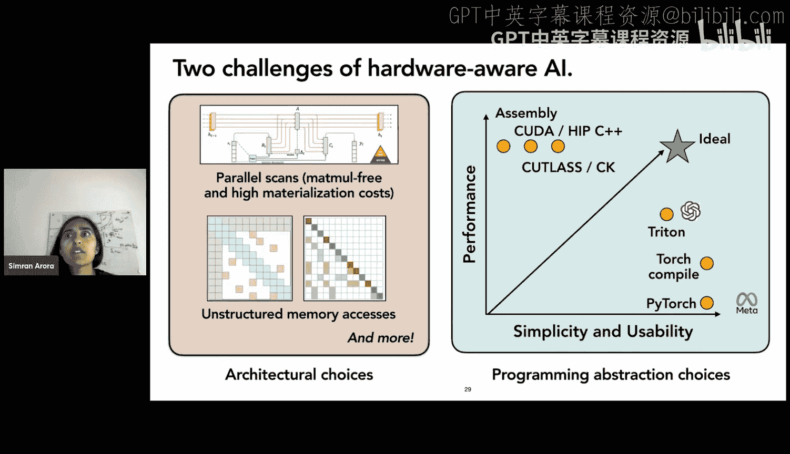

And I guess a very poor proxy for simplicity， we have sort of like lines of code in the library here。

 it's just you know four folders， we try to keep it very。

 very lean if you kind of go into the repo and look it's sort of tries to be as transparent about what's going on with the hardware and what each of the abstractions is trying to do。

So mimicking our discussion of the challenges at each level of GPU parallelism。

 I'll tell you a little bit about the abstractions that have gone into T kittens to help alleviate some of the challenges I discussed。

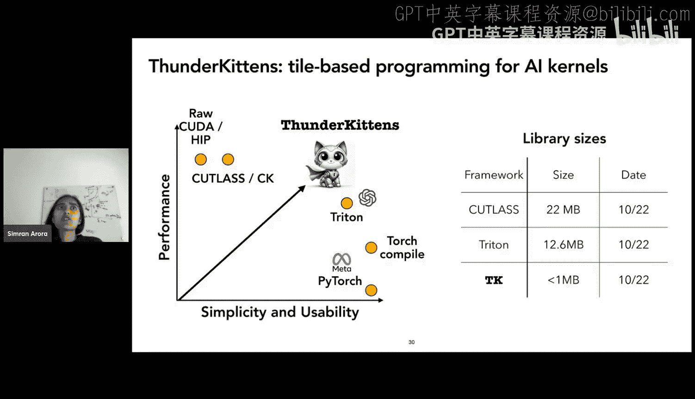

So at the base level when I talked about this problem of you know warps are working together they each need to own different data elements and process it and that challenge of managing which threads own which parts of our data these memory layout challenges。

 what T kittens does is it specifies a base 16 by 16 tile as its core data type。

 which is philosophically trying to be very much like programming with tensors in pipetorrch。

 all of the details and complexities of the memory management of you know which threads on which parts of that tile we try to abstract away from the user and automatically select those memory layout decisions to be as compatible with what hardware prefers as possible。

So。The reason that we'd pick 16 by 16 tiles in this original version of Thunder kittens is because the underlying HMMA SAS instruction that we were looking at on the NVIDdia side of things was a 16 by8 by 16 matrix multiplication as that base intrinsic for NVIDdia。

And I'm seeing here a question on the chat that's you know how different is H from coUDa in terms of programming and syntax and both of them are very。

 very similar you can basically HPAify your coUuda code very quickly and it works pretty well but the actual details about what the Tensor core instructions look like what the memory movement capabilities we have and so on look quite different and why I bring this up here is that I just mentioned you know the 16 by 16 title size is picked because the underlying HMMA instruction on NviIDdia。

 but on the AMD GPPUs we have many different and sometimes smaller Tensor core shapes that we're going to be using and depending on the MI300 MI325 MI355 platform that we're using different Tensor core instructions that we want to be using and so。

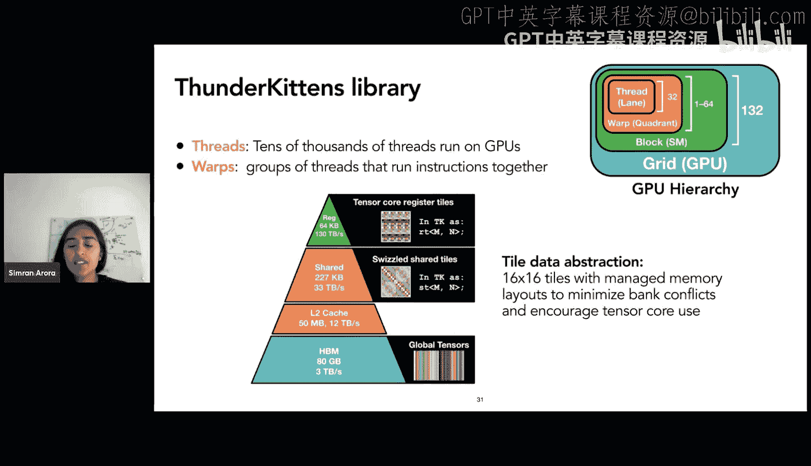

The tile size here is really meant to be kind of co designed with what that base instruction that you're going to be using is。

 what's the base size of that matrix multiply unit， but it's really designed around that Tensor core。

And I'll tell you a little bit more about that in the next slides。

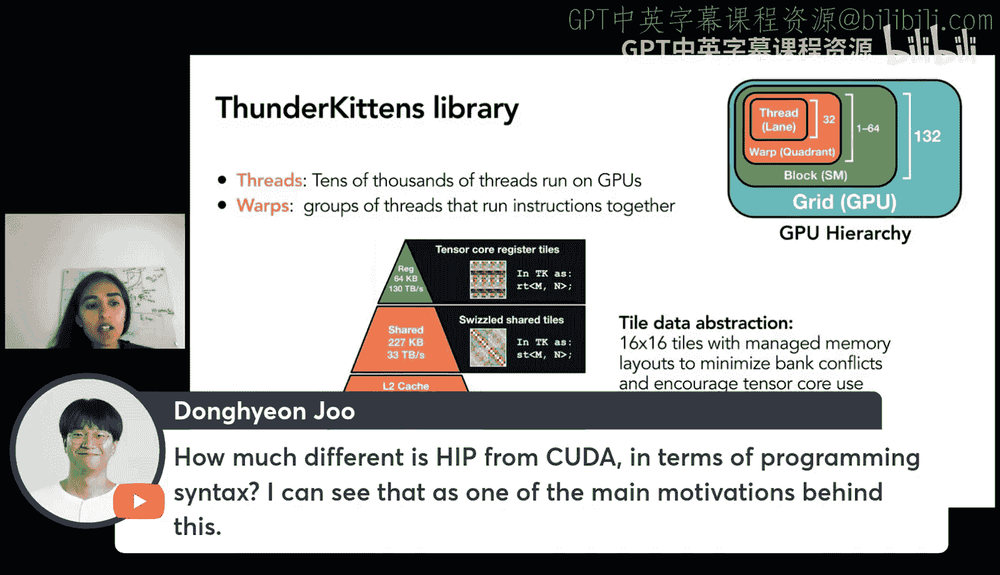

If we think about memory and register memory， shared memory。

 global memory Tensor cores at the you know when we're thinking around like okay。

 our goal is to be using these Tensor cores， these sensoror cores require very。

 very particular register memory layouts so when that instruction the Tensor core instruction is called collaboratively by a group of threads。

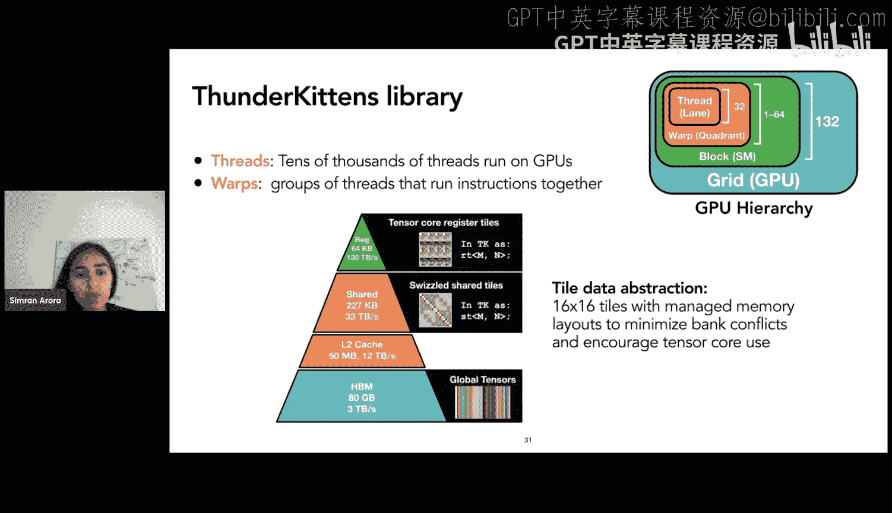

It expects that certain threads own certain parts of the input matrices to the matrix multiplication so in。

in black here we have an AMD a matrix register layout for a 16 by 16 by 16 BF 16 instruction and in yellow here I've denoted what parts of the matrix this a matrix thread zero owns in pink thread one in green threads I think 16 and red thread 17。

On the far right here， I'm showing you an example from NVIDdia's BF16 a matrix register layout。

 and you can see that the positions of which thread owns which part of that a matrix looks quite different on these different GPs。

But that's like our top level constraint， so really in Thunder kittens we tried to make our register layouts eager。

 in other words， pre assign the thread ownership to be compatible with what the Tensor core instruction is going to expect that thread to own。

And this has cascading implications going down to shared memory and global memory layouts。

So on the other end from global memory， the hardware is really encouraging us to use large coalesced aligned global to shared memory loads。

Large， you to minimize instruction issue latencies and then coalesced aligned are what's hardware friendly and what's of course sort of implemented in terms of the strides there。

In between global memory， where we want these large coalles aligned loads and register memory where we have these really particular constraints about which thread owns which element。

We are often going through the intermediate parts of our memory hierarchy or shared memory。

And shared memory is designed in a way that's banked。Or in other words。

 that shared memory space is broken into say 32 or 64 chunks that can simultaneously serve memory to threads and banking is really nice because it can help us get high throughput and serve multiple pieces of data at a time。

The challenge is that if multiple threads try to access the same bank at the same time。

 their memory aes will get sequentialized and really hurt our overall kernel performance。

And so that challenge of how we should actually represent data and shared memory in order to both let threads use those eager register layouts and at the same time make sure that we're using large coalesced aligned global memory loads is quite annoying and challenging to think about and so the granularity of those global loads and the register layouts will also govern our ability to avoid bank conflicts and tell us like how flexible we can be in even getting rid of all of those bank conflicts or occasions when multiple threads are requesting memory from the same bank。

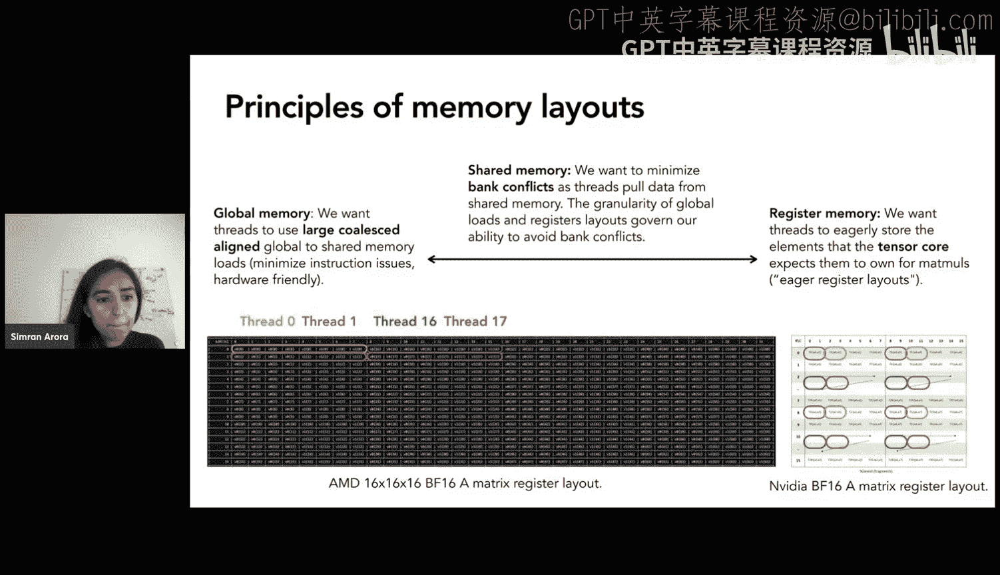

Let me walk you through one example of where this could be a challenge concretely from our experience so working on the AMDGPUs。

 so recently wonderful masters students at Stanford will and I have been looking at these problems and we have here thisP like looking at how we can do FP6 gem instructions on MI 355x。

So one of the challenges we sort of faced was on this machine。

 you really want to be loading in four banks of data at a time or 16 bytes of data。

And on the register side for the Tensor core instructions。

 each thread needs to own six banks worth of data。So if we're loading in at four banks of data on the global side and requiring each thread to access six banks of data on the register side。

I won't go into like you know all of the details， but you can see that there's sort of this misalignment in terms of those granularities here and it becomes really。

 really hard to avoid bank conflicts because we can't fully control where all of those global loads are going in shared memory space in a way that we can maximally avoid。

Thread sort of conflicts when they're pulling shared memory into registers。So overall。

 you know these memory layout challenges I hope I've convinced you are really challenging and this is why it's very。

 very nice that Thunderkins has kind of distilled the core principles for how to pick these layout decisions and abstracted them away from the user where a user kind of just says。

 I want this register tile， I want the shared memory tile and these decisions are taken care of。呃。

Apologies I guess I'm used to using my keynote， but this is the slide that I meant to show for that part so on the right here you can see in blue for thread 0 through 15 it's requiring to own six banks so these are our bank worth of data in order to use the tensor core instructions but our global to shared memory loads are at four bank granularities so for two of the strips here marked in red we sort of get these bank conflict issues。

Okay， so moving on to。The next piece here in Ven kittens。

 once we have these basic tile building blocks， we'll realize we want to run operations over them。

And so again， following our desire to be as familiar to researchers as possible。

 we pulled our abstractions from Pytorrch and NmPs library functions。

 so we can apply things like an MMA or mapm over tiles that we've defined。

 you can see Xpts here loads and stores， obviously zeroing things out or ones or different reductions or subtracting rows from you know tensors and so on vectors from tensors and so on。

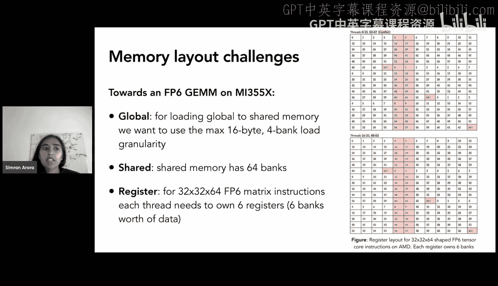

And。Once so the way in which we've just defined these different functions under the hood is in a highly templated way。

 so if you take a look at one of the kind of core。Filees in the Thunderkitens repo for some of these instructions。

 you can see that we define these core templates， for instance for tile maps or tile reductions and that makes it very very easy to add any additional operations that you care about for instance adding two tiles subtracting two tiles multiplying two tiles dividing two tiles can all kind of wrap the same underlying instruction templates。

And this has helped us kind of， you know， with code cleanliness and making things as easy to understand as possible。

And the other important thing to know here is that these Thunder kitts functions have where are designed to have no side effects。

 so TK is almost in ISA all functions sort of take this form of function with a destination source one and source two input parameters。

 and we're basically just wrapping sort of like PTX or assembly instructions for the most part as much as possible here。

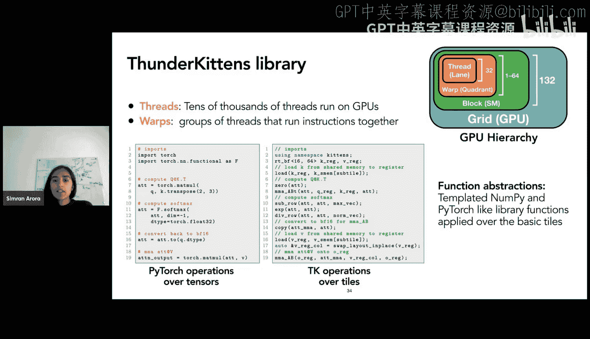

And an additional important design decision was that Thunderkitens is written in H or in KUDa。

 so this means that it fails gracefully if a new hardware platform comes out like say Blackwell comes out or a new set of functions is required that is not yet supported in the TK function library。

 we wanted developers to be able to quickly write their own inline functions in KUa and H as soon as possible with no sort of delay waiting for some upstream company to update the repository。

 so we really wanted Thunderkitens to know fail gracefully either。And emphasizing that point。

 sort of when Blackwell came out， some of my collaborators on all this work， you know。

 Ben and Dan Fu and folks implemented Blackwell in the span of say like two days。

 which was very exciting。OkayAt the next level of the hierarchy here at the block level。

 Thunderkin provides a general kernel template for coordinating asynchronous execution across warps in a thread block and we have a template that' sort of built on the producer consumer paradigm where we take care of deciding you know which workers which warps are going to go and do loading and storing which ones are going to do compute and how do we manage the synchronization between those subsets of workers and what this template does is basically reduce the developer's effort to populating a few boilerplate functions within this model so very similar to when you use N dot module and pytorrch and need to fill in an init function or a forwards pass our goal was to try to have a boilerplate load function and compute function and store function that says what needs to be stored in this kernel what needs to be loaded what needs to be computed and then。

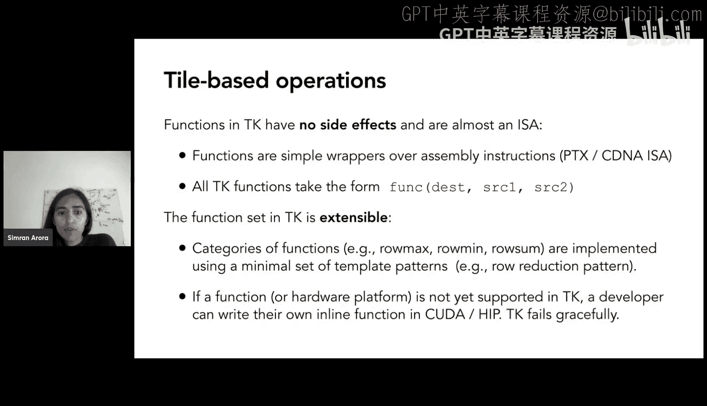

Orchestion of warps and synchronization around executing these boiler plate functions is taken care of on the TK side。

 similar to how autograd is there on the pytorch side。And we provide levers to tune this template。

 so how many warps are going to be working together in the template or how large of sort of buffers of memory might be able to exist between the different partitions of workers that we have executing this template in order to minimize synchronization。

This is a toy example of that tuning process in。Action so here for our attention flash just simple cl attention to style kernel and thunder kittens implemented within the template。

 you can kind of tune the number of consumer warp groups that are working and the number of stages that are going in。

Being between our producer and consumer work groups。

 and you can see how you can tune the T flops and performance of our overall kernel by toggling these simple integers that parameterized the template。

Depending on the hardware platform that you're using。

 using producer consumer using this sort of worker specialization versus using more occupancy style techniques will differ。

 but the idea in Thunderkins as we've been building these little prototypes or templates that can abstract out those general data flow schedules because we've observed that you can kind of use the same ones again and again for particular hardware platform。

 so on the hopperpers on the blackwells this type of wave specialization is really what you always want to be doing we see that across a breadth of workloads on the AMD machines it looks pretty different in terms of the type of schedule that we find。

 but we find that once we've picked a particular schedule it's pretty robust across different workloads on that hardware platform。

And then at the next level of the parallelism hierarchy here for the grid level thread blocklock launch。

 thread block teardown that I mentioned earlier in the talk。

 the kernel templates that we've provided use a persistent a kernel approach where you can just have new work being pulled by these thread blocks over time as they finish earlier chunks of work。

I think also mentioned a little bit in the last talk that process of scheduling tasks or scheduling what threadblocks are doing on these different SMs is very very important so the block order of how overall say gem or attention work is being done really affects our ability to reuse parts of our cache in our memory hierarchy and being able to effectively reuse cache memory can dramatically affect performance so at this level here we provide sufficient like control to be able to control that block launch order within our persistent grid in our kernel template。

And finally here at the。Final level that I mentioned you know in the challenges section where we want to be able to fuse and remove these artificial kernel boundaries in work led by my labmates here。

 Ben and Jordan that I was helping advise we were looking at kind of running end to end Lama 1B or Lama 7B and so on within an entire kernel here and so you can see that when you are able to eliminate these kernel launch boundaries and take advantage of all the fine grain scheduling opportunities you can achieve quite impressive performance over widely used and well optimizeimd engineering efforts like VLLM and SG L for decoding throughput so yeah and shout out here to Ben and Jordan you should reach out to them if interested we're continuing to kind of think about the right abstractions here。

Okay， so at the beginning of the section， I mentioned you know at the question how concise a set of programming abstractions can be used to support fast simple kernels for a breadth of AI workloads。

 how did we evaluate this？So recapping the principles of T kittens。

 we observed that AI workloads follow a few patterns and T kittens can use a small number of primitives for programming our kernels。

We wanted our primitives to be transparent to the underlying hardware。

And we wanted to restrict the set of primitives to those that yield high performance。

 so sometimes there are nice functions that you wish you had when writing a kernel sort of lazily。

 but we try to eliminate those from the library to make sure that we can guide developers on the right path。

And in the evaluations， we looked at kind of implementing a breadth of workloads， so convolutions。

 subquadratic architectures， linear tensions， statebased models， gems in different precisions。

 attention and and memory bound kernels positional encodings。

 normalizations and so on across a variety of hardware platforms and were interested in what sorts of speeds we could get out as well as how simple the codebooked and felts and so how often we were reusing the same underlying TK function building blocks and a poor proxy that I' put here but lines of code。

 and we kind of found that with our approach we could use drastically fewer lines of code than higher complexity couda hip。

 cutless composable kernel style approaches while matching or performance and being competitive and we could use comparable lines of code to the simpler。

Frameworks like Triton while sometimes outperforming the performance that you could achieve there by massive margins。

Through this project over time we've been kind of stress testing our core philosophy and ideas across different hardware platforms。

 so even here in the numbers I've shown H100 49D Apple。

 there's like Blackwell support Apple we're working with folks at Intel AMD Revos so it's been quite exciting to see these ideas generalize。

那不。一つ。Okay so for the overall where this is sort of gone right now is like we're really trying to continue supporting this in the open source we've been excited to get contributions from a bunch of folks including the GPU mode community and would love to keep working with you all and getting feedback and understanding how to improve these ideas you can use Thunder Kitens as part of GPU modes kernel competitions which is really exciting I think there's a new AMD and also released recently it would be fun to you know get support there and we have presented this work at ICear recently and been excited to see the Thunder Kitens framework used and a bunch of published work by different universities over the past few months。

In industry， Thunder kittens is currently used at cursor， Cruise。

 jump trading and together AI to write custom production kernels。And also most importantly。

 the goal here was to kind of simplify this experience of writing kernels。

 especially for a bunch of us in our lab you know here at Hazy where we're really interested in these new architectures so we've been excited to see collectively in the community a bunch of approaches towards this goal so Th kittens itself drew inspiration from many different prior works and a long history of you know ideas in high performance computing parallel programming and including I want to shout out you know Triton highlight cutless flash attentional of that work was heavily inspirational and in the past you know sort of year or so since we' released Thunder kittens first in May 2024 we've also seen a lot more of these pythonic python like DSLs for highper kernel writing so I think that you know this problem is being addressed in a variety of ways which has been great。

Okay。So that tells you a little bit about thunder kittens。

 I'll briefly tell you about one example of how we use this framework to。

Bring back new AI capabilities and kind of look at the architecture space for new AI models as well。

So as we go into this， here's our basic familiar attention equation where we have expensive memory complexity that scales linearly in sequence length and compute complexity that scales quadraically in sequence length。

Making it hard to achieve some of our long context capabilities that we care about。So attention。

 again， the equation is y equals softm QK transpose here times V。

And here we have this softm over this QKT matrix， this QKT matrix is an n squared size matrix。

 and we apply the softm over that。So again this memory complexity scales linear in sequence length compute quadraically。

 so when we're thinking about memory with a transformer the KV cache is what is the real cause of this what is causing this linear memory complexity and the KV cache for 128k long sequence of tokens can be something like 8400 gigabytes in contrast Lama 70 parameters is like 140 gigabytes so these KV caches for individual sequences that we care about processing start to approach the memory consumption of our model altogether so that's a massive issue in machine learning。

And you can see here that there's a close relationship between the size of this KV cache with the memory consumption of our attention。

 transformer architecture， and the throughput or tokens per second of experience that we can get when interacting with these models。

So as a result， know one popular idea from 2020 and earlier been a bunch of work here is to instead of using this softmax equation take this attention equation and instead use these feature map functions that are independently applied to the queries into those keys transpose so here we have this feature map function phi that you can see we have5q 5K transpose。

And what is specifically nice about using this instead of the softmax standard softmax attention is that we can reorder our matrix multiplies to reduce the memory and compute complexity of our computation。

So。Here what we can actually end up doing as we produce our different YI out of this like linearized form of attention is that we can multiply the keys and values first whereas for softmax QKT we need to multiply the queries and keys first before we can go and apply that softmax equation so by decoupling these feature maps rather than that softm applied collectively to Q and K we can change the order of these these computations so when we go and multiply keys and values first we get a memory complexity that's D by F where F is the dimension of like the output of our feature map and our compute complexity becomes linear in sequence length。

Al。But a key question is how we should actually choose that feature map function to balance quality and efficiency here so if we look at this feature map equation if you know F is equal to n。

Then the memory complexity becomes n by D and compute becomes n squared by D。

 which is exactly the same as we got out of vanilla Softmax attention。If F is a lot smaller。

 we get much more efficiency out， but hopefully intuitively there's a tradeoff in machine learning。

 there's this information bottleneck if we don't use if we use very， very small amounts of memory。

It becomes hard to remember everything that is going on in our sequence that we're processing and we get sort of quality degradation so there's this quality and efficiency trade off that's hopefully somewhat intuitive。

So going back to T kittens， we wanted to kind of see， you know， what is the sort of in some sense。

 choice of these linear attention feature maps that the hardware might prefer。

And this exploration resulted in something called the based linear attention architecture that we proposed。

 and what was really exciting about this was we could start to get really。

 really high T flop numbers and utilization numbers out across a variety of sequence lengths while using pretty large state size。

 pretty large amount like reasonably large amounts of memory with our feature mountchoice。

To kind of sort of balance this quality and efficiency trade off space so with T kittens we you know explored different forms of like this hedgehog linear attention。

 we tried optimizing mamba we worked on this and worked on this base to linear attention。

And what was really exciting about based is it's really designed around properties that are present in Hopper and going forward so leveraging the WGMMA and also by design kind of requiring a small amount of data movement between global and shared memory and doing a lot of the kind of state expansion and artificially growing that feature map dimension F on data that's already in fast shared and register memory。

 so kind of by co-designing this linear attention with the hardware features in mind and from our experience with Tkins。

 it allowed us to more effectively balance quality and efficiency here。

I showed earlier this contrast between the plots of memory consumption on the X axis and quality on the Y axis and how it's been hard to kind of map that theoretical efficiency to wall clock efficiency here we were really excited to see at the time you know there was their popular architectures out there。

 hyena H3Mba， we could start to expand architectures to use eight times the memory of some of these prior models that had been proposed while running at5x。

 the hardware utilization of some of those prior architectures as well on these Hopper+ plus GPUs。

Okay， so。You here。And with that， you know， kind of on that section of what architectures hardware prefer。

 I'll wrap up with a few key directions that I think are quite exciting going forward。So one。

 I think there is a lot more work to be done around these directions of theoretical versus hardware efficiency perspectives so this's my slide changing yeah over the generations of over the years we've been kind of closing the gaps between attention and these efficient alternatives and finding ways to build techniques that go beyond the quality we can get with vanilla attention as well I think we have a lot more work to do in terms of understanding which modeling choices the hardware prefers。

 we've done a lot of work on kind of what pushes quality and what theoretically pushes quality but when you start with a particular hardware platform or a particular type of workload like low latency or high throughput by design can we start from the hardware first and design from that direction。

And kind of shedding light on what we've seen in our work is that this has really caught on。

 so I think with the based architecture in particular where we designed really around using Tensor cores using latest generation features on the most advanced modern GPUs a bunch of the techniques in the based work were kind of adopted and carried forward into various popular models subsequently so maybe you know the momba architecture that I mentioned was fast in theory but not really fast and wall clock speeds are not really taking advantage of Tensor cores also upgraded to kind of a more linear attention style approach and you see mini Macs here which is using similar techniques to based and so on so I think there's a really important direction here in terms of understanding what architectures the hardware prefers。

Next， we really care about this kind of multis future where we're able to use all these different types of AI computing that are coming up。

Over time， you know we've thought a lot about kernels in this talk。

 but I think the communication and memory bits here are really where there's a lot of interesting work left to be done so again game changing on the NviDdia side we have these NVL 72 sort of super chips where you traditionally we think of node as8 GPUs together here we have 72 GPUs together that are connected via these very fast scaleup networks and when you want to implement things like expert parallelism pipeline parallelism this is the huge advantage because of the sort of gap between scale up and scale out network speeds。

And so I think the algorithmic innovation here and how we can even enable fast model training and large scale model training with AMD GPUs and other types of compute that don't have that type of advantage will be a really important problem as we continue。

All right and with that I will close out here's the set of folks that made all of this work possible so I worked on Thunder Kitens with Ben Specter and Orienting Hall and Dan Fu and Chris and then will here is awesome on the AMD efforts and Sibri on based and a bunch of folks here on mega kernels so please check out all of these different repositories here and connect with us on GPU mode we'd love to you know hear your feedback and experience using these tools thank you。

All right， thank you so much。 I think there are some questions in the chat， but Han。

 if you want to ask yours first， Well， maybe let's go through the questions in the chat first and I'll pull my question toward the end。

 Okay， yeah， so some of them were asked kind of early on but someone asks basically do compilers。

 I'm assuming they mean for whatever platform you use。

 not automatically fuse different kernels and take care of pipeing data。Yeah。

 so Kutagraph is really awesome for a lot of the kind of hiding those kernel launch and teardown costs that I mentioned in earlier slides so we definitely can take a look at our blog post written about properties there I think some of the opportunities to sort of decide when do I preload for instance I mentioned the example around when particular headsworth of QKV Mamal computation is done we can start running attention for that head or around pre-loading certain MLP weights those types of opportunities that might be hard just purely with the way the rules that compilers have kind of embedded in them are exciting when you have this like finegra control so I think it's an extremely effective approach and it does take care of a lot of those kernel launch costs but we were interested in what we could do kind of on top of that with our own handrolled scheduling。

And there were two questions about， I'm assuming this is the figure with like all the different DSLs and libraries。

 what's the position of the cute DSL with respect to that performance figure and then also another question is how about like JackX or flux。

Yeah， great questions so cute DSL I guess personally I've mostly read some of the code like I think that recent FAA4 kernelel that came out that it looks very。

 very clean and I think that it looks very promising so I would say it's made a lot of progress since you know early 2024 when we we started looking at Cols and achieves a lot of these goals it's pythonic it's simple easier to read so it's really really great work I think it' still is more on the NviDious I mean it is more on the NviDdia side and so I think it's interesting to see what kinds of design decisions would change when we want to like also extend to say Apple or AMD GPs and so on and like how we can go there but I think you know tilebased programming is definitely you know here to stay and reflected in a bunch of these frameworks now。

嗯。On the Jackson Fl side， honestly I don't really use Jackson Fl much。

 so I don't feel like I have much to comment there。And then another question is， does TK use NVCC。

 I guess under the hood？We compile so it's compiled code so yet we use the NBCC compiler there like playingang LLVM stuff on the AMD side the compiler bits are quite interesting I think like on the NVDdia side you don't see as much like instruction reordering and so on when you compile from the code that you've written on the KUDa side or within line assembly to the SAS and we find that the compiler is actually。

Pretty it's able to kind of handle in line px very very well and make optimizations around that on the AMD side it's been a bit of a different experience。

 we find that kind of using a bunch of assembly in line volatile tiles is more of like black box to the compiler hard to sort of re orderder instructions around that and there's also opportunities to kind of provide scheduler hints to the compiler as to how to reorder instructions and so I think the compiler questions here are actually。

Very interesting to think about when we。Pick like how how to build these programming abstractions。

 but yeah I think for TK we're using the sort of default compilers there。

是で。And then the last question is， have you explored different partitioning mechanisms of task loads operating on Tensor cores to see if different tempempltizations work better in T kittens？

I'm not sure if I fully。Grassping the intent of the question。

 but we definitely see that different types of templates work well on different types of GPUs so you know we will release more of this work soon。

 but for instance on the AMD GPUs you don't really have。

feeatures like register reallocation where producers can give their registers to consumers and things like producer consumer wave specialization as a result can be very wasteful for registers and so the types of overall templates that you might want to use can look pretty different across different types of platforms and hardware in general。

But yeah we considered a bunch of these when coming up with the one the LCSF template that we put together in Thunderkittens。

 so yes， I guess we did explore different partitioning mechanisms。

So maybe I'll chi me with two questions on first of all， thanks a very nice presentation。

 So my first question is， I mean I think one sort of a very different programming model from TK like TVN or Ha lie a different algorithm and s languages I'm just curious sort your or comments on very sort different philosophy of more like straight line compilation versus more heavy scheduling algorithm behind honest thing I'm just curious what' your take on this and my second question is one thing that's being challenge different compilers is as chip keep coming up。

 how can the framework can keep adapting yourself to the newer generation So I mean we know adapt extremelyer different chips different I'm curious what sort of secret sources that you build early into the framework that make it easy to adapt to to newer generation of hardware。

Yeah， yeah， great questions。So on the on the first one about you know we have compilers。

 we have assembly， we have hip kudos C plus plus or pythonic frameworks and various levels of abstraction。

 I sort of think things will move more towards will implement schedules and like the patterns of。

Magga kernels or the producer consumer the occupancy based schedules in pythonic frameworks and that should be pretty easy because we have core building blocks I think the building blocks like the tile data structure it's memory layouts and so on it's nice to specify on the。

Cuta H C plus plus side where that kind of comes into your question of what we decided on the Thunderki side that helped to kind of port to new hardware very quickly is that that's the place where you have flexibility to just grab the new PTX grab the new CDN AISa and like plug it into the library when it comes out and just kind of plug in play that and you can build these higher I guess coarser grainined building blocks like tiles compared to fine grainined assembly style interleaving that I showed on the slide when we're operating at this level of abstraction so I think schedules on the python side these building blocks like tiles on the H Kuda side and then I think for the compiler side you might see know those issues that I mentioned where sometimes inline ASM volatile inline instructions are treated as black box it's hard to sort of reorder around them that's a place。

I think compiler type hints and they can play a role in kind of doing that rescheduling bit for the user and finding those inter sort of cluster optimizations there so I think of like the kernel schedule programming and clusters where you have like a collection of loads that that certain waves are doing or warps are doing you have collections of like compute operations and kind of once you schedule like which warp is going to do those different clusters you can have like fine grainin interleaving within that and compilers can help with with that bit so yeah I guess schedules building blocks and then like within cluster fine grainined interleaving is where I see the role of each of those three。

I see。 So actually maybe a quick follow question， which is I don't know too much AMT say about let's say on the GPU I to Harper to blackwall。

 etc cetera every generation， it seems to be easier quote unquote to program like in sort of conceptual sense because and we keep putting specialized hardware primitive to use every single part of the piece of the puzzle do you think going forward I don't know too much maybe AMD can be called different picture here。

 but do you imagine the chrom become easier with things like TK or do you think they'll be more complex as how to orchestrate to called primitive becomes the more challenging piece。

I think it's going to get easier and easier。On one extreme with hardware like if transformers are what we end up with there will be no need for kernel programming on the other end。

 I think we're seeing similar trends catch hold and be used across different types of general purpose hardware like asynchrony or bigger faster tensor cores and so as we understand the design space around those central axes and we'll like come up with principles as a community and make progress there and then I think the models are also going to get better very quickly at writing kernels so。

That will also make things a lot easier。 So， yeah， definitely will get easier。 Okay。

 so which means the future security， job security for us will be not， not， not that good。

Or it gets better because we need to build a framework like this to make this job easier。Yes。

 and I mean there will be lots of different types of hardware so and it's also interesting obviously to consider what types of designs don't fit in our current hardware。

 paradigm at all and force us to kind of build entirely new stacks I think kind of the corollary of my point around building architectures from the hardware up is like can we break the model that's been provided to us by Iiddia and AMD and so on and like show them like oh like this is an entirely new thing that you should have been thinking about all along so maybe the value you build this whole framework also help you and the team people do through think about what makes sense from the algorithm incentive point and also realize what of the limitation for the hardware and then your knowledge of the algorithm can hopefully influence the next generation of our design right？

こ。Yeah， that's， that's， yeah， that's a good answer， thanks。

I think I see two more quick questions I think one question from CH is that AVDdia provides colors。

 MD provide composable kernel。They can give good pipeline and hint to comprs what benefits TK want to compete with。

诶。Yeah， so I talked a little bit about cutless and composable kernel on one of the slides。

 so firstly I think that TK is more of like art project like it's nice that it's being used in development but mostly was like kind of。

Around that research question so I don't think we're necessarily like competing with them。

 I think they're very production grade widely used software platforms。

 but cutless and incomposable kernel as I've kind of like dig through them and read some of the kernels implemented in them kind of following the logic of the kernel has been a bit difficult to kind of tracks through many。

 many different files and many different dependencies and like sort of deeply nest to templates and I think the learning curve there was it is a little bit harder but that's I guess just opinion and I think the older versions of cutless composable kernel more oriented I think we tried to kind of minimize the set of like abstractions that you would need a little bit more so we have like sort of one kernel template which is this producer consumer template for the hopper GPUus rather than having like an array of many different kernel templates on the cutless side and the。

Composable kernel side doesn't really provide these sort of like tile-based abstractions is not very clean。

 but we've taken a yeah close look at at all of these and they're kind of more fullfledged support but quite unwieldy and not like a good educational entry point for somebody who just wants to know like what are the what's the bare minimum of what I need Yeah Yeah and in the interest of time we'll take two last questions that just pop up in the chat the one question is about the opinion of module I guess that's relatively in the same sort of vibe question about different framework so just your thoughts a module and the last question is the recent GPU architecture that makes this producer consumers especially kernels work better than occupancy based kernels that both in ones thread so that this a question。

Yeah， so for Mojo I've played with it a bit I did some of the GPU puzzles that they released and I also at the beginning of this talk talked about their my 300 gem kernel I think Mojos really really exciting it's multi silicon and very extenible sometimes I've had trouble printing things which I like to do but beyond that and some of the error notifications are a bit hard to parse when you make mistakes but beyond that I think it like can get you peak performance it's like pythonic and they have very clean abstractions so excited to see it continue to grow for recent GPU architecture oh yeah so I think one of them is the register reallocation bit that I mentioned so if you create a。

Wp and you want it to be a producer that's only doing global to shared memory loads。

 but it also is using up a lot of your registers it can be kind of wasteful and create more register pressure so what's nice on the hopper GPP that you can have dedicated sort of producer warps give the registers to the consumer warps from the shared pool of registers so that's one two you kind of need sort of these fine grain synchronization abilities so you want to only synchronize consumer warps or only synchronized producer warps or kind of set up these barriers and so the M barrierris on Hopper plus plus and those are nice but perhaps you can implement them with shared memory anyways so I think those are two pieces that you'd want and then the asynchronous memory pipelines for sure。

And sort of sufficient shared memory to have。Buffs that are deep enough between the producers and consumers for more compute bound stuff。

Yeah， great。 I think that's in the interest time。 I think well we're end the session here。

 I think there are a couple questions that chat don't have a time to get through。

 But it seems you can leave her contact information。

 We can pass them to the audience that they can follow up with the questions。 if they have any。😊。

Sounds good。 How will my email。Yeah， again， thanks Simon for the nice presentation。

 and also thanks everyone for the， for today's session。

 I think we have a very nice two session GP kernel prone today， which is which is could be fun。😊。

Yeah， thank you， Samin， and this concludes the week long。Yes。

Thank you all for tuning in all these things all the recording should be up and we'll also have。

The like slightly edited versions up on the channel too to like avoid all the the downtime in between。

 but yeah， thank you guys for joining Yeah thanks everyone。

