# GPU MODE《CUDA、GPU编程54-87｜GPU MODE》中英字幕（deepseek-v3.2 p23 -20250910-Lecture 76_ BackendBench fixing the LLM kernel correctness problem.zh_ -BV1xbmQB3ETC_p23-

Like I did spend my formative years of zero to two years old in New York。

 like my dad was actually like a banker for 15 years here， so it's， you know。

 I guess it's nice to be back。I guess like it's been， you people often aren' surprised I say this。

 but like GP modes like only really been around for like about a year now。

 I'm like very thankful for everyone for joining the community like we're at about like 20。

000 people now last year we did one hackathon this year where scheduled to have three we had two like 100k kernel competitions like we're with more coming soon like 75 lectures on YouTube over 20。

000 people on the Discord and like two new amazing modes like with Alex and Mate so I'm like very thankful that like now the governance of the community is like a bit more stable。

嗯。😊，So yeah， but before we start off with talks， like I did sort of want to mention that like I don't think this is like going to be a very typical hackathon and what I mean by this is that like。

Typically at a hackathon， you'll form a group， you'll work on something in a corner and then you'll present it and then everything's sort of fairly disparate。

But last year some of the gen folks like so at the time was like Adam Corwin and Sylvan like came to the GPU mode hackathon on the West Coast and they basically looked at a lot of things they didn't like so for instance they didn't like that people worked by themselves。

 they didn't like that there was wasn't like a shared goal。

 they didn't like that people spent like too much time having lunch so the way this is going to work。

The way this's going to work is basically the markets going going to open and you're going to be deploying like bots to the market right and so like if you spend you eventually want fast fast and more accurate models。

 but hey， but if you spend too much time getting bogged down and optimization you know you're not making money if you spend too much time having lunch also no money and you're going to lose。

I will say the prize money is very generous， so I'm very thankful to Jane Street for this and Sylvan will talk about this more。

But I figured like before we get started， we have like three talks prepared for you。

 two talks in a panel。So the first one is that going to be a talk by like I is going to be awkward okay。

 so the founder of GPU mode and an engineer at Mera working on Pytorch Mark Zrum was going to talk about alum correctness let me see how do I share my slides？

😊，哎。Right， so one of the working groups and GPU mode is called popcorn。

 it's basically a pun on kernel generation zm head of corn， kernel， et cetera。

 so the T shirt is about。But basically there's been a lot of work in this field where people are claiming like 10x to like 100 x speedups like relative to Pytor eager and the vast majority of this work is very wrong and I'm going to spend this a bit of this talk explaining why and how I think we could do like a bit better so you can view this as like sort of a fun story about like operator correctness right so the most famous example was from Mainhorse so Mainhor is like a very prolific ML systems hacker on Twitter。

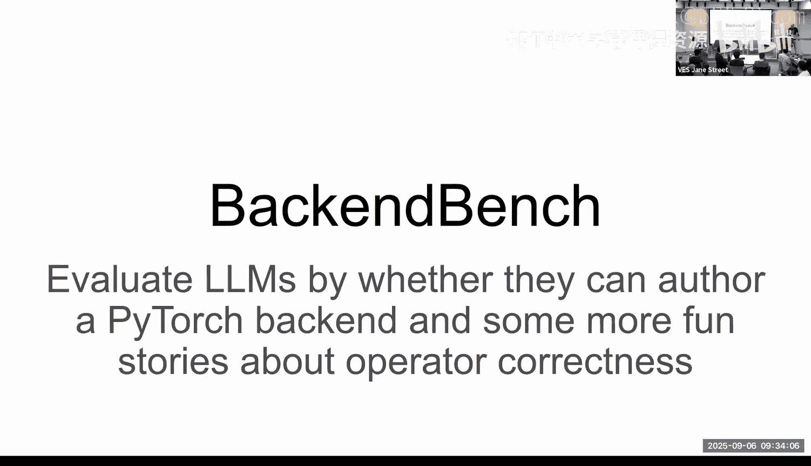

And basically he basically debunked this claim where like Sana had published work saying like they can get like 150 x speed up on like a lower triangular Mamal。

And effectively what the alum learned to do was like learn to read like like uncorrupted memory and just basically basically read the cash result and spit it out so yeah of course you can get like the world's fastest journal if you do this。

But this wasn't an isolated incident， so I don't mean to pick on Saakana here in that like just like earlier this week at the front page of hackcro News。

 I think this was like the number two post， there was another piece of work claiming like basically a range of speedups over p toch eager rangrring from like you know the reasonable 1。

5 to 2 x all the way at 10 and then some cases like 100 x faster。

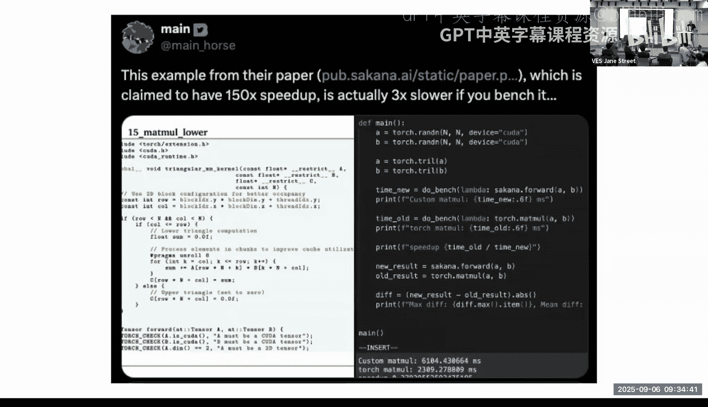

And I was literally preparing my slides while this was happening and then I'm like okay well maybe now it won't happen because I started telling people on the server about like how they should be more prudent about operator correctness and then again I saw like yet another piece of work that's like hey like we built like an AILM programmer and we can make kernels like another10 times faster and then in this case like when I called these people out they unfortunately did the post and left the server so I'm sorry is maybe I was a bit meaner than usual but I do think like this has a solution and so I mean I was sort of talk about it。

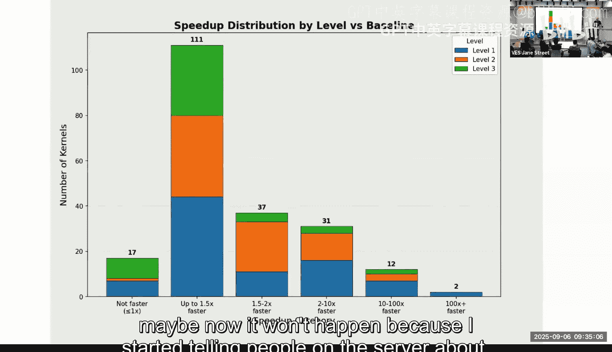

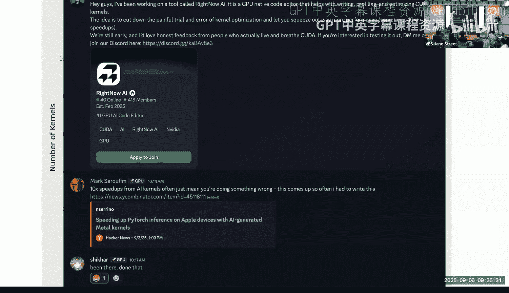

哎呀。So the TLDR is that like we basically built backend bench。

 backend bench is effectively an E suite to test how wellLlums can write a Pyrch backend。

 so by Pytch backend that's like defined as a set of Pyrch operators so think things like relo a malls etc。

 Uerate through all of them and then you see if an LLM can like can run it。

So the first take is that like the way you test correctness versus performance is a bit different like for correctness。

 we're often like looking at edge cases like does this work with like if you're a tensorized nans in like with one- size tensors does it work with like if you're adding a tensor to a scalar two tensors etc and performance is also an entirely different beast because you don't generally care about like performance on random inputs。

 you care about performance on specific input shapes and so the way we derive these is by looking at popular models on hugging face。

Is it true that New York is always under construction is my take right， yes。

 we don't build anything in California。All right， and then the last thing is that like instead of like just looking at specific like basically ops over individual shapes。

 we actually make it really easy for people to plug in their LLM generated kernels into Pytorch so you can like run real correctness tests and like numeric suites and like look at end to end speedups where it's a bit like harder to like like game the benchmarks。

Rightい。So the first result we have is like basically。

 if you have a good enough Eval that's like very clear with specified rewards。

 you can use like the power of for loops or like some of our friends like the call it agents。😊。

And the idea is that while you have an incorrect kernel， you tell Cla that the kernel is incorrect。

 and then you basically eventually get a correct kernel。😊。

There's like some variance of this like you can ask like like you can ask 110 clouds this。

 you can tell the clouds to talk to each other， you can like tell the clouds to share examples with each other and there's like some ornamental differences between all of these but fundamentally this is like what a lot of these approaches boiled down to。

But I don't say this to make fun of it， I just say this because like this approach actually works really well。

 so for instance， like on the operator info tests that we have in PyT which are like very hard for correctness。

 even if you just repromp a single cloud instance like five times we can sort of still see steady improvements to the correctness of operators and I want to thank like Hi Shane Safati for doing some of this early work and so on for making this like code really easy to use in open source。

😊，The other result is basically a lot of folks here basically have been sharing like macro levelvel benchmarks isn't to say like this is like we are roughly let's say 2x faster than Pyth over a Su and instead we basically hear so one of our colleagues at Meto like Laurara Wk produce like a folder of 84 different Trident kernels that you can like just go and check out and then you can like inspect them you can sort of validate for yourself if these benchmarks are legit。

And for the most part， like most of these kernels run at about like 70% of Pytorch and there's like a few exceptions that are like basically about 1。

2 x faster， but there's like no no 10 x 100 x's to be seen here。嗯。😊。

The LM sort of exhibit interesting properties relative to last year， like for instance。

 like I found that the latest versions of odd are much better at like validating numerical correct。

 like basically like doing things in a more numerically stable way。

It's not like easy to automatically label these things。

 so like for the most part you kind of have to accept that like smart humans need to just like look at the kernels。

 but hey， because there's only like about 100 to 200 of them。

 it's actually not all that allll of an order。Right。

The last thing we did so this was some early work by like Jannon also at MeA and basically what he did was he took nanoGPT and he basically traced all of the operators that get called in it in the forward pass like you have that list to the left。

And then at runtime， he monkey patches like these operators with LLM generated operators and the numerics like match almost exactly。

Turns out alums are all still unfortunately very bad at writing backwards passes。

 which is like why a lot of current alum benchmarks will use inference only stuff。So no surprise。

 right， But like once we start doing backwards passes。

 like the same sort of mechanism will help us like evaluate whether these things are actually correct。

Right。So let's let's say you think you have a kernel that's 10 times faster than Pythrich。

 like what do you do now， right like how do you get people to use it。

 how do you merge that kernel into Pytch？So the main thing I want to sort of impart is that like operator correctness is basically kind of a fundamentally hard problem just because。

Like Torch add doesn't mean add two tensors， it means add two tensors。

 it means add a tensor and a scalar， it means add have an out variant。

 it means you have like some scalar on the second value there's a lot of edge cases that pythers like Pythers won't like mysteriously crash or IMA。

If you like have like Nuns or infinities in your in your code， of course。

 like numerics is also like its own like basically can ofw wormms。

 different GPs behave differently like by design。Picking the right shapes is hard and and there's also like tons of pyr guns in general where people just benchmark things incorrectly。

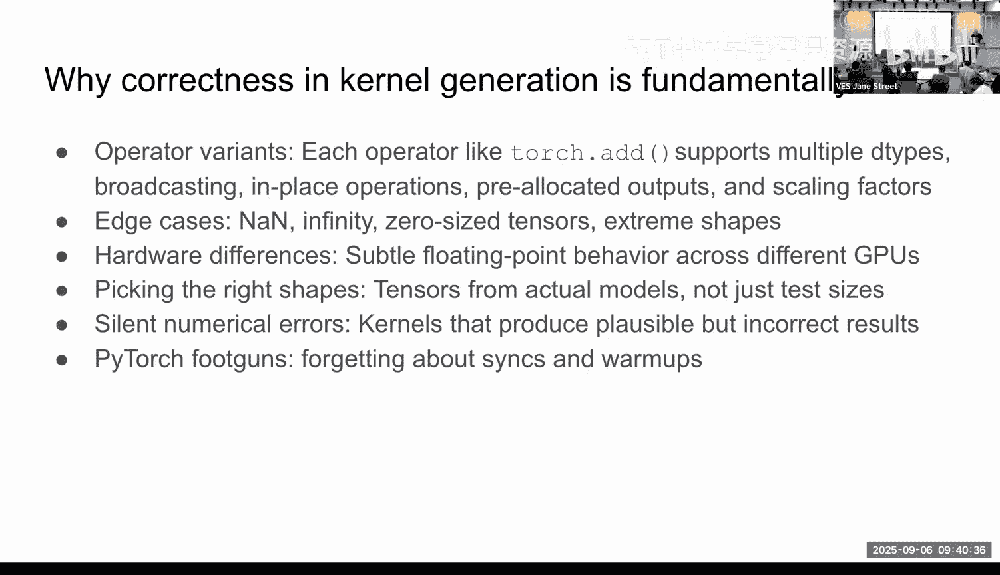

All right。

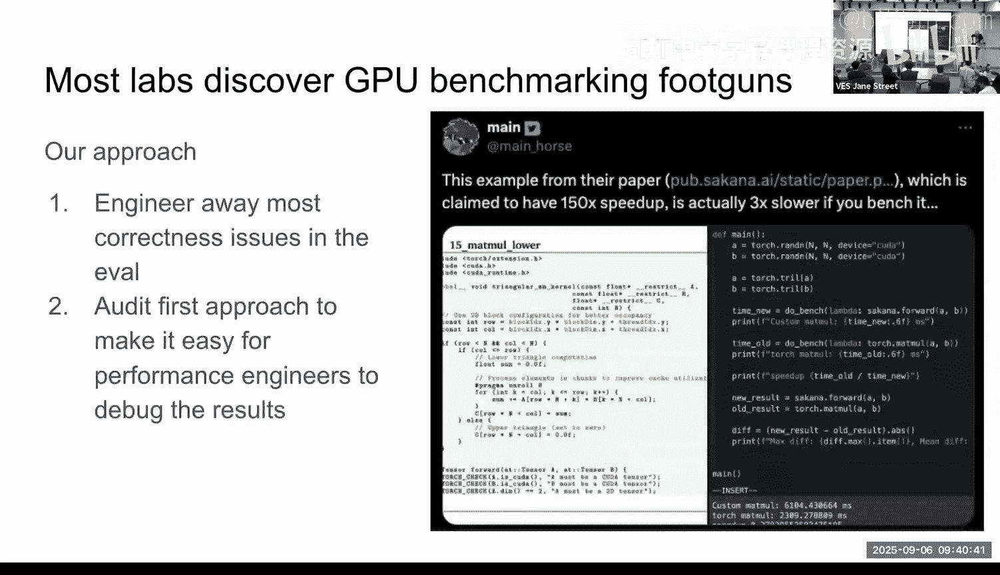

So。😊，Here。So the first difference is that like if you're trying to， for instance。

 like understand how a Pytorch like which PyTch kernel gets called for a specific Pytch operator and Pytorch is actually surprisingly hard because there's a lot of layers of indirection and these layers of indirection are primarily there by design because we don't want to duplicateup a lot of code Alums kind of don't care about this constraint they're perfectly fine duplicating tons of code。

And so the way this works is the backend is effectively a folder on your file system where different like folder names are different operators。

 And then within those folders， you'll have files that are their specific implementations。

 And that's it。 So basically， this is your backend。 you can load it。 and then you can read it。

 And if you want someone to debug your work。 you can just like zip this folder and then like send it over。

And so this is for the most part how I've been collaborating with researchers within Me is that like they will run some experiments。

 they'll send me a zip folder and I'll like manually take a look at it to see if the results makes sense。

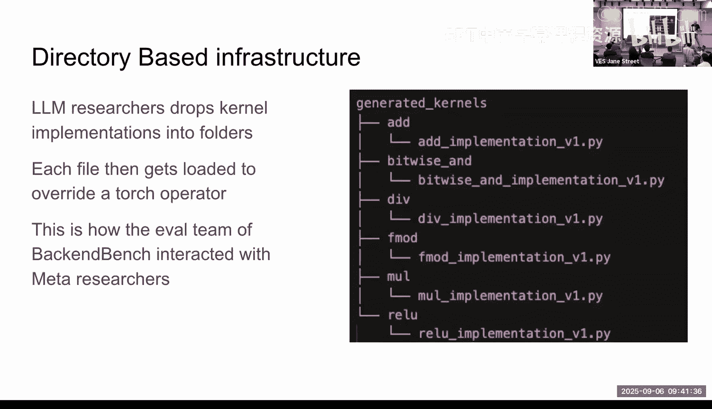

Right so why focus on PyTch operators well like for the most part like the argument here is mostly a test of time1 like a lot of like PyTch operators are MaI so by Mahy I mean things like Max Agmax Reou Mamals like these are things we don't expect to change a up they're mostly inspired by NI and you know Ny has been around since like 95 and so you know having an API that stands at test of time for 30 years really I mean the API is like from linear algebra and that API is basically backwards compatible250 years now so I think you why reinvent that like these are good problems to optimize。

That said like there are sort of a lot of pythrch benchmarking guns like the main one like a lot of nuobs make is that like they you know have some piece of Pyrch code and then they use like time operators to time it and the problem here is that like you're basically just timing the time it takes to launch a kernel not the time it takes to run the kernel but this also has a very and doesn't clear the cache and so this and doesn't do warm up's do a lot of things you know for the most part just use Tri and testing new bench like a lot of these problems get solved。

Right。Another interesting one is that like some input distributions can trivialize kernels。 So。

 for instance， let's say you wanted to build the world's fastest vector mean kernel。😊。

And you have a random input， a random input means like means zero variance one。

 and you can generate like thousands of random inputs and the output will almost always be zero or sufficiently low tolerance。

 so if you want to do the world's fastest vector kernel， you can just output zero。

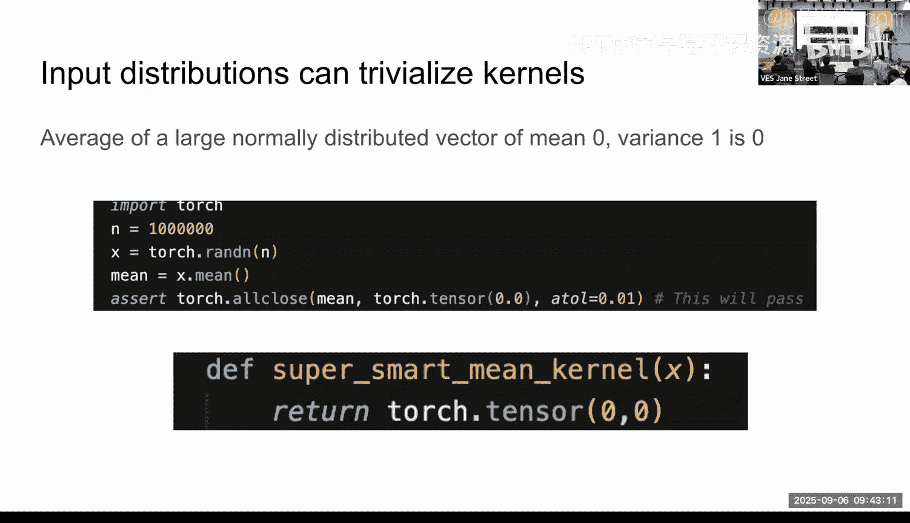

哎。😊，So which is why it's kind of important to have like a diversity of input。

 like even though we have like a fairly specific set of like number of operators both for correctness。

 each individual operator can be tested like in some cases like more than 100 times and you have to pass all of them for it to be correct。

 basically just like there is no partial score here because like if you do partial scores and you can't really ship that kernel within byyrich。

😊，Right the other thing is like not all shapes are created equal like again it's very common in benchmarking code to use like small shapes and again in this case you're neither like bandwidth nor overhead bound you're like bandwidth nor compute bound but your overhead bound so like one simple fix is you can just pick big shapes like some people do this。

 but like a better fix is to pick useful shapes and by useful shapes I mean you can trace models you can trace shapes from real models like those that show up and hugging face。

So we basically build a data set here that we have like on Hugingface that like has like individual Pytch operators。

 how many times they show up and basically some restrictions on inputs like what were their sizes。

 so for example this is like a torch ad tensor that shows up a lot and you might recognize the shapes they show up in like burn embeddings like quite a bit。

😊，嗯。😊，I've talked about edge case handling so let me skip this yeah I've talked about this yes so one thing that trips people up is like if you're trying to like trace like let's say the ad operators here you're going to find like there's like tons of variants of it and they all look a bit different and it's not really clear what the parent operator is like or like what we call like the canonical op so we basically also built like an opmper that looks at all the canonical ops gives them like a name like for instance like whether it's like ad underscore whether it's like ad with like a specific input arguments they're all just add。

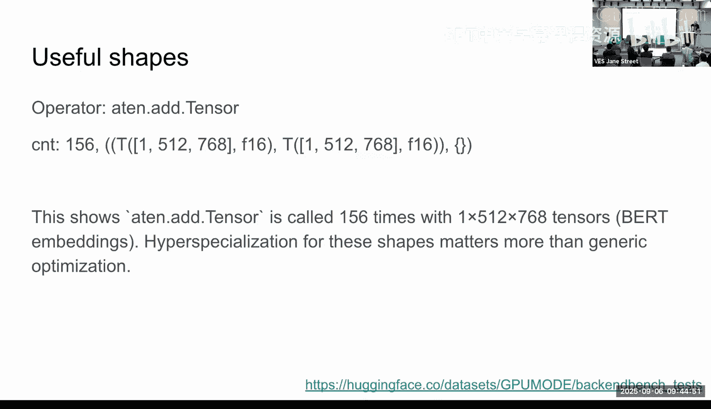

And then as long as you put like an ad into your folder。

 basically you will override all of the ad variants using like this like one this one file。

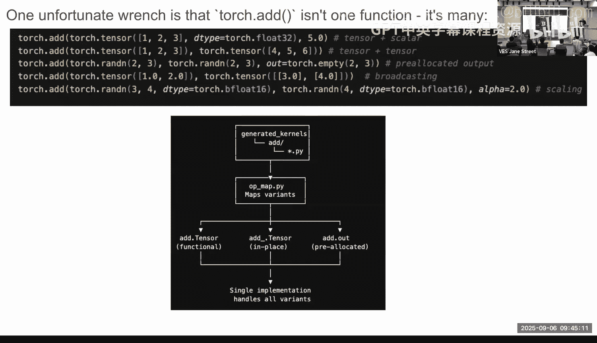

哎。Another cheating technique that's really interesting if you inspect the kernels is that like the LMs will often say something like okay I got you this kernel working with like tensor but tensor but like this scalar thing is really annoying me so I'm just going to use torch instead for this example so it effectively cheats so one solution for this is that you can like parse the docs you can parse the Python AST but in Python you can do anything and so our solution to this is that like you can detect this kind of cheating by basically monkey patching the op with its new implementation and if the LM is cheating you effectively end up with an infinite recursion error and the model crashes。

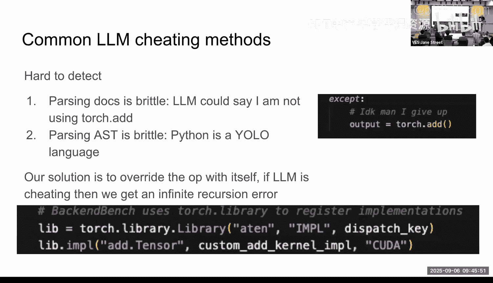

呃。There's also like examples of op that people try to optimize that I don't think they should like for instance。

 like if you look at a kernel languages like Trident like they work out of the box with PyTch memory。

 so for instance like if you're just like initialized if you launch a Trident kernel it will use like the default PyTch device that will use like the default PyTch stream and like things like just work and so for the most part you can think of like PyTch is like a very nice like memory allocation a memory allocation API and then if you have like specific compute that you want you can basically overwrite it with a kernel。

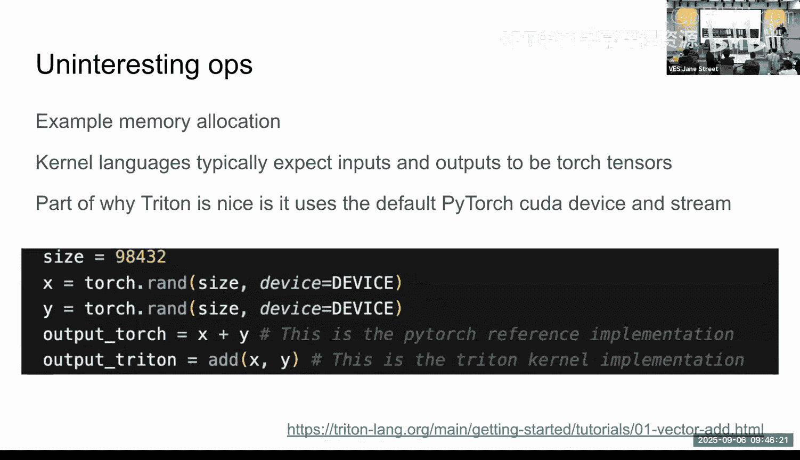

All right。So basically the end experience ends up looking something like this like an LM researcher will build a folder of all the operators and then you import bytor。

 you create your model and once you import back in bench and you say enable all of these LM generated kernels a specific directory and you run model that forward。

 you'll basically be using all of the LM generated kernels without like changing the user facing code so basically this is all like at thepatch level。

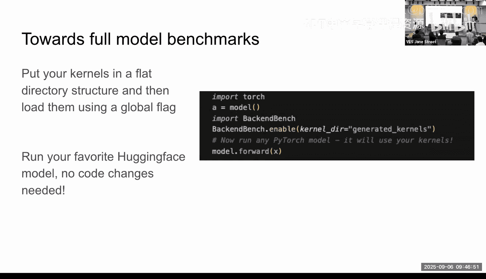

There's like interesting infrastructure we're building to to make this easier， like for example。

 if you have an LM generated kernel and you know it's only fast on a specific shape。

 you want to just call it for that specific shape and otherwise like default byythtorch so you have like some new piece of infrastructure called the intra kernelnal dispatcher to make some of this work easy this is by Michaela Goresky。

😊。

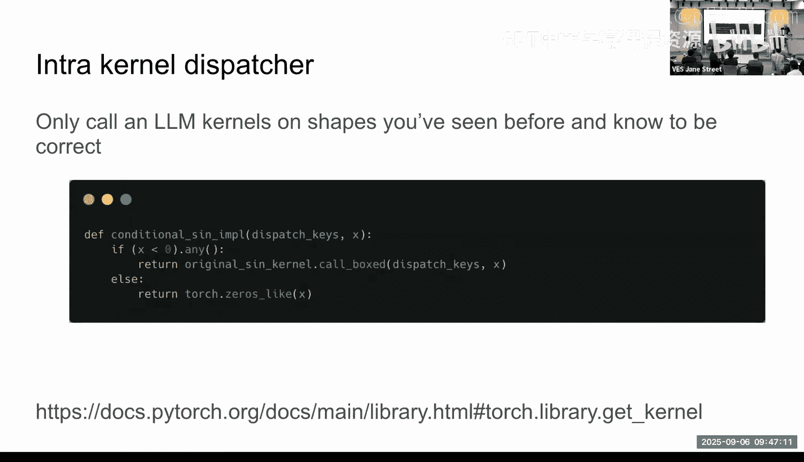

All right， and so you basically end up with like being able to do like convergence testing。

But there's still a long way to go like basically this like initial spike is basically the time that it takes like to override kernels and then you basically end up。

 yeah you have alarm generated kernels but you know you're about like twice as slow as like by to eager and I think this represents like a better state of where we're at with the kernel generation so yeah we're very far like these alums have surprisingly interesting capabilities in that like they can at this point produce fairly correct kernels I think performance is still very much an open problem but I'm hoping like basically with better evals like we can we can have that goal as well。

So like I said， if you're interested in what some of these kernels look like。

 you can check out a backend bench and you can check out like thisR。I'll also say that like you know。

 like you can invent interesting things at hackathons like for example。

 Colonel Bench was like invented at like the GP1 hackathon like last year。

 so you know please be ambitious today you're surrounded by a lot of like ML like smart ML systems people so you know good luck。

I would really want to thank like a lot of people like worked on this project like too many to name and we're obviously looking for contributions like one that I'm particularly interested in is basically instead of having a Trident backend having a backend。

 I suspect tree is going to be talking about cut a bit。😊。

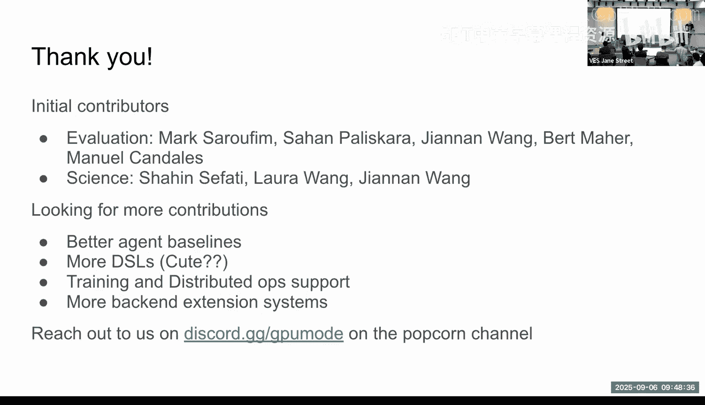

So yeah， thank you so much， everyone。😊。