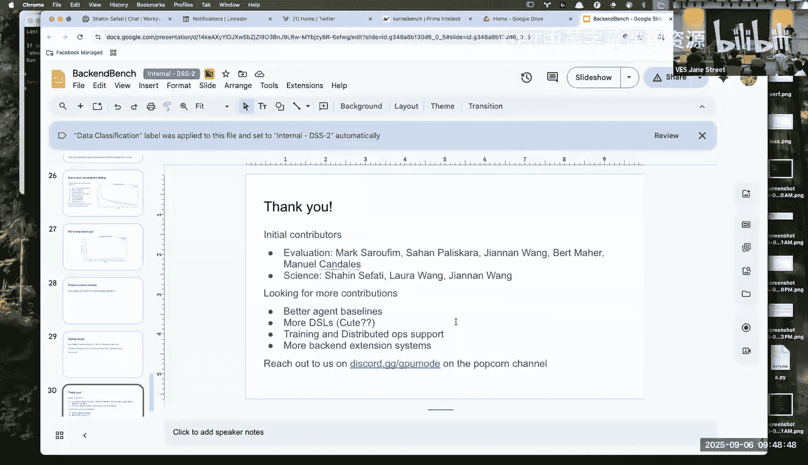
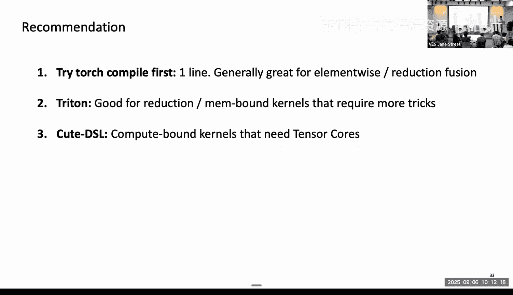

# GPU MODE《CUDA、GPU编程54-87｜GPU MODE》中英字幕（deepseek-v3.2 p24 -20250910-Lecture 77_ Domain Specific Languages for GPU Kernels.zh_en -BV1xbmQB3ETC_p24-

And you know， I guess our next speaker doesn't need any introduction， you know。

 it's the inventor of flash attention one， two， three， all more recently four， so three， please。

All right hi everyone really excited to be here thank you Mark for the kind introduction I won't talk about attention too much maybe just one or two slides。

 but I'll be mostly talking about domain specific。😊，先社？You。And just that。で生。ベ発ですね。はいたら。あのセ。

At this time。まじないか。Thank good operation。All right， let's carry on okay。All right。

 so I'll be talking about domain specific languages for GPU kernels is something that I've been very interested in in the last four months or so。

 part of it now explain is I've been trying to get my students to do GPU programming and figuring out what's sort of the best language to make them productive okay so just to motivate。

 we've seen this scaling laws and working in the last five years is a plot of the H Chiilla scaling law where generally if you have more compute。

 you have better algorithms， you have more data generally you just produce better and better models。

 not just on existing benchmarks， but they seem to have these emergent properties and so how do we keep this going。

I would argue you want to maximize intelligence per dollar。

 which can be factorized into intelligence per flops and flops per dollar。

So intelligence per flaps flos is floating point an operation。

 the first term I would call it algorithmic or data efficiency then the second term how many flaps you can do per dollar I call it hardware efficiency and the point is you want to optimize for both。

😊，So to optimize for both， you can't just go hardcore and code everything in PTX because that make your researchers much less productive so on one hand you want researchers to be productive so that they can figure out better models and algorithms。

And on the other hand， you want your code to be at the end of the day be efficient on the hardware so that we get better scaling and is this fine balance of these two things that's why I think we need domain specific languages and people have figured this out for the last several years Triton has been hugely successful hightorrch is now everywhere so it's all about striking the balance between researcher productivity and hardware efficiency and one bonus I think domain specific languages with good abstractions can make it easy for LMs to generate kernels and Mark has talked a lot about it so Triton。

 for example， has made this a lot easier。Okay， so I will talk about a couple of domain specific languages for kernels。

 I'll give an example in doing softms and then I'll show some results on math Ma and attention。😊。

Okay， so the first domain specific languages。😊，That I think almost everybody is using now is Pytorch and you might not think of Pytorch as a DSL。

 but I would argue with this you know almost all machine learning researchers are using Pytorch。

 they use it to express the algorithm the models and so on and PyTtorch then take the Pytororch program and map it to a bunch of GPU kernels and especially with Pytororch2。

 they have a fairly sophisticated backend with dynamo that will capture your program。

 the inductor that then generate Pon code and then call the Triton compiler and so on is fairly sophisticated。

So Pythor is one， I think almost everyone's using it now。

 the second one also has been hugely successful is Frighton and their success came from abstracting a bunch of things away from compared to KUDa in KUa。

 there's a bunch of things like that you have to do manually like memory coalescing。

 share memorymanment scheduling and so on that Triton just does it automatically for you and that has really lowered the bar of GPU programming and has made a bunch of people much more productive。

More recently I've been spending a bunch of time with the DSL so this is going to be lower level than Triton and I'll show some example。

 it gives you almost the same power as PTX and I'll show some example as well。

So at the end of day these DSL how they differ is how much of the hardware hierarchy they expose so this is an example on NviDdia GPU AMD GPU would be somewhat similar tpUs would be。

Slightly different， but they all have different levels of memory of threat and memory hierarchy so you have a threat and registers they're owned by threat then you could have threat blocks that have some sham memory that they can communicate you have threat block clusters that these threat blocks communicate and at the lowest level you have grid with a bunch of clusters or threat blocks that is harder for these clusters to communicate。

Right and Triton。Expos only threadb and grid As I mentioned it try to simplify a bunch of things and that's made people very productive that also means the tradeoff is you don't get to control as much of the hardware now domain specific languages has been a very productive area there's been tons and tons of these DSLs coming out there's done a kitten from Stanford Mojo from modular Thailand from Microsoft Asia。

 Mosaic GPU from Google these all quite good more recently there is glueon from the Open eye team the the Triton team trying to make a lower level version of Triton exposing more of the hardware and I just found out yesterday that meta research also is working on something very very similar TLX Triton lowle language extension we' just trying to fix not not fixed but augment Triton to expose more of the lowlevel hardware。

So we see some of these domain specific languages are converging that they're trying to expose more of the hardware in just slightly different way。

 slightly different abstractions， but the core concepts， the hardware。

 hierarchy is pretty much the same， the core concepts like layout and memory management is still the same。

So just to get a feel for how these domain specific languages differ。

 so we'll take a look at at an example torch Somax and let's see how you do it with torch compile。

 let's say I want to do softmax of a tensor in the last dimension so I have the pytorrch here and to use torch compile is actually extremely simple you just add one line and you at a decorator torch compile and a of Pytorrch folks have an amazing job to make the UX as easy as possible。

😊，And nowadays， if you decorate with Tor compile a lot of times。

 you can get quite a big speed up and it can do a lot of kernel fusion for you automatically。

So is my first recommendation， you should just try it and if it works great， is's one line。Okay。

 so then you can go one level lower let's see how it work looks in Triton so this is from a pretty popular library called Lger kernel from LinkedIn folks and so they wrote a version of softmax and here we see we get to control more of what's going on know you have things like program ID masking and the core math is actually relatively simple just the beauty of Triton you can express these lowlel operations in fairly concise way for example。

 the code is like six lines you load in the input you take the max。

 take subtract the max and take exponential， you take the sum you divide by the sum and then you write out the output is very。

 very concise this is real code that's running in production that lots of people are using right Tton is great so that's one version of Triton now if do you want to do multiblock。

which means for larger tensors， you need to start doing things like online stopm reduction and so on so it's a little bit more complicated but let's just say this is 10。

 15 lines right and it works very well I'll show you。

Okay and now we can go one level deeper with the acute DSL and here you know so it's actually a lot of code and we won't go through all the code but I just want to illustrate that this exposes much more of the hardware so for example when just loading an input you need to care about oh how am I at how am I accessing the memory which thread is accessing which which memory location am I vectorizing it for example here it is a vectorization that says I want to load 128 bits at a time know this is something that you don't control the bright level you do control at the acute level I want to do synchronous or asynchronous right here the copy atom is asynchronous and as a result when you do asynchronous you have to commit and you have to wait you have to do synchronization yourself right？

So that's an example of just loading， just one line of trident of loading translate to maybe 10 lines in QDSL simply because you have to specify everything because the language allows you to specify these six。

Then you want to do reduction things like max taking max and sum and here the language exposes all of the hardware hierarchy。

 so first you take a reduction among the values owned by a threat。

 so there's a function for that just a reduce。😊，And then you want to do warp reduction warp is a group of 32 threats and turns out if you just do reduction within 32 threats。

 you don't need sham memory you can do this thing a warp shuffle that's little bit faster and here you control explicitly that hey。

 I want to do warp shuffle within 32 threads right so this is warp shuffle would be another five lines or so。

Then threats in the same thread block you could do reduction and this is another 1 lines or so where each warp would need to write the value to Sham memory it would then synchronize and then you do another warp reduction if you've done co programming this is one of patterns that you learn in the first couple weeks or so and here in Q DSL it also exposes that for you except it's embedded in Python which generally make you a lot more productive so that's how you do block reduction and finally you can have multiple thread blocks in the same cluster and you can also do cluster reduction and the same idea as block reduction which is each thread block or each warp will write to some sham memory distribute a sharem memory called DSM and then they synchronize and then they read back the value and do another round of reduction so you see this four levels of hardware hierarchy that's exposed in the language。

And so here's what reduction looks like know from from top to bottom。

 you have to do you don't have to， but you get to do threat reduction。

And you do warp reduction and you do either block reduction or block reduction and cluster reduction right so four levels of hierarchy。

So why do we go through this know this Ich torch compiler is one line and Tritan is maybe five to 10 lines and then its acute DSL is maybe 50。

 50 lines。Okay， so how do the performance compare so we're comparing softftmax on an H 100 with a batch of 32。

000， and I just buried the last dimension that we're going to do softmax over。

And we're measuring memory bandwidth so this is on H100 the theoretical max is like 3。3 3。

35 terabytes per second， so if you hit 3000 it's like 90% so that would be considered quite good and we see for small shapes that。

The acute DSL version the one in green actually has a bit of an advantage and why is that because for small shapes we actually use warp reduction and we don't use block reduction and we know that is small so it fits in one warp and so we explicitly only do war reduction and that gives you a little bit of a speedup。

So maybe on the factor of， 20， 30% or so。And then in the large input regime。

 we see that QDSA also has an advantage because we get to do cluster reduction right so as the input get bigger and bigger it simply doesn't fit into one thread block but if you can fit in one cluster and you get to control the cluster then you can make it quite a bit faster so this is a factor of maybe from 3000 to 200。

 so it's about 15% right so that's the kind of usual trade up in terms of productivity and performance you spend more you spend more time on this if you understand the GPUs at a deeper level then you want a language that sort of allow you to control and get better performance。

Okay， so that's softmax。So far I've compared different domain specific languages。

 some of you might have programme in Kudos C++ before and you might be wondering how much performance do I give up if I use a domain specific language that's embedded in Python compared to CW Kudos C++。

😊，So let's see。So this is matrix multiply just a times B on Hopper on H100。

 and I'm comparing an implementation in Q DSL in orange and Kubus in blue。

 and I'm just multi multiplying matrices 8k 8000 by k by 8，000 where I vary K from 1，000 to 8，000。

Fairly。Fairly normal shapes and we're measuring terralops so I think the max on the device is around 1000teroflopsteroflops per second so we see that the acute DSL version both the cute and the kubla version get around 800 teroflops per second so this is really really good youre especially getting peak hardware performance you never get above 800 or a 50 simply because you power thling and all that so you never hit 100% you getting to 80% is actually quite good and we see actually the acute DSL version has a little bit of an advantage。

towards the smaller k side because since now you can implement this technique of ping pong to overlap the epilogue and for weird reasons Kubla does not implement it at least for Hopper so if you're interested in ping pong in ping pong architecture the folks at Pytorch that metata has also written a blog post on this this came out of the cutlass implementation the idea is you want one war group to be doing the core matrix multiply while another group group is doing epilo and then you just overlap the two and that allows you to not pay so much for the epilo and so for small K a lot of time is being spent on the epilog just writing out the output so if you can do that overlapping you actually get very high performance even for small K。

Okay so that's great it seems like for jam for Hopper you're not giving up much let's see how it is on blackwell so on Blackwell Cubaba is actually really。

 really good。😊，So here Kubla， a small K also does is doing really。

 really well because Kublas also is implementing this kind of ping pong for blackwellow and the cube version also implements ping pong so the kind of neck and neck maybe the cute DSL version is slightly slower。

 but you know blackwellow is new so I'm sure people will figure out sort of how to get the last to 3%。

Okay， so that's gem you know but gem nowadays is getting too easy the hardware has made it much much easier to write a good matrix multiply。

 so I think the interesting area now is jam+ X whether jam plus epilogue or attention。😊，So here's a。

A jamm plus Elo where I do jamm and then I do Swig glue Ja plus W glue is kind of probably the most popular gem out there if you're using a transformer in the FFN or the MLP you'll almost always do mat Mall and then Swiglu so this is the most commonly used matrix multifline nowadays and so I'm comparing cute DSL and orange and Kla plus Triton so this is essentially torch compile So if you run torch compile it will call klas to do the gem and then use Triton to do the Swig glue。

 so there's a two separate kernels， but if you you can code it up in cute DSL in one kernel。

And you can use the same trick you know ping pong to hide the epilogue and so on and you get fairly good performance right so this is about 7 to 15% speed up on this is like the most commonly used gem compared to what is I would say the best out there which is Kubla+ torch compile right so this really gives you the power to do epiloc fusion。

Thats Jam plus Wiglu about attention， so this is working in progress。

 but we're seeing really really good performance of attention on Blackwell。

 so we're comparing against coUDNN here， which is close source and presumably in a lower level language。

 whereas compared to the flash attention on Blackwell， which is written in Q DSL。

 it's embedded in Python， and we're seeing about maybe 20% 15 to 20% speed up compared to QudDNM。

Granted this is with a bunch of algorithmic improvements too。

 and we're working with the Kudin team eventually the performance will be the same as we work with the Kudan team to port some of the optimizations over。

At the end of the day we want a balance between productivity and performance and I really like this point made by Phil who's the author of Triton these domain specific languages just exists on a spectrum right between you're trying to balance productivity and performance so Pytorarch very very high productivity almost everybody's using it if you want to go one level deeper you could use Triton you can still pretty productive but you get more performance and as you go deeper and deeper you get Kuta or PTX where you get more performance but it takes way longer to write your code I think QDSI is actually a pretty good。

Balance it's definitely more of a bo and brighton， but it gives you more control and so far I've been spending a lot of time with QDSL。

So roughly speaking， this is my opinion that the trade off kind of looks like this。

 so if you have memory bound kernels then Torch compile generally does a very， very good job。

 you get to like 90% of what you can achieve。Triton can similarly get to about 90% and then with QDSL you spend more time。

 maybe you get to 100% you know you do TMA and async and all that right so memory bound kernels is not a lot to be gay。

For computebound kernels， torch compile can get to 70 to 80%， Trident。

 maybe you can do something more sophisticated， 80 to 90% and QDSL。

 you can do jam plus epiloc fusion， you can do all sorts of crazy things that takes you more time。

 but you can get 100% of what you want to achieve。And then onboarding1 this is very much on my mind because I'm trying to get my students to do some of this I'm trying to get the folks I lead a team together AI trying to onboard new folks how fast can they be productive right and To compile is on the order of hours to days right a lot of times you just put in course that compile and it works that's beautiful sometimes you got a set of right flags and make sure there's no graph breaks and so on so on the order of days right Triton it takes days to weeks you need to understand the GPU at a slightly deeper level but you're still very productive and Q DSSL would be on the order of weeks to months so as an example Q DSSL came out in May I think so there's been four or four months and I kind of force my students to。

To work on QTSL and after three to four months I think right now they're fairly productive right so it took actually a fairly long time part of it not just the language is that you need to understand all the the internals of GPUs and how GPUs work and what different levels of hierarchy and how to use use synchronization and so on right。

😊，So my recommendation would be B toch comp first is one line。

 it's generally great for element wise or reduction fusion。😊。

Next step would be try to use Frighton it's good for reduction memory bound kernels that maybe you need a little bit more tricks。

And or compute bio kernels that use tensor cores， you can go deeper and use QTSL。Right， okay。

 with that， I'll stop here and thank you for your attention。

