# GPU MODE《CUDA、GPU编程54-87｜GPU MODE》中英字幕（deepseek-v3.2 p25 -20250913-Lecture 78 Iris_ Multi-GPU Programming in Triton.zh_en -BV1xbmQB3ETC_p25-

Hello and welcome to another episode of GPU mode today I'm really thrilled to have like some folks from the AMD like research team like grad to talk to us about IIS。

 which is like the first class multi GPU programming experience and Trident。

So there's already been people playing around with this library in the server when it comes to the AMD。

 like multi GPU kernel competition specifically to sort of use like shared memory and stuff because it has like this like nice like Pythonic experience。

So today on the call we actually have like three so we have the three of the creators of the library。

 so we have Momaed Ad who's having technical issues but hopefully should be joining us soon Brandon Potter and then Muhammad Oama if you have any questions in chat like please drop them and we'd all be happy to answer so thank you and Brandon Muhamd please take it from here。

Okay， awesome， so I'll be starting us off， but hopefully Muhamd Duwad can get the technical issue sorted out and he'll take over。

 but today we'll be presenting Iris first class multiGP programming experience within Triton。

 this is work done by Mohammed Dwad myself in Brandon， within MDD Rad。

 we're very excited to present this idea of how we're making multiGP programming simpler using Triton Subtraction。

 using existing Triton abstraction。😊。

So to start us off， I'll kind of give a takeaway slide if you'd like to kind of get a essentially a summary of what ir is it is。

Really well encapsulated within this slide so IIS is an open source Tritonbasedase framework and as Mark mentioned there are already folks using it it is Trident based framework for remote memory access RDMA support is in the works it is written in only 370 lines of code and IRS provides Schm like interfaces within Triton for multi GPU programming and one of the core principle we wanted to kind of emboed within IRS is to make sure that we make multi GPPU programability a first class citizen within Triton so maintain programability and retain the performance that we get also。

It has very familiar PyTtor and Triton like APIs for both host and device side abstraction and it allows you to really get into the weeds and do fine grain multi GPU programming and I'll talk about that in a bit。

😊。

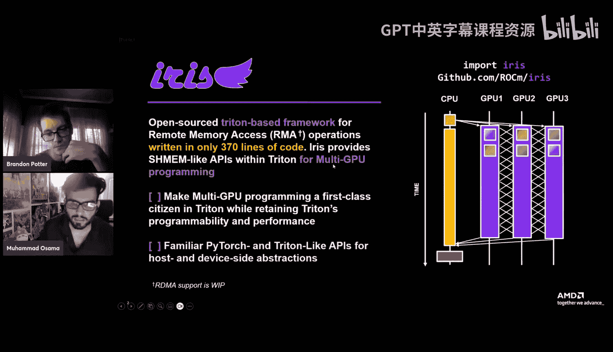

The contemporary approaches which well most likely like go through is as in the presentation compare againstwood are based on stuff that Rle does or this bulk synchronous programming model where you have on the left hand side to show a little code snippet of you set your device you launch a compute kernel you wait for that compute kernel to fully finish then you launch your communication kernel then you wait for that communication kernel to fully finish and then you launch your other work that you want it to do so it's a very stop and go kind of model。

 the bulk synchronous model that is mostly standard right now in a lot of different places because it allows sort of this portable abstraction where you can create collectives and you can use them as ops but there's a lot of problems with it it is CPU initiated control path theres host and device side synchronization required。

It is like bulkness。 So there's a very stop and go kind of thing going on。

 And there's a lot of inefficiencies within it。 This is what we are sort of moving away from。

 And Is is one world view of what that new model looks like。😊。

So within IRS what the code would look like is on the left hand side a small snippet where you're really within a kernel。

 you're doing some compute at a workgroup level or threadlock level granularity。

 you're doing some compute and if you need to do multiGP communication you after you've done that compute it really is a simple store or load so you can do a compute。

 you can store it to remote GPUs， you can do more compute。

 you can load from remote GPUs and so on it follows a really natural work group centric kind of programming model that Triton already embodies and extends it to support multi GPPU programming。

😊，It does not require any intermediate buffers that way。

 it doesn't require any sort of communication over the synchronization overhead。

 it really just is one fused kernel that you can write these kind of patterns with。😊。

So what IRS aims to provide is device side primitives to be able to achieve a code something like this。

 and there's a more detailed example later on。

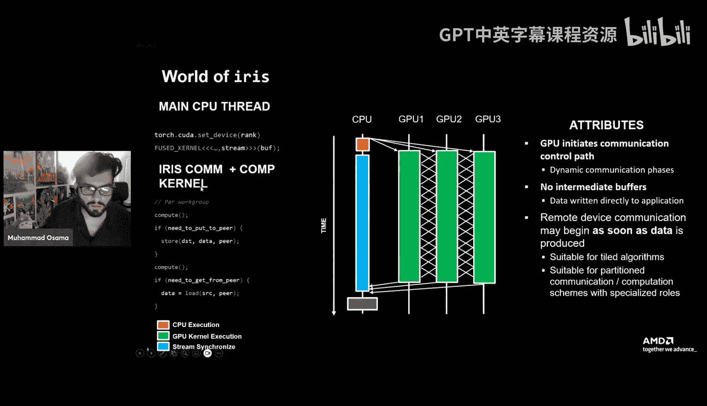

The four principles that we looked at when we were building ISW， first of all。

 we wanted to make sure that it is it is clean， it has minimal dependencies and it is very。

 very simple APIs that anyone can understand anyone with a Triton background will be able to pick it up really easily so that's designed by experts built for scale the clean abstraction essentially kind of talks about more on sort of the pythonic APIs that we have extended for the host side stuff and the Triton style device side APIs that allow you to do multiGP load in stores and atomic ops。

It is built on a symmetric key implementation all within Python we do provide examples for collectives so in the example folder within IS repo you'll find lots of examples that do all scatter already all to all communication and things like that but right now that's not necessarily the goal of the framework the framework goal is to provide device side API to do multiGPU you can build collectives on top of it and we have also noticed that potentially in the future we might be able to provide those collectives as a standalone useful thing that you could just include and just use these patterns when we were implementing these examples showed up time and time again for example。

 like the actual collectives like all to all but also various ways to do locking mechanisms and lock variants to make sure that the communication has happened and make sure you can load from a piece of data or store to a piece of data data and so on。

The other types of patterns that we show in our examples and what we have really evaluated our work on is this fine grain gem plus communication overlap via workgroup specialization or thread block specialization。

And lastly， IS's design is really built to scale， so currently we support a single node backend so you could do R stuff and we have plans for scale out to do multinode stuff that is in progress。

Okay。I'll skip through some。Yeah again the programmability was one of the fundamental focuses of when we were building IR so it is really a clean。

 simple familiar interface and I'll show examples of what that looks like so on the host side stuff like I briefly mentioned it has pitorrch like tensor creation so it it extends what you can essentially do with Torch do full to create tensors on GPU from the host side it uses the exact same interfaces as before so in this case you can just do I。

 full and you will have a tensor that is allocated across all of all of your nodes within all of your GPUs within a node。

😊，And it supports other torch As as well such as10 zeros like a range line space and so on so the very familiar Pytorrch like hosts interface works really well in our favor by just extending it and supporting multi GPU variants of them。

Similarly to the host side stuff， the device side also looks very similar。

 so we support Triton load and store APIs so what load here is really implying is we had to make a few changes for it to work across multiGPU so for that the only differences you see here is the two rank from rank and heat basis so Triton had already had a declaration of what a load API looked like and we have introduced the ability to use that load API across different GPU ranks and for that we had to enter at these sort of additional parameters to the actual API。

Oh， what's a base。I will talk about that in a second。嗯。

Yeah so these three parameters is what you have to kind of carry around in fact the two rank and heat bases are just kind of a property of what limitations of current Triton you can technically just hide these behind the point a class as well but right now that's not necessarily supported but even with just these minimal changes the API still look very familiar so if you have used Triton before this should look very very similar to you so you're just doing a Triton load but instead of doing a Triton load now you're relying on I load to do remote communication。

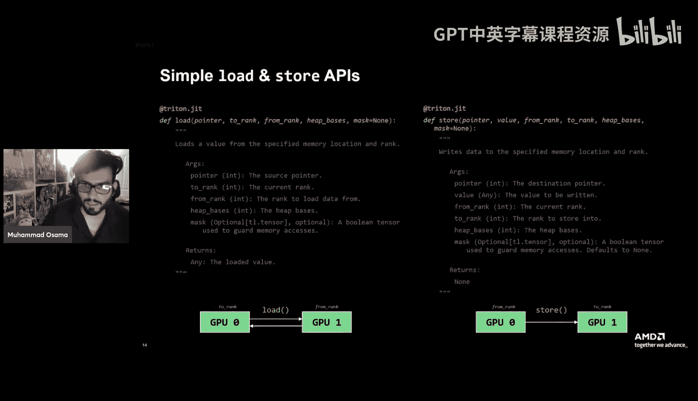

And yeah， I'll talk about he basis。Yeah， so the core of IS's implementation is built upon the idea of symmetric he。

 so symmetric he is a Pga or partition global address space abstraction。

Where the key idea is that when you essentially create a symmetric heap across all of your you create one symmetric heap across all of your your GPUs where you know a certain offset of the heat bases and there's sort two sort of offsets that you have to keep track of one is offset of target process heat base which is for a given process ID。

 where does my virtual address space begin and then the second set would be for a given variable where that variable resides within that heap。

 so in this case your process one process zero process2 set this offset the offset denoted by the heat base offset and then if you're trying to look for a variable called tensor x or whatever that would be another an additional offset on top of it which will calculate where that variable exists within that large allocation。

So all of IS's implementation starts off with an instance of allocating this he and then all of your operations now work on that heap。

 so any kind of stuff that you do within IIS that would work basically using using this symmetric key programming model。

The the offsets or the basiss for the heAP address must be first shared across all of the processes。

 so you have to start the program off by doing it allga and getting the starting offsets for all of your various process ID and once you have them that gets passed into these APIs and there's a translate calculation that's done to figure out where the memory resides in a remote rank and I'll show an example of that。

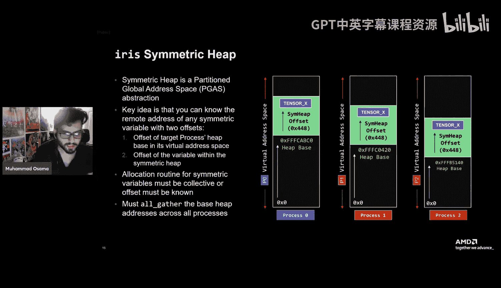

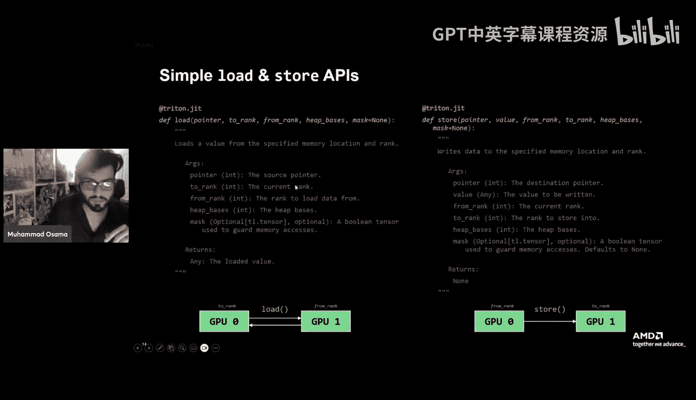

So yeah， so the on the implementation side of how we actually get sorryham up to Mohammad is actually here thank you to you so so Mohamd can take over actually from he base abstract'sing that'd be perfect Okay。

 I think I need to share my slides。😊。

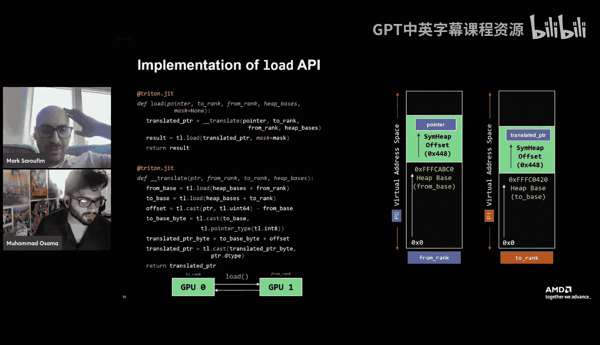

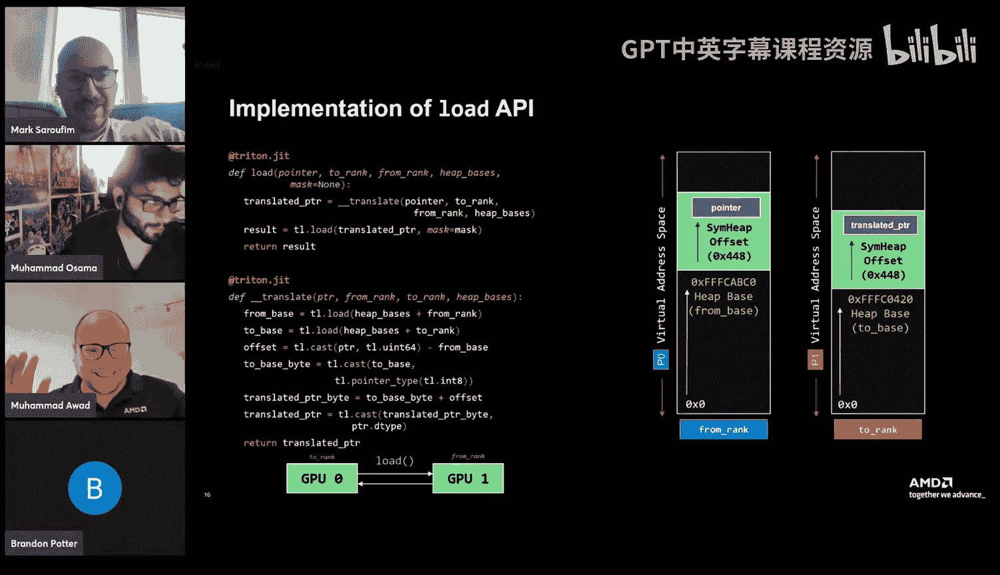

Yeah， just like and then I can pop up your screen， okay。

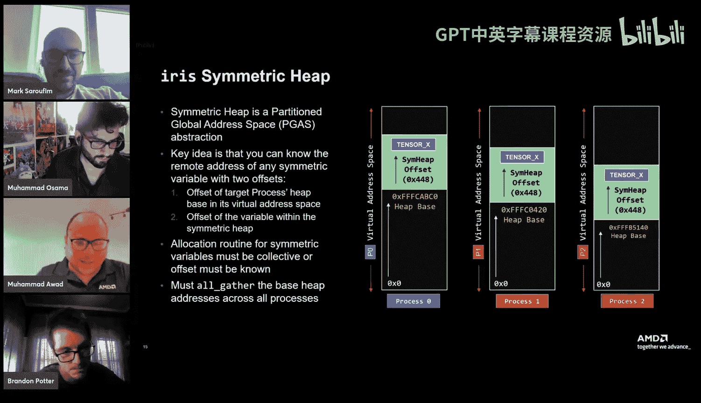

系啊。Its maybe now a good time for me to ask questions I had a bunch already。一都去。Okay。

So my first question is that like， you know， 360 lines is super impressive。

 And so like what I was like thinking， you know， like there are some other libraries that I've seen like Yfu Lang。

 for instance， now， thinking had like a couple other other slides had like a sort of small symmetric library and Py tours。

 There's like libraries like tried and distributed。

 I'm sort like wondering if you could comment like briefly on the trade offs。

 like of of these various libraries。😊。

I can fill this one。The implementation with these APIs is directly done in Triton so you can do things if you're tightly integrated in with Triton you can't necessarily do if you're calling into other APIs like Trent distributed so for instance like these loadstore APIs they're being jitter by Triton and they're going to be generating like a kernel with these address calculations are' like directly embedded into so when you're dumping out。

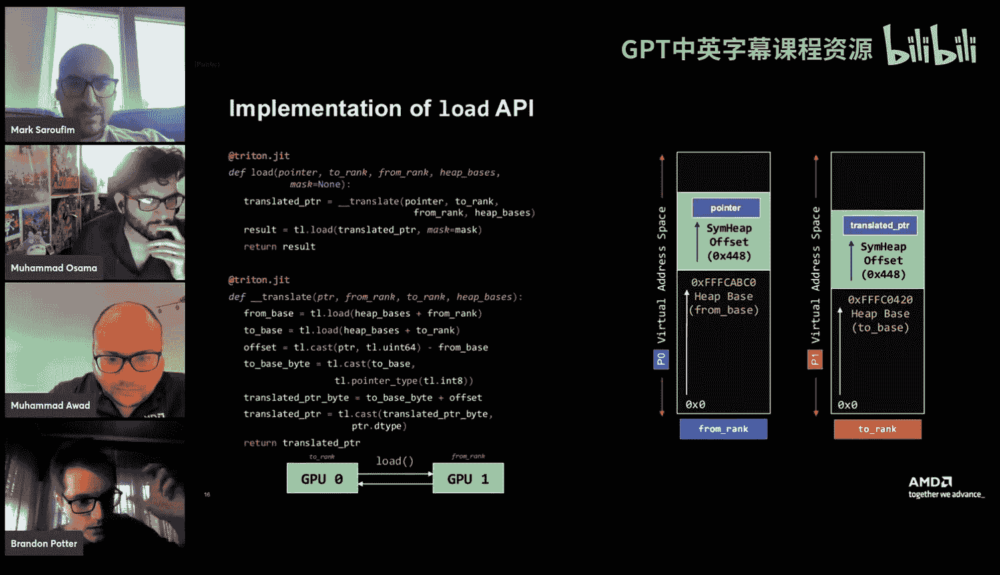

Like a triton cache you can see all of the inline assembly that's been generated you can see it is generating as like a single kernel so there will be slides later on that will show。

Some like special things you can do with cacheability with some of these like low store APIs。

 which are very useful for getting like the last little bit of performance out of the library that you can't necessarily do if you were doing something where you were delegating it to。

To a third party library。而行。it's a sort of slightly related question。

 it's like I think Muhammamed had shared a slide showing a user facing API where the initialization of memory looks very similar to what it does in Pytorch like are those actually Pytorch operators for context like basically is it like a sort of a de1 survey thing or are those just like Pytorch inspired like APIs for for for initializing memory？

We'll show more examples in a few slides and I think that question will be answered。

 but they're basically fighter like APIs。Okay， last question， then I'll let you go。 Muhamd。

 I promise， which is that like so， so， so the other Mohammad mentioned that like you have examples of collectives in your repo。

 And so very new question here， I'm not a distributed systems guy。

 But like my understanding is like basically collectives。

 nickel Rle like is like a different programming model from like shared memory stuff。

 So would you actually want to implement。😊，Collectives using shd memory， or it's more of like。

 you can。Tine of thing。I think we're exploring that I think were like we have implemented a bunch of examples already and we already see the patterns。

So it seems like there are patternss for collective。

 there are patternss for acquiring and releasing log for producer consumer relationship。

 so we might eventually introduce those。 I don't think we have decided yet。

 but I know maybe others have thoughts as well as that Muhamd。

Or brandon yeah I think I can add a little bit I think the key thing is that collectives could like the R or at least the traditional sort of bulk synchronous way of doing it is very much like providing an op that you just call what we are trying to do is maybe find patterns that exist at a workgroup level granularity that will have really nice implementations。

 performing implementations that would be used across various different applications and workload that you could just call into if you're writing code in Triton you could essentially just leverage an existing implementation rather than constantly rewriting the same set of code using IS's device side APIs so that's kind of what the goal there is。

I think the key thing is that we're only going to be providing device APIs。

 I don't think we're going to be providing like host set API because it doesn't make sense at that point you were just basically competing with Re。

 which is not like what we're trying to do。All right， that's all great Okay。

 I will let you Thank you Okay， thanks， apologies for the Wifi connection issues。

 but we'll go to next slide。😊。

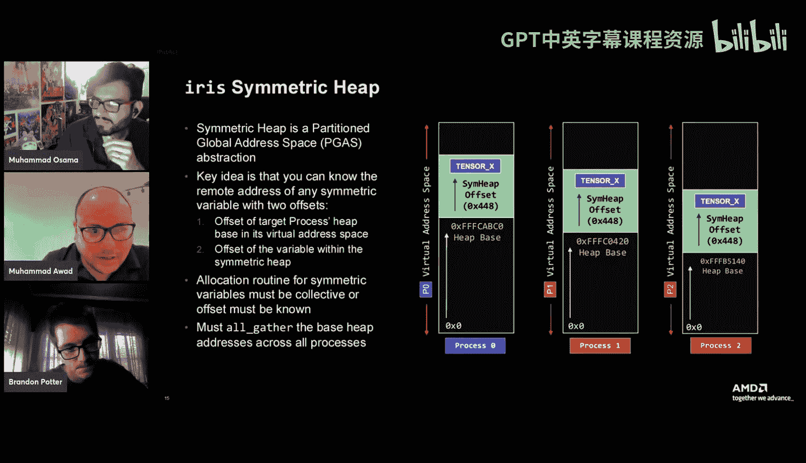

Yep， yeah， okay。Yeah， so so the the， the implementation of the library。It's actually very simple。

 I think once you understand it， once you understand next of your slides。

 you should be able to understand every piece of line in the code itself。

So they they will start first with some of the load API so the load API looks like this it's basically you have the signature as Hamhamd probably explained and then you have the first thing you do is that you just do the point address translation so that's the first line of code here and then you simply do the loader store here so the load store here is going to be across XGI for example if you're translating across strings but the most and yeah and like the other APIs as well like load store but get toomics all of them they will look very very similar all of the functions basically are a series of translation then the operation itself。

Now the most important function in the entire library is translated this isn't the critical function it's really the function that any operation will go through so if you understand this if you're interested in the backend library itself then this is really what you need to understand so it starts with just loading the hip basis so you load your current rank he base and the other rank as well and then you compute the offset so you take the pointer that you are trying to load or serve from you subtract it from your he base and you get the offset which in this particular examiner it X 448。

And once you get that number， all you need to do is just you need to add it to the destination。

Heap base， so you hear you just add it to the he piece of that destination of the two bits。

 you add the offset which is 448 and then you get the translated pointer。

So there is some caching here， but that's basically the whole idea is to just do some very simple pointer arithmetics to compute the translated address。

嗯。So that's if you understand this， you really understand like entire the entire device side back in for the library。

 this is really the most important thing to understand。

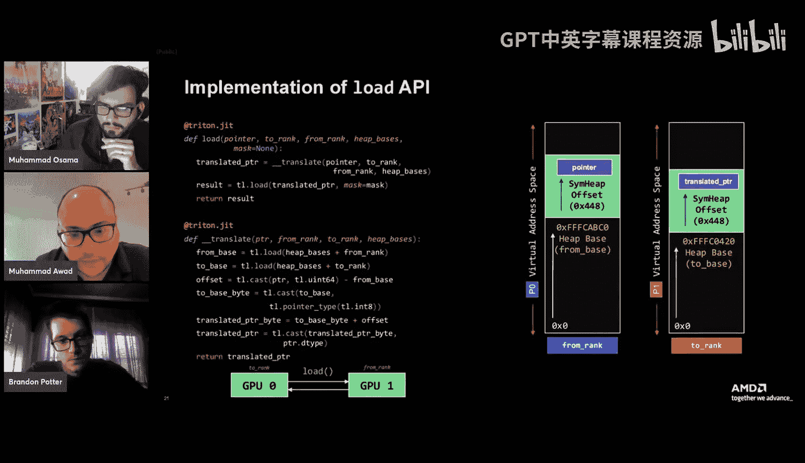

And。And I think one one of the questions that people usually ask is like， okay。

 how you implemented that in right on how close are you to what you can actually achieve in have。

 for example， or close to the hardware peak， so we run those benchmarks to make sure that we kind of evaluate that。

So the benchmark is showing buoy to buo operations load and so， let's start with the left one。

 so the left one is showing for example， if we look at the bottom left square it's showing the bandwidth between node node zero or GPU0 and GBU7。

So to get from GPU0 to GPU 7 you have to go across XGMI so here for example， you're achieving 96。

3% of3MI bandwidth If you look at the top left corner you see the same 93。

3 but this number is between GPU0 in itself so it's basically you're reading from HM so the diagonal in this figure is basically memory access through HM or your local memory of diagonal is across XGMI。

So that that's the explanation of what were looking at here and the goal is to see numbers closer to 100% right So if you see the numbers on the diagonal they are very close to 100% so they're close to the H big bandwidth that we can achieve of diagonals are also close to 100%。

 which is exactly what we need So we need to see numbers that are close to 100% so that we can validate that the implementation does not add any overhead and Triton that the fact that we're implementing Triton is not adding any additional overhead So hopefully you can see that here same thing for solar as well same benchmark diagonal is showing bandwidth that you can get this local bandwidth or HM of diagonal。

Is XGMI。So again， the numbers are called 10%。And that's hear what you want to see。

So we like to show this pretty picture to people so that they can actually say okay。

 it's not adding any overhead， but at the end of the day what we actually look at when we're writing this benchmark。

 we look at the assembly and the assembly is a ground truth with like the sort of truth for us so we know exactly the load as the operation like the code the assembly that gives you narrative for load and so and we know that that's exactly what we want。

So this should give you a little bit of extra confidence that okay。

 we actually know what the code generated all the way down to the assembly level。

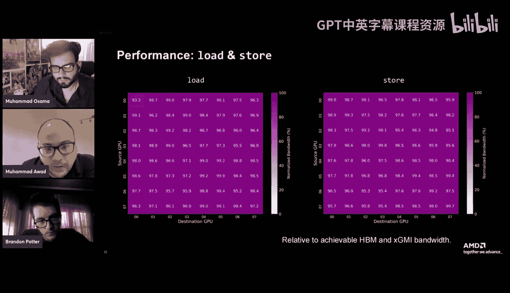

We have a lot of other so the load store obviously you're just doing the load store。

 but then you need to you need to synchronize so then comes atomics so we have a bunch of atomics as well so we implemented a bunch and I would actually since we made the project open source we had an external collaborator who has been kind enough to actually implement a bunch of those for us so most of those actually are implemented by someone from the open source committee who are just kind enough to just implement them for us and we're so grateful for their work of course but these operations they' atomics operations hopefully you're familiar with the ones in Triton and they're said for we're going to discuss the key things that you look for in a few seconds but those hopefully look familiar and they look similar to the ones for the loaded source which we have shown earlier。

Okay， so。I was supposed to wait here for a few seconds to make sure the right question we can answer them。

 so let's do that anyway let's see if there are questions before before move on to the next set of slides which is going to be like a hello world example。

😊，Sure， yeah， I had a question which was， could you just comment on why are atomic operations important again。

 I think I missed that connection。Yeah so well it's going to be clear in the next example。

 but it's basically the way for you to like basically at the end of the day。

 the veteran is going to be you produce some data， you set the flag。

 the consumer is going to wait on the flag and consume the data so that setting the flag and and observing the flag is atomics operation and this is why it's important iss going to be clear。

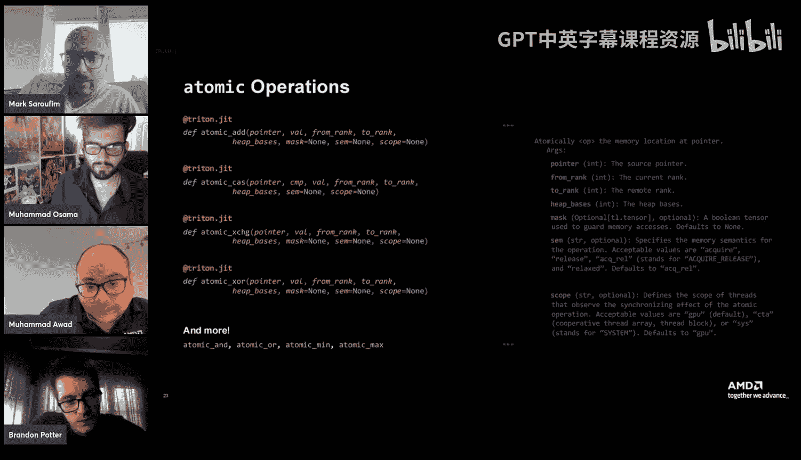

All right， so I see two questions that chat， I'm going to pull them on the screen let me know if you guys can see them。

Its process yeah， so we I think rank process GPU， they're all kind of interchangeably in that context we're kind of using them the same。

 you can you can implement it in different ways， but in this particular。

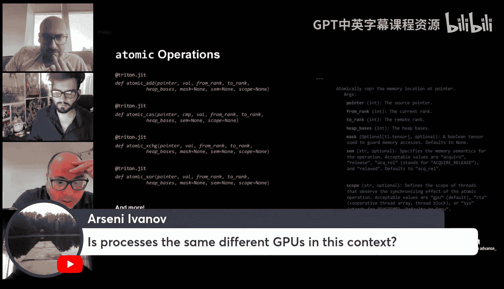

Library there kind of all。then I see this other question from Vipoul Chma。 Oh， sorry， no。

 I'm gonna go an order Viulcharrma。

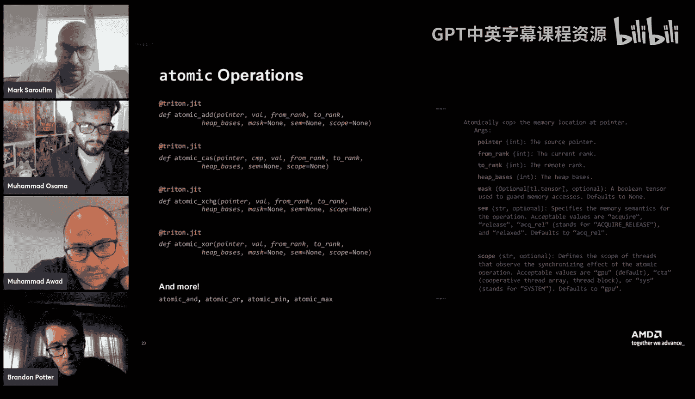

The load score for social Union was somehow lower than XGMI。

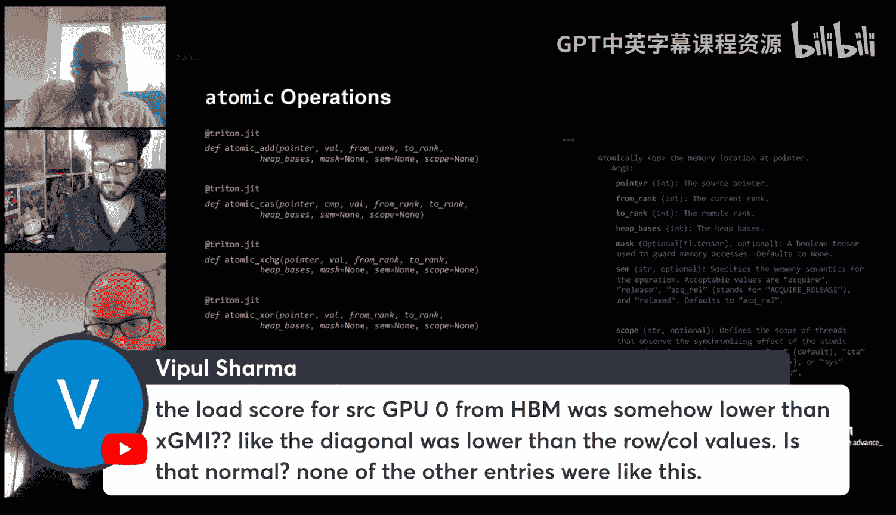

Yeah， I mean， these numbers are normalized， so like when you see here 93%。

 that's relative to XGMI bandwidth。So these are not real now， but these are just percentages。

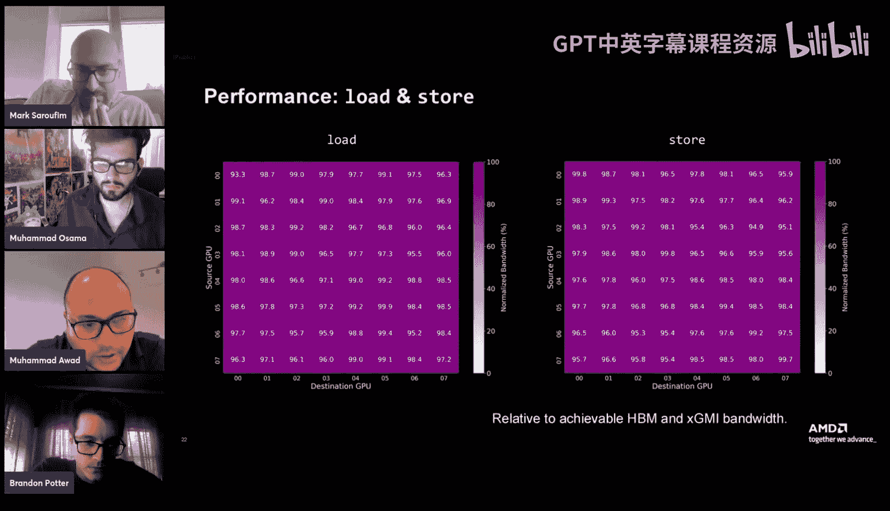

And then one more question。Okay， that's a good question。😊。

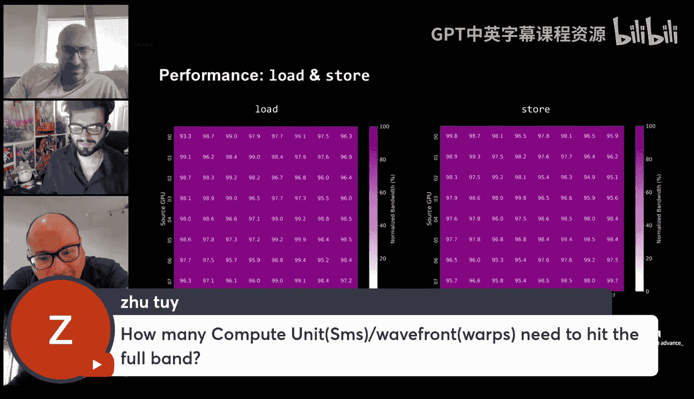

That's a very good question， let me see how to answer that。😊。

I can answer of it so it's going to vary between architectures and it depends on things like loop Un rolling as well。

 so Iris does a or Triton because it's utilizing Triton Triton does a very good job of doing like a certain number of loop pun rules。

For the waves that are executing these odds and the amount of Ss that you're specifying will be based on the number of like tiles that is transferring as part of the algorithms that is operating on。

Theyre。It will take， depending on how much unrolling you have。

 it typically takes like tens of Cs or tens of SMs to hit like full bandwidth for XJMI if you're doing like a loop unrolling for stores。

Say like you did like a loop unrolling factor of eight and you had like 10 tos， 20 tos。

 you can usually get close to the XMI bandwidth for the HM bandwidth it's typically more because you're having to generate more loads and stores and flight to fully saturate the HM。

It'll vary between architectures depending on architecture specifications。Yeah。

 and I'll just add that so that I think the goal from this presentation to make sure that you know people understand everything like adding more Cs to do load and store is not it's not always going to help you so we're going to have to figure out the right balance between like overwhelming network or just issuing like just a right enough number of loads and stores and like Brandon said it really depends on a lot of things I think one of their core point to add is that in IS you have the ability to actually control that so that's super important to be able to express that is one key principle and that will show up in some of the later parts of the presentation as well。

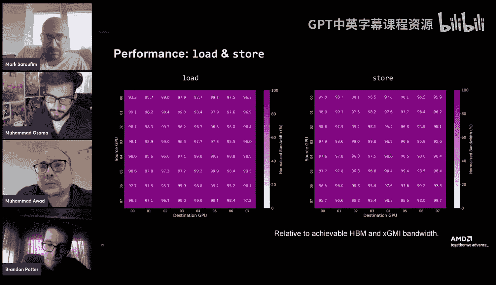

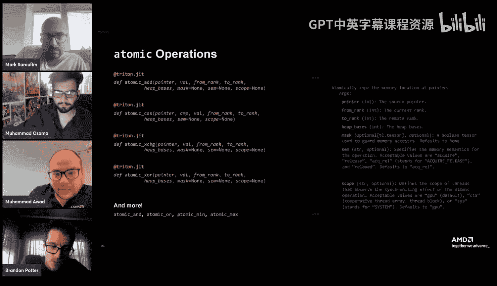

I think we can keep going that Okay so so we're gonna discuss the hello world example and really this is really the most important thing that I would love for you to understand very。

 very well if if you're not already so at the heart of any code that you will write this is the pattern that you will see over and over again so if you understand that well you will solve any other problem this is again。

 this is the most important thing so let's look at the code so we start with the initialization here so like like like Ma mentioned earlier we're going have the we're gonna have to do some initialization in the beginning and in our case we're just using the torch distributed like library to do the initialization for us that's the first line we just we need you to initialize that for us so that we can do the very initial setup of communicating the heat basis and then you constructstruct irIS。

So I in once you do that it construct thesymmetric he it it does our initialization and all of that and it allocates basically like the backing sort which is simply like a bytorch sensorsor that we will slice from in the future and the next line of code when you say input equal I the trend end so basically you took a slice from that backing sort that we have so what you get back here is basically like a bytorch sensoror it's a bytorch sensorsor it's like a native bytorsch that they can do whatever you want with it so it's the only special thing about it is allocated in like fine grain memory which is memory that we use for fine grain like synchronization and it is also allocated on the symmetric hebe so that we can do we can figure out how to do the translation。

Similarly， flags as well here is done through the IS Abi so ISO0 so again you're getting like a bytrsch tensor so the most important thing here that I want to mention before moving forward is that once you allocate the tensor on thesymmetric E if you have to use that tensor so you have to be careful about doing operations on that tensor that would return a new tensor so you have to always use in place operations on the tensor because basically if Torrsch decides to reallocate the tensor it's going be outside of thesymmetric E and then you cannot do any R operations on it because its not we cannot do an address translation so just something to keep in mind if you're using I AB to allocate tensors and you have to for R operations you have to be careful about ABs that basically torch Abi is to relo tensor so you will always have to do things in place。

So next we're going to launch two kernels and here like the rank number zero is going to launch the producer kernel on one particular stream and the consumer or the rank number one is going to range the consumer kernel on the consumer stream so technically you don't really need stream here because these are just running on two different GPUs but I think it's good practice to use the streams。

And that's basically it that's the host side setup that's that's let's all do it on the producer side you have some computation maybe so you prepare some data and you're ready to share it with other ranks So what you do is just you just use load the ir store API So here you're saying Iis。

I store at the pointer， store some data， and here is my rank， which is zero in that case。

 and I want to store at rank number one。And here are the heat bases that's basically all you need to do。

To reach out to memory that is across XMI or somewhere else。

So these stores are basically relaxed or so they can re reordered by the compiler and for you to actually be able to do the producer consumer relationship。

 you have to use atomic or the right way to do it is to use atomics with acquire and release semantics so if you're not familiar with like acquire and release basically release here which is like the last line I or atomic S it basically means that please do not reorder any memory operations before this line so basically you're saying okay please make sure that the stores reach the coherence point before you set the flag to notify others that it's they are ready to consume the data so that's what release mean scope equal system means that we're gonna do the acquire and release between two different GPUs it's not on the same GPU so the scope could be could be like system could be GPU could be wave front could be work group but typically if you're going to do like communication with I you're going to be。

Doing so usually across Cs Francisco。Now on the consumer side。The consumer。

 which is running in a different process， is just spinning waiting on the flag to be set to one。

 And once it sees it， it's set to one is going to fetch， it's going to actually consume the data。

 But what I want you to see here is that the semantics here is acquire and the scope here system。

 So there is a pair of release and acquire。 So again， the acquire here means。

Please do not reorder loads above me， so basically saying please make sure that I first acquire the lock。

And then I consume the data so basically and like once you once you exit out that loop the data is ready for you and this is really like the core example that I really want you to understand very。

 very well， so just to reiterate again， the atomic case with acquire scope it essentially synchronizes with the atomic case with release scope which guarantees that the data that you have written on the left is the one。

That you will consume on the right。嗯。So hopefully I explained that well。

 but I really want to make sure that this was understood very well if you're not already familiar with Lecos and semantics。

 so I'm going to wait a few seconds before we move on to more more complicated stuff。

 but again this is really the most important thing that I hope you understand。

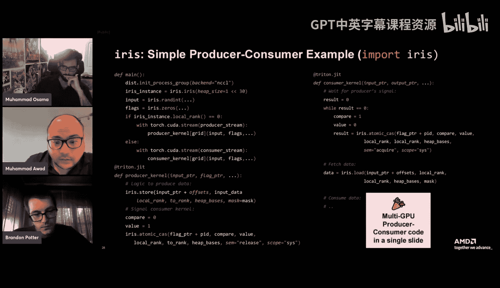

Okay， so let's just move to the next slide。So once you understand that better。

 you can implement a lot of things and actually we have implemented a bunch of them there's a question。

 maybe we can answer that we move。

All right， let me pull that up。

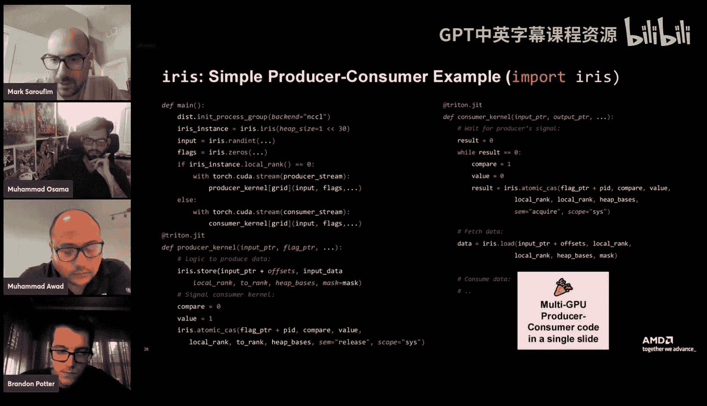

Why are explicit smaphos exactly？Compared to Btosh， so I mean。

 I assume when you're talking about bartohi you're talking about like host side stuff right。

 so it it's driven by those。I mean， so technically you need to synchronize on the host。

 but you synchronize with a different way you synchronize maybe with like torch device synchronize。

 for example， of things like that， you need that synchronization because you have threads all running and parallel running concurrently across many。

 many Cs and many。Multiple GUs， so you have you have to have that you have to have the sephos or the logs。

CO to be able to know exactly when the data is ready to beginCO。

So this is like this is the just just because you were doing parallel and concurrent programming on the device。

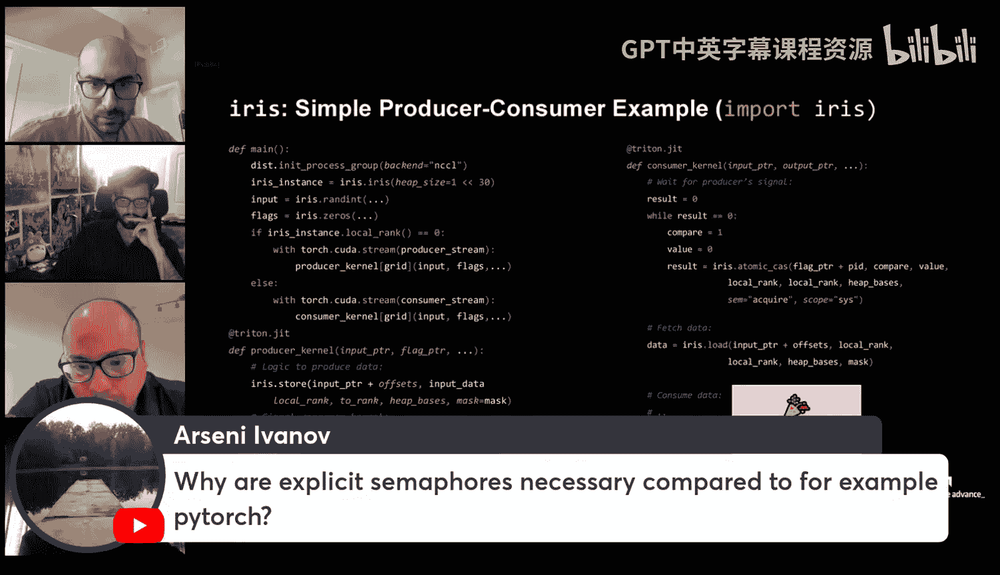

Yeah， so one key difference could be that maybe I think that the question is hinting towards is that on the whole side you will probably need some sort of kernel barrier。

 but in this case since you're in the device world。

 the Triton dotit tag above the function producer kernel and above the function consumer kernel。

 there really is implying that this is like a GPU kernel and in that GP kernel we' are doing a fine grain synchronization between a producer that's on one GPU and a consumer that's completely on a separate GPU so you need explicit sehorce to make sure that the consumer sees the data when it's ready and actually is able to consume it。

These atomics， as synchronizing atomics are like the standard way to synchronize between GPU threads using AMD's memory model。

If you look at the LOVM AMD GPU backing compiler documentation。

 these atomics are the memory model like building blocks that are used to synchronize threads in RGPUs。

And this Triton wrapper is just a wrapper around those atomics the order in the scope are specified there in the parameter list。

But they're really just the level synchronizing it。

I guess like related to this like for me like I just have a question on the interrupt like because you have like this like you know like Trident decorator。

 but then like inside the function you're calling like like you're recall artist functions so like was there like a lot of work you'all needed to do to like support this with Trident or basically assuming just everything below it is written Tri in Python like you know life is good and that's it。

The atomic and all of these function it's basically the code that we showed earlier it's really it's really just like that simple so I don't think it was any trouble more recently we actually have been running into maybe a little bit of trouble because we want to support like the cache modifiers and other things as well with load and sword and this is a little bit I mean we have found a solution but that we had to maybe have some workarounds around around around some issues so generally speaking it was straightforward until you do something。

With strings for example or something like that， I see。All right， then I think we're a good。

 like but we should perhaps move on and come back to more questions， okay。

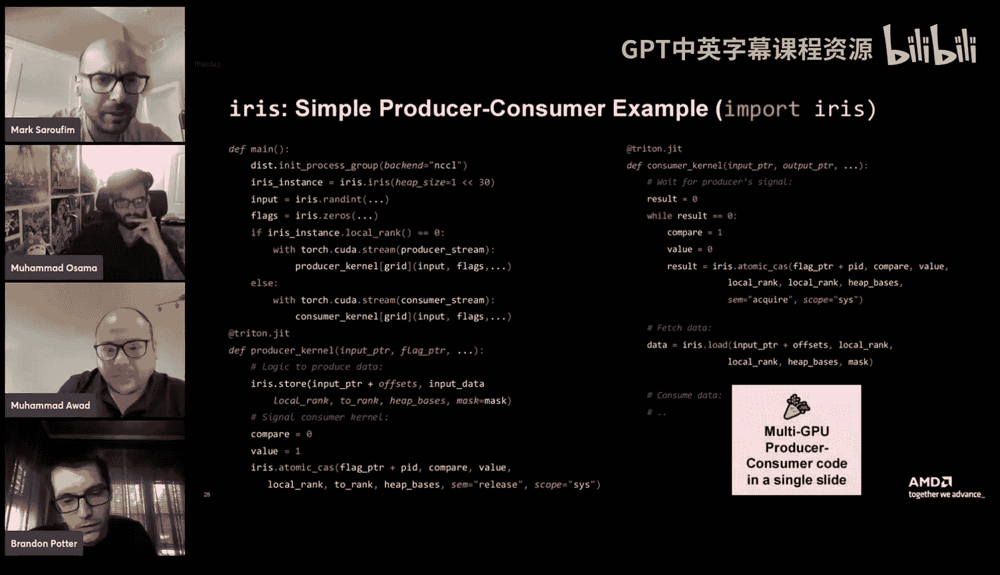

So let's dive into the patterns and yeah so if you're competing this is really the most important thing that you should understand。

 so hopefully by the time we got here you understand that。

You're not going get the best performance unless you do computational communication overlap。

 I think this is just a must that you have to do Now how do you do it。

 There are just many ways and we implemented I just to make sure that we can very。

 very quickly and very rapidly iterate and try different things and I'll mention how fast we can do it at the very end。

So we wrote down this taxonomy for the things that or the veterans that you can do and we here we're just considering like a gemmbus all scatter so here on the right you see the operation basically have the a matrix clicated across ranks and you have the B matrix sliced in the column like column wise so you multiply a times the slice of c then get sorry times the slice of B you get the slice of c and all you need to do is just scatter the C the result that ties to all of the other ranks so looking at the patterns how can you do that how can one of the ways you you can achieve that you can do it either in a few unfuseed fashion or you can fuse and if you do it in unfuseed fashion you can do it in a bulk synchronous way or you can do it on what we call a producer consumer way so we're gonna to explain all of that and organization going show exem next if you decide to fuse you can fuse sequentially so you have like a GPU wavefront for。

or work group doing some work then sequentially doing the communication that's one way of doing it if you do it in a producer consumer side you can do work group specialization you can do with front specialization and you can do interesting things and like if you're too clever you can do something like a work queue。

We're not going to talk too much about that。So yeah。

 so today actually you cannot do with specializations and just inside the triton， however。

 you should be able to do it inside G1， but we don't have G1 implementation yet。

So let's let's dive into these patterns。 and again。

 this is really the the most important part of the talk that。

Explains you how you get better performance and how you do the overlap。 So first of all。

 let's just start with the simplest one， which is just unfuseed bug synchrons。

 So we're basically doing what what you can do with wrinkleel And here's how it looks like So you launch so you have basically from this particular GPU perspective you just launch a bunch of computation So here we have five Cs we launch a bunch of jam tiles that gets executed And once you finish that there is a barrier you wait for the computation to finish and then you launch your communication kernel which is heres all scattered。

 So how does that look like in code。

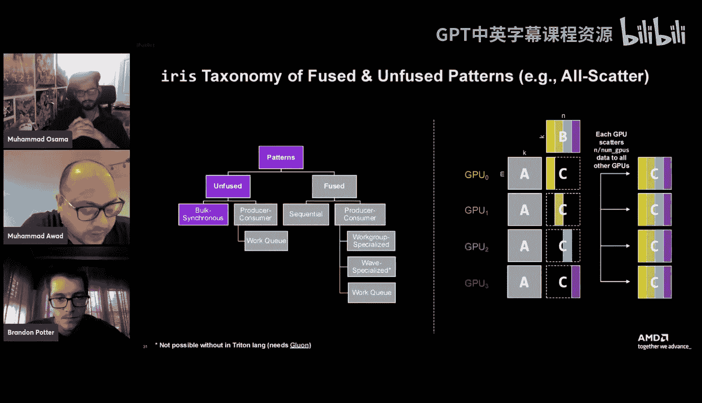

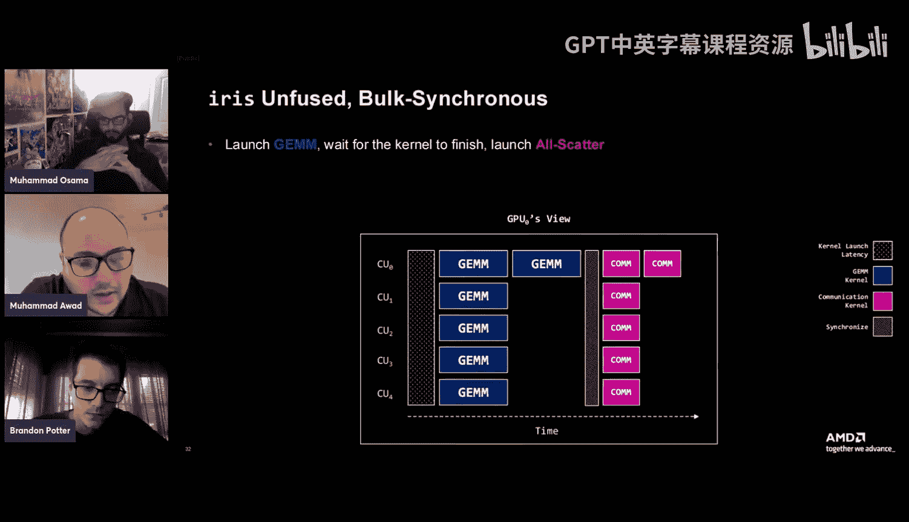

That's it。 This is the code that you have to write to get there。 So you have obviously this。

 we have removed some of the things here， like the。

Comhenence and so on but at the end of the day this is like the actual code that you need so you have on the left there is a gem there is a gem loop over the number of gemsms here just gemsms is for generality because we're going to use reuse this code in the future but here gemsMSs is basically the total number of his gems in that GPU so maybe on my 300 x that's 304。

So you compute the gem you do the accumulation over C and then you have the C results ready。

 you just store it and global memory and you're done so the on the left is basically just your normal resistant gem kernel on the right hand side this is the communication kernel so what it does is that it is raised over the ties as well and it's a resistant kernel so it just equiccupies a number of SMs in on the GPU and just itly keep。

Keep keep like finishing up the work here again， the commMs is basically 304 because we're just using the entire GPU but we will see in the future what happens if we change that number but basically here we like here you don't need the same because you had that hard barrier on the CB before between the two kernels because if you look at the launch kernel at the bottom right you launch resistant gem on mainstream and then you launch resistant or scatter on mainstream so they already have like some they already established like an ordering from the CB side。

So all scatter kernel simply is going to load the filess and what it will do is that it will iterate over the ranks and it will just scatter the data and since we already have the data in our local rank we don't need to start again so this is why there is an F statement if remote rank not equal to current rank and other than that you just scatter the data across。

Can I just jump in real quick and say something related to like stream synchronization and versus doing things like at a fine grain level。

 because there was another question in chat。When you're doing things in coudDa streams or hipSts。

 when you launch a kernel and it produces data as part of the end of that kernel it flushes data out of the caches and makes data visible。

 so if you had data that was like stuck in an 01 or and L2 cache with midGPU and then you ended that kernel like the assembly for that would be like an in program instruction as part of that instruction it will flush out the cache hierarchy to like the memory visibility point and then subsequent kernel should be able to see any data that was produced。

That stream synchronization is like this course grained。Moel呃。

When we're doing things with these low-level atomics asynchronizing atomics。

 there's no the kernels don't necessarily end， they can be corent on the hardware so to ensure that data is visible from the GPU。

 you need to flush it out of the caches or the different like memory levels to make sure the data is visible and so when you do things like a release or they acquire atomics that you was shown earlier that's actually making sure the data is pushed out to visibility point for the other kernel to see。

So， that's。Related to some of the discussion that we were having before。

Thank you okay so well this is just the bulk synchronous one how fast can you get well you actually get some slightly performance gains so ideally we think that I mean ideally we would have thought that you should at least or at max match records performance but sometimes we actually beat the Rick all the the bulk synchronous implementation of just torchtmm and just Rick for example on the bottom left we're here beating it but obviously like Rick and torchtmmll。

 these are generic implementation they have to deal with a lot of shapes so there are not specialize it that our kernels for our kernels we can specialize it and we can make tricks that a library that is designed to run any problem size cannot make but this is really the important thing about I iris lets you do all of that it lets you write the kernel in the very custom way that you want。

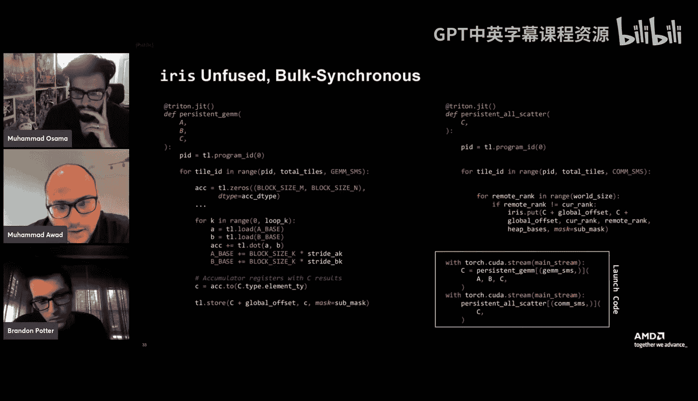

So even if you want to customize your kernel for some particular shapes or some particular things you can use IS even get that performance gain。

 but again， there's obviously that tradeoff of general general purpose library that is designed to solve very very minimal problems versus like your own particular solution that is targeting the particular problem so obviously everything has a tradeoff but if you already know some things about your problem maybe maybe you can take advantage of custom solution to get better performance。

But more interestingly， we look at the other patterns which is the next one is producer consumer。

 so we actually are going to use the same code or actually let's first look at the how it looks like。

 so you essentially partition the GPU between compute and GM so if you look at the figure here we gave the gem three Cs to do the GM computation and we gave the communication kernel to Cs。

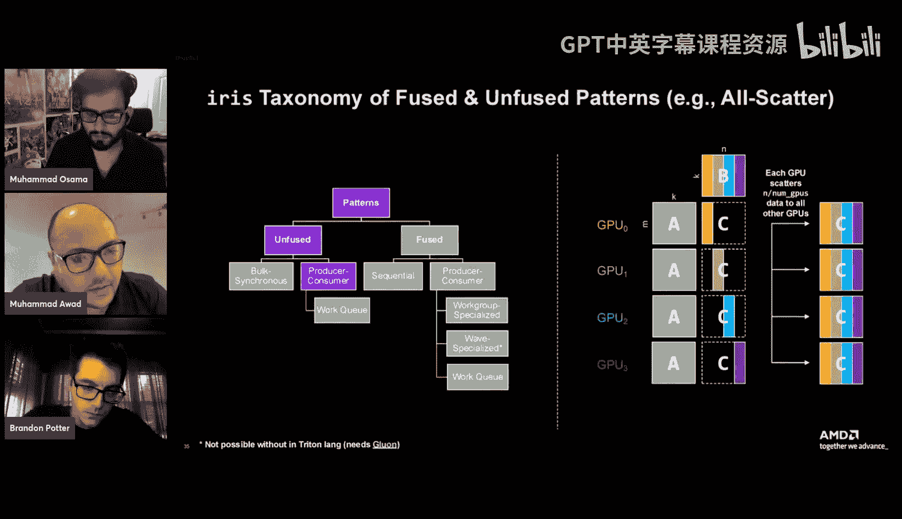

So once once you launch the kernel it was obviously here you're launching two kernels on two different streams to establish concurrency。

 the kernel that is doing the gem that is producing the data it produces tile 0 tiles one tile2 the communication kernel if you see here they're just sitting spinning waiting for the tile to be produced and once they are produced you can see so you see here the arrow dialo once tile0 is ready。

 the lock is ready to be acquired and the communication kernel consume style zero and maybe here it will do an all scatter or use or whatever it needs to do same for tile1 the next time step。

Tile 2 is already produced。 so that you see like this very。

 very small log box because with the the tide is already produced in the river sensor。

 we can already consume it。 and then tile 3， you're going to have to do wait a little bit until it gets produced。

 So the key things here that you want to think about is how do you partition in the GPU between computee and。

And communication and I mean this is an interesting question and are there isn't really like one answer。

 we have some ideas on how to do it and there is usually some good intuition for how to do it。

 but yeah there there is some art to how you do it and maybe there is some some mathematical way to actually figure out the right balance between the two。

诶。So that was the producer consumer kernel here is how the code looks like。

 So if you see this is basically the same code that we have seen earlier。

 the only difference here is that we just set the number of gsms so not304 or for example you can set it here for example to56 for example。

 a nice number that device nicely with interesting gem shapes and then you can leave the rest for comm So again you on the producer side you're just computing the gem you're using a fewer number of compute units then what the GPU has and then once you finish the computation which here you're writing with this right through modifier just as an optimization to not boot the cache and then you do the release pattern where you just release and you said that okay this style。

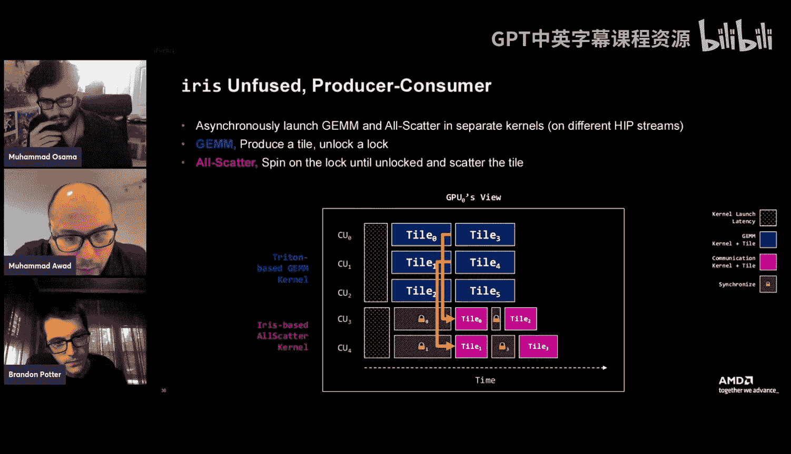

Or the log for this style is now free the consumer who is waiting on the right hand side once it sees it。

 it will acquire the log and it will consume the data will do the scatter on the host side you're just launching two kernels on two different streams to establish concurrency like I mentioned earlier。

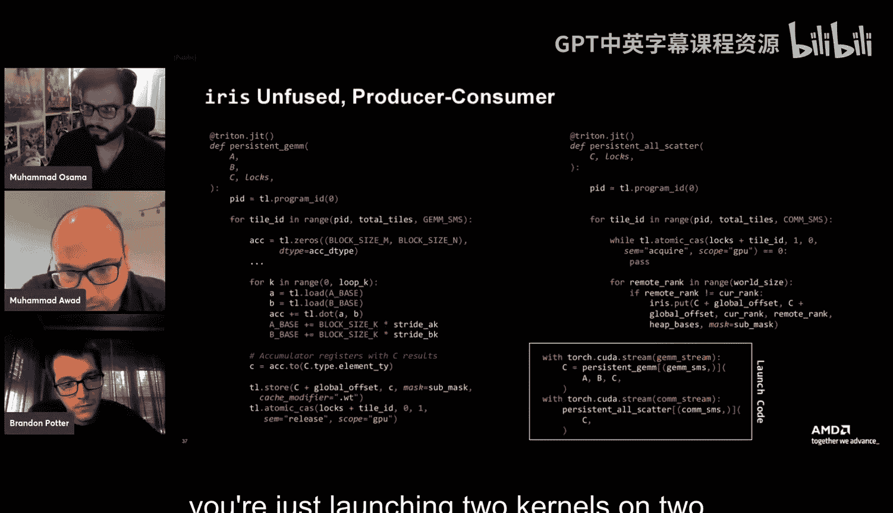

So how good does that give you well you get some very good performance gainss so for example。

 if you look at the top right you're getting here like 2。5 x speed up。

And and and again there is obviously again， there is how do you partition the problem we haven't even tried to address that here we basically thinkhammed is on actually wrote that code and he just had some good intuition for how to split the work so I think you did 256 and304 minus-256 for the communication but there is mean you can even push this further if you want if you know exactly the shamem shapes that you're dealing with or if you have a good way of determining how to partition so we can talk more about partitioning at the very end but I'll go on for now I think next is if youfuse so so far we haven't been fu kernels so you had like two kernels to do one kernels do communication and one kernel to do communication this time we're gonnafuse kernels and the first way to do it is just sequentiallyfuse the two operation and this is actually the easiest code that you could try it。

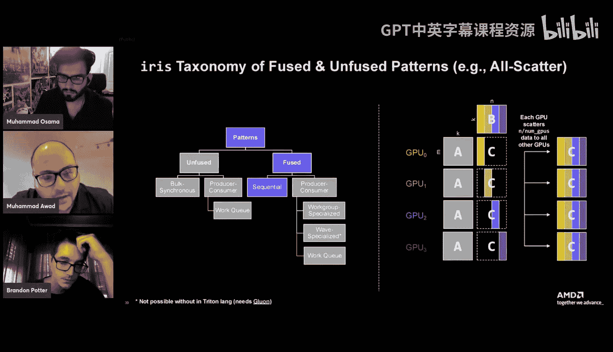

So in this particular example you're watching a single kernel and what that kernel does is that it does the gem operation and then once it finishes that gem operation it has a tile。

In its accumulator registers， it can just do the all scattered to all ranks。

 so that's the communication kernel afterwards。So obviously this is it's very easy to write。

 you avoid the fact that you have to go through HBM because the data is already in registers and you can just consume it right away。

 however， you are also the like that model of just writing Uber kernels。那我是孩子。His own problems。

 right？So， you're very likely。Increase or just pressure。And if you have some tail effect。

 like at the one， like one here， you see here， that tail effect will also get worse because now your kernel is learning longer。

 So again， there is， there is an art for how to actually。Do。Tling and do splitting of work。

 which is like a big topic that I think I'm sure actually I'll ask Muhammad to actually comment on it once we finish the slides。

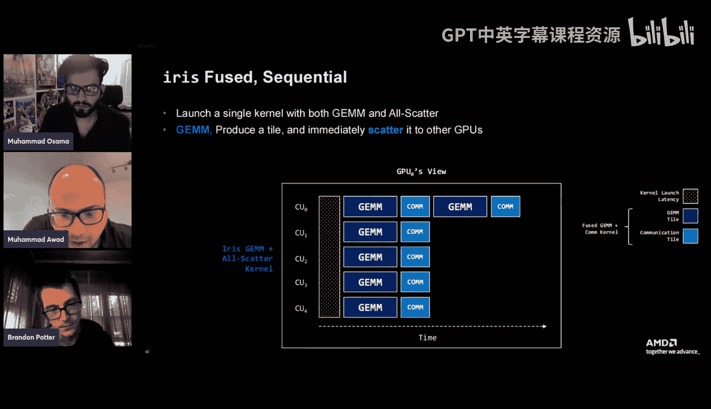

诶。Before that， do you mind using a pen or laser pointer just when you talk about？

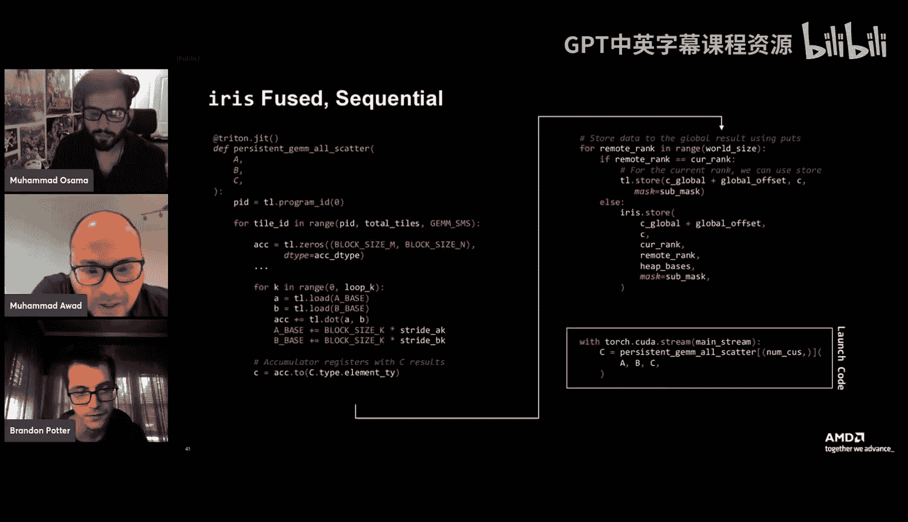

I think you can use the PowerPoint one if you right click on the PowerPoint you should oh I'm using。

Yeah that should work yeah with the settings unless you're sharing directly the slides I'm sharing the BDf okay never mind sorry sorry I'll try to be more clear about where things are。

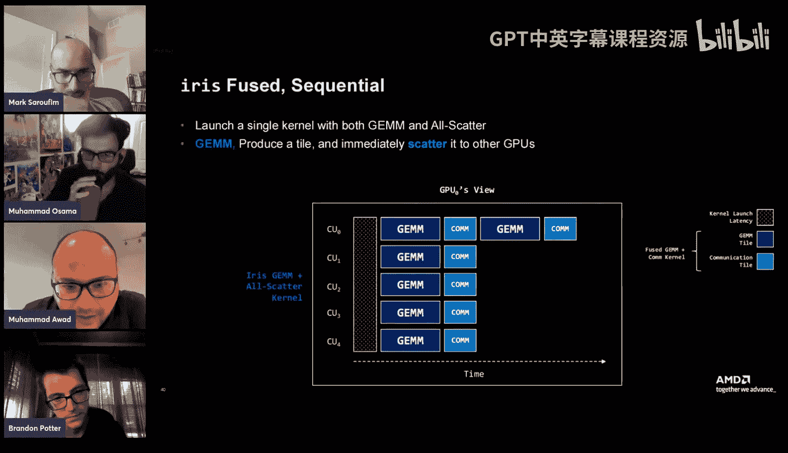

Okay I say that I say that because if you go back to the slide。

 I think the tail effect is very important to understand that it's that empty black region underneath the C0 compute unit zero second sort of time step so the last gem plus comm is only issued on C0 and everything underneath it is an empty like unused resource region and the synchronization of the kernel boundaries at the very end of that so all of that computation is all of those resources are essentially going to waste unless you have other concurrent kernels also running at the same time on top of this gem and calming and that could be a very big problem for fusing it in the sequential way where you can slot things in between between various orders to kind of tet it nicely。

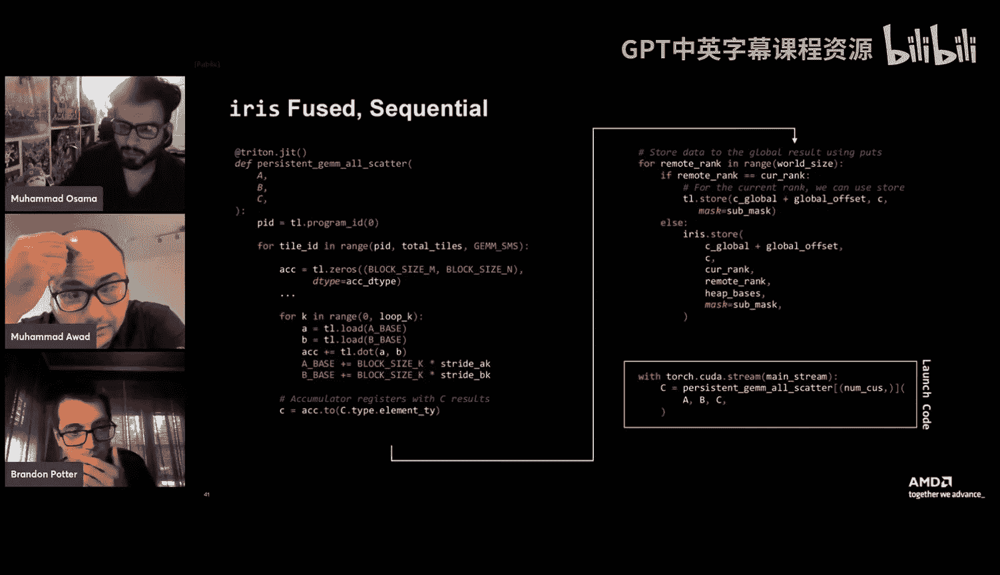

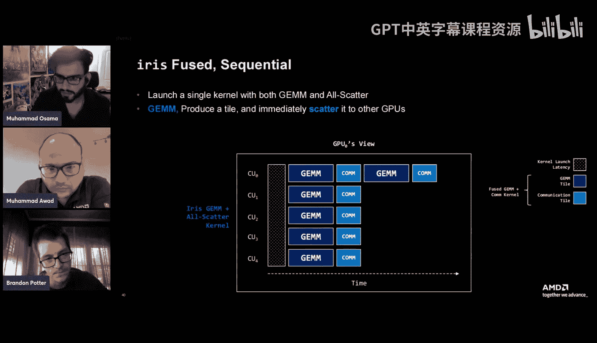

Yeah。Thank you。Okay so here's how the code looks like you on the left hand side you're just producing the gem tiles like we have seen before。

 but this time you're not you don't have to write to main memory because you use it already can you have this upper kernel that you can really to send the data across so on the right hand side you simply what you need to do is just stay the accumulate the accumulator register and just scatter it across over rank so for your own rank you can just use the store because this is just a local access for remote accesses you can just use IS or store。

And I mean you can use also IIS is store for your local address。

 but you can do it this way as well in terms of launching the kernel there is just one kernel so you just launched the kernel in one stream and that's basically it so this is actually like the simplest code that you can write that fusing is actually so simple particularly with IIS if you're using the IIS ABI it just lets you the communication board is simply these few lines on the righthand side that's basically it that's what you all you need to do all you need to have been to your gem kernel。

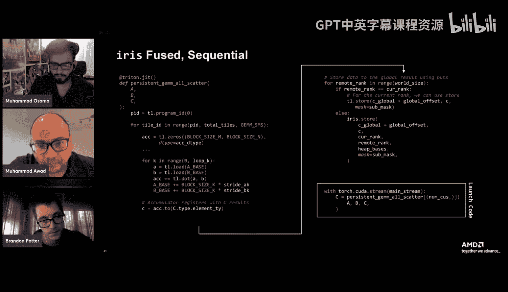

So how does that look like indimerible performance， so it varies， for example。

 on the left hand side or the bottom left hand side。

 now we're getting good results with that particular implementation。

If you look at other points in the graph it's not always the case right I mean were it seems like we're always getting good speedups compared to the reverse implementation but not always and again this has there's a probably many reasons that could affect that and one of them is maybe the data latency effect when your problem size is not divided wise or maybe you add some register pressure so again there are a lot of tradeoffs for one solution versus the other。

Okay。Now the last in way you could implement this is again your use。

 but you have a producer consumer relationship and you do with four group specialization so I think Hamd when he presents this he said this is his favorite and it's also my favorite I think it's very neat so here's what you do you launch a single kernel。

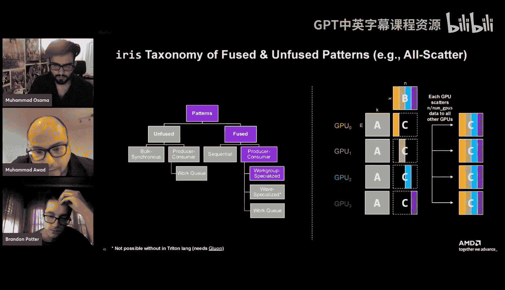

But that single kernel at the very beginning of it it has an F statement。

 it says if my block ID is less than the number of Cs I assign to communication or sorry computation I'll do computation otherwise I'll do communication so here C0 C1 C2 took that F branch where okay we're less than three。

 we're going to do computation， the consumer side is just waiting until the has produce so it kind of looks similar to the producer consumer in terms of like the kernel concurrency but here it is happening inside one kernel。

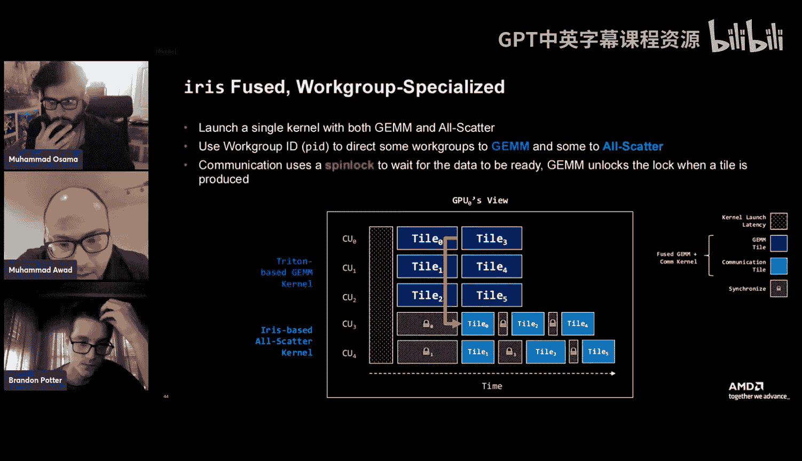

Oh so question there to both of you guys which is that like I think we had a question from Arrssony asking like。

 hey， can you figure out the right compute like like basically the right allocation between consumers and producers automatically with a compiler。

 it sounds like you don't need to because users basically has like a queue effectively and you just fill it up is that right？

So theres a I think Muhamma will want to answer that question Yeah I can answer that question I think the question in the chat talks about potentially microbechmarking essentially to figure out the compute comes which happens a lot for gem kernels for example。

 when you're trying to figure out the tile sizes at least I personally fundamentally believe that it's not the right approach because it requires obviously running the thing once figuring it out caching the result and then using that later on it works in some cases but maybe not ideal for most cases what we'd really like to figure out is essentially this compilerbased approach where we could do some analysis ahead of time and use an analytical model to predict what that partition looks like or you could do something like a work queue like you mentioned where as work gets created。

 you fill the queue and the and work groups are essentially just picking up whatever the next piece。

😊，work they have to do therefore perfectly utilizing all of the GPU entirely and not have to figure out this this division manually so so yeah there's there's a number of approaches there and we're exploring all of them and yeah it's a very interesting space。

😊。

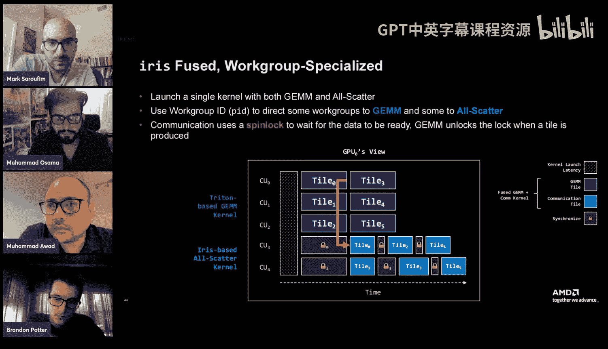

I， very good， okay。Yeah， but we do really like like just like Muhammaad also agree with them。

 I do really like like analytical model ways and I don't like like doing that grid search kind of solution unless your problem is very very considering like if you just have like just a few shapes that you're interested in。

 maybe that would make sense then but in general， I think like generic solutions is probably like an analytical model or a Q piece that would be very clever or under the right thing to do I think。

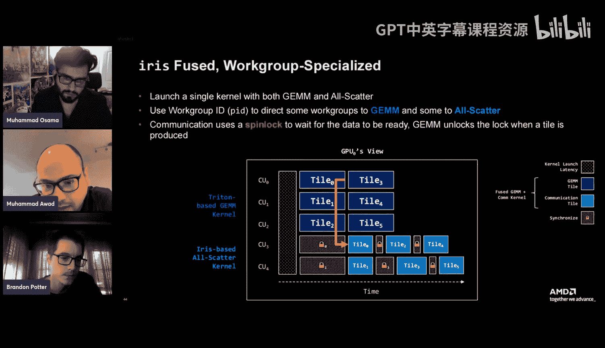

Okay， so how does war group specialization look like？

You have that the code on the left chart on the left， you basically have that big branch at the top。

 it says， okay， if I'm less than G SMs， I'm going to do the gem work。Otherwise。

 on the right hand side I'm just going to compute my B program ID so basically just do the math to compute like your ID after subtracting the Cs that you assigned to gem and then you consume the data so again you still have if you still have the reduce consumer relationship this is happening between two work group is within the same kernel not two different kernels so this is just one kernel。

And then you have the same relationships obviously like if we look at the top righthand side。

 you're sewing the C results once you finish all the broure results and then you release a log and the if you' scroll down a little and then the consumer side you're just again you're sitting over theiles and acquiring the log and then with an acquire semantics。

 a GPU scope because you're communicating within the GPU here and then you just do the all scatter。

 so again when you're actually launching this you're launching one kernel so the host site code you're just launching one kernel but that particular kernel is parameterized over the number of Cs assigned to Ge or number of SMs you're assigned to gem with the number of them you're assigned to go。

And before we move on， I actually mention maybe。Something here。

So I think there are actually many ways to do optimizations on this and actually one of the things that I would be interested to see if you could co- locatecate the communication work on the same C that produce the compute work as well so maybe it doesn't I guess in that particular case you will have to do it in a non-bri and fashion but maybe there is some trick to get some locality I think that would be interesting but even if you just do that you will get some very good performance gains as well so that's the last part on the last bar on the very righthand side。

 the purple one so you see here some different results mixed results between different shapes。

 but generally speaking it's greater than it's better than the bulk synchronous solution。

 obviously because you're doing the overlap but sometimes it's very large sometimes it's very nice speedup for example the bottom two shapes you're seeing some very good speedups up to like 60%。

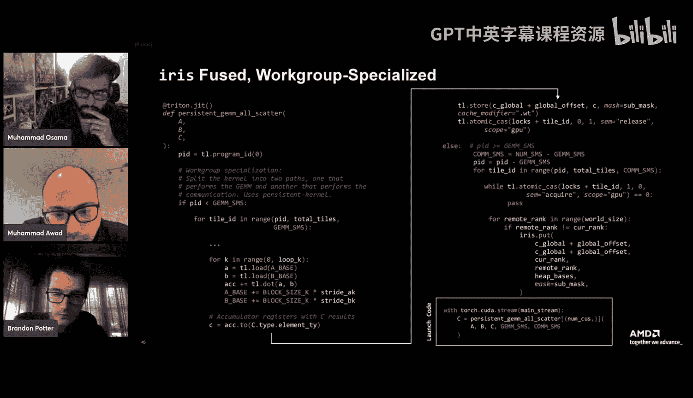

Faster， same thing as well for the middle right as well middle top as well。

 you're seeing up to 60% faster but。There is no one single answer right so we show these results and which one should you use is we have been doing analysis to try to figure out okay which one does it make sense to use and when we don't have an answer to that yet I think even even if you just look at the sex shapes that we're looking at here it's hard to tell which one is best so this is like a different problem what Iris is trying to do Iris is trying to make sure that you can explore all these solutions very。

 very quickly So actually Ham he is one who wrote all of these implementation and I think it took him like an hour or something to finish all of that and some of these implementation it took him 10 minutes and he actually recorded that as well so I'll ask him to share the videos I think the video was very good he did a good job like explaining what he's doing and I mention something about videos at the very very end but again so the goal from I perspective is to enable you to。

Do all of that exploration very very quickly we showed you the code in the previous slide and it's not a lot of code the code exists on the repository you can go check it out it's not a lot of code and you can very very quickly iterate over different solutions and different clever ways of assigning works to blogs or or getting trying to achieve some performance again through maybe some clever thing about locality。

But that's what IIS is trying to do is I was trying to give you the low level APIs to empowerbar you to do all of that。

呃。Yeah， so I think before we move next， because we're gonna to discuss basically next steps and things like that。

 we can， we can stop for a few seconds and see if there are more questions because we're we're gonna to stop for results。

 This is like our last slide on results。

I think I asked mine， I think there was one question I don't know how to answer， which is here。

 Is split up， lit up。

I can answer this yeah so the splitK and streamK we have variants of all of these various gem schedules and yeah the approach is shown here work with all of those various variants what split K is essentially saying is it's going to take like one of those the tail effect or tail occupancy effect that Mohammamed was showing that's when this question is asked it would take one of those gem tiles and make smaller pieces of it to get better utilization across the entire GPU stream K fundamentally does the same thing and yeah you could utilize all of these different variants along with the locks that we describe and the pattern we describe and its scales or the code would work as is essentially it's just going to the gem schedule will just look slightly different。

😊。

I don't see any more questions， but I think we can keep going。ok。So。

We've been having fun writing applications and I hope you guys as well have fun writing applications in Oberg request we have written a bunch of them so you see here we have written like the microbch marks。

 we had actually an intern OCta he implemented the flashD code actually within his summer he implemented flashDcode and he implemented allgaer+ gem and it just obviously's very very clever very smart guy but I mean it was effortless for him to implement those we implemented all of the old scatter as one as well we implemented one shot all atomical reduce we haven' an initial implementation for rank baseal reduce still work in progress the oldga+G like I mentioned it's pretty much done gem B scatter。

 we haven't implemented that yet I would be interested in seeing that as well we're very very interested in implementing an MoOE kernel we haven't gotten that part yet and we're very very interested as well in seeing results in endto- end work fluids in inference frameworks like VLM or other frameworks as well。

If you're interested in any of these problem or other problems as well。

 we would love to work with you either maybe try to figure out how to implement it or review pull requests you create or anything where we're happy to collaborate with the community in any ways。

 and I know maybe some of these kernels are of particular interests you。

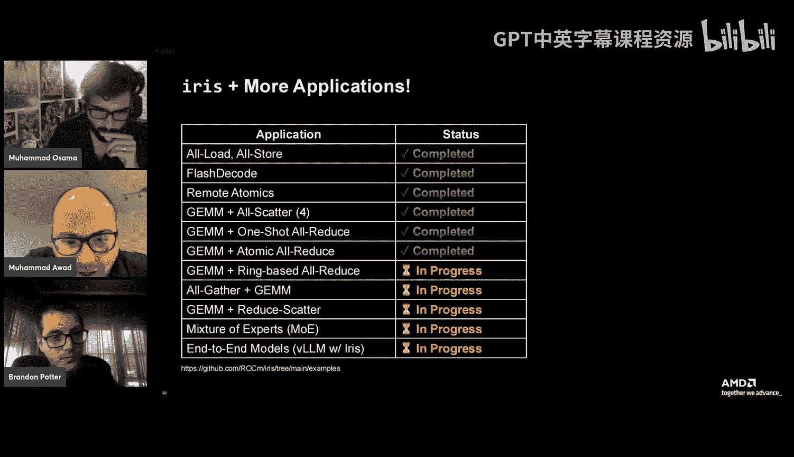

嗯。So。We're not just interested in scaleup， we have been thinking about scaleup from the beginning and I am a big fan of memory scopes and I think the way that I want to write GPU codes is just using scopes and using memory orders。

And yeah， I have strong opinions about this and I think basically what we what I want to see for scale out and what we are trying to prototype is basically at adding a scope for world obviously this is like a heavyweight scope because it crosses the boundary of GBUs but it makes programming very very easy and I think if I'm a developer。

 what I need to understand is I need to understand locality and I need to understand the cost of synchronization and I already understand locality I understand that registers or faster than H are faster than HM and HM is faster than access something across XGMI for example same for scopes as well I know that scope。

Or a synchronization at block scopepe is going to be cheaper than GPU1 is going to be cheaper than system and it's certainly going to be cheaper than work so as long as I know exactly the cost of these operations I think the program ability the programability will be the thing that I'm looking for as long as I understand the cost of those so we're going to implement this world scope I think is' very very doable and we have some initial idea on how to implement that。

IRS will always provide low level ABs for RMA and RTMA so loads and store but and get。

But we're going to implement some collectives as well just to continue the series of examples that we're building to make sure that people know how to implement those and can also explore that there are ways to actually abstract those away。

And again， Iris will always help you to prototype like very fine grain computation and communication overlap very。

 very quickly， even for RGE as well。呃。And this is our last slide。

 we're just going to mention like the next things that we're working on。

 so we're still working on the library development， like I said。

 we're super interested in integrating with inference framework。

So that's this is like a decent amount of work if you are maintaining a particular framework and you're interested in working with us and integrating that we would be more than happy to work with you so we're happy to work with anyone。

And the second thing is obviously we're trying to work on a library improvement of broadcastization。

 I think actually looking at the broad today I'm very happy with it I consider it like a decent product so we have a good documentation we have unit tests we have CI we have been improving things quite a lot so there is always room for improvement but I think I'm very happy with what we are right now we're going to implement scaleout as I mentioned so those are the main core library development things that we need to do in the near future in terms of application workloads we're implementing things as we go every time we speak to someone and say we're interested in that particular kernel we try to spend some time to implement it or provide guidance on how they implement it。

And we want to see more example， we want to see a more example across all domains from everyone。

 so we got an email a few days ago saying can I implement this particular。

 I think it was bioinformatics kernel and added to ires in an example。

 and the answer is always going to be yes， please do write examples。

 if you write code that uses the two or more GPUs。😊，Using I ABs。

 I'll be more than happy to accept your code as long as of course。

 like there is documentation you can explain the code so that others can understand it so super we're more than happy to accept BRs。

For for anything really and what I really want to finish with is that we we did this project because we were just interested in making multiGU programming easy。

 and I think so far we have been successful， but the user that I really care the most about is the people who attend these kind of talks the Ninja GPU hacker Zoo or just writing code for fun and just doing the。

Veryry novel ideas and the state of the art kind of research this is built for you we want to enable you to do all of that interesting stuff so we want to use it we want you through report bugs we want you to improve it we want you to suggest anything and we'd be happy to work with you we really want you to help us drive the future of all of that and Iris is always going to be open source we're gonna make sure that everything remain open source all discussions or all ideas。

 all of them will be through either PRs through through like issues or through GitHub discussions and even even even we can discuss a few things on Disc code as well given that there is a competition and maybe people would be interesting and brainstorm own idea so the key thing here is that I really would love to see people contribute and just open issues and we really want you to drive this help us drive this forward。

And yeah before the end， I think I also want to mention that yeah so Hamd I think I'll ask him hopefully they really did this is the YouTube link that he recording that he did I'll also say that if you're interested in an implementation and for example you look at the all gatherja and you're interested in a video explain that open an issue open an issue and say okay could you please record the video explaining that piece of code and we will do it so I think at least for the one that I will do next is that I will do a deep dive into the library implementation so maybe a 30 minutes video that will go through all of the level all the lowle details of how the library works we really want you to understand everything that we really want you to contribute so please if you have ideas on applications of issues if you want to learn more through videos please open an issue and just ask us and we would be happy to record that for you。

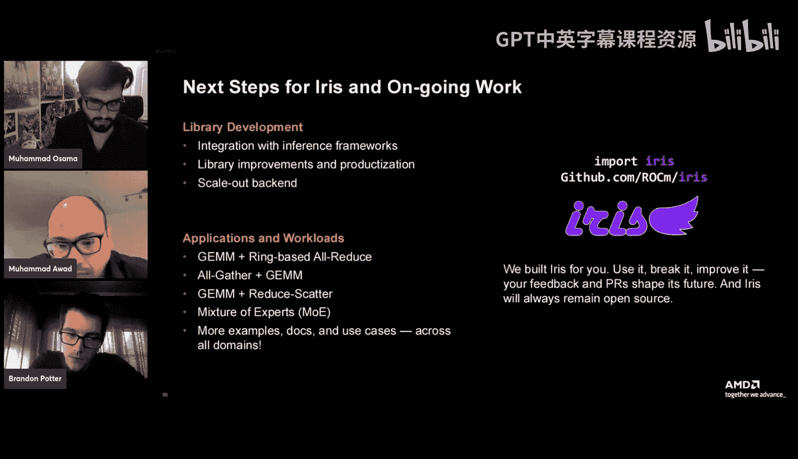

And that is the end of our talk， an now。I do apologize for。

Okay。😊，W coming this was a great mom。 Thank you。 I think you've certainly found a fun in the in the PM and chat and Viipple。

 so thank you。 I think this is great。 like I I I， I kind of like these sort of small， hackable。😊。

Distributed code basis because then like you can ramp up。 you don't need a lot。

 You like presumably need like a node to like do interesting experiments。

 We're doing a kernel competition。 if you're interested in exploring some of these problems and you don't have access to like an Mi 300 node。

I think there's like a couple of questions， maybe we'll start going through them。

 I think I don't totally follow but Zoo asked a good question before so I'm going to put them back on。

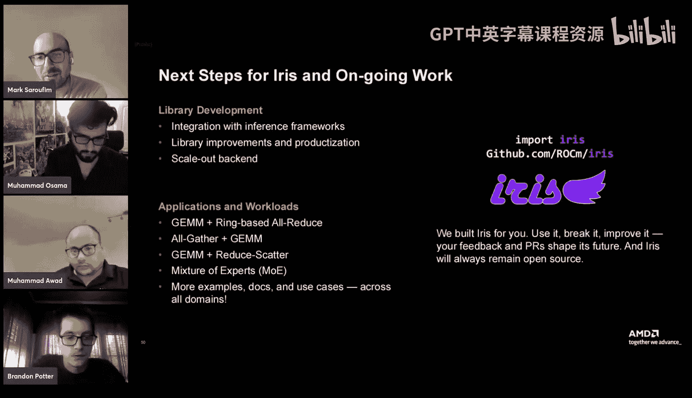

Yeah， I'm not sure if I follow the question， so float4 send from a awayfront to a mix seven different GPUs have the same bandwidth as is the same and I maybe I'll ask my own question。

 which is that like have you guys done any experiments with like very small d types and does it fit basically what the work you guys have done already？

A quick note on I think one of FP16 the implementation for the gem that we uses FP16 right now。

 but we have a separate library where we are testing all of these other precisions FP4 right now isn't enabled but F8 is using all of the Pytors way of expressing sort of F8。

 but that's something on the list of things that we'd like to support and we can add some unit tests that I is in fact working with these small types as well。

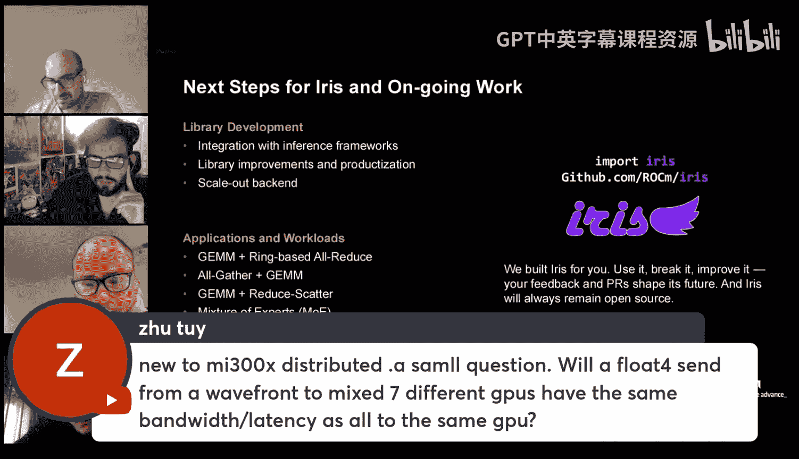

Yeah， but the beautiful thing about I is that I mean， it's all written in Triton if Triton can do it。

 then do it， but that's basically it。I see and but Trident can do comms and little bit D types like whatever sorry you can do compute but like like but supporting comms and little bit D types like that seems like an it's basically at the end of the day it's basically like a load or store So if load you need the right instruction then then that should be。

是这个哪。There are most likely some level of optimizations that go along with it。

 like packing those small types altogether together before sending them through the network and things like that that will likely be explored in the future。

 but from the functionality perspective that should be a non issue。

If you are looking through the code and looking for something interesting that's novel about IIS that won't be found in other codeases。

 I think。There was a discussion from the invasion talk， I think a couple of weeks ago， Jeff Hammond。

 he was discussing improvements from Schman Poer。Whi is allowing you to do direct load store access into other kernels or into other GPUs from a single kernel。

That API with the the Sm pointer is it's a legacy API from Shim。

 the Lo store APIs with the like cash modifiers within ir or kind of a novel thing and allows you to do。

Cash placement from the load store like Schman Pointer。

 but it allows like even more control over it that you wouldn't even have a Sch pointer like for instance I can cache it at like an L2 level or an L1 level I mean do like very fine grain placement in the caches。

It's a very nice thing that it's a triening experience。

Yeah and and I see like maybe could you guys elaborate morecause I， I think you， you very briefly。

 many of you alluded to glue on。And like， obviously， like in try it and like， I think they。

 they don't give you access to like explicit like cash management But， but I presumably。

 I think Blue on does， but I haven't used it myself。 could could you speak a bit more as to like。

 why you think this is interesting， Like explicit， like low level cash management is important for like the kinds of applications you're targeting。

If you look at the deepSee， the DPP code， they kind of hint at some performance improvement that you can get from doing like manual cache placement using like low level assembly primitives inside that code。

You can do similar stuff like that for other codes as well where you try to minimize cash interference。

 cash pollution if for instance you know you're producing data from a producer and the consumer is going to consume it in another GPU。

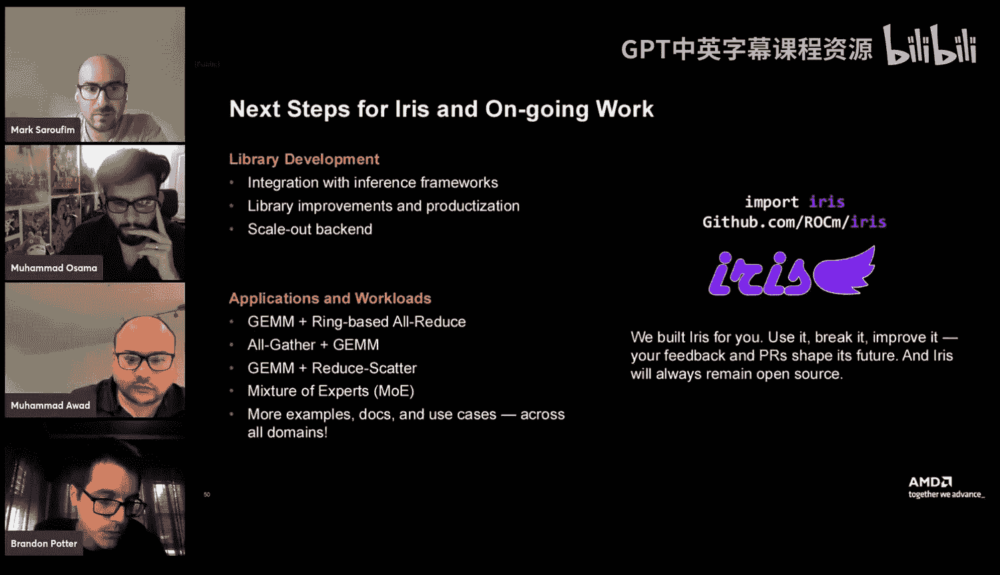

You may not want to catch that data it's kind of non-temporal you're not going to expect any kind of reuse from your own cache you're just producing and someone else' is consuming if you have other code that's running that's going to need cache lines。

 you may not want to pollute those cache lines with your data that you're just writing out and these kind of cache modifier instructions a you to do stuff like that and you typically don't have access to these things unless you're writing the assembly by hand。

So it like tried and exposes it to you through these cache modifier parameters and it's a nice thing that being able to access a remote GPU's memory and specify what the cacheability of it is is like a very nice thing。

And to add to that， I think one example on the compute side would be if your matrices like if you have tall skinny matrix problems where one dimension is really really large and you're doing matrix multiplication with it and you have control over these cache modifiers and you can fit an entire matrix it's one part maybe small enough to fit it entirely into your L2 cache and the other one should never be cached。

 for example， is just never has some caching properties like n dimension is really large K dimension is really small then you can essentially apply these cache modifiers to make sure that the one that there's no locality in it should never be cached and should avoid setting bits in the caches there you can save some energy efficiencies。

 you can run your GP clocks higher because of that your entire problem could run more effectively more efficient and higher performance It's that really like lowlevel control that is just enabled through just one tag in the line。

And that looks like what's shown in the slide at the top right corner cachemodifier equals。

wT right through so it's really simple to add these very small modifiers to your load and store and experiment in terms of getting more potentially more performance out of your existing code。

So the ability to be able to do that is really， really powerful。は well呃。I see。

 I see another comment from PM， which is okay， I'll put it。 which is like， oh。

 I think I see the problem across GPs cross GP scopes are not directly possible through at one side of the API。

 Yeah， I guess is is the the main benefit of these like。

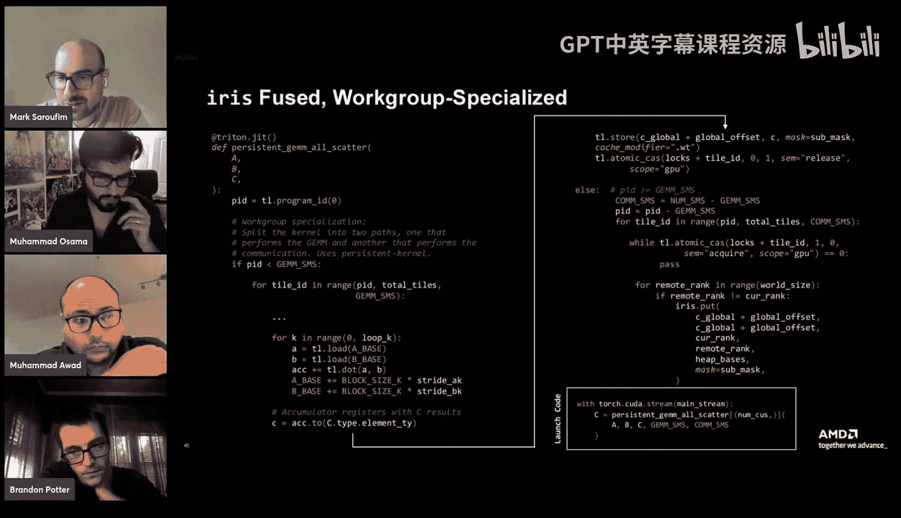

Chair member APS。Yeah just was one last comment on that like one of the nice things about the IRSC APIs that has a load store API。

 you can directly access another GPU's memory and like it loads it as a tensor from that remote GPU into your registers。

 the load store APIs do that there's also a put gett API as well that doesn't essentially memory copy from one memory space to the other。

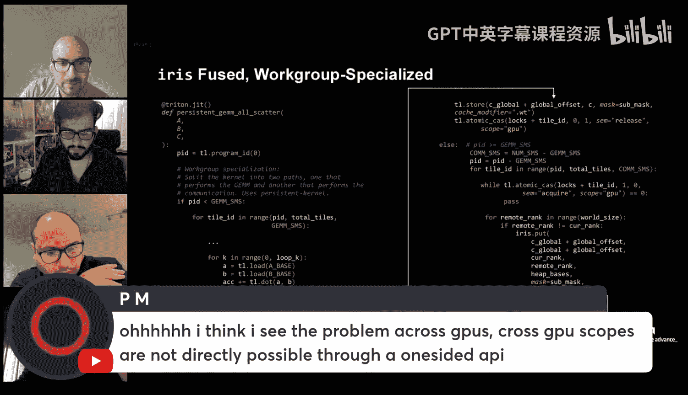

And so it's Min flip PM was saying about the cross GPU scopes， you're able to be that nervous。

 it' very nice。All right， well， I don't see any more questions， but Mohammad Muhammad Brandrenan。

 thank you for coming。 This is a lovely talk。 Please come by again anytime you'd like。

 I guess we'll see everyone tomorrow。 We're gonna have another talk on Me Kelsen again。 thanks。

 thanks again for our speakers for coming today。😊，Thanks for having us for having us thank。

Thank you was right。

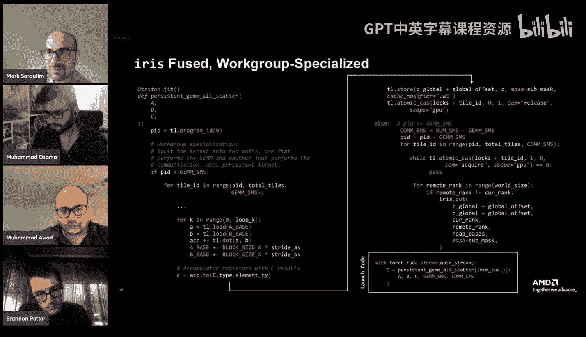