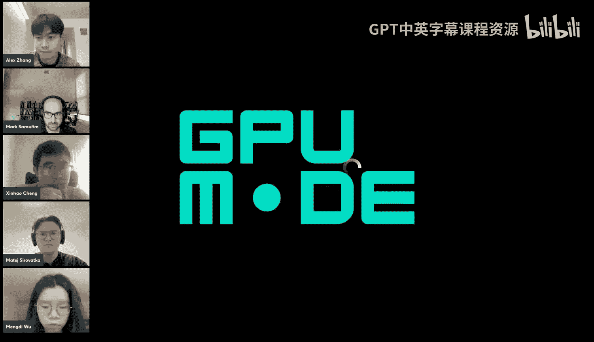
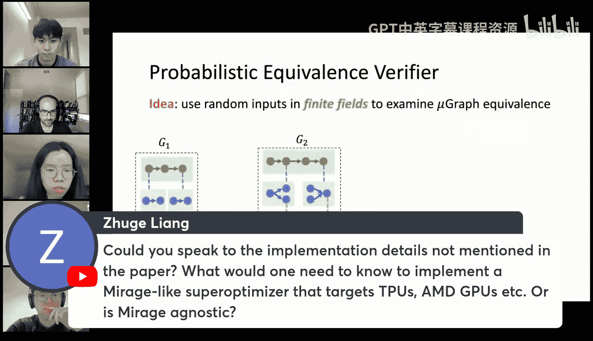
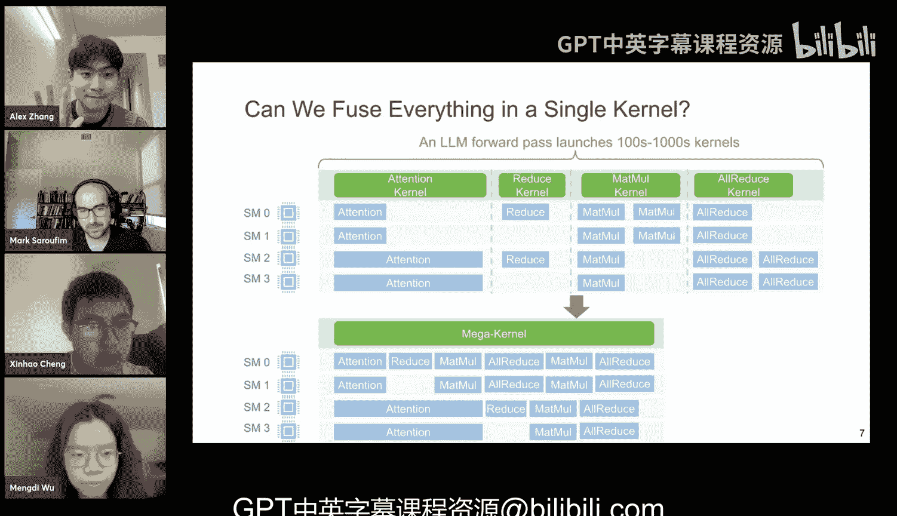

# GPU MODE《CUDA、GPU编程54-87｜GPU MODE》中英字幕（deepseek-v3.2 p26 -20250914-Lecture 79 Mirage (MPK)_ Compiling LLMs into Mega Kernels.zh_en -BV1xbmQB3ETC_p26-

Okay， we're live hi everyone， so I'm very excited to introduce I guess two sets of talks today around basically this mega compiler project at CMU so we'll have two speakers today from the same group Mendi Wu and Xinhao Chang and they're both advised by Zhao Ja as far as I understand。

 and so the talk will be focused both on the actual compiler to task representation as well as how you actually map these things to the kernels on the GPU so without further ado I'll let Mdi take it away。

😊，Okay， thanks for the introduction。Okay， so yeah， I will introduce our work Miage。

 a multile super optimizer for Teel programs， which uses the super optimization approaches to generate efficient ka kernels。

Okay， so GPU is the most popular domain specific hardware for executing machine learning applications。

But GPUs are complex， which has multiple levels of computation and memory hierarchy。

And on each single GPU， there are tens to hundreds of commute cores。

 which are called streaming multiprocessors。And each S M contains hundreds of kuda cores。

And all these computer units can run in parallel， which which forms a complicated design space of parallelization strategy。

Moreover， memory at different levels have different bandwidth， sizes and accessibility。😊。

The generally， the member at the lower level has a higher aggregate member bandwidth and a smaller size and can be available by a smaller set of compute core。

And in order to write GPU kernels which has a good performance。

 the programmers need to carefully match the tensors at different memory levels。Therefore。

 it is very hard to design high performance GPU kernels。In order to perform neural networks。

 the existing systems usually launch kernels for individual operators。For example。

 here in order to execute this communication graph。

 the existing frameworks such as PiWch will launch separate kernels provided by the vendor libraries for each operator。

 such as the RMS Do kernel， the Somax kernel， and matrix multiplication kernels。

But this may lead to subopmal performance due to missing optimizations。Such as the kernel fusion。

 algebra transformations and local memory use。In order to achieve a high performance。

 people manually implement the optimizeim kernels for certain computation patterns。For example， here。

 the last three operators matrix multiplication， softm and another matrix multiplication from the popular attention computation。

So people manually implement these optimized attention kernels。

 which require hundreds lines of C plus plus code in Koda or hundreds lines of Python code in China。

Which requires a large amount of manual effort。And the remaining operator Army storm is still computed by a separate kernel。

And in order to bridge the gap between this high performance and low menu effort。

 we introduce Mirage， a multilel super optimizer。Miirage is not the first super optimize or automated optimization frameworks。

Existing super optimizers such as tassel and PE apply algebra transformations on the operators at the kernel level。

In order to find an optimized algorithm。Another category of work， including TM and An。

 they perform schedule transformation to improve the efficiency of within a single kernel。However。

 all this work are rely on the users to define the computation of kernels and cannot generate customer kernels whose computation is not standard。

Mij uses a holistic approach to perform optimizations across multiple levels of the GPU hierarchy。

Supporting all of these out transformations， schedule transformations and custom kernel generation。

The In of marriagerage is a cancer program。And the output is a set of optimized GPU kernels to efficiently execute the input potential program。

Mirage requires less engineering effort where we instead writing instead of writing thousands lines of color course。

1 hundreds lines of tri code， you only need to write a few lines of Python code in marriagerage。

And it also performs better performance， but it also achieves better performance where in our benchmarks。

 Miage outperforms the existing systems by up to 3。3 times。And moreover。

 marriage is easily adapted to new architectures and new models。

Where we do not rely on any menu implementation。So in order to achieve the holistic optimization。

 let me first introduce our I， the Mi graph， a multi level grapher presentation。

Mil graph captures the hardware memory hierarchy with multiple types of graphs to represent computations at each level。

Specifically， there is a single kernel graph in each mill graph where the vertices represent the computation running on a kernel on the RD Ss of a single GPU。

And the edges represent the intermediate sensorors stored at the device memory。

The vertices can either be standard tens operators such as matrix multiplication and or reduceuce。

 these are also supported by vendor libraries。And in addition。

 we also have a special type of operators called graph defined operators。

The commmut of these special graph defined operators are represented by a lower level。A graph。

 which are called a third block graph。Which are different from the kernelgraphs is that the vertices in the third block graph represent the commmut of a single vessel。

The tensors are stored in the shared memory。What is similar to the chograph is that we can have also have standard operators supported by vendor libraries and graph defined operators whose computation is defined by an even lower third graph。

Operators in a third graph are computed by a single thread and intermediate results are stored in the register file。

 which are similar to the kernel graph and ball graph。And with， with this graph representation。

 Mirage is capable of representing optimizations at multiple levels。And the challenge is。

 how do we explore the extremely large search space。

A common approach is to define a set of transformation rules that maps a sub graph that match a certain pattern into an equivalent one。

For example， here in the first rule， we re orderder the division and matrix multiplication。

 according to the commutivity between division and multiplication。

And the second rule applies the applies the for loop along the reduction dimension of a matrix multiplication。

And this is a schedule transformation。So this transformation based approach is good for optimizations within one level。

 because in this case， the transformations can be summarized as limited rules。However。

For if we consider this multile optimization， the problem becomes hard。So yeah。

 the the in this multi of optimization， the most important one is custom kernel generation。

And on the input in in this case， on the input side。

 we can fuse arbitraryr operators into a single kernel。

 which means we can have infinitely many possible input patterns。😊，And on the output side。

 we don't have common rules to generate optimized kernels because the optimized computation can be very complicated。

And therefore， a transformation for custom kernels are dense and irregular， and it is。

 and they are very hard to design。So Mirage instead， uses an exhaustive search。

It takes as input a ten program and performs the exhaustive search to generate all the possible mu graphs up to a size using exhaustive search。

And and these generated mill graphs are not guaranteed to be correct。

 So Miraj next uses an equivalence verify to check whether the generated mill graph candidates are correct by using random testing and we have theoretical guarantee on the correctness of this。

And all the verified mill graphs are are are sent to the Mi graph optimizeizer。

 where we perform optimizations that do not affect the correctness of mill graphs such as sensorsor layouts。

 memory planning and operator scheduling。Finally， Mira Wu picked the fastest。

 fastest kernels at the output。😊，So let me first go into the Mi graph generator。

In the Mi graph generator， we first maintain a library of operators at all the kernel thread block and thread levels serves as the primitives。

And Miraj will exhaustively search for all the possible male graphs using an available operators up to a certain size。

😊，For example here， we see from the input， there are three input， there are three input tensors。

 so we start from a graph with three input tensors and we try to generate the first operator which can be a matrix multiplication。

 an explanation， it can also be a graph defined operators。

And then Miraj will try to generate the second operator。 It can also。

 it can be another matrix location。 Or if we encounter a graph defined operator we will try to generate its underlying computation definition by generating the lower level graph using a similar approach。

In this way， we do not miss any opportunities to optimize the computation。 However。

 the search space would be extremely large。And our idea is that we use expression guided pruning。

From the input potentialential programs， we can derive the desired expression we want to compute。

For example， here the here the input potential program is Army stormwarm。

 followed by a matrix multiplication。And the desired representation is like a for each Z。

 K equals this sum over W K I times a normalized term。So during the search。

 we can use this desired expression information to guide pruning。For example， in the first branch。

 we compute the E to the power of X I。Which means all the following mu graphs must contain it as a sub expression。

And here we assume that there cannot be any redundant computation in the optimal graph。

 which means this E2 powerful of fixedI term cannot be canceled in the following search。So yeah。

 however， in the desired expression， we see that there does not contain any explanationation。

 then we know that this branch is useless and we can just prune it out。In the second branch。

 the current expression is not directly a sub sub stream of the desired one。

But it's actually a expression of the desired one up to some basic abstract properties。

And there can be a actually can be an expression that is equivalent to the desired one and also contains this YK as a sub stream。

In this case， we keep this branch and continue exploring it。😊。

This expression provide good things for perruning。 however。

 full information expressions are still too complicated to reason about。

So in order to achieve a good balance between the pruning quality and pruning overhead。

 we introduced this abstract expression。Where we instead of keeping all the detailed informations in the full expression。

 we abstract away the index details。 For example， the communication of a matrix multiplication is CI J equals to sum over K AIK times B KJ。

 And here we abstract away the index details， and this expression becomes submission over 64 elements。

 and each element is an entry from input tensor A times an entry from input tensor B。

And we can recursively compute the abstract expression for a mu graph。Yeah。

 we just pick random variables random and distinct variables for the input tensors。

 and we compute the abstract expression for a tensor from the semantic of the operator that generates this tensor。

Yeah， so by this abstract expression， we can capture most of the semantic information。😊。

And these abstract expressions are also easy to reason about。

I actually had a question and there is one in the chat I'll get to so like do you need to have these algebraic expressions beforehand like fed into the system or can you feed in like a Python script and it converts it for you？

Yeah， that's a good question。 So， so we will take the user does not need to provide this abstract expression。

 So the user only need to provide the Py watch or Python Python representation of the computation graph and Mira automatically derive this abstract expression and use this information during the search。

Does that answer your question。 Yeah， and then I guess the。

 the kind of follow up is in the previous slide when you do the pruning。Yeah。So。

Is are are there like， I'm like unfamiliar with this， but like。

 are there solvers that basically can do this kind of sub expression solving thing for you。

 like I in in my head， this is this seems quite expensive。

 but I'm maybe I'm thinking about this kind of naively。Yeah， yeah。

 that's that's a very good question。 Yeah， actually。 yeah。

 So this is this can be represented by in any like a solve the proof system of any solvers。

 but if we directly encode this full expression into solvers。

 it would be very hard for the solvers to resolve this problem and solving time would be affordable。

 that's why we take this abstract expression approach。

 So this would simplify the logic that we require from the solve we require the solvers to support。

 and yeah， and actually， yeah， we have export we have tried to that the solvers to directly solve this full expression。

 Yeah， but it's very slow and that's why we try to simplify the representation。 Yeah。

 this is a tradeoff。 if you give more to the solver。 then its more automated， but。

The server would become very would come very slow。And so instead， we can handle something。

 We can find the structure from the communications by ourselves by the system designers to simplify the tasks for the solve in order to get the result in an affordable time。

😊，I see。There was also a question in the chat。Ask the close one first and then the other one they're basically saying like in the in the next slide。

 when you define the like yeah， this expression， they're saying it seems very similar to Ein subnotation and they're asking like is there any relationship between them。

Or can you use E sub notation here as a replacement？Yeah， I think it's， yeah。

 it's very similar to this Einstein representation。 And we capture， I think we capture a subset。

 subset information of the Einstein abstraction， and we can absolutely use this as use Einstein abstraction as expression as a replacement。

 And I think the reasoning would be the similar。 So I think what cares。

 what what matters here is that how do we use this representation to help us prune the search。

And how do we perform our optimizations on top of these representations。 Yeah。

 so I think this abstract expression or Einstein representation can both work。I see。

EThere wast a question from like a much earlier slide。

 I think where you were talking about basically like operator optimization。 But they were saying。

 like， I don't follow why there are infinite patterns。 It， It was a slide about like。

 why you need to do this like decomposition in the first place。 I think it's even earlier。而呃会错。

this one， I think it was this one。啲 one。Yeah， okay。

 can you say the question again the question was I I don't really follow why there are infinite patterns。

 There there was a， I remember there was a， there was a line that did something about like their infinite patterns that come out of this that you have to search for。

 but I don't I think for infinitely patterns， I think it's this slide。If I understand them correctly。

 Oh， yes， sorry。 Yeah， I see。 Yeah， yeah， yeah， this slide。 Yeah， the point of this slide is that。

So if we want to generate custom kernels。 So we need to transform a part of the。

 So if we use this transformation based approach， we need first， yeah， so， so first。

 we don't know where where to part the operators， for example。For， for example， we may。

 if we have like three operators， operator  one， operator 2 and operator 3。

 we may want to have a kernel to compute the operator 1 and half of operator 2 and another kernel to compute the half of operator 2 and operator 3。

 So in this way， it's very hard for us to design the transformation rules。

 because there's a not a clear boundary of this cutting space。 This is one point。 And another is。

Once we so， yeah， so in this in this transformation based。

 in the traditional transformation based approach。We can。

 So we only have a limited rules because not every pattern of the computation can be transformed to an optimized one。

 However， in kernel generation， we can alwaysfuse arbitraryr operators into a kernel。

 So that's why we have， we can have infinitely many possible patterns。 So basically yeah。

 you can think of this transformation as as a function from the subset from all the subgraphs of the input sensor program to another subgraph。

 and in this custom custom kernel generation， this function is very dense which which in contrast of to these traditional transformation based approach where the transformation is a very sparse function。

Yeah。Perfect， thank you。Okay， yeah。 thanks for all these questions。 And I will continue to。Yeah。

 and will continue to introduce how do we use this abstract expression to guide our search。

So we will， so we will build a set of axioms， which are represented in first order logics to reason about the abstract expression relation。

Here we have two set of axioms， these equivalents axioms and these sub expression aoms。

So these equivalent assumes capture the abstract drag properties between operations。

And note that here we only need to reason about the algebra properties between these simple operators where we only have this like addition multiplication division and summation。

 And these are all all scar all insar granularity， which means this equis axioms is very simple compared to the like algebraic properties related to tensor computations。

Yeah， and these topic expression axioms basically are yeah， just reflexivity and transitivity。😊，Okay。

 so this is the full pipeline of this abstract expression guided search。

Here we take us input the inputence program。And we and Mirage automatically derive this desired abstract expression from the inputence program。

And then we do the exhaustive search。In each step of our search。

 we will compute the abstract expression of the current partial graph。

And use an automated thermal prover， which takes thiss axioms and abstract expression and sub expression axioms to prove whether the this partial this abstract expression for partial mu graph is the sub expression for the desired one。

If the answer is yes， then we just continue the search， otherwise we will pull out this branch。

And we have some experiment results show that this abstract expression can actually significantly improve the scalability of the search。

Here， the blue line shows the search time for the Mirage without abstract expression。

 and the orange line shows the time for mirage search with abstract expression。 You can see that。

After the after six operators， if we do not perform abstract expression。

 we cannot get the answer in affordable time。 And in our example benchmarks。

 the mill graph needs3 11 operators。Okay， and okay， that that's all for this mi graph presentation。

 A mill graph generator and abstract expression proving。

And the next component in marriage is this probabilistic equivalence ver。So the generator。

 the graph generator will generate a set of new graph candidates。

 but the correctness would not be guaranteed Now remember that we in our pruning。

 we prune out we abstract away some informations and that may lead to some mistakes in the outputted Mi graph candidates so we need a ver to check whether the each generated whether each generated mill graph is actually functionally equivalent to the input pencil program。

And our idea is to use random inputs is to use random testing basically。

 and in order to avoid this numerical issue， we run all this random testing in field。So basically。

 we randomly generate the input tensors for both the generated new graph and the input tensor program。

 and we evaluate two graphs on the same input and check whether the output are the same。

And we have theorems to prove that if G1 is equivalent to G2， then O1 always equals to O2。

 And if G1 is not equivalent to G2， then with a certain probability， O1 does not equal to the O2。

And this gives us the probability of this， of this false positive。Yeah。

 and next is the Mi graph optimizer。So in the Mi graph generator。

 we only consider the optimizations that does not alternate this output。

 which include these object transformations， kernel instantiation and compute organization。

And this yeah， and these optimizations can all captured by the Mi graph。 and for other optimizations。

 that does does not affect the correctness of a mill graph or we can see that which are not captured by the Mi graph presentation。

 we do other， we will defer these optimizations after we verified the Mi graph and these optimizations include tensor layouts。

 optimization， memory planning and operator scheduling。And in this way。

 we reduce the generator search base and solve the rest of the problems。

 Yeah since they are more orthogonal to each other。

 We solve other remaining remaining optimizations optimally。Yeah， and。Yeah。

 that's let me show the experimental result。 We evaluate Mirage。Again。

 a evaluate marriager on on this。Subgraphs selected from the popular machine learning applications such as normalized transformation。

 Q K normalization。 this Q normalization means attention with Q and K being being normalized。

 and this R storm plasma matrix multiplication。And the group query attention Laura and Gd MP。

Our baseline include all of the vendor provided libraries expert written。

Cos and compiler generated kernels。Yeah， we can see that Mirage can outperform the existing approaches in most of the cases。

Yeah， finally， let me show to show show case study to to demonstrate Mira's ability to discover how to customize male graphs。

So in this， so for for the Q group query attention。

Theage can generate the a kernel that is similar to this expert written implementation。

 which is flash decoding on100。And here we need two kernels because yeah。

 the first kernel computes on partial sums， and we need a second kernel to accumulate these partial sums because we cannot directly communicate between three blocks in a single kernel。

And in each100。Since we have new architectures that allow us to communicate between four blocks。

 so we leverage this GPC level or reduce to accelerate attentions。

And Mirage would automatically leverage this feature to generate efficient kernels。 and actually。

 it is two times2 fast 2。2 times faster than the best existing kernels。Okay， finally。

 to let me summarize。 So Mirage is a multile super optimizer that can perform algebra transformation。

 schedule transformation and new kernel generation together。😊。

Where we only require minimum engineering effort， and we can also achieve high performance。

Yeah and Mirage is an open source project。 Our paper is submitted by the OSDI this year。

 and if you are interested， you can contribute to our rapport。Yeah， that's the for the Mirage。

 I I can take some questions。Thank you， first of all。

 there was a question in the chat and then I think we can ask ours and then we can go on to the next slides。

 but the question was basically like can you help give us some intuition or like understanding for how the system would discover something like a tile Ma mole and basically like。

How do how does the way that you're dealing with these like algebraic sub expressionions and stuff help find like the extra summation terms for Tling？

Okay， yeah。 so let me maybe go to the。Okay， maybe just use this one， so。嗯。Okay， so for tile Mama。

 T Mama is a very simple computation。And in in order to in order to discover the optimizeized computation for Mama Mirage。

 maybe we try to yeah， so let's assume this is the best one。 Actually。

 Miage will try to explore all the possible ones and pick the optimal one。

 And one of the solution might be Mirage will generate a third block graph。

 which takes us input the matrix A and matrix B。And it will try to generate these input iterators。

 Yeah， so here we comes to a detailed design of the mill graph where we use this input map and output map to represent the so。

 so there are some parameters in the for the third block graph called grid dimensions and block dimensions。

 which are the same in the GPU in the in theda Qda programming term。And yeah。

 and we also have this input map and auto map to show how to to represent how do we map the tensor dimension to this gray dimension。

And yeah， here for this all these hyperparmeter or these non graph structure parameters。

 we will enumerate all the possible values for them。Yeah， this is very。

 this is very expensive and is' actually the current bottleneck of Mirage。

 And here we use some heuristics to help us reduce the search space。

 And we also have some ongoing project to try to reduce this cost。Yeah。

 and by exploring this all the possible input maps and great dimensions， we try to。 yeah， we we。

 where Miraage is able to represent all the possible tall or blocking strategies for child Mama。

I'm quite curious， like。It my understanding of the system is you're doing exhaustive search over some set of like operators or optimizations and then you're effectively like the the way that you check that they work is you just directly check correctness by running it in some way。

 so like how long does this compiler actually take for like let's say like an attention snippet or something。

Yeah， for our benchmarks。 yeah， these6 benchmarks。 the yeah， actually， the slowest one is the Laura。

 because it has the input the number of input tensors is larger than others。

 and other than this Laura for for other other benchmarks。

 our search time is within 30 minutes or 20 minutes。 and for Laura。

 it may run several hours like 3 to 4。Yeah， I see。Like roughly how many， I guess， like。Attempts。

 does it make like per like if you give it， if you give it some function and you ask it to optimize like how。

 how many solution candidate solutions does it come up with usually。

It varies a lot across different benchmarks。 General， it， it can have up to hundreds of candidates。

Yeah， for， I think for most of the benchmarks。I had a question which was like。

 I'm sort of curious as you were looking at what those like output kernels look like。

 did you find them to be particularly human readable。

 do they look like they were generated by a compiler。

 any commentsancy on the readability and lens of code of the output here？Yeah。

 that's a good question。 So there are two or two levels of outputs of mirage。 actually， So first。

 is this verified mill graphs。 So the mill graph representation is very human readable because it's mostly about the strategies and generated quota codes。

 So for the outputs， we have yeah， we have generated a quoa codes。

 that would not be that readable cause for example， the the tensor。

 the ten names are not related to their semantics。Yeah。Yeah， but for the mill graphs。

 it is very readable and we also have a visualizer to visualize this mill graph。AllVery helpful。

 thank you。There is questionOh e go first yeah， okay， yeah。

 I do have a question of like about the third space like I'm quite curious like how big do these graphs get like I imagine that for some stuff like as you said Aora。

 these graphs can get pretty。😊，Insanely here。 So like。

 what's the rough best number of operators and so on。 Like did you check that and like。

How does it so like for example， how does this number of operators correspond to the speed of the kernel？

Oh yeah， yeah。 Yeah。 that's a good question。 So yeah， I just some。

 I just have some high level intuitions。 And I'm not sure whether theyre actually true or theyre the only aspects affecting the efficiency of search。

 But from my my experience is that so the this abstractrun abstract expression pruning is very good at it' very good at pruning the noncorrect or useless graph structures。

 So the main cost of this search is on the on those aspects that are not that cannot be efficiently pruned from abstract expression such as this parameter tuning and the inputs So input input enumeration。

So for Laura， there are four input tensors for the in the input tensor program。 So we need to。

 so in in our search， once we generate operator， we need to enumerate its input。 its inputs。

 And this is very expensive。Because once you add one more operator。

 the complexity goes exponentially larger。So yeah， that's my intuition。

IA with the last two questions in the chat and then we'll move on so the first one is can you speak to implementation details not mentioned in the paper and basically if you were to implement like this system for other hardware vendors like TUs or AMD GPUs would this work out of the box or would you need to do other stuff and basically like is it device agnostic？

It's it's a good question， so。In order to support， let me go to the。

Another， yeah， in order to support other other backend platforms。 So， yeah， so first， that the。

 for most of the hardware platforms， the memory hierarchy is actually very similar。

 They all have this multiple level of memory hierarchy。 We have out We have device memory。

 and we have on chip memory and very local memories。

 this is very similar across out of the machine learning orman specific hardwares。

So this Mi graph is generally capturing these optimizations across multiple devices。

 and what we need to modify is that here we maintain this library of operators at multiple levels。

 and this may need to be reimmented to adapt to other platforms。

But this might be very simple because we assume all these platforms have this own kernel libraries for us to use and another might be the yeah this solution is general and for the like parameters like these great dimensions。

 block dimensions in other other platforms there might be other parameters and may need different heuristic to generate that are two two points that need need to be implemented in order to support other hardware platforms。

And then in the interest of time， I'll do one more question。

 we can kind of circle back to the ones after， but basically this person is there's like kind of two parts of this question。

 the first one is more specific， it's like do you have a system for discovering that threads in a thread block are sharing memory。

 for example， collaborative reading into thread group memory for child Mawell。

 but broadly what they're saying is this mu graph search is all over algebraic transforms。

 so it's not entirely clear to them like how this actually maps onto the hardware？

And like the software kind of abstraction that say like Kuda provides。I see。 Yeah。

 If I understand this question correctly， I think they're more interesting。 Theyre more about。

The details of this mill graph optimizer or the transeller。

 where we transform how how do we transform this mill graph to a quoda program。 Yeah。

 so this graph is mostly designed to capture the optimization strategies we want to the programs need to consider during their during their work。

And yeah， and to transform a new graph into into a ka program。 we just do yeah。

 we just do some string manipulation。 Yeah， so we have a transpieller that uses some yeah。

 that that's uses some traditional compiler approaches to transform a graph to the thea coa program。

 and also yeah， these optimization， this graph optimization are also included in this transpir。か。

Thank you， I think we'll go on to the next talk and we can circle back to some other questions after。

Okay， perfect。Okay， take it away。H everyone， this is Xin Hao。

 and I'm going to introduce a follow up project based on Mirage In this project。

 we are trying to compile the entire large model into a megacon。Um。Yeah， yeah。

 So since we have already have some background from Monday's talk。 So I'll skip this kernel apart。

So for I M serving， most of the existing systems using a kernel layer approach。

Each layer in the computation graph is implemented in one ka kernel。For example。

 model layers may have matrix， multiplication， multi head attention or reduce。

 and all these computations are implemented as meta attention and or reduce kernels。

So we already have a lot of techniques to implement and optimize these kernels such as cool+。

 flash attention， flash M O A， Nikel and something else。So in this kernel per layer approach。

 each kernel includes multiple thread blocks。 The thread blocks are going to be dispatched into。

Different streaming processors on GPU to do computation。嗯。

So it is very hard to do workload workload balance in a static way。 For example。

 the amount of this computation of attention kernels。are depends on the TVV cache lens。

So in this case， each streaming processor may perform a computation for different requests。

 and some of the requests may be much longer than others。 So as a result。

 attention computation on some S Ms may be much longer than other S Ms。In such case。

 other Ss are idled for a long time when the last block hasn't finished。So in a static way。

 we cannot do optimization since the workload depends on the real data。

 We need to wait for the real request comes and perform balancing for the workload。

So there are several limitations of the current kernelop layer approach。

First is that there's no interlay pipelineing。In this traditional approach。

 kernel serves as a as a barrier。 So， for example， in this case。

 we have a tension kernel followed by reduced kernel。

 We rely on the kernel to guarantee that the computation is in the right order。

Because we launch the reduce kernel and tension kernel on the same stream。

It means the reduced computation cannot start before the attention kernel finished。

This kernel barrier prevent us from software pipelineing across different kernels。For example。

 we can start the data loading for the next kernel before the current one hasn't finished。

But this software pipeline is hard to implement in this kernel player layer interface。

The second limitation is， it's hard to overlap the compute and communication。

Colons captured data dependence in a very cross way。In this case。

 we have or reduce kernel followed by sorry， we have much kernel followed followed by the or reduce kernel。

If we look into the data dependency， So each threat block of the or reduced kernel only depends on the threat block。

 only depends on one thread block of the matrix multiplication multiplication kernel。

But if we launch them as separate kernels。All or reduce computation must wait for all metrics multiplication competition done before they can start。

So this corn approach prevent us from overlapping the communication and communication。Finally。

 for k programming， it is very important to use kgraph to reduce the kernel launch overhead。

But Kgraph is a steady graph， which is hard to support dynamic workloads。In today's I am serving。

 we launch hundreds to thousands of kernels for inference。 So this results in a significant overhead。

So kernel fusion is a good way to address this issue。

 We canfuse multiple kernels into a single kernel。In this example， we have met more followed by。

We have a Army snow followed by a Mcmo colonel。In this case。

 we can apply some algebraic transformations。Which has been introduced in Mondi's talk。

We don't need to compute the Y I。 We can directly use the three input tensor to compute the final output Z by reorgan the the way we compute。

Through this way， we only need to launch a single kernel， and we have better software pipelinelining。

And also， we reduce the device memory access since we don't need to read and write the intermediate result of this Y I into the off chip memory。

So here the question comes， con fusion is very desirable。

 So is there a way to push con fusion forward。Can wefuse everything into a single kernel。The idea is。

Instead of launching hundreds to thousands of kernels to compute layers of the L M。

 we can launch a single mega kernel to compile and compute everything。In this case。

There's no longer kernelel barriers。And also， we can reorder operators。嗯。Yeah。

 so as we discussed before， each or reduce only depends on one piece of the。

So it is it is safe to reorganize the or reduce and matrix multiplication。

 and we can still get the correct result。This reorgan allow us to achieve compute and communication overlap。

 When some of the streaming processors are using the tensor course。

 others can do or reduce and utilize the NV link bandwidth。呃，So。

This approach also let us get better loan balancing。For example， for attention computation。

 some S Ms may finish early， so we can assign more works to these Ss to reduce the overall latency。

So to summarize， this mega kernelnal approach provides three key advantages over the current kernel player approach。

First， we have better interlay pipeline。 We have better opportunity to build software pipeline between different operators。

And we can also overlap compute and communication because now we capture fine green data dependent。

We know each piece of this or reduce only depends on one piece of the mat more。

 and we can real them to。 And also， we maintain the correct result and get overlap in between。

With this different GPU resource。And this also provides better support of dynamism workload because we no longer need coolograph。

 When everything is fused into a single kernel， the kernel launch overhead is minimized。

So we can build a runtime system to handle this dynamic workload。

So my kernel is very desirable since wefuse everything into one kernel。 but this is also challenging。

嗯。The first challenge is that we need to manage the data dependencies。Originally。

 we rely on Colel barrier to handle this dependency。Now， without it。

 we need a new mechanism to make sure that the dependencies are still preserved。

So the second challenge is handling the dynamic。For L M serving。

 there's many degree and dimension of the dynamism。For example。

 it is very common to use continuous spaing。 means that we batch requests from different users together and serve them in a single iteration。

We may have different number of requests and different number of tokens peration。Sometimes。

 we may need。We， we may。 We may mix the pre and deco phase together。

It is also very common to use page and read attention。

 and sometimes we use speculative decoding to reduce the latency。

So all this approach introduce different degree of dynamicss。So。

 the last challenge is to optimize the performance。Since most of the existing compilers。

Optimized individual kernels。 But when wefuse everything into a single kernel。

We care about the end to end performance of this whole kernel。

So we use three techniques to address these challenges。 First。

 we use task graph to manage the dependency。And we。

Build internal runtime system to handle the dynamicyn。And finally。

 we use the super optimizer to generate highly optimized kernels。So our system is called MPK。

 which means the Mirage persistent colonel。You can think we have a compiler and input is a L M is LM architecture。

 and output is a highly optimize mega kernel。Our compiler can reduce the engineering effort。

Users do not need to write thousands thousands lines of code or tracking code。

You can just provide the python code of your model。

 and the compiler can generate mega kernel for you。So MPK also gives high performance。

 Our kernel can also perform existing service systems by 1。2 to 6。7 times。

And we also offer support for a new model。 You don't need to add a new quota code。

To for your new model。So MP K has two main components。 It has a compiler and a runtime system。

The compiler takes L M as an input and， and also some of your serving configure。

 such as how to do batching， paging and speculative decoding。

And the compiler will generate a task graph。 Once we have this task graph。

 it can be used by the MP K runtime to serve requests。And here is the task definition。

So this task graph interleaves tasks and events。These are the two definition in our graph in。

 in this figure， the， the blue box， each of the blue box is one task。

One task is a unit of workload that runs on a single streaming processor。

It can be a computation task such a， such as a tail of Ma more， one head of the attention。

 It can also be a communication task， such as transferring a piece of data to another SM M or transferring data to another GPU。

🤧嗯。In addition to the tasks。Each of the green circles。It's called event。

An event handles the synchronization among tasks。So in this figure。

 an age from a task to event means that we need to notify the event when the task is done。

And we also have ages from event to task。 It means that when the event is fully triggered。

 So fully triggered means all tasks， the event depends on are finished。At this point。

 we can launch all tasks that depend on this event。

So we are going to explain this further on a later slide。嗯。

Ttgraph is similar with chgraph definition， but in chgraph。

 each node is a kernel that runs on entire GPU。In our task graph， each node is a task runs on1 S M。

Taskgraph is a lower level of kgraph。It takes a sub kernelnal dependency instead of an entire kernel dependency。

So a autograph is also static and immutable。 We constructed it once and repeated many times while serving。

So first， we want to talk about the compiler。MPK includes a compiler that converts the original model architecture。

Ttosgraph。So the compiler can optimize how we mapped the layer to tasks decomization based on the number of available streaming processors。

So the compiler also automatically adds synchronization events to capture the task dependencies。

For example， for or reduce task we talked before， each of the or reduce tasks only depends on the one piece of Me more。

 So in this case， in this case， we have events connect each pair of this or reduce and met more。

So this allows us to capture the data dependency at the finest granularity。Finally。

 we automatically generate quo implementation for each task。So after we generate a task graph。

 the graph will be executed on our runtime system。The runtime system have two kind of roles。

 We have schedulers and workers。Each scheduler runs on a warp of an S M。1 S M has four work exors。

 so it means that we can serve four schedulers in one S Ms in parallel。We run the worker on one S Ms。

 So in our design， most of the S Ms are reserved for workers。

 We only need one or two percentage of S Ms as schedulers。

So our runtime system is a task base runtime。So each worker has its own task queue。

And each scheduler also has its own independent event queue。嗯。

So each worker will repeatedly fetch a task from the queue and execute the task。

And notify the events when the task is finished。So on the schedule side， it will also repeatedly de。

This。Fully triggered events。The fully trigger events we have talked before it means that all the tasks it depends on has finished。

And it will launch all tasks， depending on the event。So for now。

 let's use a demo to show how this runtime system works。So。

 so this follows the the figure on the top right。 So first。

 we have initial events that's not depending on any task。

So it means so this event is considered already triggered， and it can launch all tasks。

 depending on this event。So this schedule will launch these four attention tasks on different workers。

Once the first attention task is finished。The worker will notify the event。

Because in this task graph， each event depends on two attention task。

So it means that this event must be notified twice to be fully triggered。

So there's nothing to do now。So once the second attention task is finished。It will notice the event。

So for now， this event is notified twice。It is considered trigger。So once this event is triggered。

 it will handled by one scheduler。 The scheduler will launch three much more tasks。

 depending on this event。So similarly， once the other tension tasks are finished。

 the corresponding events will trigger and launch the subsequent tasks。

So this approach let us gradually launch。All task and holdddle and handle all events。

While still maintaining the data dependency。So this approach also allow us to run。

 to run all computation inside of mega kernel。So we compare our end to end performance with the existing service systems such as Torch。

 V O M， S E N。 So this figure shows the performance of serving Q13，8 billion on a 100 GPU。

We can reduce the per token latency from 14。5 milliseconds to 12。5 milliseconds。For alarm serving。

 there's a hardware limitation。Since we have to load and store things from device to un cheap memory。

 So the serving latency is bounded by the memory bandwidth。So according to the bandwidth。

 theoretically， serving a token on a 100 takes about 10 milliseconds。

So our me kernel approach push this software performance towards the hardware limits。

So our project is now open source with in the same reportport with Mirage。

 So it's joint efforts across many organizations， and we are now actively working on the following up project。

 and we welcome any questions and contributions。Thank you。Thank you。Mark， do you want to ask first？

Yeah， so I think there's one thing that wasn't too clear to me。

 which was when you mentioned an intra kernelnal scheduler。

I was wondering if you could elaborate a bit more on how this works and just for a context。

 like you know on my end， what I'm used to is like you have a Pyth program。

 you figure out sort of intermediate IR and you generate like kernel code。

 there's something I understand quite well so I was wondering if you could speak like in more detail about the scheduler story。

呃 yes收。呃，人面。Yeah， so， so。So if I'm， so can I explain this example。

 Do think that may help you to understand。Oh so what I meant is more like I'm not too sure like how this looks like at a codeVd level like basically like are there like specific yeah like the sort of high levell picture makes sense I'm wondering what does the end level kernel and because you do mention like a kernel eventually gets outputted and kernels where all these things in which case I'm curious looks like so this scheduler is that we use the verp as a scheduler and so it maintains a queue on this scheduler and we just when there's it's fully triggered it will we will in a new we are going to we are going to pull out events from this queue and then notify the other Ss the detail is that we just write something to the device memory and so let other stream processors know that that there's something change。

So there's a， there's a loop inside this this this schedulers to。

 to fetch things from the the workers。 and in inside the worker。

 there's also a loop to to catch any changes in in that worker。All right。

 maybe after the talk if you have times， do you mind just like sending me a link to that like loop that you're referring to and I'd be very curious to just to see what it looks like。

Yeah， I'll send you Ill send you via on Disc our。That sounds right。 Thank you。 email。 Yeah。

 sure yeah， I I。I was also quite curious about that in that， like。

 it seems like the scheduler or like the warp is just treated as。

Just like a single threaded imperative program， like is did you use the other threads in some meaningful way in the schedule or you just treat it like it's just running instructions。

Yeah， yeah， that that's yeah。 that makes sense。 So we。

 we use a ver since that the instructions are executed in in a verp level。 So actually。

 we only like run one instructions to write this to the device memory。 So， but there's no。

 there's no difference to use one size or one ver。 So we use one ver。I see。

There was a question in the chat， Paul is asking， I think in one of your examples。

 I think that ArIS norm plus the MLP or like linear is not fusible under tensor parallelism。Yeah。

 this might have been a previous slide。有你咩事出别。😔，Yeah。

 maybe I'll elaborate on this question as well because so it wasn't really clear to me if like our like redistributions also use in the kernel because like I think typically you want to be interleaving like tensor parallelism for the MLP but then sequence parallelism for RMS norm and so like you also ause the redistribution and sort of any details on comms might be helpful。

Yeah， so if this fusion that's a like。That like， like introduce more communication。

 We are not going to like， use this in our。I think the question might have been with regards to other slide。

 by the way， maybe more one more。呃So sorry， which slide。Yeah， maybe one more here。All right。

 so it seems like the answer here is that like you would just like for you wouldn't use sequence parallelism basically right like you would just like basically insist that everything continues to just pure sensor parallelism。

 you eat the extra memory cost， but then' you don't distributere the comes and you can keep a at kernel。

 is that right？Yeah， yeah。 I think so。I true。Yeah， another question is in J's AutoDIF is implemented via source cell transformations that can be lowered to the XLA compiler。

 do you think in principle Mirage could be a substitute for XLA as a compiler in the future？Yeah。

 I think for now， our target is to provide a general compiler for all tensor programs。

 And we are also working on this engineering efforts and supporting more kind of like more kind of tensor programs and also more hardwares。

 So yeah， actually， we are， we we our target is to cover this cover this L M serving stack。

 But I think， yeah， that's our， that's our goal。 So we are going to compare with all these serving systems and see what's the difference。

So so one thing like that's quite common in a lot of like compilers is that like before you decide to fuse something or not。

 like you basically will just。Run the fused versus unfuseed variant and see what's faster and typically。

I've heard in the past that like the reason why mega Journals weren't popular was because you run into like inherent like re village problems。

So I was wondering， how does your approach deal with this like basically when you should not fuse or what and because like I think especially me kernels also kind of became popular as with people refusing entire small models。

But obviously people weren't more infusing large models。

 and I'm sort of curious if you could comment more on all of this。Yeah。

 I think that's that's also something。 some engineering problem we have encountered like。

So sometimes there so at the beginning， we use the ifL to separate these schedulers and workers。

 but that cannot so because in the workers， we use a lot of registers。 but in schedulers。

 actually we don't need that much that many registers but if if we use the ifL condition that the source code that does not split this register allocation for different for schedulers and workers。

 So for now we separate this schedule and workers into different kernels and use a green context to do this to do this communication between them。

 So for now we get rid of these registers and for a kernel fusion。

 I think we are currently we are we are using this based on our intuition。

 It's like we develop different kind of different sizes of kernels and fusions and we test that performance of the single kernels。

And also the register think Londonern we select the best one。

There was an earlier question which also applies to Mingdy， you still here。

 but is there a tracer or logger or some kind of visualizer where we can see the entire process of search and transpolation in Mirage？

Or like some kind of open tool for this。Is Mon still here。Oh， can you hear me。Oh， yeah， yes， yes。

Okay， yeah， so。Yeah， so currently we only have some stat results or yeah Sta numbers during the search。

 Yeah we don't we don't have like this tools to help the yeah for it。

 We will have the visualizer for the mill graph。 yeah， our。

 there are still some limitations of the search and we have some ongoing project to improve them。

 So it's still under the this rapid development。 So yeah， ands not yeah， I don't yeah。

 we don't think it's it's stable enough for us to have a visualize our logger。Okay。

 I I think that should be it for this。 But thank you guys so much for this wonderful talk。

 I think it was super， super interesting。 Yeah， that should be all。 So thank you guys for coming。

 and yeah。😊，I see yeah thank you you。

