# GPU MODE《CUDA、GPU编程54-87｜GPU MODE》中英字幕（deepseek-v3.2 p27 -20251001-Lecture 80_ How FlashAttention 4 Works.zh_en -BV1xbmQB3ETC_p27-

Okay， we are live， so I will just let Charles take it away because I think we don't really need much of an introduction for this Oh well。

You know， ever since I was a child I dreamed of not needing an introduction but yeah。

 hey everyone I'm Charles I am a huge fan and like top tier luer in GPU mode and yeah working in a company called Moal and infrastructure company thinking a lot about GPUs and how to make them faster because we settled GPUs to people and then they want to do stuff with them and they're like man I gave you a dollar I wish I could do like $2 worth of work with that and things like flash attention are how people do that so。

Yeah， so we've been thinking a lot about LLM inference and how to make it faster and what the bottlenecks are。

 so when a new version of flash attention came out， we got really excited。

 took a look at it and then after a while of like reading it understanding the source code understanding what was going on we realized like oh yeah。

 there's not you know no one else has written this up anywhere。

 so figured we'd write it up and share it with people so we'll go through that in this talk so yeah。

 so let's just do a quick TLD we get rid of that annoying little box and dive in let me do the TlDR on what flash attention4 is So flash attention4 is an attention kernel for B200s or SM10 GPs SM10。

0 GPUs And by the way like I know people have like。

Wide variety of comfort familiarities with things if there are questions like please yeah feel free to interrupt send them my way so yeah so this is a coupa kernel for doing the fu multi head attention operation that's one of the two most important operations in transformers。

 the other one being Mamals。So pretty important to get this fast。 It is written。

 This particular kernel is written in cute DSL and cutless Python to relatively fresh DSLs for writing kernels So it's not like it's not really a C+ plus kernel。

 at least not the way it's like written right now the flash tension 4 is only a forward pass though the backwards pass is promised to come soon。

 and there's a bunch of features in it。 when we take we'll probably like look a little bit at the source code ourselves So I'll try and point out some of these features that are in place to support the backward like storing some of the intermediates to global memory so that they can be used with a gradient backward pass optionally It's also right now it's a 16 B brain float。

😊，Format kernel。 so the inputs and the outputs are and the yeah。

 the inputs and the outputs are in that precision。 Low precision should be soon like about a month ago one of the authors T Dow said oh yeah。

 and about a month， we should have some lower precision versions。

And then it also supports paged key value tensors， so that's like a Kv cache or a past cache and it supports attention syncs。

 which is something just popularized by GT OSS， but it's like a way to handle longer contexts than you can handle in you know then。

You can handle with your given memory。 So yeah， so like overall summary is it feels like a a bit more of a like attention prefill kernel than a decode kernel and it's probably a little bit better for training because it's B F 16 right now。

 Most people do their inference in a lower precision but we don't have the backward yet。

 So still very fresh， still very early， but we can at least understand some of the like key algorithmic techniques from what we have right now。

😊，I think yeah， one way to say why it's important is it's the first petaflops scale kernel in the F attention series。

 so that's  a thousand0 teraf flops or a billion billion floating point operations per second。

So it's about on a B200 is about twice as fast as the previous flash attention kernel flash attention 3 running on an a100 and it's 15 times faster than the original flash attention kernel running on an A 100。

 so that's pretty exciting that's like。😊，I want to say it's about 30% MFU，30% flops utilization。

 which is， you know， very， very respectable， very nice to see。

 It's kind of where the flash attention kernels and state of the art kernels have landed frequently and the like。

30% to 50% range， quite common。 Yeah， And it is a little bit faster than the other state of the art。

 the in the CoDNN library from Nvidia， their coDNN attention is also petafloop scale， but maybe 5%。

10% slower。 We'll see the precise results later。 We're still in the TLDR phase。嗯。

So diving one layer deeper， talking a little bit about the internals of flash attention for it's on top of what flash attention3 offered flash attention4 adds a lot more warp specialization。

 a lot more like inside of the kernel it says like okay if my thread index you know lands in some range。

 you know if I'm some particular warp of 32 threads I'm going to do this work versus this other work。

 there's like five I think components， as opposed to just two in flash attention3 there's a new approach to the sort of numerical stability problems in an online softmax algorithm the online Somax algorithm being the key thing in all the flash attentions so there's like more efficient way to handle numerical stability in that case and then there like maybe kind of the like coolest thing。

 at least for huge nerves。Like me is there's this new software emulation of exponentiation that is triggered on some iterations that sort of moves calculation off of the multifunction units or special function units onto the coudA course and that can looks like it's there to sort of relieve bottlenecks that emerge on the special function units。

Then like one quick one for the real heads in the room。

 if you're a huge dork for Blackwell F4 it does use Tensor memory， which is a new blackwell feature。

 but it doesn't use two of the like you know really famous or top of billing blackwell features there isn't anything with FP4 unclear whether we'll get an FP4 version of flash attention for and it does not use the new matte mus that can be split onto two cooperative thread arrays So like your kernel grid has many little elements in it usually you have to program just one of them at a time but there's a feature in blackwell to do two at once like two cooperative thread arrays at once do a matm together they like share data and that's not used in the flash attention for kernel though it is used in the Thunder Kittens blackwell attention kernel I'm not as familiar with that one so I can't say too much。

More detail about that but yeah， that's a sort of interesting difference between the two The main impact there is on memory bandwidth there's like a slight hit to your memory bandwidth with if you don't use the two CTA map Moles but if your compute bounds。

 then maybe you don't care。嗯。So this everything I'm going to present here going to goes in at least about flashlash attention for a lot more detail about this in the blog post。

 and then I also want to call out that this was joint work with two engineers at Moal。

 Nathan Wang and Timmy Fang who have been doing a lot of work on open source LM inference engines you yeah and on making GPUs Gober here。

Cool， any questions or anything like before I go any further。Want to pause。

 give a moment if there's any questions or requests。More detail， less detail。I did have one。

 and I think there's there's one in the chat as well。

 but do you actually know what the performance of the TK attention kernels convert to flash attention for I should I'm a little worried about。

Even if I did have the number on the top of my head。

 I'm a little worried about like not doing a total apples apples comparison with these things right because in the end。

 like with the differences between you know coie and N flashten for thunder kittens I expect these changes to come on the order of like a few percent right And so now you're starting to worry about very。

 very tiny nuisance variables or noise things where it's like， oh yeah。

 this person like was running their GPp in a room that was like kind of hot and like and so。

I want to say。I don't yeah， I don't know that there's published numbers。

 but yeah I was just curious there is a oh I guess there's two questions in the chat one of them is basically like in your opinion can a lot of the optimizations that you've seen in FA4 be done as compiler optimizations and which DSLs I guess like TK would be most suitable for these。

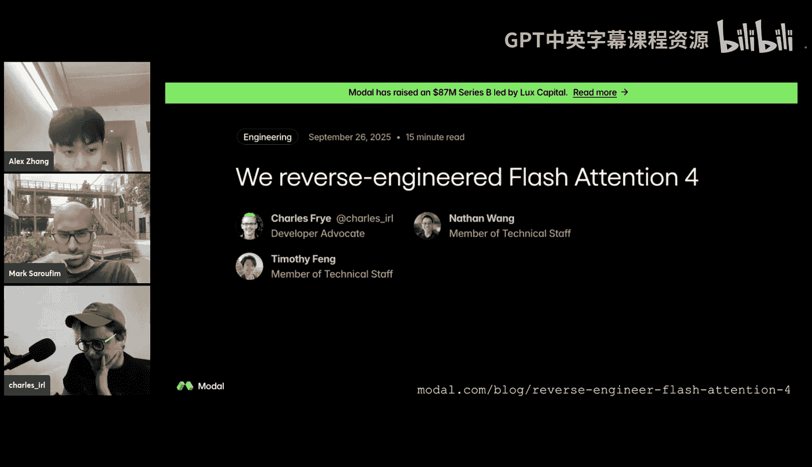

Yeah， that's a good question Okay， so I might put a pin in that and come back to it at the end。

 I would say coming up with the five stage pipeline。

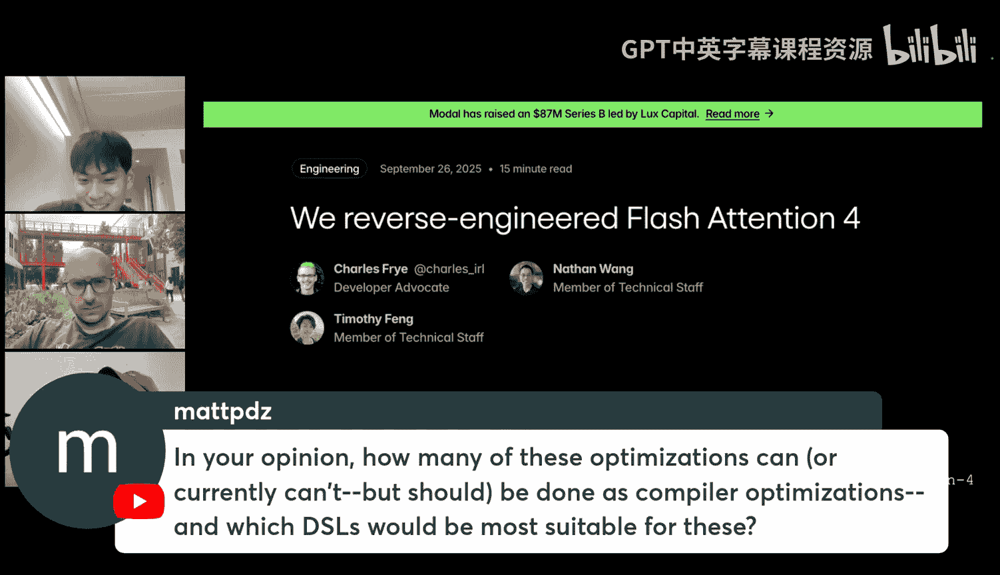

Is。Pretty wild for a compiler to decide to do。 like that's a lot。 But maybe that's the sort of thing。

 like， yeah， you just write a couple of these like core patterns and let， you know。

 a couple of separate compiler passes， like figure them out and compose them together。

Producer consumer wars in F engine3 felt like what much more compileilable or compiler friendly this is this you need to know a lot more about the algorithm to do it or like a lot more about yeah what what the programmer intent is the software emulation of softmax that feels like something that feels compiler friendly like you might just have those things and then be able to choose between them based off of heuristics or benchmarking so that was the other big innovation the smarter softmax scaling thing is is a little bit more like that's just a。

Yeah， you could just write that in as a trick。 It does not have any like proving that that has no numeric effects is not a thing that a compiler can just do。

 I think， from like a small set of primitive ideas it's more like the sort of thing that just gets written into a compiler as a valid transform Yeah sense makes sense Here's another one that you might might have been on but they're basically asking like how much of what you're about to talk about is possible on SM120 So like the consumer 1590 classes that's a good question All right so SMm190。

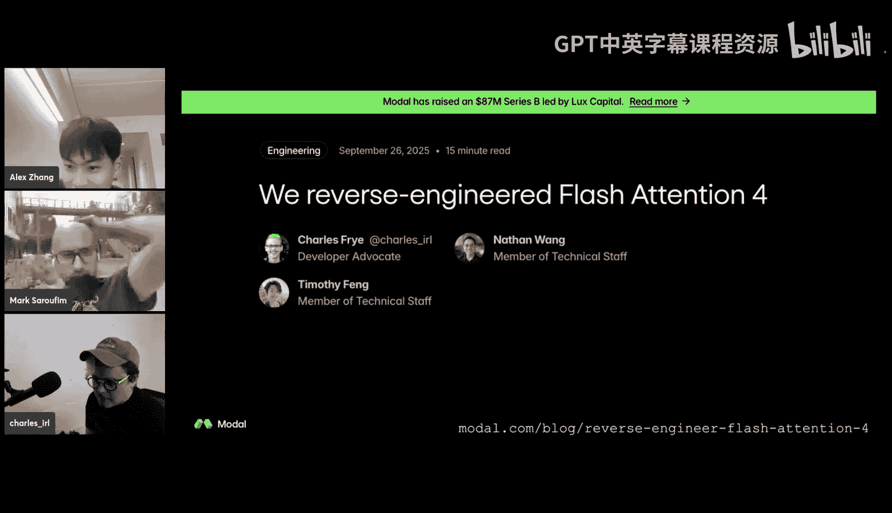

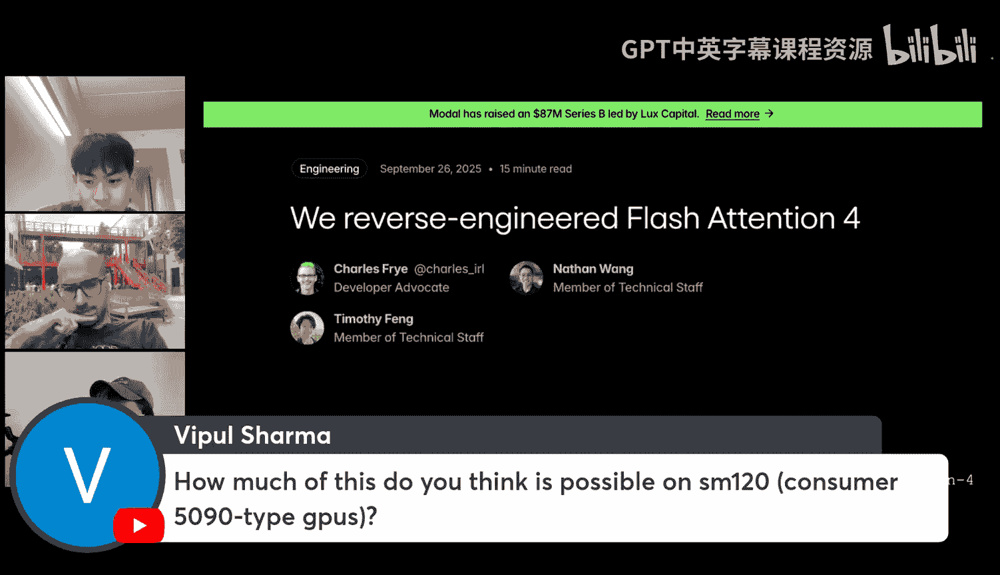

Right， you or sorry， S 50，90 S M 12。 So we don't actually have any SM M12s on modal。

 So I haven't really played with them。So I don't know there features off the top of my head。

 You are still like it's using the TC Genno5 instructions。

 which I think are portable from 10 to 12 So I don't think you run into a problem there the two CTA thing might be only 10 and not 12 I could be wrong about that but we aren't doing that so you don't have to worry about it The software softmax thing oh yeah。

 this is an interesting one。 I think for the SM12 GPUs。

 they actually have more like special function unit bandwidth。

 which means you actually don't need the fancy software soft software Exponiation。

 there's a tweet from from Simon from Vl about that。

 It was focused more on the like Rtx 6000 GPUs which I believe are like their data centered GPUs rather than like home graphics GPUs but I remember right their SM 12 like the 5090 so that might actually mean that you don't need a。

Some of these things， but the actually the smarter softm scaling is like back portable to any attention and honestly like it's one of those things that's like obvious in retrospect and feels like you could pretty readily add it to pretty much any attention kernel。

 any streaming attention kernel。Gotcha great questions。 Yeah， I will let you move on。

 there might be some single about to， but yeah， yeah， yeah， cool Okay。

 so I want to do a quick tour of flash attention one to three focusing on some of the things that are like really important So you know how did we get here and I also want to apologize a little bit ahead of time。

 especially for one or two the math slides put these together in a day or two just because wanted to get this talk out as quickly as possible because it's very。

 you know， timely so there there's some ugly slides here you know， I'm sorry。😊。

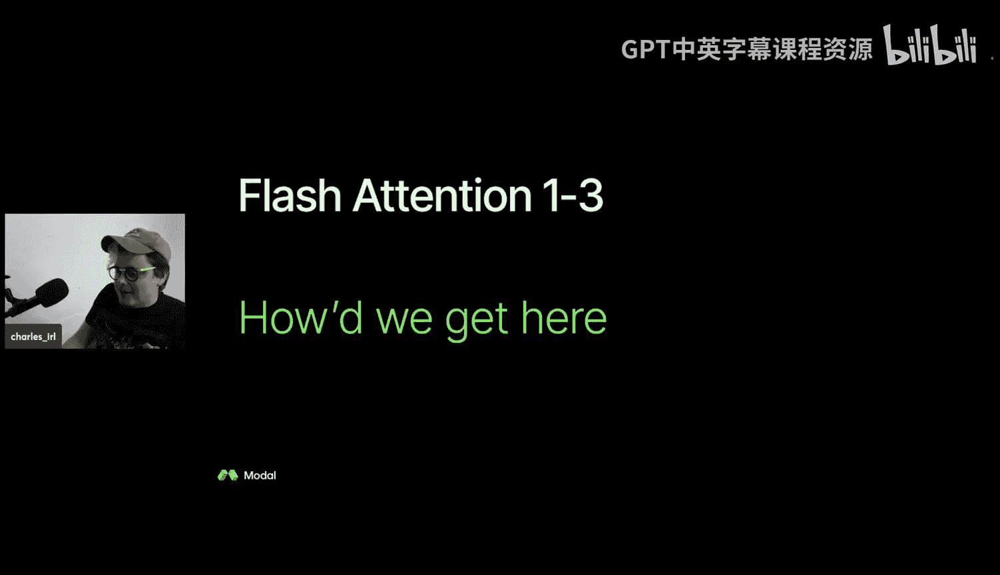

It's my， it's my fault， but I don't， you know。I don't fully apologize okay。

 so let's start with just like flash attention1， why is this why is this kernel so important。

 The key thing with flash attention one was coming up with a really good way to apply the general idea of tiling to an attention calculation So when you do an attention calculation。

 you have these like you have your queries and keys and values that you've computed by applying your attention heads to the sequence and then you need to take the queries in the keys and do this big outer product to get their similarity to one another and then you use that outer product matrix you take that and you scale all of its you know all of its entries so that they become like bounded between zero and one sum to one so they become these like like a soft arg max and then you use that to like soft arg max。

Through this big tensor of values。 So that's like the sort of mathy way of talking about it。

 It's it's a quantization of the discrete arc max operation。

 And you're doing it with these big with this big outer product followed by softm followed by matrix multiplication。

 And so the key like。😊，You know， somebody like oh the hardware naive way to do it。

 just like taking the math and translating it into a program is to say like， oh yeah。

 let's realize this giant sequence length by sequence length。Matrix。

And then like like create that tensor and then apply a map like apply the softm to each row of that tensor and then apply a mapte mole and that hardware naive approach is like sort of the default that you used to get from Pytorch if you just wrote out these like operations and that is。

 you know that's not going to get you the best performance to get the best performance you want to take that like that algorithm and break it up into like operations on a bunch of tiles of memory。

So I'm not going go into detail about how tiles are used in flash attention one because it's different from the later ones。

 but the key idea is that you want to take chunks of each of the queries。

 keys and value matrices do a computation on a chunk at a time and then write that output and the reason why you know the reason why you want to do that is because you don't have as much super fast ra on the streaming mold processors as you do the slower Ram that lives in the in the GPU and so yeah the。

This like tiling approach， like super super every fast map mole uses some kind of tiling。

 every fast map mole for GPus uses some kind of tiling。 If you squint inside of a tensor core。

 or rather， like the way Tensor core operations work is also like a tiling approach And so yeah。

 this is like a key key parallelism strategy。 So why， you know， why is this。

 why did it take until pretty recently for somebody to come up with this。😊。

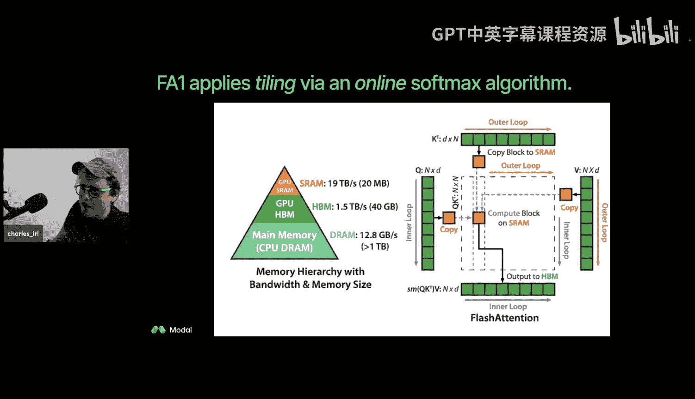

The reason why is like if you look at what like the math of softmax looks like it looks like something that would be like super trivial to parallelize right you're taking an input and and to produce like one element to the output。

 you need to take that element and exponentiate it so that's like a pointwise linear nonlinear operation easy and then you need to do this you do this scaling so that it ends up between0 and1 but and that scaling is a sum。

 but that's just like it's a reduction of the same thing you're calculating here so this is e to the z。

 this is e to the z and it's just a reduction of the same value。

 so we need to calculate this pointwise non nonlinear operation and then do a sum reduction but like oh wait what could be so hard about that like some reductions there's a chapter and programming massively parallel processor for it like people know how it's not trivial except that there's already somebody who's done it and trivial bring in a library the hard part with softmax。

Is that it's numerically unstable because you're taking an exponent here and so if you have large values in the input。

 you're going to exponentiate them， they're going to get really big and that is like it' it's subject to overflow。

😡，So the solution that people have like the immediately obvious solution to do a safe softmax。

 numerical stable softmax is to go look through the row and find the maximum value and then subtract that from every number and when you exponentiate a really large negative number。

Then you end up with a number really close to zero and if you've looked at floating point numbers。

 there's way more of them close to zero and so like your precision is better and so this controls the scale and ensures that you like that you end up with like results that you know that are close to what you should get mathematically the problem here is that this max over Z is like a bonus extra reduction that you need to do and the whole point of trying to work it with tiles was like to handle the fact that we have these big tensors。

 we don't have enough memory internally to store them with memory bandwidth is precious and so we've added this extra reduction no good and so the trick with the original flash attention is to apply the stabilizing factor online so basically you subtract the largest value that you've seen so far from。

The input values and that ensures that you like you know as long as you're doing that。

 then you will end up with no really big numbers getting expentiated and then you don't need to worry about the you don't need to worry about the numerical stability problems what you do need to worry about though is that this no longer get like just this thing that I wrote over here this like pseudo mathath thing is not the same as this because you're now doing you're like each of these is scaled by a different value and so all of your different elements in your softmax are going to be scaled by different values。

So you just need to you need to go back to your past outputs and rescale them and the nice thing is that that's a super easy operation you just you know you just need to take the ratio between the max you used and your new Mac and then just rescale by that number so it's very cheap and the outputs that you rescale in the end are relatively small it's a single tile and you're operating on many。

 many tiles per CTA and so it's like relatively cheap in memory bandwidth and in terms of computation just do this scale correction。

So that was what flash attention， like one of the key contributions of flash attention was was applying this to get like a nice online softftmax algorithm。

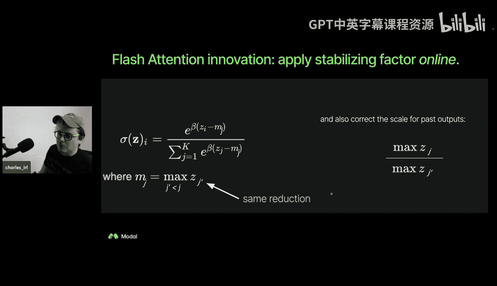

And I just want to the reason why I went into some detail about this this stabilizing factor is that this is going to be one of the biggest changes with flash attention for。

 we're going to have a smarter way to do this。

O。So now flash attention one。But like came out for ampire GPUs flash attention 2 within the same generation。

 we got a faster version of flash attention2 and this one。

 the key difference is that the like inter matrixtri multiplications that you are doing have been kind of transposed so I guess we didn't talk about I don't want to talk too much about how flash attention1 did it So I'll just say that flash attentions2 and onwards have all done this thing where you you load in the query tile and then you scan through all the keys to calculate your query key combo and then you scan through all the values to compute your output。

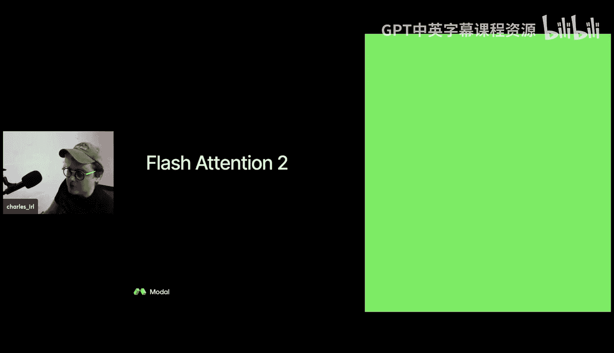

So that is what is shown on the right here right， Warp  one， Warp 2， Warp  three， Warp4， right。

 they're splitting up the queries tensor， but they all have to access all of the keys tensor and all of the values tensor。

So the reason why this is a really good idea， like structurally for what you're trying to do is that queries and like your outputs。

The outputs。For this query tile one here。Only depend on query tile1 and then all the keys and values。

😡，But。Yeah， so you end up with like a cleaner mapping of your inputs and outputs onto your like your warps and your cooperative thread arrays。

 So this was， I think。The Triton guys， the one who's credited in the Flash attention two paper with coming up with this idea。

 yeah。

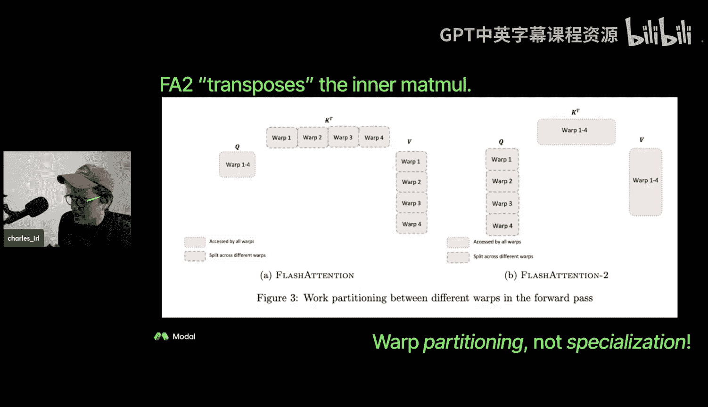

So that's like thats then yeah， that's how things work at flash attention for I have a diagram for that for flash attention4。

 so let me just jump to that really quickly。 So the idea is you have tiles of your query tensor tiles of your output tensor and you load a tile handle all the keys handle all the values and that produces one single output tile and that's the like that's how flash attention two through four all work you could ignore the right hand side of the diagram will'll get there。

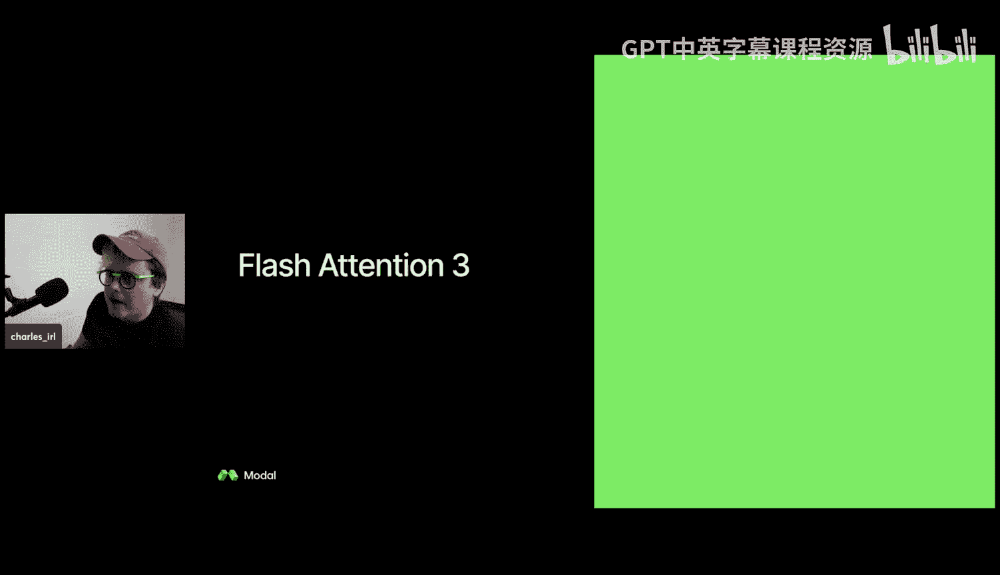

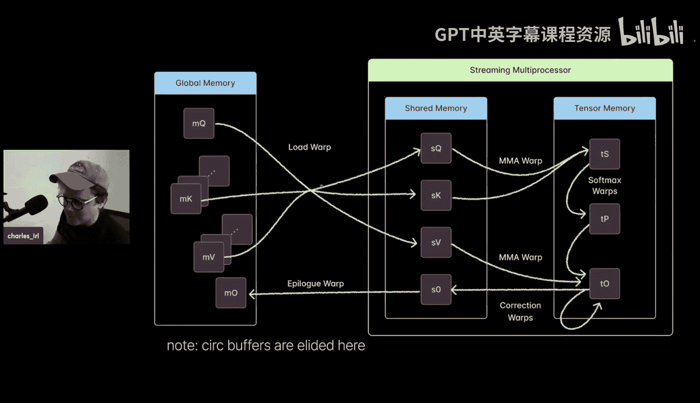

Okay， so that' that's the like main innovation flash attention to got to much， yeah。

 much higher MFU on Ampre。

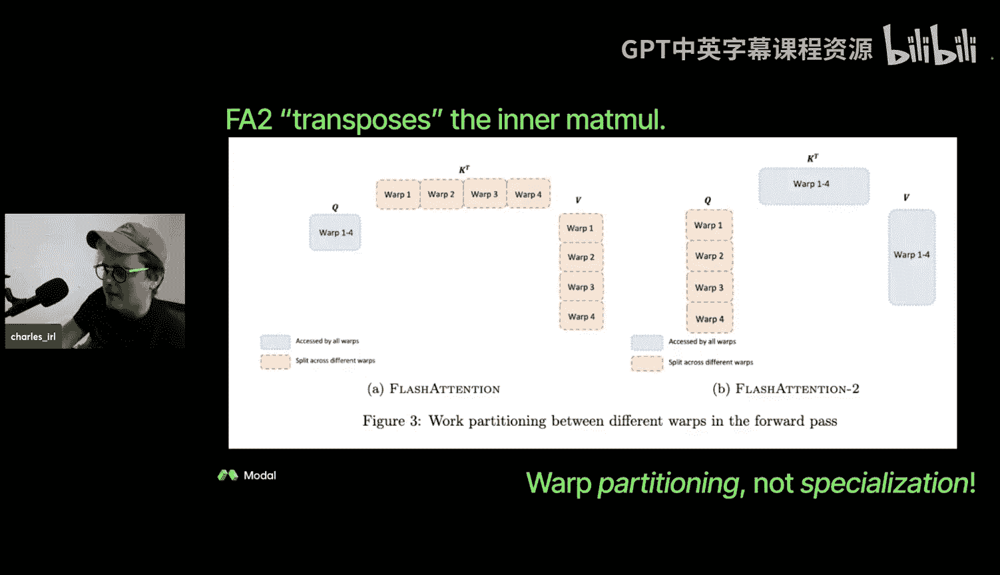

Flash tension 3 then came out with the hopper generation of GPUs， mostly focused on H100s。

 and F tension 3 added two things that we're going to crank up to 11 with with the next flash tension4。

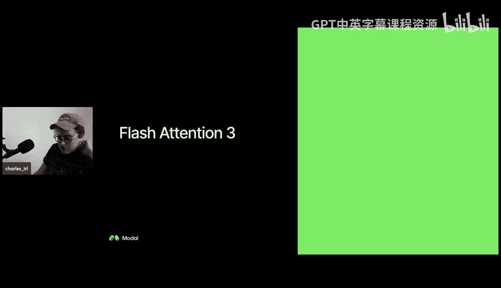

So the two things it added are asynchrony and warp specialization so asynchrony is like pretty common thing in CPU programming right you like you go off and let the kernel do stuff for you so you the operating system kernel you say like oh yeah go and like send some bytes on the network and then let me know when a response comes back right if you've used asy weight in like Python or no JS or rust or whatever。

😊，So this， but this is actually pretty new with GPUs。

 the ability to do that kind of like programmer managedage asynchrony and so the two types of asynchrony that show up in flash attention3 are the asynchronous memory loads with the tensor memory accelerator specialized hardware for loading tensors so loading multi-dimensional arrays without as much overhead and asynchronously and then and then it also runs asynchronous map mole so you're gonna run a map you like basically kick in H100 fast map moles you kick off a map mole with an instruction and and like you later come back and say oh yeah。

 now I need the results of that instruction and I'm going to use it on a future step and it's like you explicitly need to write this in your in your map Mole code。

And。So you can like do other stuff while the tensor core is running。

And so that's the asynchrony part the other part that gets added in flash3 is warp specialization so within a single cooperative thread array within a single sort of like instance of your running kernel program you say some warps are going to do one set of operations and another group of warps is going to do a completely different set of operations so this is not a new idea like in 2012 is like I think the first paper Se chemical combustion reaction simulation paper like came up with the idea of this like warp specialization but it got way better in Hopper with the addition of dynamic register allocation so you can give fewer registers to the tile producers and more registers to the tile consumers so that those tile consumers can use the registers to do computations while the tile producers don't consume as many registers because they're basically。

😊，Just telling the tensor memory accelerator， yeah。

 write this into shared memory and they don't need as many registers。嗯。

Yeah so sorry I told that a little out of order sorry when I say producer and consumer。

 a producer of query keys and value tiles is a warp that is just loading things from memory loading things from RA and putting them in shared memory and a consumer does like everything else so this is a pretty simple pipeline right you've got like one thing is just thinking about memory and the other thing is like just thinking about compute so it does the matrix the MMs Mamal acus and it does the softmax operations。

One last quick point you'll see that I say warp group everywhere here instead of warp you might not have seen that before warp group is for continuous warps with an alignment of 128 on their thread index this is just like a group of warps that are like kind of scheduled together nicely and so you can。

There's the matrix multi， the fastest mamals on hopper needed to use a whole warp group。

I'm not going to go into more detail about that because it's pretty much gone in flash attention for so I don't want to like dwell on it so if you if if that's confusing to you just hear warp every time I say warp group for the next like little bit。

😡。

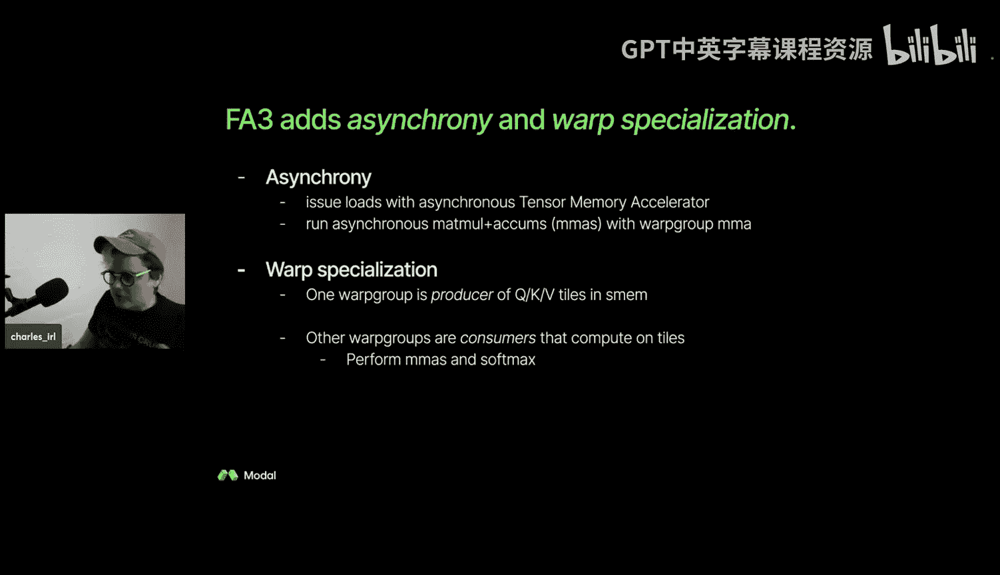

So warp specialization just to like double click on that because it is really important for flash attention form the idea。

 you know， you write this program here that says like like copy one query tile and then copy all of the key and value tiles into SRAM。

 compute something on it and get your。Get your outputs。

That that like that program is written for a single thread block。

 which is like or cooperative thread array， the other terminology for it。

 so that's a bunch of threads that will all that are guaranteed by the runtime to all land on the same streaming multiprocessor and then they're like to get all the queries and all the outputs you need to run many copies of it。

 so like you write a program technically for a coup of thread but then your program kind of executes at this granularity and then you run a bunch of them in like concurrently in parallel on the whole GPU on all the streaming multiprocessors and that's your whole grid of programs to get the final output。

So this is the like the coUa programming model exposes this at the level of like Kuda C plus plus Kuda fortran it's like。

 you know， this is the like happy path if you can write your program this way， the fun trick。

Is to say， oh， no， I'm actually going to take。Groups of 32 threads called warps。

 these are the ones that actually all execute together。

 so at any given time on almost all instructions， like every single one of these 32 threads are going to do the exact same thing。

And you can tell ahead of time which ones are going to be in a warp together because it's just based off of the thread index so you kind of just break it up into chunks here it's kind of broken up into chunks of four and the warp specialization says these guys are going to do just the copy。

😡，They're going to just do these copy operations and then this block of four is going to just do the compute operations so there's all kinds of different things you can do with warp specialization。

 the deepse people where like using warp specialization to handle like different parts of communication across GPUs in addition to things like this so you can really go crazy with warp specialization and it helps you sort of like even more fine graindly break up the work that you want to do inside of this like coherent unit of your kernel。

😡，嗯。So yeah， so the two and and that breakdown of the two different types is your producer warps and your consumer warps in flash attention 3。

 So producing tiles in shared memory versus computing on tiles in shared memory， so consuming them。

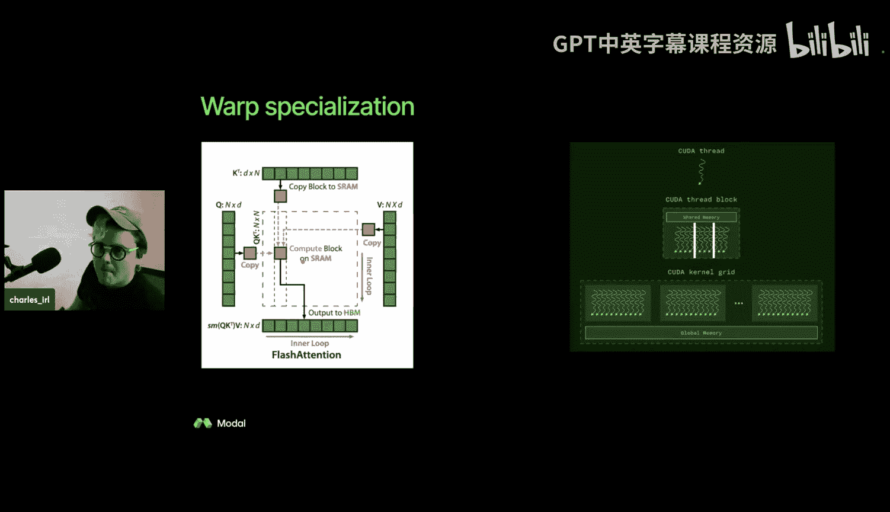

Then the additional thing in the in F tension three was asynchrony within war groups so I want to talk about this because it get this is the part that really like。

呃。Yeah， wait， hold on once I sync within work groups。Yeah， I'm actually now like talking this out。

 I'm actually gonna skip over this bit。 It's like。

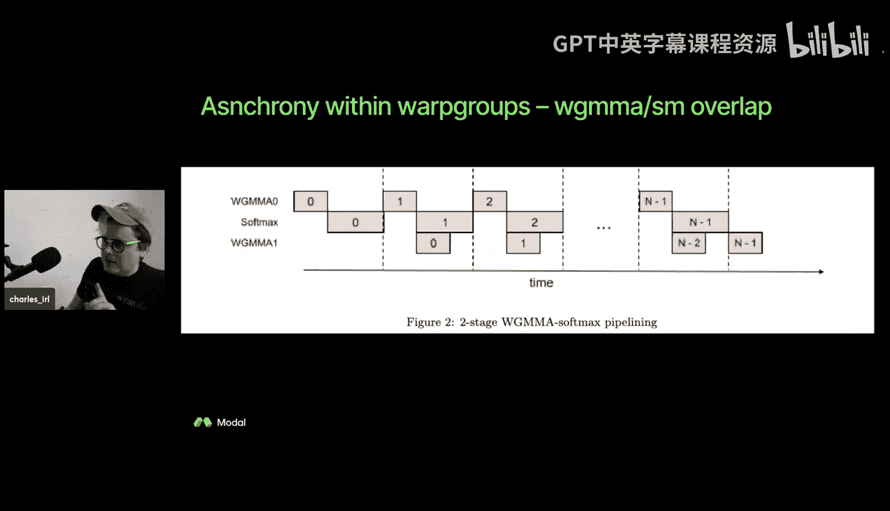

Pretty important flash attention 3， but it's not as important for flash attention 4。

 So unless it feels really critical or comes up in discussion with flash attention for I'm actually going to skip it。

 It's very cool， but it's really well described in the flash tension 3 paper。 So I can't really。

 you know， add any innovative explanation。😊，So let's dive into flash attention force。

 so flash attention one through three， what we just covered。

 that's like the history from Ampire up through Hopper of Td and J Shaw's fast attention kernels。

So flashlash attention 4 is still a work in progress so what we're about to talk about in the today and in the blog is like only guaranteed to be true about like this specific Git hashes version of flashlash attention 4 so like we in the blog post we link specifically to lines of code in this version so if you're watching this not in early October of 2025 keep that in mind like the source code or the version of flash attention for that you were using might be slightly different yeah。

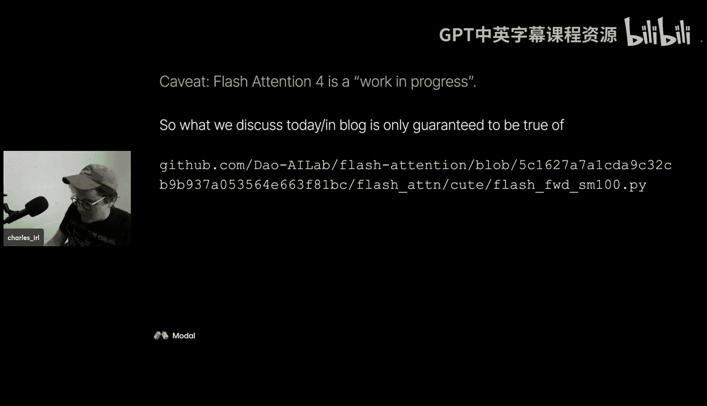

Okay， so flash attention 4， this is the like slide that's been going around that the author Te Dow presented at hot chip hot chips。

 hardware conference about a month ago six weeks ago now comparing the coy and N fast attention for blackwell flash attention 4 So this is know new GU architecture comes out。

 all your kds are fast， but they are not speed of light anymore and their their flops utilization is gone down。

 So this chart shows。They acrosss a wide variety of sequence lengths。Yeah， sequence length。

 you the performance of flash attention4 versus coD and Ns B200 attention is， you know， range is。

 well let's say about 10% faster， yeah， 10% faster， maybe 20% faster at the largest scales。U。

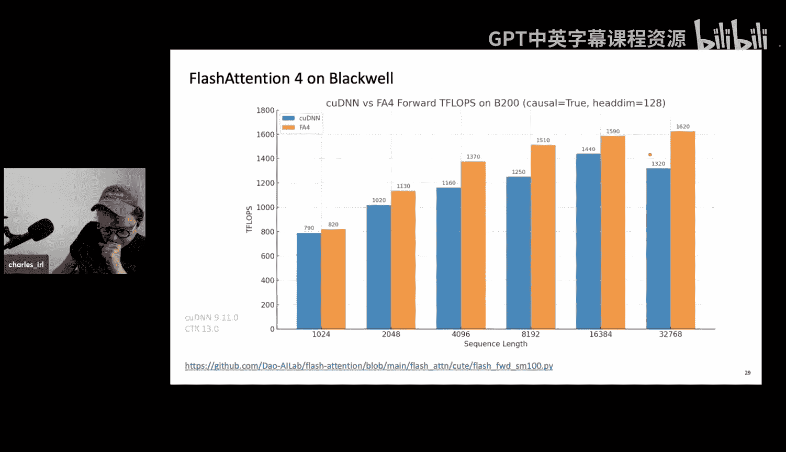

So how， like， how is that done， So the first thing is that flash engine4 is going to take the asynchrony of the like producer consumer pipeline and crank that way up。

 So we're going to have more stages of the pipeline that comes at the cost of more complex coordination。

 So like in some ways， like a more complex kernel that you need to write。Yeah。

 and actually just to like make a point really clear。

 this like programmer managed asynchrony is 100% on you as the programmer it's very different。

 it's more like writing your own event loop than like relying on the like as sync await features of a language it's like the thing it's like more like writing the thing that as await in Python node Js rust like what it relies on。

嗯。And so and you don't have the compiler to help you know that this is correct。

 so you have to watch out a lot for like deadlock and invalid programs because if you have pipeline stages talking to the same memory。

 then you need to make sure that like you know that they don't load the memory like before it has been written to or right to the memory before it's been read。

 so that's all done with with barriers with with the coupa level barriers。

So that's going to be a big change， we drop the warp groups because you don't need that for fast mat mules on blackwell and then we're going to do a more efficient soft Mac so the two things that change about the softm is instead of recaling every time you see a new max only rescale when the max has changed enough that you need to in order to get a numerically correct output。

And I'll go into more detail about that in a second and then the second thing is that we're going to move the exponentiation off of this hardware acceleration for it that that is in the special function units and move it onto the coudtic course and we only do that sometimes and it looks like it's done just like reading the code and like inferring it looks like it's done only in cases where the special function units are likely to be a bottleneck。

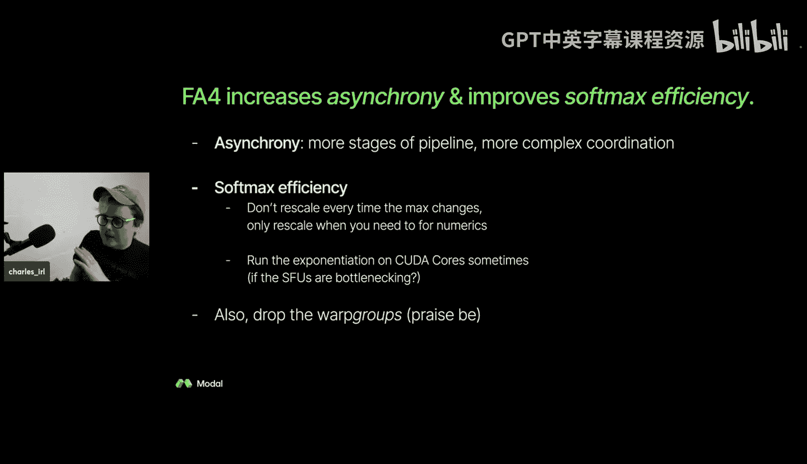

Okay， so the pipeline here is now complicated enough compared to like just a simple producer consumer that it's worth like drawing out instead of just saying it。

 So yeah， there are five different specialized types of warps。

 I think people use the term warp roles。 So there's a load warp and that like the producer warp。

 very similar to the producer warp that just produces these tiles in shared memory。

And then there is now a separate warp that's like the reverse of the load warp that takes the output tiles that you produce and writes them out into global memory。

Then in between is all the calculations that you need to do。 So there's an8。No， sorry。

 There's two MMA warps。 but actually， sorry， that like per tile。

 we're looking at a per tile view here。So per tile there is one MMA warp that does both the matrix multiplications for queries with keys and the matrix multiplications for your like attention scores。

 your you know attention probabilities weights with values to produce outputs so this is one one warp as well。

 and then there are per tile theres four softmax warps and for。Correction warps for correction warps。

 I have to look at the code a second to make sure I get the number there right。

 But just focusing on what those do the softm warps are taking your your raw attention scores and applying the softmax to them。

 they also signal to the correction warps to let them know when it's time to do the rescaling So that's these warps down here。

 the new thing， the other new thing with blackwell is the tensor memory。

 which has nothing to do with the tensor memory accelerator unfortunately。

 the tensor memory is basically the output memory of the tensor cores。

 So when you when you produce tensor with a tensor core operation。

 it like gets stored in the tensor memory that's basically where you want to put something you're accumulating over which is exactly what you do with the attention scores。

 you're going need to you need to take the。😊，Query and apply it to all the keys in the past。

 And so you accumulate on this attention score in the tensor memory。

So it looks a lot like shared memory in a lot of ways like it's the same size as shared memory。

 but it's really it's like to first approximation only accessible by Tensor cores。

And so the so the that is produced by the MMA Warp acted on by the softm Warps。

and it's only it's like it looks and feels a lot like an additional layer of the memory hierarchy on top of shared memory。

 but things generally get loaded into shared memory and then put and then like you you either move them directly from shared memory into Tensor memory via the registers or you produce it from Tensor core operations。

嗯。but yeah yeah， there there was a question， I think maybe is that is pretty important in the chat which is it's also related to what you were talking about before。

 but basically like do you think that like kind of。This。

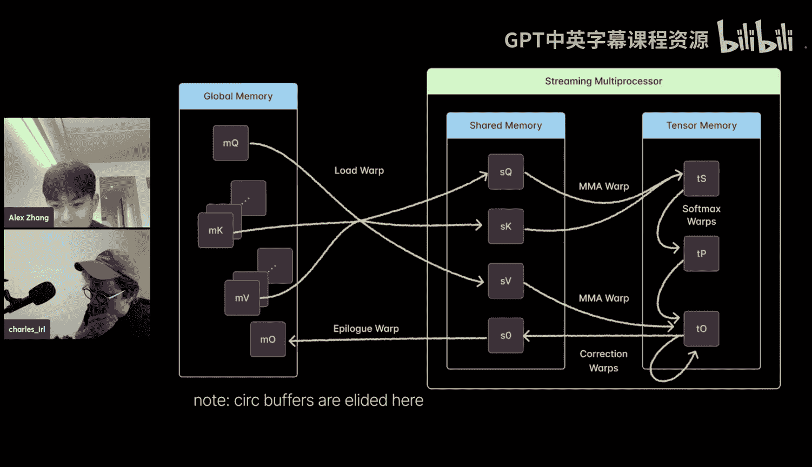

Model of making everything async with memory barriers and like doing all this like kind of fancy pipelining and like multist like I guess things are going to be like what Colel devs have to just always do like on GPUs or do you think like this is just something that because this is an early algorithm on Blackwell like maybe people will solve this with a compiler or like maybe this is just something we won't have to like deal with in the future。

 Yeah， this is kind of a billion dollar question and I'll say a little bit more about this at the end。

 but I would say that。

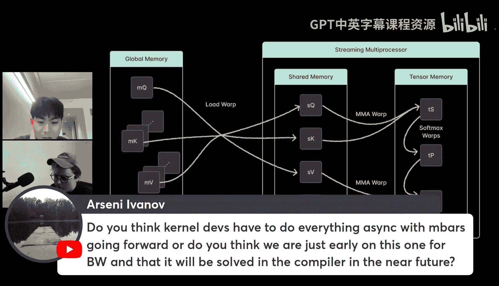

One of the reason why you see a lot more tile programming。

 like tile level programming DSLs is to try and have programmers write in such a way that this kind that the this kind of stuff could be figured out by a compiler or that like。

 you know， a compiler can take a bunch of like strategies and like slot them in because if you write at a thread level。

 like the compiler can't reason about tiles like the tiles are something that we have in our head while we like while we manipulate the threads I will say that the need for。

All of this asynchrony is primarily if you are trying to like drive the tensor cores at their maximum flops。

And there are many kernels that don't need that， like all your nonlinearities and like normalizations。

 anything that's not like at its core， a matrix multiplication。Those are those。

 you can't get all the flops。 Like， that's where like 99% of the flops are。

 They're in the tensor cores， but it's only for matrix multiplication。

 So I would say it's sort of emerging as like a different way to do the like the that Mamo programming。

Like now it looks even more different from the rest of KUDa programming you know。

 it than it did in Amre， yeah。Can I defend humans for a sec。 Oh sure。 So my take here is that like。

 if you look at what a lot of this。Kind of like specialized code looks like it effectively has like some sort of branch on like a warp ID if you're like this warp。

 do consumer stuff， if you're this warp， do producer stuff。

 and so if you look at it like it looks a lot like we're offloading the programming model to the user directly。

Like maybe the trend is eventually compilers will do it。

 but so far like we're getting a lot of like juice out of like offloading scheduling decision to the kernel like we're getting mega kernels we're getting more specialized kernels so I would bet on that direction more at least in the short term and compilers maybe in a year。

Got it。 Inter。 Yeah， yeah。 So I do have a slide or two on this。 So it's。

 we'll bring it back up at the end。 But yeah， that's exactly the like'。

 you're on exactly the right track。 I think it was Larseni is the one who asked that。 Yeah。

 one thing I do want to note here， just like， in part for reasons of trying to make the diagram like comprehensible。

 this operates on a single tile of input and output。 But。😊。

The the an individual like cooperative thread ray at any given time is going to be working on two input tiles to produce two output tiles。

 so there's two MQs over here， two MOs over here， two tiles。From queries and outputs。

 and then all of these things in the middle are duplicated。Well， not all of them are duplicate。

 the keys and values， you don't need like a buffer for that because the keys and values are going to be shared across both of the tiles you're working on。

Almost entirely almost entirely and but you will need duplicates of all these so managing that pair of bufferss that's where a lot of additional complexity comes in and but that's also really important for being able to like expose enough parallelism that that you know you can hide the like long latency reads or even like long latency instructions。

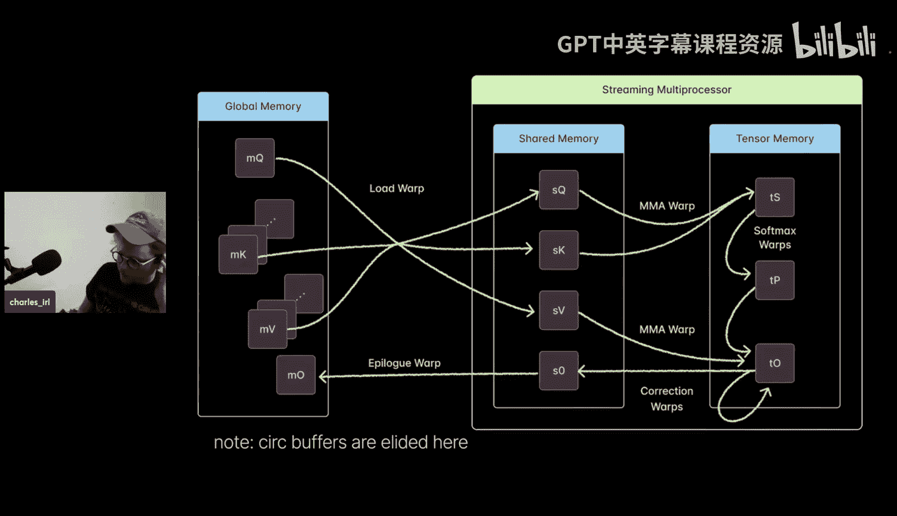

but it's not in the diagram， but we do talk about it in the blog post。Okay。

 let's talk software exponentation So the fundamental problem here is that the you need to do this exponent in your softmax right there's an exponent in there that's a transcendental function it's definitely not a MA mo so you can't use the tensor course for it and you also like the default way to use it is with basically you use like a PTx intrinsic function EXP2 like to take something to the power of2 and then you like multiply like convert it back to like exponentiating with E by doing like log2 of E so that's the way you would normally do it and that runs on these the like special function units that yeah that perform that in hardware the problem is that there are not that many of them I don't have a floor like like floor plan diagram for。

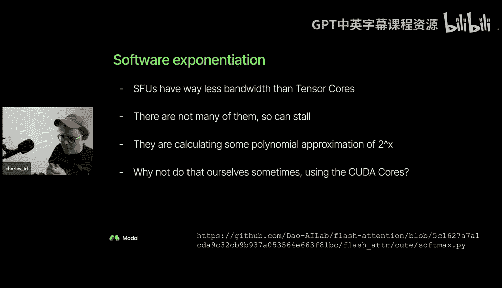

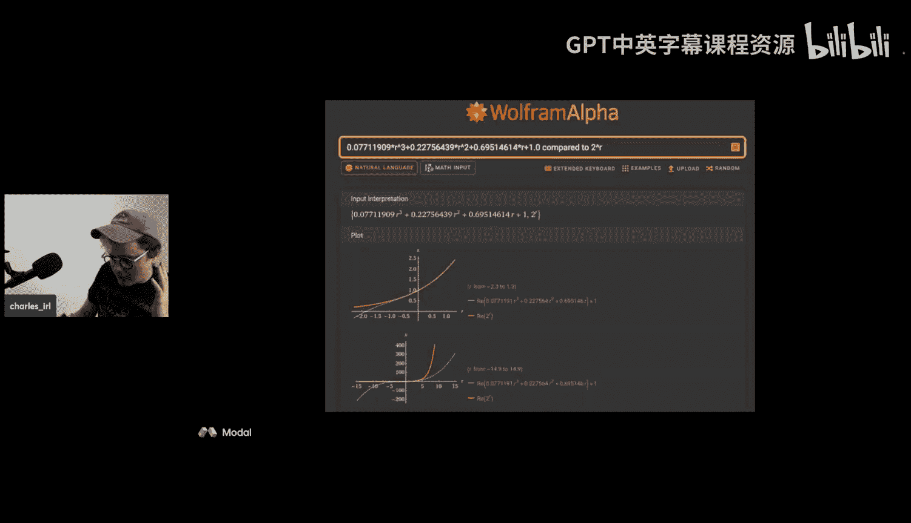

B200s I don't think one is shared by NviDdia but there's like not very like there're not very many of them and they like so it's not it's like it's fairly easy to end up stalled on the SFs。

So the SFs， though， like you can't really like， you know， with floating point numbers。

 like you can't really calculate the exponential of something。

 you calculate something that's like the closest floating point approximation of the exponent of another floating point。

So they're already doing a polynomial approximation polynomial approximation means multiply an ad right that's what the coa cores are for coa courses can do multiply ads and coa courses have like a lot of nice features in them even like like packed instructions that I'm not I don't think there's as much support for those like vector instructions on SFUs there may not be any don't quote me on that but so there's like there's like and there's a lot more bandwidth total in the cotic courses and like you and there are more of them like a little bit easier to do the scheduling。

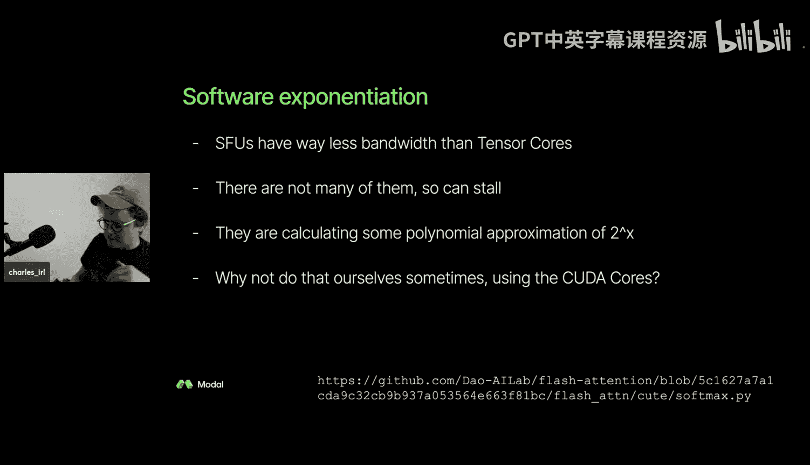

So， if we take a look。Here， let me pop this guy open in the soft max。

 Let me zoom in the way that this， there's like this neat little bit。

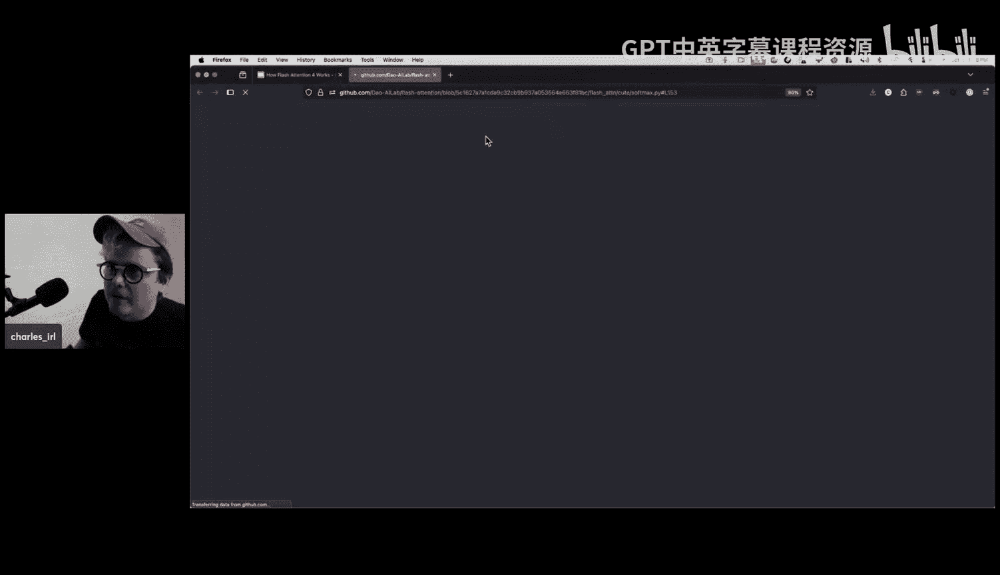

Let's see。 It's called， it's down here somewhere。Right， so the there's like a bunch of this like。

Cutless and cute DSL stuff here that's saying like basically， like I'm， I want to run。

So if I'm not using this new trick。Just do this EXP2 instruction， this intrinsic instruction。

But if the like when at compile time， somebody turned on this new trick。

 E to E assembly and end to end assembly。This。Like we check a couple of conditions。

 which is we check against a frequency and then we like there's a maximum amount that we would ever do。

 So we only do a certain number of them。 and then so like often we stick with just doing the the intrinsic。

 but otherwise we like defer over here to this inline assembly here。 So this here is some inline PTX。

And this guy， right here。This is the sort of like really important part。

 it takes some 32 bit floating point constants and tosses them into a 64 bit register。

 so like a vector like you pair of 32 bits in a 64 bit like vector lane and then it applies that that instruction。

Like on pairs of input values so of calculating two exponents at once。

 and it does that by doing like these threefuses multiply ads。

 So that's the if you figure out what these numbers are here and you compare that to two to the X。

 you'll see that that that it's a cubic polynomial approximation that's really nice on the range0 to1。

 So you handle that's the like rational part of your exponentiation。 the like the nonineg part。

 and the integral part is really easy。 it's two to the X。

 it's like basically a bit shift maybe not literally a bit shift in floating point numbers。

 but but yeah， so you have you have like one part to handle most of the scale and then the the the rational part you handle with this cubic polynomial approximation which I haven't I like talked a little bit with。

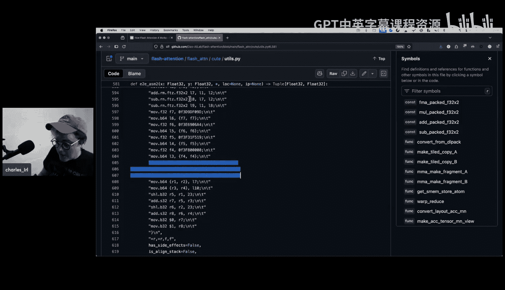

With Jay who worked on Flashten 3 J Shaw and he said that this gives you like bit identical results。

 so this is software emniulation of the like EX2 instruction so this this it's an approximation to the underlying math。

The hardware also does an approximation to the underlying math。

 and these give you the same results on 16 bit precision values。

So that's this software emulation and and the like technique in the code used to apply it only on specific iterations。

 So the fact that it isn't so we have a limit the one thing I wanted to call out from the code here I lost it again F count。

 listen and f limit So there's like you only apply this trick up to a certain number of tiles and then you stop。

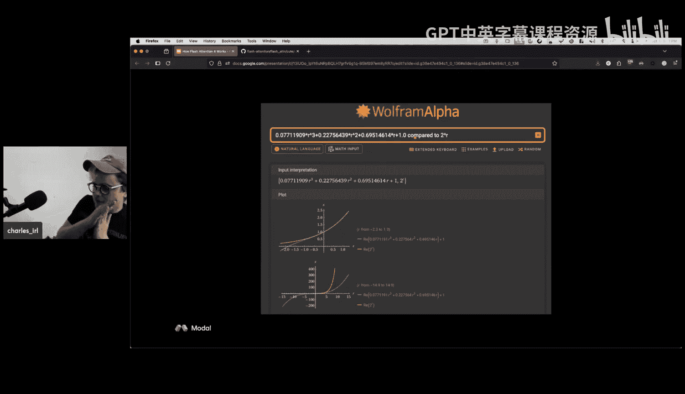

So my read on that is that you like in the middle， like at the end of your kernel。

 you have less work to do。 This is like a wave quantization effect， great chorus blog post。

 H he blog post about wave quantization effects。 So there's less work to do at the end。

 So you're less likely to bottleneck like at that point。

 you're not going be bottlenecking on the special function units。 So you might as well stop。

 So you don't need to do this like fancy extra trip。

So I'm sure we'll hear a lot more when three and others like write out the paper。

 but that's my read on why they're doing it in this particular way。

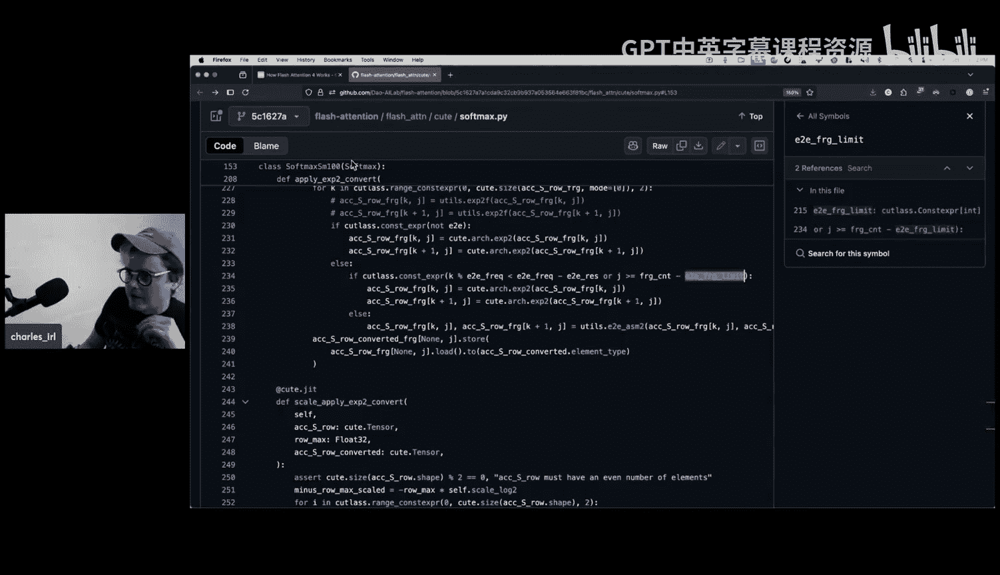

嗯。Alright， so that's one trick to make the softm faster。

 The other one is to do a smarter version of the scaling。😊。

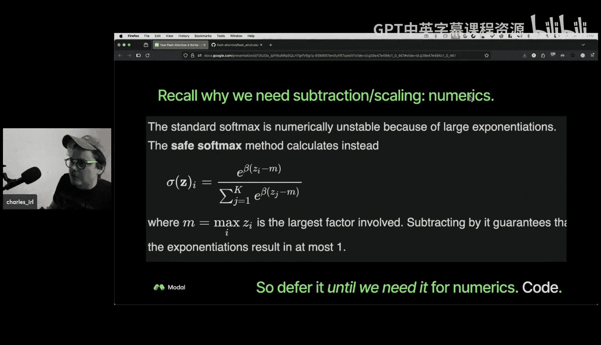

So recall the reason why we need to do this like why are we doing this like online subtraction of MA。

 it's not that we need to like online subtract the running Mac in order to get the correct operation is that we're doing this subtraction of maximum in order to do be numerically correct。

😡，But in order， like， but you know， we don't need to always subtract off the largest value to be numerically correct。

 We used it to make sure that the numbers don't get too big when they're expd。

And so the trick in the in flash tension4 is to defer the subtraction by the maximum until not only has it gone up a little bit。

 but it's like gone up enough that it actually matters。So the idea is like at the beginning。

 especially at the beginning when you're like querying the past keys you might see a bunch of like really small values and the maximum might change like。

 you know every single time every other time at the beginning but they're all small values。

 and then eventually you see some really big value because the like the attention mechanism has tried to attend a one specific key or like a couple of keys and then that's gonna to set your maximum value and then you know that's the last time you're gonna to need to do the correction。

 So maybe you only need to do it that one time。 and the correction remember involves this like coordination where you need to like like rescale the previous output values。

 So it's not it's like。It's not incredibly expensive。

 but it's coordination is always going to be like costly。

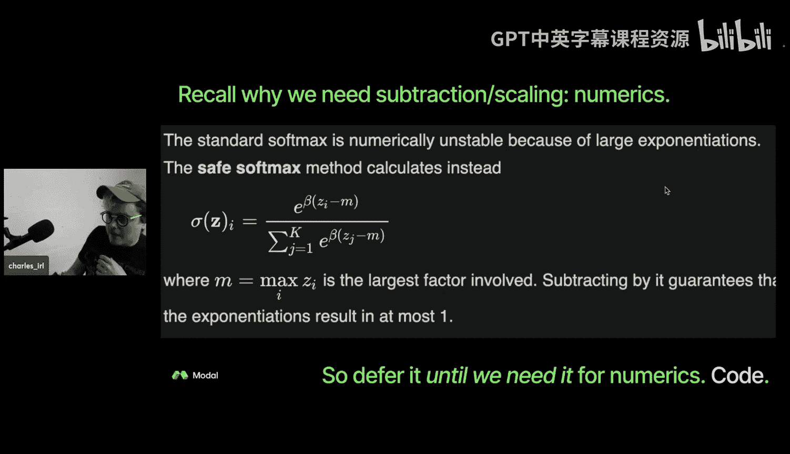

So taking a look at the code really quickly for that。

 the snippet is right here also in the like that same softm SM 100 class and it says。

You're calculating a scale based off of the difference between like the newax sorry。

 the oldmax and this like new Romax that you've calculated。

And then you just check that against this rescale threshold。And then if that rescale threshold。

 if you're like if the change is big enough。Then， you。Yeah， then you update the scale。And the way。

 just to show where that is done， let's see， where that's done for in the forward pass。Or sorry。

 in flash forward SM 100 ballot。Yeah， so then that value， if， you know， if that value is changed。

It will show up as a less than one value for the scale。

 And then there's this like all the like only one may have had to do a rescale。

 like only one of the warps that is currently running may have or sorry， Yeah， only one of the。

Threads， yeah， that's currently running may have seen a new value。

 so you have to do you have to do a warp wide check and this produces like a bit mask of how many of which threads in the warp observed a change in scale and then if any of them observed a change in scale。

 then you need to do a rescale。So that's this is that's the like core logic for this the actual rescale threshold you'd have to figure out like what is numerically safe so that'll be another thing that I didn't see that anywhere maybe I missed it like what what that number should be set to I think is' by default turned off in the in the open source code online but yeah the the the。

The calculation is based off of numerical correctness for 16 bit brain float values。嗯。Yeah。

 and from the hot chips talk， setting this parameter appropriately gets you like up to a 10 x reduction in the number of times that you need to apply the rescaling。

 which is pretty nice。

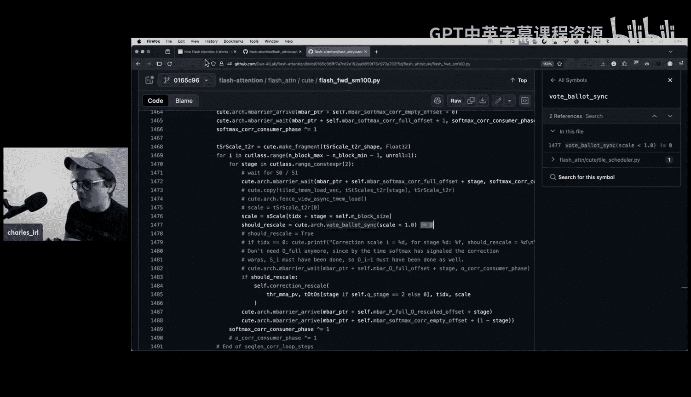

嗯。So。One thing I I do want to note like this， there are some other open source blackwell kernels like Coie and N is closed source。

 the black the back end the kernels， but the。The fuse multied attention from the Nvidia cutless repo has the same warp pipeline。

 like literally the same names for them， the same index。

 like warp index assignments So like very similar async pipeline。 so definitely like， you know。

 flash attention gets a lot of attention because it has been the fastest kernel multiple like state of the art multiple times。

 But there are other places to look to find like more tricks and more approaches to you know。

 to programming fast kernels for blackwell and you know， even giants stand on the shoulder of giants。

Okay only I'm happy to stay a little bit longer to answer questions。

 This is what I think a lot of people have been asking questions about。 So it's like yeah。

 what does this imply about the future of kernel programming like what's next one kind of funky thing that I noticed is like if you think about the way CPU async works it's like you kind of jump around moving like there's a packet or like a request to a web server that you need to handle you kind of jump around between requests in a single thread being like okay yeah add the header to this one remove another header from that one read from memory okay now put it out on the NIC like that's how your CPU async works GP async like this one you instead and and sorry and if you look at like the way Ruk works in particular。

 this is like implement as a state machine there are states that are all of your await points and then you move between states like in each each。

Time that you like pull that thread to see if it can make progress so that that like state machine approach is kind of also present here in that there are a sequence of states that you move through but now instead when you write a warp like as Mark put it like yeah you have these like if warp index is this then you like run this step and if your warp index is this then you run this step so you end up kind of writing something where like the program stays in the same place like the program implement one transition and then the like data moves between sort of instances of the program which is like pretty different and like kind of interesting like if you're computer science person so that like this program models like pretty different means we like probably need to think about asynchrony pretty differently in GPUs then it's been thought about in CPUs yeah。

But I think maybe the and like one of the big takeaways from this is you're like managing all this stuff yourself rather than having a nice interface like asyle weight and so it feels like GPU programming for you for NviIdia GPUs for mat mus needs like a pretty big update and there's lots of people who have kind of seen like oh yeah we've got this tile centricity here like you don't you aren't like doing fiddly things between like elements of the tile or across tiles you've kind of come up with this like clever way to break your program down into chunks。

Maybe it's like the way you get really big scales you take something that makes sense on a small chunk and then you like run it embarrassingly in parallel or you run it as a big scan across tiles。

 like that's how you end up with the largest scale where you can actually really make use of the amount of RA and the amount of memory bandwidth and the amount of arithmetic bandwidth that the hardware now offers。

😡，So lots of people have seen， you know and developed this tile programming model and are building something that is a different programming model from the couda programming model。

 this very threadcentric model to this tile centric model and there's some great talks by like Steven Jones。

 Bryce Lbach from NviDdia about this mostly focusing on Q tile NviDdia's upcoming like I think early alpha still tilebased programming DSL and I think my sign that my signal that I see that this is really serious for them is that they've built it doesn't go through Ptex the like existing assembly or IR that we looked at for the software Exp it's actually a new IR called tile IR that gets compiled to SAS directly and as far as I know that's like not been done in the history of CUa So that's like pretty that's like a indication of like a pretty big be and then Triton is like the similar。

Approach from open AI based off of doing like LVM IR representations and like progressively lowering them on that front。

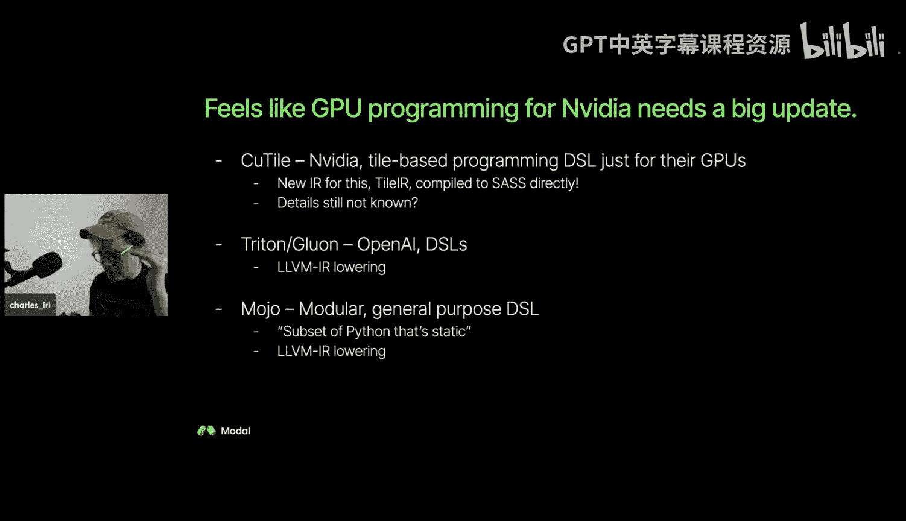

People probably may maybe have seen this， but actually bought in in an attempt to。

It appears the Triton folks have kind of given up on getting to the like the speed of something like flash tension 4。

In in Triton and have introduced instead a new like backend called gl on that allows them to like handle warp specialization partitioning。

 handle the like scheduling the synchronization trip。 So you know。

 having these like circular buffers all of that stuff they like found it too hard to express in Triton。

 And so they put out this glue on。 And if you look at the reported numbers that they give for their 16 bit Colonel。

 this is early numbers still， they report about the like co and N performance for FP 16。

 so with this like gl on。Back end so a lot more detail from from from Jeff on the like open AI Triton land in that link to YouTube video。

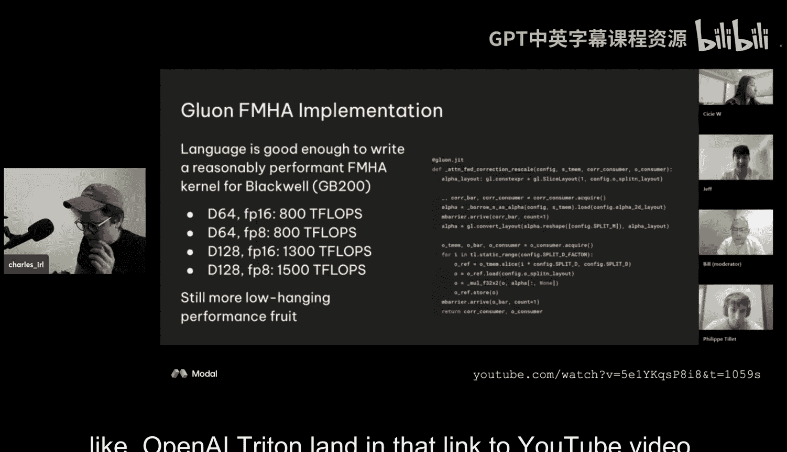

So that's kind of a sign that of just how hard this is。

 it's like to express to like write the right programming model so that programmers can write their programs in a way that it can be compiled to this speed。

So like this means like some very exciting times for high performance computing for and for。

 you know the compilers and programming language kind of work that makes that high performance computing accessible。

嗯。So yeah， we had a lot of questions related to that that came up。

 so let's maybe time time to talk about those and other questions just really quickly since I'm on the clock here worked on this as part of my work at Moal we're like rewriting the stack from like the container level on up to make GPUs go Bt and to like help like S lovable and others serve these things at a super large scale or hiring Moto。

 cocas if you liked this you'd probably like working with us so yeah。All right， thank you。

 I guess there are a ton of questions。 I can start with the chat ones and then。

If we have time we'll keep going， I think some will also just come in so I guess I can start with the the broader one。

 which is。嗯。Do you have any local measurement on basically。

 I guess the amount of time that each part of the flash engine 4 kernel takes because it seems like a lot of the warps are doing softm related stuff and also just from the talk。

 it seems like a lot of the focus was on that too and on these specific instructions So yeah I guess so that's actually pretty important difference from the like Hopper kernel right from the flash engine 3 kernel that one like the matrix multiplication was like really hard because you have to do the warp group MMmas And so there's yeah。

 there's a different allocation of warps here It's actually maybe easiest it's identical in in flash engine 4 as it is in this。

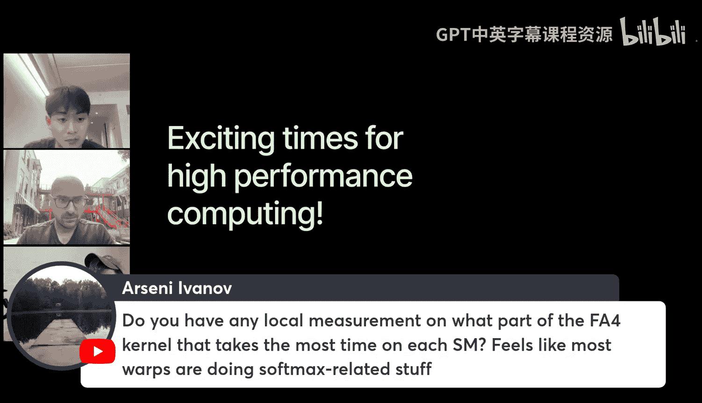

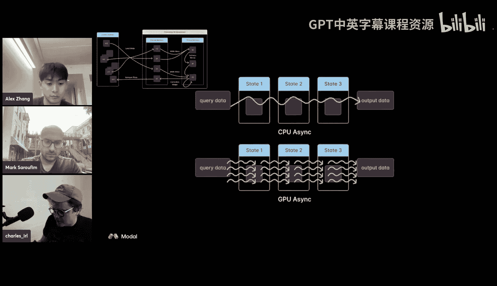

The cutless example， there are， yeah， there's two set。

 there's like a soft max warp warp group per circular buffer or per entry in the circular buffer。

 like two， two entries and then only one warp for the MMA。 So that's actually， yeah， sorry。

 I should have zoomed in on this part here。Right so the first four warps do softm for one of the two like tiles you're working on。

 the second does it for the next four， and then the correction is another one that gets a whole warp group。

So the， I mean， the good news yeah， is like the map。

 it's now possible to like drive of the like tensor cores like with a single warp to respectable performance。

 Yeah， then yeah， So the question was， yeah， oh yeah。

 so we don't have local time like timing measurements precisely for that。 We like， yeah。

 we like ran it， but we didn't do any like ablations or precise timing。

 So I don't have anything to say on that。 I would like。😊。

My gut is that a large fraction of the wall clock time。

 if you were to like just like look at a trace and like have all the warps like what， you know。

 what are they， what phase are they in， you would see a lot of it is spent with the softm。

 but that's more intuition。I see Another question was from earlier， which I should have asked。

 which is basically like for the。The rescaling kind of trick for the softm， they're asking。

 why is like checking that you should actually apply the rescaling factor。

 not more expensive than just rescaling。

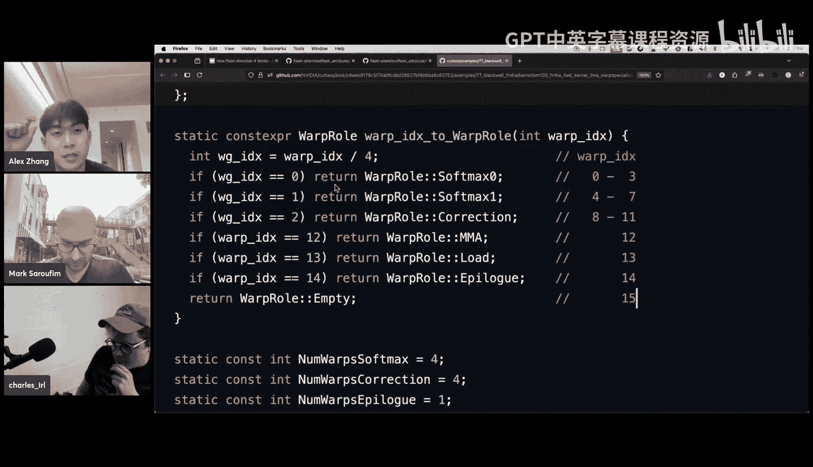

Cause it because。So checking whether you should apply the rescaling factor happens in。Sws。

Applying it happens in the correction wars。And so you have to determine that you need to do the rescaling。

 then signal the correction warps， do the rescaling， and then actually the softm warps。

They can maybe do an update， but like at a certain point。

 you're going to have to wait for that correction to finish before you can proceed。

So it introduces coordination overhead and a synchronization point。Makes sense， yeah。嗯。

And I think the last chat question until unless some others come in are in your view like where do compilers still fall short。

 I think you touched on this a lot but yeah I will say like I'm not I'm not a huge expert in the DSLs and and like things are changing so fast that I like don't want to say too much more than what I said already。

I don't know I've also been recently looking at how GCC works just to like， you know。

 going through a bunch of C programs and seeing what it does and people did eventually figure out some pretty crazy stuff with like with with compiling C programs so like my。

Yeah， my estimation of what a determined compiler engineer can achieve is pretty high。

 but there's also like that's because like X 86 was like like fixed in stone by Intel and then like not changed and they did a bunch of work in the hardware to make things faster and then like see the language was like fixed in stone and like didn't change。

Like for long periods， right， and the that's just not the way things are working right now。

 And so like you you， you， you know。The compiler engineers have to work really。

 really hard to like figure out how to do something with a particular program mode or a particular hardware model。

 And then if it's like different， like who knows what Rebeen is gonna hold like probably a bunch of crazy shit。

 And like now like war groups are just like kind of gone。

 They like don't matter as much anymore from hopper to Blackwell like。That's， that's a big change。

 And so I'm a little， it's maybe like the problem is hard。 And like， Mark， Mark was like， yeah。

 a year。 Like， that's enough time maybe to solve some of those problems。 But it's like。

 what new problems are gonna to come up a year from now， yeah。

So I couldn't agree more like and I would add like a few things here。

 which is that like we're definitely sort of like I mean the sort of TLDR to the question of like how are compilers doing versus custom kernel DSLs。

 I think like right now we're like custom kernel DSLs seem to have the advantage like in this like like in today's like hardware environment。

I think a lot of it comes down to like the amount of effort you're willing to put in like if you have like a few minutes or like a day to spend making things fast you know nothing's going to be a compiler if you have a couple of days or maybe a couple weeks maybe try and if you have a couple of weeks a couple of months this is where like DSL matters and you know for problems like flash attention for a few months is like totally acceptable amount of time to spend like on this stuff。

But yeah， like the programming models are getting wacky so yeah， I would personally。

 I'm betting more of my time on the custom kernel stuff is because they make it more predictable to figure out what got fused into what。

And I think today this really matters like you're basically like you're never asking yourself was this optimization done well like of course it's done because you called the intrinsic or like you  fu the code yourself but with a compiler you're having to guess and I think this is like an un idealal experience if you're doing blackwell work today yeah。

上次。This is actually a question I had and it just popped up in the chat basically like what are the main differences between algorithms for Hopper and blackwell and I think this is important even like beyond flash tension because。

Now， like I think kernel writing is a lot more popular and there are a lot of other like even in M domains where like you don't use attention like you would use some other kind of maybe similar。

 maybe maybe not similar operation that probably builds on map Mo or something else and like where like。

Yeah， I guess like from what you've seen， what what are the bigger differences？Yeah， okay。

 so the most important thing to recall is that like there is matms and there's everything else。

 right， Like there's tensor cores， which just do matms and like have consumed lots of silicon area over time to do that faster。

 and then there's everything else。 so and then， and they and they do。

 if you look at the like floating point operations they can achieve for that specific Excel like operation。

 they achieve 00 x throughput。 So to some extent。😊，Like the only thing that's changing is matms。

 There's like the the like loading the data for Mams also changes with the with like the existence of tensor memory for instance。

 But yeah， so it feels like， I mean， first， it's way simpler。

 Like even just gring how the matms were working in hopper kernel was harder。

 then in a blackwell kernel I feel like I don't have a link to the code that I can pull up like immediately。

 but it's basically just you just find this place。 There's a Tc Gen5 do Mma call。 It's like you know。

 there's a leader thread for it， which is a little annoying。 but like other than that。

 it looks very much like the rest of what you would do。

So in that and like compared to what what happened in Hopper where you have to like set up a warp group and then maybe multiple warp groups coordinating on a Mamo。

 that's like， yeah， because that is actually like a pretty big simplification。

 which is a nice thing to see in an era where it feels like so many more things。

Are being pushed by like the speed of development and the like demand for additional performance that things are getting made like messier otherwise。

Yeah， but。啊，没。Yeah， I think yeah， that's the most notable thing to me。 I don't know if Mark。

 if you have any other thoughts。No， I think that sounds right to me。Yeah， yeah， for everything else。

 I mean， the coa cores are still coaing。 you know， you can still run。

 you can still run pretty similar programs on them， so。Yeah， but I guess it's actually like。

 maybe what I would say is like as this component gets so much faster。

 it starts to become like imperative to rethink your algorithms so that they work on it。 It's like。

You know。Like people are changing the transformer architecture a little bit。

 they're like tweaking it for like multilant attention and like multiple next token prediction and speculative decoding。

 all these things are attempts to get as much Tensorco friendly operation as possible in as many like places as possible and so it's really like yeah like the long termm arc is like pulling GPUs over to being truly like just a mapmle machine and not not as much of a generic parallel processor。

Cutture， yeah。It looks like there are no more questions， so I think。

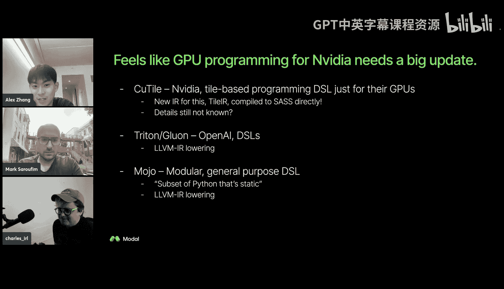

Unless you have more stuff we can just end it here Yeah。

 thank you so much for for having me Alex always love love GPU mode thanks Mark our illustrious founder co founder and yeah hope to see you all around。

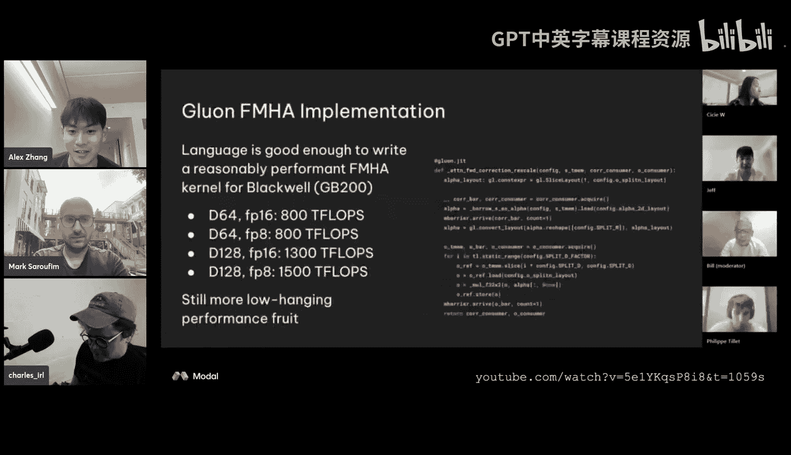

Thank you， Charles， you welcome back any your time， Thank you so much so much。Take care， everyone。

