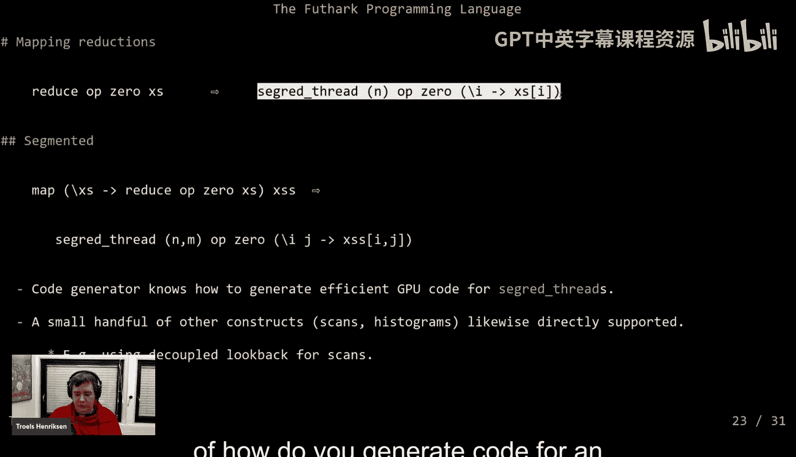
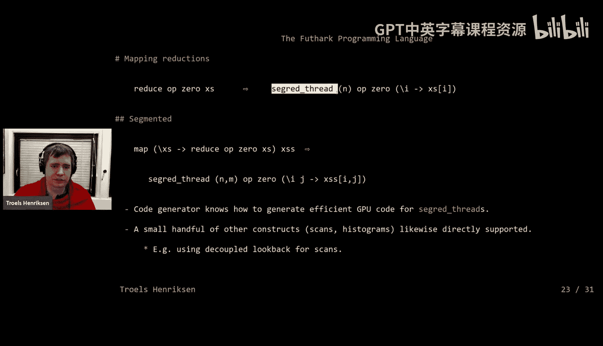
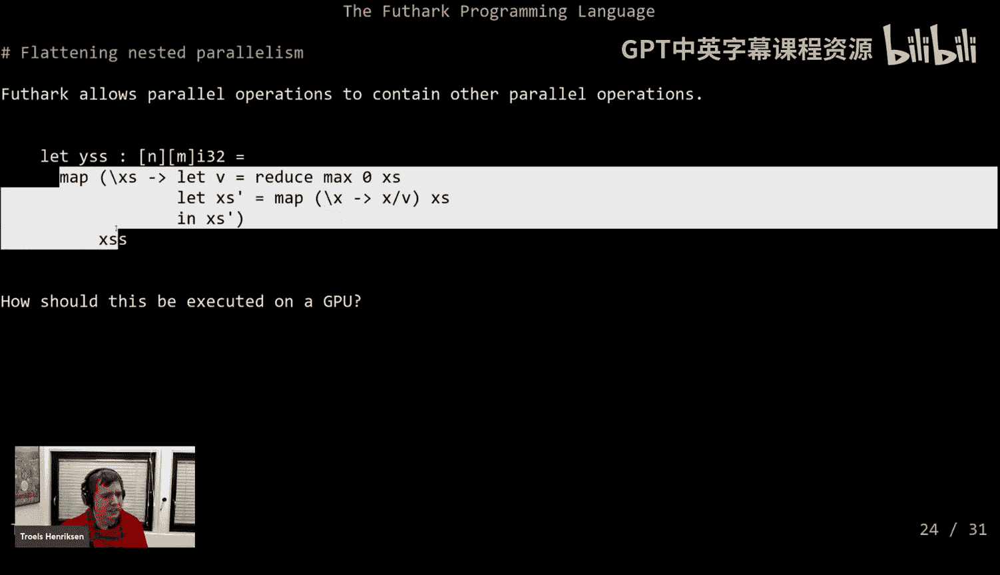
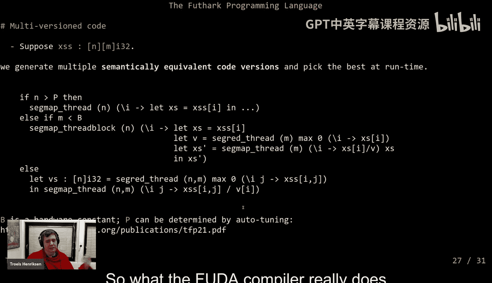
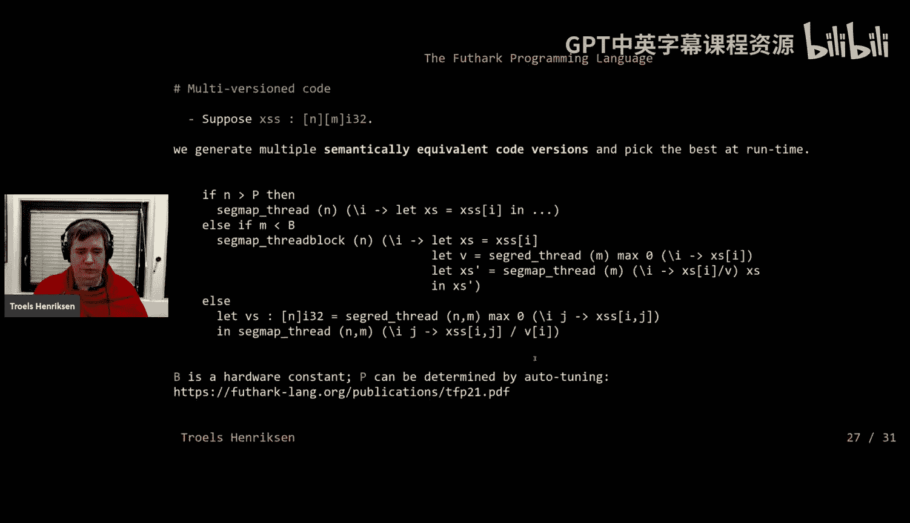
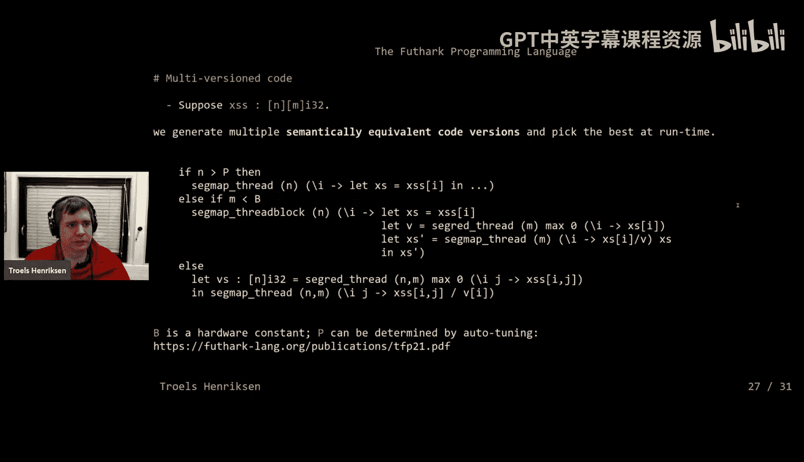
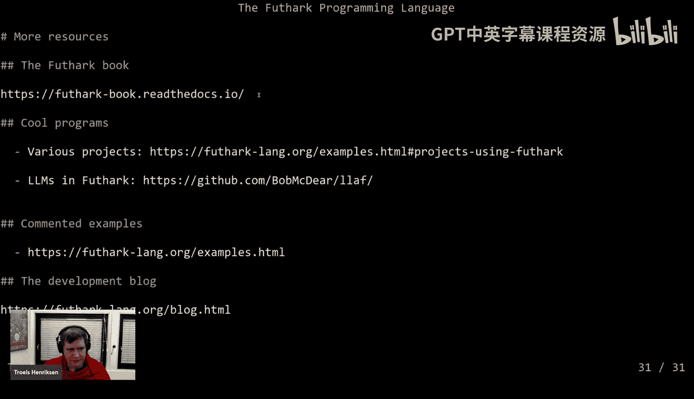
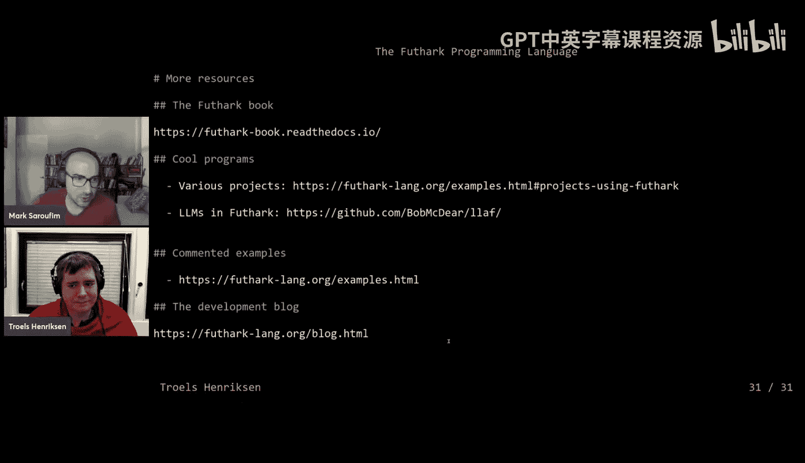
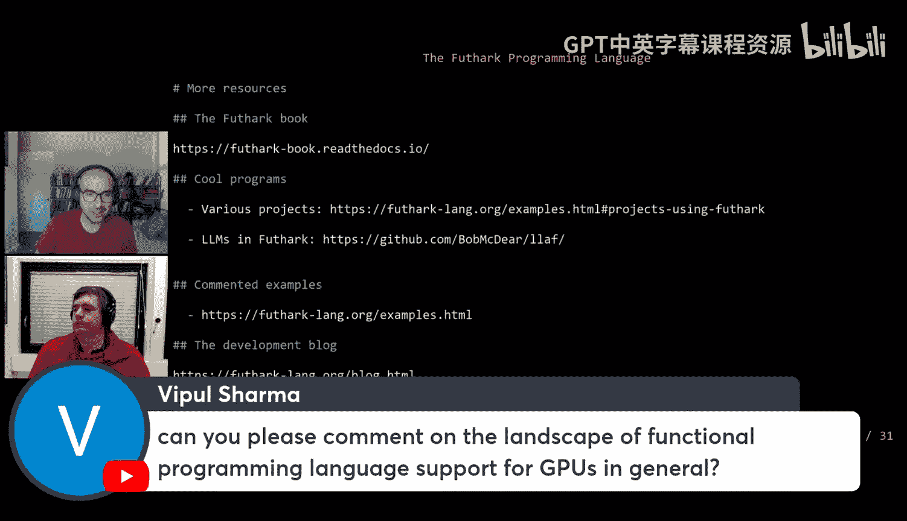
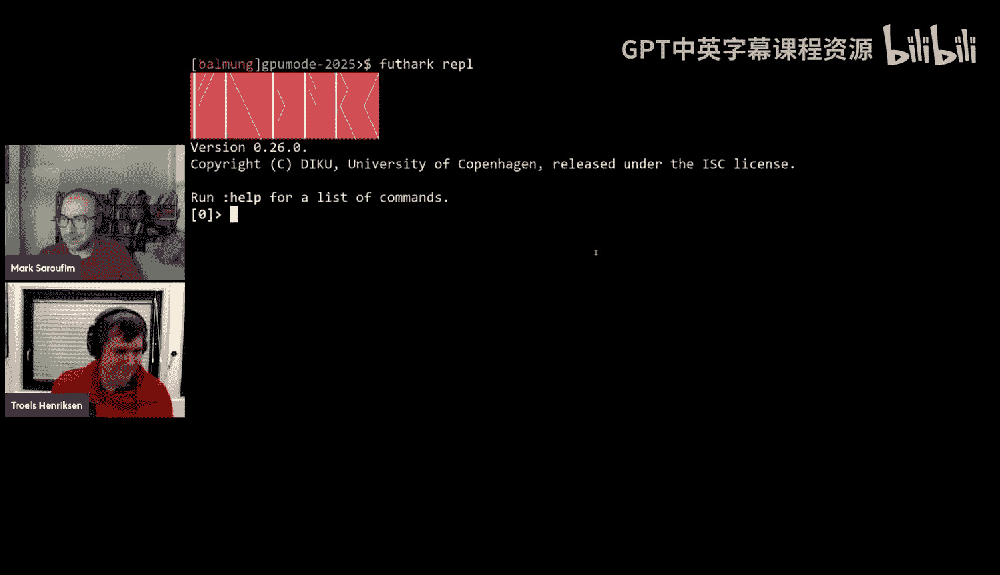

# GPU MODE《CUDA、GPU编程54-87｜GPU MODE》中英字幕（deepseek-v3.2 p28 -20251004-Lecture 81_ High-performance purely functional data-parallel array pro -BV1xbmQB3ETC_p28-

All right welcome everyone to another episode of GPU mode today I'm really thrilled like for what it's worth by popular demand to invite like Charleslls Enrisson so trollles is one of the main authors of a programming language called Fuharrk which is like a very sort of。

😊，I guess if you look at the possible spaces of programming languages have in GPUs like Kar is like a very very unique take there's tons and tons of like academic papers written about it that you can go like check out on the website but I figured like Charles could give us like a nice crash course Trolls also informed me that he likes to be interrupted so if you have any questions please post them in chat and I'll be sure to interrupt them and thank you and Charles please take it from here thank you so first of all I want to emphasize that while I do most of the PR activity for who the to use a very fancy word is really a group effort I wasn't even the one who came up with it that was Cosmin Wan my eventual PhD advisor at the University of Coma。

Who and there's a bunch of other people in particular of students and open source contributors who have also contributed since then。

 but the genesis behind Fua was as part of a project for high financial high performance financial IT because the banks were kind of bankroll a research project and the goal was to come to come up with language such as that domain experts could write high performance financial models for pricing things because apparently it's very difficult computationally to figure out what things are worth in finance I don't really know much about finance I learned a little bit than I forgot it when we stopped working on that specific domain but the outcome of that was that we found that there wasn't at that point a language that was high liberal enough that a domain expert who was not a hardware expert would use it。

And that was also fast enough to compute what things are worth before the regulators came and asked what they were worth。

So that was interesting and we did that by kind ofversion engineering GPU kernels well we wrote some GPU load liver code for various financial problems and then we thought about well what should how could a compiler have generated this code and then how should the input language that compiler look like。

 nor would that compiler work out and that eventually became fuile。诶。

So my agenda for this presentation is how we take Parch。

 which is a high level language and I'll discuss in some detail and how we translate that to GPUs。

Fther is kind of is a broad research protocol we focus on many things。

 also on algorithms and type systems and kind of the parallelel programming in the large。

 but since this lecture series is called GP mode I'm focusing on H GP aspect。

 which is certainly an important part of the research。

 but is actually not kind of the original driver。So briefly。

 just in KF for those who do not know Fuza which consider that it's an academic obscure language from Northern Europe it's probably many of you。

 I'll give a brief introduction to how it works and what it looks like so it's a standard of language it's not embedded in any other language it's in the ML family and why I come from MLL means the family of languages from Milna's original Edinburgh ML it means functional language not machine learning but I guess for Fua it will actually look be both。

So it's very similar in structure and synax and fields as language such as O camera。

 standard Mel and Heskell and F sharp and Sca and all。

 although it's a lot simpler which I'll get to it has some fancy features like size dependent types it also some standard features like parametric polymorphism and high oil functions although with some restrictions that I will also get to and。

A lot of the vision is really that the language is not supposed to be particularly weird。

 one of the research challenges or questions that we have posed for ourselves。

Beyond the initial thing of helping some pans write fast code is that we had this idea that that writing parallel code and even efficient parallel code ought not to be particularly difficult。

 it should be doable in an language that is not more complicated。

Then what we normally teach like first year students we teach functional programs or first year students and many universities do that and that works out fine。

 And we think para programme should be easy enough that a first year student can do it Now that doesn't mean that the language is meant for in experience programmers in practice the people who have the kinds of problems that are like food is suitable for tend to be pretty experienced programmers to complic things with high computational requirements but we think the language should be simple so that they can focus on the complexity in their domain instead and of course it's a resource project so。

It's not certain that we will succeed or that we have succeeded to the extent we would like to。

 but I'll let you be the judge of that and I'll also mention a little bit about that later。

So having being a pretty standard function language， Futak has some building in what we call comps。

 ZX， because the second order， which to the user just looks like second normal and high order functions that are very similar to what you would find in a normal function language things like map very example here。

And map， you give it a function from A to B， you can be any A to B， it's polymmorphic。

 then you give it an array of A's， an array of Ns， this is how we write a。

 the type of array furthera， and then you get back an array of NBs。

 so you can see here that map turns the A's into the D's and it doesn't change the sizes of the argument you get back an array of the same size。

And this is really just a map that you would find in any modern language， I mean。

 I think most languages have have a map now， the difference is that in many languages。

 even language like Heski and MLl map is just yet another library function is written with thecurion and so on And who that map is really something that the compiler knows about it knows what the properties of map and it is able to transform users of map and eventually use that to generate parallel code。

And'll and I'll explain that in some more detail。 and there's a handful of these so called showx。

 these per combators like that's a reduce， which is。

Like they were Jewish you would find many other languages。 It's also called fold in some language。

 There's a difference between fold juice in the type here。

 and we also require this function you pass in here。 there's a function of two arguments。

 it must be associative So you can generate parallel code from the reduction turn a little bit to that and you have scan and a few more。

 So there's a small handful of functions to the program look like functions but have special parallel meaning to the compiler the compiler can reason about。

 And then ultimately you build your programs as compositions of these primitives these are at the bottom of level。

 but that's all these nice features para polymorphes and how functions So you can build your own on top of these。

 but ultimately these are what the compiler will reason about and that's not that many reasons are also get into。

So what's it form， there are lots of very nice languages that I use that are very pleasant to use for practical programming。

 I like has a lot myself。And we didn't release this it out to supplanned any of those because Hua is not a general purpose language it's a pure language it has no side effects。

 you cannot write to a file or read from anything or connect to something on the internet。

 It's a pure language you can only write functions that operate on their inputs and the terms of result。

 you cannot in with the world in any way， so you cannot write applications in it。Instead。

 the idea is that you take a food that program， and then you're compile it to a library。

 and then you call that library from some other language that can actually interact with the outside world through some foreign function interface。

And Fag itself will generate either C code or Python code and provide either C or Python interface。

 which you can then call from any language I can call C or Python code。

 I would say except for Python， most languages go through the C interface and there are some bridge you can use to make that a little bit more pleasant so it can be pretty pretty economic。

 but you really need some other language。So to kind of help food like actually we get something done。

 it really is not for writing applications， it is for writing libraries。

but there's some tools we been you not much write small applications in sort of food like itself。

 but it's really not that's just most photo demonstrations and examples。

Now so apart from not being general purpose， it's also not really GPU language。

 which may be a bit surprising given that I'm holding this presentation at the GPU Mo。

But again the research perspective mentioned remember Fuar。

 we try to make it a practical and useful tool， but we are also academics and that means we have to。

 we are allowed to dream a little so that did a dream of Fuar。

 they said you can write code in a way that is high level and data perel and without worrying about the hardware and it's disimistic so we can have no risk conditions。

And then a compiler will make it run fast on the parallelel machine that you actually have available。

 which could be any parallelel machine because the language itself does not require you to program directly towards H FT features。

Now， of course that means someone has to actually pay the pipe and find out how to make it run fast you have to provide a compiler for each machine and of course we don't have a good compiler for every single pair of machine that has been built our best compiler and the one we put the most effort into is whole GPUs have we have three different packets Kuda H and home shell and we work on Web GPU as well but。

But that means that food that will run pretty well on GPUs and to some extent on multi CPUs。

 but it's not optimized， but the language itself is not GPU specific， it's not a GPU language。

 it just has a GPU compiler。It also is not particularly useful for graphics。

 I mean you can write graphics programs in it because it is nothing prevent you from creating an array and interpreting that array as a array of colorss。

 but it's not for writing graphic shakers， it is focused on throughput。

 not on latency and while you can have whoar program that runs fast enough to produce real time graphics。

 it's not really。It's not really meant for it， it is a little bit painful and not really what it's meant for。

The compiler is pretty complicated， it's quite large。

 it's 100000 lines of Haskeki and hasski is a language where you can get a lot done in per line of code。

 so I will not talk about all that it does because there's a huge amount of time5 things that it does in order to get the code code running at all in also to get it running well and a lot of it is not super interesting and it's very timecon to explain so I will most be focusing on kind of the highleve idea of how further that goes from highleve data power code to lowlevel GPU terms and also what limitations we have because we're not doing everything perfectly of course。

And you should also set your expectations。 Fu， I think is a pretty good language。 I like using it。

 and it also produces code that is often fast enough。

 but it will not outperform expertly handwritten GPU programs。

 So a lot of the other lectures that you have in in GPU mode that I've seen。

 have been about all these kernel languages like like Triton， for example。

 which are very low level by Fu extend， and you can certainly write tri and code that is much faster than what you can do in Fu。

Because in food that you cannot directly program the hardware。

 you cannot directly access hardware features that up to the compiler and the compiler is not as good as an expert GP programmer。

Now， of course I would argue that FA is easier to program it than many of these modern kernel languages in particular if your main goal isn to get a matrix multiplication or something running as fast as possible。

 but if you're prototyping new parallel algorithms and you just wanted to run faster than if you wrote it or give sequentially or it has some other very high level language。

So Fuag is fast for the kind of language that it is for the kind of high level function programming that it provides。

 it is not fast compared to real low level languages implemented by expert。Now， in my experience。

 most GPU code is not super expert written and foods that will definitely be GPU code written by someone who is not very good at writing GPU code。

 which is many programmers。And one other very important thing food that gives you is it optimizes the composition of things。

 so many of these other languages that makes it very easy to possible to write very high performance kernels。

 they don't make it very easy to write high level components that you can combine together and then guess also expected that result would be fast。

Whereas FuAag is supposed to be a normal language in the sense you can write libraries and reusable things and plugl them together and then compiler will try to remove the overhead of having written things separately so you can write normal small modular components that are plug together and still get good performance that that's one of the one of the kind of advantages of using a language like Futhag。

So I mean， I usually phrase it like it has to be faster than everything that is more productive and more productive than everything that is faster。

 but I think pretty much every language tries to be on that curve because otherwise it is just worse on something else。

And the difference really is just where I'm a carefulfo I tries to be。

It doesn't aim for maximal performance on GPUs because then we would have to go on for a more loadable GPU language。

 It goes still for maximum performance with a constraint that the language would still be hardware agnostic。

 but that also makes it interesting how we actually map these highle concepts to to GPUs。

 It's not a goal to taking over the world。 We kind of do write everything and that's fine。

 I like many other languages as well。So you only use it for small performance sensitive parts that might be more than one kernel。

 as we will see it a through that program might turn to several kernels but it will still be a fairly small part of a large application usually。

Okay， so let me show you some example of Fua code just to get an idea of what FuA programs look like and how they they feel。

 And this's part as to can idea of the syntax， which may be unfamiliar to some of you。

 it is a very conventional syntax from a functional programming perspective。

 but if you're not a functional program， it will look a little weird。

So this is an implementation of softm。The first I have a define function。

 row softm for computing the softm of a single vector。ri like this。

 I don't have a size here because I don't care about the specific size here that'll be inferred by the compiler。

It's a vector of single position floating point numbers。

So the first thing I do is that I find the largest element of that vector with a reduction。

And so in food， as know as in many function language of this kind。

 we do function application just by putting a function external argument。 We don' only need prefers。

 So this is applying the function reduced to the three arguments。 if 32 max， that's a function。

 if 32 are lowest and an excess。 So this does a reduction whether it's a neutral element and this is the operator。

 So we are finding the maximum element of of this excess。 Of course， in a real program。

 that is a function that is just find the maximum element of x they reduce instead。

 writing it using the the fundamental components reduce。 So you can see how how it goes。

Then we get back x， the max x， which is just a float and F 32。

 we can then map on top of the original x。For each element of that， vectorta x。

We cannot run some code that produces a new element。 in this case， we take x， we subtract max X。

 and then we take the exponent， and then that is going to give us a new array X of also of this type。

 that doesn' that's not visible here but it is an array of an vector of F that choose。

Then finally we sum that using a reduction when now we use the plus operator with serious neutral element。

 and then finally we divide every element of this x array with with the sum。

 So that is softmax and a vectorta to then do softmax on a matrix we just。Take all matrix here。 M。

 which has two dimensions， and then we map the row soft functions， the row softm function on M。

 That means on every row of M。 we apply this function。 And you can see every row as this type。

 The function accepts something of this type。 That's the same thing returns a new row or vector。

 And that means that result of the map。 will'll give you a practice。

 So this also show how you can do proposal programming。

 You can write a function operation on a single element or a single row。

 And then you can easily map it on top of all of the rows of a multidimension array like so just with map。

 So that is that is composition。 And then up the compiler to figure out how this can how this actually turns into efficient do code。

As another example is matrix multiplication， which I have heard many people carva。

 I can you have a ty here， this would be the same type。

 So first I I define a function that product that takes two vectors。

And then I do a element wise multiplication of those components。

 so the first element is multiplied to the second element and so on using a function called map2。

 which is just a library function build of all the fundamentals of Mac function。

 So this is something that you provide yourself it's just simultaneously mapping and two ratess at the same time and then you sum those of that that is just that product。

Then to define the major multiification。As I that these should be F64s。

 hybridposition of precision of integers and to define maximum application。

 we can write that as mapping over the rows of the a matrix。

Then mapping over the columns of the B matrix， and we do that by mapping over the transposive B by default food assume row major or by transposion B。

 we can con the column major， we map over that， we get a column of B。

 and then we just take the dot product of the row of a with the column of B。 And again。

 we are able to reuse the dot product here down here。

And another interesting thing here I said this was to my focus。

 butza does have this nice little size type system。

 We can see that this function here is paraized over three types sorry three sizes。

 these are not things that the user will pass explicitly you can see when the use dot product we don't pass in and end here we just pass in the actual V Now these here are use for expression constraints on the function arguments dot product。

 for example， it is used to enforce that the two arguments must have the same length because definition of dot product requires that for Mad will we require that the number of columns of of a must equal the number of rows of and we get back a result that that is the number of rows of a by the number of columns of B So you can kind of express these fairly common constraints are written in the type system and if you write a program that doesn't obey these constraints you get a type error than a runtime error this is something that is really less when you're doing about each stuff and really。

面是就。The compile computer complains about your code long before you run it， which which is nice。

Finally， this is nothing really to do with view program of parallelism Fudaag also supports a standard functional programming thing so you can define a type for an option type of that is polymo in some element type A and say whether an option is either some a or it is nothing。

 this is just an option type or maybe type or whatever it's called other languages and then you can use it for example to define and a safe indexing operation where you give it an array and give an index and then depending on whether that index is in bound。

 you get back either some or on So this is just to show that that fudaag is highly different enough that you can use novel functional programming techniques some types and so which is very convenient。

And for some applications。But there's nothing we to do with parallelism。

 this is just a natural feature。Okay， so who that knows a lot of things that are pretty standard up function language sorry enough to I have a buncher questions。

 that's okay， but if you want to finish your train of thought that's okay okay。

So the first question I had is like if you could go back to the Maimmal slide。有。As yeah。

 there's the logistical question someone in shot is asking if you can make the font bigger。

 presumably not because these are images。I can wonderful。Yeah。

 so this is I just text this is wonderful thank you so as I looked at something like this and I was like thinking。

 oh， like let's say you're trying to implement something like swizzling。

 like presumably that's like yet another function and expressing layout transformations it's quite easy with a programming model like this。

😊，Yes， yes， whistling， that's just I mean changing the elements of a vector and array from product's perspective。

 because are real challenges can you map that efficiently to hardware。

 but seman there's no challenge in running whistle operation。I see the not indexing。Okay。

 and and so like the other question is like I mean you obviously referred to other programming languages that are like one of the things you mentioned is like FuArk is a pure language and so the main thought that popped in my head is like well how do you deal with determinism and randomness because like at least like within like the Quta ecosystem like most Kud algorithms will not be deterministic by default。

 is this like something you care about is it like a property of the emitted code or is it a higher level property that you need to reason about and anything that？

Yes， so the language itself is completely deterministic if you ignore certain things like if you do a summation on floating point numbers。

 it doesn't specify the order so you might get some nonsimistic number of I think that but apart from stuff like that。

 it is fully deterministic， which means if you actually need randomness。

 you'll need to use a standard function programming tricks to get them。

 which usually involves manual management of a random number generation state。

I see you do that in a very conventional way in the actual way the field of programming in Fua is very similar to programming in something like OC。

 the pure subset of Oca。Okay， I see。Okay， I have a few more questions but maybe we'll go through them later Thank you yes Okay so but none of these features are actually something you wouldn't find in other languages except maybe for the size type stuff but the thing that makes them really difficult to implement is that is that Fuza also wants to be fast and when you want performance that is a feature that makes every other feature much harder to implement。

😊，So we had to constrain food that a lot compared to languages like Oka and law Hecal in order to make it feasible to write a compiler that can guarantee that that it will generate code that that's good for some notion of of good and of course here the trick is to promote up with the restrictions that provide the maximum benefit to the compiler and the least amount of bother to the program I think we manage to do it as all right so these will look a lot quite harsh usually。

So the main restriction， which is very unusual for functional language is that we don't have recursion。

 you cannot write a recursive function in Par。And this is because we want to target hardware。

 like especially as views where our unbound recursion is just way too costly。

There are techniques for implementing it， but they result in slow code。

 and we don't see any point in having a language designed of performance where there's a feature that if you ever use it。

 your program will just be slow that seems kind of contrary it better just avoid it so programs will not accidentally write code that doesn't actually do what they hoped it would do。

Now because sequential iteration is kind of important。

 we do have a special bit of syntax that corresponds to a tail recursive function that is those functions that are recursive。

 but don't need a stack to be recursive what they just call themselves so this is a notation it's not super important us sort of presentation I don' want to show it。

You have to have some loop parameter X。 It is initially one。 Then n times where you。

 you run the loop body where x here is the parameter。 So it has some value。

 And then the result of that loop body is bound to x。 And then the next iteration one。

 So this will see n times you do， you can have to imagine as an x equals x times I or assign x to x times I。

 if you want to take the imperative reasoning。 And this would also just as well be a wide loop instead of instead of a for loop。

But that is just what foodar ask was a consideration is this particular syntheticctic sugaral chaincursive functions。

Another restriction that a function program might also bulk at is that it does have high order functions。

 but they're not completely first class， and that is because the standard way of implementing first class functions in pretty much every language is that a function first class function is a pointer to a function so when you want to call that function you have to follow the function pointer。

Now you can function partners on GPUs， but again， the performance implications are at best unpredictable。

 so we don't really want to go there。诶。And I'll back into turn to what those restrictions actually are if a final restrict is that we don't have irregular arrays。

 which means that you have an array that is multi dimensionmenal。

 then all of the other dimensions must have the same size。

 this array here where the first element has three elements and the second one has two iss not allowed you would get a type error if try to have a construct a program that would construct such a thing at one time an entire type system form ensuring this cannot possibly happen。

And the reason for this is that we want predictable layouts in E allocations。

 we want to be able to say that we we have an array of multi dimensions it has a shape。

 we just multip spell the shape， figure out how much memory that needs。

 and we can easily reason about how it leads laid in memory as various formats for representing array layouts but they all depend on having some kind of predictable layout I mean and the classic predictable layout is the square array or rectangular array where sub element has the same shape they also model layouts that you could also use like triangular arrays but you cannot have those directly in food that's also there's something you can work around yourself。

 you can model your own irregular arrays as we call them in food but but at the fundamental language level that are allowed you have to use regular arrays and then you can encode things into a big one dimension array if you need it。

Okay， so let's talk a little bit about the value representation in Tta。

Because it's a function language you can have various things。

 you can in particular have have numbers and whoever default unpackes everything so you don't have to follow a point all the time。

 That's what's crucial to get any kind of performance on a modern machine。

Everything is called by value because pure language， which the array， which are passed by pointer。

And if you have things like a triple or any kind of triple a hth or a record。

 then in a normal language it will be some box struck that is kept somewhere or maybe on the stack or something。

 Fudaag will actually just take this apart and treat it as three distinct values The compiler itself has no idea what a triple is or a triple it's just separate values all the time。

 which people can be kept registers。Yes， if you just had three integers。Having to be floating around。

口充前呢其是。Food that has pretty flexible arrays and you're going to have arrays of anything in particular you're going to have arrays of tus。

 So consider if you have an array of paths where the pair consists of a 32 bit integer and an 8 bit integer So that's a four by value and a one bite value And then the perennial question is how should we actually store an array of this type in memory。

So the tech will be something like this where array has this format， it has some starting offset。

 then there's a4 pi integer， then there's1 by i8， and then immediately after that five bytes after the that of the array。

 you have another integer and then the by it and this doesn't waste any memory but the axis is here unaligned and that's pretty bad what this integer here will start at at visible by by5。

And that is at best slow and at worst， it just doesn't work on hardware。

 but you will give some underlying access error。Another way to resolve this， of course。

 is how I think a C compiler by defaultFL will do it by padding up thestructs to some alignment size that of unfortunately that wastes memory。

 so now you use eight bytes of memory per element， this pilot don't really having five bytes of real payload。

 so we don't want that either。So the solutionge we use。

 which is a standard distribution for this kind of problem。

 is that whenever you have an array of tools， then that is represented internally and at one time as multiple arrays。

 so instead of having one array of a pair of T1 T2 T3s， you have an array of all the T1s。

 an array of all the T2s and array of all the T3s and they all just look are laid out tightly and compact in memory。

Now this is a completely standard transformation in high performance computing it's called called the Str for rate transformation and all of you who've done GP program have probably done something like this as well。

 and it kind of sucks very often because you often end up having to break modularity to do this because it's kind of an invasive change。

And the food that compiler does it automatically behind the scenes。

 So you can program using arrays of breakers and a kind of rich。

 large objects or well not in the object of in a sense， but but large values。

 And then behind the scenes， the compiler will turn it into into this representationpresentation instead。

 it's not visible to programmers at all。 It just happens completely automatically。

which is very nice because you can get quite an answer to do this by hand。

 especially when you have things like polymorphphs and so on and you don't actually know what type you are going and trend up with at run time。

Allright。Another problematic thing， everything is problematic when you want to run on GP as I learned when I first started on this project。

 Another problematic thing has a high order of functions， as I mentioned。

 because they' are normally implemented with function pointers and yeah you can have them on GPs I don't actually know where the full set of the ideas but just blindly using function partners is going to be bad。

 you're going to have divergence and all kinds of nasty things and even on CPUs because we don want to run fast and CPUs having your program be just a long chain of interdirect codes for function partners is probably also going to be pretty slow so we would like to not of in a situation where that is the only way we can run the program the program the program has written。

Fortuly， without the first people who dislike function pointers in the 70s。

 there are also people who didn't like function pointers either。

 and this is not because they needed to get their code running on immediate GPUs。

 but they wanted to apply some static analysis techniques that could not cope with higher order programs。

 which means programs that are high order functions。

 which is kind of equivalent or more it or challenge with function pointers。So John Reynolds。

 back in 1972， made a great contribution to to GP programming when he invented the idea of dealization。

And the idea is that you take a high order program there's a program that actually has first class functions and you're transform it into an equivalent program that does not have first class functions。

 And the basic idea is that you take every function term in the program that means any lambda。

 this is a lambda from with a parameter X， and this is a body X plus y。

 so an anonymous function with one parameter。And you turn that into， this is a compiled information。

 you turn that into a value that has some unique tech0 here that represents the original function body and then contains the free variables。

 you can see here why here is not a parameters that's kind of some free variable that is defined out here maybe and and you store that inside This is really represents the closure corresponding to this function Similarlyly。

 if you have had two free variables K and set you would have。Two values here。

 And this would be you have a different number because this is a different Lada。

Then when you apply a function。Then you know that any function will now be something of this form。

 And then when any function called then be replaced by a big case statement， will just check， oh。

 this function we are going to applying。 I it this function。 I is La zero。 If so we do this。

To the a plus y corresponding to the to what's going on up here。

 the A is the concrete parameter of the function code that places the X。

Or maybe it's the other function and you just do that。

 So every function call becomes a big a big case， a big control wire check。

 which functions this is actually so this helped Generals Lain 72 because his static analysis technique could cope with branches and these are because。

His problem was high order function not branches， but this is still not good enough for us because sure we can give real function behind us but at the cost of having a big case in an higher function。

And also， if you have a arrays of these things， that they quickly become very irregular because the days of you store every element can vary at large so that's also quite efficient。

So what we do with RuthA is that we apply some restrictions in the time checker to ensure that we always know which functions is being called。

 that is when we have that big case， we will know statically which of the possibilities it must be。

Which means we can of afford lie to case entirely。诶。

And so let's look at some cases where that will prevent us from from knowing that here's。

 for example， a case where we have an if and depending on some poololean values。

 we return one of several functions。And put that if。 and then we apply if。 Now， in this case。

 we have no idea what F might be， which of these are actually going to be applied here。

We cannot decide statically because that depends on these runtime values this B1 or this B2。

 So we said in by introduce rule saying a condition cannot return a function。Okay， what else。

 what else can you go wrong， Oh， you can have an array of functions so you have an array here of this function and this function。

 maybe some more functions。Then you can index an array based on some runtime value I and apply that to argument Again。

 we have no way of deciding or knowing which of these functions is going to be applied without knowing what I is and that's runtime value。

 again， we into the rule saying you cannot have arrays of functions。

Which is kind of a harsh constraint， but it essential from this problem。

And with these two rules and an additional one that is not so important。

 we will get to the guarantee that we can always decide statically whenever a function applied。

 which function that is， so you get the feeling of programming with higher order functions。

 but with some strategic constraints that means a compiler has a much easier job。

So this is essentially how it will look like。 This is a demonstration of。Of defalization。

So we have a we have bind some numbers to some variables， and we construct a Lada。

 but as that S a to his argument X， and let me apply that Lada。 Now with the functionalization。

 this Lada here。That turns into a record that just captures the three variables。 That's just a tool。

 You can say that that captures the three variables of use just the a here。

 And then the application here becomes a call to a lifted function that is provided the the closure here。

 and then the argument and the lifted function then。Extracts the free variables from the environment。

 And then it just does what the function was supposed to do。 And this works out quite nicely。

 This results in a program。 You can see there is there is no control flow here。

 It's just straight line code。 and that's something that we really like。 And then of course。

 we have to make sure we handle this tool efficiently。 This is essentially just a tool。

 And that's done by just pretending there is no tool going turn into separate separate values。

So that ends up resulting in。In quite nice code， essentially the code coded you will write by hand if your manually to specialize all of your high order functions。

So the point of that is that restricting language enables better cogen。And。What is crucial， I think。

 is that these restrictions are easy to understand in the sense they are expressed in terms of type rules。

 they not just compile based on the compiler running some magical analysis that you don't understand and then sometimes suddenly saying no for reasons that you cannot comprehend because it's a decision made by some black box。

it's composable because it's expressed in the type system。

You need of course learn how the type system works。

 but it's not going to be particularly magical the rules and the rules are not going to crop up at runtime or only appear once you're trying to combine things。

 they kind of appear immediately when you bring them， not later not due to a composition of things。

In the practice we have found that for the kinds of programs that people want to write。

 they are not so much of a hindrance， the only people I have noticed who run into them are experienced functional programmers from other languages whose favorite programming styles may not web so well in Fu fact。

 but for people who come to it from outside function programming they usually don't even notice that these restrictions are in place because。

They don't really cover up for standard times of programming。So。

 I think maybe this is a good time for a couple of questions。 Okay， so first up。

 I want to ask you a bit more about defalization and like when it comes up。

 like I think a very natural scenario for me is something like。😊。

I have a Mamal that I want to fuse into some point wise up。 I don't like the compiler。

 like I don't I can't have a generic function that goesfuse Mamal and then some unknown generic pointer runtime and so with the functionalization like I can have like the optional of falling them that like sort of a very like at least for machine learning people like would that be like a a good motivating example。

 Yes， even you gonna have a major multiplication that is paraized over what multiplication means。

 that's just another another so okay I see so whether you're doing， for example。

 a Ma over like like where you're doing the inner product basically over yes。

 and those always have the property that the functions sort flows downwards And it turns out that if your function flows downwards。

 then you will not notice these restrictions they would not affect you whatsoever is the main reason why。

Another thing I want to ask you is like the term like so at least within ML compilers there's a very popular term people use called functionalization。

 which like if you have frameworks like Pytorch， effectively you can have in place mutations and so what they refer to as functionalization is writing your code such that you remove in place mutations and you make everything functional is this concept related at all to def functionalalization or is this like just an abusive terminology and they're very unrelated。

No，'s I don't think it's a userive terminology， but it's it's just a conversiont evolution of nomentature。

 I mean， it's just about what they all both root in the word function。

 but no they're completely unrelated de functionalization has nothing to do with whether you have side effects or not。

Okay， I see okay， so the last question was like you mentioned like some important restrictions on like statefulness and I think like at least like within within machine learning。

 there's sort of two very natural places where state comes up like one is the weights of your model。

Which I figure the work around is you have a function that just returns the weights of the model。

 but then you also have things like KV caches where like also I don't mean to put you on this spot because you did mention your applications are different from like what someone might do with like。

 let's say MLl stuff。But let's say for these two use cases where paper cuts you potentially foresee with FuA if at all or for KV cachees and modelways I don't so the caching issue so Fuar has one very big limitation that our return to a little bit。

 which is that you cannot have benign effects and catchs cannot have an9 effect where the only performance you're not supposed to observe whether or another thing is in the cache or not that just makes probably fast or slower and FuA does not know what a cache is Fu restrictions on purity are very harsh because it doesn't really understand what you're doing has no domain knowledge。

So you cannot write those kind of benign effects in Pta， unfortunately。I say okay， now for space。

 I mean， but in many case I would it turns out you don't need them and part of that is because Fuar does actually have a feature that I am not going to talk about which is called uniqueness types and it allows you to do local imperative things where you at the performance。

Imair like before we can overwride things， you can overrite elements of a race in an imperative of each way and get the cause you would expect that just tos right directly and then the type system guarantees that you can never observe that this is imperative we would never use the old array again for example feature and it can be used it specifically exist to handle these kind of algorithms that require some kind of operational destructive updates that's a complicated topic on its own so that's why I mean like I'll maybe reach out to you after the talk to just get a link to if there's a relevant paper I think that sounds super compelling to you could go Thank you Charles。

Okay， so。So most of the complexity， now I've been talking a lot about language design。

 now let's move on to what the compiler does。So it's a big compiler and doesn't have the classic stuff like constant folding inlining and and so on。

 But for the purpose of this talk， I'm not going to talk so much about that。

 I'm going to talk about the optimizations that are important for GPus。

 kind of relate to how GPUs work。 I will mention one general purpose of some station that is technically not GPU specific and that is fusion that is because fusion is a single most important optimization for making these very highlevel data languages work。

 So basically and fusion。 is if you have two adjacent operations。

 then you can smash them together So you don't need to manifest results。

 and all of the ML compiles to this as well all of the is this is kind of table stakes。

 still here is an example how I would express it in fua。

 if you're first mapping G on some array X and then you're mapping F on the result。

 then fusion is turning into a single map where you get the elements of the array。

 And then first you apply G。 and then you immediately apply F on the element without writing the result to memory first。

So that's important because it means you read the writeness memory and it's also crucial because it enables different kind of programming。

 It means you can write small functions and then compose them without paying the overhead of having to store them into weird results and Fuda has a pretty fancy fusion engine that can do all kinds of fusion between different combinations that the compiler knows about not just but I won't talk so much about that because that is again a big topic itself。

 but the point thing is just remember that in Fuda you're not penalized for keeping things small。

 the compiler will mesh it all up into a big bubble especially disabled and is pretty good at it。

Now let's just talk about how these parallel operations。

 these high level things actually map to GPU code， so the main important thing here。

 which I think will not be so much of a surprise to this particular crowd is that Fua is not a parallellyzing compiler in the sense that it tries to guess which of your loop are parallel it depends on you using parallel combinationators to express whether the parallel is missed and then the compiler will just try to figure out best run that on whatever hardware that you have available which is only GPU useful for this talk。

诶。And to a large extent， it is pretty obvious how it will do it for we have a map that means apply a function to every element of an array。

 it is not difficult to imagine that a map can just reach into a GPbu kernel with one iteration per element of access and I want to introduce a little bit of rotation here because。

Just limit us to make it clear the difference between map as a high level concept and the map that occurs when the compiler decided。

 well this map is going to turn into a kernel， I'm going to call that a sick map from。

And the second map thread utility tell it essentially of the grid size in threads on thread blocks。

 in that case it's a one dimensional grid of n threats and then every thread will run this function。

 so it would be given its ID and I which will be in the index phase of n so from0 to n minus1。

And then you can use that to index an array to get out an X。

 and then you can do whatever the function here is supposed to do with the F this part can also be complicated because maybe that's an location and there needs to be expanded and and so on。

 But the basic idea is not so complicated。 A map just turns into a sec map thread with one thread per element of of of this array。

 That's that's a simple case。Now it' you missed maps。Then what do you do。

So if you have perfect and nested maps and by perfect and nest。

 I mean that we are taking a two dimension array XSS。That means we are mapping。 We get back an。

 We have a get an X as a row。 And we just immediately map that row again。 So have a stack of maps。

 And then here we're doing something with with the elements。

 Then that turns into a two dimensional set map thread， which you write like this。

 And if XS has size as shape n by M。 then we will need n by M threads。 And this should be。

here and then。对啊猪啊不用去的。I and G corresponding to the index base where you can then index X S to get the X that1 and you can reply the function here。

 So the basic idea here is just for these perfect nested maps。

 you can turn it into a segment map thread。 And the segment map thread is pretty easy turn into actual low GP kernel using whatever API you prefer later on in the compiler。

 That's pretty mechanical not so interesting。It happens very similar for reductions。

 so reduced operation with some operator and some neutral element and some input array is something called a Se threat。

And again， we assume access has n elements and there's an index base of n。 this is the operator。

 there is G elements。 and there's a little function here that just indexes the array here。

 And then this thing separate thread。 that can also be turned into a GPU kernel。

 It's a little bit more complicated because this is really a challenge of how do you generate code for an efficient parallel reduction on a GP。

 and we just need to teach the code generator， how to do that。 So we did that some years ago。

 we continue to maintain it and improve it based on how GPUs changed。

 but basically the compile just has to know as I have a recipe for how this construct here gets to be turned into efficient GPU code。

 So that's where the effort gets put in as long as we can eventually the program into compositions of these。

Then the generator can turn that into effective CPUU code。 this also becomes one term。

 maybe two kernels， depending on the algorithm you useful for needs for this sacred。

When you haven't met one top， you just another dimension mentioned sorry so Charles。

 yeah speaking of reduction algorithm choices like is this like something you expose to people because like these different algorithms are different trade offs which you know。

 is it rereable， is it fast？Does as or not does do you care about launch overhead or not so like I'm sort of curious how you expose these knobs and users No these these for reductions thesenobs are not exposed there are some notbs data that are exposed in some sense and return to but。

But the compiler just does the best it can， but it's some assumption for example。

 it doesn't optimize for launch overhead generally， but it will in some cases。

 but no it's a black box compiler， it is not particularly configurable。

 this is not core to the design。 It's just mostly an issue of how many resource we have to have available to invest in this maintenance。

 It is much more difficult to have a compiler that can do many things than one that does one thing。

But the important thing here is that we can also have segmented things。

 so you can also do a reduction on a multi dimensional index space。

 which corresponds to having a map on top of the reviews of really any number of maps。

Where again you have multiple elements and you pass and you just index some array based on that。

 Now when you do this， you don't get a single element back like this segment here。

 that's a reduction on a single on a single dimension index page we'll get back a single scale as a result here you will get back a result per per time per outer iteration is so this is essentially what is also called a batch reduction。

And this idea that all of these， this is thats what the sec part。

 all of these construct means that you can have any number of patches on top and the code generator will know how to turn that into a ph code the way you turn this into a good tribue kernel and the way you turn this into a tribue kernel actually quite different So that's very completely different code path finding these two cases because this is a batch production is not a batch production but this is ultimately just essentially a hard code into the code generator。

And there's a small number of these constructs that they compile themselves to handle like four or five。

 depending on how you count and they do the best they can， like for scans。

 it's just a fancy couple look back， depending on which GPU bag you're using。

 we also have a really fancy way of handling histograms and such。

 but that's just a small handful of pieces。But of course。

 the program that the user write might not look so nice because food that is very general。

 you can map with any kinds of functions that you can imagine for example。

 you can have a map that looks like this or you have some。

Two dimension array and you are mapping a function and for each row。

 you are taking the finding the max of that， and then you are dividing each element of the row with the max that you found。

 So is not normalizing every row of a matrix really。And。This particular map here。

 that doesn't match any of the templates I just showed you because they were all a map containing either a single use or a single other map or a single other small operation。

 And that doesn't fit。 So the question is， this particular thing。 How should we run this on A GPU。

And this is actually a really big challenge and perhaps the main research challenge through are how do we map nest the data parallelism to the parallel levels of a concrete machine like a GPU。

 but it's also problem on CPUs。Now the GP user problem is particularly acute because they are not for joint machines。

 you cannot just have threats that launch more kernels well you can。

 but the performance implications are tricky， so we don't want to just always do that。

So our illusion is that we have a transformation we call flattening or fission that cuts apart these complicated mapists until they fit simple patterns that the co generator is able to recognize and then we can fall back on the of an efficient cogen but it's all based on cutting apart these mapists into simpler mapists so suppose this is what we have initially the program had before map with some complicated stuff inside。

Then we can cut it apart here， we can distribute this statement and this statement search that we have two mappingists where the first one just does all the reductions and returns an array of n intermediate results。

And then in the second one， we map over simultaneously is kind of we map collaborative two rates at the same time。

 we map over both the original exercise again and the intermediate results we had。Whi P yes。

 And then we can。Ex make。And then these particular things。

 these look like the patterns that I showed you before。

 These are a map that's just a reduced or a map that's just a map containing some sequential stuff。

 And these can be then between into the segment map a threat construct here showed you before and and turning into CPU kernel。

 So this becomes one kernel。 And this becomes another kernel。诶。

So this is what it would really look like if you use that full notation。

 but of course the question is， did this actually make the program better because an alternative would be that we just said okay。

 we're just going to launch one thread for each of these maps and then each thread will do this reduction and then do this map sequentially。

Because reducing a map， I mean， they allow for parallelism。

 but there's no obligation that just because we have map in the program that has to be parallelable。

 that's， I mean that's a performance straight。 maybe it's not worth paralyzing that part。

 So is is this thing this transformation here where we maximize the amount of parallelism really maximize amount of threats we could put on the GPU。

 this that actually make the program faster because that is， after all， the ultimate goal。

 not just to heat up the GPU。So another option is， as I mentioned。

 that we make it part sequential where we only paralyzze the outer map and we leave these things as sequential code and get turned into four imperative four loops or what have you later in cogen。

 and we just have n threats。Another option and my fancy option is that we don't launch one thread for each of the outer maps。

 but we launch one threat block。 So now we launch in threat blocks now using a contract home segment threat block instead of segment threat。

And then the inside of each thread plug， we then collaboratively perform a production and a。And a。

诶 a map again。Now， the advantage of this approach is that the intermediate results here can be stored in shared memory on on the SM doesn't have to go to global memory。

 So it's going to be quite fast if， of course these operations which are a producer operate array of size M will actually fit in shared memory。

So now we have three different versions， one that fully exploits parallelism。

 one that partially exploits parallelism， that's this one。

 and one that kind of cleverness triess to exploit locality。

 but may not fit depending on what the size of the actual array would be at runtime。And。

It took me a little while to accept that there is no one size fits all these kinds of programs。

 so what the food that really does is that it generates all of these versions。

They all do the same thing， they all seally equivalent， they would use the same result。

 theyre just go in different ways and have different performance characteristics。

 so the compiler would generate a big if that contains all of these versions。

And then it will pick at one time the one that it thinks is based based on a combination of heuristics and some other decisions。

 for example， it will say that if the amount of parallelism in the error dimension exceeds P which is a number that that represents you need this many threats to fully utilize the GPU。

 then it will not exploit the innerarism based on the idea that parallelism is not free to exploit。

 so if we can fully fill out the GPU without exploiting it， then that is the superior option。

Otherwise， if we don't have enough parallelism here。

 that means we need to explore some of the inner parallelism as well， then you'll see that。

 well if that parallelism fits inside of a single threat block。

 then we are going to use this Se map threat block version while we exploit more parallelism and it also has good locality。

 but in case this is not true in case the inner parallelism does not fit in a threat block。

 then we need to fall back to the fully parallellyzed version that uses local memory for intermediate results。

And now P and B are a hardware constants and P， you can determine by ultra tuning wrote a paper about that some years ago。

 you just give the compiler some representative data for your program。

 then you run the ultra tune and go away and get a cup of coffee and it' find out what the option value of P is and actually them AI actually multiple Ps every single instance where it does multiversion will result in a new P because the P might also depend on what goes on inside inside of these bodies It turns out to be quite effective。

this transformation， but it does mean that the code size does increase significantly。

 this really gives you that does some pruning and such， but but in the worst case。

 you get an exponential increase in code size exponential in the in the maximum depth of your parallel nesting。

 which is usually not that big in practice your program will not completely explode exponential sounds worse than it is。

 but that is a trade off it you will get a larger program。 Of course。

 we have some heuristics for not generating versions that are meaningless。

 and you can also have some attributes to pick the one that you intend if you know what you're doing。

 but but that is a trade off here。

Another interesting thing that compiler does， which is also related to this idea of modularity。

 is that it will automaticallyly try to optimize your array layout based on how youre accessing them。

So here， for example， is a kernel that launches n threats and each thread will then sequentially traverse some array X S at which is two dimensional array。

 So because we assume and prove that by default arrays at row major。

 this is going this is going to be the fastest varying index。

 the J here is bound here in this follow。 So that means we're going to have uncoalesed axises。

 because each threat will be group will be。Going through remember the Str of one， that's bad。

 of course， that's just a not give you nastiness。The way the fu compile figures this is that it notices these patterns and determines that this is not an efficient access pattern for this array。

 human major， and then inserts a transposition of that array。To make it column major。

And then we access that instead and flips in Texas here。

 And now the axises actually are coalesced because now we can see that each thread jumps with a stride of of in。

 I guess M， depending on。On what is is and and neighboring threshold access and neighboring elements in memory this is an extent that coalescing optimization and the cause is just doing this transposition。

 but if you have an efficient transposition kernel then you can do that in the course that it takes to copy their arrays essentially so in many many food our programs would actually spend more time transposing array arrays to make sure that the memory access are all coalesced and it will actually're done running is a subsequent code just as long this is definitely worth it and of course in some cases the compiler then further optimized and look at where this is excess come from maybe we can just construct it immediately in column your form wherever it comes from。

 but in some cases that's not possible or you just move around the problem but。

These type positions are usually a good idea。So that's also part of。Of idea the modularity。

 because when you write that problem， you don't have to worry about whether you're storing your results in the optimal order。

 you have don have to worry about how your users of your function will want to access memory。

 you just write construct an array and assume that the compiler will kind of handle make sure the layout is optimal on how it used optimal is a big word here。

 this is not a super advanced analysis analysis if you do things like your own index arithmetic and calculations and it doesn't understand what you're doing。

 if it doesn't understand what you're doing， then it struggle to touch it。

 it will assume that you know that you know what you are doing。

 But for simple things while you are straightforwardly cur a entire dimensions of your multi arrays。

 then it is able to understand what goes on and lay the arrays in an optimal way。

 or at least in a way that is coist。Okay， so that's a bit of of how Hu compile works One question I always get is who actually uses this I mean this is an exotic obscure research language。

 there are not that many people who use it， the people who use it tend to be either hobbyists dreamers or students of data parallelism Some of these students are my own who are also use it others are students or places who are sometimes volunteers who use it or forced by their own teachers who use it。

 but there are also people who use it who are not hobbyist dreamers or force too and that tends to be people who are researchers not in compilers and use it also are machine learning because machine learning users have their own languages。

But there's been people who need to implement convic algorithms that are not easily expressible in the highleve language they have available like checks or Pythtor and that are too hard to express lowle languages like Triton or just Kuda itself。

 but also one that performance that they would not get if they wrote this in Hekell oh so that whoa isn't a kind of a Sw spot in that you can write pretty advanced stuff and it'll still run pretty fast as well。

 so one example that that I like is that as a Swedish engineering researcher。

Mechanical engineering research， I think who who wrote an unusual neural network for particle simulations that apparently was difficult to express in in other languages。

 it's also a pretty large program。 And very importantly。

 he makes use of fuza support for automatic differentiation。

 which is a very exotic feature that you will find machine learning languages。

 but not really anyway else， but Fuza does have it and it's some kind of a killer feature when you want to do that kind of stuff。

Because differentiating large things my hand sucks。Okay。

 so what's extra food that It does actually work。 it's a prettyd nice language。 I like using it。

 especially for prototy things because you can。Dry things in a fairly natural way if you're a function programme at least and the size types help you and you're going to turn it on a wheel GPU and see what happens。

So the research challenge that we're still exploring further is to see how far we can take high level to a myistic data parameters program model We know that there are things that you cannot do in it the question is what can you do and can those remaining problems be fixed。

So so one question here is what can we express and another is whether we can generate efficient code for I think that that is perhaps more interesting for this audience because there are things that food that does not do so well。

 it has a pretty simplistic view of what GPU is and there are things that modern GPUs can do that food that does not utilize to its disadvantage in particular it does not use any kind of asynchronous operations at the kernel like for overlap impaired compute。

 which is crucial if you really want to get that last bit of performance of course。

 and you can do that in least lowle languages， but it is。

It's not really clear you've probably you have not exposed this at the service language levels and the question becomes when the compiler should try to exploit this。

 it also doesn with tensor calls and similar specialized operations again because we don't have that in source language so we need to come up with a kind of compiler information or maybe a social language which knows that is enabled to will figure out when it's worth using these things。

And because food that is so generic， it doesn't know what a tensa is。

 it doesn knows about array of things， it doesn't know what ma multiplication is。

 it just knows about map usess， so it is kind of tricky to be able to utilize these extremely specialized things when the compiler doesn't really know what's truly going on。

We also don't make very much use of war level operations。

 only things that are essentially hardcode and coaching， like our reductions and scans。

 they will do war level operations， but anything that directly arises from user code will usually not do any more level operations。

 which is unfortunate because we must be leaving some performance on the table here。

And of course we don't have any transparent to view。

 I think this that is really sad because that should mean food that is high level enough that it should be possible to do this in a nice way。

 but we haven't gotten around it。It turns out it is still tricky because Uza is still too express in some ways。

It can be difficult to do that efficiently。Okay。This is pretty much all that I had for today。

 if you think of like interesting， there are some resources that I suggest you look at。

 one is the Fu art book， which is a nice way of learning。

 basic food that programming and even some parallel algorithms。

 if you want to move beyond just smashing together ten。

I have a list of some various projects that use Fza because it is a good job they decided it was a good choice for those projects and in particular recently a person made an LLM it's not a very good LLM it said GPT2。

But thats always is very neat and it's it。It shows how you can use the size types it's very very clearly shows the constraints of the size of different things。

 it's a very nice little program， but it does get a very good text， it's a hidden。

It's very repetitive in its output。 There's an example of small route programs that show various various programming techniques。

 I definitely suggest looking at that。 if once you understand the basic synt of how the language works。

 And other of course， the a development block that we've been writing for the past8 or 9 years。

 which contains lots of information about。Things we got wrong， things we got right。

 weird optimizations， weird language features， and yeah pretty much the life story of the language project。

So that's it that's what I I have for my presentation Thank you Charles this is a wonderful talk I see two questions in chat like the first one is going to be by Viul Sharma and they're asking like could you comment on the landscape of functional programming support for GPp in general I think they're trying to get a。

A sense of like how unique Fuhark is in the space or there's like other similar projects that inspired each other。

Yes， that is a very good question。 So Fuak used to be less unique than this now when Fuak started there was a good selection of functional languages that the GPU execution the main one they want to beat from our perspective。

 I mean， we you know enemies， they are friendly colleagues that were very inspiring It accelerate which is a library for Haskeelll It's an embedded language in Haskeel and that was kind of what we wanted to match and then compete with initially accelerate is still around。

 but they focused more on multiple GPs now。Then there is a StaX， which was a project by。

 I guess Google Research by some of the people who also made Pythonons。

Wwhichch is very similar of fua in that it is an ML like language with a rich type system photograph about multiple machine array and they also are GP co generation now text is not maintained anymore and it never reached the point where they actually said that you couldn use this for a real program and we think it's a good idea it was always a research prototype and then like I say。

God more interested in order in current languages instead。呃。系。Think。

I don't think there are any other functional GPU languages that are still around and are nonexi。

 I mean， they're not super experimentally。 there's also one called Harland hasn't been developed 10 years。

 that was a GPU language that did everything。 I mean， that had full recursion。

 everything would possibly want in functional language and they could run it on GPU。

 but it would not run fast unless you up the narrow path that was kind of a musical to the program but how you would just get get to run if all you wanted to care about was he up the GPU。

 but I don't think there are currently any GPU child functional languages。え？

That are similar to who that in its abstraction there are plenty that are more low level you have lots of low spread s here at GP mode。

 but also of them that are more high level like Pyr and Gx to an extent。

 that depends on what you consider high level， of course。But for food this particular niche。

 which has higher data programming is's a pretty sparse field these days。I will say like you do。

 I think have still some spiritual colleagues that are doing low level stuff。

 like specifically the team at like Colfaax research that like worked on a lot of like Flash Attention three and four recently like published a blog called categororical Foundations for Cuute Laouts。

So I do feel like the ideas like art making a comeback does seems to come and go in waves it seems like。

Yeah that's these tensor languages you can really categorical approach to those so the thing I dislike dislike I mean they are very very good for their purposes。

 but the thing that they don't do that I really want to further do was this idea that you can map anything you want。

I mean， this this parametric approach that you have an array of things and you can map arrays of things just like wooden normal function language that's kind of the dream of foodza that。

Whatever you map， that should the compilers just make that run efficiently and that is challenging and maybe it's not even worth it I that's also an open question whether the thing that Fuer tries to solve is a problem that very many people care about。

ButI'm an academic， I'm allowed to dream。But speaking of dreaming。

 like I think when you mentioned some of the challenges you had with distributed。

 I'm sort of curious if you could elaborate more because very naively speaking。

 I'd expect like purely functional and distributed would be like the sort of like match made in heaven。

 like you kind of have like in Js for example things like VMap or PMap。

 but even then if you're trying to express like specific kinds of parallelism strategies。

 it would be really nice if you could just be like apply parallelism apply expert parallelism on this dimension of this array and it just works like that sounds like the language of beautiful ergonomics。

 it is very close to working because the idea of having missed the data parallelism is actually needs to very well to distribute communication because you might just distribute some the other things to different GPU with different machines in a cluster and then you can kind of distribute the inner groups as well in whatever is appropriate。

 but the problem is that food that has some constructs that make this。

Diffic and the main culprit here is that foodza does allow you to completely add how random access or array So at any time you can compute integer and then you can say give me an element of an array and that just completely wrecks distribution because you have no idea how what the communication is going to be like and。

we really want the property that if you write a with our program。

 then it will work on anything that a compiler supports。

 we don't want to just halfway through compilation say， oh， I can't figure out this index operation。

 Sorry， this program cannot run。 And the reason it' too complicated for me to explain I don't want that experience again I'm allowed supreme。

 So I want to only make promise that I can keep。 And it turns out this promise is really really hard to keep。

 but but we have some ideas。 And part of it is restricting the language in some sense。

 So you have to it's more obvious too when you're doing something that will let should do it well。

 or to come up with some runtime mechanism from such that performance decays in a predictable way when you do naughty indexing。

 but if you behave nicely then it will itll just work I'm okay it with it being possible to write slow programs。

 I just want to be pretty obvious when it happens。All right。

 and I guess like my last question before I let you go so I think like food dark has had something to do with like like Norse ruins as like a name inspiration。

 could you like speak to a bit like where the name came from？Yes， definitely。

 I forgot to I have it here。 No， Okay， but I want the rev。Because this is。

 these are the first six letters of the Bruy alphabet。 And they spell out F U thn。ARC， so fuai。

 it's just the first six levels of the Mu alphabet， which is also then the name of the Mu alphabet。

 and it turns out people who name alphabets are really unimaginative because even alphabet is just alpha bass。

 we just the first two levels all alphabets are named like that it's very people they really very creative。

All right well Charles again， thank you so much for coming it wass a pleasure having you。

 we'd love to have you back so you're more than a welcome anytime you feel like you are any of your students。

😊，So thanks everyone for watching and if you have any questions in control。

 he's fairly active on the GithHub for the Phar pose so just feel free to ask him questions there thank。

😊。

