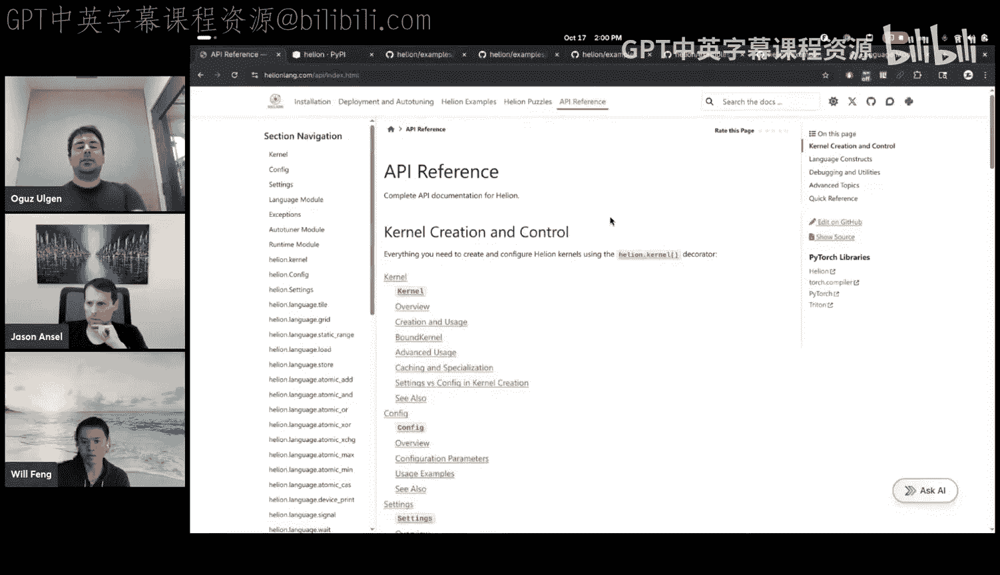
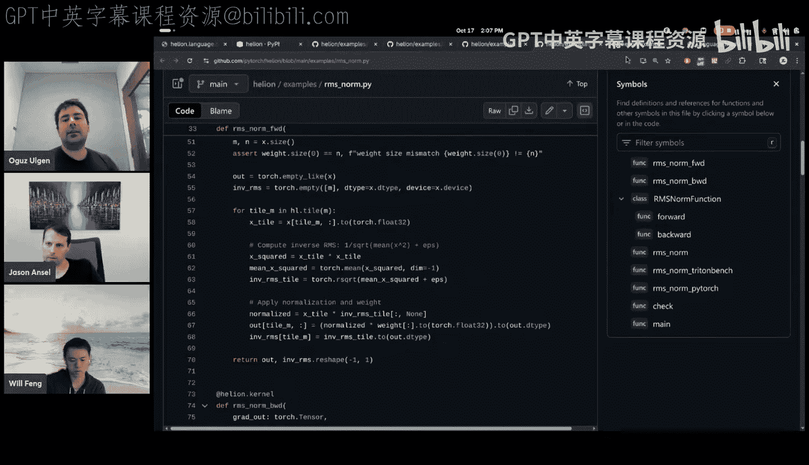
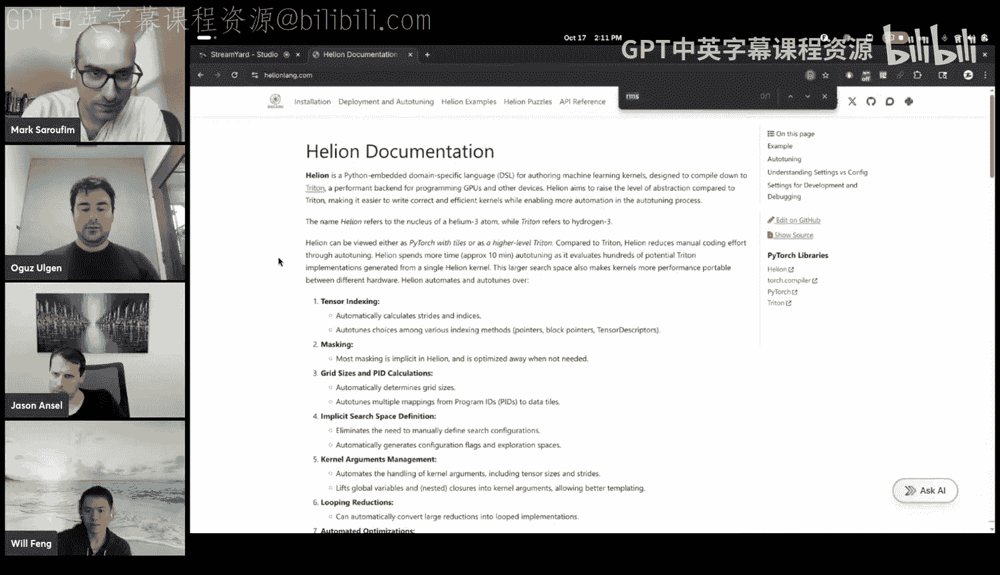
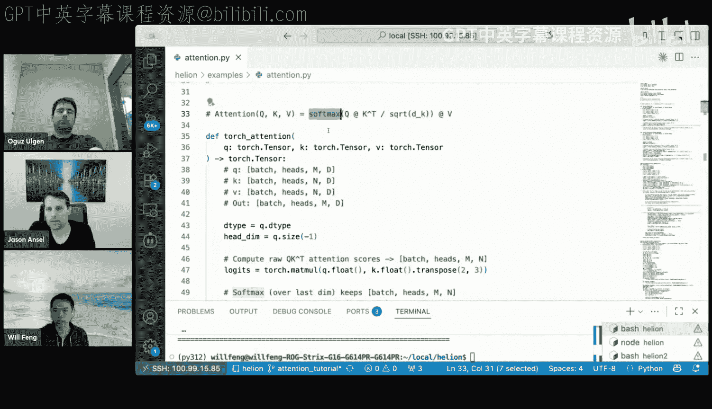

# GPU MODE《CUDA、GPU编程54-87｜GPU MODE》中英字幕（deepseek-v3.2 p29 -20251017-Lecture 82 Helion_ A high-level DSL for ML kernels.zh_en -BV1xbmQB3ETC_p29-

滚。Okay， I hope folks online can hear us okay welcome to another episode of GPU mode today I'm really thrilled to have like three of my colleagues like we're gonna to be giving a sort of a special lecture on helion so'd just like to quickly introduce the speakers like a lot of the people here were like some of the main inventors of like Torch compile like Jason was the primary author of the module Ogos did a lot of like interesting work on like reducing like compile times and if you want to complain more about compile times you should reach out to Ogos and did a lot of the early work with like making sure the compiler works well with distributed who has been kind of like a longter Ptorch maintainer as well so there's some of them my most knowledgeable colleagues so please ask some hard questions but without further ado I think today what they really wanted to talk about was heliian which is their new DSL for kernel authoring so folks yeah please take it from here。

😊，Great， thanks， so I'll start off with some slides to basically go over the ideas in Helium and then I'll hand it off to Os and Will。

 who go through some more hands on examples。😊，So start off with some motivation okay why do we need a new DSL and sort of the way to think about heliian is it's sort of at a higher level of abstraction than a lot of existing DSLs like Triton。

 but a lower level of abstraction than Pytorrch and really the moment that sort of motivated it for me was we kept on getting asked from users of torch compile to get more control like people wanted control over the exact kernels that get generated and for that you really needed a DSL but you sort of would want a DSL that's at a closer level of abstraction to Pytorrch that sort of lets you use a lot of the concepts that you already know from Pytororch。

Without needing to worry about low level details of the specific kernel。

And so a big differentiator in sort of what makes heliian able to get performance competitive with much lower level DSLs is the use of an auditor and so the idea is that heliian is sort of integrated into the language has a very sophisticated auditor which searches thousands of different every trident kernels which are generated from a single helium kernel。

 so basically the search space defined by helium kernel is a superet of the search space that you get from sort of a single trident kernel implementation。

 and this search has a bunch of advantages the one big advantage is it saves human time。

 basically rather than needing to span human effort to try hundreds of different ways of being a kernel you can let the auditor do that basically trade sort of human effort for machine effort。

And then the other big advantage is hardware portability。

 so often what we see for kernels written in lower level languages is every time a new hardware generation comes out you need to rewrite your kernels but with a higher level language combined with an entrepreneurer。

 you can just retune for each hardware generation and get much better portability between hardware。

So let's go through an example of what a matized multiply looks like in helium。And。

Are you are are you on。Are people still seeing the old slide， I'm not saying it。

Right now we're seeing auto tuning as a slide I advanced my slides so let's go through a matrix multip example in helium this is what what looks like in inside the helium kernel you basically have two main parts so have this outer part of the kernel which is basically just regular P code you use it to allocate your output cancers and you have this inner part of the kernel and this inner part of the kernel gets compiled down into into a triton kernel itll be a single kernel sort of guaranteed and what you have here is you have this outer HLductile loop。

 this outer HLduct tile loop basically becomes the launch grid of your kernel and then within this HL tile alert you can use。

Cch operations like at MMM here and you're basically operating on tiles and so you could sort of think of it as pieTr with tiles。

And it looks like there's a big delay in my slides because let me try resharing。

We can also let's give this a few more shots and if we keep running into technical issues。

 we can try something else。Sure。Sure， okay。Yeah， so there are a bunch of language contracts in heian。

 so the main one is this HLduct tile construct and this HLduct tile construct subdivides。

 the iteration space of a given size into tiles and the exact details of how that space is subdivive is up to the audit tune。

 so the auto tuneer is picking tile sizes， it's picking iteration orders it can do swizzling to change and flattening to change iteration orders。

 then within the HL tile loops standard Pytorr operations can be used so if you know Pytorch you already know most appealelion and also supports stuff like control flow and other things。

So now I'm going to go over the configuration space and I think go over the configuration space is a good way to get sort of a tour of the language because you can see sort of how the helium is lowering different things and sort of what they correspond to。

So the first part the first product configuration that I'm going to go over is the indexing mode so in Triton on the right。

 you can see there's actually three different ways to write indexing you can do sort of pointer math you can do a block pointers which is a more structured way of doing it then tensor descriptor which is similar to block pointers but works on the latest in video hardware and in Heliian you just write regular sort of pytorrque style indexing with with tiles as arguments where sort of the tile is specifying a block it came from each all the tile and the autotutor can autot between all three of these and what we find is that sometimes one is fashion than the other like we've seen cases where where tensor descriptors are faster for big inputs and then pointer indexing is faster for smaller inputs and the autotutor select this this。

For you， which saves a lot of work because it can be pretty tedious to rewrite your kernel to do different types of in。

The next choice I I talk about is block sizes， so as I said before。

 when you write an HL that title loop like this， you're implicitly defining some block sizes。

And the corresponding trident code for this is on the right where you see there's a lot of boilerplate to sort of sort of thread block sizes around。

 you need to do some math to compute grid sizes and so on and all this sort of boilerplate is removed and he in and you just need to use right sort of this higher level concept。

And by expressing the tiling in a higher level way。

 it also allows heliian to do more sophisticated things like you if you set the config flag loop equals true。

 then we basically take those two block sizes that I had in the previous slide and you flatten them into a single block size。

 basically turning their 2D iteration space in a 1D iteration space and this allows searching over things where it would be very tedious to do this at the triangle mode。

The next thing I want to talking about is reduction rolling so if you write a reduction like this in helium where you're basically reducing the rows of of a 2D tensor you can express this sort of naively is sort in a straightforward way where you basically load the entire row into a tile in the output language and you do the sum here。

 this is the problem that it if your sizes are very large。

 you'll end up running out registers and if it's even larger it'll just scale the run because basically the single row that an SM of your program and so the way to handle this is to do a reduction loop where you can basically have accumulator you can iterate your accumulator over your data and then then that accumulator has a block size so sort of introduce the search space and helium will automatically convert between these two different。

ay of writing。啊。Next is the pinI types， there's a program IDs so there's a lot of different ways of expressing program IDs。

 you can either do a one dimensionional launch Gr a two dimensionional launch grid or there's a number of different ways of doing persistent launch grids。

 where persistent launch Grs basically they mean that you run one coUDA program per SM and then that coUudDA program is going to iterate over virtual program IDs。

 which allows pipelan across coUuda programs， and we can auto tuneune this as well。

 we can auto tune optimizations over grouping and reordering so we can reorder loops which is just swapwa of loops around or we can do sort of subtling of the iteration space which could help with cache reuse and we can do this automatically。

There's lots of configuration flags that try and exposes you know there's， for example。

 you know numb stages， warp specialization， numb war etc cetera。

 and obviously autotu as well these are basically like pass through to the heliian auto tuner and then another thing the final thing I'll talk about sort of in this section is automatic masking and so masking can be tricky to get right and heliian automates a lot of this for you and will also optimize it away if you're in static shitsha。

So next I'll talk about the Jason， if I ask you a few questions before you go audit tuning so I just want to like as you're sort of going through this like my first thought was like。

 oh yeah， like this is basically Trident with like some of the annoying parts sort of like smooth over or audit tuneed over and so then how do you think about like the identity of the language like basically as language evolve like what are features that you would expect to see sort of en Triden versus in heliian how do you sort of make sure that it just doesn't become like sort of like a bit of a random repo yeah like any thoughts on the overall direction？

Yeah， I mean the main direction is to try to build something a lot closer to Pytorch so in you know things that I definitely wouldn't want to see sort of sort of leak too much into the language would be hardware specific details because a big motivation here is having a language that works on lots of different types of hardware and so you need to sort of keep the concepts high enough level that they work across many different types of hardwares also I think having an integrated audit tutor in the language allows you to do a lot of things which aren't really possible languages without an integrated audittutor and so I think like the auto tuunning part of helium is pretty core of the identity of the language。

And so related to this like a lot of your colleagues sort of building kernel DSLs have sticking the opposite but where they're like。

 oh， like Blackwell made everything too hard， you need to call the low level intrinsics。

 it's very hard to build like sort of generic primitives。

 therefore we need a DSL or like new hardware architecture at least have the language change so that it's indistinguishable from the one from previous generations。

 like what's your thinking on like taking the opposite but here。Yeah。

 I mean I think we definitely need both right like where you know you look at a language like Python which is very high level and Python is incredibly popular。

 lots of people you want to use Python but if you want the very fastest performance well you probably should be writing either C++ or inline assembly or something like that and you know you SM1 who I love both languages and I love both Python and C++ I wouldn't want to go without either like there's sometimes I want to go super low level but my everyday programming you know it's really tedious to write C++ with inline assembly it's a lot of work and so what I'd say is you would sort of sit to that same thing where like most of the time I'm writing Python but when Python when I want like to go really low level and sort of sort of really try to try to squeeze the very last dropout of something。

But I'll be writing that inline assembly。As well， and so I think they complement each other and something where my hope would be that the helium auto tuneer makes helium fast enough that people don't need to go down to like inline PTX in or low levell Kuda。

 but those options are there， and I think it's good that those options are there。

Perhaps it's also like valuable to add that like there is like some sort of like a chart where like amount of effort you put in versus amount of performance you get and like I think there's like already like some charts flowing in on the internet about like with Triton with Q DSL with heliian or like with writing like cutla。

 cubes， whatever， like the heliian just makes the amount of effort to get good performance very low and then if you want to get like the peak performance。

 perhaps you might need to pick a more hardware specific language。I think yeah。

 I know which picture you're referring to I'll put it in chat is。

People keep referring to I think Tdo had had the one that was basically referring to how cute DSL bends the curve a bit。

 but yeah， like I think maybe different DSLs will sort of say say similar things， but yeah。

 sorry yeah， we we can't keep going I think this digression I've been interruptted you for too long Yeah not noise。

😊，All right， so now now were talk about auto tuning so auto tuning takes about 20 minutes to search 12100 candidate kernels actually Jason serving our thing again because there was a question that I think was very directed you were there an inspiration from Hide here I think yeah like think George Mcle was what I'm not sure heliian did So any comments on that Yeah I definitely like I took a lot of inspiration from the way Haline works and you you could sort of view you know like Hali really really pioneer the idea of sort of splitting out your sort of your semantics language versus your sort of scheduling language and you could view the sort of the heliian language as like the semantics language and the autot configuration as the scheduling language and so so definitely sort of sort of takes and then also the auto tuning combining over an autotune or auto generate the schedule which the original Ha didn't really do but。

Sort of follow up work to Heline did a lot of it， so that's definitely a source of important in inspiration。

All Yeah and one of my very early projects in grad school was actually one of the first audit tunes for AI so I know a lot about auto Aline as well。

Yeah， I mean， I'm sorry I really want want you to keep going but were asking questions so I figure we can just go through them so someone's asking so Stephen is asking is this like giving another abstraction between Torch D and Triden and does it provide a lower level abstraction for better optimization like glue on as well？

😊，Yeah， so it is a lower level abstraction than torch compile so it gives you a lot more control like within torch compile。

 you sort of just give pitorrch your torch program and then torch compile will figure out okay what gets fused with what how many kernels you have it has sort of a lot of optimization there within helium you have explicit control for exactly what goes into the kernel and so it provides much lower level of control there are escape hatches in in and helium that allow you to go level level like you can insert inline PTs into helium and you insert inline trident into helium but it's definitely a case where it's not designed to be sort of the equivalent of the lowest level language it's designed to be a very high level language that gives you performance through audit。

So hopefully the audit trainor can search over the types of choices that you'd be searching of that you'd be implementing manually in the level language。

 but we're trying to basically automate a lot of this。

I see one more question from Matt I think we'll pause after that question and then re out to questions later so Matt's asking and let me know of this if you have a later slide on this but have you considered parallellyization strategies as part of this audit tuning process？

parallelization during of the audit traininging process。

 like tryingal things at once or parallelization of the output code。

So sorry I actually mean I think math means parallelization of like distributed parallelism as in like things like audit tuning。

 making something like work over like DP PPP， CP TP， et cetera。

 this is what they're referring to a composition with distributed Yeah so there is some examples in the he repo of mixed comms compute kernels so you you could do things like know try to overlap your communication and computation that networks works so pretty early in you know because heli is a kernel author language sort of definitionly a kernel runs on exactly when GPU like the scope of a kernel is confined to a single GPU but a heli kernel can include communication to other GPUs and so you can basically like implement sort of。

parallels in there， but that's sort of done at a higher level than all at the current level。

All right I then can finally you get auto tuning maybe we'll see all right yeah so the audit tuneer today we have a few different algorithms these algorithms are pretty still pretty simple algorithms but we're really excited about in the future looking at things like LLM guided searches reinforcement learning shared performance databases where you could try to try to predict stuff but right now we basically have a pretty straightforward auto tuning algorithm so I'll go through how this auto tuning algorithm works so you start off with your initial population where you just randomly pick100 configurations you then select the top five fastest configurations then on each of those fastest configurations you hillt climb to a local minimum and then you take the fastest of the local minimums that you found and empirically this works pretty well we found that the search space。

😊，For these kernels is pretty regular， so we're able to get pretty good performance from this。

 but we know't we'd love for this algorithm to be faster。

 this is pretty computationally expensive and for more complex kernels it's quite possible that more sophisticated algorithms would be required。

So how do you deploy a configuration so we have the most straightforward way if you just want one configuration for all shapes is you can just take the output of the auto tuneer。

 the autotr print out and config it what's fastest this is what a configuration looks like and you can just copy and paste into your code check it in and then in subsequent runs it'll just use this configuration without any autoting in some cases you might want multiple configurations like for example。

 if you have different shapes that you're dealing with。

 this is example with a small shape and a large shape。

 you can run the auto tuner for both the small and large shapes and then you can specify two different configurations。

 you can say config equals first config， a second config and what will happen is every time we call the kernel it'll if it's a unique shape if it's never seen that shape before it'll try both of the configurations and pick whichever one fastest and then then cache that result。

Whi works pretty well in a lot of environments， and then if you want to go into more advanced you can manually route to which configuration you want。

 so in this case I've ahead of time compiled the two configurations to a small runner in a large runner and then I wrote just sort of a simple routing function which is okay。

 if the nuM is small， then use this one otherwise use the other one。

So now I'll talk about some personal performance numbers。

 so the first case study on my show is a comparison to keep DSL and quack on RMSMS andR backwards。

 there was a post a while ago that sort of showed some of these numbers here and so we to try to reproduce them with helium included and what you see here is torrsch compile is doing really well for first and smaller sizes。

 quack is doing really well for the largest sizes， but you can see that that heliian and then also sort of the  few tritan equivalent of what helium is doing tend to do really well for all shapes so you get sort of sort of better performance portability across different sizes。

So these are still some work in Congress Jason， what GPU are those numbers on these are each。Oh。

 thank you。So here's some the B200 speedups over where we' we're showing the helium speedup。

 the torch compile speedup and then the handwritten Triton speedup。

 most of these handwritten triton kernels are coming from byer。

 which is a repository of handwritten Triton kernels and what we can see is that for most kernels the helium one is the fastest with the geoamine of 3。

2 times faster than in ear mode pitorrch and we can see that we're almost twice as fast as handwritten triton。

 this is mainly because the autoter is able to tune the triton code much better and sort of squeeze more performance out of the Triton compiler than you would get through manuallyly writing triton code。

Here's some results on AMD， the AMD numbers show a pretty similar story to the B200 numbers where helium's fastest in most cases。

mAnd again， we sort of see the same pattern where the eyeTer is able to give you a robust performance across a large number of shapes。

So coming towards the end， I'm just going to have one slide on how the internals of healing work。

 so this is sort of a diagram of the compiler because we'reython met DSL we start off with a Python AST the FX syntax tree we first annotate this AST with types and metadata we then convert it to a number of Fx drafts。

 one Fx graph per basic block and every node in this FX draft has an inductor IR attached to it so Heum basically is reusing the inductor compiler to generate a lot of its output code we have compiler passes that operate on these IRs and then finally we have CogenN we only incorporate the configuration that's the auditudor came up with during CogenN so that basically everything to the left of this can just be run once and then everything to the right is rerun。

Every time we' auto tuning， and then we generate a trident code as an output and for the wrapper code that basically calls the kernel。

 we're using an ASTV right they say change that for loop into a kernel。

And then I'd encourage everyone to try healingli today， definitely we'd love some feedback。

 early feedback helps shape the language and then contributions are welcome。

 we'd love for people to submit PRs and have some improvements and we're releasing a beta on Monday。

Awesome， thank you， Jason， I guess before we transition， I had a couple of questions。

So when you were showing like the B200 numbers， do you have like sort of a like a qualitative sense of like what was it that helium did really well that like wasn't like but like yeah。

 what was it that helium did really well and sort of specific use cases right than up where the performance differences were quite big that wouldn't have been as easy to express and the sort of existing alternatives like compile or just raw fighting。

Yeah， I think I went over the sort of things that it's searching over。

 I don't have the exact details and like， oh， for this kernel it did this and this and this。

 but that type of case study to dig in a little deeper would be。

 I agree it would be super interesting。Yeah， it would be a good first contribution to I think if anyone in chat is interested so related to actually unrelated to this so typically for auto tuning when you're first picking the first is does it typically work by random initialization in the beginning Yes it starts off by random initial？

😊，Complete random， okay。Last question， in your diagram like the architecture diagram。

 what's a basic block？Oh， so a basic block is a concept of compilers where the idea is that it's a sequence of code that has no control problem。

So if you have like an ifF statement， then you know you have one basic block before the ifF statement and then two basic blocks。

 depending on which side of EFC if you go down similarly for a loop you'd have sort of basic block from the body of the loop and so on so it's easier for compilers to work control flow is like a tricky thing to compile and so often sort of compilers work by like splitting things into basic blocks which don't have any control flow and then you have like one compiler process for the basic blockss and the other things that sort of cross basic block。

私し。Okay， soundsund it。 Thank you， Jason， I think we can transition to the next part。

 which is like I believe like oh goes the slides。😊，So let me just read this。Alright， yes。

 take it for me。 Okay， hello。 So I'mz。 I have also been working on the Torch compile and also heliian。

 So today I'm gonna be talking a bit about like the documentation。

 how to like get started with heian。 And then I'm going walk through a few simpler kernel examples。

 And then compare a few like more advanced techniques。

 And then after we we take over with like more interesting kernels。

 So the first way to get to heian is like， if you go to heian dot com。

 this is the main website we have for heliian documentation。

 this will just explain a lot of the topics that Jason talked about in the presentation more detail with like examples that you can try out yourself。

And the easiest way to get start with heliion is by just going to doing PIipP install heliion in addition to this you will have to also install the Pytorch 2。

9 and Triton 3。5 the Pytorch 2。9 was released I think yesterday or the day before so you can just download it from PIP and then if you get if you do Pip install heliion you will get the most recent version of heliion on Monday we will release 0。

2 which we will consider to be the it's already stable right now but 0。

2 will be the official beta version that we will release on Monday。Okay。

 now with that out of the way， the other interesting part here， the website is the documentation。

In the talkcs we can can actually just sorry the API reference So in the APIR reference page you can look at our individual language semantics like for example we can read about like TL that title general when we refer to TLV you mean sorry HL when we refer to HLV mean heian language and you can read about how tile works。

 what arguments it takes like how to do how to pass a block size begin and other arguments as well and you can click on various to the language constructs here to read it's just like very similar to how heliian sorry how the triton works。

So now let's take a look at the examples。this is the I hope this is big enough so this is the ad kernel this is also on our website if you go to heliian examples Al you can see this so a kernels like one of the simplest kernels all you do is you take two tensors and then you sum them up as Jason mentioned the kernel has two distinct components there's the device side and there's the host site so everything that you write outside of this like four HL tile loop is the host side where you can perform any torch operation you want or you can perform any other pythonic operations you want all of this all the code in the host side will be executed in the eager environment there will be no compilation。

And then this host code can exist before the H tile loop and also after the H tile loop and inside the HL tile loop is what we call the device region where heli will compile into a triton kernel one super important abstraction about like I guess abstraction about a healing kernel is that we're guaranteed to convert a single healing kernel into a single triton kernel there will never be a case where we will end up with multiple kernels everything inside the device region will be currentgent the onefuse kernel。

So with this at kernel we have the we broadcast the sizes。

 we create an empty tensor for our output and then we just tile over the entire size and then we just add it and then when you autoune it you can identify different strategies where we will emit different versions of tracking code depending on like what are the most ideal settings for your shape size。

So moving on let's take a look at matrix multi and one interesting thing we will talk about here is this lambda we're passing into the matrix motivation for epilogue so in this case healing kernels are able to take a lambda function that can be executed inside the the device region to perform some operations suppose in this case we pass two matrix matrices and then in the epilogue we pass activation function say we pass a re so what we do is here is we again create an empty。

Tsor and then we are now doing tiling over using an accumulator and then we tile over the sorry we accumulate over the subtle and then we eventually write this result into the output tensor after this accumulated result but before we write it we actually call our epilogue and if in this epilogue we passed re as I like the error activation functions as I mentioned earlier then the output triton kernel we'll also emit the in the triton format。

So moving forwards， another interesting technique is sometimes you need to pass two different tensors。

 but you don't actually want to operate over the entirety of the tensor。

 but you want to do some masking。So let's take a look at this kernel that concateates two dimensional tensors on a single dimension。

So you pass your two tensors and then you again create your output tensor。

 but in this case we want to create an output tensor that is the like the summation of the both of their length in the second axis and then the interesting part here is that now that we' are tiling over the entirety of the output tensor we can just access elements of the first and second tensor with the same tile zero and one because that would be out of bounds so when we are loading the first and second tensors here。

 we can pass an extra mask argument that will allow us to mask like only access the correct parts of the tensor and then zero out the rest of it。

And then we can use a simple torch air operation in order to write it into the final answer。

 is there a question something is beeping on my end， I can't see。Okay， I will continue。嗯。

So now we're going to。Look at RMS S norm。 So the RMS S norm is a fairly straightforward。

Normalization function where you do the root mean square operation and this is just you take a value you like you take your tensor。

 you divide it by the square mean like this sorry the skirts of the mean squares So in this kernel we're going to take a look at how to write a very straightforward RMS norm implementation and then we're going to look at writing a more advanced version of it advanced version doesn't necessarily mean it is more performant in fact in most cases Heing is able to generate the exact same advanced version through autoutning but I want to use this as an approach to talk about some of the more interesting features。

But before then， let's keep going with the regular armest norm。So with the normal RMS norm。

 you take your inputs， you take your input tenor， you take your weights， you take your epsilon value。

 and then again you create your output and then you tie over the over the。Iput sorry。

 you title over the region。And then if you notice here we are using torch mean and then torch reverse square。

 these operations are all like they don't do any introductions I guess they do a reduction over the whole line。

 so in some cases this might be not as efficient because you will have to load the entire line and again。

 as I mentioned， the he auto can do these reductions for you so that they are they're not loading the entire line and they're loading smaller components so one interesting way of rewriting the kernel would be to actually do these reductions yourself。

And so if you look at this kernel， we have this function called H register block size。

What this does is that if you want to have multiple inner reductions in your kernel。

 but you want to ensure that these inner tiles are both。

Over the same block size then you can register a block size ahead of time and then this will indicate to our auto tuneer that whenever this block size is used we need to make sure that both of the tiles are using the same block size this is like one of the more interesting ways of I guess I kernel with our own reductions。

And if we go back to the documentation I mentioned earlier。

 you can search for the register block size and this will talk about how this function is being used。

So as we mentioned here in the documentation， this is really important when you want to share the block size。

So going back to the kernel， another interesting thing here is the eviction policy decisions。

In a more naive implementation even though you have to sorry where is this so in this case like we have to take the mean over the squares and then later do a division of this value over these mean which means that we will access this x value like we will access the value of the x multiple times so we don't actually want this to get evicted right away whereas with weights we are only using it once so we can after we use it we can directly evicted so HL load operation also takes eviction policy argument exactly the same way the tri will take and then we can ahead of time explain that like this to our opportunity sorry yeah or you know that like this argument if we actually want to evict last because x will get reused again and then our next use of x we know that this is the very last time we are using it so we can actually we can evict this at this point。

So this is a more advanced way of writing your healing kernel where you can actually control these reduction dimensions and you can also control how you want these kernels evidence and as I mentioned earlier or autot will actually like in this very simple RMS norm case or autot will actually do these decisions for you so you don't have to do it by hand。

 but in other cases where you want more explicit control over how your kernel is emitted。

 you can do these decisions yourself。I think this is everything I had。Okay。

 I I had a bunch of questions。 Okay， so first one from chat is from Stephen， who's asking。

 like how easy is it to capture helium kernel from goagraph or hipgraph and to hip graph and then replay it later。

 I there any issue like the typical kernel with dynamic parameter like sequence length with the helium kernel。

So generalCgraphs should work with helium kernels unless you're doing something that's not cographable in the host code outside the kernel so if you do something like not cographable。

By default， that will work， but most not problem。So and now more about like questions I have a bunch of questions about like the programming experience alienian so like there's like like one of the like a local favorite and GPU mode from Torch compile is the torch log is equals output code so you just like look at code and mod it like you presumably have something similar where people can quickly understand okay like what the heck was auto tuned over like what was actually the code that's running that people can take a look at and build intuition let me actually really shared actually quickly So all of this is conveniently in our documentation page。

😊，Let me hide this Okay， so if you go to Heliian Lang， I believe we have a so。

Okay， so there are multiple ways to do this， the simplest way。If you pass。

 is my screen big enough to be read on the stream？It's okay。

 You could make it a bit bigger if that's okay。Co so we have a few environment variables and I think there's actually a page in the Viki somewhere that explains all these environment variables I cannot remember off the top of my head。

 but I know there's a chart so。Settings for if you scroll down on the first page。

 it is settings over development and debugging， which actually go over two very important examples。

 So first one is helium print output code equal one。

 What this does is that once heliian like Van heian is running the。Sorry。

 binds the kernel and generates triton code this outputs the triton code we generated it also outputs an easy way to create a repro so in addition to the I guess kernel itself and the host code that actually calls the kernel we also emit a coal function with input tensors that would be whats similar to what you would use like in some cases you might need to modify this exactly like the inputs in order to get the example you want but it emits this likelihoodid print output code equal one also gives you easy way to emit just like something to reproduct re the other interesting environment variable here is a heli otion effort equals none so when you're creating writing your kernel you still testing things you don't want to wait 20 minutes to get output because like at this point' you might not care about performance you might just care about does it where is it correct like is it good enough so in this case we have this heliian autoion effort equals none which。

Picks just default configuration for at tuning and it does not perform an attun。

We have two other options for each Otune configuration， I don't remember exactly where this was。

 but there's a caasor ti tuning version that spends less time on auto tuning and it finds a good enough result instead of the best result。

 but by default we do the 20 minutes oftune as Jason mentioned earlier。

One other debucability so like I guess like there are two other debucs things another interesting feature is that we have heliian in。

Okay it's not here so we have heliian interpret equal1。

 but this is another M tu what heli interpret equal1 does is that it instead of running the kernel using the triton backend we actually convert the kernel into Fx graphicable code and then we just run it using Pytor eager what this does is that in the HL tile loop everything we have is what you would run over the all the tiles anyway。

 so instead of doing a tiling we just emit run that device code over the entire kernel using over the entire region using the interpreted eager version。

And lastly， if you want to further debug your helium kernel， we have similar first logs。

 we have eight like helium logs， and if you pass helium logs equal all or you can do like helium log plus all which enables the debugging level。

 this will emit out of internal diagnostics that can help you identify what's happening in your kernel。

 and we're happy to take more contributions to improve like the user experience for kernel altering and also kernel debugging。

 like for us the user experience is the utmost important thing when writing a helium kernel。

So speaking of UX then like maybe people got used to it nowadays but I remember in the early days of like Trident like people were confused like oh you know print statements don't seem to work like breakpoints don't seem to work there are certain things that need to be in the launcher code versus like the host code in all' case it does seem like when I looked at the code it did look like real Pyth code I'm just trying to understand like is helium actually just Python code or is it like something else like what's allowed versus now I noticed one of your example had an for example that seems to work just fine So what should users expect to work versus not work inside the heliian do kernel decorator So as I mentioned earlier like we have two sections of the code we have the device and we have the host code both of these sections go through our own like type inference and type propagation algorithms so technically everything should work inside the host region of the code should know。

limimit of what you can do except like when you emit metagatorrch operation over like some tensor we do emit a warning because like that would be executed using eager so everything in the host code is going to be in eager and you should be able to do everything then again like there are probably some rough edges there since this is like we slap runner type propagation and there might be gaps in the type propagation so we also welcome contributions on any like Github issues that you might run into there but essentially host you should be able to do anything you want in the device region this is the part like in the for loop which is the device region this is the part we emit into the we emit a triton kernel in this kernel there are some limitations like for example if you have print statement we automatically convert that into Tl print something I forgot the exact Tl version but like we convert that to the Tl version and youre able to get。

Like you're able to print it with however， like whatever functionality Triton has for printing for breakpoints。

 I don't believe we have support for it like I don't， I guess I have never tried actually Bpoints。

 it is something that we can support again in the host region。

 but in the device region that would not also be unsupportable。I guess one other plug。

 you run into if you using heliian if youre any problems。

 please go to the issues section and create a new issue with either bug report。

 feature request or just anything you want and we will take a look right away。Okay。

 one more question I think Stephen is asking this question I actually wanted to ask this as well so I think this is good timing so like when you look at like a lot of like modern kernel codes so especially specifically in projects that are like mega kernel projects like there's sort of like a lot of scheduling code in those kernels like not just like like like what the computer is done but like how it's going to be executed and which resources and how to trade how to communicate between them。

😊，So how easy would it be to build something like a mega kernelnal and helium to do some of sort of like mirage like work and would it be helpful or is it solving like a problem at a different level of distraction？

Yeah， I was thinking about that a little bit where you can imagine so currently you can have multiple HL that tile loops in your kernel and that basically becomes like a4 each kernel where basically all of the iterations run in parallel but you can imagine adding something like a barrier operation where the barrier operation basically says okay all all the HL that tile loops before this need to run before all the HL that tile loops after that and by adding sort of that type of constructs of the language。

 you could have you could have a really easy way to these sort of mega kernels where you sort sort of entire model on a single kernel so that's not implemented yet but that's something that I was thinking about a bit in terms of like when' is that profitable that's most profitable for very small sizes where if you have if you have a sort of full size model like you know you're like lava。

80 plus you know the kernels are big enough that the kernel watches， it sort don't really matter。

 but if if you have really small sort of sort of sort of kernels that sort of these type of makeco kernelnal strategies can be very profitable and so that's something that you we're interested in with love contributions there。

 hopefully we'll get to it that it's not there good。Also， we didn't touch during the presentation。

 but currently heian does support these like forage kernels where you can have multiple top level HL tile loops。

 the support is like there is like limitations in support and this is something we' are still working on。

 but it is like the4 each style is supported with multiple top level for like HL tiles。So okay。嗯。

I guess Will， you're up next。Y， sounds good， let me share my screen。是。有解释。😊。

Its maybe just zoom in a thd more if you could。The in， okay。Yeah， thank you。😊，Very cool， yeah。

 so I'm gonna quickly go through how to write a attention kernel in helium。 So to start， we。

 we gonna review what the attention kernel is。 So it's pretty easy to look at online attention kernel essentially is something like this when we do a matrix multily of Q and transpose of k and then divided by the head dimension。

 The square root of the head dimension。😊，Apply a softm over this operation and then do a major multiply with the V matrix。

😊，So if we expressed all of that in just pure Pythtorch， that would look like this。

 which is pretty straightforward。😊，And sometimes we want to maybe decompose a soft Mac to have like better。

 numerous control。 So well have can have another version that looks like this。😊。

Which does the Q O matrix multiply and then do a decompposed softm， which is like a bunch of。

Like exponential and some operation。 And then we and then do do the final memo at the end。😊。

So when we want to write this kernel in Heliian。So this is how the kernel looks like， which。😊。

So this is how kind of looks like which is like in the in the host code。

 we do a bunch of like like tensor setups and like reshaping to make sure we are processing with the right shape。

😊，And then this is the first actual tile that we that we encounter， so。😊，The。

 the key consideration when we write a hidden kernel is that for this， for this kernel。

 what are the dimensions that we can pairize over and what are dimensions that we must sequentially execute。

 So， for example， for the attention kernel， what happens is that。😊，Only the softm dimension。

 only the softmax operation needs to which is a reduction operation that needs to have a sequential operation over the n dimension。

😊。

For the other dimensions， we can actually just like paralyze over them the the the the competition on them。

 So in the heliian kernel， what we do is that。😊，For the first H tile。

 which is the which maps to the tri kernel launch grid。

 we will paraize across the batch times number of head dimension， as well as the M dimension。

And this will be our first actual tile loop。😊，And then within the first H tile loop。

 we need to do the softmax operation。 So what we do is that we will do another H tile inner loop within the without loop over the n dimension。

😊，And then。😊，For each tile in in this in the inner loop， we will go through the attention operations。

 Well go through the Q and K major multily， Well go through softm and' go through the major multily with matrix V。

 and then we update the running max logic for the for the for the softm reduction。

 And then at the end， we finish off the softm， and then we will save the output to the to the output tensor so。

😊，I would say that like the most important consideration when writing a he kernel is what dimensions to paralyze and what dimensions to sequentially execute。

 And then for the rest of the。Like because like when writing tri kernels。

 we always need to worry about like offset when reading data and making sure the shapes align and things like that。

 Heliian tried to take away heian tried to just like solve all the like those boring considerations and then leave the interesting consideration to the user so that user can think at a high level。

 just think about what to paralyze versus what to a sequentially execute。😊，So。

We can actually use the helium print output code En that just mentioned to see the output Triton kernel。

 Let's just run it here。응。So。Here。So starting from here。

 this is the Trident kernel that this helium attention kernel generates。

So we can see that within this Trident kernel， it's actually semantically is matching what the helium kernel does。

 but just with a lot of boiler plate on how to compute offset the indice stuff that。😊。

And then we can also see that the Autoermost HL dot tile is converted into this like launcher with the grid size here。

😊，This is like paralyzze over the product of this and then you can see that when we run the helium kernel we automatically generate both the Triton launcher code and the Triton code itself so that you don't unlike Triton where you have to like write both a launcher and the Triton code itself。

 Helium just like handles it for you。😊，And and since with the event variable。

 you can just generate the tri kernel， it's pretty easy to debug when numerical issues happen or like if output doesn't match the reference。

 it's pretty easy to tell what's going on。😊，嗯。And I also want to show that。Sometimes， for example。

 if we are writing for like specific how we like blackwell， which is pretty new。

 And then maybe there are some optimizations that are not exposed in in Triton yet。

 We can actually have very hardware specific of in instructions used in in Heian， for example， here。

 we can like directly call some FMA operation， which which is like。😊，actually， I I， I didn't。

 I didn't have a definition here， but it essentially just caused the P D X inline P X instruction within the heli kernel so we can support this kind of operations as well。

😊，Um。Yeah， that's all I want to show for the， for the attention kernel。

Thank you a few questions so how do you decide whether to sort of have a like a function that's mapping to PTX versus just like sort of like in line adding strings I think Triton for example。

 went for the choice of you can just like dump in PTX strings directly in your code this is like a convenience thing for auto tuner or is it just like a purely aesthetic difference we support the exact same thing inian you can just dump inline PTX in the string I think the implementation of that underscore FMA is just the same in PT I will show the example just one Yeah I I'll just show maybe just pull out the code。

quickly go yeah， okay here okay you谢 I see like reference yes the same。😊。

So so you mentioned something interesting in passing。

 which was that like one of the most important things in healing is you need to have like an intuition for which dimensions you need to paralyze over versus which dimension you need to go over sequentially did you mind just like collaborating on that like concept a bit more。

 feel free to use a simpler example too if like with attention， this requires a bit more thought。

Yeah， so my understanding is that with Triton， what is paralyzed over is always the launch grid like the launch grid like what however。

 new mouse in the launch grid is like parallellyzze over on the Ss But otherwise within the Triton kernel。

 things are sequentially executed。 So how it maps to heli is that the outermost HL dot tile is is's controlling the parallellyization。

But within the heli with with like that for any of the inner the HL dot tile loops， four loops。

 it's a sequential executed。😊，And and and sometimes if we want to write a kernel that's actually doing reduction on the within theer outer follow。

 we need to do do likeomic atomic ad across the S M so that the data stay consistent。Yeah。Yeah。

 got it because like there's no concept of launch grid here， Right， Like everything。

 everything's a tile in your case。 So you're but you're even more tile build than Triton as itself。

Yeah， so in he， there's no launch great concept。 But when we lower to Triton， we we， we do have it。

 So it's like。😊，诶。Sort of like I shouldn leaking， but but but but but maybe with like other other like other back ends in the future。

 it is like a different， but yeah。😊，We also do have an HL grid thing where you can say for like program ID inHL that grid。

 which exposes the lower level concept of the lunch grid。

 although we've encouraged people to use HL that tile because it gives the auto chinder a lot more choices and so you're sort of like locking the auto chinor in to one choice if you manually specify the grid。

关 to死游戏。收啊。And so and how does composability work here， like， for instance， like。

 let's say it's gonna sound like a meme， but just like just to sort of this humor meme for a second。

 which is like you have a like a trident kernel and then you're like calling that from within a pie charge program that like also like has like a heliian kernel interpersed Well like like like how does this all work together really。

 I mean， I guess there's just keep them separate probably there's no real reason to do this。😊。

the cock this is very good。Yeah， so helium has the invariant that like one helium kernel is exactly one kuda kernel。

 Triton has the invariant that one triton kernel is exactly one couda kernel and so you can have like a pytorrch program with some helium kernels and some Triton kernels and some pytorrch kernels or whatever language you want and they should all just compose together because they're all just separate kernels and they don't really actually interact。

あ。Except for their inputs and outputs。Also like something that we didn't mention earlier was Heliian also already has composibility support with torch compile so like if you have some model that you torch compile and then you have your custom kernels in there you can also have your custom like your custom Triton kernels now we can also have your custom helium kernels Currently we just compile your helium kernel down to a tritan kernel and then we like just send it along similar to how we deal with customOs using triton kernels or even the raw triton kernels in the future we are thinking about building more like a prologue or epilogue fusion inside torch compile with helium kernels like it is something in our roadmap but we haven't gotten there yet。

So so speaking of like when I was like looking at the output code。

 it was like giving me flashbacks to regular torch compile output code。

 is that like difference like like， is this because there's like a comment text stack or this is just like compiler generated code will look compiler generated basically。

 And it's， it's because heliian uses torch inor and torch inductors the back end for。

 for torch compile。 So there's there's a lot of shared code in the trident generation。

you mind talking a bit more about that like specifically like what does that really mean and what does that look like in practice I forget if you already mentioned this in your big。

Architecture diagram but I'd love to hear a bit more detail Yeah yeah so in helium like we don't have a massive library of helium operations and the reason why we don't we don't need a less of library helium operations is you can use just regular Ptorrch code inside your helium kernel so you know rather than having like like an hL X you can just call torch X if you you know want to do a you can also call like more complicated things like you can call torch dot softmax inside your helium kernel and we you know we know you know because we're using torchductor or we can sort of lower that softmax into output driving code and so most sort of pointwise in reduction Ptorrch operations are supported and the way their supported is by going through the same。

Tch stack that Toshham highly uses and so because we're using sort of that same tech stack。

 you know the output code has a lot of sort of similarities and you know it also is like what makes heliian able to sort of ingest pie chartch operations as it sort of sort of main way of handling sort of that long tail bumps。

But but but clearly the reuse is for like ops， right。

 it's like you have bys op op level reuse so we are we are not so so torschco includes a lot of stuff that's like fusion is he trying to decide oh should I use X and Y should I use Y and Z。

 you know， should I and like you know because heian kernels like definitionly or just one kernel like there's no fusion decision I the everything's just one And so we don't we don't reuse any of the like graph level fusion decision code from torschco file but for everything that's sort of op level we reuse。

Yeah， like the the philosophy， like one and a half is that like。

For for the current offers to think about what's， what dimensions to be paralyzed。

 what dimensions need to be sequentially executed and then write operations in Pytor in Pytor syntax。

 So that's like the， the idea that that that we are going for， yeah。内裤。All right。

I don't think I see any more questions in chat， so thank you for coming on guys if you have any last words you'd like to say or I think you guys mentioned that you're going to be doing a release on Tuesday Wednesday I think I wasn't sure if I heard correctly so we will be doing better release on Monday and during the Triton conference on Tuesday Jason will be giving a talk during the Pytorrch conference on Thursday next week Jason will be giving another talk and Wednesday we have right after the keynote at 1030 AM we have a meet Torch compile and healingal developer session and all three of us will be at that session so feel free to come over and ask us any questions you have all this information like the conference details everything can be found on our Github page I think at the top of to read me there's like a plug said like explaining where you can meet us and all that stuff。

And I guess to add on the GP mode Discord， we have a sectional， feel free to also reach us out there。

All right， wonderful， Oh yes， for hosting of， Jes， thank you。 thank you all for coming。

 appreciateate it guys， Thank you so much。😊。