# GPU MODE《CUDA、GPU编程54-87｜GPU MODE》中英字幕（deepseek-v3.2 p30 -20251018-Lecture 83_ Formalized Kernel Derivation.zh_en -BV1xbmQB3ETC_p30-

All right， hello everyone， welcome to another episode of Zqui mode。

 this is going to be one of our last lectures for the year。

 like the next week is going to like the Con Ga Week because like the whole Kentucky。

So this is a talk I think we've scheduledled like a while back I'm not mistaken from front of the like over or four months ago。

 I'm not exactly down the details。But but Min said is basically a regular author of a incredibly beautiful mathematical background that describing different and most different algorithms。

Vincent is also a PhD student at IP where this is a big part of a research focus。

 without further ado， on'm2 Vinnce talked about useful。そうで、すね。Thank you so much。

 unfortunately today my supervisor Jolies ideany wasn't able to make it。😊。

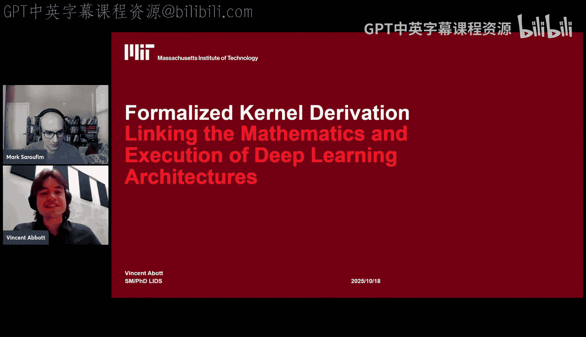

So。

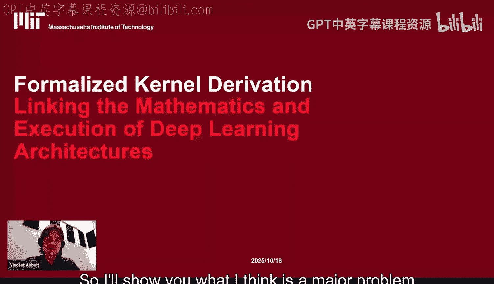

I'll show you。What I think is a major problem in deep learning research and the sort of approaches we need to address it and how by developing these approaches。

 we can do low level kernel derivation and performance modeling。

Much more efficient and even systematic。So。

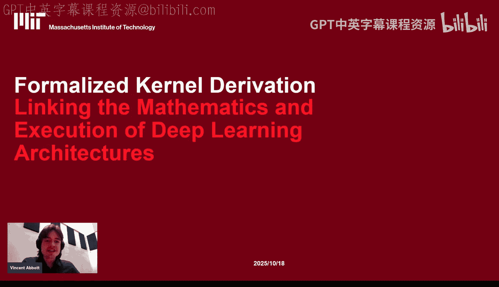

This talk。Well。Cover a key issue， which is that deep learning models despite being pure mathematical systems。

 where from start to end we have a mathematical formula， they lack a formal language of analysis。

So if we look at the diagram on the right， that doesn't really show us what's happening。

 it doesn't really show the mathematics that's occurring。So this leads to issues， for instance。

 driving flash attention。T five years， and you have to note that flash attention already existed within the structure of attention。

With a formal language。Maybe we can approach these problems systematically。

We can be given a definition of attention and then from that definition alone from the structure within the mathematics。

 we can derive these。Downstream properties such as a flash tension implementation or certain probabilistic concepts。

 and we can use rigorous mathematics to do this。So in this talk。I will be covering。

A formal mathematical system to describe deep learning models and how they can be applied to systematic kernelnal derivation。

😊。

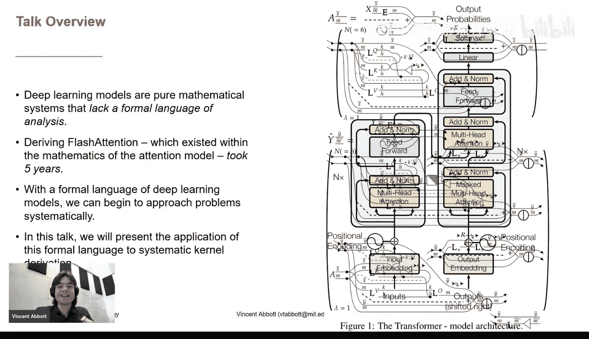

So。Here we have an example for the transformer architecture。

 the transformer architecture can be reexpressed using this。Using this diagrammatic speed。

And as a formal method for deep learning models， there are various applications of this system。

So kernels are but one， you can use a formal mathematical framework to start analyzing probability flows。

 how quantization errors occur， how training interacts with model size。

 will be using in category theory。Category theory is the mathematics of abstraction and composition。

As a result， things that are described with the language of category theory。

Tend to be able to extend to these。Complex， large composed systems extremely well。

And this has been the focus of my lab at MIT。And so we can actually quickly do a demo。😊。

And I can show you what these sorts of formal methods allow。So you should be able to see。Yes。

 you should be able to see here this diagram， so this diagram has been automatically generated。

 So previously we just saw that these formalisms exist but。

The utility of these formalisms is in systematic processes， so you won't understand this diagram yet。

 I'll go into that soon。But for now， you can understand that by establishing this language。

We can do this automatically， and we can derive these systems。So。

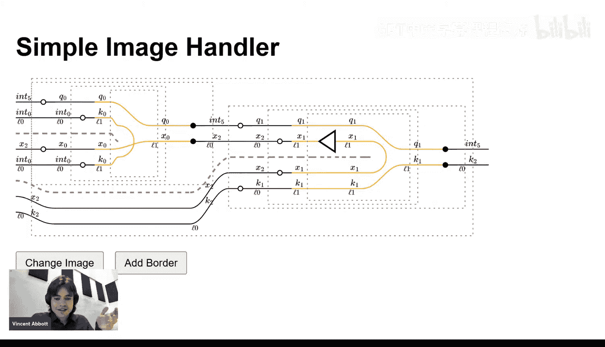

We can go into more detail there later， but now the background。

 what's the motivation for this research， what's the current state of deep learning。

 why does this matter？

就。Deep learning models are mathematical functions。 We all know this。

 The next level equals some function applied on the previous level。But for some reason。

 we don't just use an oracle。 and that reason is。The computational limits that we have to work with。

The design of deep learning models。Is inherently related to the task of implementing them。

 if that were not the case， oracles would suffice。😡，So this was the major insight of AlexNe。

 which was the first network to really use GPUs and use them in parallel。

Transformers came along next， which were able to do much the same process as RMNs。

 but in a much more computationally tractable manner。

By processing everything in parallel across multiple heads。In addition to other key features。

And we have mixture of experts。Mixture of experts are a way of encoding the feed forward layer that takes advantage of even multiple GPU systems。

So we see that the fundamental design challenge of deep learning architectures isn't necessarily having this pure mathematical representation。

 but it is having a mathematical。Opereration， which relates closely to execution。However。

 deriving these low level optimizations or even high level where we decide to distribute across GPs is difficult。

😊，Attention to five years for flash attention to be to be derived and another two years for it to catch up to the Hopper architecture。

 So at the top right here， we see。😊，So a high level diagram of flash attention。

And we have other cases like this， DeepC came out in 2024 and implemented what was a relatively standard transformer model。

 but by betterco designing the software with the hardware was able to achieve incredible levels of performance。

And a key fact is that the performance benefits of these algorithms。

Existed in what was already there， it existed within the contemporary hardware。

 it existed in a close design space to existing algorithms， yet we took all this time to derive them。

😡，So where does this， why is this problem so difficult？Well。

Deep learning models are PR mathematical functions。At a high level， I've said this a lot。

 but it's a very important thing to understand。Because it is。

Because it means there is a mathematical key， There is a。Reason these things exist。

 which lies in existing mathematics。😡，So when we work with deep learning algorithms。

 we go from this mathematical description to an algorithm and finally to a low level implementation。

But there is some reason within that mathematics why that low level implementation exists。

But how can we discover this relationship？How can we readily go from a mathematical function to a low level implementation？

😊，Well， the challenge in large part is because we lack formal representation methods。Currently。

 we often use linear algebra expressions。But they are insufficient to cover their nonlinearities with Indeed learning。

 for example。In this expression。From。The attention algorithm。Of which does softmax occur。

 of which access does concatenation occur， what are the sizes of these variables。

 how does one operation relate to the broadcasting of another？So。

So this is a diagram from my first paper， which。Cover some of these ambiguities。And then given these。

Standard ad hoc linear algebra or ad hoc diagram representations。

 it is difficult to see how they go to the low level implementations we are after。

And this is why driving these algorithms takes so long。

So the answer is we need some formalism for deep learning models。

 which can explain why methods such as flash attention are possible。

And such a formalism would have other benefits for other forms of analysis。

 but in this talk I will focus on low level kernelnal derivation because it is a field where diagrams can offer immense advantage and much of the mathematics has already been sorted out。

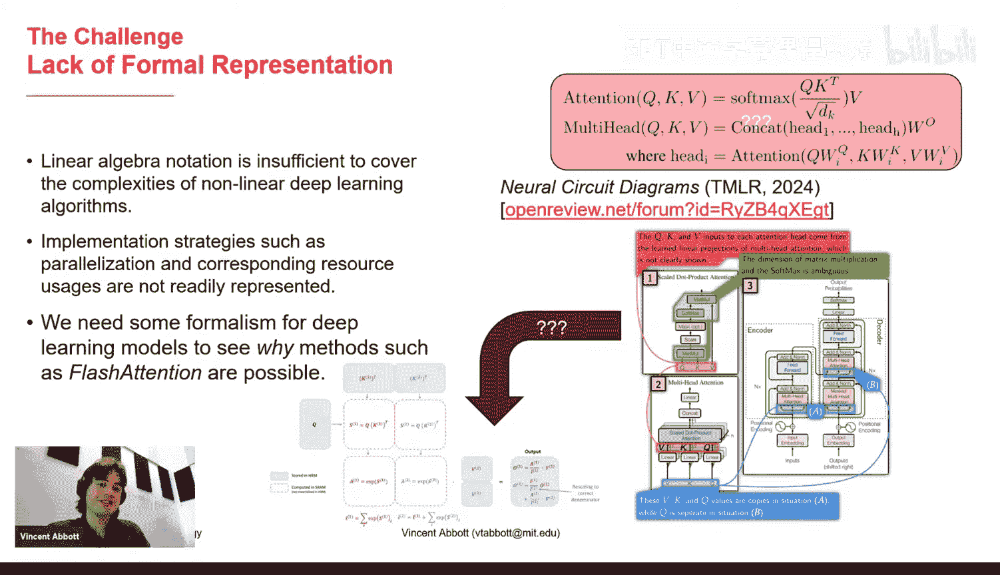

So what's our solution to finding a formal representation？Well， that would be category theory。

Category theory is the mathematics of abstraction and composition。😊。

Its studies compose systems that are generically built from objects and morphisms。

 objects are anchors， morphisms are links。And so this could describe a graph。

 a family of functions interacting with each other。Diagrams of a formal nature or even algorithms。

So here are some examples of category theory， this is from seven sketches。

 and so we can use categorical diagrams to show a cooking recipe how one step relates to another how the ingredients flow。

😊，A famous result from category theory is the Ytlemma。And so category theory。

 the language of category theory， can describe systems。

 but then also provide proofs about certain properties。And then we can go pretty in depth。

A category theory allows for these diagrams to be constructed and within the diagrams are encoded algebraic rules。

 and then complex relationships can follow。😊，But。To many of you that have heard of category theory。

 you'll be worried about the endless abstraction it is sometimes known for。😊，So。How。

Why are we trying to apply category theory？Of all things。

So a way I like to think about this is something like group theory。Is can， on its own。

 be extremely abstract， focusing on things which don't necessarily exist in the real world。

 It's a hodgepodge of theorems or something like Romanian geometry。

But given something such as particle physics， where the nature of the problem is。

Are all of these interacting symmetries， group theory becomes the appropriate and correct language through which to approach it。

Allowing group theory， this abstract field of mathematics。😊。

To serve as a representation of the system and to provide theorems to work with it。

And then the mathematics。The particle physics we have developed， the understanding of。嗯。

Of quantum physics that it has provided。Has allowed for all sorts of implementations。

Within the real world， so we see how an abstract mathematical system。

Given a problem which has the characteristics that system describes。

 can go from being highly abstract to highly applied。So with category theory。

Deep learning models are， by nature， highly composed systems。

And we care about multiple levels of analysis。 There is the functional level。

 There is the implementation level。 There is the probability flow level。

 There are all these interacting。Levels for this composed system。So。😊，And then category theory。

As the study of composed systems and the relationship between them。

Becomes relevant and becomes a relevant tool to describe these things。

So we can go from mathematics to a form of representation。

Category theory provides the language in which we can talk about these systems and the tools and theorems to further describe them。

So we see that this representation can then also go to implementation。😊，So。

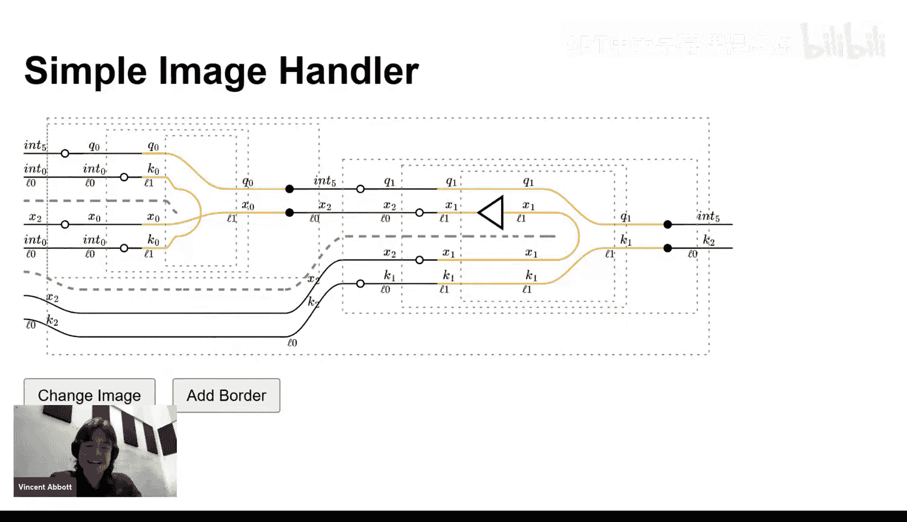

That covers the background of the talk。And some of the。

And the justification for category theory is applied in this realm。And ultimately。

 what we can do with it provide a formal system to describe deep learning models。

As well as hopefully be able to go to low level implementations。😊。

But then the question is what is category theory， what is this thing we are working with。

 this talk will focus a lot on the mathematics。But。For now。

 don't think about it as something too new， for now we will just be describing some diagrams。

 so we start with a product category which will be foundational towards what we do next。

So a category， a product category specifically， how do we construct it？

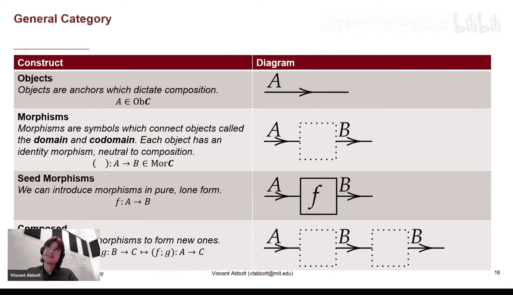

While we have objects， objects are anchors， they dictate composition。

 it could be sets for functions or nodes for graphs。And we will diagram objects in a particular way。

 We will draw。A line with anarrow and label it。Next up， we have morphisms which connect objects。

 we connect。Nodes with edges， we connect。Seets with functions。

 amorphism is anything which will be of this shape， something that goes from A to B。

 or it could go from a to A。And now to describe a category， we will have some seedmorphisms。

And from these samorphisms， everything else is built。This isn't technically necessary。

 but is extremely helpful for representing a category， implementing it， et cetera。And finally。

 we can compose morphisms。This last one should be a C when we compose morphisms， we。We joined them。

And the intermediate object has to be the same， and then this forms aneummorphism。

You'll notice that this shape。Imitates this shape， therefore we are formed amorphism。

So in a product category， we can also stack things。

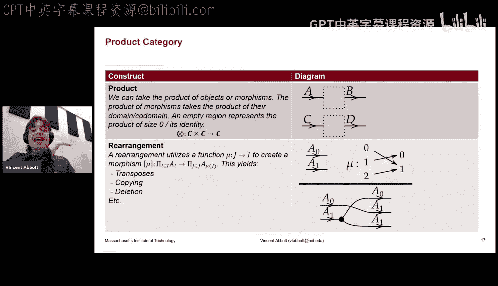

And we stack things with a product。A product can combine objects into new objects and morphisms into new morphisms。

Combining objects， for example， is assembling data types into a two pool of data types。

And in that case。Taking the product of functions would be running the functions in parallel。

So we see how when we stack functions， we also stack their objects。

 functions in parallel execute separately on the two inputs。And using a diagram such as this。

 we can represent that and how more complex systems are built up。Next up， we have rearrangement。

Rearrangement has a very nice diagrammatic representation。But it might not be intuitive at first。

So this is what it represents。Things like transposing， copying and deletion。

Are all sort of the same thing。When we transpose or copy or delete data。

 we're not manipulating the content of the data。We're just rearranging it。When we delete data。

 we have a forgetful rearrangement。When we transpose data， the rearrangement just goes。

Just would go zero to one and one to zero when we copy data。

 we rearrange it so that two things are the same。And we can actually express rearrangements in a unified manner。

We have some sort of function that goes from the outputs。

 you can think of this as the variables we will have afterwards。

The variable names we will have afterwards to the variable names we had beforehand。

And then if we have some variables， we can construct this rearrangement now。

You'll notice that this rearrangement has the order slot。

So the name of outputs comes first to the name of inputs and here。It's the other way around。This is。

You can find that this is the correct way to do it。

 and there isn't really another way and this pattern will be very common and is very important and extremely helpful。

😊，So。We have that， okay， we have objects， we have morphisms， we have composition。

 we can take products or rearrangement。😊，Now， what can we do with this？With this framework。

We can start reexpressing something such as the attention。

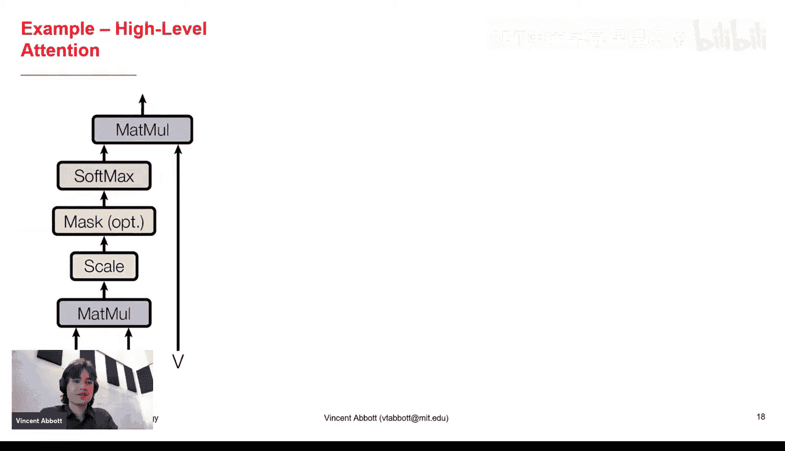

U something such as attention， we can go from this diagram。

 this ad hoc diagram to something a bit more formal。So we have Q and K， we label the objects。

 which are sets， we label the morphisms， which are functions。And then we follow it through。

 you may notice this is the exact same。cateategoorical diagrams match very closely with what we would intuitively do。

 they match the flow of data category theory is a way of formalizing things that we very often are already looking at。

But because of its rigorous structure， it allows for extensions to be developed。

So what extension do we need for this class？Well， the one on the right isn't very helpful。

 We've already covered why there is structure in this， which this diagram doesn't show。

So we want to develop a way of showing that structure and to do that， we will develop。

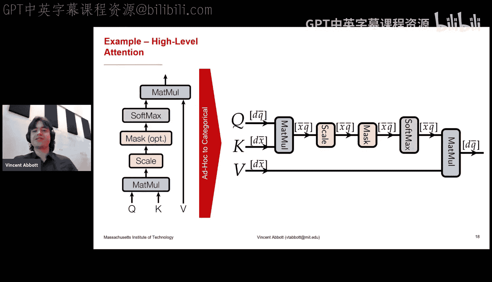

A specific category。Caed the Array broadcasted category。So。

This category will represent as its object。Will be a raise or two of a raise。

And its morphisms will be functions between arrays。And we will develop specific infrastructure。

To allow for broadcasting to be clearly expressed。So。

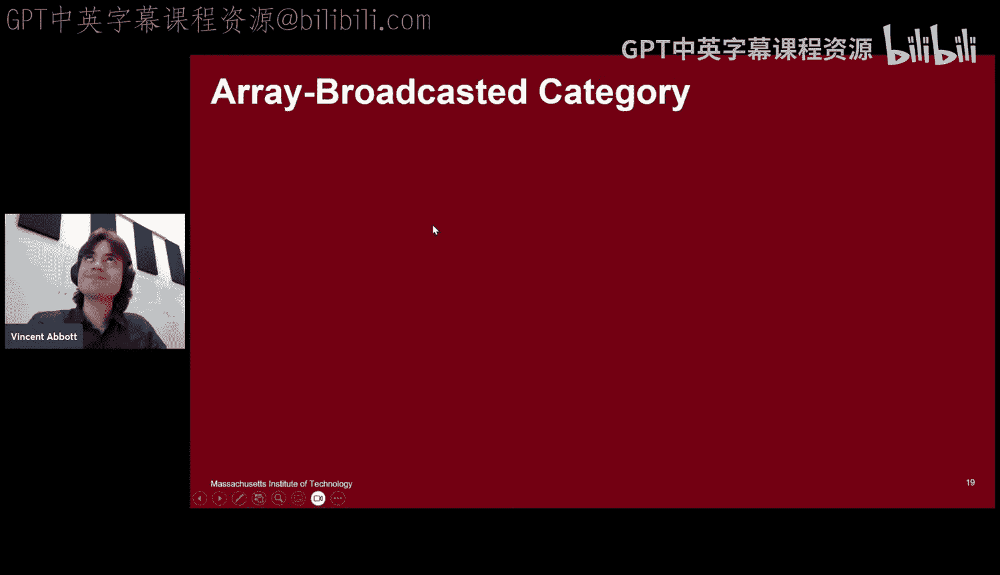

We'll start with。The size category， the size category represents the coordinates。

 which an array may take。We should all be used to this。In。It corresponds to the size of arrays。

And so the objects will be that。And then what is the product？

The product is assembling individual sizes into a multi dimensionmensional size。And so。

We have this infrastructure for sizes。We will show what。嗯。Morisms in this category are very soon。

But for now， we have sizes and we can work with sizes。Cool。Okay， but what that？Well arrays。

 we can use these sizes to define arrays， so an array is some base data type， you know， FB steam。

 the real numbers， anything else。and a size and so we're basically saying for every coordinate that exists in the size。

 I have an instance of the underlying data type。So here on the right。

 we have standard representations we could call them。

Where we have these grids and they represent values within an array， but we can develop diagrams。

 So how do we do this？What do we do is we draw an arrow with a base data type？

The underlying datatype， then we draw the size above。

So here we have a and A is an object in the size category。

 and the size category's object can be broken apart into a product of other objects。😊。

So we can represent this data time。By this expression or by that expression。

 they're both the same because these two are the same。

And note here that we keep the  error on the base data type， but we remove the arrow from the top。

 the reason we do this is just do not confuse them with each other。Okay， next up，morphisms。

Object object， simple enough。Anything that goes in the middle constructs amorphism。

And so this x might be that or and the y might be something else， or we can use the system to。

Expressed this。To express this category。Next up we have the product。

 the product is the Cartesian product， things going in parallel because we're using stacking without any separation to mean one thing we developed this dash line system to distinguish products from each other。

This can then describe。Twoles of array and functions acting in completely independent parallelism。

And so if we had this function and that function stack together。

 it would be a function that takes a tuple and produces a tuple。

So that's the Ar World class category。It means we can reexpress this。As this。

This is a bit more useful。We see that this is the size of everything flowing through the system。

 we can keep track of things a little bit better， but still there's a lot of structure here that's missing。

That structure is the gold cost of card。But。Anyway， for now we can make an aesthetic adjustment。

 we'll use pictograms in names to represent key operations。So we use cups for matrix multiplication。

Which is akin to Penrose diagrams and physics。And softftmax will be a triangle。

 it's a very important operation， so a pictogram makes sense。

So now how do we introduce the rest of the structure。

 how do we show the relationship between this cue and that cu and so on？

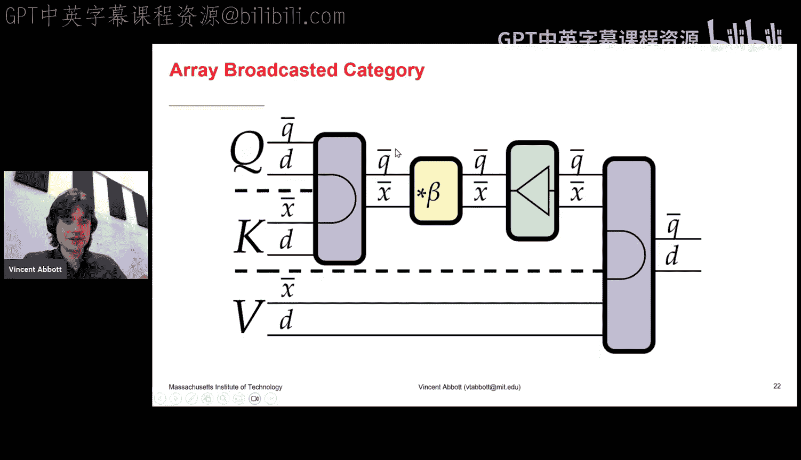

Well， we need to develop infrastructure for lift。

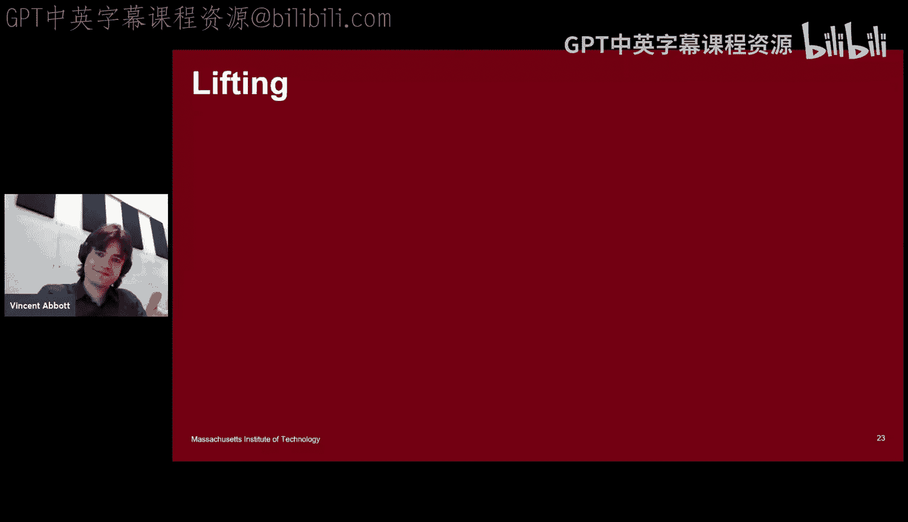

So that's what's wrong about the picture on the left， we don't have this lifting information。

So this lifting information is critical to things such as flash attention。😊。

Because it is ultimately over this Q axis that flash attention occurs。

So we can develop diagrams to clearly show it。Such as this。Shows this relationship。

 this queue is related to this queue and so on， all the way from the end to the start of the operation。

在。What is the thing， what is this thing we're doing Torchs Bap doesn't get too much information。

 but we can provide a formal definition。So let's start here。

We start with an operation that goes from the array on the left to the array on the right。Like so。

 and we know that using our diagraming tools you can represent it like this， inputs。

 outputs labeled with sizes。Now。When we lift something， we have F act across rows of a bigger array。

 so we have this。So here we have F acting on first， second， third， fourth row， etc。

What will this look like？This will look like a this will be diagram as a function acting on PA。

And producing E。And。We can do this wonderful trade。

Which is where to indicate that F is broadcasted over P， we just draw the P axis。

Over the top of hair。This modifies the input output shapes in the correct way。

And clearly shows the relationship between these two。So this is what lifting is。

So how can we provide a bit more of a formal definition because we want to work with this we don't just want to。

Have lifting be a thing that exists。 We want to show how lifting relates to things such as flash tension or indeed some other。

Analytical approach we want to take to deep learning system。So we define lifting as follows。

We use indexes。

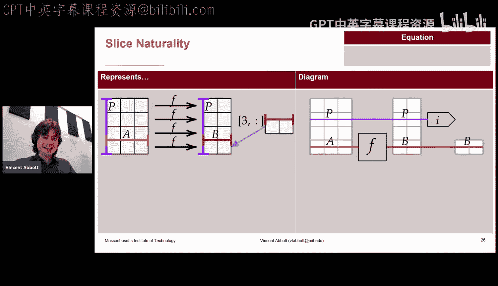

So an it or slices， rather， a slice is。Such as in Pt， where you extract a specific column。

Or specific row。So in this case on the left， we're extracting the third oh。

The fourth row of the expression。Over here。And so。We know that this fourth row has been generated。

By F acting on the fourth row of the input。And similarly， we can diagram a slice as so。

 so the slice on the eye axis just as in pie torch。

Then reduces that access and then leaves the remaining。Access behind， so this would be B。

So this left hand side can be represented like this。We have F lifted over P。

And then that slice being applied after。And what is this equal to Well。

 it's equal to F acting on the fourth slice of the input。Well similarly。

We can show it as so with eye， this slice moving to the front of the expression， no doubt this。

Fourth slice corresponds to this。So this correspondence over here has this diagrammatic representation。

So this starts to show diagrams have some power， not only does this P axis correctly indicate the input and output types。

 it also allows for us to start performing algebra。

And so this is how we can define a lifted expression。So here。

We have FP and let's imagine we don't know what it is。

 but we can just say that given a slice over eye。FP will be equal to that slice applied onto the input and the function F applied afterward。

So we can use F and knowledge of slices to define what FP does。

And we have this slice naturaltcher hour of property。Where a slice after an expression。

Can be moved to a slice before， and both are mathematically equivalent。

So in our attention model we had Som broadcast over Q， what does this mean？

Means that a slice after the expression becomes a slice before。What element wise expressions。

 we have the axes going at each side。So we have both axes going through this means that slice so if I ask what is the IJ coordinate of the output is equal to the function applied onto the IJ coordinate of the input。

And so here， just a quick note。This is the product of size zero。

So when we lift a base data type by a product of size zero， we get an item， it's a loan value。Also。

 you may notice that we're not writing the base data types much here。

That we can keep it implicit we know what's happening for loss of this analysis。

 it's not directly relevant。So we have slice naturality。Now let's go back to the size category。

 what are the morphisms， what possible morphisms would we want to apply onto the size of axes？Well。

 App transforms。This definition is。A fair amount。All we really have to know is that we're restricting ourselves。

To refine transforms of coordinates。This will become very important because it last for some very nice。

啊。Heears to be derived like your。So anyway， let's keep that on the back there。

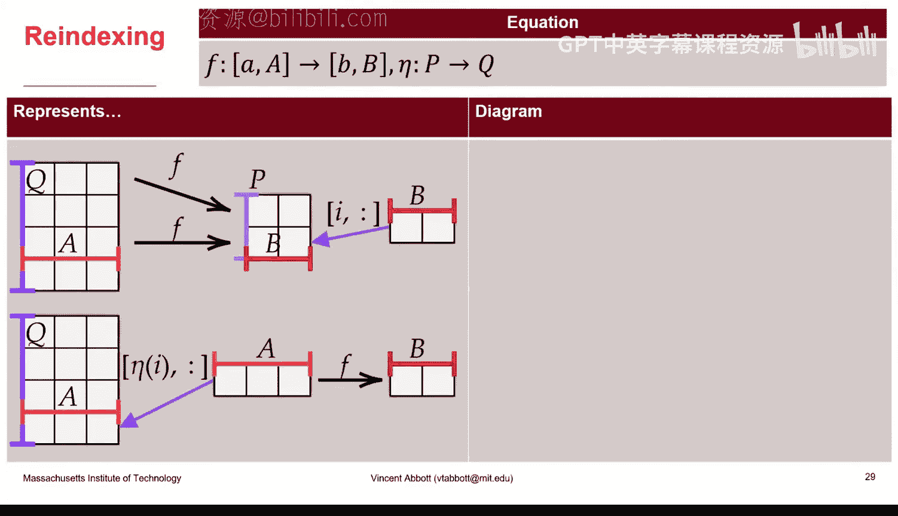

Next up， after lifting， we have re indexing。Reedinding is where we lived。

 but the output slices don't correspond to the exact same input slices。So this could be that the Iat。

Output slice corresponds to the atar higher。Inper。Exactly it。We have this sort of pattern。

 so what does this look like， well， this would look like。This row produces this row。

And this rock produces this row。So that how can we clearly define this， what we say， again。

 Ith output corresponds to A to I input？So A are maps from zero to zero and from one to two。

This could， for example， be the dilation in a convolutional network。How do we diagram this？

You diagram it like this。Well， we know that the input here is QI， so we can ch QI down。

The output is PV， so we can ch PV down here。And then we have some slice acting on it。

 so this slice is in。And then we know that this should be equal to that。So here we have。

The a to I slice。And then this produces a， which F can act out。So。What do we put here？

You can just put Eta here。So if we have AA above an expression， it maps from。

So A are maps from P to Q。And here we have P to Q。And we put data here， so the orders up。

What it means that I。Effectively， it goes left。 and then it。Interact with Ather to make this slice。

 which can be moved behind the expression。So we have this， we know what F is。We know what this is。

 it is just a slice。He say that this is equal to that。So this defines a reining。

So what can we do with three indexs， why have we gone through all this trouble of defining them？

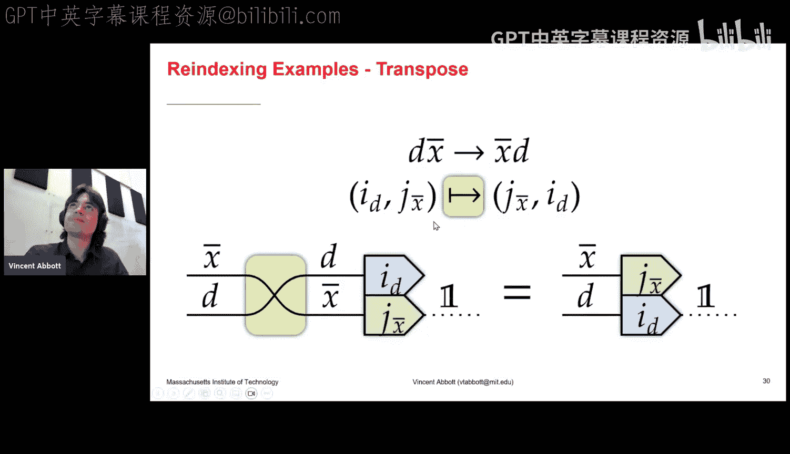

Tech transposing， for example， what is transposing。

 transposing means the IJ coordinate of the output。Is equal to the JI coordinate of the input。

These two swap around。Previously， we defined。Rearrangements is a fundamental component of these product categories。

 and here we're using them。We're rearranging the indexes。To swap around。Then we're using that with a。

Reindexed lift to define what a transpose is。So that's one example。

 we can use this reinexing terminology and this rearrangement in terminology together to present trans。

To show that transpose is just a specific instance of this thing。Furthermore。

 we made something like matrix multi。

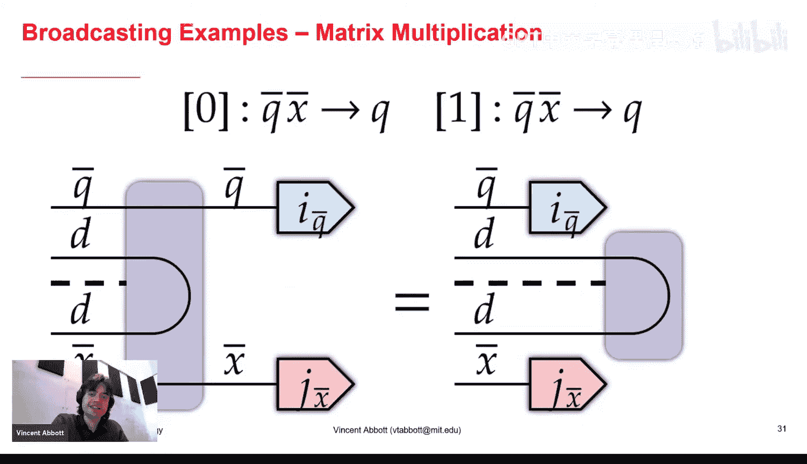

Major smallplication is a bit more complicated， but fundamentally。We have the Ij output。

Is equal to the。I。Slice。Of the first input segment and the J slice of the second input segment。

What is this operation that goes from IJ to I， itss deletion？Projection into the first dimension。

So this can also be represented as a rearrangement， same with this。

So we can use rearrangements together with reinexing to define these operations。But we can do。

We can also do this a bit differently。For makes some ofplication， I mean。

We could have that the Ij output is equal to this slice rearrangement。And with diagrams。

 this can be clearly shown， we show how J relates up to X and how I relates to Q。And so here。

 the rearrangement。Of projecting into each of these segments is implicit。

And we can effectively just trust the diagrams to show us how things are fun。

So now we've built up this infrastructure， what can we do with it， well。

 we can take attention and reex it as a series of lifts and reindex。Giving us this expression。

So over here。We can see we have Q and D， and this axis travels all the way through。エクサービスでスみたいし。嗯。

So what does this mean， well let's have a look。We stop with our expression。We show the broadcasting。

And let's take some indexes and let's see what they do。其他我没发。Across。Across。And across。

So what did we just do？We shot have this expression。Our some output。Rellates to specific input。

And furthermore， how this is。And this， furthermore， these outputs are independent of each other。

So what does this mean？This means that we have the output of the expression。

Is equal to a series of independent calculations。Does this mean？

Does this mean that we just derived flash attention like this as a way of decomposing attention into a series of independent operations。

 but no？But sort of。We'll need a bit more infrastructure for that first。

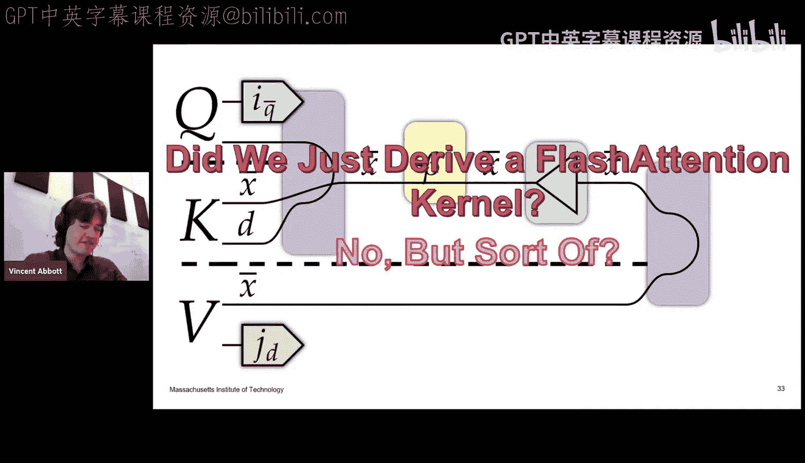

So， but we got close。And。

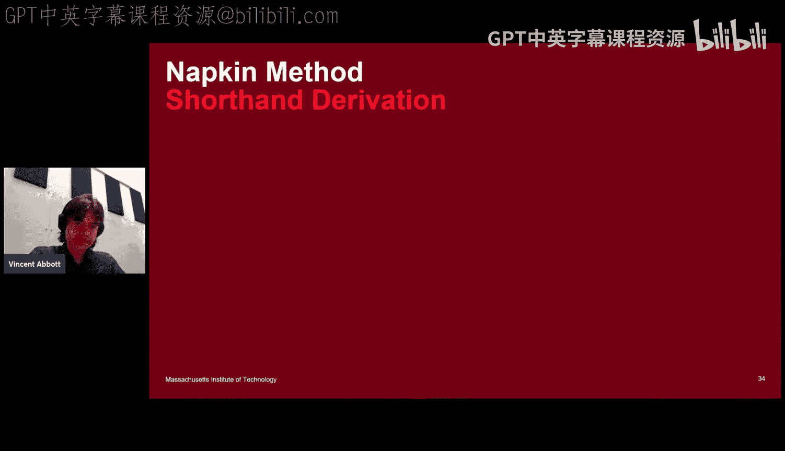

Sureir。Qu，So next up。

So this has been a lot already。But hopefully most of this should be。

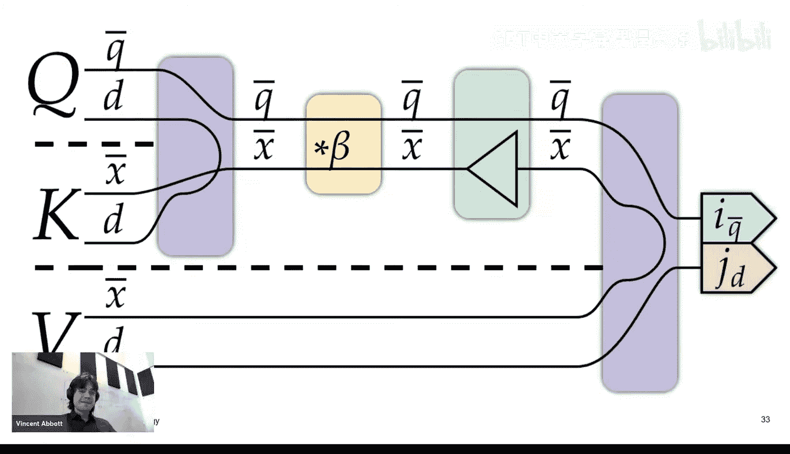

Understandable。We use lines to broadcast expressions。

 and we use the shape of lines to show how output indexes relate to input indexes。

 and this can be composed something into independent expressions。

This is not quite enough to derive something like flash attention yet。

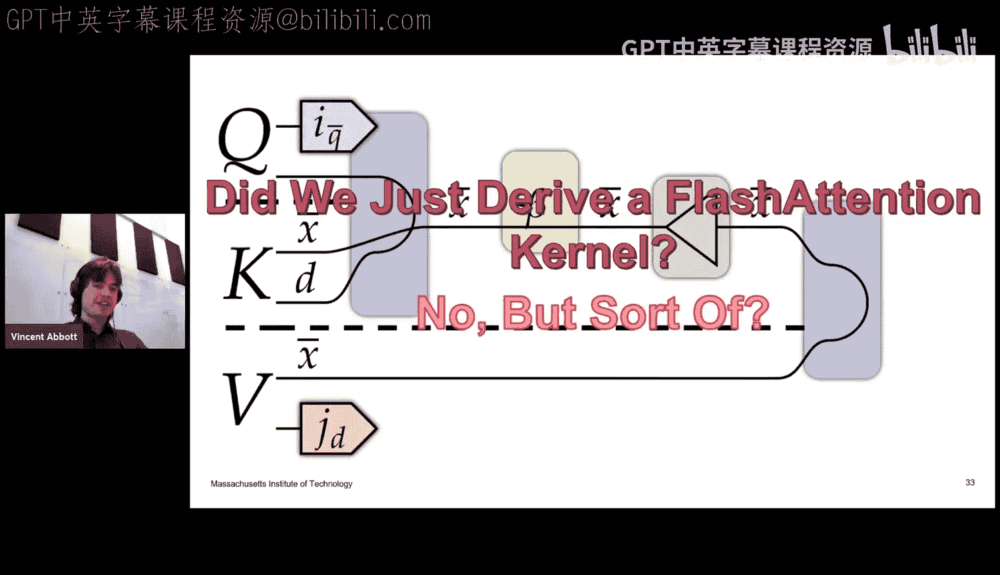

So。The rest of the talk will be。In two parts。First。

 I'll go over what I like to call the napkin method。

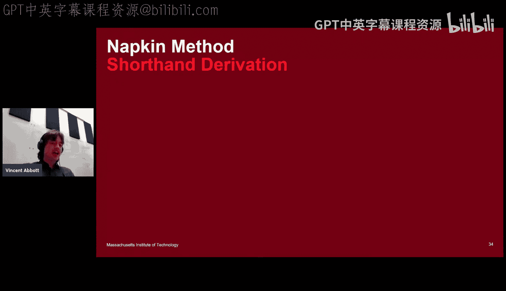

This is shorthand derivation。So this is without too much of the formalism。

The napkin method is what we were both up to with。The second part of the rest of the。

Which will be quite mathematically intensive。Going over the napkin method first。

 I think is a good way of firstly。Getting the diagrams to be a useful tool that you can start using。

And to understand why deriving this mathematics is so important。😡。

So。What is the napkin method？It is the fact that given this。Diagram， we can get。We can derive。

Flash attention at a high level because we can see the independent operations taking part。Okay。

 so how do we do it？We begin with a high level diagram， such as the one you see。So first we know。

 there is this property of acts of certain operations that they are streamable。

And when an operation is streamable across an axis。

 it means the input to that axis can be fed in chunks。And accumulate it at a lower level。

So softmax followed by matrix multiplication， is an instance of this。So we can relay with the x axis。

To be screened and to be sent down in chs。And then this axis because it travels all the way through。

 all the way through the expression。We will have the streaming take。So we can do this。

And so now this Sx figure。This represents the size at the lower level， it represents the chunk size。

And now what do we do next， well， previously we showed how an index from here flows all the way through to the star。

So instead of executing all the key values at once。We can execute them in independent charts。

And we labeled that。G器。So what do we now have here on the right？We have a sub algorithmgorith。

This sub algorithmgorim says whose diagramgram says something， what does it say？It says that we are。

Distributing into blocks over queue， each of size GQ independent operations。And for each block。

We are streaming the axis。X in chunks of size。S or S。So。

What we can then do with this is this shows the amount of memory on chip it shows the amount of。

Transfers that are taking place for each of the sub algorithmgorithms。

And it shows the number of sub algorithmgoris we have。

 the number of sub algorithmgorims will just be given by the total size of Q divided by the individual chunk size。

So it can half that。But there is a restriction， the bigger GQ is。

We have to keep GQ below a certain level as to not violate lower level memory。

So we have to take that into account。But given that our stream size can be small。

 small enough to ignore really。We can get this expression。

So this gives an upper limit to the size of PPP。Okay， great， so we have this diagram。

 it represents a low level algorithm， and it allows us to get the maximum memory that we're be on chip。

😊，But we also want。For flash attention， the big insight is。

Being able to reduce the total number of transfers that take place。Sorry。To calculate this。

 we will look at the transfers per tile。And we get that by looking at the size of the inputs and outputs to the expression。

So we have the number of loads and the number of saves。And from this。

 we can calculate the total number of tras back。We multiply the number of sub algorithmgorithms by the transfers per sub algorithmrithms。

And taking these two together。We get an equation。And furthermore。

 we can find GQ because of our previous condition that the maximum memory cannot be violated。

And from this， we simplify the expression。And we get to the same performance model as。

But as the first flash attention paper。So what have diagrams just got？

Weve started with a diagram and then applied these tricks。

Basically saying that we can stream and we can tile and that these strategies travel across axes。

From this， we have derived the performance model。The same as the one from F attention law。

And we have derived an algorithm， an algorithm which。

Chunks the Q values to be operated on in parallel and chunks the x axis to be streamed into each tile。

So we have derived the algorithm。At a high level from flash attention to。在。In。

Me and Joe is prior work。Flash attention on a napkin。

 we develop these methods and then we apply them。And we we saw how deep we could go。

 and using these diagrams can derive a very low level algorithm that says the specific operations that must take place。

 how axes must be。😊，Split in parallel to be streamed， et cetera， and can even get insight into。

Into the number of clock cycles required per operation。However。

These methods have up to now been diagrammatic。There are algebraic tricks that we can use。But。

There is immense value in not just having the trick， but having the truth be able to be。

Systematically implemented to be rigorously defined to not just be， you can do this with the diagram。

 but to actually be this is what the underlying mathematics represents。

And this is our correspondence to an underlying algorithmic process。To build a formal tool。

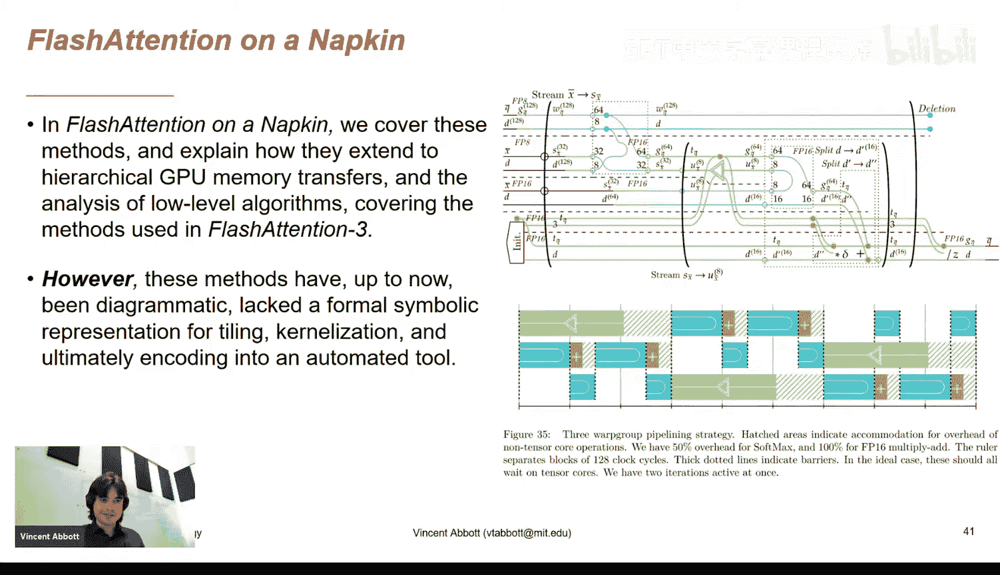

在。That'll be the next section of this tool。We've introduced these diagrams。

We have shown a specific instance of how they can be used to。

Look at a method such as flash attention。But what does this overli on？

What mathematics have we been using， or how can we be confident that it even makes sense？Well。

 for that， we will turn to broadcasting Al。

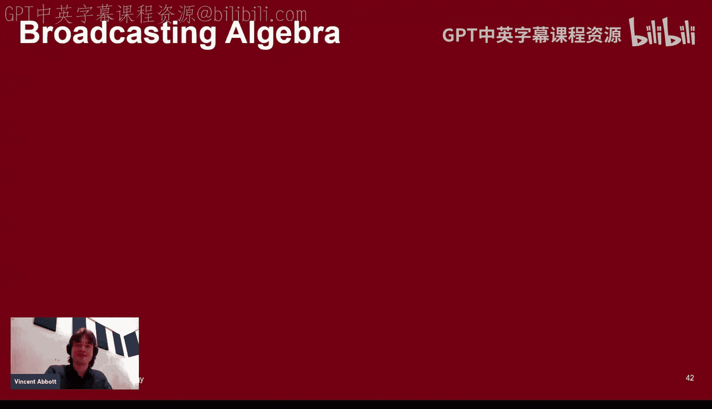

So。We have introduced lifting。When we left， we can take an array morphism， a function between arrays。

And a size andmorph something of them ane。Rearrangement of coordinates and not necessarily rearrangement can be more general。

And then。We can take the arraymorphism and stack the size morphism on top。

And now what does this lead to， this lead to the expression on the right。

And because we're using category theory， there are some useful tools。

 I haven't introduced you to identity morphisms yet。

But think of identitymorphisms as saying whenever we can use amorphism。We can use objects。

When we can use morph phs。Which sounds weird， but we have already used it。So for instance。If out。

Seismmorphism was just the identity mapping from P to itself。We have a standard list。

 we go from P to P。Instead of the index going from。IP eight I p。The index just goes from IP to IP。

We see that。Lifting is a specific instance of a reined lift where we use the。

Identity sizeismmorphism。Additionally， we may have an array identity and a seismmorphism。

 and then we will generate this expression。What does this mean？

This is a peer rearrangement of coordinates。It means an instance of this that we have actually already seen is for transposing。

But copying would be another instance。嗯。In these casess。

We're just saying this operation doesn't do anything to the data， nothing is happening to the data。

But which coordinates refer to what is changing？And so in this framework。

 we have distinguished between。Operations， which。Change data and change the content of data and operations which just rearrange data。

 and we have shown how they can be represented together as one unified concept。

So this allows for a general description of the operations that take place in these learning models。

With careful attention being paid to how data is rearranged and manipulated。And furthermore。

 provides the key insights we need。For。嗯。Driving， say。

 low level kernels or studying how probability evolves through a system。Because these。

Characteristics such as colonization。Stem from the fact that data is in part just being reindexed rather than being manipulated and is being reindexed in a specific way that this method can accurately describe。

So what does lifting give us？Well it's category theory， we care about composition， right？

Lifting gives us this really powerful compositional property。

When we have two expressions next to each other that are both lifted。We can join them together。

The composition。Of。Two listed operations is their composition。Lifted by the composition of their。

Three indexing。So here we have used this notation。Semicolon this represents forward composition don't worry about it too much basically says we do F and then we do G you can contrast this with the circle notation。

 which is we do mu and then we do ata so it's just swapping the two around it makes these categorical expressions just a lot more coherent to work with。

So what do we have here at the bottom？And we have to talk， but how？

If mu was the identity of P and G was F and F was the identity， we get this。

And then on the right hand side， we have。If mu was ata， if G was the identity on y。

 we have this expression。And these three all interactive indexes in the same way。

 If I qued any of these expressions with an index， I would get the same result。

Indexes form what is called in category theory， a family of projections。

Meaning that if two things are equivalent over family projections， they are necessarily equivalent。

So。And now we will get to broadcasting。😊，Okay。So。Broadcasting。With matrix multiplication。

 we saw that the two inputs took different reindexes。

This can be seen as a more general case of lifting， we can express this in terms of liftings。

 but being the more general case， it is the thing that we want to focus on。

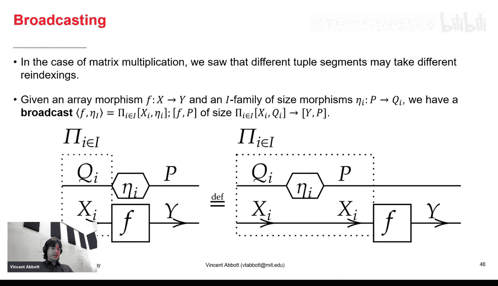

It is if we can describe how broadcasting interacts with kernels， kernelization， index flow。

 et cetera， we can describe broad we can describe。Colonnalization in general。

 not only will we have described the basic cases of one input， one output。

 we will have described multiple inputs。And a single output we would have described。And。

By focusing on reindexings in general and not just rearrangement reininges。

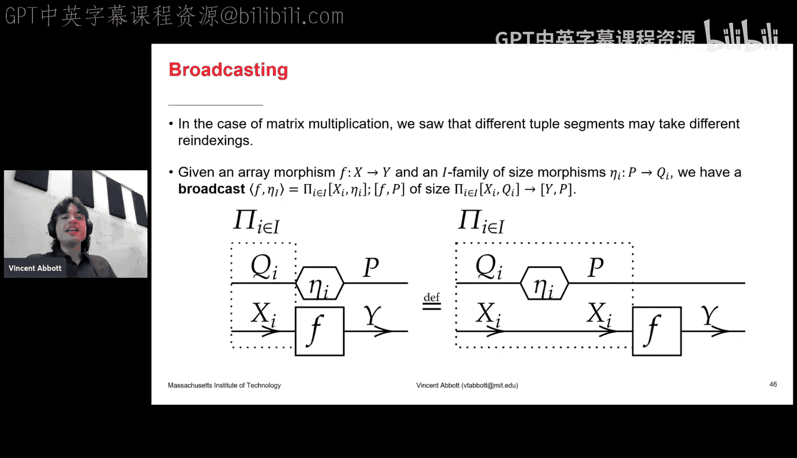

We can describe both something like attention where we can mostly get away with。

Just rearrangement free indexings， but we can also describe convolution。

Which uses addition as its reining， so we want to describe the general case and the general case is broadcasting。

So what is broadcasting， just think matrix multiplication or that specific instance。

 what we did there， that's what we're talking about。

 we're saying that each input had a different re indexing。This is。And in order to represent this。

We will use this shorthand。We will say A to I in the case of matrix multiplication。

 projection into the first projection into the second。And then here we're representing a product。

 so this product is X I， QI。So this is a product of multiple arrays being represented here by this notation。

 the I， we have this I here means we're working with all those one。So we just have this notation。

 which is。Said to be definitionly equivalent to this。Great。

 and then we can drop the pie symbols because we know that if we have these lingering eyes that it means that there is a product。

Beyond the scenes。So what algebra can we do with broadcasting？Well。

 broadcasting is just lifting reexpress so we can do this。If we have this expression。

 F will cost it and then some me。We can move new into these expressions。Again。

 this is a consequence of both the expression on the left and the right doing the same thing to all indexes and therefore being the same。

And so we have this equation。Well it's a diagram， but the diagrams are equations。

 it is very important。😊，And we will use it in a。In an innovative manner。

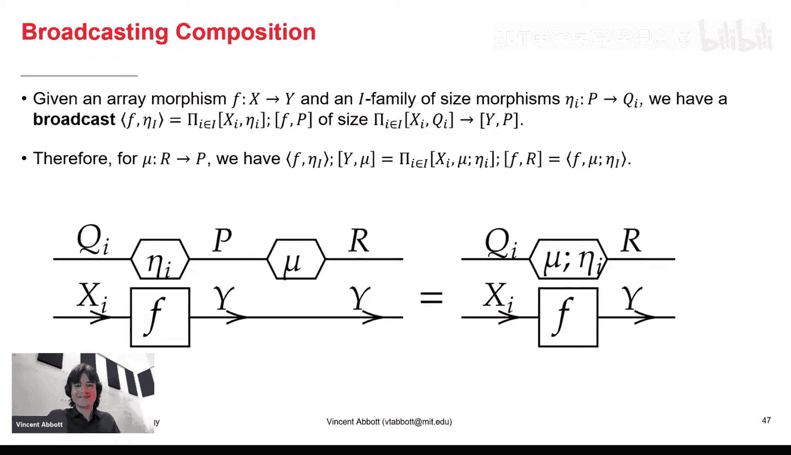

Colonels entirely T， Okay， we've just covered so much algebra。 There's more algebra to come。

 What would have covered so far as what can we do with diagrams。😊，How can we look at indexes。

 rearrangements， underlying functions， how can we matchsh them together。

 how can we like study the flow of indexes， how can we come up with these nice diagrams and equations to represent it。

Why did we do this？Just five panels of coals。How can we use this to straw tunnels？

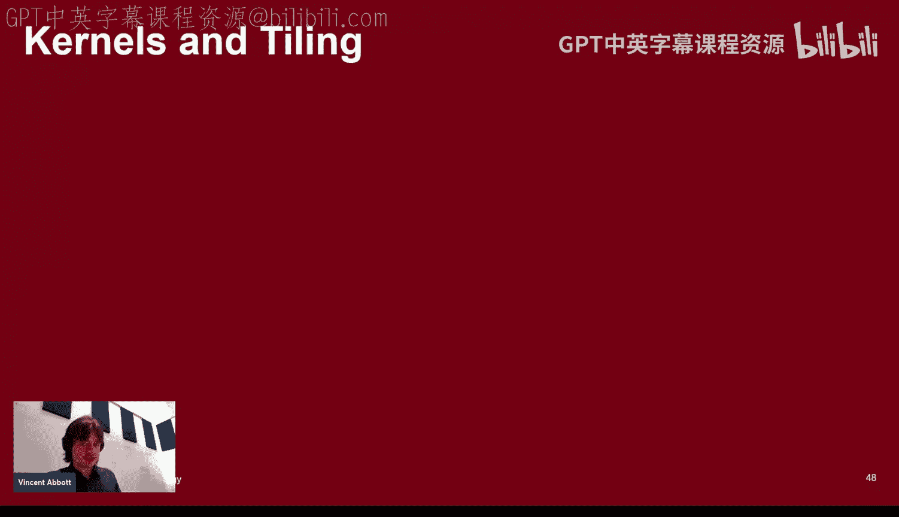

But first， let's be clear about one。We want the tunnel to look like。A colonel。Is in essence。

Some operation which splits data into independent tiles。

An operation acting on those independent tiles， the sub algorithmgori。

 and then an operation joining the outputs together。So it's some F。Can be reexpressed as sour。

It means we have developed a kernel。They have said that F could equivalently or correctly be executed as a series of parallel operations。

And now， just as we did with the NaA method， the amount of data applied for XKappR。

Is less than the data applied for X。And thereby， we are able to efficiently do this at a lower level of execution。

😊，We will achieve colonization using tilings。Okay， this diagram。It's amazing。

 but you need to know what's going on。How will we do this， how will we show T well。

 we have our reining tools。What does reinding do， it could take in operation such as P Kappa。

 T to pe。And then generate a split。XP， X， P capa tea。This is what we're off there。We're taking X。

 and then we're splitlicing it。So here we're taking X。And we're splitlicting it。

But we're taking X and explicit。What reining do we need to find this？We need something of this shape。

Right。But why this portion on the left？Well， this pot on the left means。We take the value of P。

We just take it just as an identity so we can use objects to represent their identitymorphphasismt。

Then we take our grid index。T， so this represents our allocation on the grid。

We multiply that by some stride and we add these together。So using this。

 we can go from a coordinate in this。In the grid， which has both the local。こでね。

Within within P CAappa and the grid coordinate within T。And we can combine these to get a coordinate。

In the original array。So taken together， this allows us to go from。A big array into these sub arrays。

 The subrays are indexed by T。 The location within the sub array is indexed by P Kappa。

And we can do this using a reindexing， so we have indicated that this operation doesn't change the underlying content of the data。

It just puts it in different spots， or it uses a different system of coordinating the data。

 and that is represented by the reining。So in this manner。

 we are able to define splitting an operation into or splitting an array into sub arrays using this reinexing tool。

Okay。😊，And now some tiling algebra。This is。What's the essence of this？

This mathematics is here for you to indulge in if you so desire， but know what's the essence？

But we're saying that。嗯。Reindexs compose in quite a nice way。And this is a nice way to express a T。

So we say that if we have a tiling and we follow it with any athne reindexing。

 we can rearrange it into this。We use this sort of notation。

 this notation here basically just means that。Every one of our eine functions is some map from naturals to natural。

Fundamentally。But when in the category， we have to label the domain and code domain。When we do this。

 we are restricting that function to a specific range and image。

So AP is just a way of showing this restriction。So here we have our original form。

Ata on P Hp is the size of the full array， and here we have Ata on P Kappa。

This is A acting on a sub array。This is a tiling that comes beforehand。Reindexing off。

And then this is a reindexing that comes beforehand and a tiling that occurs afterwards。

 just a reminder that these being objects represent their identities。Soir。This tiling。

 how is this stride derived， it is derived from。Cappa， so the。

The kappa strip passing through the linear component of ATA。

 so we already get the offset of ATA from here， and then we have the linear component。

We can test this by tracing it。8 to apply there。To there， plus。Kappa Lambda Ata gives a stat。

 which is equivalent to the other side。So because of the property of。

 this is why we chose aline functions because we can do this rearrangement。

Where a reinexing or a tiling followed by reinexing can become a。Reindexing followed by Tiland。

 their order can be safely swapped。So what does this do？

This allows us to go from this expression on the left， which is a。Broadcast， followed by Tyling。

And just using the broadcasting algebra， we can do this， this is uses the lifting algebra。

We merge these together。And then the right hand side can be reexpressed。So then we go from this。

Did this。Now this means just as we did before， the reindexing comes first， followed by the tiling。

And so what does this mean？Well， it means that we have taken F， which。Opers over degree P。

 it is a Pfold broadcast and now。It is a P Kappa fold goal card。This is the big function。

 and this is the small one， this is the sub algorithm。So these two are equivalent using algebra。

And now we can we're going to use。We're going to come with the diagrams easily show this。

 So we'll just do that。 We take this T axis， and we just。Represented as a bounded box。

A dash bounded bolt and then you know that this shape。

Means we have a tile and reduces the tea and gets rid of it in the process。So we have this。

So an expression followed by a tiling that is tiled over the same axis。

So this capilling happens at the peak。Becomes a tiling， which includes F。

This is tiling subordination。And is how we derive kernels。So。For join。

 so remember how kernels had a split and then a sub algorithmgorithm and a join。

If the tiling is invertible。Which is the case if the stride matches the size of the sub algorithmgorim。

Of the sub algorithmgorith tile。Then。We can come up。With a joint。So this join。Goes from。

A series of tiles to a single array。And then we apply this join onto the end of both expressions。

 because this holds。We end up with this。So we take。This is our function， our original function。

And we have just derived the kernel。This is a kind。We have a split。We have。

What each individual sub algorithmgorithm does， and we have a join。This is general。

All that has to be the case is that the tiling occurs over the same axis over which the function is broadcast。

😡，And so as a result。This tiling can absorb something that comes beforehand。So if we look over here。

 we have a tiling afterwards。That tiling afterwards can subordinate G。

Which can then furthermore subordinate air。Tlings and by expressing tilings in this way and by allowing for。

Reindexing this like this A mathematics， the mathematics of broadcasting， all of this。

 what this allows us to do， the reason we have done this is so that we can take a tiling。

 we can show that to composers， and then we can encompass multiple things。This is a fused expression。

This is how we can generically represent what it means to fuse operations and therefore only have to execute them once。

😡，This block serves as a sub algorithmgori which executes both。In sequence at a lower level。

in this case， there doesn't have to be communication with the higher level。If we didn't。

Decompose an expression into these tilings。We con fuse in a very straightforward manner and what we are left with is a fused colon。

😡，So that is why we have developed all of these tools before， all this algebra。😡，And furthermore。

 we can do this subconnal trick， which is where when we merge things。These expressions。

Can also be turned into kernels。So this represents a， this is multilevel kernelization。

Because this can be transformed into this。You know we know this can happen。And。

This matches closely with， for instance， when you're doing something such as attention and you move matrix multiplication to a war group level rather than registers。

This represents。A hierarchical process。So using these tools。We have。

We have shown how a kernel is really a special form of reining and that fusing kernels is a special form of composition。

 these insights are very category theory flavored because the language of category theory that allows us to express deep learning models in this array broadcasted manner then leads to these tools。

😊，And， but there is one aspect of。Colonnels， which we haven't looked into yet。And that's streaming。

Streaming is when， for example， matrix multiplication， we don't load the entire input。

We load the input in chunks， and then we add the chunks together。

As covered in flash attention on a napkin。Streaming has this。General4。

Whenever function can be re expressedpressed as the operational on the right。

 but we have the function Act。On a。A portion of the S axis。

And then have the rest of the S axis be accumulated。So it can be expressed like this。

 so what we're doing is we're splitting this axis， giving us to array array。

We're feeding one of them to the function， and then we're feeding the other one to an accumulator along with the output of the previous function。

In the case of matrix multiplication。Because matrix multiplication is associative， we can do this。

 we can take the input， we split it into chunks， we feed one chunk， we take the output。

 then we sum the output with。With another chunk from the next。From the next input。So we can organize。

UmOur expression in this manner， reducing the amount of data that has to be keptped at lower levels。

If this equation holds or if this diagram holds， they're the same thing。We can do this rearrangement。

Where we recursively expand the expression。So this means this。Is sufficient for。嗯。不呃。

For streaming to be of any size we really want， we can do any number of screens。

And so streaming looks like a sequential tiling。Instead of having the function。

Instead of having this function， we express it in this manner。Where this input is。

Is known to be a collection of chunks， a collection of tiles， so it has this additional dimension。

So we have S and thatt， and then we have a tiling so remember this is what we use to indicate that something is a tiling。

 we have a tiling which splits this into chunks。Which has this additional red axis N of Sigma。

And then this is fed as the input instead。So this also forms a title。

So what can we do with this so suppose we had some function followed by a function with a streamed input and then we have a tiling afterwards so we want to subordinate the function into the ti well what can we do？

We can subordinate G。Into the screen ti。And then we can subordinate the entire expression into the capappa tiling。

So。This means that this aspect。Is run n times t times。

This everywhere that's not covered by the stream is only around teen times。

And the tools we have developed where we can subordinate things cover this case， and furthermore。

 we can subordinate things into the stream component of an express。So。We have just covered。

And this is the general case of a kernel in general， a kernel will have some tiling。

 some parallel tiling as well as some sequential component。

And both of these can be used to subordinate expressions that come beforehand。

But there is a very important case to consider。

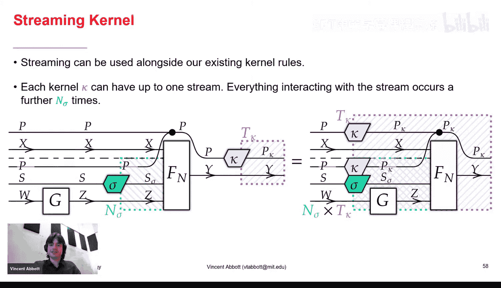

And that is。We。Expressions are misaligned。Because tiling and streaming can only occur when we have appropriate index for。

What if the indexes don't flow in a？

In a trivial manner。So what are some cases of this， well， we have weaving。

Weaving is when we don't just have a straight up broadcast， we're not just or straight up lift。

 we're not just lifting to the top of an expression， we're lifting in between。This sort of thing。

 this is hard to express with equations， but with diagrams and code it's。Quite straightforward。嗯。

We have this axis， goes through this， and then relates to that and to that。

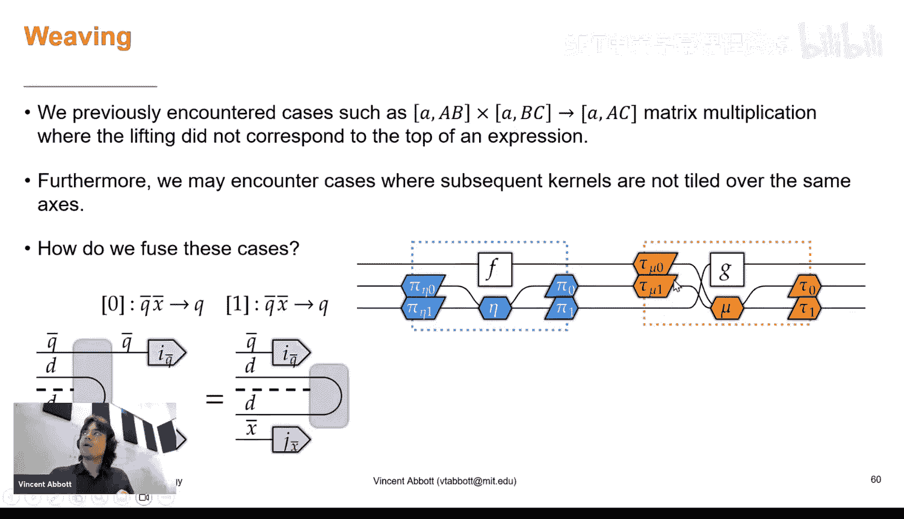

Right， in matrix multiplication， you may notice that if we were just lifting， x would go here。

 but it actually goes here。So here we have also used weaving so have these cases of weaving。

We have cases of weaving over here we also have the case where these aren't tiled over the same axes。

 this is tiled over here， but this is not tiled over that。

So how do we deal with these cases where things are weaved and the tilings don't align？

You remember that。Tiland was possible because of index。When we have a line index flow。

 we are able to do a tiling and when we do this， we relate the output tiles。To。To input tiles vi。Yes。

 the output tiling to input tilings via the linear component of the ane reinexing。

So this would be the standard case。When we go towards implementing this。

 what we will do is we will define a grid。Index along。

Or a grid axis along each of the axes over which we are tiing。We will generate some size of the tile。

 and we will use a simple strip。We will take啊。Rrid index multiplied by the size。

 and then that gives us our tiling。嗯。And then this is defined。For each axis。

 and then that passes through。走。There's a bit of a better way to show this。And that is like sorrow。

So what we have here on the right is we have gene， this will be that this is the top axis。

The second one and the third one。T。😊，Is a tiling or tau tao is a Tling that Ty doesn't care about this axis。

It cares about this one and it cares about that one。It will develop some sort of。

Striide in each direction。So we have that ti。Then the tau tiling will pass for reme and then become some sort of tiling on the input。

If I have an access or if I have a coordinate over here。It may map to coordinate over here。

There is some sort of linear transform here mapping from。A coordinate along these axes。

 a slice along these axes to a slice along these ones。That's what it means for this to be broadcast。

 there is some clear relationship between output and input slices and its linear。

And a similar thing happens for F， but it happens in a different way。We have。

The grid coordinates here mapped grid coordinates in this plane。

But Pi maps grid coordinates in this plane to grid coordinates in this。So we can't just say， oh。

 we're just going tofuse these two together and have all the indexes flow through no。

 only some of the indexes will successfully flow through， we have limited index flow support。

And because of this， we have to remove。This tiling。

So we remove this tiling and all further effects it has because it's not supported over here。

 Similarlyly， we remove this tiling。Because it's not supported by G。So。And by the way。

 is these are generic expressions， so we don't really care about the。

 we just care about how outputs relate to input。Okay。

 so we abandoned the axes which aren't fully supported through the entire expression。

 and then we are left with these。This axis was supported by Tao。And map through。

Then this axis was supported and mapped through to the very end。

 and so we see that this axis actually influences both of these and then we isolate the components of the reindexing which allow for this。

Overall， what does this allow us to do？This allows us to take an expression。And then have。

And then develop fusion， even if we don't have perfect alignment。

And though this process is complicated， it's systematic。

If we have represented each axis as having some tiling at some kernel level。

 and we have defined our reindexing Alpine operations。We can implement this。

And once we have implemented it， it will derive fusion。

 it will derive a generic case of fusion automatically for us。So even though this is complicated。

 it's systematic。And allows forfusion even in complicated cases to be systematically implemented。

So let's look at what would happen in the case of attention。

 suppose we have developed two kernels already。We have developed the Q matrix multiplication and we have developed the attention followed by matrix multiplication。

 so we have these two kernels。So。What wouldussing these two look like， Well。

 we know that indexes are supported here。And they're supported here。

 so this flows all the way through。And then this。Sigma streaming split。

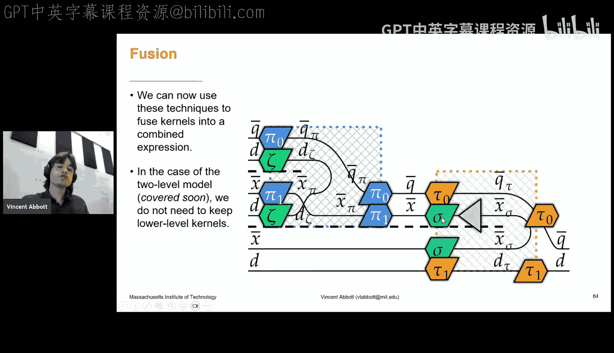

Can then subordinate this pi1。However， this Zear is not supported， it can't just join a stream。

 we already have the stream for the kernel， so we must remove it。So we see here that。

Sigma can be used for pi 1 and tau0 can be used for pi0。And so then we keep。All the axes。

Which are supported by the index flow of both components。Derriving the high level current。嗯。

So this derives in fusion。We have the sigma， the streaming。

Happens over everything which interacts with this axis， so it happens like this。We have Kappa。

Which is Tling P。And this should be。DAPa and we have K one which is targetingling this。

 so we don't use that for implementation because it doesn't impact。Okay。

 so we have this method and we we can systematically fuse even misaligned。

Clonnals and recall that we did this in a general way。

 even though here we are just using rearrangement reindexings。

 which are the simple case in practice we can use more complicated reining。

So what does this allow us to do， this allows us to search for optimizations。

Category theory states that any that this sort of product category system we're working with can be reexpressed as a graph。

 and so therefore we just need to code up the graph。Then the graph can start fusing things together。

And then we can have these higher and higher level fuss。

So we see that this method also allows for this optimization search to occur。Okay。

 but we need to judge the performance of these optimizations in order to actually do a search right like this is just searching for rhythm。

 we don't know how to compare them which path to choose and so on。

So in order to do performance modeling， we will need first need hardware modeling。

Gps are complicated GPS have multiple levels we have you know high level you know GMM then L to cache with L1。

 we have all these transfers between。Between levels within levels。But。Fundamentally。

 we can convince this。What we really care about is this。We have these different levels。

They're connected to each other。If they're connected， they can transfer data。

And certain levels such as tens or armmen， pure armmen。Can。Execute operations。

So as we show in flash tension on a napkin this。Hierarchical view can even encompass。

Like if you can transfer across levels that can be condensed into bits。

 the equations are much the same。So we can take this complex GPU hierarchy and we can represent it like this。

 this is what we need， this is what we care about。And so。Furthermore。嗯。

Because GPs have this recursive structure where we have high level with lots of memory。

 low level that can execute things。We can condense a lot of this information into a two level model where we have a high level and a low level。

And if we have to write some optimization for two levels。And recursively apply。

 we can get an expression for， say， the total bandwidth across all levels。By just。

Suming a series of expressions together。So because of this recursive structure。

 we can mostly worry about two levels， at least from that once we want to do implementation for war groups and so on。

 you will have to focus a bit more on。A multi levell system。

 but we've already developed less of the infrastructal multile system。

 So we're covered on background。Again。How do we represent this within our data structure that we have presented？

嗯。We will do what。I like to call base data type smuggling。Our arrays have two components。

 they have a base data type and they have a size， so far we haven't used the base data type。

 we haven't even diagramed but it's not necessarily relevant。But。

It is a perfect place to put lots of information。For example。

 we can say that the base data type isn't just。The real numbers。

 but it's the real numbers and the location。Or it's the real numbers and some quantization。

So using the base data type， we can say that something is a real number located at this level with this quantization。

 etc。Furthermore， remember the expression we have for taking an arraymorphism and a seismmorphism and making a new arraymorphism by lifting。

What we can do is we take as the arraymorphism， we take conversion between data types we takes we。

And that conversion would be going from one level to another。And a split tiling。

Which is what we already use。And then we take this lip。

And now what this lift is is not only do we split P into P CAappR。

 but we also change the data type in the process。So this data structure， this construct。

Can represent the process of moving to lower levels within the GPU hierarchy or moving up levels。

 whatever we want to。And so we can take our。Derrivation of a unified fused kernel。

 and we can add this information， we'll just do it by coloring it。And so now。This expression。

 what is this expression， this expression for which we have all the tools to derive this。😡。

We can handle misaligned fusion， we can handle streaming， we can handle。We can handle all of that。

And now we can also describe the level at which operations occur。What's happening here？

We have included information about lower level sizes。That's present。

We have included information about transfer。So this is transferring data of this size。

How many times has they been transferred well？T transferred to caps。

Because it's located within the kernel， so everything happens to teacap number of time。

But about this region， everything in this region is happening an n Sigma number of times on top of TAPappa because it is part of that tiling。

So this expression contains everything we need to derive the high level performance model of。法石探。

It shows the number of times things occur， it shows what is occurring and so on。

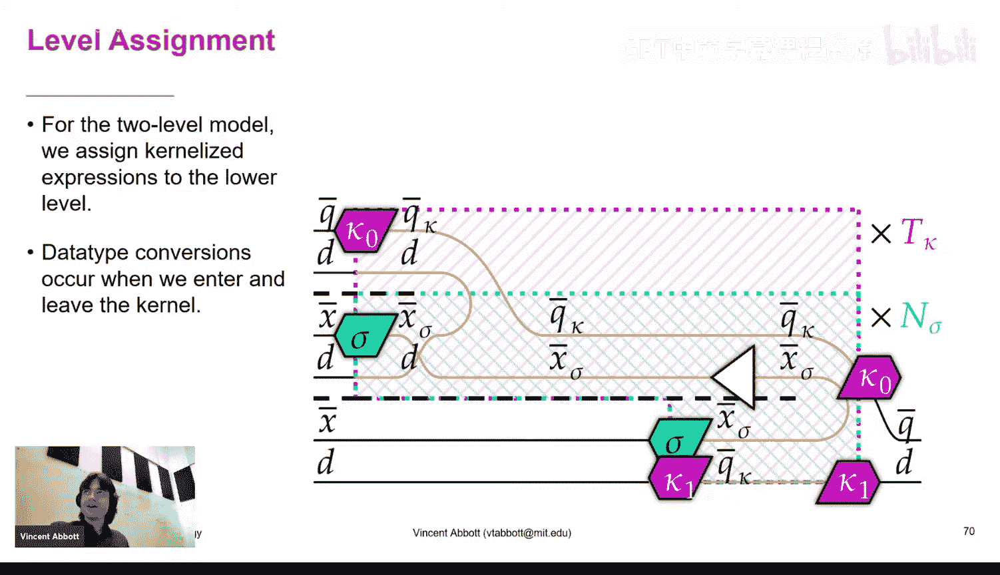

So we can now move to performance modeling now that we've covered how hardware can be represented。

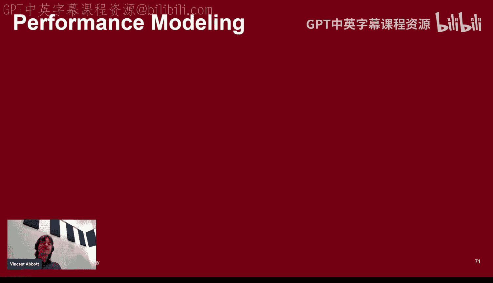

啊。For performance modeling， we care about choosing the optimal sizes。Given some size。

 we can use composition。We can use decomposition to find memory usage。嗯。Memory usage， compute。

 bandwidth， et cetera， because these have a compositional structure。

Doing something T times multiplies the amount of memory users by T。

 well having something be T times bigger。Memory doesn't increase as you have more tiles in the kernel because memory is only relevant for one tile。

 but for compute and bandwidth， which we care about at the total level at the level of the entire algorithm。

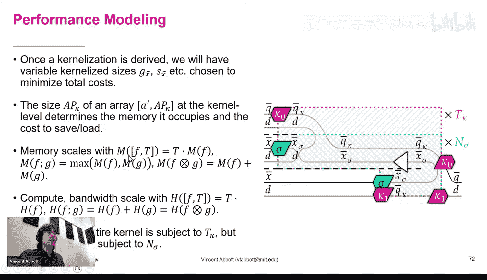

We。嗯。It does scale。Linearally as we have mores， so we can come up with expressions for memory。

 we can come up with expressions for compute。And bandwidth。

And so these expressions go all the way down to seedmorphismisms because all of our compositional tools all the ways to build things up。

😊，Can be decomposed， F D becomes T times H of L。 So this is for compute or bandwidth。嗯。

And so this number。Is different across the kernel。 But again， we have the tools to represent this。

 All this is represented and using the compositional structure of category theory， we are able to。

Express things such as bandwidth and memory usage in this decompositional manner。

So we have the tools to do this。So category theory allows us to do this performance model。

 we have developed the entire framework we need。We have shown how category theory provides the compositional algebra to think about kernel fusion。

 how we can use。Araymorphism and styling like all these things come together in producing this performance model。

 which has this performance model that these optimization， systematic optimization tricks。

UThat ultimately are just one application of this。

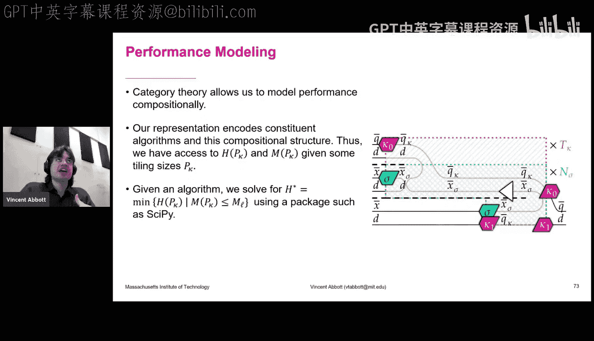

Of the advantages of formally representing deep learning models。And so I think with that。

 now that we've got all the way down to performance problem and hopefully convincing you that category theory is sufficient to cover it。

 that will be the end of my presentation。😊，For today， hopefully this will serve as a。

Helpful resource for you to get attuned to。To this type of algebra and this type of approach。

 And hopefully it will motivate you to as well， look into。

Look into these formal methods for describing deep learning systems and find applications within。

Deriving low level kernels， performance modeling and field。Thank you。

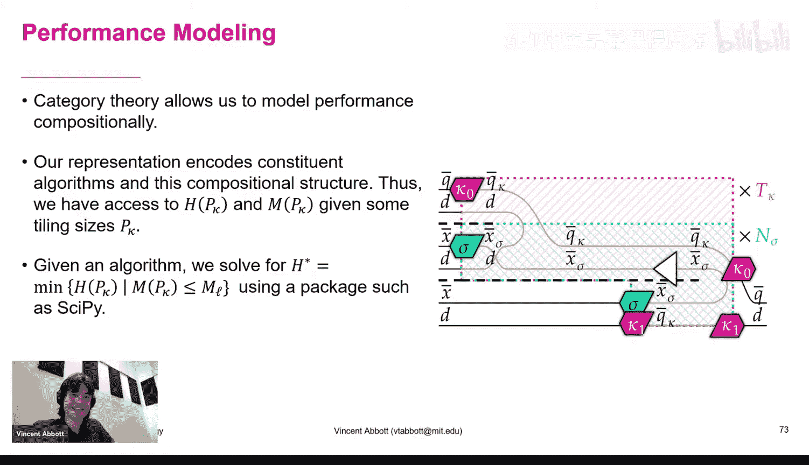

Sweet， thank you so much V this is fantastic。 so I guess there was like a couple of questions in chat like I can go through them and I had like a couple。

😊，I sorry I didn't see the comments， but no what noise， so if I do this， do you see it？

I haven't looked too much at。Category theories and types， I think。

So you can use category theory for compilers， you can use category theory for abstract type analysis。

 and I believe。Though I'm not certain that that's often used for compilers。

 CPU programming languages， etc ceter， I think that。Compils， CP programming。et cetera。

 that uses a different dynamic to GPs， GPs are in many ways simpler。

 the degrees of freedom are smaller and the things we care about are quite limited。

I covered like raises and broadcasting because that's like most of what we care about。

 so I haven't worked too much with stranger times。No and so quiet it hasn't been necessary。

 but there would definitely be ways to integrate it into this category theory allows for those compositional truth。

😊，All right， another question by yours。I believe it would have， I'm obviously biased。

 I'm not the right person to ask but。The tricks for so these diagrams。

 they they don't actually derive flash attention one， they directly derive flash attention two。

Which is already a good sign that they point to some underlying。

Underlying value within the framework。I。They use very similar methods to matrix multiplication。

Like matrix multiplication， the optimization for it as well， it's just you just label the axes。

And with flash attention there what like I developed the diagrams before I came across flash attention and then when I saw flash attention。

 I then developed these methods to look at flash attention specifically and the methods ended up being literally just line go all the way through thelabel line。

嗯So。Yes， but of course， I probably wouldn't。Like the way these things are， everyone misses it。😊。

Another question from Enkiu。嗯。No I don't think you could prove it this is more like also on the flash tension no flash tension uses a lot of other tricks which these don't cover flash tensions feel like extremely smart because there's war group things there's。

There's like in flash tension three you like rotate the inputs so that's not like all covered like I'm not saying that this is like wow like so amazing it's just like for the high level view you can do the low level but that's not fully formalized yet and I don't think I would have。

Being able to do that without doing ad hoc。Anyway， sorry， the previous question， I'll cover that。

 I missed it。Yeah， I think the smaller set operation， no， this is a language， so we do。

The language describes what the language has been developed to describe。For a smaller set。

 the idea is as we come across more kernels and more tricks used by different kernels。

 you then develop the language to implement。So over time you incorporate more and more tricks。

 so one of those tricks for example is reduction so in reduction you parallelize an associative operation streaming is already covered。

 streaming is where you sequentially do an associative operation so for example the trick of going from streaming to reduction is in theory should be straightforward because instead of streaming instead of sequentially do it in parallel but I haven't developed the mathematics for that yet。

 and that is an instance of as we come across more things we develop more language to describe them and then the hope is if we come across a brand new kernel or brand new algorithm just like that we can apply all the tricks that have already been developed but no if they're not able to tell this is like the set of all tricks that are possible it is to be able to mathematically describe tricks so that they can be generally applied。

Yeah， thanks， good question。Yeah， I mean。So搜呃。How do I put this question So so one of the interesting things you brought up is that like just because you've sort of layered things。

 it seemed that a lot of like the sort of maybe like 80% of your talkers so is actually like hardware independent like basically the sort of like the formalism of the hardware is like then thinking about like oh like GPU specifically you need memory to be transferred with between GMM L1 L2 but then otherwise everything else is sort of like not that then potentially would be kind of interesting for people to reason a priori what kinds of hardware you might need is this like something you've thought about。

Yes， it is。The hardware is abstracted away， it the methods are very intentional。

Intentionally developed to hardware independent， but I think that overstates the amount of effort that's required to make it hardware independent because these GPs they're all sort of the same。

 you have hierarchical processes each has memory and can execute an operation and they can transfer data between each other。

Like that they can execute different operations， they have different resource costs for different operations。

 but you know the scope to describe the hardware is limited in that way。

It depends on the depth you want to go into but。Apri I reasoning about what hardware would be good。

 I think would be extremely informative in this talk， I covered lots of the mathematics。

 but I didn't cover too many of the。Of say， the insight。And one of the insights is。For。

There is a full bandwidth。If I want to。Minimize the amount of。The time I'm spending， sending data。

 there are two factors to consider。There's the speed of what that。Of course。

 if I transfer bandwidth faster， it's faster。But there is also memory size。

The bigger my cash is the less redundant loads I have to do。

And there is a trade off between these two when designing a GPU。Because the more。

The more transors I allocate to one task， the less I have for another task。

And this trade off between how much memory I want and how much my bandwidth speed and how much my cash influences the speed of an operation that varies between algorithms。

And so some algorithms are more or less sensitive， and I think those sorts of insights when。

So this actually goes into Geli's work he's looking at category theory so doing these sorts of co designign problems where you relate the functionalities and requirements of say the algorithm to the functionalities and requirements of say the transistor account for a GPU and integrating that into cohesive system so yes this is something where。

😊，We're very keen to work on city。

2。For my other question， it might be easier to share my screen， so I'm going to do it quickly。

So like some of your later， diagrams like really reminded me of this view in the NCU profiler where like you basically run a real workload and then you monitor。

For all the different kinds of memory like how much data is being moved through it and then like what's the bandwidth of it。

 have you potentially looked at like validating like experimentally like what memory model you predicted analytically versus what was seen in practice and any interesting differences you might have learned from this kind of exercise。

呃。That's something I really want to do。Like it's， I really want to see， you know。

 these are like equations and they're the same expressions from。😊，From other work。嗯。If we can。

 we can like just test these and see how these like derive like order of magnitude calculations。

 how well they correspond to empirical tests would be would be extremely interesting， I think。

 because then you can start，You improve the model right so that like whatever coefficients you need to add you perfect them through lots of empirical testing and at that point you can just be given an algorithm and then do this high level performance model derivation then do the adjustment process as indicated by prior empirical testing and then just have a really good idea of how many resources it we apply to one so I think that would be a super valuable task to do we have used this method to。

Implement an attention variant from scratch before， so that was an a。paper。呃。

I can see if I can get it。Oh。But yes I can I can find that and get and answer answer a few other questions Yes。

 so I mean like what's interesting about simulators is like the cost of profiling on an individual GPU isn't very expensive。

 but it gets very expensive like once you go like beyond the single node。

What sort of brings me to sort of my second question。

 like this is a bit of a more ambiguous question， but like I'm curious here hear your take and I'll just ask it regardless。

Of。I remember like 10 years ago， there was kind of like a big sort of resurgence of category theory。

 like the idea in AI was like， well， you know they're all functions， we could compose them。

 it just sort of felt like natural。And then then that wasn't like basically for like another 10 years。

 like the idea sort of like died off a bit， but they made like a very strong comeback when layout algebras became really important。

Both in libraries like cutless by NVIdia and also when doing like sharding propagation rules for distributed tensors。

And I'm sort of curious， like if you sort of have any observations。

 like basically was this sort of a natural transition。

 how come is it now that these ideas are like basically coming in full force？

So you any sort of comments on this history？I'm sorry。Two things， coupleless is interesting because。

It。It seems like it wants to be。Okay， I actually cover。😊，Category theory， and why， I think。哎。

I spent some time in the talk covering why why category theory right like this is like an abstract field of maths right like topologists consider this to be the that's too abstractly mean know thanks right like that's what category theory is known to for mathematicians and I think category theory is a language。

😊，And。You know， it's a language that you can make up and you can go as complex as you want。

And it is as a mathematical structure， the study of composition and abstractstruction。

 And I mentioned in the talk something like group theory， you know， once you're doing like。嗯。

Lee groups some symmetries I mean they're super applieded rotations for robots but Romanian geometry there's like this fineman quote about you know the mathematicians do Romanian geometry to cover n equals seven and then the physicists come along they're like oh can you give me n equals four with。

With like a Lorenz。呃。With a Loentz metric and then they get that and then they apply right so these abstract things become applied if the characteristic nature of the problem matches the characteristic nature of the thing they're studying for particle physics it's all about symmetries so group theory is now like you just need it general relativity Romanian geometry you just need it you could try to。

😊，And I mean， what we're doing with deep learning at the moment sort of like trying to do general relativity without Romanian geometry right it's like we can but。

It's just we don't have the language look cut list and I think naturally it's just composition reining these re indexings are actually ho functionss。

 by the way， so that goes to the ant dilemma these are。

This is like the bread and buttercher of category theory。 It's like the Ytlemma， It's composition。

 it's these rearrangements。 So a couple when you read it。

 it's talking about composition and isomorphisms and all these things。

 but there are some parts of it that makes it not a coherre as a category theist。

 There's some parts of it which。😊，Don't allow for the tricks which I think it should allow and so yeah。

 it seems like I think this will become， I think this is highly relevant otherwise I wouldn't work it。

And I think other tools will converge towards this。

All right thank you and I guess like sort of my last question to sort of close things off。

 which is like one of my main observations talking to you now and especially throughout your talk was like at least within AI like our attention span is like measured on the order of weeks like we basically look at like something interesting figure out how to make it as fast as possible whereas from a mathematician mathematician's perspective you have to have sort of a longerter view of things like develop the tools and basically essentially be patient and wait until they become like very useful and then when they do it feels obvious in hindsight so like with this framing in mind like what would you recommend for like the sort of average ML systems hacker that might be more familiar with things like Pytorch and Kuda and they're trying to get their feet we with category theory do some like interesting work where would you recommend they get start。

嗯。I。I really like to what she say about the yeah， this is。

this project has taken years and like a lot of persistence。😊，Forgetting to know category theory。

 if your application focus find an application where it's good。Hopefully we'll have a。Well， actually。

 if you're interested in engineering and category theory， my supervisor just wrote， he just。😊。

His book was just released on applied category theory for engineering design。呃。

So people can check that out and that covers category theory， it's for engineers if。

You're doing deep learning。It it's great， it covers the resource efficiencies。

 these like resource things and so on， it shows an application of category theory。

 otherwise find something you can apply to， hopefully we'll get a formal write up of all of this and it can be a big toe。

 but hopefully we won't。The ultimate version of this won't require people to necessarily know category theory to be useful。

So。there'll be different levels at which you have to engage with the category theory。

 hopefully we can derive here and with guarantees and then you can just play with the diagrams and it should all be fine。

😊，Yeah， like my suspicion is like especially when you covered things like at what point do you index like for example。

 do you do an operation then index or do you just index and then do the operation。

 at least like my wife for instance works in databases they have like a lot of like these ideas around like should you sort of like push down or push up and optimization and ideally you want to work with less data so it does seem like like the natural place for a lot of these intuitions feels like with compiler people so that they could like naturally prove out that their optimization was correct and then。

As these passes become more and more popular， my suspicion is that。

They will sort of enter the mainstream， but at first this compiler passes to me that also seems like a very natural place to put a lot of these ideas in。

Yeah， definitely like what we're doing here is we're basically developing the mathematics for a compiler right a big step in this will be at some point once we can derive this the description of the。

Algorithm to then go to implementing it， like turning it into Kdaco。

 turning it into PTX or whatever else you want， we're working with compilers exactly as you say like there's lots of these shared patterns。

Excellent Linds thank you so much for coming on you're more than welcome to come by in again so thank you for humoring us thank you everyone we'll see everyone next week thanks again That was fantastic if anyone has questions。

😊。

