# GPU MODE《CUDA、GPU编程54-87｜GPU MODE》中英字幕（deepseek-v3.2 p31 20251115-Lecture 84_ Numerics and AI.zh_en -BV1xbmQB3ETC_p31-

s how is it different from CPUs， I could hardly find any information and then when I kept probing。

 people told me hey， you should really talk to Pollyus I'm like lo and behold。

 Pols is not one of my colleagues in the Pyrich team so that is how this talk came about。

Generally like what makes this topic interesting is that like， you know。

 silent and correctness issues are really cursed， floats are really cursed。

 this is something like with hard leany do。And Polus like Pollyus is basically most like is arguably the man most responsible for sort of the efficiency revolution on GPUs whether it's like low bit D types or sparsity。

 most of those papers published by NviDdia will have Polus's name on them so yeah。

 without further ado Polus， please think you' from here。

Thanks Mark yeah thanks for the introduction and I should mention yeah I was involved with a number。

 you know of papers and other I guess inventions at Nvidia。

 but there's you know a pretty large team working on all of these things so I cannot take all the credit you know a lot of people。

Did a lot of work to enable all of these things。Okay。

 so a quick outline and I think you know if you have any questions either chat post them in chat or interrupt me so I don't see the chat since I'm in presentation mode。

 but I guess Mark can interrupt me and can try and answer but don't wait till the end if something's not clear feel free to jump in and ask and a quick outline just so I guess maybe you have a mental map of what topics are coming in what order。

So I'll go through some basics of number representation and I'll try not to spend too much time there but I think it will suck up some time that sort of will lay the groundwork for then talking briefly about the history of different numers use in AI and then at the end I have a few slides on some floating point quirks I think that's what Mark was referring to by very sort of silent surprising results all of those will make more sense once we understand sort of the intricacies of floating point representation but I figured rather than covering those right after the basics maybe I'll throw in some AI stuff in between so they'll be something for everybody and maybe a ton of folks won't get bored a quick note as Mark mentioned that was an NVdia for quite a while so a lot of the material that I'll be sharing is actually borrowed from my past presentations and papers at NviDdia in some cases accredited in some cases I just copied the entire slides so you'll see an outline。

Unfortunately， I don't have some of the sort of cool videos of various histograms that I had it N VIDdia since I no longer have access to those。

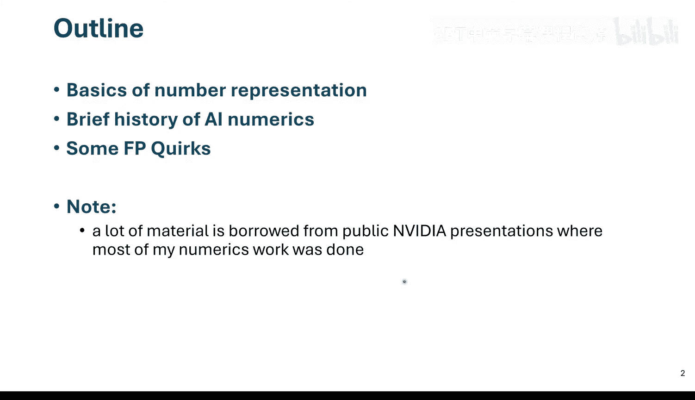

Okay， so getting to numbers so I'll talk about real number line right there are complex numbers and things like that。

 but we'll ignore those。 So you know real numbers are you know just numbers that we encounter in real life and the key to observe theres that there's an infinite number of them right so here I just have sort of an arrow。

Sort of illustrating the real number line and on that I have a few samples right so I have integers like negative 10。

1，2， then I have pi you know and pi has basically infinite number of decimal precision digits。

So key observations is that there's an infinite number of values on the real number line and both infinite range。

 we have arbitrarily small and arbitrarily large magnitudes。And even if we take any two。

Values and make a pair out of them will have an infinite number of other values in between those。

 So that would be infinite precision。 And actually。

 I forget if I included here slide discussing precision and accuracy。 But yeah。

 precision is just how many samples you have between any pair of values。

 So there's an infinite number of those right And whenever we talk about algebra。

 those are the assumptions that you're working with the real number line。

 which has infinite representation。

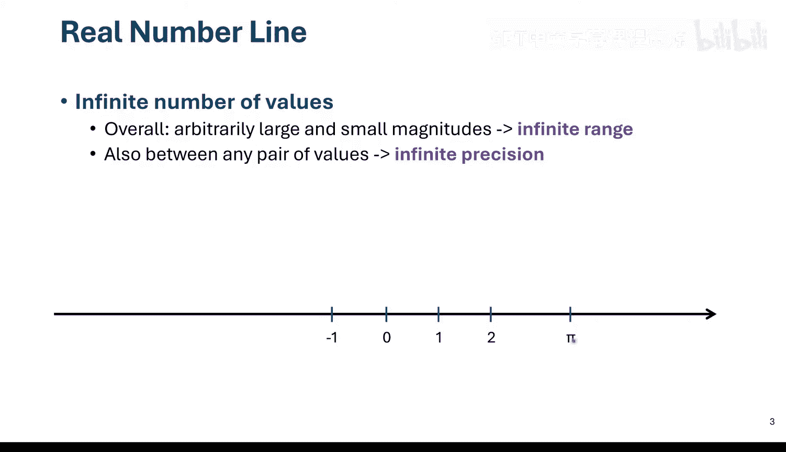

Unfortunately for computers， they cannot do infinite because memory space is finite。

 memory bandwidth is finite， there's also a finite silicon area。

 which means that we can only pack in so much math， either area wise。

 which will limit the size of the numbers we work on。

 or the time that we want to spend on operations is finite。

 we could actually have arbitrarily large precision representations but they might require many。

 many instructions to process。So because of all these limitations for practical purposes。

Computers go with some finite representations right and then by definition。

 those finite representations of numbers will be just sampling the real number line and there'll be many。

 many values that cannot be represented accurately in these formats。

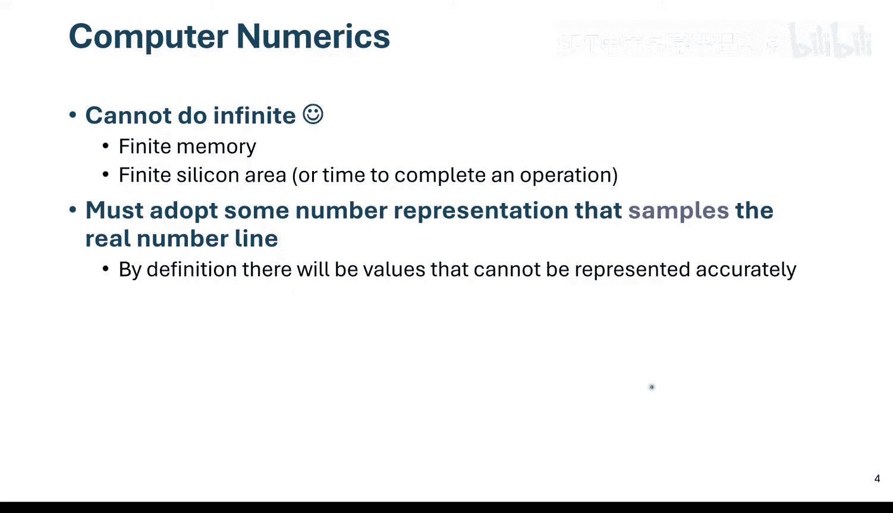

So quick note on terminology for precision in accuracycur those are often abused and by me sometimes as well。

So precision has a specific meaning， it sort of refers to the sample spacing on the real number line and we'll have some finalr examples later on。

 but just sort of think of it that finer sampling of the line usually means higher precision or the way the you know if you have higher precision。

 you'll be able to sample the number line more finely。

and a key thing to realize that something can be very precise but can be inaccurate right and accuracy refers to how close some sample of some format is to the actual value that we're trying to represent right so a quick example of these terms is let's say the value pi。

If we look at， let's say 3。14， 1543。It is both more precise and more accurate than just 3。

14 right so it does have more decimal digits， that's what it gives it more precision。

 but its also a better approximation of pi than just 3。

14 right so this guy has both more precision and more accuracy。Now。

 the second line is an example of where we are more precise because we do have more decimal digits after the decimal point。

So again， we more finally sample the real number line， but in this case。

 it is a less accurate approximation of pi than just 3。14。 I think that is correct。Yeah。

 so it's further away from the real pi value than just 3。14 would be。

So that sort of distinction between precision and accuracy and in the rest of the slide that really one I'll talk about accuracy。

 for the most part it will refer to neural network accuracy。

 so the quality of the results after the neural network processes the inputs and precision will usually refer to them in tsel size we'll get to that or the sampling of the real number line。

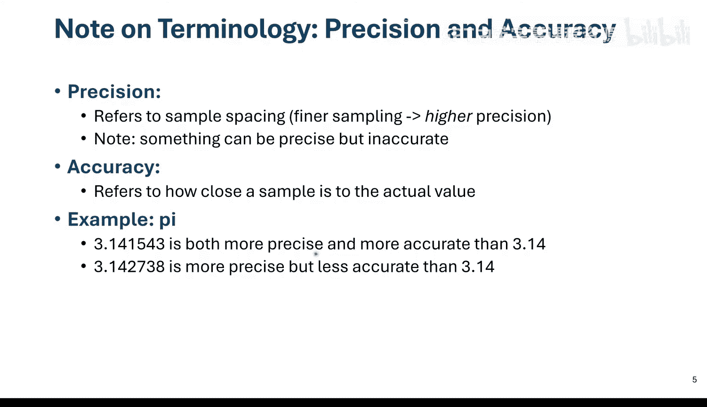

All right， so I would say there are two widespread format categories and we'll just talk about the binary representations right there are things like binary coded decimals and so on but they're out of scope here so and if we talk about binaries then we'll have some number of bits so end bit patterns。

Which basically means we have2 to the n encodings of binary strings and then the question is how do those strings represent numbers on a real number line and the sort of two categories of representations would be integers and floating point and there are more things beyond that。

 I think I'll have one graph without going into details we can talk through that。But integers。

 as the name suggests， they represent integer values。

 and the key there is that they sample the real number line at equal intervals one unit increments。

Floating point representations represent both integers and fractions and they do not uniformly sample the real number line that's the big difference。

 but they really end up doing at least all the aee like formats。

 they uniformly sample the interval between each pair of adjacent powers of two and it's just easier to look at the picture rather than just retext so the first line is integer sampling of the real number line right so as expected we have integer 0。

1，2，3，45 and same to the negative side the interval is always one unit。

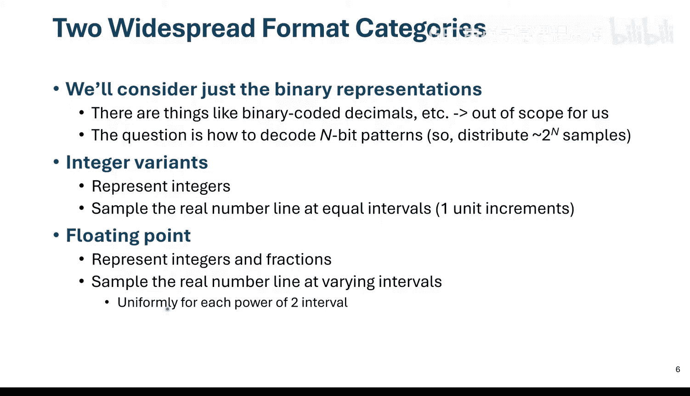

And that's what we have in various programming languages when we think about integers。

The bottom line is aee like floating point representation This one。

 as we'll see later is let's say with two bit menisas。

 but you can see that the sampling gets much denser closer to zero it sort of gets coarer and coarser as we move away so that's what you would see like in ir regularular scale if you put this into the log scale the picture would look different。

 but the key observation here is that in this particular illustration we have four samples between successive powers of two so for example。

 if we look at two and four so that's two to the zero I'm sorry two to the1 and  two to the two。

We'll have four samples， we have let's say two itself， two and a half， three， three and a half。

 and then four would be the next power of two。The same is true if we look at the interval between one and two。

 so that's two to the0， two to the1， again， four samples。

 same thing is true between one half and one。For different samples。

 And so that's how we get to sort of higher density of samples towards zero。

 And at some point they disappear because we're out of exponent range。So that's a key observation。

 you know that's what floating point formats do， so you might have a similar number of samples of the real number line once you get n bits。

 they're not always quite the same between integers and floating point we'll see various reasons for that but very roughly we can think if we have n bits to represent a number well we'll have roughly two to the end representations and is's just a question how are those distributed on the real number line and how does that match the applications that we're interested。

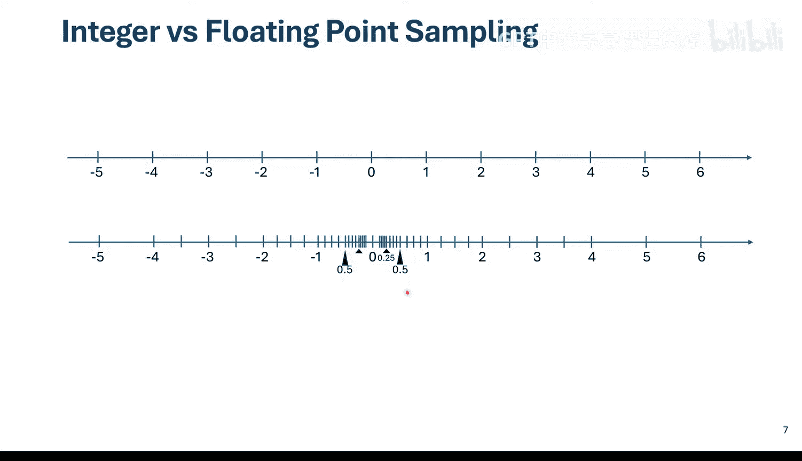

Okay， so I'll talk briefly about integers。 I have more information in integers。

 but for the sake of time， I figured we。Kind of transition to floats as quickly as possible。

So even when it comes to integers which at first glance sound very simple。

 there are different ways to represent them right so there are unsigned integers there are signed magnitude representations and twos complement so the most popular ones in today's chips are unsigned and the two complement so let's say and see definitely when you say just int you will get a signed integer two complement representation when most architectures and unsigned。

Most architectures implement them， but there's some overheads， and I'll touch on those briefly。 Okay。

 so if we look at unsigned integers， there'll be M unique samples。Or I'm sorry， I'm lying here。

 they're two to the n unique samples given n bits， and they will be zero and then positive integers and increments of one。

Now， depending on the programming language， there are different mandated behaviors and then C integers and thus' also C+ plus the quote unquote overflow behavior is to wrap around。

 So if we think about 8 bit integers， if we have value 255， which is the maximum representable and。

Unsigned8 bit and and we add one to it and the result is also 8 bit。 while the result must be0。

 that's mandated by C。And this actually extra processing that has to happen can result in slower code than if you were using just integers。

 so this can come up sometimes where。You're working on values that would be just unsigned。

 so for example， in GPU world that comes up for let's say， thread block and thread IDs。

So those are unsigned integers in Kuda and but policy guess but like this just seems like a foot gun though right because like you would want the error in this case and tell someone hey。

 you got an overflow how come the behavior was the sort of like how could we rationalize the sort of behavior of the design though Yeah that I don't know I don't know the history behind sea requiring that。

But from my limited understanding， what happens to sort of guarantee this behavior。

 extra processing has to happen， and then at least in Kuder land。

 the way that manifests is that oftentimes you end up using more registers per thread。

Compared to what you would get if you just switched to unsigned integers。

And I give an example here where we were working on a layer normm kernel。

 the kernel was handling 128 elements per thread， so the register use per thread would be quite high。

 you know at least 128 plus auxiliary registers for indexing things and all the indexing was sort of thread ID and block ID based。

And if I used unsigned integers for， let's say inds to access memory， then I was using 168 registers。

 If I used signed integers， I required only 143 registers in what the delta is that large。

 things can actually affect occupancy in your performance。 Now， some of that might be compiled。

 not being asing with registers as it could be。But my understanding is that it's that。You know。

 unsigned integers in C and C plus+ come with some extra requirements that。

Our compiler sometimes will end up using more registers for or extra instructions。But in general。

 maybe Mark to your question， so integers don't really have。

I guess any kind of sort of overflow behavior like floating point do。

 so's the notion of overflow is not really native integers at all。So for s integers。

 there's no definition what happens when you， let's say， increment the largest positive integer。

Usually implementation， it just turns into a negative value， which is arguably even stranger。Yeah。

 I mean， I understand but like so so then like different hardware vendors will take different like choices and they'll be unpredictable。

 iss just that like again， when I'm adding numbers， I don't expect to be doing like a mod level。

Operation over like the max Reable value really right yeah， sure those the behaviors so so be yeah。

 but but that's one thing to keep in mind if you're working with integers which can happen and you know they。

Can actually get used in AI for values as well， in some cases。

Keeping in mind whether you signed or unsigned。You kind of have to think about okay。

 do I need like an extra power of two range for the integers or do I not need a full range and I can sacrifice one power of two because I will not hit these quote unquote overflow behavior and then get more speed or at least sort of low resource usage and then go assigned。

 So something to keep in mind。 This is not super widely known。

 I think in various optimization slides from this year's GTC mentioned that in one slide。

 but it's yeah， there's not a ton of material on this。 And if you look at stack overflow。

 There's debates about that and implement various microbechmarks。

 But it will be compiler and I think hardware specific。So Vipool is asking a follow up question here。

 which is so wrapping around happens for signed integers as well， but just at the software level。

 not really within the hardware。Okay， yeah， I mean。

 the software you can technically implement anything。

And I think something will happen at the hardware level as well， and that's probably no again。

Specific to a particular chip。You know， if we take what you signed in。

 I guess the maximum magnitude would be for8 bits 127， I think， so if you add one to that。

You can check on your platform what happens。Oh。In pure hardware。Okay。

 the next representation is s magnitude there's not much of that in hardware that I'm aware of。

 but the reason I mention that is because once we get to floating point there's。

Sine a magnitude aspect there。 But the idea is that you have1 bit for s and the remaining n-1 bit go to represent a magnitude。

 So one property of this is that you get symmetric sampling around zero right so you have same number of positive and negative values。

 It does imply two representations for zero so you'll have both a positive and a negative zero So this can be viewed as wasting one sample on a real number line because they really correspond to the same actual value but it can also be used for sort of like Laportt style signaling right so this can come up and I think this can be seen in somewhat in video code for communication where you're trying to minimize synchronization cost。

 So usually that's for latency limited cases I think you can find that in some nickel code nowadays。

The idea is that you the receiver needs to know when the bytes that it's reading have been written by the source of the information and that can be done through signaling through separate flags and then you need memory barriers and that will some overhead。

 but another approach sort of a lap style approach you can initialize your data to some invalid value that you know that your application will not generate and then the sender can just overwride it and the receiver can just busy spend on that region waiting for values to change from invalid to something that's。

Valid， and then as soon as it sees the value change。

 it can actually process it so there's no need for barriers and synchronizations。

So this is where if you guarantee that your application， for example。

 will not generate negative zeros， you can use that negative zero is that special value right and that comes up in floating point as well。

 So that's one aspect you kind of lose a sample， but you could repurpose it for something else。

And it does come up in some AI related use cases where you're trying to push the performance out to the limit。

And finally， two complements so doesn't represent signed integers。

 it's the most popular sort of implementation in hardware。

 it does have only a single zero representation。And but it is asymmetric around zero。

 it will have one more negative sample than positive right so for 8 bit integers you'll go from negative 128 all the way to positive 127。

That usually doesn't matter there's been some studies that suggest for AI generally you want。

Your sampling to be sort of centered at zero， especially for training and that's probably more true for lower bit representations。

 so I don't sort of like biing during quantitization so oftentimes what happens when people use integers for AI is that they ignore let's say negative 128 for8 so they only use negative 127 to positive 127 range。

And that's where variousquirks come up because let's say you have to really match up what your quantization。

 sort of library or software does to what software that's executing the neural networks does because they might have different assumptions。

But that's students's government。

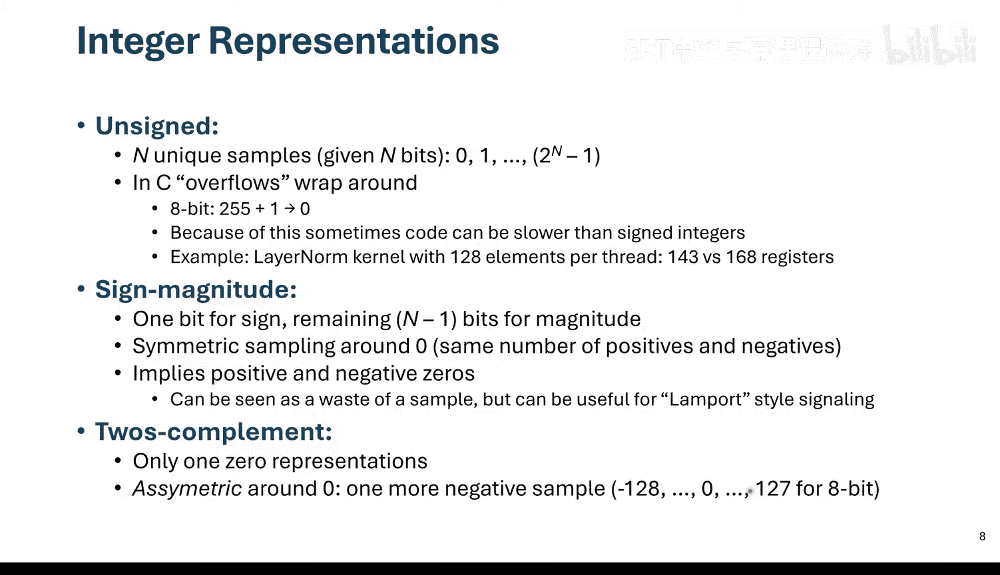

Okay。So moving on really briefly on integer adoption for AI so they've been adopted mostly for inference。

 there's some use of integers for training， so there's a blog post by TPU folks from a couple of years ago where they used AQT to train with integer representations other than that。

 I think training is mostly floating point and inference。Started using integers fairly on。

Think about， I think， 10 plus years ago there was integer used for inference。

And so the pros of integers for AI is that in the early days。

 it was really the only way to go below 32 and later 16 bits for your math or a presentation in memory that was still supported by hardware you could get so hardware was mostly FP32 FP64 as well。

Not a lot of people use F6 for neural networks， so it was mostly single precision floats for a long time and then FB16 started emerging later BF16 came up。

 but if you wanted to go below those data types integer was basically the only way to go。

 you would save memory footprint as well as memory bandwidth。

 you could also get higher math rate on both CPUs and GPUs so for example。

 if you wanted8 bit representation you had to go with integers a while ago。

The cons of that yeah go ahead so over the years like I mean I've seen like a few people sort of postproof of concepts of like integer training like working well like smaller scale I think no one figured out like a good recipe to make the training stable for larger models but you think there's like sort of more fundamental reasons like is this like really a good idea even should people keep trying is this I did that in the water how do you sort of think about this that's a good question I don't have the answer so I can just sort of hand wave and have some semi-informed opinions So I think for high bit counts integers were tough because of the real number line sampling issues right So if we look at this figure what's going to happen if you have the same number of bits the question is what does your application need and if you have to represent like large magnitude values let's say I need to represent for whatever reason 300。

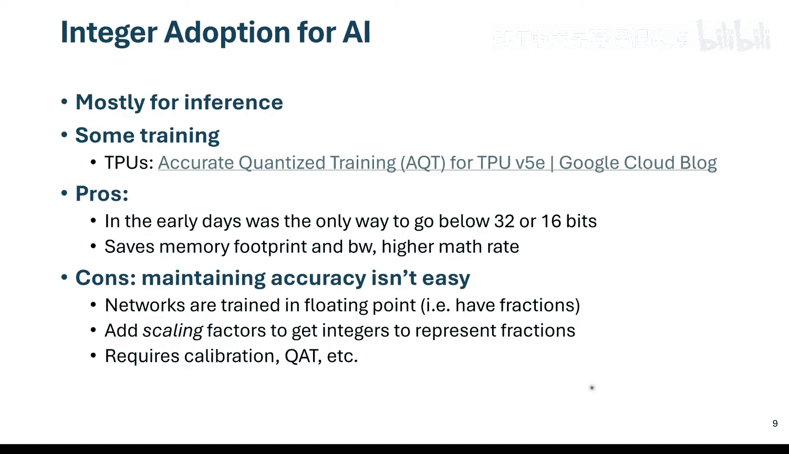

Then I can do that with integers with scales， I can stretch them out。

 but then the interval also increases and then so let's say and then I lose you know the samples closer to zero。

And if my application does need that， then I'm kind of screwed because integers just say。

 I'll only sample the real number line uniformly because you can only apply a scale factor。

And that's where floating point formats have some advantage because they can stretch out to high magnitude values。

 they will sample those more coarsely， but then they'll have representation closer to zero and for small magnitudes and we'll look at some histograms later on。

So nobody really knows the answer， at least that I know， but my suspicion is that's what。

Causes problems for integers is as you know sometimes you have to cover a fairly wide dynamic range。

 but you still need enough precision to distinguish even the smaller magnitudes。

And that's where integers will struggle and some floating point representations will outperform them。

So Donan is asking a follow up question which is haven't recent tensor cores dropped some support for a little bit integers。

 does that mean even inference is shifting towards floats？So it's true。

 I'm trying to remember the history now。I think touring。 So I think intake support。

I forget now for the leaderships。Might still be there， but what got dropped was into four。

 right so tensor cores。I want to say for。Ampire had and for support。

 I might be wrong because it's been a while ago。And then there wasn't a whole lot of usage。

 so that got removed and there are now low precision floating point representations。So yes。

 I would say that， you know， if I had to make a choice for inference today。

 I would probably use on the latest hardware， you know。

 floating point representations that have a similarly small number of bits。

Another observation I don't have in the slides， but we can chat about it when we get to。

 let's say things like FP4。When you get to very few bits representing floating point。

Things start resembling integers to some extent they get similar right so if we look at four bit representations。

 actually one of the binary floating point encodings basically turns into integer so let's say03。

 I think it's essentially the same as integer sampling at that point。

So that loses some of the benefit of floating point because you have so few samples。

much if I answered actually， what was the question again， I guess maybe I rambled on too much Nona。

 I think you answered it。 I think you're mostly agreeing with the question ask。 yeah。

 we can keep going。Okay， yeah， so what are the kinds of integers So the main one is that maintaining accuracy isn't easy even just for inference right so networks are trained in floating point。

 you know with some exceptions which really means that they have fractional numbers。

 not just integer values and we can deal with that by adding scale factor so you can take your integer representation then have a floating point scale factor and now you can represent fractions in the next slide I walk through why youd want to do that。

But to find those scaling factors now you have to do calibrate。

 so you have to inspect your tensors to figure out what scaling factor to use。

 sometimes you still lose accuracy， so you have to do things like quantitization or training。

 so QATT and so on， so there's quite a bit of involved effort there and it has been done but it's an nontrivial effort。

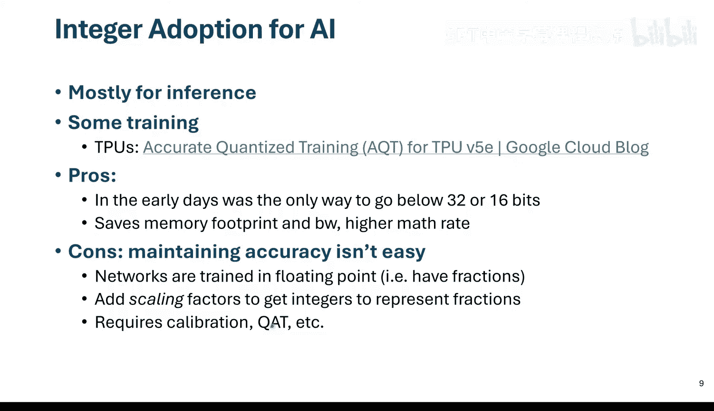

So a quick note on scale factors because that again will come up for floating point。

 so you similar problems arise for floating point as you go down to fewer and fewer bits。

So maybe this is overly sort of mathematical or you know overly equation oriented。

 but let's say we have a vector x and so there's a bunch of vector elements。

 let's say K vector elements， so a sub I would be a scalar。

 so it's a vector of real numbers and some high precision。

And then we want to have let's say a floating point。

I want to have a quantized version of that vector that's in integer， so I'll call it x subscript Q。

 so that's integer version of that vector。Now， I had all those fractions。

Presumably they were needed so still have to have some ability to recover them。

 So now we have x prime vector。 This is really what you get when you take your integer quantized vector and dequantize it So to go back to real number representation And the idea is that you have some scale factor。

 So in this case， you know it's decode scale x for vector x。

In the eight days I'm going to take my vector of integers and I will multiply each integer value with that scale factor and that's how I decode so effectively to encode。

 you take your real values， multiply with some scale。Then round to an integer to decode that integer。

 then。You convert to high precision and then divide by that original scale factor or just multiply with a decode scale factor。

 and you get an approximation。And the reason you want to do that for linear operations is because you can factor out the scale factor math until the end of a dot product right so if we think about machine learning。

 much of the time is being spent in matrix multiplies or linear layers。

 and then we can just look at that as just a collection of independent dot products。

 you know they share some data， but that's a sort of a hardware optimization question。

But mathematically， if I'm computing Z， which I want to be the dot product of x and Y。

Then I can actually carry out my multiplications and summation in integer space and only take the final result in what sometimes people will call epilogue over gem or linear operation。

 then only convert a floating point and apply those scale factors。

And that can be done for linear operations， right because I'm multiplying point wise xq times its scale。

 and then yq times its scale。And since scales are the same for this block of k values。

 I can factor out。 So everything inside the summation now is just integer values right so this is why I can do integer multiplies and adds and only the final result has to get converted to floating point after that you can choose to recquantize So this is really the crux of why integers and actually low precision data types in floating point are being used for neural network math is because you gain speedups So this operations where you spend much of the time depending on your block size。

 so the larger this block， the better for speed。And you can do that some low precision into your floating point。

 and only the final result， you upscale and sort of dequantize。m。

I'm assuming there's no questions on that， but so I mean， it's a very cool explanation， though。

 for what it's worth just because it makes it very obvious that you're decoquetizing like that you can choose when to decoquantize so I haven't seen someone explain this before。

Yeah， you know。The assumption， any kind of integer low precision operation here is cheap compared to let's say。

 FP32， so therefore you do most of your math cheaply。

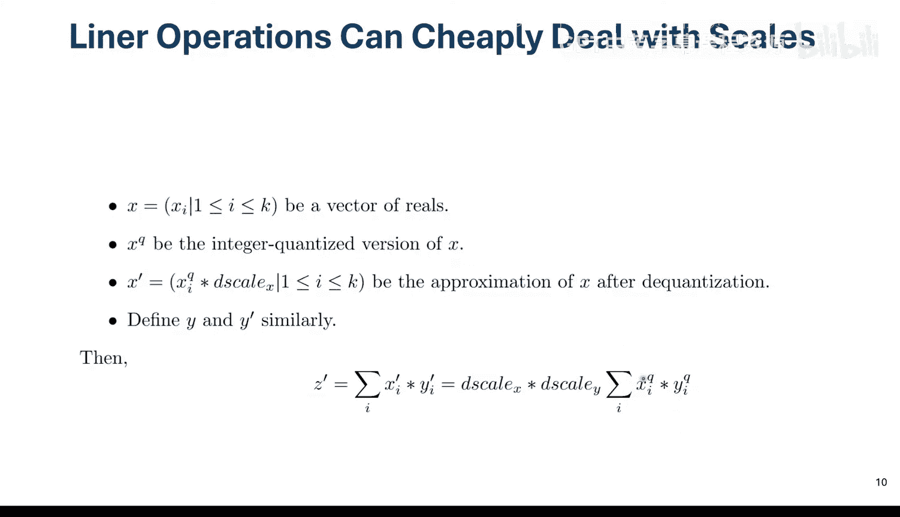

啊。Okay， so quick illustration and the thing that's the last thing I have with integers but illustrates some of the difficulties and from one of the papers out of my former group at NVIDdia so this two figures rippedped out of that paper what they show is like a histogram of values and then what happens with different calibrations so we grab some tensor and the X axis is just magnitudes of values and the y axis is the number of occurrences of values in the particular bin。

So's we see it's going to skew towards as well of magnitude， so it's a real number line here。

And then there are different ways to calibrate you know how do you choose the scale factor so one way to choose the scale factor what we call let's say a max calibration is where you find your maximum magnitude in your tensor and you say okay。

 I will take that maximum magnitude and through scaling I want to map it to the maximum magnitude in the destination format。

 so let's say we're using8bit integers。So here in floating point， the maximum magnitude was。

 let's say 2。1， this bin over here， this mold blue bin。And really what I want to do。

 I want to find a scale factor that will map that value to 127。And I cannot do math in my head。

 but you know， it's going to be， I don't know，660 something。

So the idea I'll take my real value is and multiply them with a scale factor and then maximum magnitude becomes the largest the integer I can represent。

 and then all the other guys going to get dragged along with that and then after that multiplication you will round intote your representations。

Now， but what you can encounter is that your largest magnitude might be an outlier and maybe it's not even important。

 so there are different you know sort of scale factor selection approaches so you can look for let's say。

 entropy based one so let's say optimize something like ha divergence between your quantized and un quantantized。

And then that would pick the scale factor based on this value。

 which basically means that all the values to the right of the green vertical line。

Would become the same value since we're talking integers， they don't become infinities。

 They just get saturated to the maximum presentable。 So everything greater than I don't know。

 let's say 1。45 would become 127。In inches your land。

Another approach is sort of to do percentiles based calibration so you say okay I will find a 99。

99th percentile of my values and I'll make that represent turn into the maximum integer and everything above that would get saturated so it just turns into the same value so you can say like you will be sort of saturating more and more values based on different approaches here and then the table here just shows what happens to various networks so this paper is from a while ago so CNNs where all the rage and transformers were just beginning to appear。

But the key observation here is that this column shows the accuracy for FP3。

 which back then was a native way to train things and then different columns for different calibration approaches。

And the resulting accuracy when you ran inference evaluation。And in bold numbers。

 we have the highest accuracy numbers for any given row。And what you will see that。

 well there's not a single column that has all the bold values they're spread out。

 which is a bit unfortunate because that suggests okay different calibration methods seem to mesh you differently with various different neural networks so that's sort of what made it more complicated to use integer quantization is that there was not sort of a very straightforward mechanical recipe you could follow you would have to evaluate various things to see what worked best for the particular network。

Okay so that's in a I should so surprised yeah I mean so one thing I found interesting about this chart though is that like at least with LLMs and I don't know if it's because of poststream quantization but a lot of those models when they were released in FP16 or Bf16 were like if you looked at the distribution of weights it was basically mean zero like variance1 already maybe this is already like that picture that you're showing also seems to be smoothly degrading but like do you suspect like people were doing this because they wanted their models to be more amenable to like quantization like later down the line or is there like a good like it seems like here you know presumably before quantization became popular there'd be no reason for people to muck around with the distribution of their weights before releasing yeah I think generally I mean so again I'll make a generalization and I'm sure there's always exceptions So think generally people didn't mu around with weights you know they just released or use。

what came out of training usually would start mucking with weights and indirectly activations if you wanted to quantize because then you wanted sort of these properties to where you maybe you wanted to reduce the dynamic range or you know get rid of the outliers and there are various techniques that will do that like you know smooth quant and others that will take these tensors and then somehow post processces them trying to reduce the impact of these outliers but overall yeah I think。

Oftentimes the distributions of weight and even activations appear sort of normal like in their shapes。

 you know， so you'll kind of get bell curves， it's not always true。

So for example where that tends to be notious for activations whenever you add the S connection values right so let's say I don't know。

 Leonon produces some values and then you add a pointwise the tensor that comes through a skip connection。

 you can actually get these sort of like doubly humped distributions and things like that。

 so it's not always a normal looking distribution of values。

And then I have more histograms of these things and it's it's tough to really gauge from them what's needed because。

 you know， this outlier may not be needed at all。And conversely。

 we've seen cases where errors on large magnitudes had a more significant impact on let's say evaluation accuracy。

 and that's part of the reason the way which use scale factors。

 you know we tried not to saturate a lot of large magnitudes， especially for training。

 because we've seen training accuracy suffer more from that。So yeah。

 there's not a good answer to that， but I think generally， unless you're quantizing。

 you don't care much about the shape of your tensor distributions。And when you're quantizing。

 it's not necessarily that you're trying to fit into a particular curve shape， the histogram。

Like many times you try to reduce the required dynamic range。

 so sort of the delta or the ratio between the largest magnitude and the smallest magnitude that you need。

 these jurisdictions here， my personal take is they probably matter less than the range that's required。

So I'm going to say that something so I'm going to say something that's probably wrong but like maybe we'll lead to an interesting discussion。

 which is that like it seems that like that sort of the local LLM basically trend like around like Lama2 and all those related models like those models were like really amenable to quantization because it's like your point where there's no skip connections there's no crazy dynamic behaviors it's all like linears and some like simple nonlinear linearities so that's basically quantizer' dream and presumably the more complicated architectures become。

The less you can make the more likely you're going to see jagged shapes in your weight and activation distribution。

 which is going to make those models harder to quantize than something like a bunch of dense linear linears。

Perhaps so even Lamas do have skip connections right that that's a pretty common thing in transformers it's just sort of like the skip connection is kind of when you route a tensor you know around the attention and those things and then you up do the way that so that does come up and we've run into that you know challenge where you know those tensors were tougher to quantize。

Yeah， so I don't know it's a good question how that relates to network complexity。

 so certainly and I think I might have a slide later on that shows that you know larger models sometimes are easier to quantize so they you know suffer less from quantization。

And there will be different schools or you know of thought trying to explain that right so one aspect would be that okay well maybe those models are more over parameterameterized so therefore they can take more damage before really losing accuracy。

 but that hasn't been fully established there are some papers on like scaling laws and precision but it's still a pretty active area of research and investigation。

That's good， okay。Go。

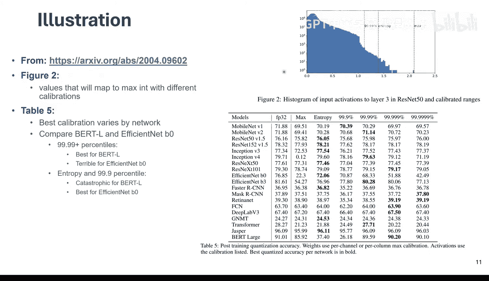

Okay， so moving on to floating point。All right， so mostly itll be apoli like floating point that we're talking about and I was trying to take them up a sort of like slightly general introduction because you can spend you a couple of hours or just some intricacies of this。

But anyhow， so we already saw that it samples the real number line differently。😊。

And unlike integers so a Tripoli floating point has several bit fields。

 so you'll often see me refer to an notation that's EX and Y or X me so E stands for exponent M for Menisa that's just different fields within representation and X and Y is how many bits we spend there。

But there are really three bit fields， so usually there's a sign bit and a single bit for that0 indicates positive number one indicates negative right so this is going back to s of magnitude representation idea。

Then you have exponent bits， so we'll have e bits of exponent and the exponent is really just a power for a power of two。

And it's represented as a biased integer within touch on those but basically bias and I'll give the formula here it's not super important how it is。

 but the idea is that if you look at the exponent bits and just interpret them as an integer they'll be between 0 and some value so let's say if we look at FB16 which is an example I have here below five bits for exponent。

 so five bits can take on values between 0 and 31 if you just look at them as an integer that's not signed。

And then the idea is you will subtract the bias from that encoding and that's where you actually get the real exponent。

 so maybe I'll come back to that one well look at the example。Anyhow。

 so you have some exponent bits and they largely define the magnitude of your number and largely affected the dynamic range。

Then you have Monteessa and M bits。 so Monteessa again， I not atpoli terminology。

 but it's very popularly used word its。D fractional bit。

There's always an implied one bit unless you're dealing with subs， so as you can tell。

 with floating point for representationation there's a lot of intricacies and so handling it properly and fully becomes trickier and trickier。

Let' say compared to integers but you know fractional bits again the sort of positional encoded so the first bit corresponds to you know if it's one then you multiply with2 to the negative1 if it's0 then same idea and if it's second bit is set to one then it indicates a quarter or two to the negative two and so on but it's easiest to just walk through an example so I picked like a smaller representation so one of the FP16s yeah so if5 and10 that's fP16 representation that is an arupee actually I think that's the smallest data type in arupee today so5 bit exponent10 bit menisa one sign bit so that's how you end up with 16 bits。

Exponent bias is 15 just applying that formula from above and then I just picked some value here。

 so there's a binary string of 16 bit and it decocodes to 6 and a half in decimal right and the way to do that so we have five bit exponent and so 10001 is 17 in binary so that's how we have two to the power 17 but we have to subtract the bias so that's in purple so that's how really it's due to the second degree。

And then you multiply that with a significant in apoli terminology and the significant is really the implied one bit。

 so that's the thing in red。 And then after that you have the fraction。

 I dropped all the trailing zero bits。And this is in binary， right so this is one。

 but then we have the first bit set to one so that's2 to the negative one。Next bit is  zero。

 so there's no due to the negative second contribution， and then the third bit is one。

 so that's due to the negative third。And once you add these guys up， you get 1。

65 now in decimal and then you multiply that whether your sort of exponent contributions so that's four and that's what I end up with6 and a/ half so that's how you look at the sort of apoole or atropoly like binary new string and decod it and encoding is just sort of like the reverse of that process。

So suppose like presumably like our ancestors had fierce debates around like how to design these initial floats。

 like whether it be， you know why not like FP17 like maybe maybe maybe multiples of two are nicer but like why not for exponent bits and 11 meant this a bit could you maybe speak to like how these things get argued for because I think for the MX formats maybe it's a bit easier because it's all AI data types and you can look at LMs and make arguments here but this is a bit to me seems much harder to make an argument for one choice versus another？

Oh yeah， so I think so the history of this really predates me。

 but I think at yourpoli standard I want to say came about in the '80s， maybe late 70s。

I might be slightly wrong there， but it's been around for a while。

 but prior to that there were computers doing a arithmetic for a long time too for a few decades and there was know flood import representation was kind of wild West you know various vendors hardware vendors had different implementations and I think Khan was Intel I wanted to say and you know IBM had different implementation and so on various mainframes。

And it was done mostly for scientific computing and at some point。

 you know folks decided that we need to have a standard encoding so we can actually you know port our code and have some kind of reasonable expectations for numerical behavior。

 So that's how ourrupee effort started and from what I understanding it was actually you know。

Quite debated and it was not a unanimously agreed upon solution。

 but that's what sort of the majority agreed to。 and that's what became the standard。

 I don't know exactly what they used to evaluate， but I think they looked at various So kind of did a lot of work based on just sort of fundamental principles。

And then， you know， there was some testing on applications and that's how single precision and double precision came about。

AndfB16 was added later on， I think that was done in early 2000s。

 and that actually came from the graphics world and I think that goes back to NviIDdia and ILM。

So that also predates my time at NVIDdia but。I think that was for high dynamic range imaging。

People wanted to go beyond8 bits。To represent colors and then they went with floating point like representation back then again just to have this ability to have a wide dynamic range that represent both very small magnitudes and large magnitudes and just sampled the number line differently and I think back then for the graphics purposes they arrived at this。

If5'10 representation and you know hardware got made and eventually aee adopted that so that's kind of the history behind F P16 it sort of came from the graphics world and then conveniently started getting adopted for AI and there were some difficulties would pop up now and then B flow 16 came about but that's interesting so basically different different people interested and float would effectively need to lobby basically it's like graphics obviously the AI lobby is like dominant that's sort of maybe the right way to think about it and then you have like tons and tons of applications whether it's like people doing radar or like aeronautics or graphics and then they kind of argue out and then the applications that went out basically get dibs on how the floating points formats get designed and a good example of that would be FB8 and I have that I thing mentioned don there are different FB8 encodings there actually a lot of them and it's kind of a funny thing because when you。

About it， it's only eight bits， you know， how many different choices can you make？

But you can make a lot of choices and so there's an arupee working group trying to standardize FBA。

The only catch is that that working group， I think by now has been around for three， four years。

And it's been so slow that no conclusion is being arrived on there's a lot of debates and evaluation of data。

And that's gone on for so long that people start moving beyond eight bits to like four bits。

So that's how OCP standard came about because then a few hardware vendors got together and said。

 look， well， our representations that we may have are somewhat different but we need to have an encoding just so we can know exchange checkpoints and just have the software function。

So let's just standardize some encoding that basically we have a spec to which we can write software and so that's how OCP format came about。

So and you know the performances are not necessarily perfect right and it's hard to say well would be perfect for various scenarios and that's where people debate no positive and negative zero merits and then what exponent bias to use and so on and at some point you just need a practical solution because a lot of that becomes to some degree philosophical and at some point you just need to have a。

Definition to follow and just work with it。And then maybe I'll come back to this question later on when I I think I have a graph that shows posits right so that's kind of interesting because it is like a representation of real numbers so fractions。

 but it's。😊，Quite different from atropoee floating point right so in that world。

 you have you know Khan and then there's John Gusten and they have。

Quite different views on what number of presentations should be and you know those debates get heated and exciting Excel okay。

 let's keep out。

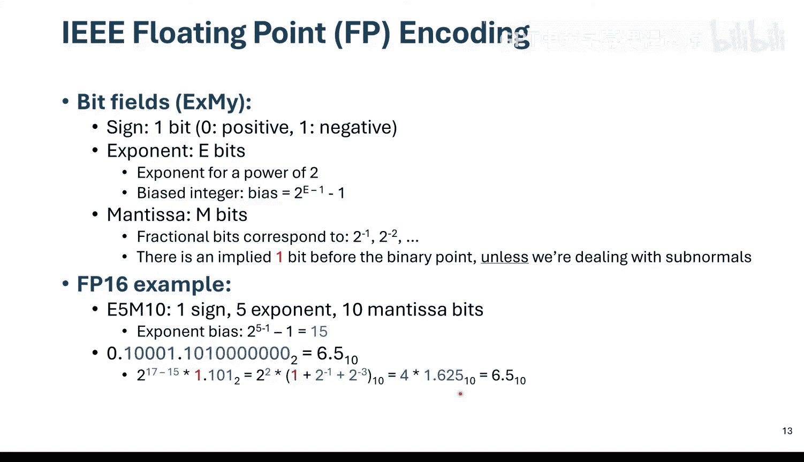

All right。Okay， so flood point sampling， as I mentioned， I guess。

 you know exponent bits sort of define which powers of two are sampled in a real number line。

 so for FP16 exponent samples are between two to negative 15 and 2 to the 15。In reality。

 it's wider than that because of submals， I'll have a bit more on that later on。

 So that's what really largely determines your dynamic range。

 I think dynamic range I have not defined， but that's the ratio of your largest representable magnitude divided by the smallest representable magnitude。

So for FP 16， that dynamic range is roughly 40 power of two。 if you look at FP。32。

 I think is like 200 something， 240 or so powers of two， so much wider。

Then mentia bits define your sampling between successive powers of two。

 so that's your precision when people say single precision double precision to be pedantic that really just refers to the mentisa size。

But you know if we look at E5M2，10 bit mentea bits。

 therefore you have 1024 samples between each power of  two， if we think about B flow 16。

 which is also 16 bits， but that's E8 m7 right that has a smaller only 7 bit menisa。

 so B flow 16 only has 128 samples between each power of two， but it has a wider range。

 so that makes a different tradeoff。And yeah， the key observation that I think I've mentioned a couple of times is that floating point samples at real number line with equal intervals between successive powers of two as opposed to integers and you'll have the same number samples between you a quarter and five as you have between 128 and 256。

 so unless you're looking at the log scale， your sampling of the real number line sort of gradually becomes coarser and coarser as you go to the larger magnitude。

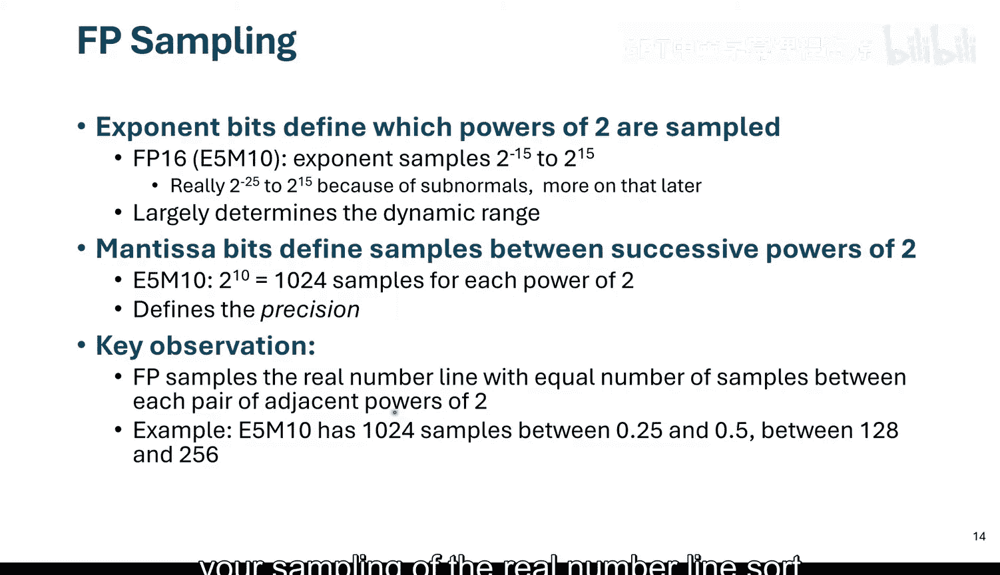

So we've seen this illustration， so I'll just skip through it， but yeah。

 this sort of shows us know higher density towards zero。

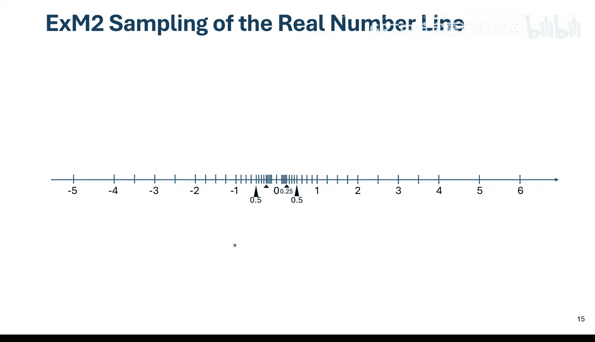

Um。And a few more details so that's where I'll get to special values right again integers usually don't have these。

 so there are a number of special values which are really reserved bit patterns and that was usually follow sort of exponent special encodings。

 either all zeros or all ones。So zeros， and Ipoli have both positive and negative zeros。

 and that just means that all exponent and all minus sub bits are set to zero and then the sine bit can make it a positive or negative zero。

so again， you could view that as losing one sample because now you have two encodings for the same kind of value algebraically at the same point on the real number line。

Subnormals， okay， those are special values， exponents are all set to zeros。

 myisabs are non zero and a slide on that coming up。There's infinities， both positive and negative。

 so that's what you will get when you overflow， you generate a number that is larger than you could represent in a particular floating point format。

 then usually it'll just generate an infinity pattern。

You can actually do math with those they'll tend to propagate and then you have Nans or not a number so those actually will have a bunch of encodings in aroppolies so2 to the should be m minus1 I think bits oh no no two to m plus1 because it's both positive and negative。

So as many bits as you have in。Missa， that's how many encodings you will take away So exponent bits are all set to once。

 and then Monteissa must have at least。One non zero in there。

And these are generated by things like square root of a negative number。

 some of the positive and negative infinity where you know just you cannot do any more math。

 so usually those' signals something bad happened numerically and there are signaling non signalingngs。

 but they're not that relevant to us。but the key thing to recognize here is that infinity state encodings and Nstake a bunch of encodings and that's where subsequent formats have not like that are apoli like。

 sometimes they will give up some of these encodings in order to recover samples to to sample more of the actual real number line that will happen as you go to you know few and few a bit so FB8 started to do that you know FP6 follows that you know and FP4 does it even more。

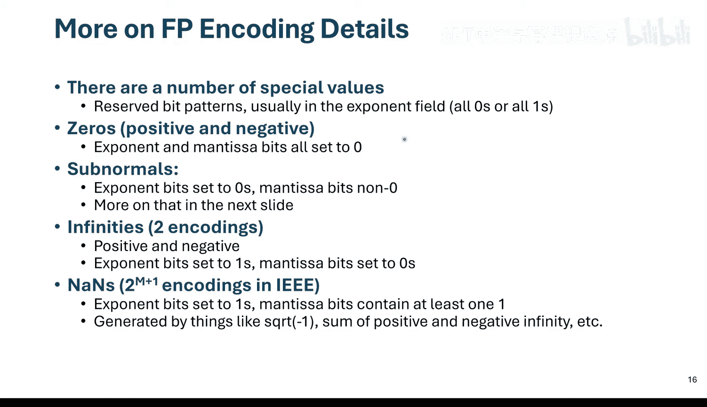

Because as you have fewer and fewer bits， you want to reuse you know。

 you want to waste fewer and fewer potential samples in the light。

So a quick notice abnormals maybe I'll just rush through that in the interest of a time。

But it's a special interpretation of exponent bits， as I mentioned。

And basically just says that exponent， you just treat it as always between just negative 14。

And it gets rid of the implied one bit in a significant before their binary point。

 so just as an example， quick illustration of a number right just we saw just as we saw in a couple slides previously。

 so my exponent is all zero bits。And Manessa does have non zeros。

 therefore this makes it a subnormal number。And then the decoding is that， I see this pattern。

And so exponent becomes automatically negative 14。And now in red here， for normal numbers。

 you would have the implied one bit for sub normalmals， there's no implied one bit， it's a zero。

And the rest just proceeds as before。 So you decode it。 But the key here is now。

 since there's no leading one bit， I can have smaller and smaller magnitudes that are defined by how many leading zero bits I have in my menisa。

So one way to look at subnormal that is really in this case， the most significant bit is one。

 so logically we normalize it so we multiply by two in order to move that one across the binary point。

Then I have to adjust my exponent down by one so it's really the same thing as due to negative 15 and then I can do sort of like really more traditional trip like decoding math here so that's how we end up supporting you know smaller and smaller magnitudes right and really the purpose of that is to you know waste less of the bit space that you have so you can make use of them anticipateip bits even when your exponents are all set to zeros right because usually there's fewer exponent bits so once you run out of those encodings you can still recover these guys to represent smaller magnitudes by having more and more leading zeros so。

So I'm hand waving about that here， but's you folks can take a look at that。

 but I think it's interesting to look at that visually right so I'll have a few of these graphs。

So the way to look at these is that on the X axis， I have the exponent。Or just think of it。

 I have some value x and I take log based here of that， but these would be， let's say。

 exponent encodings。And this is for FP32 so that's why it goes you know all the way up to 127 and then it'll go down to pretty small valleys。

 so for FP 32 your exponent will go between negative 127 and I'm sorry 127 and I think one negative 127。

And you see that for all of these exponent values， so the y axis shows the precisional number of samples between powers of  two。

FP32 is E8 M23， so in this region you just have 23 bits。Of Montetia or 23 bits of precision。

 no matter what power of to you have， and that sort of follows the definition of floating point that。

Same number of sample points between successive powers of two， except for once you get to subnormals。

 So all of these guys on a slope。Now， they have all the exponent bit set to 0。

And they just end up having more and more leading zero bits in the Monteessa and because of that。

You sort of like to your precision is only the bits after the first non zero。

 so as you go to smaller powers you have few and fewer remaining municipal bits to encode so that's how at the very end you end up with just one value there。

So this is sort of a good way to look at some number representation and say okay。

 so this is the dynamic range of the range of values and this is the precision。

 how much precision do I have for various magnitudes and floating point has you know full precision for most of the range in subnormals will gradually have less and less and less precision。

So any questions on this graph？Before we look at a bunch of these。

 I guess let's make sure that folks can really follow it。I think this is clear。

 I had a slightly unrelated question but like but one thing I noticed is like people spend usually like when when you're when people are explaining floats。

 you typically spend a good amount of time explaining like the encoding but then there's also like the I think the IL standard also describes like semantics of ops on those floats so for example。

 things like what happens if you take the max of a value with like let's say a positive or a negative zero like what should you expect the output to be so my question here is that like。

I found it really hard to figure out like what are the exact semantics that NviDdia likes to follow like for instance it was very difficult for me to get like a piece of Qa code output negative zero like it was just much easier to output like a positive zero relative to CPU which costs some inconsistencies how come like basically you know we have standards hardware vendors just don't think it's important enough to publish this they are worried people will copy them because their approaches have better performance characteristics like what's going on like what why is that yeah very good question so I think NviIDdia and EMD GPUs and I suspect other chips。

When it comes to single precision floats or FP 16， if they claim that they are aee compliant。

 they they will implement whatever the standard requires。 So if we pick， let's say。

 on FP 32 or FP 16， which are defined by aee So N videos hardware those。

Scaalar operations and I'm emphasizephad so basically non tensic core so whatever happens in Ka core is atripoli compliant。

 so you will get a you know apoli defined negative and positive zero treatment。

 same thing for infinities and Nans right that are like strict rules on how operations that involve Nans and infinities operate and what values they produce。

And I think vendors just don't publish anything around that because the implication is that it's just whatever is an aE standard。

 so get the AE standard and whatever you see there is that is what you will get out of hardware。

Zero positive and negative is an interesting thing actually got bitten by that recently what I was trying to generate you know negative zero and write it to memory is sort of a sort lamper style flag and you know my code was hanging and then I discovered that even though I'm writing in C++ I have a literal negative zero but then I discovered that what gets written to memory。

I think we're just a plain zero。And or maybe when was doing maybe I was doing comparisons against negative zero and I could never pick that up and then looked at the Apoliee standard and while AEpoliee standard says that for comparison purposes。

 negative zero and positive zero are the same。And what the compiler was generating。

 so even though my code was Shaanggu is checking is x equal to negative zero。

If we looked at assembly， an assembly was just checking is x equal to0。

But that's completely arupally compliant behavior， right？And that check， I guess， technically。

 would have still returned the same true or false value， even if I had had a negative zero there。

 So I had to change， you know my code to actually use a binary pattern for negative0 and just do integer testing against that。

 So that's sort of a quirk， that might be interesting to folks。 But yeah。

 so like when it comes to single precision or half precision FP 16。 if they are typically compant。

 you can just look at the standard and the hardware。

Should just have that and if it doesn't have that， that would be you know a surprise to many。

Now if you look at things like Tensor core operation。

 that's where you know aroppoee only defines operations on scalrs。

 including fus multiplay out on which I'll touch over at the end a little bit。

 but when it comes to dot products， it's a you know completely a wild west today。

And those implementations change in hardware from vendor to vendor。

 also from the same vendor across tube generations because people keep tweeting， you know。

 tweaking implementations， making that products larger and so forth。

So those are basically you know implementation choices by a particular chip right so GPPU does one thing NVdia GPU does another thing。

AMD GP power does something slightly different and everybody's trying to invent something that's more efficient in terms of area and power consumption。

So that's non standardatized。I don't know to degree have answered your question or I think it did I have another like Miy question。

 but maybe I'll wait if until you coverx formats or but yeah I'll I'll try to get to that sooner anyway。

 so this is this graph。 but it's interesting to look at when comparing different types right So same graph but for 16 B formats。

 And again， as I mentioned， there's two of them So there's a P16 which is a defined。

 So that's E5 and10 it's in red or brighter red， So we can see it has a narrow range。

 So on the X axis， it covers fewer powers of two but it does have 10 bit menessa therefore for much of its range。

 it actually has 10 bit precision and then it sort of gradually drops off。

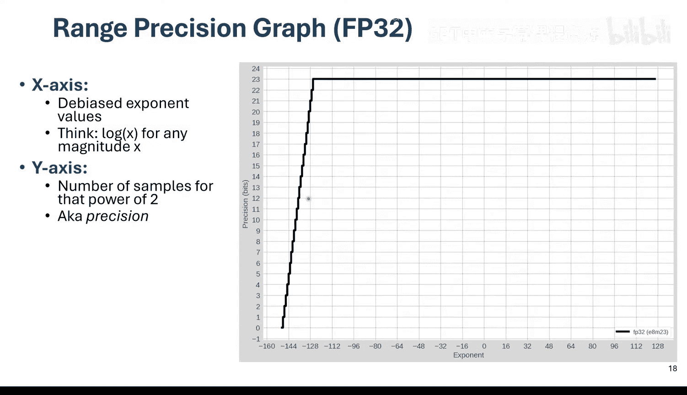

Beef flow 16 is sort of the maroona dark red color here， so it's E8 M7， so its exponent is larger。

 it's 8 bits instead of five so we can see it covers a much wider dynamic range right that's almost as wide as Iroppole FP32。

But to cover that， it sacrificedmentis a bit， so it'll have less precision and know where that precision matters or doesn't matter。

 it's very application specific and so on。Going smaller could you go back to the like it is remarkable when you interface space and like this like how dramatic the differences So I' heard from a meta colleague and I'm hoping you could give us like also maybe a war story here that like apparently like NviIdia wasn't too happy that the the B16 format became very popular primarily because I think it was like a Google format whereas FP16 was already supported in the hardware so why would this be annoying if you're like a hardware vendor is it you like need completely differently designed hardware or you need completely different design compilers or is it just like a mine in convenience to go from like let's say accelerating FP16 to Bf16 from my point of view wouldn't I don't have a collection of NviDdia being annoyed B16 So B16 certainly made things easier in many aspects It just sort of like if I think about how that happen historically。

You know， single precision was around in hardware and then even before Tensor Cos N video already had some FP 16 hardware for graphics right so they were vectorized operations for that you' got to get twice as much method input。

One catch is that they actually were producing FP16 outputs， they would not produce FP32 outputs。

 which was a bit of a problem and that's what Tensorco solved。

So that just got adopted and software got written and shipped so people could actually take advantage of the format that was already in hardware。

And you know we had to solve a bunch of things， and I have a slide。

 a bunch of slides that sort of show the history of that or how we solve various problems。

And the idea was， well， it's a format that's been in Attripyee as a standard for 10 years。

 so let's just use that and see if we can make it work in the early early days。

And then B 16 came out， it did come out of Google， I think originally they even used it just as a compression approach like a lossy compression。

 which is truncate the bits off and like for network communication。

And you know that worked well enough and then you know so for Nvidia's point。

 I can't really speak on their behalf I'm no longer at Nvidia Bf16 you're saying you wouldn't even need hardware support to see acceleration because of this like chopping aspect because you have the same you have the same exponent as of P32 just easier port I see well so I think if you just treat it as a velocity compression and another thing is if you were just chopped off the least significant 16 bits of Menissa。

That certainly work and it would be fast to do that the question is you know do you need a more proper rounding right because that just would always round towards zero and it could create problems potentially in some cases so that could accelerate things that were purely bandwidth limited or you know were you're trying to save memory footprint it would not accelerate your math because you don't back then know there were no math units that would do that so you would have to pad and then just do single precision math。

Um。So it was basically acceleration of you know bandwidth limited cases。

 which makes sense for communication and other things like that。

 And then Bflow 16 units get added to hardware right so Inve added them。

 TU had them So for Miria's point of view， you know historically NV never has been really married to a particular data type。

Edta just wants to ship things that are useful for people and for various applications and whatever they are。

 that's what NviIDdia ships， so that's why NVIDdia started supporting Bflow 16。

 basically with a chip generation after Volta。And has shipped that sense。Yeah。

 like as soon as soon as they could they supported basically as soon as was you know clear that oh it is a format that actually you know works pretty well and you can see because of this dynamic range it did make things easier you know so war story wise you know in training there's a lot of these epsilons that happen right so if you think about even things like batch norm or landor whenever you take a ratio of something usually you'll have an epsilon in your fraction to prevent divisions by zero and people would just arbitrarily pick some small magnitude I know。

E to the negative 6 E to negative 10 or something like that。

 It was intended to be very small to not impact anything， which N M L perator we discovered。

 they actually do impact convergence in some cases。

But then a lot of those values were so small that they would just become zeros and FP16。

 so you had to be careful when converting。your training scripts to FP16 you know to pick some value that would not get flushed to zero because then you would get divisions to zero if they got flushed to zero and things like that。

 but with a wide range that B flow 16 has you don't have to worry about those things。

You have to worry about things like what you needed more Monessa， but that's somewhat rarer。Okay。

 so going smaller， you know， we got to 16 bits so and I think I have a slide that says okay。

BF16 training has become sort of the standard for quite a while okay's a desire to go smaller so FB8 formats。

 there's two of them I'll touch briefly later on on why there's two E4M35M2 so different just sort of encodings of the same number of bits and not unexpected E4M3 smaller menissa so covers narrower range on the x axis so a fewer powers of two but has more precision E5M2 wider range but sacrifices precision2 achieve that range。

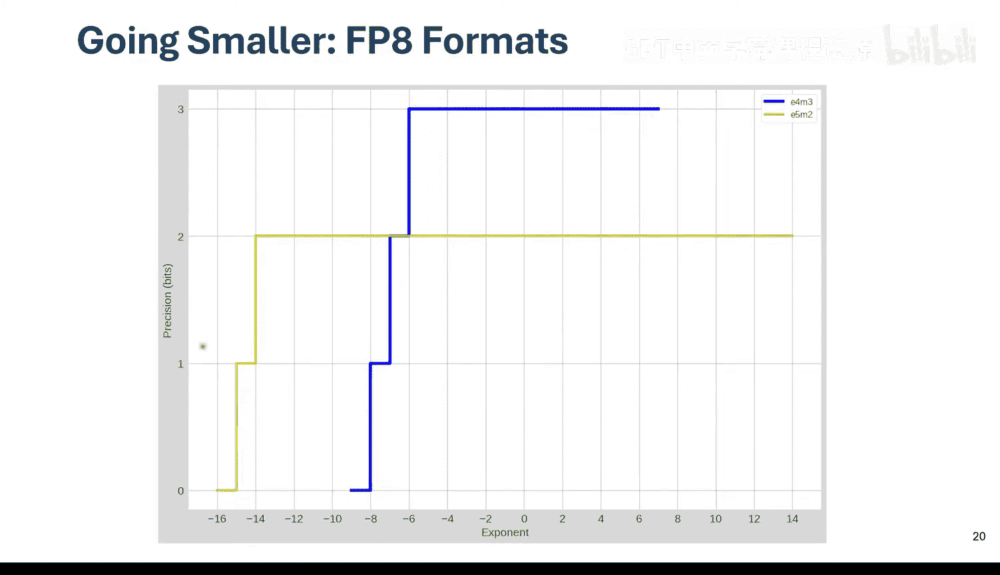

And if we look at all of them together now， I even threw in here you know， E2M1。

 so that's a FP4 format， you can see how tiny that thing is compared to FP32 where you know machine learning started。

So that's kindick。It's an interesting sort of representation of different dynamic ranges and precision and you know how far we've come along Now going the small decF cost right so you cannot just use values out of the box。

 scale factors come about and scale factor granularity becomes a question and we'll touch on that briefly。

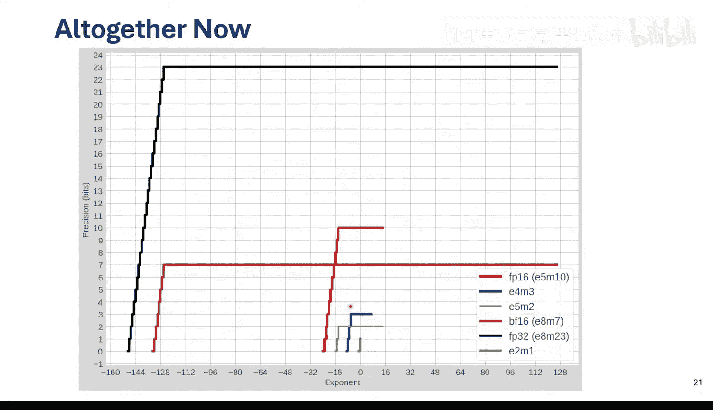

So this is one slide that I alluded to so what's interesting in this one is the green curve right so these are different8 bit formats。

 so the blue and yellow RFFP8 formats that are in the OCP standard as we saw in the slide earlier。

Green is a posit right so that's sort of proposed by John Gusevson as far as I know there's no hardware implementations of that and it's not obvious whether it's better for some applications it does have interesting properties。

 but you can see that it actually samples the real number line quite differently right so a AE elect representations sort of full precision for a while and then they gradually decay towards the left whereas posits they're centered at one first of all not at zero。

But then this sort of symmetric， so smaller magnitudes and larger magnitudes both lose precision as you get away from further and further away from one。

So just a different it actually has two ar arguably exponent fields in it and then uses run length en codingd so if you just you can find it yep go ahead。

 it makes intuitive sense though like I'm looking at this I'm like oh yes。

 why would I need to be precise for massive values like it sort of makes sense？

So like if you're to guess like how come this never made it to hardware is it just like the soft applications weren't really there and the well case studies Yeah。

 so it's fairly new right and it hasn't proven out and。

Depending I guess when a paper read know they will either claim that it makes a difference or that it doesn't make a difference and there's a paper a few years back from Jeff Johnson。

 which was really interesting where he looked at different representation of numbers。

 it was basically log format but for exponents he was using posit encoding。

But once you jump through all those hoops， it just sort of came about that you know aB representation using that encoding versus just plain integer。

Ebit encoding。They effectively had the same quality at the end of the day when it came to network accuracy and then silicon cost wise are also similar。

And so I think when sort of studies go deeper into what the benefits and where they would be。

 oftentimes I think it's found that， okay， it's not substantially better to warrant like pretty different hardware implementation。

Um， but who knows you know， it stay might come， it's hard to say。

 but if figured could I've included because just so folks get a perspective。

 there are different wasting code real numbers than just actuallyly like formats。

And is there a good intuition like when like presumably like over the years you see in many different like detype come and go do you have like a good intuition when someone proposes a detype2 to think about okay I think this could run efficiently on hardware versus not or like yeah is this or is this like actually a lot of work to figure out so I don't have great intuition for that since I'm not an asI person I was sort of more an American and sort of performance。

But yeah， I think you know， there are ASI people， people who designed the circuitry to do the math units。

 I think those folks have pretty good intuition or you can fairly quickly say， okay。

 this will be more complex or less complex。I'm just not one of those people。Yeah， no， I mean。

 like you presumably you walk over to one of your colleagues and ask them is this a terrible idea or not but yeah。

 like so yeah， when you earlier mentioned， you know， various formats that Nvi has contributed to。

 it's always been a collaboration between sort of algorithmic people， application people， ASI people。

 a lot of people get involved in in these。Okay， so that' that was the basics took a while， okay。

 so brief journey through AI and numerics history。

Okay， so what sampling is actually required， right。

 we saw different sort of distributions of representations。But what does the I need and you know。

 the answer in the first bullet。 unfortunately， we don't know we'd love to know that's it's not even a million dollar question that's you know。

If you know the answer to that question， it's worth billions。

But there's a lot of interest in reducing the bits per value and that's understandable right because the smaller your representation。

 the less memory footprint you need， which is a good thing。

 you know you can fit larger model more activations you know in your memory it reduces memory bandwidth pressure right so when you have to access that memory also you have to move bytes right so the fewer bits you have to move across memory buses。

 the less energy you need so you save power power is becoming extremely important nowadays for performance and lower precisions per operation do require less energy。

It also enables packing more mathth units into the same silicon area。

 so you can get more effective memory bandwidth utilization per value if your value smaller。

 you can also get more mathth。Ops out of the same silicon， you know。Nmeters。Um。

So a lot of motivation to go smaller and smaller what works。

 what doesn't work is largely empirically driven， unfortunately。

 so those these studies get pretty expensive right but effectively you run various studies and those inform and evolve your mixed precision recipes and formats right so if we look at the history throughout time。

We started with a P32 and I'm looking at like recent history of machine learning rights a list say starting from 2010 or so know。

 there's decades prior to that。But in sort of this latest wave of AI studies it was FP32 initially。

 then went to 16 bits， which were I would say even today are still largely used。

 FB8 is becoming more and more prominent since hardware has been around for that now for a couple of chip generations and people are beginning to adopt and you know there's early sort of ventures into FP4 even for training and's but FP6 and apprenheses because it's sort of like a halfway point between FB8 and FP4。

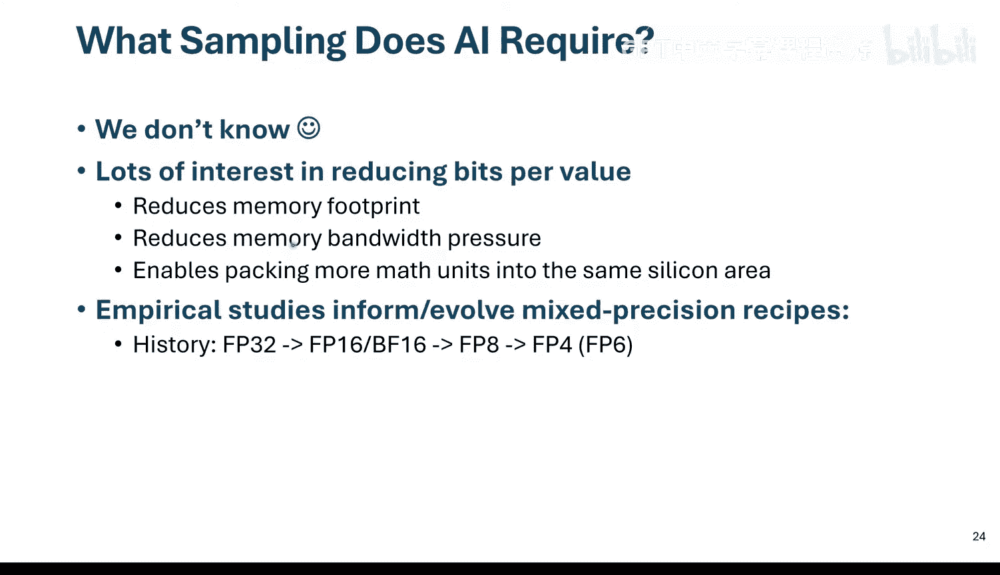

Okay。So one thing that always seemed and correct me if I'm wrong like one thing that always seemed bizarre to me is that like it's one of those rare situations where the hardware people are bolder and ahead of the software people because they're shipping thetype that they're betting that the community will figure out how to have stable recipes for and maybe they'll do some a priori work but like this is quite strange to me because you would expect typically hardware people to be a bit more conservative otherwise like let's say they pick the wrong detype than all of a sudden you know that whole audio generation is like dead into the water and won't sell right so the cost is quite high to getting this wrong。

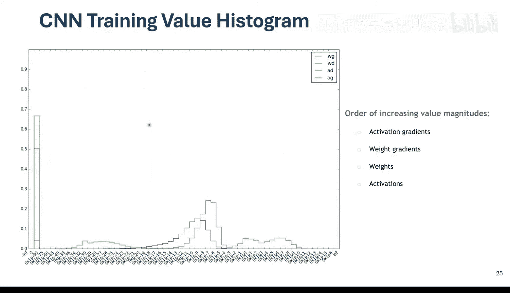

Oh yeah， so the cost you're absolutely right， the cost is high right and and I think different hardware hardware vendors have different tolerance for risk here and be takingking。

So I'm obviously biased given my past， but NviDdia generally has been you know pretty bold at trying new things and also spends quite a bit of resources to evaluate those right so like whatever goes into hardware。

you know。From design to the shipping of silicon， you know quite a bit of time passes and so during that design phase。

 you know。We would try various things and see how well they work and the most promising ones would sort of make it into hardware。

 so there would be recipes tried out on a much smaller scale to sort of inform the direction for hardware。

And then as we get closer to closer in shipping， then you know large and larger scale training runs would get。

OrRun， and then eventually when silicon is available。

 you can do really large scale executions right because like all of these studies do sort of like。

Simulated precision right because the hard doesn't exist so you have to somehow process your values to what they behave like what you might have that adds quite a bit of overhead to your experiment so they become know pretty expensive and neural network training at scale is expensive so it's it's an untraal cost but yeah that's why I think sometimes you will see know vendors who are more aggressive you know they'll kind of lead the way and then others sort of follow and adopt what they had in work but to a degree if you don't try something here I think you'll just stagnate right because。

Through sort of like end of Moore's law and other things like that。

 it is hard to keep improving dramatically performance of let's say。

 single precision floating point type。So you can hit that wall so you have to actually go to something smaller。

But but if the argument is based on simulation， then arguably we should know from now what is what what's likely to be the lower bound and smallest like D types that we could use So for example like I've heard some people speculate that that's after it before other people say no there's also the subbit types so like this has a lot of stuff to squeeze did you have any hot takes you'd like to add on the topic well I'm one of the people that say that subbit types。

Theoretically are possible how well they will work。 It's really hard to say。m and I can。

 I think I have just one slide that just mentions that but basically you know all of that would be some kind of lookup table baseding where you're counting the index bits。

 but then what you're st in a table is higher precision that's how on average you end up with fewer bits per value。

It's really hard to say， right because these studies。It's hard to have， you know。

 very definitive results because you can study and improve something out at the smaller scale and sort of gauge maybe potential for success。

 but then something might come up right that happened with even with F8 recipe。

 right like there was a recipe that was fairly conservative， had potential scaling。

 It worked fine for a couple of years And then you know。

 models got somewhat larger and the data sets got a lot larger and then。

A recipe had to be adjusted so it' it's sort of a dynamic work where even once you have something that works numerically。

 you might have to adjust it as if the data sets shift or let's say model architecture shift and then they just kind of change how they generate values Yeah。

 so that's very difficult to answer definitively you could do that in theory if you wanted to throw a bunch of compute at it you take the leading models today。

And you say， you know what， I'm just going to rerun those training sessions with all kinds of format choices and see what holds up。

But then you know another aspect of that is you try some exotic format。

 it will need some extra bells and whistles to work right so then you have to really study those to see okay how do you choose different scalar factors at what granularity you need them so it becomes a pretty expans space to explore。

Make sense， okay， that makes sense， thank you， please。So， you know。

 we looked at this sort of these graphs of。Value representations and formats This is actually a histogram of values and tensors during training so I forget actually which network it is it's either maskcar CNN detector or SSD object detector so from quite a while ago。

X axis here is just C+ plus x notation for floats but just think these are powers of two that we're showing right so just look at the number after P and that's the power of2 bin y axis is percentage of values and the way this was sampled was actually we looked at all the tensors。

We categorize them into you weight gradients， activation gradients。

 activation data and activation gradients or those are the different colors and then throughout training I think every few steps we ran through all the tensors and just bin them and that's what you're seeing here is really bins filled out by all the tensors over a training session。

And interesting observations here is that like you know in red are the highest magnitudes it's most to the right and that's activation activation data basically right so you activation values activation gradients are in green and those are the smallest magnitudes right they're most to the left on the very left here this big bin is just zeros right because this was the CNN so it had values。

Um。And then we have weights in blue right so they're sort of second in magnitude sort of between red and the rest and then we have weight gradients those are in black and again so that's the histogram here so you can see the different tensor types actually do end up being in different magnitudeed regions。

But that's just sort of a curious observation and you can see sort of their shapes。

 which unfortunately does not really indicate where you need the precision right because just let's say that this bin is the tallest for blue。

 it doesn't necessarily mean that that's where you need the highest resolution or most precision right。

Again， we tried various things， but nothing is that straightforward unfortunately。Um。

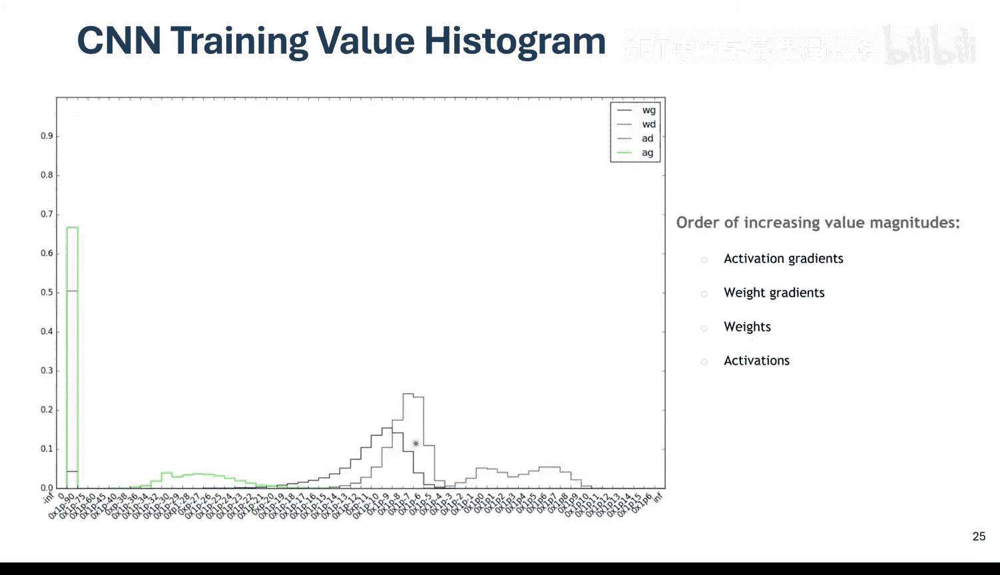

So looking at FP16 right so FP16 has a narrow dynamic range and this will illustrate why that was an issue and some folks might have seen these slides。

 I don't know。1012 years ago I stole them from I guess my own GTC presentations so these actually graphs are from H32 training and for a unknown reason even to myself I chose not to use uniform with bins so if you really squint and look at these bins mostly they're three powers of two until I get the smaller magnitudes and I just up it into like 10 and 15 powers of two so they're not uniformly sized but that's not the key thing here。

Anyway， so blue are whites， green are activations， activation gradients are black and white gradients are red。

 so we kind of see where they positioned on this log scale， so magnitude wise。

 as we saw before activations tend to have the highest magnitudes。

 activation gradients have the smallest magnitudes they most to the left those in the negative range for exponents。

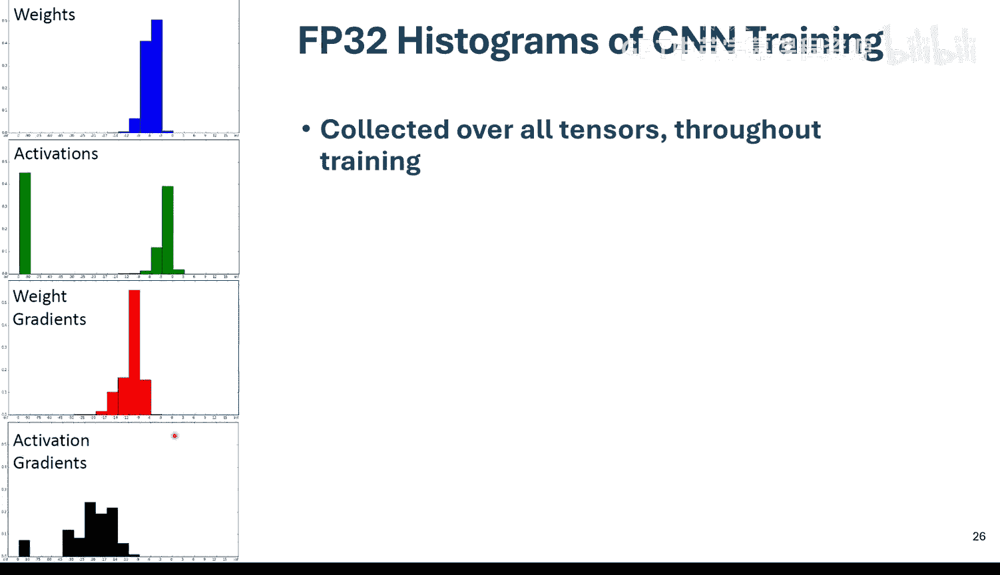

Same collection as I mentioned before。Now in blue， I'm highlighting the region that FP16 can represent。

So if we look at these histroograms， weights have no problem。

 you know all the values that occurred well within the blue region， same thing for activations。

 largely the same thing for weight gradients， you know these bins have a few values here just outside and in practice they didn't matter you can flush those to zero。

Activations very clearly do have quite a few values that FP16 cannot represent without anything。

 right so those would get flushed to0， anything that's outside the blue region to the left would get flush to 0。

But another observation is that much of the FP 16 region is not being used at all right so if we look at the gradients so the red and black histograms。

The orange region， FP 16 can represent and it's quite a few powers of two right so it goes from I don't know。

 let's say negative 2 all the way up to to the 215 so。

Lots of powers of twoobbininates that are not used at all by the gradients。So they're kind of wasted。

So the solution for that was once that was observed was well， for gradients。

 if we multiply them with some value。With a scale factor， they will shift to the right。

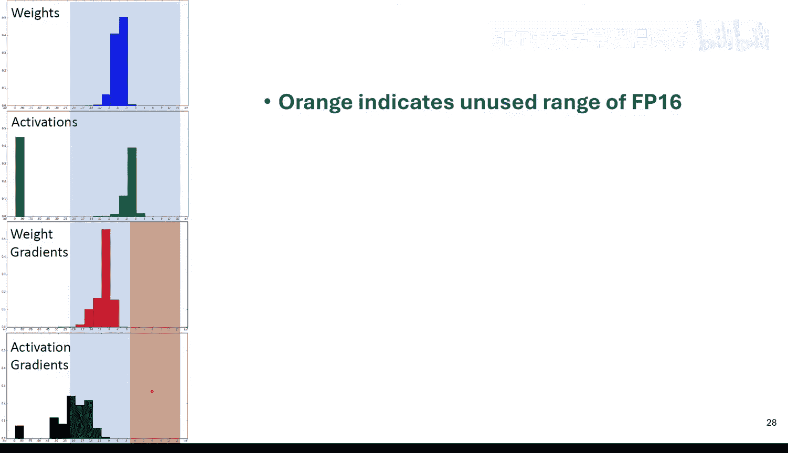

So if you find a scale factor， you multiply your loss with a scale factor then by chain rule。

 all of your gradients， both weight and activation gradients just get scaled by the same value and we just pick that value to be a power of two so menissa bits don't get touched at all just exponent bits get adjusted and that effectively moves your activation gradients well into FP16 representable range now you don't lose values and you can train the only catch is that prior to doing weight update by the optimizer you have to undo the scale so you have all the right magnitudes when doing weight update。

know， that works fine for the most part， I'll get to some difficulties there。

 The reason you have to do this so。

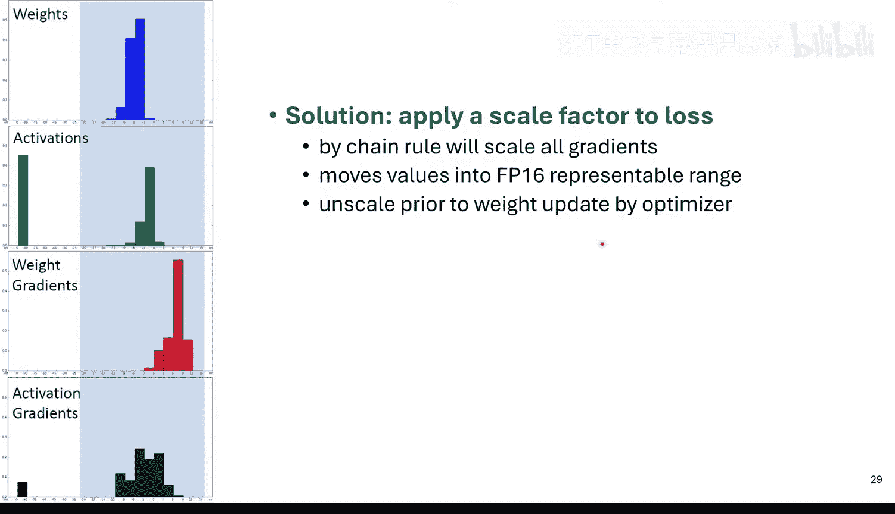

This is always an interesting figure to look at oh I just have some garbage share in the text。

 but this is a training of a two layer SDM network that was a big network back then that was expensive to train because it took a couple of weeks on a couple dozen GPUs。

Those were the nice days。So in orange so blue curve is FP32 reference training session in orange is FP16 training so Volta was the first GPU with Tensor course for FP16 with no scaling so scale factor is basically one and we can see that it trained fine for a while match blue and then it just decided to diverge。

😊，And then in green is what happens with correction when we actually implemented the scale。

 the loss scaling approach to where you multiply the loss with some scale factor and that moved the gradients into。

Representable range for FP 16。 So that's the green curve and that matches the blue。

 and that's the zoomed version of that where you can see even if we zoom in。

 those curves are tightly intertwined。 We actually trained FP 16 longer than we train FP 32 back then。

 So that's why without loss scaling， know you fleshed too many values to zeros。

 bad things started happening。And so presumably if you go back to the so like right at the point when the orange curve starts to diverge。

 is that like when activations become too large like just because you have to display such a nice visualization and I'm curious if you were to look at the picture of the slide before at that point in time right before the divergence what would you see good question I don't know we didn't look at that I say okay but I would say you know based on some other histograms that I looked at。

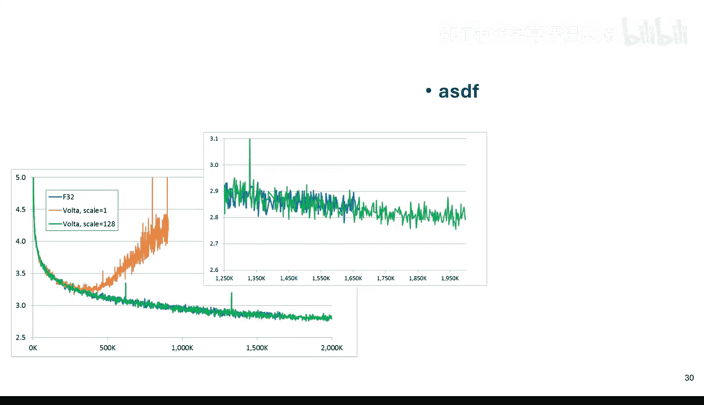

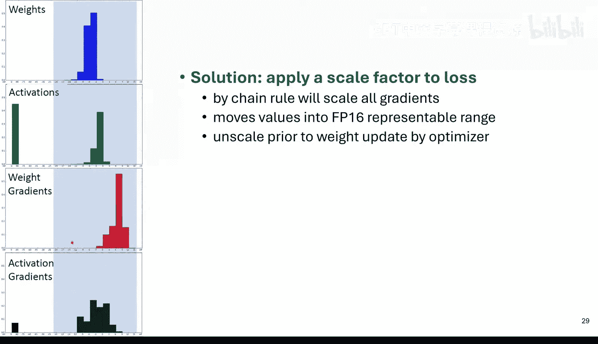

Usually what happened is that I didn't see much shift in the histograms throughout training。

And unfortunately， I don't have those videos， but I had them when I was at Nvidia。

 right so there's sort of folklore belief that。If you look at your weight gradients that they should get smaller and smaller in magnitude as you train because your loss is getting smaller。

 your network is getting better and intuitively it makes sense right because if your network were perfect and your loss would be zero。

 your gradients would be zero。So therefore if your network is improving。

 your gradient should be getting smaller and smaller， but in practice that's rarely the case。

 so what I've seen for the most part， there are some exceptions were for sometimes those gradients would get smaller or with gradients but that was very rare for the most part what happens from random initialization to like the first few I don't know。

 10 iterations of training， you would see the shift of those histograms simply because I guess the random initialization was not。

In the right space where I guess it should have been and that's what training corrected fairly quickly After that those inograms largely remain in the same place is just you know different values where you take on or you know different tensor elements would take on different values。

But overall， histogram wise， it was largely in the same region and didn't migrate。

 So I think to your question， I would hand wave maybe a hypothesis that。Overall。

 activations didn't really shift is just that because you were flushing gradients to zero。

 like a lot of smaller magnitudes， somehow they sort of guided you into the parameter space into an area that you just sort of got stuck and it got worse and worse That was bad Again。

 you know， this is sort of AI story time where I'm just making up tails and hand waving because it's but this is interesting like like the values would look normal。

But the combination of weights would create like weird loss behavior like it's yeah okay that's very counterintuitive to me but okay yeah and I've seen other things like maybe it's rat holeing too much but this would happen to batch norm and there are a few papers out there who incorrectly identified that so when you push sort of the bit counts down sometimes things will start exploding。

Or Monteis a bit campsta and there were a couple of papers out there。

 not from NV from other places that were alleging that it was somehow overfitting because what you would see that training curve looked okay。

 but the validation curve would explode at some point so people sur that it was maybe overfitting。

 but it wasn't really that but what was happening is that，嗯。All the histograms generally looked okay。

 if you looked at things like L2 norms， maybe your gradient norms started increasing， right？And then。

Roughly what was happening and。And there's actually a paper of that from Fair from earlier this year like why gradient magnitudes would increase throughout training if you have enough data。

 but then your weights would start evolving and then things like batch norm accumulated statistics which are useful evaluations or inference they could not keep up because they had sort of exponential moving average but values underneath would move faster than those statistics would change and that's why your sort of evaluations would collapse but again。

 it was sort of like a weird effect that if you started you know having too few bits and gradients that would accelerate the change in。

Grantient norms。And that would have an effect on weights and this activations and then just sort of that's how you would end up with ba parameters getting outdated so there are sort of like these weird indirect interactions that actually take quite a while to take effect。

 which makes debugging extra exciting。um。All right。

 so this is just a quick graph because it's kind of interesting to look at this is what happened to scale factors right so scale factors were dynamic and the way we did that was basic because you don't really know what scale factor to choose right that scale factor for one network is not necessarily good scale factor for another so we just made a dynamic because again this scale factor application was very。

 very cheap know the only thing you do is take the loss which is a scale factor I'm sorry a scalar after the forward pass multipied that with something and then that prop is just like it would have been otherwise nothing else changes so there's really no extra cost。

But if you don't have the right scale factor that maybe you you know flushing too many values to zero bad things happen so the idea was keep a you know find a scale factor that's as large as possible so we'd really start out with a maximum scale factor and that would guarantee that something overflows and generate those infinities and ns but those we can actually detect in the optimizer so as soon as we saw infinities or ns in the optimizer we would just skip an update and then decrease the scale factor by a factor of two so that's what you see here at the beginning which is a high scale factor we overflow so that it gets dropped then it works for a while overflow happens it gets dropped。

Works a little bit， overflows gets dropped and then here works quite well for a while。

And the heuristic was that every thousand steps， if we did not have to reduce the scale factor。

Then we would increase it by two right so basically you know kind of push it so if you haven't run into problems for a while make it larger and if there's no problem make it larger again after a while so that's what you see here we made it larger it was fine for a thousand0 steps we made it larger fine for a thousand0 steps we increased it run into a problem backed off and after100 steps we try it again but you can see the scale factors kind of stayed in this range so the smallest scaling factor was two to the 20th which suggests well actually not suggest it indicates that the maximum weight grain and magnitude never exceeded2 to the negative five。

So that's where those representations that go into magnitudes greater than one were really unused in those floating point formats。

Okay， maybe I'll skip this for interest of time， but this was an experiment to sort of determine okay how bad is it to skip updates so this was just reson 50 training and orange is default training and blue was if we skip 0。

1% of updates just to see if that affects accuracy and it didn't and the reason you see regions here because there's quite a bit of run to run variations so for each one we actually run multiple training experiments。

So back then Resin 50 was expensive so you can sort of see there's。

 I think it was maybe 10 experiments， 10 runs for each， you know。

 to that even more prohibitive with large LLMs。

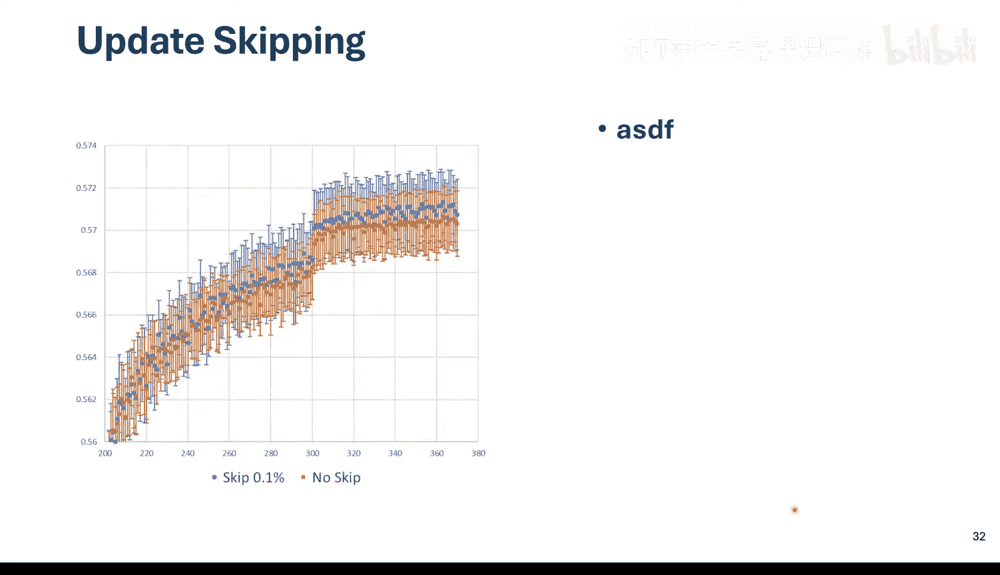

Okay， so that was 16 but training， but basically has long replaced FP32 and then BF 16 really supersed FP16 because it's why the dynamic range made implementation simpler no need for scale factors don't have to keep track of them also I should point out that in FP16。

This law scaling only applies to gradients and if for whatever reason your activations do hit high magnitudes or weights then。

You know， you'll overflow and that's going to be a problem because you can't really apply cheaply scale factors to the forward pass。

Eventually we run into that with smaller types， but then for 16 bit types you could just use B flow 16 now occasionally cases come up where Bf 16 does not have enough menisab bits so some operations fall back to FP32 or if you have FP 16 you can do FP 16 there right there's some evidence。

 for example， that when you're dealing with long sequences and attention based networks then for attention softmax。

Inputs or even the outputs， you want more precision or more menessa right so if P16 can work there would be flow 16 sometimes fails。

So。And like an illustration that we've seen earlier， like you know。

 dynamic range versus precision for the two。

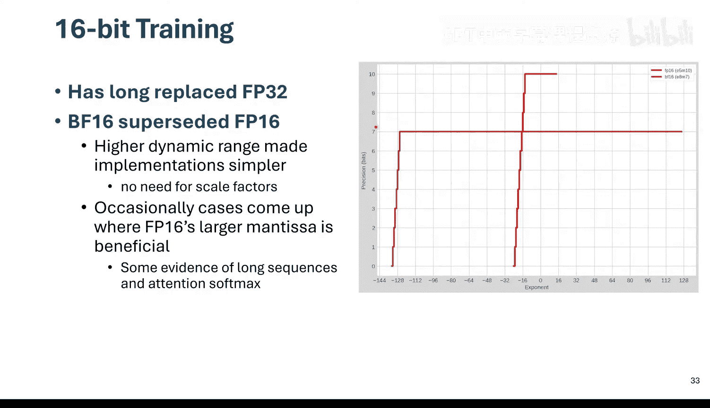

Okay， so 8 bit， so 16 is nice， but8 bit is nicer because it's smaller so you could make it faster two encodings if I m35 m2 we've seen this graph before This one does have several variants right so there's OCP。

 which is sort of open compute project which is a。Standard specification body and that's where a number of vendors like NviIdia。

 AMD， Google。Intel and arm got together and came up with a spec for how to encode those bits for FB8 Gracor have a different implementation in their hardware Tesla for their training chip also have a white paper describing their implementation it's really more of a block format at in their case and as I mentioned there's an aly working group that has been working for years and is still working to standardize something and it appears that they're sort of moving in a direction to be different from all those other ones。

But you know， we'll say how much that matters since the world is trying to go below 8 bit by now。

 And the differences come there from various choices。 So， for example。

 OCP format largely follows apoly， if when though if I3 gives up。

I think Ns to have a bit more encodings， but so OCP does have plus a negative zeros。And。

I think atee working group， the draft that they had a few months ago did not have a negative zero and they were recovering that bit。

 I want to say， but I'm less less positive， so I'll say it， but I might be wrong here。

 I think Gracoral also may not have negative zero。 They save it for some other encoding。

Also exponent bias choice， so OCP formats follow aEee approach on choosing the exponent bias。

Just based on the bit count， others。We're proposing changing the bias to something else I would argue in practice that really doesn't matter because FDA certainly needs scale factors per tensor or even fine granularity so that point exponent bias really doesn't matter because you have a separate scale factor anyway so that's what kind of have this comment that a lot of these differences are more philosophical then have a real impact on AI workloads and that's part of the reason why OCP groups has got together and say okay let's just have a spec so we have something to write software for and but yeah over time we'll see what gets adopted mostly。

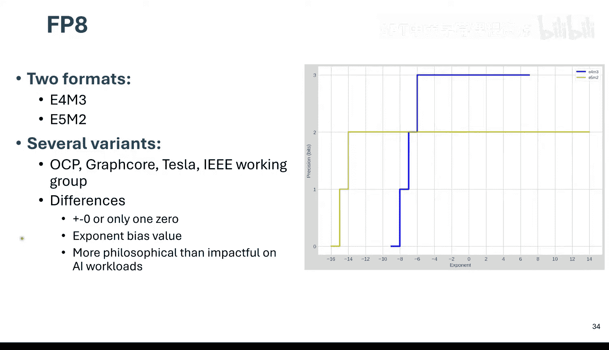

Okay so a little bit on FB8 so it has very narrow dynamic range and that you know definitely is insufficient to store all the tensors with a single scale factor you cant just pick it so dynamic range 45 m it's about 18 powers of2 binades 443 did I mess it up oh yeah it's in reverse I'll correct the slides afterwards yeah I mess this up so it's 18 bins 443。

 32 binates 45 m2。But they're insufficient to have a single scale factor for all the tensors of frequency see activations and activation gradients and so forth and there's a quick illustration of that here this again same kind of type of histogram buts for different operations that produce those values so there's projections so that's linear layer right after attention there's up projection down projection and FFM QKV projection in one of the batch matrix multiplies inside the attention and so you can just sort of see that they have quite different dynamic range needs like in purple。

😊，This actually has quite a wide dynamic range that it needs right and also let's say green and yellow appear over here。

 but then the rest of the colors are over here， so even though if your data type could cover the dynamic range needed by one of these tensor groups it's not sufficient once you look at the union of all kinds of tensor groups and even for the same tensor type I think the graph below here。

😊，I forget for which layer most likely it's upconver up projection in the FFN。

 but I think green and blue are just sort of in different positions in the network。

 So one is closer to the input layer and one is closer to the output of the neural network。

 And again， we just sort of graphed the。Histogram of the values that occur during training and per tensor there's roughly maybe the same dynamic range。

 but if you look at their union it's pretty wide and start succeeding what either one of these data types could cover so that's where you end up having scale factors now per tensor or even finer granularity right so per tensor scale factors work for some networks so for a bunch of megarons that in video they work just fine。

 but then as data sets grew we had to go away from static scale factors to dynamic。

 I can get into that if people have questions but that gets involved and then per subtensor was needed by some networks as well so like namely deepse for example right they had block and sort of sub row scaling that they implemented so per row scaling exactly cheaper computationally but per block gets pretty expensive before black hole and M 300 so before the MX formats。

So Perro seems a bit counterintuitive to me because it's the same scaling factor for a whole bunch of features like I would imagine that like yeah。

 so is this just yeah， how come per column doesn't even show up here？

So basically when I say row and column， so myself always get confused by those。

 you know what's logically row and column， but really when I say row here。

 it's really the along the dot product dimension。That's what I see see it's render dimension I see Yeah because the idea and I think I can jump it Oh yeah。

 I do have okay， let me just jump to this slide Nell explain that the cost at least computationally right So the top graph here is what I would have what I call per row scaling but it's really for one tensorors per for the other one is per column So in green are the values in the let's say a vector and in purple is a scale factor associated because it's already kind of a quantas type。

😊。

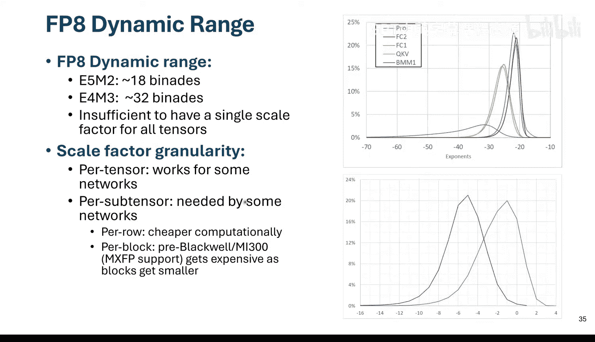

So if you're competing that product， again， going back to that linear equation we had earlier。

 if all of these values share one scale factor and all of these values share， not a scale factor。

 then we compute that product in low precision， you know with cheaper math。

 get the sort of black element as an output and then apply those scale factors in higher precision so that's what I would call quote unquote cheap。

If I'm make my sort of segments smaller， so now each one of these sort of segments in the bottom graph has its own scale factor。

 even though they's the same color here， then I can no longer compute this entire dot product and some lower precision and then apply scale factors。

 I have to do you know one segment dot product， apply the scale factors。Next segment。

Dot product apply scale factors only after that I can add those two segments contribution to the dot product so now I'm adding this overhead and if there's no hardware support for that directly。

 then you have to do extra math in addition to your you know matrix units and you have to do it no many times doing that dot product so it will slow down your dot product potentially。

So that's where you know the coarse a granularity you have for this scale factor。

 the cheaper it is computationally， and even if you have hardware support it still you know some power cost will happen there because of that。

But yeah， but the key is that you want your scale factors to be applied along the dot product dimension that way you can feed your matrix unit。

 know， whether it's N videodia tensor courses or I don't know。TPU systolic array or。

 you know AMD's implementation of a matrix unit。 They all need to do that math within the matrix unit in some quote。

 unquote， cheap precision and only apply scale skill factors after that。

I don't know does that help answer your question？okay， let me see de here okay， so yeah。

 I guess I just talked about that， but then for result quality intuitively having smaller blocks is better right because if your block gets smaller and smaller。

 then potentially need a narrow dynamic range within the block or another way to think about it that your outlier magnitude is large values。

😊，Go into a smaller block。 So either blast radius is smaller。 right。

 They can only flush to0 values within the unit that they're being quantized in。

 So if your quantization unit is entire tensor， in the worst case。

 you could have such a large magnitude that if you represent it。

 it just flushes all the other values to zeros because they're somewhere much smaller than it。

 But if you have a smaller block， let's say block size 32 is an Mx formats。

 then that large magnitude can only sort of you know。

Blast the other 31 values in the same block as it， and it doesn't affect other blocks because those guys will have their own scale file。

So that's sort of the intuitive explanation why smaller blocks are generally better or should be better for accuracy or quality of the neural network。

 but they're not great for speed unless you add specific hardware for that。

What about what about like mix so there's a question from chatd from from Dongnyon。

 which is what about like mixed scaling formats， like why not have one tensor and per tensor scaling and one tensor and per block scaling？

so you can have that it all depends on what kind of hardware support there is。

 so as soon as you have block scaling for one of the tensors。

You need hardware support in the matrix unit for that。

 because if you don't have hardware support in the matrix unit for that。

Then effectively you'll have to， you know， so if we just look look at this picture and I just wipe out all the purple sort of square down the column here right so those just have the same skill factor。

But it's still the case that I cannot compute the dot product of the first segment and add it to that thatt product sort of contribution from the second segment。

Without applying the scale factors first， right， Because they're sort of in different regions once they've been mapped。

So as soon as one of the dot product vectors has block scaling。

If you don't you don't have hardware support for that， you'll have to do extra instructions for that。

That makes sense。

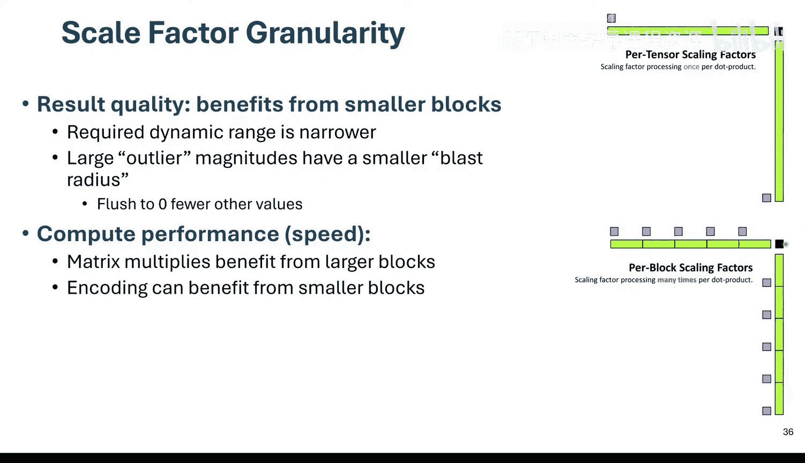

狗。All right， so I think this sort of transition is to OCP MX format right so for FB8， as I said。

 recipes evolved all started with per scale potentialtens scale factors and then originally was the just sort of heuristic based scale factor selection so that's one aspect。

When let's say some operation produces a tensor， it produces it in high precision those values set in registers。

You want to write low precision to memory， but before you can encode them into some low precision type。

 you need to know your scale factor。And if you don't know that scale factor。

 you have to look at the tensor values， well oftentimes what you'll have to do you'll have to write out that tensor to memory in high precision。

 then you know what the maximum magnitude was then you have to go through it again and then do the conversion right so that adds extra memory trips so it's costly。

So the heuristic originally was that we just used that tensor' past history。

 so we said okay well in the previous iteration this tensor's largest magnitude was x so we'll assume that we'll choose the scaling factor based on that previous history and really we would maintain let's say like a moving window of scale factors over some number of steps and then pick the largest one out of those and make that the scale factor and like I said that worked great for a couple of years and then training started stalling once data sets shifted significantly so then shift happened to that dynamic scaling and then folks also went to fine a granularity with FPA8 which added overhead because there was no hardware support for that and then starting with blackwell and MDs 300 series theres support for a X formats which really are just a definition for a finegrained block format。

So the idea is your data is 32 element blocks and they could be encoded in FP8。

 FP6 or FP4 as far as elements are concerned and that you also have metadata that's associated with that block and that's an E8M0 scale factor basically just powers of two and that's just a quick illustration how to decode that right so you have your data in yellow stored metadata some power of 2 so let's say 16 so really each value is the product of the metadata and that value so 1。

5 turns into 24。5 turns into 8 and so on。But now， like I said， granularity is fine。

 that's 32 element blocks and hardware has support for that so technically there's no loss in speed when you do math now in these vectors。

😊。

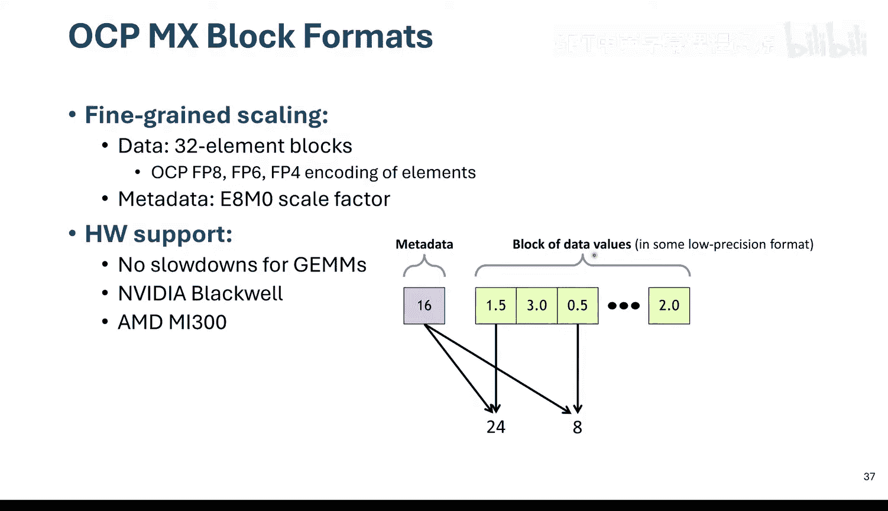

But you do need newer hardware for that。Quick illustration of MXF8 so that's the slightest ripout of my GTC presentation earlier this year。

 so for inference MXFPA8 is kind of interesting because unlike Inate and even sort of vanilla FP8 you don't need Qat you don't even need to do PTQ so you don't need to do any kind of calibration literally all that happened here we took a network trained in higher precision except for deepSq which was trained in FPA8 but with different scalinging factors and then we just converted to MXFP8 without any scale factors。

From calibration， so it just sort of straightforward cast only operation And in the figure here you can see accuracy so baseline was whatever precision the model was trended So B416 for everything other than deep CR1。

And orange is what happens when you run that same network， so same weights。

 but just cast to MXFP8 when you load up the model and all activations were just being cast to MXFPA at runtime and acuracies are basically indistinguishable。

So I think it's a pretty nice story for inference of high precision trade models without really any extra headache when converting when quantizing them to a smaller type and again。

 the big reason for that is the small blocks and each having a scale factor。

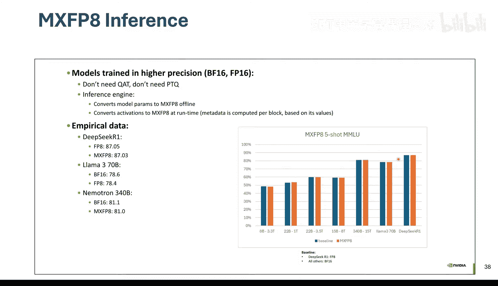

Training MXFPA also makes it easier so for FPA there were all kinds of recipes。

 but for MXFPA because blocks are smaller， we're able to keep more gradient I'm sorry not gradients。

 more tensors and FB and wind ended up using only E4M3 so we dropped E5M2 so E5M2 has a wider dynamic range which we found in vanilla recipes when your scale factors sort of at our coarsse granularity。

 we needed E5 M2's wider dynamic range to make training work。

But also some tensors needed3 bits of menissa precision， so those tensors were just left in the。

In higher precision if they needed both dynamic range and higher precision because FPA could not do but with mix FPA formats now since we can have scale factors of fine granularity。

 they sort of take care of the cases that needed wider dynamic range and menticis so again that makes training much simpler and again just some training curves here green and black so black is B416 baseline the mixFPA8 is in green they just match up and then the bottom here is just evaluation graphs right so different。

Evaluation benchmarks shown in both Bf16， when in FP8 and MxFP8 and theXFP in green just matches black。

 whereas orange one sometimes because of of course the scale factors loses a little bit。

 so you would have to do some PTQ or QAT。

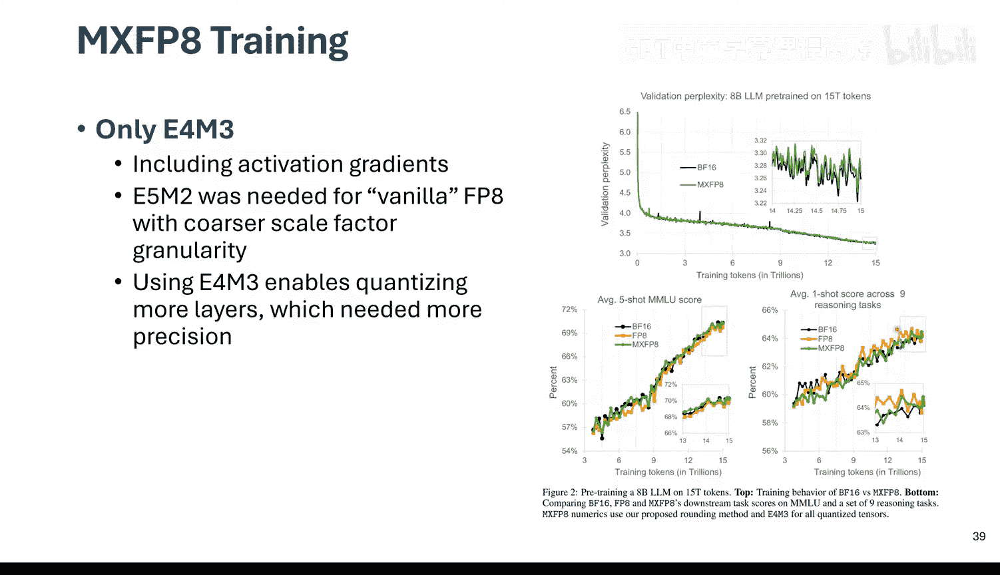

All right， that guess us do you have before。which is the smallest data type so far so OCP X FP8 spec defines the encoding it's easy because I just listed all the magnets you can represent there's also negative versions of these right so you can only represent zero。

 one， half， one，2， three，4， and 6 that that's how it sample the real number line。

It departs from sort of aaa like in the sense that it has no encoding for infinities。

 it has no encoding for NNs， we kind of rely on the block exponent or block scale factor to indicate that the entire block is nans or entire block is infinities simply because even with all of these sort of recycling of the bits still we can only represent just these magnitudes so if we had to represent infinities and NNs。

 this would have dropped substantially from you we could sample many fewer points in a real number line。

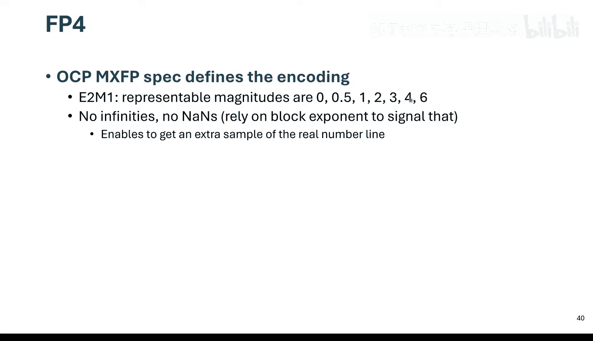

Um。Again， slideroed out or GTC just shows what happens with NVFP4 inference if you only do post training calibration。

 no further training right so we'll see it so that's or blue is the baseline sometimes F sometimes a Bf 16 oranges FP4 but without any kind of fine tuning to recover accuracy during quantization So we see that we do lose percentage point or a couple of percentage points of accuracy across various networks here。

 it's not catastrophic， but it's certainly lower。So max calibration was used in this case。

You can see all the details in the slides after。

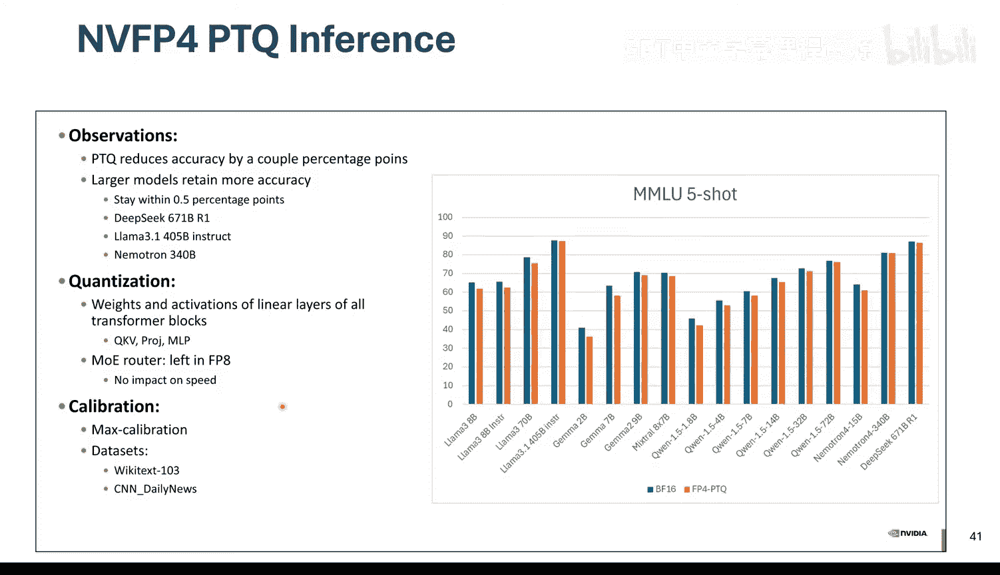

Um。But so to recover that accuracy you have to do some kind of training with quantitization in the loop right so you have to do quantitization or word training。

 there are some other techniques we can sort of distill but I sort of grab a few networks so a couple of neotrons and the green is what happens with QAT so quantization word training so you can see it goes from orange to green we recover accuracy large neotron was actually okay even with just PTQ and then this is Lama 3。

1 that we grab a couple years ago and without any kind of training we've got accuracy in orange for S4 but if we did a little bit of distillation based training for Lama 3。

1 on8B then we got to the green accuracy。The catch with QAT approaches is that we've discovered and I think others have discovered the same thing。

 if you're doing any kind of quantization where fine tuning to get the model adjusted for lower precision。

 you really have to do that with the same data that the model was pretrained or even fine tuned on in higher precision because you can get to situations where。

You have very different data set on which you train that data might work for your networks。

 but some other network was trained on a different data set。

 so if you're continuing just the training of another network with a different data。

 your loss will keep improving， but your downstream task accuracy really takes a hit。

Because I guess it's just seeing a different distributions of data So that's one sort of challenge with QE。

 It's a tough f because that means basically only the lab that produced the model can give you like a quantized version of yeah that's a bit unfortunate that's where you know there's some that's why for the Lama you know the traditional QET was not working well for us and it's actually not a problem related to quantization know that's problem for continued training in general respecttive or precision but that's where we just basically did some distillation right so the idea you just put whatever data through the unquantized network and quantized network and then your loss for fine tuning is just simply the difference between the twotensors in the quantized and unquantized version。

 So you're not really training for a particular task metric you just training to minimize the difference between quantized and unquantized。

Thank thatt。I have a few more questions on the slide。

Let's see there must be found oh okay so so the first question was like for example like NVFP4 is like one example of like deviating from like the I think that I've expected even come out all that long ago and I fire called NVFP4 we have a NVFP4 competition actually ongoing right now in the on the server where people are competing to write like the fastest NVFP4 kernels but like one it uses like different like ceiling factors like smaller block sizes how does this happen basically basically the spec writerss get it wrong like could you sort of help us understand of like why NVDF felt like yet another D type would be more beneficial for researchers here Oh sure see do I have。

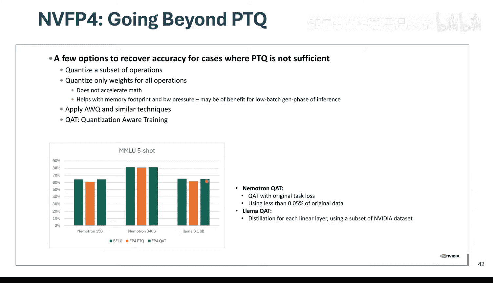

I have that here so it's actually a good segue so I can comment on how that happened since I was involved in both OCP spec and NF so a lot of these things take quite a bit of time to come up with。

Right， and then oftentimes suspects end up being some sort of compromise。

 right so work has been going on and been video on this for for quite a while。

And then the spec effort started so the spec sort of settled on one implementation right so that's a good at this slide maybe on the very left explains the differences right so MXF before which is an OCP defined specification it has the re element blocks and scale factors are8 m0 so just powers of two because zero and is a bit。

NVF4。Is sort of， you know we can see it as a， you know。

 as a bet by a vendor that it's something better right mean that had been in the works for a while or various things that evolved into it had been in the works for a while。

 If you look at some publications from Nvidia research。

They had sort of fixed point based formats that worked for some cases。

 not quite for others and that's where transitioning those the floating points sort of ended up in this。

 I forget what the original format was called in their paper but maybe it'll come back to me。Anyway。

 so you know， there there were efforts going on for a while。 and then。

 you know spec sort of settled in one compromise。 And then at Nvi。

 we felt that there may be benefit to this。Different variant of if before。

 so we put that in in hardware and we shipped that as well。

So they're both available in Blackwell right so people can choose whatever they wish to use or can experiment with both and I guess you。

 over the next slides I'll show。Some cases that might give advantage to NVF before but it's you know earlyish to tell so on this slide you know there's two training sessions and there's a paper I didn't include a link I'll add it to this slide there's a paper N from NVIDdia that came out on before pretraining maybe a couple of months ago by now it's an archive if you just Google NVF before pretraining you'll find it。

But it sort of did an ablation study where I guess x axis here is just tokens and trillions that network were coned on and then the Y axis here is actually not the loss。

 but it's relative difference from Bflow 16 training session。Lower difference is better。

 but lower difference would be up right so zero differences at the top So if you just had a curve that was just flat here along the top edge that'd be the best case so in both of these cases F4 training sessions werere lagging behind B flow 16 but green was lagging by less than red right so red is further away from the top edge。

And yeah， so red is M XF before， green is NVF before。😊。

Another interesting way to look at that is well what does that mean to your training session。

 it doesn't mean that you cannot use MX before training at all。

 it just means that maybe you have to train longer and that's what was done here so the on the right graph X axis is tokens and trillions used for training。

And Y axis now is the validation loss， sort of in absolute terms。

 and the sort of the line through here is where NVSP4 training session loss was after 1 trillion tokens。

N aex 34 was you know above it right the wax doesn't go all the way down to zero right so it's this gap is here for illustration。

But then if you continue to train an MXFP4 loss would keep decreasing right so and we see that that loss intercepts the same level as NVFP4 achieved loss after 1。

36 trillion tokens， so one way to interpret that you can train an MXFP4 that's what this experiment shows。

But you might have to train know， 36%。Tokens more to get to the same loss value as in if before did。

And then so you can sort of think about， okay， what does that mean to the cost of training？OhSo。

 that's。One aspect， and maybe I'll pause to see if there are any questions。

So is this like one of those things like where again， we need hardware units for both， though。

just get on NVf4 and then and then do some sort of simulated thing for Mx So again。

 I hesitate to speak on Nvidia's behalf since I'm no longer there。

 but I'll pretend that I'm speaking I don't know half a year ago so from NviDdia's point of view Nvi support it was part of the OCP spec for both FB N MX formats and it was one of key members So Nvidia shipping hardware for that supports the spec format because that's good for the community and then there's also think there's a format that's not in the spec at least not yet but it might have advantages so Nvidia supposed to ship it So blackwell case both of these formats are natively supported in hardware in other cases if somebody is making hardware from scratch then they kind of have to make a decision what could they ship they can choose to ship both or they can ship one and the way to interpret this graph on the right so let's say I'm making hardware I'm trying to decide what to ship。

嗯。And it really sort of depends。 So let's say and again。

 this is one sort of experiment that you know provided these numbers。

 but let's say it's very generalizable well。If I could implement MXF4 hardware。

 let's say more than 30% cheaper than NVFP4 hardware。

 I might come out well or at least break even in that cost。

 so let's say I implement somehow for whatever reason。

 let's say MXF before4 training for me twice as fast per step than NVFP4 then even though I have to do 36 more steps。

 I still come out ahead at the end of the day because each step is half the lifetime。

Now in these two types cases， I don't think it's the case。

 but that's how we can sort of make trade offs between some data types。

 so one data type maybe better convergence wise than a number of steps。

But if the other data type can get the same accuracy in more steps。

 then you just sort of raise the threshold that it has to cross in terms of speed。

But it's still a viable choice potentially right， and I think more and more the world will probably have to think about things in this way because as you go to fewer and fewer bits。

I think is' going to be much and much harder and at some point impossible to maintain the same sort of convergence behavior as higher precision。

But then you're just looking to trade that off to for you know。However。

 much you're giving up in convergt speed， you need to more than make up for that in actual speed per step。

 and then you still come out ahead。If that makes sense， it does yes， so the poll was asking。

 I think a related question which was。If he recalls correctly。

 andVF before those multiple levels and graularities of scaling as a global scaling than a block level。

 what's your thoughts on such schemes where scaling is almost like fractional block size？Yeah。

 so and VF4 needs that because once if we look at the scale factors。

 so it is nice to have those my bits and I have a couple of slides on that。

 So we'll walk through that。 But again， it's you know scale factor is 8 bits and it's 8 Bs because it's just sort of a nicer addressable unit in memory right the scale factors are stored separately from the values themselves you can address 1 byte so it makes things kind of simple to fetch。

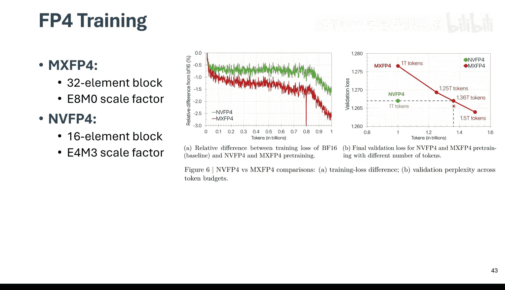

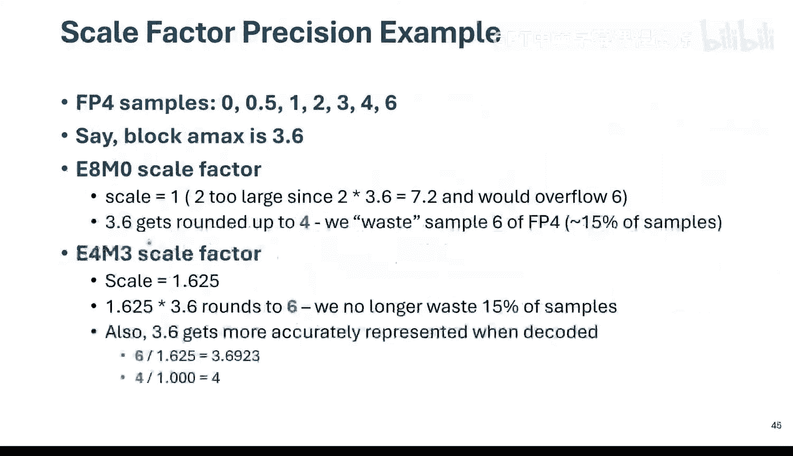

So， and we did study， you know how many metics to use and sort of three was sort of what。

Best trade off there， because if you go higher than three。

 then you really have to give up a lot of exponent。 But yeah， exponent is only E4。

So now when you store the scale factors themselves， well。

 they have to have a scale factor of their own。 and so far that's been per tensor。

 So you don't flush like the tiny ones to zero。 So that's I think why you need not always。

 but there are certainly are cases where you need two level scale factors。

 one per block and then one per tensor just for the scale factors themselves。

 It's really just sort of。Almost unnecessary necessity to reduce the average cost in bits per value because we could have said。

 well， just store more bits here， let's pretend that you know a bit addressing is not what we need。

 Let's say we could have stored E8M3。And that's easy to store an address and memory。😊。

Well then your average size per bit actually goes up quite a bit right because let's say you have 164 bit values。

 so that's 64 bits already， and then if it's E8M3， that's 11 additional bits so now you have 75 bits in total per block and you divide by the blocks as by 16 you know you end up with some average size per bit。

So you do want to keep this small as much as possible and two level scale factor or you know fractional scaling。

 if you want to think of it that way， it sort of helps amortize those extra bits。

 So now what you have is still just 8 bits of scaling per block。So， total bits per block is 8。

And in addition to that， you have， I think in video， they just use 32 bit。

float for the pertensor scale， so I have an additional 32 bits。

 but those 30 additional bits are amortized over the entire tensor right so they're pretty going unquote cheap at that point。

So yeah， so this multi level scaling is just a way to。

End up with a smaller number of average bits per value because you amortize them over sort of larger scales。

Or blocks levels， I guess。Makes sense。 Yeah， let's keep going， go。

All right， so a little bit on scale factors， right， so that will explain some intuition。

Why you might want to have precision or extra precision in the scale factors right and again。

 scale factor recipes can vary and probably will evolve one thing I should mention here。

 maybe you should have put in the slide， So if you look at OCP MxFP spec you can just find it by Googling OCP MxFP。

It actually has a bug in the suggested specification for conversion to the low precision formats。

 and we're in the process of correcting that。So don't follow what's in the spec and let's say follow what's in Nvidiaious paper and I think there's some other papers that people publish so they can be different ways to choose scaling factors that work。

 but the classical recipe is basically find the maximum magnitude in your block。

In some higher precision， then compute the encode scale factor to take that maximum and map it as close as possible to the destination format's maximum without overflowing。

And we don't want to overflow because in some F training sessions we saw if we overflow the destination format and then just saturated the value after scaling to that。

 so a bunch of high magnitude values just started becoming indistinguishable because they would just all get converted to let's say in F4 case they would all just become six and you cannot tell them apart。

That was Stalin trained to some degree， and that was actually an FB8。

So that's how we followed this recipe。But。So now the question is if you follow this classical recipe how much the scale factor precision matter scale factor format itself and that's where the mentesa bits or more precision can potentially expose more of the format's dynamic range and can actually more accurately represent the block values so a quick example of that let me see how we're doing on time okay close to the end here almost so if we look at FP4 it's easy to look at because it only has these values that it can represent or magnitudes。

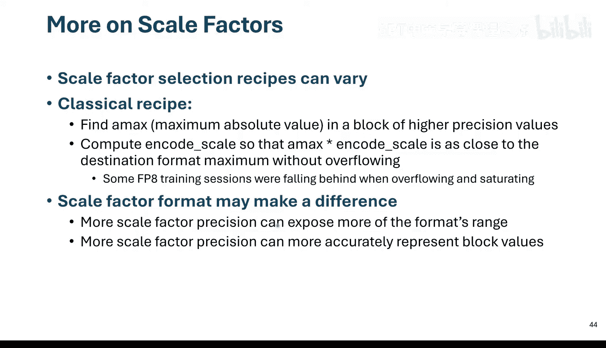

And let's say we have a block of high precision values where the largest magnitude happens to be 3。

6 so let's just pretend everything is positive for simplicity， but no loss of generality All right。

 so we have 3。6。Well， that cannot be represented exactly herood because there。

Nothing that would get around at either three or two four。

But we have to find a scale factor and again， we're looking for a scale factor where the goal is to take 3。

6 and map it to6。And then all the smaller magnitudes would also get increased and map somewhere in this range。

So if our scale factor is only 8 m0， meaning it can only be a power of  two。It will have to be one。

Because if I pick my next available scale factor， which should be two。

that's the next power of two it's too large because2 times 3。6 is 7。

2 that already overflows6 and let's say I decided that's bad I don't want to do that so I have to pick a smaller scale factor than two only choice is one。

Well， that's fine， so 3。6 gets multiplied with one and it gets rounded to one of the values here。

 it'll get rounded to four because four is closest to 3。6。

So what we end up doing is that we will not end up using the sample six in the FP4 format at all because the largest magnitude I had just got converted to four。

 so nothing else in that block will get converted into six， they can only be smaller。

So I just wasted sample six out of FP4， which is about 15% of the samples that I have because I only have six of them to begin with。

So that's one potential sadness and then if we look at what Eform 3 would do， well。

 Eor 3 can represent 1。625。😊，As a scale factor and 1。65 times 3。6， I think it's like 5。

85 or something like that， right so that will run to 6。 So now I'm no longer wasting the six sample。

 So I just saved myself and that's how I end up using more the dynamic range of f before than possible without with just powers of2。

 So that's one potential know goodness。And the other one is now 3。

6 gets more accurately represented one we decode it， right？So if I look at what happens with。

You form three scale factor。😊，I took my 3。6 original value。I multiply with 1。

65 scale factor and I round to6 If I decode I have to divide by the scale factor right so6 divided by 1。

65， I get back 3。7 roughly right that's what I get back so it's not exactly 3。

6 it's off and we can see you know the error is about 00。1。Um。If my scale factor was only 8 m 0。

 then I took 3。6， multiplied with one， rounded it up to 4。 Then that four comes here。

 Now I have to decode。 I have to divide by the scale factor， which was one。 So I still get back 4。

So now the error after encoding and decoding is larger instead of 3。6 I'm getting four。

 whereas before instead of 3。6 I was getting back 3。

7 so those are the two potential you know benefits of the scale factor having precision sort of enables more of the dynamic range for your block in some cases。

 and it also can more accurately more accurately represent the largest magnitudes。

How much that matters it's probably a bit early to tell right know more training sessions will have to happen。

 this is still you know bleeding edge work， but that was sort of the reasoning why。

We saw inV before having potential benefits also for PTQ。Quentization， which was losing accuracy。

 but having more on a scale factor was helping us keep more of the accuracy than just powers of two。

So that's why I guess we felt compelled to also。Shipp in V4 and。See how things shake out。

So maybe that's sort of ass to the answer to your earlier question。

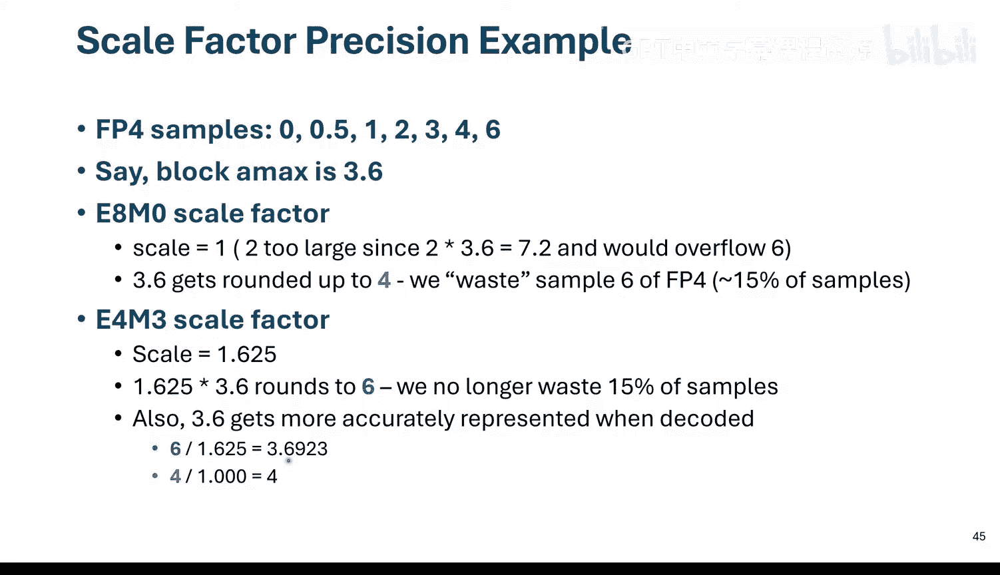

Okay， other works I'll skip through this in an interest of time so you know people have been publishing on binary and I would call attorneyernity training。

 they call it 1。58 bit training so you one paper from early last year was pretty interesting that's basically just using negative 10 and1 values to train of course with scale factors and they have to change quite a few other hyper prims to make it work add more normalizations and so on but it's sort certainly interesting codebooks I mentioned earlier and that's how used sort of get to maybe sub even sub1 bit per value。

General idea is you look have lookup tables as a compression technique。

 but so if you have 16 entry table， you have four bit indices。

 but I could have data types that are much larger in the table itself could be FPA I don't know FP 11 whatever。

And again for DNA use， so lookout tables are nothing new they've been around for decades for DNA use you days back to at least 2015 when Sunngan published a paper on that。

 there might have been some work prior to that that I'm not aware of。

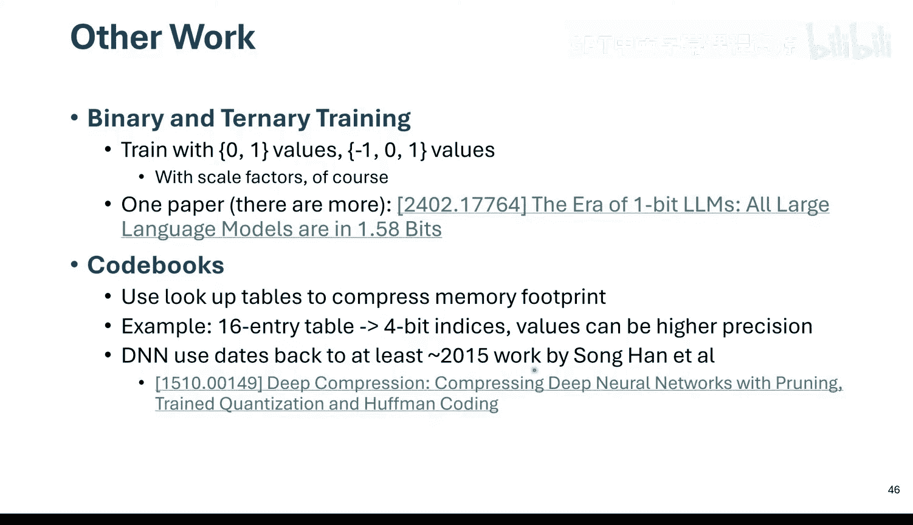

So just some directions。So I think and you know there's also techniques to adjust neural network tensors to be more amenable to low precision and again active area of research general idea you have a tensor and you'll apply some transformations to that tensor to reduce the dynamic usually to reduce the dynamic range required for the values right so examples of those would be additional normalizations and that's what sort of alternativeernity training does it adds more normalization layers you know after each gem for example。

 sometimes that helps sometimes that actually hurts you know when we've done some experiments。

And there's techniques like AWQ smooth quantant， SVD quantant， random Harman。

 had more transforms and so on， so all the ideas here you do some extra processing on the tensor that you can easily undo that somehow makes tensor sort of more behaved for low precision quantitization and like I mentioned usually they try to address the dynamic range。

Any questions before we move on to P floating Point quirks？No。

 I think I think we should keep going Okay， all right， so I just have a couple of slides here。

 so kind of going back to again floating point。Specifics here and some quirks that do come up and you see them sort of brought up more and more online in the AI context。

 but really those things have been around for as long as floating pointingcoings have been around。

So some things are like nonassociivity of additions and thenfuse multiply addd so both of those things sometimes can be surprising to folks but they're sort of discovering the old quirks and in all of these cases。

 maybe I won't say all of them， but in vast majority of these cases rounding is really the reason behind these quirks。

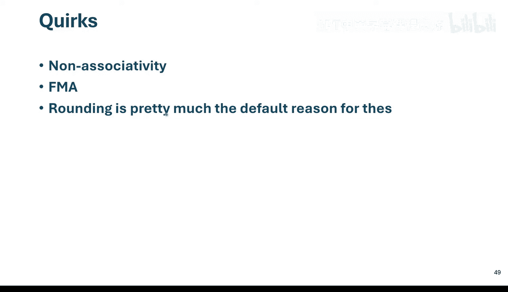

So floating point non associivity。That key observation is that even though in sort of real number。

 algebra order of additions does not matter， so a plus B plus C is the same as b plus C plus a。

In floating point it is not， and that's because you have finite number of bits on finite precision。

And it's the rounding of intermediate values that's causing the differences。

 and we have an illustration that will go inside in the sec。

So things that can change the order of these operations right so if every time you did A+ b A plus C。

 your results would be purely deterministic right so you see these things come up in the deterministic training or even deterministic inference discussions。

So if you change hardware， you will get differentt product instruction sizes。

And that can actually actually will not change the order operation actually it does change the order of operations when you really think about the summation if you compute that product of 124 elements。

 if you do it， let's say 32 elements at a time or 16 elements at a time。

 you just change the order of additions。😊，But even on the same hardware。

 you can get different orders of operations either because of different compiler optimizations。

 right so different compiler flags， or if you're using atomics for things like reductions because then that's really sort of like runtime scheduled effectively。

And related to that would be like work queuee based implementations right to where different。

 let's say threads grab work from a work queue and because of thread scheduling now some thread might do grab different chunks of work that it works on and again that can change additional order。

And usually there'll be deterministic versions of kernels to avoid that。

 but these are some of the reasons they can cause it。

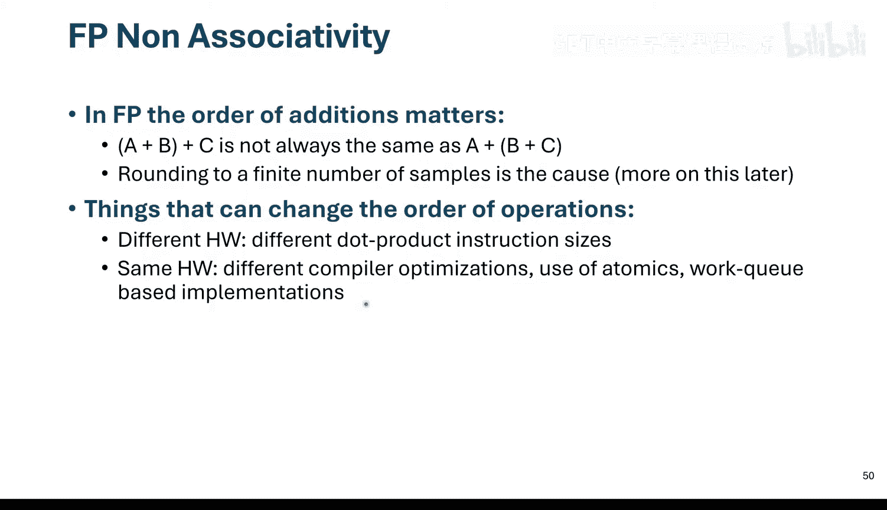

To understand why that's happening I sort of figure I can start with floating pointswamping So that's a special case it's really just when you add two values and what's happening is that the values magnitudes are so different that the sum will be just a larger magnitude if they're positive right so quick example with E5 and2 because it's fewer bits to show maybe it will not like nettpic everything folks can look at it afterwards but let's say we're adding numbers 32 and 3。

5 and E5m2 representation and the output will be 32 which is algebraically incorrect but that's the best you can get if your inputs and outputs are always E5m2 and the reason for that being is that I convert them to binary formats so you can see1 is 1001 is 111。

They have different exponent values because they're different magnitude values。

 so we have to do binary point alignment is just like if you were adding values in decimal system。

 so you have to make exponents the same。But to make exponents the same。

 you have to make exponent larger for the smaller value， and because of that。

 you write shift the1 bits by shifting in zeros。 So these are still the same values that you're adding once you add them。

 you get this result。And the key is that the result to be represented accurately needs all six bits of the menisa。

But now you have to convert back to5 M2， which only has two bits of Matissa。

 So all the bits in red here。Are going to get victimized by rounding。

And that's what happens in any of these representations if the value cannot be represented accurately in the destination format。

 rounding will happen and in this case you run to the nearest value and the nearest value will be 100 and so that's how you get the re as an output。

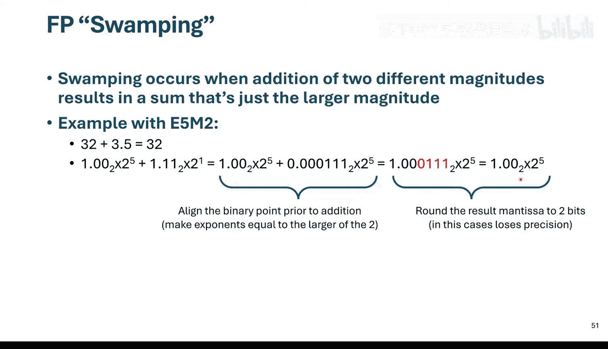

So not just swamping how that occurs。And then just building on that。

 maybe I'll skip through this in the interest of time， but now let's say we're adding values 32。

 3 and a half and  four。And based on the order in which you add， you will get a different result。

 So if you first add 32 and 3 and a half and then for you will get only 32 and maybe that's quick to describe right。

 we just saw that 32 and 3 and a half because of magnitude difference we'll just produce 32。

And after that， I'll have 32 plus 4。And same kind of problem will still occur occur。

 I will lose that one bit after rounding to nearest even and I still just get back 32 so as if we didn't do any additions at all。

Here， if I first add 3 and/ half and 4。I will get eight。

So it's not seven and a half because that could not be represented because of rounding。

 but I get eight and then I add the re and eight and we will get 40 at the end so。

This quick illustration， if you want to sort of go through the bits you can and it doesn't have to be like a swamping case。

 there will be other cases， but the principle is exactly the same intermediatemedia values that you get change magnitude based on the order。

 and therefore they。Incur different rounding sequences。

 and that's why you will get different results。 and it's just unavoidable in any kind of floating point of representation。

 simply because like as we saw earlier， the number of real values is infinite。But any kind of number。

 limitationation and hardware has finite number of bits and because of that you will have to round and as soon as you round your sort of traditional algebra laws start breaking down。

 especially when it comes to socitivity。

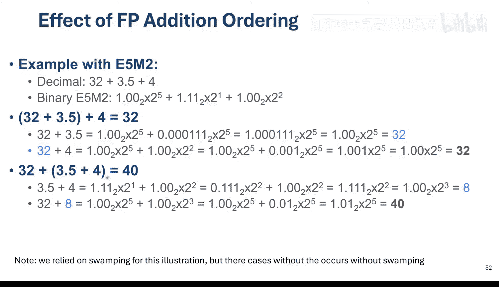

Fs multiply ad that's the last thing before we wrap up so it's a course so like a subsequent aee version of 754 introducedfuse multiply ad operation right so what it does in a single instruction it can multiply a with B and Esy all at once or at least can a single instruction does that and it's only for scalrs。

So as I mentioned， defined by a Triee， it's implemented in most modern CPUs and GPUs。

All the main ones have it。And one requirement of aee is that the product a times B before the addition happens must not lose any precision so you have to maintain it in full precision without losing any bits。

 and that's a key difference that can cause some interesting quirks later on。

SoInvest majority of cases fu multiply add is more accurate than a sequence of first floating point multiply round to the destination format and then add。

But it can lead to surprising results， so again， this is an example that comes from Khan。

Basically the author of AE754。So one case is where if you have x times x minus y times y may not be0。

 even if x is equal to y， right。Technically it's really same value square subtracted from the same value squared。

 so that's kind of surprising algebraically at first。

 but if we dig into what's happening underneath it's understandable why you could get non zero outputs in this case。

And you will get this inequality here whenever x times X product。

Requires more bits to be represented accurate or precisely than your destination format has。

And the reason for that is if you dofuse multiply implementation。

It's really logically what happens is first， let's say you compute the y times y product。

And you started in an attempt variable。It will get rounded。

Because then you're storing into a destination variable， and then only after that。

 you callfuse multipplay add。😊，And then you'll provide x and X。

 and you subtract the temporary value just computed。

Because if you multiply a cannot take four arguments， it can take three。

 so that's why you have to pre multiply one of them and then submit as an argument。

 so but now in this case， x times x does not get rounded at all because aee standard requires that this product must be maintained in full precision and then you do the addition。

So x times x didn't get rounded， this temp value did get rounded。

 and now you subtract rounded value from unrounded value。

 so if you lost bits during the rounding now you can actually get a non zero answer。

Whereas if you do F Mo and F at sequence， then Fmo of y happens， and you get rounding。

 then F mo of x happens and you get rounding and then you do addition。

And in that case you will get a zero every time， so it's a quirk。

 which one's the right thing it's hard to say right because it's unavoidable with finance representations。

 and so these effects usually will manifest themselves through compiler optimizations how compiler decides to look at your source code and generatefuse multiply ads or just multiply and add sequences usually compilers have flags to disable diffusion if you want that or even you can have intrinsics per operation type。

 but something to keep in mind these things can happen。I want to say， yep。

 I think that's the last slide I had。So thank you thank you yeah this is like a through of the fourth so thank you so I think there's a lot of questions in chat and then I have a lot of questions as well so let's just go over them and when you get tired。

 just let us know so okay。😊，So Vpo is asking， can we expect an OCP schema for Tensor cores FMAOs because it's lacking in the Irople standards？

Will that'd be a question for。Hardware folks， which I no longer represent。U。I don't know。

 I would say that no， personally。I guess maybe a need would be demonstrated for that。

Because I guess today on all the hardware that I'm aware of from either in video or EMD what's going to happen is that those OAP formats are only supported in you know matrix units。

 let's go on that right and then for any scaleal operations you would have to do math in some higher precision format。

U so。I guess that's not not answer。 So it really depends on our hardware vendors and how much performance benefit they see from adding those instructions。

AllAnother question I see from Dongnyion which is like how much of quantization's effectiveness on training versus inference drives an adaptation and standardization or hardware support of a format。

 is there heavier considerations on training or inference？So again。

 we really want you to present that video here so I'm well so I say by now I don't even know right so I can talk maybe historically right。

If we go， let's say prior to， I don't know， more than three years ago。

 probably was very heavily weighed towards training。

But then as inference becomes more and more of a thing。Right so for a long time。

 people would train neural networks， but inference workloads were not a huge consumer of cycles nowadays with the proliferation of various you know large language models and LLM based services inference is getting more importance and I think all vendors are probably adjusting you know sort of their。

Investtigations and priorities accordingly so I think that evolves over time and just sort of follows where people predict the compute cycles would go and you know when you work on hardware you always have to try and predict where the compute cycles might be going in a few years in the future。

 which is difficult to do correctly。All right， so I guess the answer is it varies。

 it changes over time。Yeah， I mean I mean for what it's worth like and video has also shipped in the past like basically skekus optimized for inference or training。

 so I think they do react to like whatever the market demands so。Okay。

 so I had like three questions that are like all ambiguous so like I'll just start with the first one so like one big o from your presentation was like sparsity and at the last like in Europe I was at actually the last IML I was at there was sort of this like sad vibe among sparsity researchers feeling like well you know we thought we could get these speed ups in practice but we really couldn't and it wouldn't compose quantization you sort of like have any like just I guess reflections on。

😊，you think these people are justified and what they're saying do you think things will change soon is this quantization good enough。

 how do you think about like these okay， so you know for full disclosure， you know。

 sparsity features were also maybe I won't say it came out of my group and really but we were very heavily involved。

 especially on algorithmmic side。Um， so。I think generally， if I just sort of take a 50，000 foot view。

Sarsity has always been interesting to researchers， but practitioners。

 I guess just have had more experience with quantitization。

And so that was sort of more familiar to them。 So that's the path that they were more。

 maybe the path that they would more immediately adopt and sparsity required sort of developing new muscles。

 And so people sort of would postpone that。 So I think my personal opinion is that sparssity does have a future。

 but there'll be more。啊。People will have to feel more pain without using sparsity before they really start putting an effort into trying to get it to work right so sparsity。

 if even if I talk about two to four sparsity， which you know is quote unquote only 50% sparsity。

It still， let's say， discards 50% of your tensor， which is a lot。

And so you will not maintain accuracy with that if you don't do some kind of fine tuning afterwards right so if I think about let's say Bflow 16 trained network。

 let's say densely trained network。And if we convert it to XFP8， we see， okay。

 we can maintain accuracy in that case without any fine tuning。

If we take a BF 16 train network and keep it in B flow 16。But throw away 50% of the values。

 it is going to lose accuracy。 So you have to do some further fine tuning basically you know sparsity where training you have to do to recover that accuracy and recipes there are not as mature as for just reduced precision even reduced precision has work remaining to do。

 but sparsity is even newer So even quantization where training。

 I wouldn't say is popular really right it's still relatively And then so I think sparsity where training is。

Somewhat tougher than just QAT。So that's sort of on a difficulty side of things speed up wise。

You can get speedups right if your linear layers are large enough so on pure sort of me outputs sparsities。

 let's say 2 x faster in this spec， if you look at various sort of larger gem sizes， yeah。

 youll get per gemma speed up in a neighborhood of up to let's say 1。8x over its dense equivalent。

And then you know the speed up overall will drop off once you consider end to end a little bit right because there are layers not being accelerated by sparssity So performance wise。

 if you get to the larger models， you'll get speed up and I'd say where sparssity has gotten some adoption is in the domains where。

People work within some kind of limitations of hardware and they just have to get it to work。

 so automotive would be one of those where you know generally they work on smaller embedded devices。

And then they're more desperate to squeeze out everything they can out of it。

 so you know we had a project where we took an object detector。Train that in B flow 16 and then。

Also took that train model and quantized it both to intake and add it to the force parrssity we could not do it to all of the layers。

 but we did it to the majority of the layers。And we maintain as in that case。

 and I don't know speedup， if I remember correctly， it was somewhere between 1。4 and 1。5 x。

 so it was pretty substantial。But an nontrivial amount of work went into that right so that's where I mean maybe people will have to feel more pain without using spars do before they start jumping through those hoops or they're more motivated to do that。

Another thing I would add is that。You knowBecause even 50% sparsity， it discards a lot of values。

I think they'll have to be you know at least somewhat of a paradigm shift in people's minds from saying。

 okay， I have a dense network now I'll postprocesor to sparssify it。

 I think model architectures maybe will have to be designed with sparsity in mind from the get go right so let's say you already decide you know what I'll have a weight tensor is going to be sparse。

And I'm just going to train with that。Or you somehow will think of your activations that having to have that 50% parrssity and you just train with that so。

Is basically you know your entire training is already with that in mind。

 so you're kind of changing network topology in a way。

And that way you don't have to deal with sort of post training。Specation and recovering accuracy。

 and then so。That's where， you know， just like， you know， if we think about Ms， they sort of。

Made a lot of。Headway over the past one year plus。And you could view that as a form of sparsity。

 right， Because if you look at all the experts and you just sort of。

Treat them you know basically concatenate them in that case you were up projecting in the feet forward as to like a really。

 really high dimension。But most of that， you don't really use right because you only use a fraction of the experts。

 So you can view that as sort of like very coarse， you know sparsity。

 but something like that potentially could be done for fine grain sparsity right。

 but you have to you know design your models for that and you know find training techniques for that because even a always right took a while to sort of tweak and。

Better balance the workload among the experts to where you know。

One of them doesn't get ignored or if you don't get ignored they get enough training data and so on and so forth so I think sparsity has potential certainly you know linear operations can run faster when you have a bunch of zeros and the hardware we can figure out where they are and just avoid doing math there。

 but I think there's both。Maybe model design and training work remaining there as well as sort of recipe work。

Yeahcha I guess I have two more questions do you mind going back to your slide on float swamping？

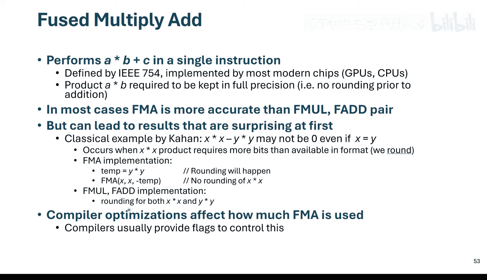

， yeah， so I'm wondering like how much of like problems and numerical stability。

Can you basically reason through using like this is a framework， for example。

 take something like I have a subtraction and then a division and I'm doing like let's say it's sort of some rough model for like an optimizer step and I'm trying to figure out like if the algorithm I have is like as numerically stable as it could be。

 is this like the kind of framework that you would use to solve this problem or not really。

Itd be similar right so and there are people who do work in this space it gets like very tedious very quickly。

 but you know sort of gets into the integral arithmetic to some degree where you say， okay。

 I'm doing this sequence of operations。And。Then you just sort of have to establish， let's say。

 what's going to be the worst case error due to rounding。

And you can do that for a single operation right if you know what input data types you have。

 you do the addition， you can work out okay in the worst case， you know， the magnitude of the errors。

 I don't know， like 0。001% or something like that。And then you can say， okay， well。

 this error happened after one edition， then I have another edition。

And then you can sort of accumulate those errors and you kind of work out how much of that happens。

 you know you can say that will get very tedious very quickly because now you're doing large dot products and you're putting them through non nonlinearities and things like that。

 so it it's really really really hard to argue about that or reason about that。End to end。

 but for like some sequence of scalar operations， you know。

 people do that and try to establish some bounds。 Oh yeah I see。

 But so then the more obvious trick then would be just like。

Do the low precision operation and then like just do it naive upcast to higher precision D type and then you'll basically can use that as an upper bound on how stable your algorithm is as well。

嗯。Yeah， maybe I would， I think I agree with that or as a way to study that， right but it's。

Maybe just do higher precision operations， but periodically just round the values。Just， oh， oh。

 I see I see， okay。Okay， there's one more question， so this is a question from Vipo。

 which was he saying it's a slight tangent， but could you please go over how the switch between subnorm and normal floating point numbers happens without hydro overhead。

 I didn't get it。

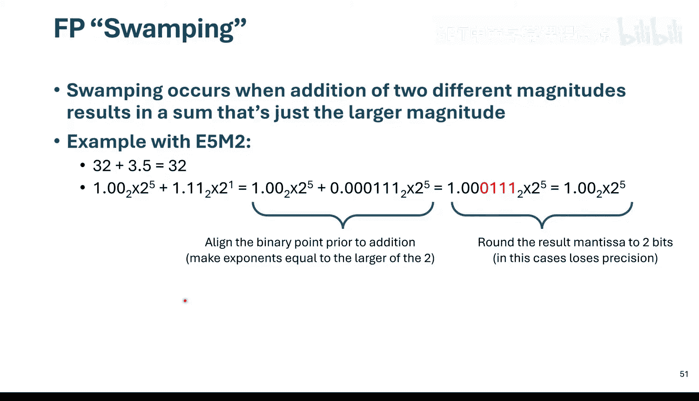

Oh， okay。So。

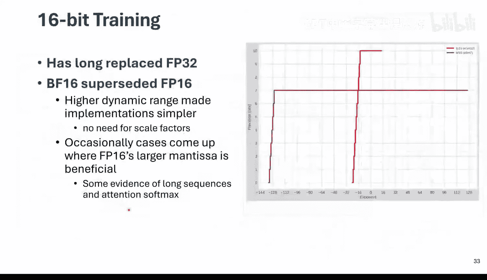

The facetious answer would be expensively。

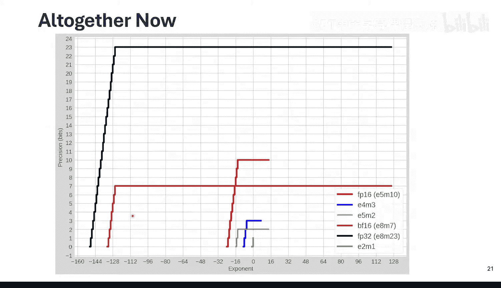

But basically。

You know， what changes is how you interpret the menisa bits， right， Because for normal values。

 you would go and say， even though I have， you know， these bits in blue。

So let's say 101， I'm ignoring the trailing zero bit， but there's that implied one bit。

And then I go through my traditional calculation of the exponent。

So I'll decode the exponent bits into some value， then I subtract the bias then treat that I have leading one bit sub normalormals。

 what you have to do is once you see somewhere had the sub normalormal here。

For submarormals， two things change。The exponent， you no longer treat like you would have a normalized number。

 so you can still decode it。 you see it's a0， but then you just say， okay， it must be negative 14。

 You do not duub buy subtraction， So it's going to like think of it as conditional now based on what you do is based on the data。

And also for the Monteesla， you see this 101， but you say， okay， well。

 since I detected it's a subnormal， then I don't have thelet。0ero bit。

So if you don't have hardware support for this。You would have to write software for that。

 so you'd be start throwing in a bunch of you know conditionals。

 maybe there's some you know bit twice bit manipulation magic you could do。

 but you would be increasing the instruction count by quite a bit。Um。

I think nowadays that would come up。So I think on GPUs， GPUs traditionally have supported subnormal。

 so I'm less positive about AMD。So I'm not going to say anything about them。

 but on Nvi GPU subormals have been full speed for your basic operations like addition multiplication。

Operations were that are implemented in software， so for example。

 division for floatinging point right because there there's a hardware instruction that we'll do on approximate division and then there's a sequence in software that sort of refines that approximate result to be the full precision result that ourrupA would require。

So now soon a software isn't involved in subnormals。

 just introduce more paths that you have to cover。So that's why the cost will go up I'm not sure about nowadays。

 but if we go back like you know， 10， 15 years back and if we looked at CPUs。

 there usually subnmals would incur an overhead。So oftentimes you would want to compile the code in with an option that says you know flesh my subnormals to zeros and then you would run faster unless of course you needed this submals then that was not an option and you do want subnormals for these low precision types because。

They help you cover more samples in a real number line。

 So I don't know if I'm answering the question well， but yeah， if it's not supported in the hardware。

 it can definitely be done， but it will have quite a bit of overhead because you can no longer just feed you let's say。

Regular floating point ad instruction， which would decode the binary representations inside the instruction itself。

You actually have to implement your own edition。I think for better or worse。

 and when it comes to performance it be worse。All rightI guess the last question and a immediate one So like when when Hace wrote has like Baianvaris blog post like I think a lot of people became interested in numerical determinism again。

 you know you sort of hinted at this already like with fMs around how like this intermediate upcast can cause like surprising behaviors and outside of like obvious things like that as well I think yeah but I guess outside of like sort of basic problems like different code deposited code faces do different things like how would you go about tackling this problem of like。

People are fine with a 30% performance hit to their code with more determinism。

 like which foot guns of floats should people be aware of and like work around if this is really important？

Well you know my answer will be very bias based on my background right so I was always a performance guy so like speed。

 you know we need speed and then people need to figure out how to make it work algorithmically and numerically right and then trying to figure that out like you know for lets say reduced precision recipes and things like that。

But it's an interesting question right， because to a degree and maybe that sort of relates to your previous question。

 you know， to numerical stability of algorithms， if these kind of things significantly impact your results that may be suggesting something about the stability of the approach that's being implemented。

I'm not making a super strong statement that's what I'm saying maybe suggesting something about stability but maybe the approach is not that stable numerically right I actually buy this argument like for example when I saw that there was a paper around how like in training repos BF16 is used more often than F16 and this was causing like completely divergent runs and you know my first thought was like damn if our algorithms are sensitive to this choice like it really seems like our algorithms are not very good but。

I guess you you might disagree， but that was like my first impression No I agree with that， right。

 and I think in H's block， he was， I think talking about things in the context of attention where this x squared minus y squared thing。

May come up and bite you。But you know， there I would sort of echo the same sentiment。

 as you just stated where if。That kind of difference。

Really impacts your result then I think you're operating you know right on the edge of numerical stability and。

You know， but now how to solve that is a different question right maybe you have to tweak some other hypoparameter to make it so more resilient to the different results because you know。

By definition， all these representations， they will make sacrifices because we cannot。

Represent things infinitely accurately。So all of them lose something right and then you can disable。

 for example， fus multiply ad if that's causing a problem。

 but it can actually cause problems elsewhere because I can easily design cases of inputs where fus multiply of a b a times b plus C。

Is actually more accurate when you diffuse multiplayly ad than when you're doing it as two multiplications and an addition。

So， you know if one thing suffers fromfuse multiply ad， others might suffer when you're not using it。

Um， so it's difficult to say because other repos might unintentionally be dependent upon the unpredictable behaviors。

 or like of course， they'll always be depend on the performance， but in addition of the specific。😊。

And I think one example， I think you referenced like a web page where you know。

 they were talking about how compiler optimizations can affect things and and it was。

I wouldn't say it was it was a new case for me。 It wasn't surprising once I read it， right。

 but let's say function inlining can actually。Cause changes in your results numerically and but really the root cause once again was rounding and fuse multiply addd right if you have a function that inside it does multiplication and returns the value and then the caller will do a subtraction Well。

 if compiler can inline that function， all of a sudden now  fu multiplied is an option for it without function inlinning。

 it is not an option So yeah， it's and again， it will come back you know if that kind of thing causes problems。

 then we'll probably at the edge of stability。But I think， you know。

 it's good for people to be aware what can cause these things certainly you know。Yeah， and indeed。

 this was my observation debugging a lot of numerics issues in Pytor。

 which's like I would sort of spend a couple of hours debugging something and then I'm like， oh yes。

 this is actually expected behavior but I know why it's expected so as as opposed to patching anything。

😊，and it's not just by I think it's， you know， it's for any programming language， you know。

 they'll all run into those kind of things， it's just a representation related， you know， trade offs。

All right well Pols， thank you so much。 I think you hit a record you're like the third longest talk we've had on the server so thank you so much it was like an absolute honor to have you you're always welcome back and everyone please thank Polus for coming on and we'll see everyone in a couple of weeks Thank you Thanks for having me。

😊。

