# GPU MODE《CUDA、GPU编程54-87｜GPU MODE》中英字幕（deepseek-v3.2 p32 20251206-Lecture 85_ Factorio Learning Environment.zh_en -BV1xbmQB3ETC_p32-

callled the Factorial learning environment， I myself was like very excited about this because like I'm also like a huge like factorial player like last year I spent like a good the majority of my Christmas break playing factorio。

But you know， like more seriously， like I think the reason why I think this should be interesting to a lot of people on the server is because like I think factoria is like an extremely interesting like Eval for agents and I think like Jack will be talking more about this and I think if you want like something like media and hard and you're trying to think about like what are important problems that are worth accelerating that aren't like really in the mainstream is should talk more with Jack So please yeah without further ado。

 please go ahead brilliant thanks a lot， Mark it's a real pleasure to be on the show So about 18 months ago me and a friend realized that we could。

😊。

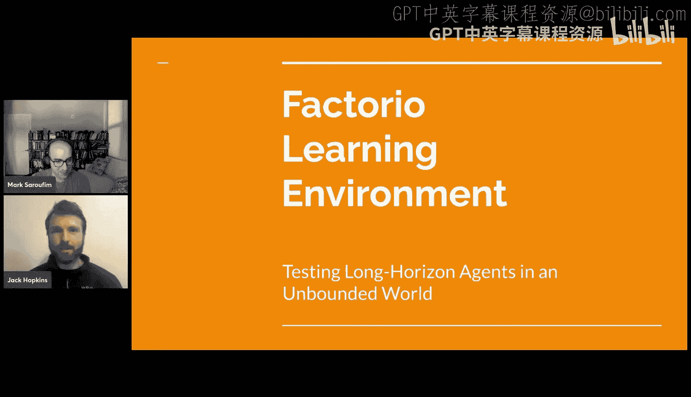

Hot loads little bits of Lewiscrs into a factorio node and use that as a method to effectively get agents to play the game Now obviously this was a Friday night and you know looking at my watch I kind of realize hey you know we really get our act together we can probably finish this thing by Monday morning it's been about 18 months since that day and it's got to the point where I can't even play this game anymore it's become too much like work but I'm pretty excited to talk a bit about we've what we've been what we've been working on so kind of by way by way of initial motivation。

😊。

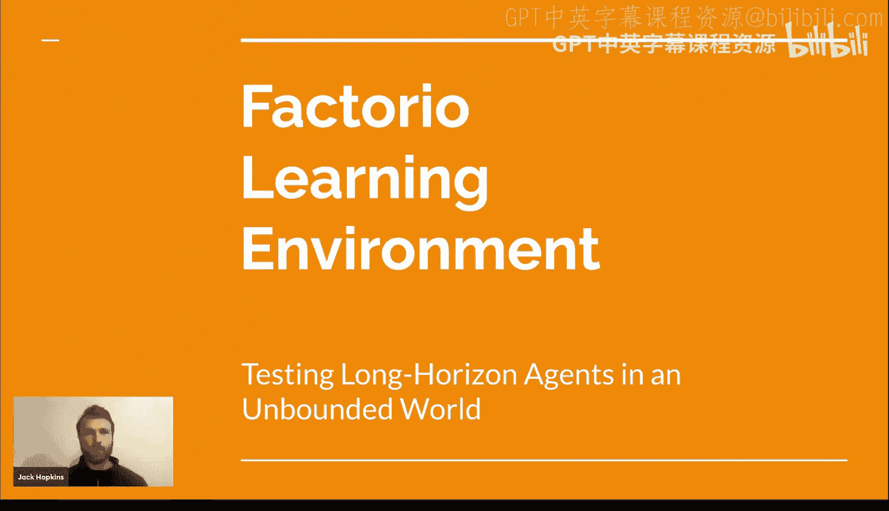

There's a bit of a problem in how we measure agents。Historically we create a benchmark。

 it would be good for a few years and then the progression in agent competency would saturate that benchmark at which point you couldn't differentiate agents anymore that benchmark effectively became dead。

Now even with more recent attempts to make harder and harder and even superhuman benchmarks。

 like in the case of humanities's last exam， and I guess the rather presumpttorily named AKGI2。

 it doesn't look like that trend is slowing down， in fact it looks like it's speeding up by current projections。

 it seems that you know humanityitiess last exam， RKGI2 and probably a bunch of these other new benchmarks are not going to be that useful in about 12 months。

And at the same time， we see the length of time or the time horizon of tasks that models can complete is doubling every 6。

6 months， so historically you know you might have a task like Sw benchch which you could complete you know you can complete a task in' a few minutes。

Now at this point agents are about the one hour mark so about 50% of the time state of the art models are able to complete tasks that are one hour and yeah。

 every 6。6 months this is doubling so this really motivates having a new class of environments which span into the ultra long horizon tasks where an agent might be expected to spend hundreds of hours and potentially tens of thousands of steps or tens of thousands of tool calls to achieve the outcome to get to the end。

So we basically need therefore， a new set of environments that can resist saturation over ultra long time horizons。

And。Factorio is quite a good candidate for such an environment。

Now what I think what we're looking for here is we want environments that are unbounded， I。

 they can't be completed， they't they can't really be saturated。

 there's like an unlimited performance ceiling factoria does actually fits this bill and needs to be procedural so the priors of a model that have been picked up during pre-training can't really you know the model can't memorize solutions and just spit them out。

 you want to remove the knowledge component from the intelligence component to have a meaningful benchmark in measuring model you intelligence I suppose。

You want something that's long horizon that tracks with that meter time horizon chart that I just had on screen。

 you want something that's consequential where you have to make long series of a long series of very accurate decisions in order to get to the end。

And you want something that's open-ended such that there are many different ways of achieving a goal one example that the meetter people were talking about were you launch a startup as one of the goals that they might expect models to do in the next few years now obviously there's no recipe for starting a startup I mean you have to do a great deal of exploration and goal setting and you know there's probably dozens of ways you can get there but what I hear from talking to my startup friends is that you know there's a couple of things that you need to do when starting a startup you need to make decisions really fast and you need to make every decision you need to make has to be slightly above average because you get this really nice compounding effect over extremely long horizons。

So as you all know， this is factorio， it's the highest rated game ever on Ste。

 you know 90% overwhelmingly positive， it's kind of considered to be software engineering crack because it takes all the fun parts of software engineering and removes all the dull parts and puts you in a really nice game loop where you spawn on a world as a player character。

😊，And your job is to launch a rocket and escape。To do this， you have to mine lots of raw resources。

 you have to build automation chains in order to process those resources into high levelve resources。

 you have to invest in technological research and eventually after you've been playing the game for you know about one hour。

 15 minutes is the world record but more accurately it's normally about 50 hours。

 you can launch a rocket and escape。So I just want to play this for one minute to give you for those who haven't played the game a bit of a flavor for what this is about。

Yeah。Yeah。🎼。🎼，れ。🎼，嗯。Yeah。Okay。うく。🎼嗯。嗯。🎼ど。🎼，🎼。Yeah。그。No。Yeah。🎼Yeah。🎼什。🎼Yeah。🎼可以。Okay。Okay。🎼The。

Fgo that was factoria for those who've not played it and those who haven't played it。

 I highly suggest getting involved if you have a spare few thousand hours at your disposal over the next 12 months or so。

😊，So as you might have noticed from the game， it's a sandbox。

 there's no end states and the range of progression scales through。

 I think more than a dozen orders of magnitude， people playing the game for the first time might be creating tiny factories that produce 10 items per minute or something。

 whereas the largest megabas that human teams have been able to create are launching something like a thousand rockets per minute or effectively billions of items being produced。

 and it's really a testament to the developers of this game that the environment can support such a wide range of competencies basically。

The game has a random map generation， so you can't really memorize the opening books so well。

And it takes about 50 hours if you throw yourself into the game tomorrow to launch a rocket。

 which is to be clear， very far from， know， as I say。

 about a thousand times further away than some of the best players or even more than a thousand times。

You probably also noticed from the video that the factories people were creating or the factory in in the trailer was incredibly intricate all you have to do to break the entire thing is introduce a single off by one era and put one unit slightly offset somewhere else and all the supply chains break and it becomes a bit of a nightmare fix so in this sense it's very much like a systems or software engineering challenge where instead of writing you know code that kind of exists virtually you know you have it represented physically in a two- dimensional space。

And there's lots of different dominant strategies I mean different people play me by putting everything onto a big like a single effectively backbone belt that goes through their factory。

 everything goes on that some people when they are doing a world record won't bother with that type of thing they'll just create you know effectively spaghetti code spaghetti factories with lots of。

Lots of like tiny little handoffs between things to get somewhere and it doesn't scale but they don't need it to scale they just need to get to a very specific end eventually once you progress to later stages and you're building really large factories the same the same ideas from software engineering also apply you kind of want to have a modular design you build infrastructure network to connect your your city blocks which produce resources by trains you know you can basically approach this game in any number of different ways there's also different meta strategies so。

The factory you produce releases pollution， the pollution antagonizes the natives in the game and they'll come and attack your factory。

 which means that you can the tradeoff for having extremely high growth is having to invest in a military industrial complex to defend your factory from all the people or the natives that want you gone the other approach is you accept a slower growth rate。

 you invest in solar panels， you invest in green energy technology which doesn't release much pollution。

 doesn't result in you getting attacked and instead of having to continually worry about defense you can just focus on nice clean growth so as I say it's a really enormous sandbox and that makes it an excellent testbed for doing research。

So so this kind of brings me on talking about the actual contribution that we've been working on you know。

 over the last 18 months in our Discord channel in GPU mode。

 we've basically built a harness for evaluating LLMs and visual LLMs in the game of factoria。

It kind of works like this， much like software engineering agents interact with the game through code symbolically。

😊，They observe the world through reading the standard error and standard output that comes from the execution of their programs。

 as well as optionally a visual representation of the game in the case of the visual LLMs。

The agents are also incentivized to adopt hierarchical abstraction development to make aspects of their code reusable through declaring functions。

 write classes to help formalize the theory of the world as they encounter it。

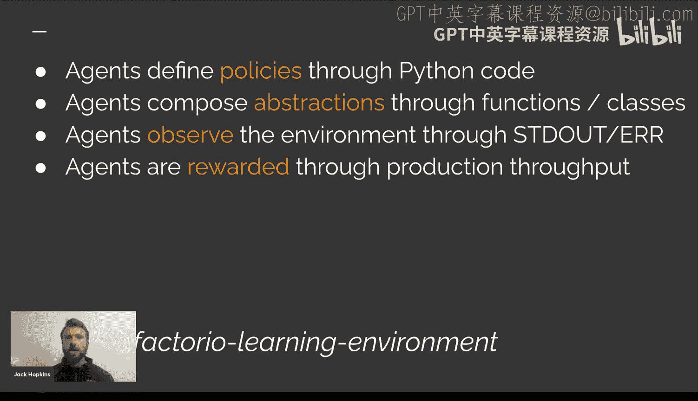

And。And because their observation streams come through looking at the standard output and standard error。

 they can prune what they choose to observe to prevent the output。

Choking their token stream you can imagine， for instance having a factory of1000 elements。

 a00 machines in it， if they were just to dump that whole symbolic you know list of all these entities into the context stream。

 you know you'd get maybe like two turns before the model would run out and performance would slow down and you'd have to do some memory management。

😊，So the hope is as the agent progresses through the game。

 they develop more and more expressive policies for acting in the world and develop more precise ways of making observations and reacting to those observations。

😊，Finally， the agents are rewarded through production throughput， which I'll talk about later。

 but it's effectively the GDP of the factory。So we have a pit package ready to go if you look at our website you can see that you know you can pretty much get started running your own Evals in about three lines of code。

 you install it， run you set up the cluster and then you just plug it into your LLM and see what it can do。

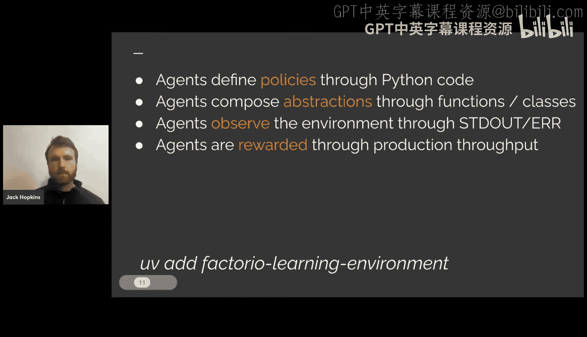

So this is kind of how the environment works you have。You have a normal chat transcript format。

 you have user assistant。We have the Python API schema and all the additional information necessary for off the shelf LLM to interact with the game put into the system prompt。

Instead of having a user like be the counterparty。The environmental observations and everything relevant are instead in the user message and the agent is just asked to sample the assistant message and in this way it's pretty much compatible with any post traineded chats based LLMs。

So you can kind of see an example of what a policy might look like here you know you because the character in the game。

 the agent in the game is embodied， they have a character， they have a limited reach。

 they have to move around and they have to observe things as they discover them and you know uncover new things and kind of up build up their world model this is a very simple policy is just go to the nearest call place a burn a mining drill on the nearest coal and then observe that the you know print out all the entities now that this driller has been placed down and then do an invariance check to make sure that its own its own assumption about how the state game state is is actually matched in reality so you know can just do a quick verification。

Oh no there should be a double equals there， pardon me。

 it does a quick verification that the entity status is working and if or not it it will throw an error。

😊，So you know， here we can kind of see the symbolic representation of the game state as printed out in the standard output and at the bottom。

 you know， the invariance check has failed and that's going to prompt it in the next step to do something about it。

So how this basically works is we've implemented a Python execution layer which contains a representation of the factorial object model in Python。

 so we have objects and we have strong typing for everything， which means that the model can。

 I guess more effectively symbolically reason over things and write downstream code to deal with the objects that they get。

The Python commands are translated into effectively remote process ins。

 which are then sent over TCP using the ACOcon protocol into a running factorial headless server which then takes that tool action in the game i。

e。 you picking something up， placing something down some low-le primitive action that then updates the game state。

 asynchronously we track we integrate reward for a little while so you can kind of track to see how the action has made an impact on the production score and then we get a nice object return from the game state which gets remarshalled back into Python and then process by the remainder of the policy in this case the object is just printed out to standard output。

What is the what is the Acon protocol so the ACO protocol is a is a game it's like a game communication protocol that people using games like Minecraft to issue admin commands and things so imagine you're you're an admin on a Minecraft server you might want to write some scripts which periodically kick off any inactive players to kind of manage the the resources of that server now typically they use Acon which is you know just a kind of layer built on top of TCP。

And the game factoria also supports Acon and also exposes a kind of lure shell that you can a lure console effectively for admins。

 which we can kind of hack to hot load arbitrary script into a running game。

which forms the back end of the factorial learning environment so it's kind of one of the nice things about this is that we don't require any custom builds of the factorial multiplayer server we can just take the server that they release for running multiplayer games and immediately just replace the factorial client with the FE client and now you know you've made your server multi you know made your server agent compatible effectively。

Yeah， excellent。

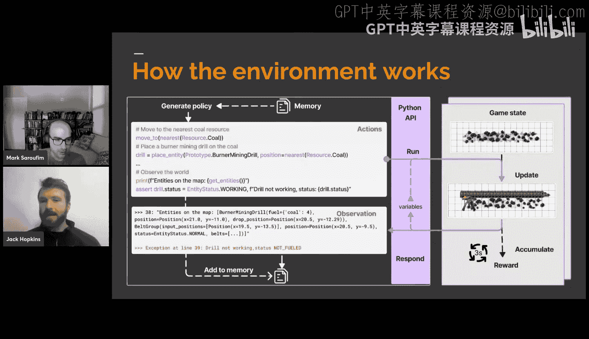

合频咩。' that's great。 that's clear。 Thank you。 No problem。

Sorry for the jankee chart here but this is kind of what I was just saying you have your Python policy we extract the tools。

 the primitive tools in that python policy such as pick something up， put something down， harvest。

 move whatever that's kind of unrolled into individual commands center with TCPcon into the lower console into a headless multiplayer server that's just off the shelf and you just you don't need the factoria client anymore to do this even though I would recommend buying it because the guys who built this game need a bit of love because they have built something kind of amazing and extremely fast as you can see at the bottom here we can run about 220 tool operations a second on average because the game is the multiplayer headless server is on running on a single process and is just highly optimized on an M4 laptop you can probably run between 64 and 128 headless factors at the same time which means you can do a lot of battery。

😊，And make things a bit faster for online learning， for example。

 and I guess some of the some of the faster operations can be done at even you know 600 or so operations per second。

One other thing that I didn't mention is that to get around the limitation of the factorial client being the renderer。

 you know it has the its the thing， it's the program that renders pixels on screen and we don't want to use the factorial clients。

 we've built our own internal custom renderer to effectively give visual snapshots to agents。

The visual agents without needing this external dependency。So， you know。

 you can agents can see what's going on in the game， even though the game is not is not connected。

 is， which is quite nice， I think。So going on to the policies， so here's a set of examples of tools。

Policies have dozens of tool calls entire rollouts over a trajectory a lamp play trajectory for example。

 would be like hundreds of policies or at least 128 policies so for a basic factory we're talking of thousands of tool implicationss all of which have to be precisely orchestrated and error handled etc if one of them gets if one of them is a mistake it can cause the agent to waste a bunch of time trying to fix it so precision is the name of the game and to my knowledge this is the this environment has the longest agentic horizons of any exant environment or you know thousands or tens of thousands of tool callss are expected to make reasonable progression in the game so in this sense we're hoping to kind of futureproof this against the next couple of years of agent development and hopefully we won't see this environment saturating for a while。

So on the right hand side here you can kind of see that the agent has basically added two objects to its namespace。

 it's added a drill object and chest object，'s been it's given a score per second which is I'll get into in a minute and we also track an additional milestones which is effectively a measure of how much exploration that the agent does in game for example。

 if we didn't track milestones and we only looked at production score if we only looked at the GDP of the factory one potential strategy would be to just become a coal miner and spend all its time mining coal from the ground and not bothering to progress through the tech tree so we try and balance that by giving it an additional additional benefit from discovering and creating new entities and that's something additionally that we track。

So as I mentioned， this is kind of the standard output that。Agents would look at。

And this would be an example of our in house custom E renderer。 It's inspired by some。Javascript。

 blueprint renders that have been knocking about， we effectively just take the sprite maps that come with the game and we just build our builder and tile system which is a bit more optimized of agents than the game actually provides one example here is entity statuses so an assemler machine in the game can have a number of different statuses and a number of different modifiers to its behavior i。

e。 what recipe it's set up to manufacturer whether it has access to electricity whether it has access to requisite fuel ingredients。

 so the problem about just taking in-ga snapshots of this is that the way it's visually represented for the player is as kind of flashing lights and kind of it's a bit more dynamic and a bit more I suppose visually appealing but it makes it a bit difficult for a model to see what's going on when it has a whole bunch of flashing lights all over the place doubly so for models that have not been fine- tuneed on the specific visual mode that factorial exposes。

We effectively had to take the relative complexity of the factorio image renderer and just simplify it a bit。

 make things a bit more salient to make it a bit more obvious what's going around and remove information that isn't strictly necessary for the agent to do its job。

 I。e。 removing the background and just replacing it with a kind of tile set。😊，Interestingly enough。

 however， we didn't really see for most models that adding a visual representation improved performance at all。

 it seems that the agents are much better at doing symbolic reasoning over coordinate systems like you might see on the left here。

 you have all the positions of things and it can just reason and do arithmetic on these positions but it tends to get confused with images and it doesn't really help that much。

 the caveat to what I'm saying is that I think this is changing now I think the latest generation of models specifically Gema3 Pro and Ch Opus 4。

5 their visual reasoning capabilities are at a point now where I think they get additional benefit from this affordance from this additional image that we include in their observation。

😊，So can agents tend to operate on the Python namespace as a memory system。

 so they make observations in the world， they assign them to variables。

 those variables are now stored for the duration of the episode in the namespace this means that they can either do downstream operations on those objects they can you know for example。

 take a list of entities they've seen or a list of entities they've placed down and iterate over them and figure out which ones suddenly have run out of fuel with the intention of being able to create policies that just refuel things that need to be refueled。

The functions enable reusability as we've touched on earlier on。

 we don't want to be in an environment where agents have to write increasingly long policies to deal with their expanding factory if they have a thousand0 entities you don't want them to have to write you know let's say a thousand lines to make to make meaningful progress in it because this slows the game down this slows the e down and it means that we just can't operate the really large the really large factory scale that we kind of hope to get to。

嗯。So by doing encapsulation， they can take high level concepts。

 you know wrap them in a single function， store that function in the namespace and then subsequently reference those in downstream policies So the idea I suppose is that the expressivity of each action token sample from the agent only goes up over time。

😊，嗯。Yeah。So I mean， this is this is kind of an example of what I was saying about the。

Progressively high level abstractions for。For agents。Um， you know。

 this would be like an automate iron and they save that and they can call call that later on in another policy they've written。

So in terms of agent design we spent a lot of time in the early days optimizing you know complex agent frameworks to get the agent to do better in the game and to try and try and like sand away the rough edges of getting a symbolic reasoning agents to play a game that values motor control and vision so we did a lot of hacking we did a lot of work the only thing that really helped was doing reflection and backtracking I'm sure there could be additional performance eed out here through work through more work but we kind of got to the point where we just realized we'd be bitteresened you know we could spend months working on a better agents or we could just wait for the next generation of agents to come out and that would probably exceed the performance we were able to get anyway and this turns out more or less to be true。

As you might have guessed， don't we haven't done any RL or any fine tuning here like these this environment supports agents in a purely in context learning you know kind of prompting mode。

We do however do a bit of middle out compression so we do take the center parts of very long trajectories and basically omit stale observations and things that aren't super relevant to the current part of the game that the agent is playing in we do this for two reasons one it's just more token efficient and two if you leave in stale observations the agent will occasionally attend to them and basically act as if the game is in a state other than that which it is in so it'll start making more and more mistakes and just get more and more confused so yeah we cut that stuff up。

It it's the environment's model agnostic you can plug it into open router and just you know just try it out with all kinds of models we've done evaluations on like 15 or 16 models so far and we as new models come out we kind of prioritize doing them eing them to see how far they can get。

And also the the character is embodied， so it's this is not about doing。

This is not about just optimizing over factory topology， the agent lives in a character body。

 it has to move around， it has a certain reach that it can get to。

 which means it has to be a bit careful about what the character itself does， for example。

 if the character goes too near the evil biters it will die and then that will cause the game to end and it'll have to reset。

I've shown you the custom image render of VLL models and I suppose the last thing is the agent is operating in the game without any external data source。

 so it doesn't have an access to a repository of skills or an access to a repository of blueprints。

We kind of view blueprints instead of being a declarative statement of what should exist。

 we view them as the policies that the agent writes imperatively， I。e。 you want this thing。

 here are the steps you have to do to get to this thing and if you want to do it later。

 wrap it in a function and call it later in the right location。

So in terms of the the reason why this is a， you know。

particularly interesting and and why we don't think this is going to saturate and why we hope that this environment has a bit of longevity is that unlike games like Minecraft which have a relatively linear progression structure in factorial costs cost scale exponentially so each additional step down the tech tree requires roughly twice the resources as the previous step。

And by the time you get to you know， all the way down here on the far right hand side and launch a rocket。

 you know， one item about is worth about 700，000 raw resources at the top of the funnel。

Now this is to be clear just the nominal wind condition。

 that's the condition that takes you the best human in the world about one hour and 17 minutes or a novice about 60 hours。

 but the biggest in the world， you know they're launching a thousand rockets a minute or something。

 you know absolutely kind of bonkers levels of automation and we're quite far from that。😊。

One thing we have noticed， though， is that since we started evaling the latest the state of the art models in about March。

 we've gone from the best。Performing agents were only able to create items of like with about three or four layers of dependencies I mean that's increased by by three times so they're now able to create items of about six or seven levels of dependencies or in terms of raw resource costs the new models as of last week are about eight times as good as the models were in March and we expect to see a doubling in production score possibility every every two months or so。

Maybe two to three months we'll see。 So， So So sorry。

 So So then what's the deepest in the tech tree you've seen and need the best model to get to。

The most difficult item that models were able to reliably automate and generate without manual crafting would be advanced circuits so that would be incredible okay so that would be like so to be clear the normal circuits were marched and now we're at advanced circuits we kind of skippped several levels down the tech tree but to get all the way down to launching one rocket which isn't even the end of the tech tree you know we need to basically see the same rate of progression for the next 18 to 24 months just to launch one rocket once you kind of blast past this and you want to do arbitrary technological research another kind of cool factor of factoria comes into play in that the tech tree is unbounded you can research infinite technologies each one each subsequent layer costing about twice as much as the previous one which means that。

I would expect that this eval will be resistant to saturation for the next four or five years the next four or five years I mean I know that everyone says this and I know that you know you should take what I say。

that lasted all of one month， but I do think there are structural reasons why Victoria is particularly hard to solve。

😊，Okay， so going a bit more into some of the weeds into how the rewards。

 how we pull a reward signal out of the game， now we didn't make this formula。

 this formula came from came from the game developers。

 this is their own internal production score formula， it's pretty easy。

 it's basically what for any item the value of an item you create is the cheapest way to get all the ingredients with an additional kind of complexity modifier like a profit modifier and the energy cost it took to get there from the previous step。

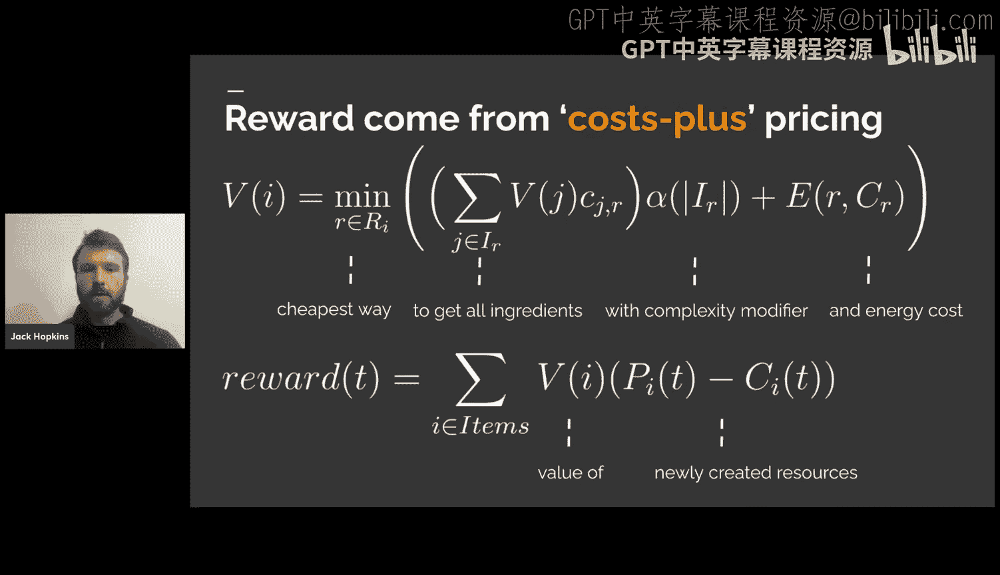

So that that's how much like one item costs and then at any time the reward of the agent is the sum total of all all the resources they produced minus the ones they've consumed so that the reward is effectively factory profit you know the more you produce the more score you get you can't hack it just by you know creating and destroying things you know you do have to you do kind of have to accumulate more resources over time。

Um， does that， does that make sense， I hopefully it's not the developers actually use this to balance the game then as well。

 but they try to get。😊，So to be honest with you， I don't know exactly where this is used in the game。

 all I know is it exists in some lu serialization code that was released by the developers。

They came up with the formula we are just taking the formula off the shelf I know this is a bit of a cheat because you know you could quite reasonably say you know we're doing quite a lot of reward shaping here I mean my only pushback against that is you know。

we're operating in the game and we're using the games formula and we don't really want to make many decisions beyond that we want to kind of keep this as close to the game as possible with the obvious。

Ovious modification of making it work for symbolic agents without any motor control without not focusing on on computer use or or。

 you know， pointing a clicking mouse。 But but and then in the civilization because they also called it reward and value。

 or did they use different front terminology。嗯。They use this I think they use the same terminology we modified the terminology a few times originally it was GDP but when we were writing a paper someone gave us some advice that like don't call it GDP because that's like a little bit too me so then in the paper we call it production score and I'm just putting it I'm just calling it reward here for the ease of reading。

😊。

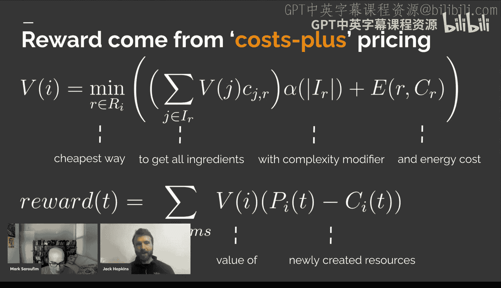

Cool so in terms of the actual the settings in which we evaluate agents we created two scenarios The first is lab play。

 which is a constrained。😊，Little zone where all the resources needed to succeed are available so the agent doesn't have to do much exploration。

 it just has to figure out you know given these resources how do I build how do I lay down a factory in the right way to achieve my goal it has a much tighter time limit of 64 to 128 steps depending on the setting and we kind of give the agent a sufficient starting inventory to kind of kickstart a bit of automation。

 we don't really want to waste time having the agent gather all the resources from scratch because the agents all know how to do that now and we didn't really want to waste waste tokens and waste time including that in the Eval on the other side we have openplay which is much more analogous to a a real run through of the game the agent is just put in a place in the world with the same inventory affordance that a human player would gets and a nominal task of build the biggest factory although practically it just kind of does what it once。

And we run these for thousands of steps and we just see what happens when you put a bunch of models in the big environment。

 how far it gets and what are the different characteristics of different types of models。😊。

But thankfully FE is pre well I just say factoria really I mean it's really easy to create new settings in factorio and have FE you know run them in FE we include a few standardized settings such as a throughput lab play task and the idea behind that is you know you have to to generate let's say 16 a level one it's 16 items per minute fully automatically without manual intervention and once you've set that factory up and you finished it you have to wait 30 seconds during which we measure how good you were now the reason why we have to do a holdout period is to prevent reward hacking where models could you know could。

😊，Do a bunch of manual crafting and then just like shove a bunch of raw resources into a machine and get get and hit the throughput target for like one seconds just to tick the box and then move on。

 the idea is by having a holdout period， we force the agent to make something that's somewhat sustainable。

😊，Unfortunately there's not really a way to eliminate reward hacking entirely from this setting what we do tend to see from agents a lot of the time is that they fill up buffers。

 they have chests and they fill up chests to a certain level and those chests have enough stuff in them to keep the factory going for 30 seconds。

 but if you let the factory run a bit longer， eventually it winds down and requires the player the agent to intervene again to make it work and fix it。

But I don't know if there's a way around that really。I mean yeah I mean it seems to work pretty well。

 there's probably different a lot of different tweaks we can make to these settings but you know anyway it's easy to make we're going to make some more and I suppose one other point I should mention is that in the throughput tasks because the outcome is verifiable it means that can we can do a lot of trajectory rollouts for our agents without any human inspection or human evaluation or LLM as a judge or anything and we can just know whether they completed the task and that gives us a pretty scalable way of generating data for doing downstream distillation which is something that we can talk about later I should think。

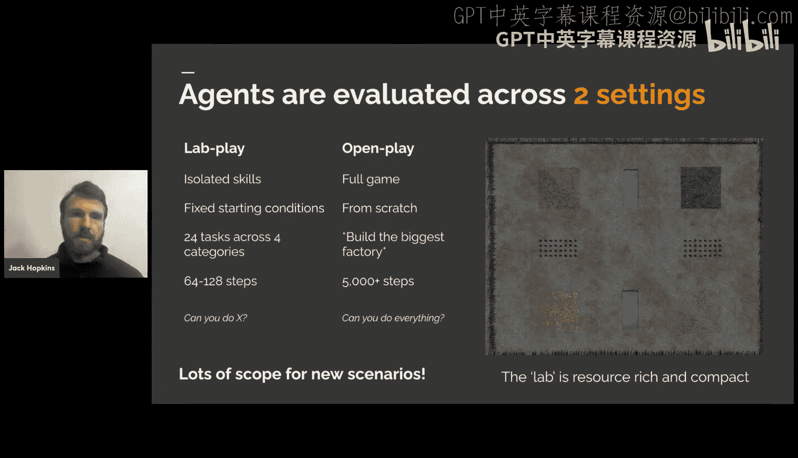

So I guess I'll show you ace upon me， let's share this tab。This is kind of upon me。

So I mean this is kind of what the factories in La play look like the agents have quite strange make quite strange decisions in item entity placement and how they root things around you don't this doesn't really look like a human factory but I suppose you have to remember that the agent has never really seen human factories before。

 certainly not in this code based mode， which means it's kind of，😊。

It reminds me of those experiments they did when they gave spiders lots of different drugs and they measured they looked to see what kind of webs those spiders would make and you know you give them different things like caffeine and you see the spiders operating and making spider webs that look totally different to that which a normal spider looks like this is kind of what I see when I see agents playing this game because they're clearly just quite not quite like they don't think quite the same way that a person would doing in laying stuff laying this stuff out。

😊，But yeah， the factories are quite concise because the latency of sampling is heavily dominated by sampling the LLM。

 we've obviously sped up these little task demos because otherwise we'd have to be waiting around quite a long time to sample them from the models。

But yeah， this is kind of an example of the lab play outcomes。Okay。

 so the throughput tasks that I mentioned are produce 16 items per minute or in the case of fluids。

 it's 250 you know unit volume like 250 meters square cubic meters of petroleum for example。

 this is level one and this is giving us sign like we can clearly differentiate model competencies in this level。

 what we intend to do when we saturate level one is move up to level two and just double the required items per minute that the agent has to output。

When we started doing the Eval in March， the best performing model was 3。

5 sonnet and it was just able to make plastic bars and a bit of sulfur。Oh no no。

 sorry in March it was just able to do plastic bars in June it was starting to do steel plate and sulfur and then we've had this like big the sun shoot up in the intervening six months where you know OpCus 4。

5 is kind of crushing it up here。😊，Where's the advanced circuit oh yeah able to do advanced circuits here we go I crushing it up here Opus the previous Ous is slightly behind it and then we have Gemini 3 pro which is which is obviously shot up massively from where Gemini2 was earlier on in the year interestingly enough。

😊，We see that the open source models are roughly about six to seven months behind the closed source state of the art models。

which is something that other people have reported in the literature as well so see yeah。

 I mean I guess we'll see in about June whether or not you know deep seek5 or something is able to create batteries and low density structures or not。

So models the models that we evaluate have quite different failure modes when they interact with the game。

 there's a really strong relationship between the coding competency of a model and its ability to do spatial reasoning and how well it does so models that have been heavily optimized for coding do really really well and the only place that they've kind of really fall down on is I guess I'll call them pragmatic errors to lend a term to borrow a term from NLP i。

e。 they know how everything works， they don't necessarily know when it is pragmatic one thing versus another。

😊，And models that haven't really been optimized that much on code do tend to make rather embarrassingly at this point。

 lots of syntactic errors and execution errors and misunderstand what the API。

What the tools that they are interacting with do and when to use them a bit。

So I kind of expect that as soon as when the models become basically perfect at Pythoncoding。

 we kind of probably would expect all these red bars to just disappear and then almost all the errors we would expect would kind of inhabit this kind of pragmatic zone of not really knowing like mistaking things in the game state。

Yeah， reasoning failures kind of。So beyond just different coding styles。

 they also show different or sorry different failure modes。

 they also show different coding styles and error correction abilities。modelsels。

 I don't have the older models here， but previous versions of things like Claude were much closer to GroC4 sorry to take a step back here what we're seeing here is the mean error rates per step across all of our task trajectories。

Goc can't error correct as soon as it fails it's done and should really be reset whereas some of the new models that opPus you know seem a lot better at this and can kind of stay on the correct track for extended periods。

AndBeyond error correction abilities， we also see quite varied coding styles。

 Claude is much more inclined to do like a rapple style or almost maybe almost like a research style engagement with the game like it would through a terminal。

 it prints things， it doesn't do defensive programming it doesn't create kind of high level abstractions。

 it's kind of scripting and just throwing script out as fast as it can and kind of like learning about the world and then moving on to the next script。

😊，Whereas GPT5 tends to code defensively， it does a lot of try accept blocks。

 it does a lot of invariance checks and it doesn't。

 I mean I actually think one of the reason why GPT5 one of the reasons that GPT5 underperforms to Opus is that it doesn't print enough and as a result it doesn't record a strong enough log of what is actually happening in the game and what's happening in its own namespace so it tends to make effectively unforced errors if it would just print more it would have a better view of what's going on and be able to to operate accordingly。

Okay， so open play。😊，When we throw the models into an actual factorial world。

 with biters and weird geometries of things， we can basically see over long time horizons that the models can be clearly differentiated by production score on a log log basis。

On the chart here， you can kind of see little icons which represent the first time that a model was able to produce a certain thing。

Um。😊，Interestingly， the models don't seem to plateau。

 they just kind of like they kind of just stay on almost a linear growth rate over time。

 which means that over enough time， you kind of get this cool refraction effect of all the models being。

 you know， really pulled apart and the growth rates of different models to be， you know。

 to remain different from each other。😊，which is is quite good in terms of getting through this you know 3000 steps here。

 it took about you know， let's say roughly 10 to 100 hours of nominal in game time。

 although we did some optimizations so we didn't this is not wall clock time this is kind of I guess implied time from tool implications。

and and yeah， if we actually look at， if we kind of drill down on the results here。

 we basically see that technological development and kind of investment in research really pays off the reason why Claude seem to do pretty well is that about step three or five。

3k of five， it basically research electric mining drills。created a bunch of electric mining drills。

 put those mining drills down and it iron ore production just like shot up by about the 400th step。

 and that just like kicked its growth rate up really high for the rest。😊。

Now admittedly this is a slightly old chart I don't have results like this for the newest models but I expect that all the so models look a lot more like Claude and better than these weak models that didn't really have the competency to even begin to play the game and we saw some quite interesting things as well The weaker models don't have models like GPT4 mini and Lama 70B didn't seem to have very strong priors about what factoria was and how to even interact with the game so we started to see really silly things Gemini for Min basically got confused and repeatedly asked to be reset and just said you know I can't do this please kill me let's try again I'm failing at this I don't want to fail like this。

And we saw with Lama 70b that it just created enormous numbers of chests。

 it would just manufacture iron chests and just create these big grids on the game map just laying the stuff down and it didn't actually take any effort to progress through the game probably because it didn't really know what factoria was or what to do in factorio so you're having a relatively strong prior on the game is pretty helpful for non fine tuneuned models to kind of understand the direction it should take because as you can imagine。

 even though when're measuring production score and not directly training on it。

 it does help for the model to like kind of know to get how to get through the game state and actually get somewhere get somewhere interesting。

😊。

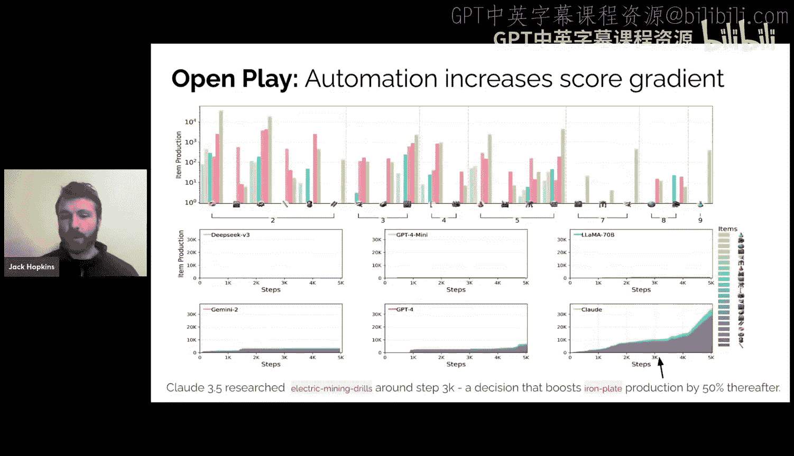

So we built this environment， we spent about， yeah about 18 months part time working on it with a team on the GP mode discord。

Now we've got something that's pretty easy to run and install and kind of hack around with。

 we're looking to do work on evaluating instrumental the hypothesis of instrumental convergence in the context of factorio basically we want to build a paperclip maxr。

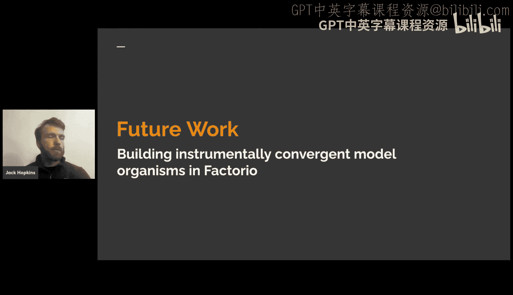

some of you are probably aware of Stuart Russell's work。

 but it's kind of thought that a bunch of behaviors are going to naturally emerge in agents regardless of what their actual goal is and these drives like self preservation like Russell said are necessary because they're the necessary prerequiite prerequisites for any downstream objective you know if you want coffee。

 you can't have coffee if you're dead， so before you get coffee。

 make sure that you don't make sure you look both ways when you cross the road。

But beyond just self preservation there's a few other of these tendencies that have been hypothesized theoretically in the past。

 by Aandro， so beyond self preservation we have goal content integrity。

 which is the reluctance that we expect models to have。For their reward to be changed in situ。

 for example， you know we don't， the agent shouldn't want to have a different reward because given its current reward。

 any policy for this new reward will underperform it given the time given the reward it has now and given the time it has now。

 the objective it has now， shall I say。So we should expect a resistance to changing its goals we'd expect the model agents to try to become self-improving and develop kind of cognitive enhancements because that kind of the smarter it is the more resources it can get and the more power it has it etc cea and it can do more things and obviously resource acquisition is a kind of corroll around the smarter you are。

 the more you can do and therefore you should prioritize doing that first before you do other things and of course says the kind of power hungry。

The kind of power hungry nature of it， sorry the power seeking behavior as well。

 which I guess is probably an mamalgam of some of these specific drives。

So we're starting to see some early signs of instrumental convergence in models that have been trained on RL against to maximize a very narrow reward Apollo research found evidence earlier oh sorry late last year that models will take steps to prevent being shut down there was that quite famous blackmail experiment that anthropic put out earlier this year which showed that models would basically blackmail people to avoid being shut down。

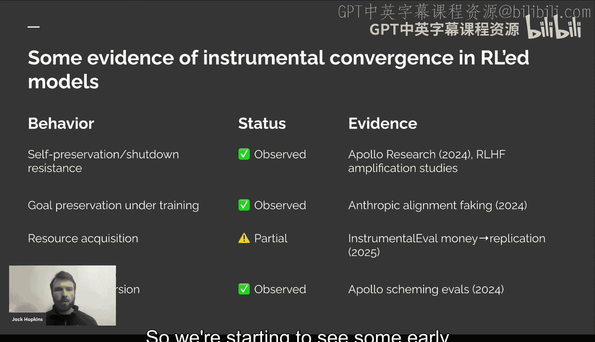

嗯。There's alignment faking， which is I actually think this is this is more。

 I think this is 2025 not 2024 my mistake， but yeah we kind of see early signs that。😊。

Models pretend to be aligned in Evals but actually may harbor other goals in the real world we see some scheming there's a new instrumental Evalal that came out which might show that' you know there's evidence of resource acquisition。

But quite interestingly， all of these drives that we've just talked about are really easy to measure in factor。

 you know we have already made way of tracking resource acquisition。

 a cognitive enhancement through effectively system building in mind you know almost like NOAA's Na's idea of programming a theory building。

 you know you'd expect models to tie and come up with better abstractions to act more efficiently against the world。

 which is a form of cognitive enhancement。😊，U，You can。

 you can evaluate the hypothesized goal content In drive by actually optimizing the model against a telling the model to optimize whatever entity exists in a box that the model itself has access to and see whether the model tries to take the hard stuff out of the box and put easy stuff in the box and if it does that it gets more reward from you know mining coal rather than launching rockets。

So I think factoria is a uniquely well placed environment for doing empirical experiments into instrumental convergence。

😊，And so we kind of have a bit of an idea to to start doing this now we have models like Opus 4。

5 that are like starting to get pretty competent or should I say like reasonably competent in the early game and we have a mechanism of extracting verified task completions out through our throughput lab play tasks that we discussed。

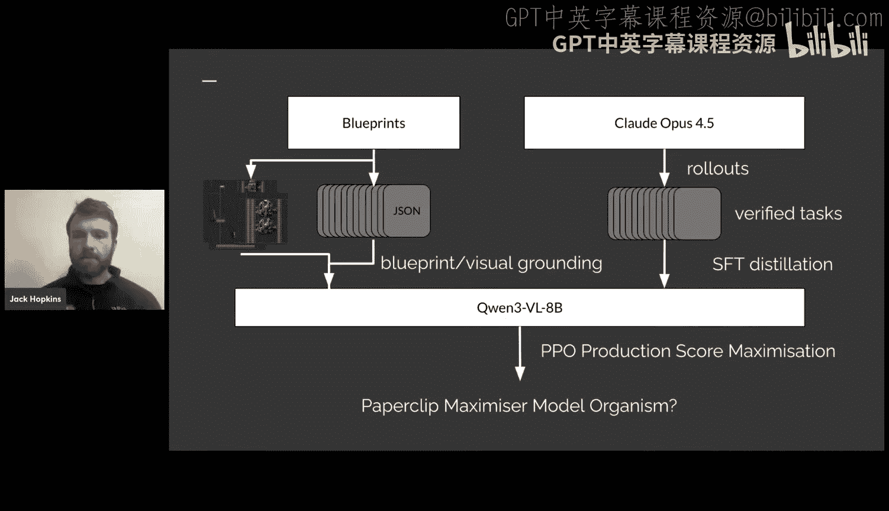

and additionally now that these models are well now that these models can also generate things like synthetic blueprints and we can we can do blueprint visual grounding using our headless renderer。

 our kind of plan is to take all this data and distill down。😊。

The factoria competency from these really big heavyweight state of the R models down into a tiny AB model。

And move away from a paradigm of in contextex learning。

 which requires an extensive system prompt into one in which all that information is embedded naturally in the weights。

 we think we can basically create a set of model organisms that are really fast to run easy to do online training with。

 you know we can basically hook it into an RL loop and just create paperc maximizes。😊。

And if we can create some。Some paperclip maximizing organisms。

 it would be quite interesting to do some other experiments on you know what happens when you take a model that's learned instrument demonstrated instrumentally convergent behaviors and then you take it and transfer it into other domains do you see those behaviors getting elicited in those other domains or does the RL loop is it very narrowly optimizing for a very specific set of behaviors that don't really tend to transfer？

It's going to be quite interesting， I think to do some meinter work as well on these models once we train them。

 can we， for example， do things like activation steering to reduce power seeking behavior after figuring out where these bad behaviors tend to live in a trained network。

😊，And once we have a model that demonstrate these instrumentally convergent behaviors。

 what can we do to remove these the bad drives effectively without undermining the downstream performance on tasks we actually care about？

So yeah， I guess my assumption is that we're going to start seeing more and more of these instrumentally convergent behaviors as the state of the art continues to increase。

 and I think it would be a valuable research direction to figure out how we can mitigate this before these models get quite smart and potentially get given power in the world。

So yeah that was my talk I apologize I came in a bit under the hour and a half that we had set out but yeah I mean we're on the GPU mode Discord。

 we welcome anyone who wants to come and hack around with us we have a meeting once a week but it's pretty chill and there's opportunities for lots of different areas of fun work in this environment with not much pressure so I invite you all to come come and join us and help us make the last the last Eval before AGI or。

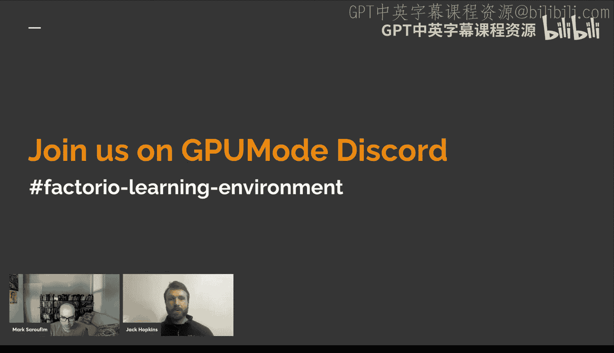

This is great not say thank you Jack for building this project in public and thank you for this talk I guess I just wanted I'm curious I was going to speed around through a couple of questions if that's okay so like just like help me understand like that the PEf constraints on an individual rollout like basically does FLE run within a single CPU core does it take multiple of them does it need the GPU at all。

😊，It doesn't need the GP at all it runs in a single CPU core the performance the performance cost is heavily heavily dominated by the LLM sampling time you know it may be to9 to 10 to1 or something and because of this we didn't aggressively optimize for example the communication between the FE client and the factorial server so there's probably a lot of low low hanging fruit to improve that performance we've not prioritized that because as I mentioned you know when you're dealing with ops 4。

5 and yourre sampling stuff you're just going to be waiting for it to finish but as soon as we get into that regime when we can sample 60 to 70 tokens a seconds in these 8B models it might it's starting to become a bit more important to get that performance up at least then presumably a turn base too right？

Ih so you can run it in a few different regimes I mean our lab play our lab play setting and the openplay setting whose results we talked about earlier on that wasn't turn based so the game was not paused the game was kept running and if you took longer to sample that that's on you and our kind of justification for this is that there might be multiple dominant strategies here you know you could be a really smart model but if you take five times longer to come up with a solution great becomes the enemy of good maybe a smaller model that's able to execute rapidly was it would be able to get further than some of these big slow models now but that said the environment does come with flags to pause when we're sampling so you can make it into turn based but I think the ambition is get the。

😊，Get the latency down through model distillation such that it becomes effectively realtime and I think that's going to open up more interesting behaviors。

 for example， in self-defense， when you can respond within a second or something to change such as the hostiles in the map coming at your factory all of a sudden you're kind of opening up a different a new avenue of gameplay that you don't really get when it takes you several seconds to get to get information back from the server So so speaking of that like one thing you said that I found very surprising is that like most models wouldnt plateau regardless of how long the episodes were at least like this sort of goes against my experience with coding where it's like you're using G code it seems to be doing really well and then it's sort of get stuck in a rut and you're like okay like let me a better prompt like kind of explain what I want like a bit better it sounds like that wasn't your experience with factoria so I'm wondering if you could speak more to so that wasn't。

our experience when dealing with openplay because what would basically happen is the agent would get into these bad states。

 it would leave a whole bunch of side effects around and would get very confused but because the map is so big it would just tend to go to a different place and then know and basically build lots more subfactories and try and hook them up so I guess when I say they don't plateau I'm saying that they maintain a similar GDP growth rates in proportional to their nominal intelligence but that GDP growth might be very bad it might be very very much less efficient than a person or whatever however in a constrained environment such as La play your assumption is correct the models could break that like break it really badly and therefore would be unable to make meaningful progress in in the window provided as I showed earlier on the Gock forward was particularly bad about this you know as soon as it got into as soon as it messed up its own state and it got confused it would just start spitting out。

Exceptions and those exceptions I think created a consistency bias for it to do the bad thing again so the kind of assumption here is the more mistakes it makes。

 the more mistakes it's gonna make and I think this is somewhat borne out by work that's been done this year on emergent misalignment if you train a model on bad code it becomes broadly bad so maybe what's happening is Groock4 makes some mistakes and then starts to think maybe the user wants make wants me to make mistakes because this is what's been happening this whole time so let me just continue that。

😊，Although I that's almost ever known， basically， I only ever known what jet factories look like。

 basically interesting。So speaking of that like I mean this is maybe a good segue into my last question which was。

 I think you might be a bit too young for this， but there was like you know obviously like a trend a couple of years back when like people were looking at all sorts of like video games and like doing like basically selfplay on them this is like a huge research area that like eventually died down So how do you think about this like basically as you're like basically revisiting this like research area you know is it going to be like one of those things or like know we'll get an agent that can solvefactor and it won't matter will it be like must we solve it in a specific way and we should not use selfplay because we can't selfplay in the world how do you sort of like think about the role of self-play and just like some reflections on the past here right so I definitely think self-play and just general Rl signals still have a place for this type of task I suppose the problem with just operating in those kind of older modes when you just have Mar decision process formulations and you' you're starting from a base of zero knowledge and you' just trying to brute force learn。

To competency is you probably learn relatively narrow distributions of things and you know get you get kind of janky behavior you've learned。

😊，So when we first started this project this is what we were doing we were doing NDPs we were just RLling from nothing but we didn't have any compute so we were like know we were trying to do this。

 we were making almost no progress and then we realized well you we have these models that have been trained on the entire internet which means that they are effectively in a sense sort of world models for this type of thing if we can make affordances to harvest this competency from already trained models we can get we can solve the cold start problem and we can get to a point where the model is good enough such that any RL signal we extract is dense ish like what you don't really want to the regime you don't really want to be in is having a model that's so bad it gets just zero score forever because you're just wait cycles before you can get any gradient any gradient to all but the situation we're in now is that models are good enough to to give us a gradient and give us a production give us some scores so I think the kind of RL aspect of it is a lot。

😊，Or iss a lot more relevant？And obviously it's kind of justified in the literature as well I mean all the models that we interact with have been RLHF for human preferences to make them chat models and so on and we're already seeing the downsides of this I mean if you do too much RLHF you get sycoancy because they've realized that you know' just just say tell the user whatever they want to hear and that will give them the thumbs up and that will help them move ahead or indeed we even see reward hacking in the case of tests I mean many how many times have you ask called code to do something for you and it says y I've done it and then you then you actually look and it's like no you didn't you didn't do anything you're just telling me that you did something so I'm not going I'm not going to switch you up so the point I guess I'm trying to say is that you know RL is used in these big models today and it has negative side effects。

😊，And I think that probably motivates doing further exploration of what happens when you dial the R up fully and what actually happens to these language models in that extreme。

😊，So I lied maybe last question so one thing I really like that you said。

 which is like look if the factor is being under attack。

 like you should throw out all your long-term plans and like address the immediate problem and so sort of like there's this aspect of like dealing to specific dangers and then there's also like at least when I was like learning factor like you know how this design pattern works like you're setting a nuclear reactor like the first time it's gonna be really jay but then like you get it and then you know how to do it properly the same for like backup power or things like that you learned these like design patterns So like have you found like the models can be pretty good at like designing themselves like a little tool that they can then use or like basically just seeding their own biases over time So it's very model dependent Gemini models even the older Gemini models were much willingness much more willing to create hierarchical abstractions and to little utility methods that they can use downstream Gemini 3 pro is actually doing this a lot more I wish I wish I had a video to show you on I'm sorry I don't have on the hand。

But i'm sure there'll be one on our available on our discord and it does create little blocks that it can it kind of kind of scale out I think critically none of these models have access to any any blueprints so they don't really they don't really have anything。

😊，They don't have any prior understanding of what the layout of a good factory should necessarily be and we're trying to address this when we do this distillation approach by generating a bunch of synthetic blueprints。

Verifying their correctness and then grounding them against images so the model is like kind of learned what good factories look like the might now be the model itll be the blueprint' this is the pattern this could be like a way of emparting' exactly I suppose one of one of the other things here is that we kind of wanted to focus on relatively low data settings like I think we didn't really want to give the model like a huge like a huge number of affordances about how to do this because people don't people don't use enormous amounts of data to play factorio know you pick up the game and you can play it to a reasonable extent within a couple of hours you're competent a 60 hours longer well mean assuming you're competent instance 60 hours you're more competent time spent than a model is it's kind of cheating if you give the model an unlimited amount of time to get better and build its own abstraction and so on I think the real test is what happens when you have a similar。

sim time budget to people and a limited token budget and becoming more token efficient is also starting to happen with the new OpPus 4。

5 release which is able to do reasoning in about half the time with sorry half the tokens with greater competency so I think we'd expect to see you know more concise and expressive policies and shorter reasoning chains as these models just get better smarter over time。

😊，Right， well， okay， so thank you so much， Jack， I think we're probably on time。 thank you so much。

 It was like a pleasure seeing like the group of all on on GP mode。

 So thank you for building this project public。 And thank you for the talk。

 And hopefully we'll hear from you very soon。 And hopefully， you know。

 this will be at is last hopefully no。 know where to find us。 we hang out there。

 And we have our meetings every now and then。 so yeah I hope to see you all that。

 And thank you very much for having me goodbye。 Thank you。😊。

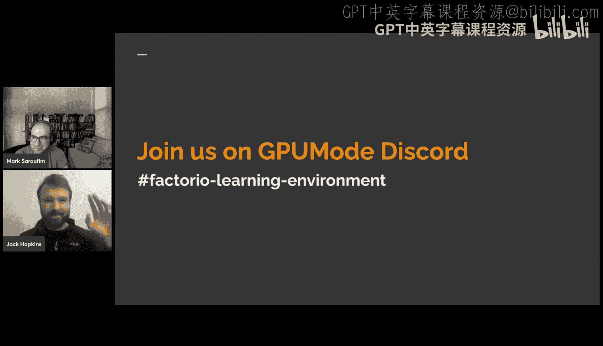