# GPU MODE《CUDA、GPU编程54-87｜GPU MODE》中英字幕（deepseek-v3.2 p33 20251207-Lecture 86_ Getting Started with CuTe DSL.zh_en -BV1xbmQB3ETC_p33-

Right now we have the Blackwell and VFP4 competition going on and I'm sure as all of you guys know。

 most of the solutions or intended solutions are involving NviIDdia's new QDL/ cutless4 so we have Vicki here who has graciously you know made these slides and is going to talk about QDL and provide kind of a nice instruction and also talk about a lot of the features and things you can implement in Q DSL。

 which should be helpful for the competition and also very generally for people who are interested in writing kernel code。

 so I will let Vicki take it away。Thank you。 Thank you， Alex。 And hello Ron。

 I'm Viki Wang from Nvidia。 And today， I'm happy to give a brief introduce about Q DSL and hope after my presentation need help you to have a happy journey with you G mode competition。

 So before one more comment。 So feel free to interrupt me if you have any questions about the content。

So。First， before let's look into details about gas cell。

 Let's have a quick look about the background。 So why is the。

 Because Ka is the background of the gasL So theres a lot of the popular high level generators and compilers in the world that allow users to write the。

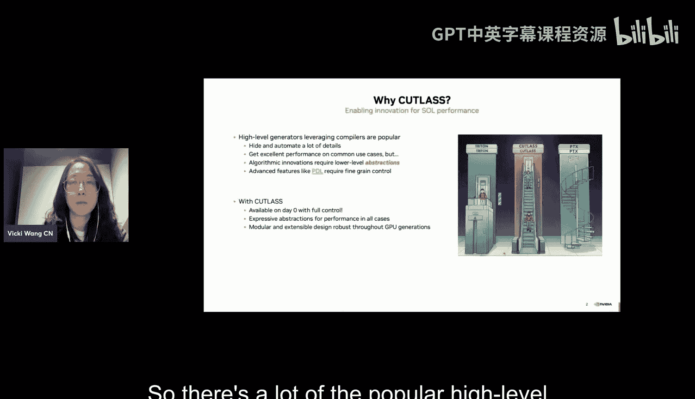

Colonnels without and without knowing too many details about hardware。

 They are easier for user to quickly iterate on the new algorithm of features。 However。

 they also had a lot of many details that hard for users to give the full control of the hardware features。

 So sometimes if you want extremely speed of light performance。

 It will be hard to figure out the magic optimization did by the。

High levelve color generator or compiler Well on the countries is the Pt。

 which gives all the control of our hardware features。 However。

 Pt is two lowleve abstractions that contains too many details that also hard for developers to do quickly programming there we have the colors is give expressive abstractions for developers to program on NV GPU and try to provide the simpler abstraction than Pt that also give the full control to users。

 So let's have a quick look at the design architecture of the colors。So， the left diagram shows the。

Multiple abstract layers in colors from the top to bottom。

 The top is the high level interface that allow users to select some optimized kernels。Based on a。

Tuned configurations that user donate to worry too many about hardware optimization details。

 While the bottom layer， which is the yellow and gray box are the cute abstractions。

 the gray the atom abstractions that allow user to program on different tentacle and friends feature some different architectures and yellow box is a programming model。

 which tries to provide some consistent programming model for user to program the。

Colonnels with excellent performance on different architecture generations and cute DS SL actually is the passionate solution build based on these two layers and try to empower AI researchers and engineer to do quickly development prototype。

 We also give a GTC talk this year。 So if you have interested about the more details。

 feel free to look at this。Talk。Okay， so how do we start to look at。

 how do we start to with play out play with our colors in person。

 So this slide just show the quickly data。Just pipe install this NV call DSL will and write you passing code run the person hell directly。

 Then the you program will run directly on NV GPU。 So in the rest of the slide。

 I will try to focus on the full program。Topics we we provided to the to the GPU mode and then use those。

 for examples， to help you run up the。DSL features啊 that may may may help you。

Figure out how to write the code in Ki dataa。Any questions before I go into details of the。好的。

it doesn't seem like there are any in the chat right now。

 but I can just ask like a simple one like u generally what are the differences between QTSL and u say like cut was three and like what has been there before。

Okay， so the color three is mainly C plus plus template based library。

So the developers can write kernels via call C plus plus framework。 However。

 based on our observation， the C plus plus is good。

 but the template is so heavy and hard for developers to debug and build。

 Also the C C plus plus template using a lot of fancy features there。

 The combination time usually is high。We measured and find that the kernel need 10 to 202 to compile。

 So sometimes it blocks the researcher to fast iterate。

 and the in industry try to pivot peon like the and。

 We think that pethon will be easier for developers to prototype。

 And also when we write kernels inon there will be stream stream less work for user to integrate their kernels into the framework。

 So we think that we'd better pivot to that we have the colors for which try to build entirethon ecosystem for colors。

 But the first step is we release the bottom layer。

 which should be enough for user to try our features first and have fun with the full control of the hardware details。

 I see is there any。Like major differences in flexibility between the two so like can you roughly do anything that you could do in Cutless 3 in Q DSL or are there some features that that aren't available？

From F side， I believe they have the same flexibility。Cool， I'll let you continue that。Thank you。

 So then let's look into the details。So the first example is jamway It's quite simple examples where we we will users to do the batch the jamway computation like the diagram show in the right bottom figure。

 The example of the the。Cute cute template。 Just use very simple global load instruction to load it from global memory to Russia and then simulate the computation with the FF main instructions。

 And when and in the end store the result back to the global。 The example and template is simple。

 but we would like to use this to highlight some very common features in Q DSL。

 The first are the two decorators in the Q DSL。 The first is the Q G。 This decorator is used to。

It's mainly the entry point of our hoststead of the kernel to prepare。

Prometerters for the kernel and including in how we compute the great size block size and clusters you picked for you kernels。

 because this is a kernel written in Q DSL。 The kernel required the key tensors and key tensor usually have some fancy layout not fancy layout is the layout that our NVIP for instructions。

 the Tensor pole instructions you will use and hardware require some layout that easily to。

Make this tenor call to better feed and speed efficiency。

 So we would like people to starting from here to get familiar of those。Blue。

 and the second key decorator is the cute chip。 Cu kernel。 Cu kernel is almost equal to the global。

Entry point of our GPU kernel。 and this table shows the color call combinations and requirement。

 So in short， the cute j is not only the host site entry point。

 It also can be used to be in line function called by our cute kernel。

 So the third line in this table。 but the kernel is the global entry point。

 we only be able to let the acute kernel decorator to call another acute kernel decorator。

 So these are the main difference。And the second point。

 we would like people to get familiar with this acute layout。Q layout actually。

 mainly contains a bunch of the divide operations and slice operations。

 Those are typical cute operations。 The partition and divide operations which try to telling the global tensor like the this one。

 we telling this global tensor with M and K dimensions based on the MM Ty we give there。

 This is the G examples， I still use this terminology because of the rest program used。

 But for this one， even if it' an MM Ty。Varable naming is actually just to for you to。

 to learn how to slice or partition your global tensor with some tellor。Values。

 so we tailor this input a matrix with block M and block K， you give for the configuration。

 Those are compile time variables。 And after this teller。

 we have this kind of hereical coordinate informations for this matrix。

 the block M and block N are the innermost chord。Here， and then the M contains a multiple。

Block iterations and the K dimension contains multiple iterations of the block block its。

 So we have this rest Gm and rest K。 Also there is the rest， which is the batch batches。

 but for this diagram to keep it simple， I only have the batch equal to one And after we partition this global。

 we will slice this global tensor with the coordinates we want want to in this example。

 we have this block x slice on the restm dimension to move the city to the right block。

 it want to compute and we use threaded index to slice each row inside this block。

 So in the rest figure， it shows that once we slice this global tensor from each thread point of view it try to locate to one of this darker green。

Rose from a matrix， this yellow from this B matrix。

 and will then do accumulation to get the darker blue in the output matrix。

 So that's the many typical acute layout algebra in the program。 So that's the second common feature。

 we want to elaborate a little bit。The third feature， I think。

 is quite useful is the tensor and tensor S I A concept in Q DS SL。

 So tensor is mainly the composition of an iterator and layout of the。Of the memory。

 So it it contains support for global memory， share memory， memory and tensor memory。

 and tensor SS value is just a local data modeling for the acute tensor in value semantic and in immutable。

 So when we do some global element wise operations， we can load this tensor， this tensor。

 this tensor we create here after we slice where they get a global tensor。

 and we based on this global tensor shape build an tensor。

 and we can load the global tensor into a tensor。As I say representationation。

 which actually in the underlying is the vector operation。

 and then we can use a lot of vector inline operations to do type conversion and elementwise operation and after that we store it back to the register tensor memory and when we store it back to the register tensor memory。

 we can do read and write on this memory。So that's the Tensor and Tensor SSA features。

And the last common features we would like to show in the first example is the control flow in Q DSL。

 we supported the for while， and if control flow， which allow user to writeonic control flows in the code and our TSL compiler will do AST processing based on the the condition given for this control flow to determine whether is' a evaluation code or some AST rewrite generate the。

Generate the condition in the I code。 So there are different combination。 So in short。

 if the condition are constant values compile time static values is just a passing evaluation of the code。

 But if its the compile time defined conditions， it just it will go through write and generate the SF note for the I code。

 And the if while and for have the same requirement。 But for the four， there is a special。

 which is the color range color range is almost equal to the range。

 the little difference is that the color range support some advanced and rolling and pipeline control if you are more interested。

 probably can look at our software pipeline examples。

 and here just a quick elaborate about the color range green control in this code。

 the left side is the simple。Jam example here， we do copy load A， copy load B。

 And once we load data from global memory to to local memory， we do this jam to do the computation。

 And in this full loop， we have this pre fetch stitch annotation in the loop and did almost equally to。

Translate this simple code to a manually software pipeline scaling。

 where we split this loop to some prefet TM load operations。

 We load several data ahead of the computation。 and then inside this computation。

 We can in parallel execute the computation with data pre fetchch in the previous stage。

 and then loading data for the later stages。 So this is the power of the software pipeline。

And with the jam algorithm， we almost show the common very useful basic features for acute DSL。

 Any questions for this。Art。seems like。People are still kind of shy in the chat， oh yeah。

 by the way I was going to say your camera is off a little bit。嗯。Oh actually no， there is one， sorry。

 I just showed up。

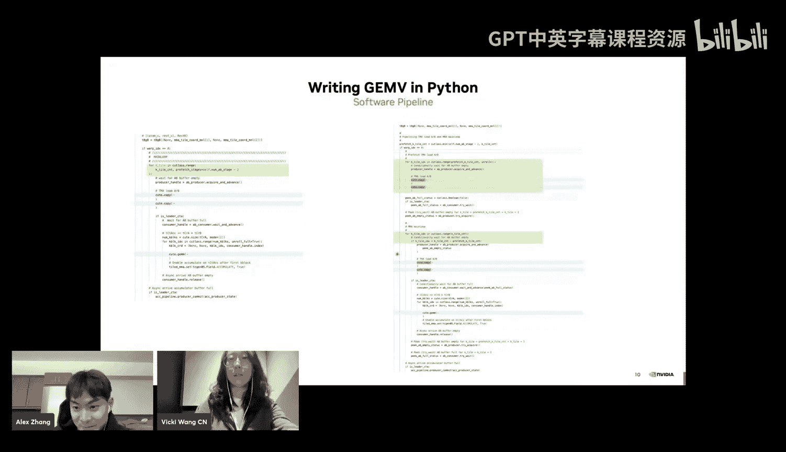

嗯。I'm not sure what example this is referring to， but they're asking why is NVFP4 converted to FP32 for compute。

 This might be the Tensor SSA example from the previous slide。Yeah。

 it's just to show this tensorized S I features。 And it just simple examples at the very beginning。

 So we， when we share the key DSL examples， we actually didn't use any tensor call or。

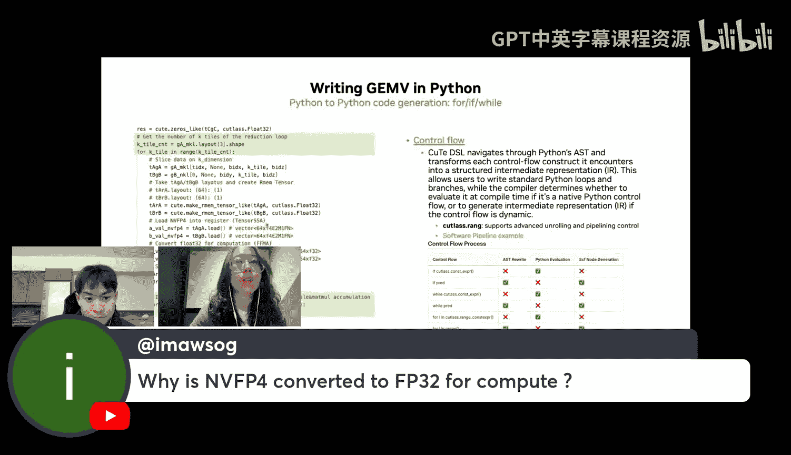

Black while advanced Halloween features is just to help the participant to get familiar with our common DSL features and get familiar with the acute algebra and layout expression。

So we fully， we fully use the FMA。The IP is 32 data to simulate the competition。

There is another question you mentioned that that the tensor oh， like the tensor object contains。

 I think they mean to say an iterator， can you expand more on that？

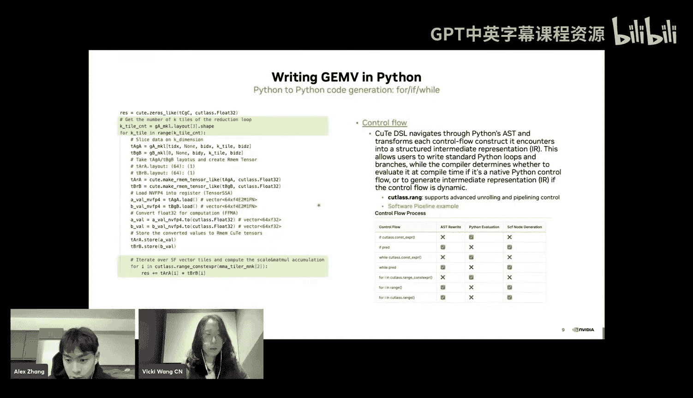

Oh， I probably don't have examples here， but。Let me see the tinsor。 Okay， so here。

 let's look at the left side code。 You can see my。

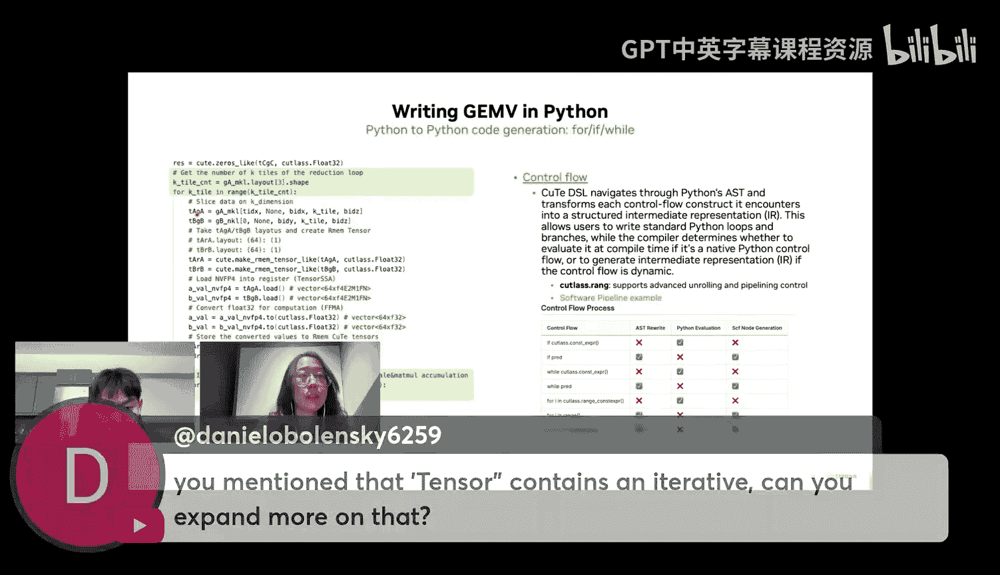

Mo， right this right， Okay， so here we have this T A G variable。

 it equal to a global memory with some slice coordinate point to a tensor。 So in this。

 this is a typical tensor operation。 And instead this， we have the iterator and layout。

So in the in in some， if you really want to manipulate the tensor iterator。

 you can actually get the iterate from this tensor。 It's just like the。

ATsor concept used in torch where we have the iterator and layout inside this tensor。 And actually。

 you can extract the iterator， do some layout transform and make tensor to get it back to a tensor you would like to use。

Yeah。I think also， the， the。Cute slash cutless docs has like a whole section about this。

 I I I can like get in the chat afterwards， but。Yeah， there is more details about the。The Tenor I。

 this is the link， you probably can look into details of this documentation we have pushed in the GiHub。

All， I think that should be it for now， if more pop up， I'll jump in， but I think you can continue。

Thank you。So let's look at our second example， which is the。

Geneneric matrix multiplication algorithm。 This one is an more interesting one， because for this one。

 if we want to achieve the speed of light computation performance on GPU。

 we induce use a lot of the advanced features on the black chips。 So in this example。

 we actually focus to helping a participant get favor of our cute programming model。

So in this example， the Q DSL template try to show how to do how to leverage TM load to load different tensors。

 A tensor B tensor， the scanning factor tensor of A and scanning factor tensor of B from global memory to the local memory and then use tensor call also because the hardware tensor call requirement the scanning factor。

 A and B need to come from the tensor memory。 So we have another S to T load operations to load them from the share memory to tensor memory。

 and then we use the tensor call to do the computation。 And after that。

 the computation result again stored in the tensor memory。

 we show people how to load data from the tensor memory to register and do a very simple。

S from the writer back to global tensor。 So let's have some detailed look to show the acute programming models。

 So first is the TM A for TM A the code， actually， including the two parts。

 The first is the host that。 We need to set up TM A atom and the T M A quality tensor。

 because T M me， the hardware features require the。

Code to show the coordinate for the tensor to the hardware to load。

 So at the host set you will see we have the YouTube function where the user need to pick the right the atom instruction in our examples we use one CTA features when you optimize this code to achieve the maximum memory efficiency you may want to use the two CT features and then we give is the global tensor with the layout we set in the host site to construct the tensor and give the share memory layout。

 the share memory layout contains the Swizzel information it tells the TM when you move data from global memory to share memory you have to sizzle the data based on some share memory requirement that later can be consumed by our tensor pole and also the tail size of this share memory tensor and how many share memory stages we have in the share memory that allow the optimization to do prefetch。

And then the tenscle instruction says this this is also used to tell the TMA later we will see how it used it to partition the global tensor to fit into the tencle computation patterns and this also carry the tenscle information that try to couple the data movement operation with the later computation operation once you set up the TA and TMA tensor in the wholeet pars to parameters to the current wire Q G decorator。

 then insert the device。The first is where we do this local town， as we show in the jamway。

 this local town will use the MM teller to partition the global tensor into different block sizes and then we have this TMA partition。

 which based on the TMA descriptor or the TM item we set up in the whole site and the share memory layout and the global Tensor。

 we also partitioned here to get the MM information to get the shared memory global memory layout for the TmaA to do the copy and in the end。

For each K block iteration， we just called the killer copy。

 It will help us to copy data from global memory to share memory， to meet the。

On the hardware Tma requirement and also prepare data in share memory that later can be consumed by the ten call instructions so different tensors all follow the similar patternss to do the partition and loading data from global memory to share memory there was a question in the chat。

When you were describing making the TM at， you talked about swizzling from global to shared memory。

 can you explain swizzling and how it relates to warps？

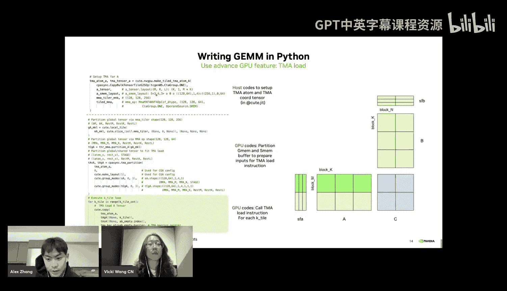

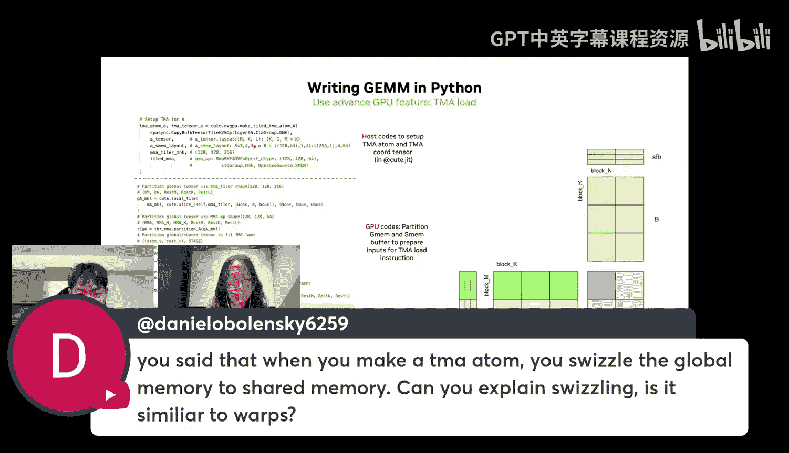

嗯。That's a good question， so I'm not sure if I can。A problem need to。

Bring some Swso data layout in in here to help you understand。 But in short。

 because we are trying to move in data from global memory to share memory in global memory。

 the data actually stored in either the column major sequence or or the real major sequence。 sorry。

 the M major sequence， Okay major sequence But when we move the data from the global memory to share memory。

 we copy each of this small green box from global memory to share memory。

 And when we do this kind of copy to make it。Maxim use our memory bandwidth efficiency。

 we need to shuffle the data， storage layout a little bit in shared memory to avoid something like the bank conflict。

Because if we do this kind of streaming copy from this block。To the share memory。

 the first row and the second row， they will follow the similar pattern as global memory。 However。

 for the computation， the tenor call， because it try to fetch data。 Let me change moment me change。

Because this is the granularity of our global campaign。

Says it sometimes not equal to the instruction says。

But the testor call probably will do a more smaller granularity consuming the data。

 So it probably at a time， only consume part of this chunk of the data from from the share memory。

 so。This size。Probably not meet the best memory elementary requirement we have in the local memory。

 for example， for the share memory we wanted 128。Accessing for different bank and a lot of the data have no bank conflict in each thread。

 so we we probably will try to change this chunk of data。

Do some whistle and when we copy it into share memory。We probably want to make this。

Match some share memory requirement to meet the。Amentary requirement of Sw patent that avoid the bank conflict。

 so that's the simple idea， but I can share find some Sw details in the public documentation to you later。

 then probably help you get a better understanding。Amazing， thank you。Okay。

 so if there's no power on this side， let's continue to go to the。S2 T copy， as I just mentioned。

 the scanning factor A and scanning factor。B after we copy them from global memory to share memory。

 the tensor call require them to be stored in the sorry from the global memory to share memory。

 The tensor call require those two tensors to be stored in the tensor memory instead of the share memory。

 So we we have this S to T copy code in the example to show how you copy data from the share memory to the tensor memory。

 Again， first， we need to pick the right S to T copy at。

 I think the the the instruction details could be found in our could programming get to show the different configurations of different S to T copy instructions。

 And then we have this。Taled copy operation to make a tele copy at object。

 And once we have all of them， we do this partition source to partition the share memory。

And we have this petition D to petition， the destination of tensor memory。 And again。

 we do this copy。To copy data from share memory to the。Tensor memory。 and after this petition。

 actually， the data， the data in the share memory and tensor memory follow some huge layout。

Convention where we have the atom set， which said in each instructions。

 the copy granularity of this instruction and how we move around the M dimension or n dimension or the key dimensions to copy each of the smaller granularity data from the share memory to the sensorsor memory。

 So here when we do this slice。We actually try to copy the entire data。

From each K block to the tensor memory。So in general， again。

 the pattern is kind of that picking the right title。

 get a child copy object and use this child copy to the partition S and partition D and do the copy。

 It's similar to the T M partition。 It's just the TM A partition is a。Syntax。

 not syntax is a simpler abstractions that combine the partition S。

 which is the global tensor and partition D， which is a shared memory tensor to return to operations。

O啊 will continue。And then sorry。And then we come to this Chor call in the Chor call set again。

 we pick these Chor call instructions。This is the Tensor instruction level ship。

And also we use one CT configuration and also we tell the Tensor call operas coming from the share memory where says the A tensor and B tensor coming from the share memory。

And after we， after we configure the child Iime， we use this to。

Construct the descriptor from the share memory tensor。

Which is the opera tab that can be consumed by the。To jam operations。And we。

Convert the share memory A， share memory B， and the tensor memory to the。

Descriptor tab and a testsor memory tab we needed for this Q jam operations。

 and once we configure all the opera tab， we do this loops on each of these key block iterations。

We just show that the key block is 256， but for the instruction needs to do a small amount of the data every time。

So we hear set the scanning factor iterators。 This is where we have the tensor tensor concept later means that the tensor is iterator。

Composed with layout。 So here we set iterator into the child M M and then called the cute jam to do this jam computation。

So you mentioned at the top like you。You need to pick the right tensor cooperation for like the child M。

 what， I guess。Like does this imply that there are several different Tensor core operations that could be used and some are better than others？

Yeah， yeah， yeah。 The hardware actually provide a。Different sizes of ten call that allow user to pick。

 because， for example， if the problems are like jam， we jam we only have an equal to one。

I see see so if you use a very very wider tencle actually we are wasting a lot of computation power right right that's why we need to different sizes to balance the competition resource and memory loading I see I see thank you。

And。Okay， let's continue。 after we finish the competition。

The data already in the accumulation result。 So in the app。

 we have to do this tensor memory to write copy to get the data back to writer。 So again。

 the sequence will be constructed the right Tensor memory to write copy instructions。 And after that。

 you may notice theres a little slide differences about this get slide。

 we part we we we put the thread inside here because the teacher our。Copy is a safety instructions。

 So we have the different slide， different thread I D into it to move thread to the right granularity of the。

Of the computation result to different position。And then again， we do this kind of partition source。

 where is our tensor memory， and we part the destination， which is global memory。

 and we use this partition the global memory ship to construct register tensor memory here and the lesson step is we copy the Tensor memory to register to get the data prepared for the final simple global memory store operations。

 because the code is just a demo。 I in the in the template。

 I directly copy the data from register to global memory。 So here after this step。し。

The R M will follow the similar global memory partition layout to construct and do the copy。

 and the store， the global store operations will be directly。Very simple to directly。

Copy the data from this R to the global memory that will be quite simple。

If you want to do more optimization to change the layout you probably will change how you construct the register memory here and do some sling shuffle to store the registers to the share memory and then use share memory to the global memory。

 but on if we look at all the copy sequence it all follow the similar program model that we pick in the right item do the partition source partition destination and then do the copy。

So here is a summary of our acute program model， which is very typical and you will get familiar with with this program model in all our competition。

 Cu template example， that is for copy， especially for the global tensor。

 we have this local town to telling the tensor global tensor and then for all the global tensor or the local tensor。

 we have this partition source and destination or use this TMA part to simplify you TMA。

code logic and then do this cute copy to iterate on your parted tensors。

 And for the central computation， we just make fragment on the local memory。

 we prepare there to make it to meet the instruction required operation type and then called the Q jam。

 So the sequence and the logic will be very quite similar。

 The difference and how you tune and take the atom selection and sing patterns to ensure you have the maximum memory bandwidth utilization and best central efficiency utilization。

So that's the optimism questions leaving for the participant to explore and try on you， said。Yeah。

 do you think。You can provide a little bit of。Intuition for how somebody would go about optimizing the stuff for the competition。

 So like basically， it seems like from a lot of from the examples that you've provided。

Like there's a lot of flexibility in like what instructions you can use like what tile size tile sizes you should choose and and things like this and and they all will give you like functionally correct kernels but sort of like for someone who is competing for the first time like what。

Can they do to sort of make things faster or like how would they change their code beyond like the template。

 for example， to make their code faster？Probably can let me see。 I can。谢谢。O嗯。Let me see。嗯。

From the Q dance template， I probably won't be able to find a。Pieace of code that allowed you to。

 to see how to use this button let me。Share this link to you。 Maybe we can share to others where。

Chat， wait a moment。啊啊。So actually， in our Github lab。

 we have a tutorial examples that that examples currently show the optimism tricks we can play with the jam。

 But that tutorial is focused on the half precision gems。 So in there， actually。

 there are a lot of things we can do。 So the first as， as we just described is the atom。Itom size。

 because different items。Depends on your problem size。

 how many memory you are going to waste and how many competition you are going to waste。

 That may be the configuration many people can be can be explored。

 The other thing is let if I go back to the G examples。

 you may notice this software pipeline optimization。

 because all the all our competition kit template。 I just do a simple。

For loop where I do load load and then do the computation。 So in every K block iteration。

 the computation have to wait the data to be ready in the local memory first and then do the operation。

 However， there is a software pipeline examples in ideal case we actually should to parallel the data copy operations to this mass cooperation。

 the mass operation。 So the id case is that we pre fetch some of the memory operations ahead。

And when we do the computation， the data should already be ready in the local memory。 And in power。

 we prefer data to the other buffers。 So that's the other optimization we usually do。 However。

 this is a typical。This is the this is a typical software pipeline optimization。

 but both T M A TMA instructions and technical instructions， there are asynchronization instructions。

So actually， the typical black white program model is workp specialization。

So let's me back to my slide here。So， after this part， we get familiar with the operation sequence。

 Let's jump to this pipeline on slide。 First， we actually have a bunch of slide operations which try to do this producer。

 consumer control between the copy and load instructions。 So instead of software pipeline。

 we can also have the war specialization optimization to let different work。

To do different copy and computation instructions。 then because they are asynchronization instructions。

 each word won't be blocked by the other side。 so they can have better concurrency on GP to balance the workload。

 So that's the pipeline part。 But also those pipeline will guarantee the memory orders and operation correctness。

 So that's the part user need to explore。 So my also based on the tutorial if people look at the tutorial。

 I think those are the major operations and the optimization configurations user can try。

 and it will give you already some excellent performance。

 The rest part will be some fine greenularity optimization。 because in all our examples。

 I'm trying to do the。Alo storage。On a block granular。I see。 So it means that for each block。

 each block， I directly copy accumulator from the teamM to the register and then store the register to the global memory。

 In fact， if we want to have this optimize the i， we probably want to also do some telling on the。

Ile part， then we can do the TR copying and the global copying concurrently。Some， some。

 some some kind of the optimization trick we use in the software pipeline。

 So let's summary the software pipelineing， the right atom configuration。

 which could be the key optimization user for the try when they want to get help on those problem size。

打车打车。Thank you。😊，I problem。Okay， so now we almost get familiar with this cute programming model and get familiar with just。

Ppeline optimization。 And let's look at another DSL feature Q structure。

 We have this structure data that allow users to manage share memory and to ensure the data match some element requirement in the share memory said。

 So usually we use this to allocate this。Barerry， because of barrier will be used for the pipeline to do the producer consumer data synchronization。

 So we use this to group a bunch of our barrier operations into the structure to ensure they match some alignment。

 and later that will be easier for us to do the share memory efficient access for this barrier。

 And also we have this share memory allocator you tools。

 It will allow users to use this allocator operations to allocate share memory for a buffer。

With static share memory large。 So those are used for structure data and you choose for user to manage the share memory buffer。

Okay， we already look at this pipeline on slide。 So I will go to skip。 Okay， after here。

 we finish the jam example introduction。 Any more questions。 No I'm going to go to the next example。

There was a question which is， do you have any recommendations on how to change how you slice memory based on unconventional or small matrix sizes？

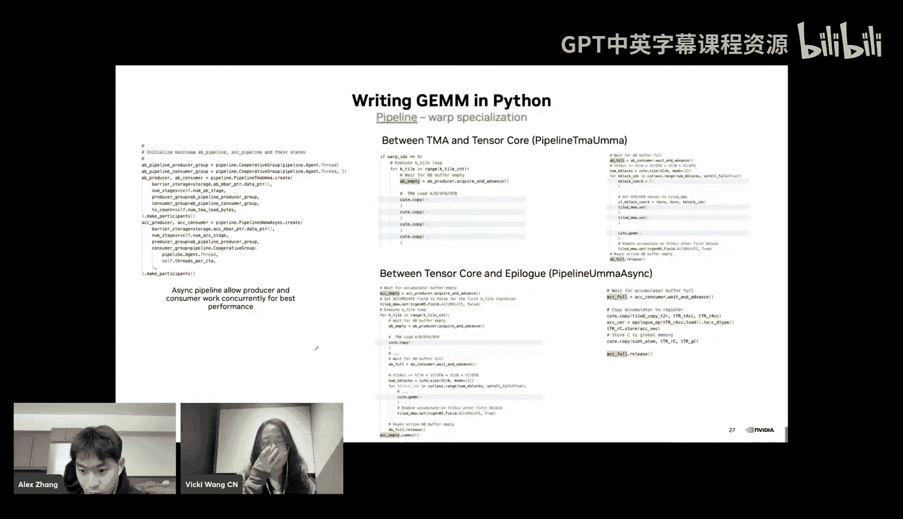

This is a good question。 But I think the because when you said this is unconventional or small matrix size。

 it depends on how small you have there。

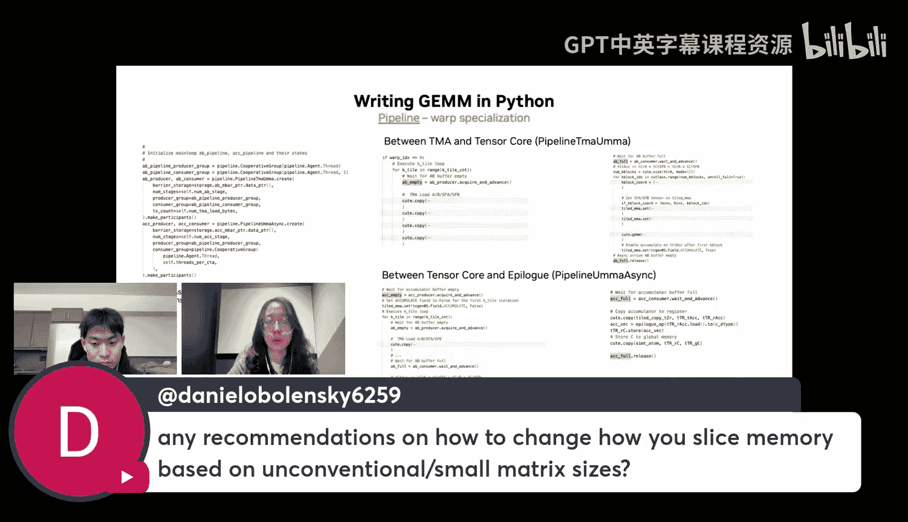

And if it's really very tiny or small， I think it's probably not the mass computation cases。

So this probably will fall back to the memory on the cases。

 which means that how we maximum use the memory benefits will be the key importance。

 So at that moment， I think you probably can on。Ignore a little bit of the central call set that think about how the memory operations。

 What's the。Best configurations for you to load them from each memory to the other local memory and how you do some kind of software pading。

 because even if we do memory copy， we are probably still going to do global memory to local memory and do some kind of the local memory whistling。

Between and then copy to another memory space。 So the shot is that try some software pipeline to make sure you memory operations also in some kind of concurrency to to have the latency to get you better most memory movement difference。

 So that's the typical optimization suggestion。

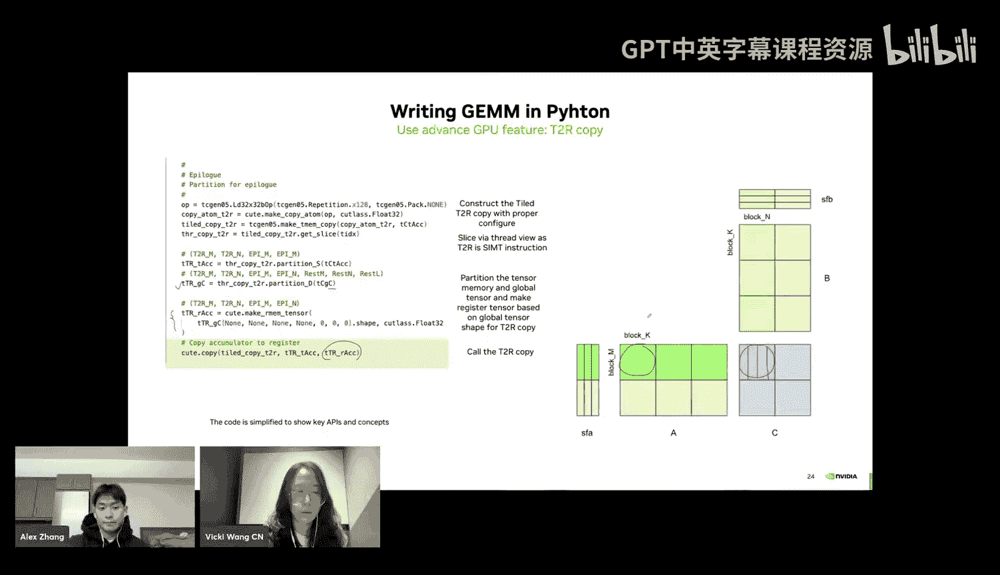

I see。And there's another question， what kinds of things in NCU or Ensight computee would be useful to look at when trying to optimize a warp specialized kernel and understand any bottlenecks？

Usually， I probably will start from the speed of light section because that speed of light section will first tell me whether the the the kernel bound on the memory efficiency bound on the computation efficiency。

 And then I probably will check the memory sections to see。 okay。

 if my kernel bound on the memory is bound on some local memory of the D。

 I probably want to check the local memory traffic footprint to see if I'm doing too many redant redundant load from global memory to local memory。

 And actually， this bring another optimization， I probably just forgot to let you know is about the。

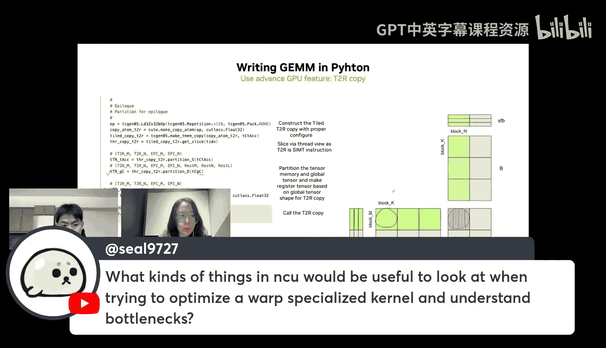

Cluster optimization， because the cluster optimization is another hardware features that allow the users to load it from the global memory to the local memory and do some broadcast to further reduce pressure on local memory。

 So the memory section will give you all the breakdown details about how you memory traffic size from global to local and how you memory traffic size from the local among different local space。

 So based on those analysis you probably get better sense about where the memory stacks there and you can continue focus on the memory part。

 And then if you can already found on the mass part。

 you probably can check the instruction static sections to understand which instruction is the long or on your competition part and then continue to do so far for analysis there to figure out。

这条。Go it， thank you。Okay， let's continue。 Then this is the dual jam。

 The dual jump is where we have this a matrix and the2 B matrix and the2 B matrix have the same in dimension。

 And we do this computation to get the two。Accumulation result。

 And before we write this accumulation result to the global memory tensor。

 we do three Galu on one of the communication results and then do an element wide operations to do the global canceror。

 So if we look at acute DSL。Features for these examples， because it's quite similar to jam。

 The difference is that you have to manage another actual buttontensors there。

 So you will see a bunch of the actual tailer partition in my examples。

So the the the key optimization of features， we would like this。

Agorithm for you to see that one is that we have this epi operation Lada expression in our code。

 So the kernel functions kernel signatures have both compile time argument and dynamic argument the dynamic argument is the kernel character and this static argument actually is some line functions that can be applied to the kernel to get better efficiency So here we have this lambda functions to illustrate how we want to do the three ga operations and here again。

 you see the power of the tensor SSa operations where we load the Rm tensor to the vector rise operations apply the Clu operations here directly。

 that will be very simple。 you don't need to manage element one by one and then we do this element wise multiplication between the two tensor SSa operations So all this will simplify you implementation and。

The Tensorized I features will help you handle each element wise operations。

 so that's the features we want to people to explore and try in these epi fear use cases。And okay。

 so about three Galu。 And a quick question， because it's quite similar to jam。

 And these have more competition。 So I think for this example。

 you probably need focus on how to use the sensor call to get the。B competition inference。Okay。

 then let's look at this group jam。 I think this is the most complicated examples you are going to explore。

 So first elaborate about what is group jam group jam have multiple group of matrix multiplication。

 And in each group， the M and K sizes will be a different。 So the code need to。Compute the。是。

The the data each city need to process on the fly。 So the tricky part is that we need to have a Tma update operations in the code。

 So unlike jam and other examples at very beginning of the code。

 the logic is that we need each city to figure out where the data it need to load and which town is try to compute and store the result to the right globalsor。

 So after the each city based on this coordinate and problem side to figure out the right group and the right coordinated is going to do the resting that we need to do online Tma descriptor update inside the kernel。

 So the most of the tricky and fancy part in this group jam is we have a。TM a map manager。

 you choose for you to do this kind of the tensor map update on the fly。

 So the template is quite simple。 I use some very environmental program model that I let each city。

Do one，1 output of the problem size。 So I give each city a global tensor。

 My pointer where to show is a tensor B tensor， scanning factor a tensor and scanning factor B tensor at the beginning of the code。

 once I figure out which group I let the grid dimension they to show the group index。

 When I figure out my city compute to which group I let it point to its global tensor。

 And then I use this TA。Descriptor I created at the host site to construct the new T descriptor in shared memory。

 and I feel this shared memory tenor descriptor with the。Static Qiao size and static box sizes。

 But with fake global， global dimension and global thread information strain information for this share mytime descriptor construction。

 And after this， because I have my real tensor A B， scanning A， scanning B constructed。

In online with my device operations。I'm。Update the descriptor information with this real tensor information and store it back to the global Tensor map pointers I get it at the beginning。

 And after finish this， and need to ensure all the T Tensor map update then in the global memory。

 Then after this， we finish all the T update inside kernel。

 and the rest part will be very similar to the other and operations we do the T operation load and scanning load to do the tensor call to do the operation。

 So all those T and all those T update and management will be the key tricky part for this group jam and will be very complicated sometimes for user to figure out。

Any questions on this group gem Yes， sorry so， I guess there was a question for the dual gem。

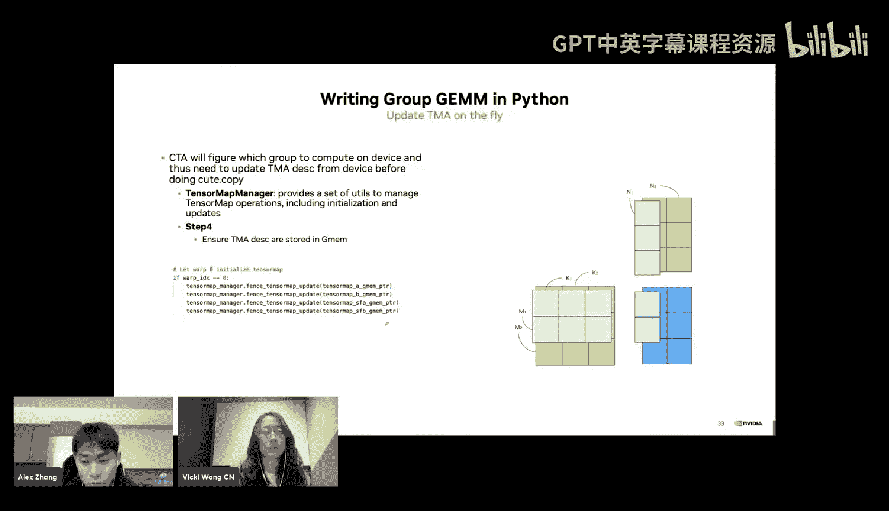

They were asking， how should I stage data through shared memory for dual gem。

 should the output of the first gem state in shared memory for the second gems input。

 or is it better to spill the registers and avoid shared memory pressure？我觉得这里确实玩不紧张。嗯，嗯。Let let me。

 let me see。 So on。So first， I think this purple and this purple output， they are in the tensor ro。

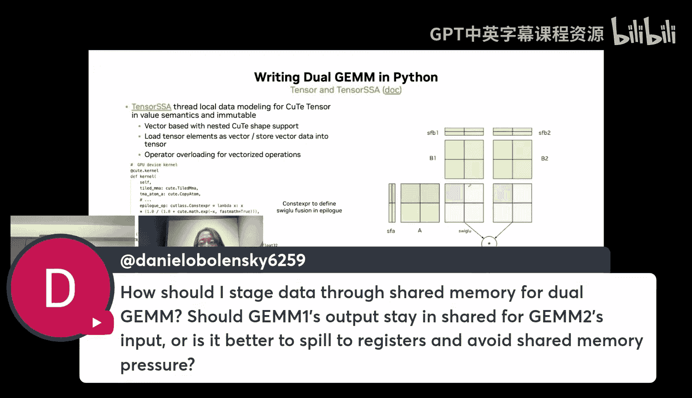

So in the testor memory， the second part said， okay， I need to to do the elementwise operation。

 So those must be in the register。嗯。I think you probably can have a try because because in on blackpo。

 all those memory operations and code before the app all in the local memory。

 there's less register usage before the app。 so you can explore to load the entire data into register。

 But if you pick a very large。A I may tell you writer probably will be spelling。So remember。

 I mentioned that you want to do some subtling on the epilo。

So you can every time pick a subtling of the app， load it into register。Do you elementize operation？

And then going to share memory to do the rest of work。 And then you can do this kind of the。

Eleimate wise operation， rest and share memory movement in concurrency at different stages to get the best efficiency。

 You probably don't want to store the data into share memory directly because your share memory will be used to prefech the atenor。

李成r。And if the backlog consume too many of the share memory。

You probably will reduce the stage for your main loop to load the data to， to。

 to not hang the tentacle。So I think the my my suggestion is that try to slice in the i clock to do kind of the restaurant and share memory staging and in concurrency to get to the difference。

ま好き。I think that's that should be it in chat， I think you can， yeah， you can， you can bump。Okay。

 so I think I've also done my group jam。Introduction。 So again。

 the fancy part and the complicated part for the group jam is the tensor descriptor management。

 Once you figure through the tensor map。Update。I think if we look at each cities。

From each city's point of view， the rest part will be very similar to the gem and Du jam。

 so I believe if you get good performance result with your gem and De gem optimization。

 you can apply the similar optimization to the group jam after you figure out the right gem descriptor update logic。

Okay， then I would like to introduce some other interesting features for the Q DSL。

 Y is the compile and run in our template， you may notice that I have some kind of the customized competition key used in the example。

 because we are DSL， we have the。 So sometimes the competition time is quite long。

 So when we benchmark the kernel。 we probably don't want to recomple the kernel every time。

 So here we have this cache key for this cache key。

 we can allow user to catch my customize the key you want to use to。Index。

 if you kernel already in this global cache key， you oh you change the some static compile time configuration that you need recomp。

 So for this compile kernel logic in the group jam。

 I use the problem size as the key because different problem size have different group。Gup numbers。

 So it will change how the kernel signatures to launch the GP kernel。

 So I use this as my customer key。 and I have a bunch of the。

Prameterter pre pressure in the completion time to use fixed tensor。

 So I have this make pointer operation with take a non pointer to ensure I compile kernel with the right signature。

 but it doesn't contain the runtime information。 And once I compiled kernel and cache it in the key when actually launch my kernel。

 I first check if this configuration already cash in the key if it is the competition time will be simplified。

 So here I after I get this compiled kernel from my key。

 I actually update the parameters with the real run time informations and then launch my kernel。

 So this typical the。Customized the cash strategy we we provided in Q DSL。

 and there is the link about details of this catch。 If you have interest。

 you can have a more look on the details。And this part will be quite useful because when you write。

 you probably will hit some issue someone to debug a little bit。

 I usually find the print is quite useful for me to figure out if my layout is wrong or if I copy the wrong data to my memory So we have theic print。

 So this print allow us to print all the static informations and we have the print。

 This can be used in both the whole side and GPU set。

 So print will print the value of the runtime parameters and we also have this print tensor you that will dump the content of the tensor。

 but please pay attention the print tensor only support limited data。

 So if you really want to check your narrow precision data whether they are writing the local memory when you load you probably in the tensor to load your narrow data to the。

Vized operation sorry， not not the tensor SS expression and do the convention to convert your now present to float 32 and then to do the print to check if the value match you expectationedition that's also why we use the。

F I may， as a jam way to help you ramp up on this part。

 that probably will help you to get some debug hint later in your code。

 So this just the red just show different print。 So the first two other peasant print。

So you will notice there are a bunch of the question mark because the peasant print only print the static information。

 So for all the runtime information， it won't print details。

 So you will see the question mark in the print result and the Q print will print all the information。

 So you will see all the runtime variable for the question mark。

 which will help you check if if your partition result。

 give you the expected result on the rest jam rest and so for so forth。

And then we can check the global Chor and local memory Chor content， so here。

We check the global tensor and did print all the random value we set in the tensor preparation stage。

 And after we parted the。Glow potential to the the partition result。 We can slice the tensor。

To print part of the result， which is only 108 parted the blockcam data to the screen to check if you slice the right data you want from the global tensor and also you can add this were both annotate。

 It will give you all the details， I it will print all the 128 element。

 I didn't show all of them to simplify the example。

I think this quite be used quite helpful when you try to debug some function issues in your code。

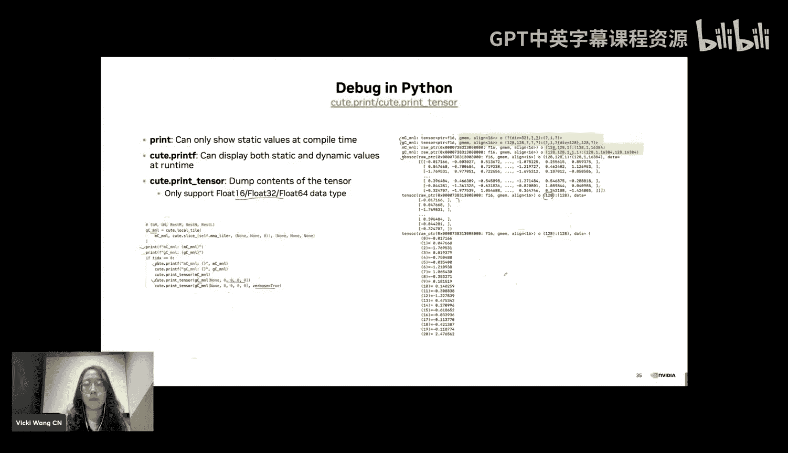

Okay， then here we go。 We have this inside。In debuing to。

 So before we go into this inside debuing you， there's another several configurations you can use。

 The first is the keep air。 If you want to look at air， you are familiar with M air。

 you can dump air to check if some air bug。I obvious to you and you can quickly identify the problems。

 you can also keep the Pt or coping to use our AD tool kit due to some examination to see if there are some racial spelling or some bad if you not but that's probably require you have some good understanding about the Pt and SA。

Also， we have this line info features。 If you pass this annotation to our compile function， Actually。

 we will have this kind of the source and sa correlations showing inside。

 please ensure you inside reports based in the same folder with your source code。

 Then it can show this details。 And when you click the。Instruction， for example。

 here is my T2 share memory copy。 It will point to my source code to show here I do the code。

 So if you are familiar with insight and try to do some instruction level termination you probably notice there maybe some sa generated looks not good。

 and then you can click to see if the Sa generated from some for example。

 some cases you forgot to do loop loading。 and then it generate some unexpected loop conditions for your code。

 So this will also be quite helpful。 Also again， this is some features will still enhance and polishing。

 So maybe you may you may notice some mismatch between the Sa and source that something will continue to improving and you probably can report issues in our Github and in the later will we may continue to enhance and make it better。

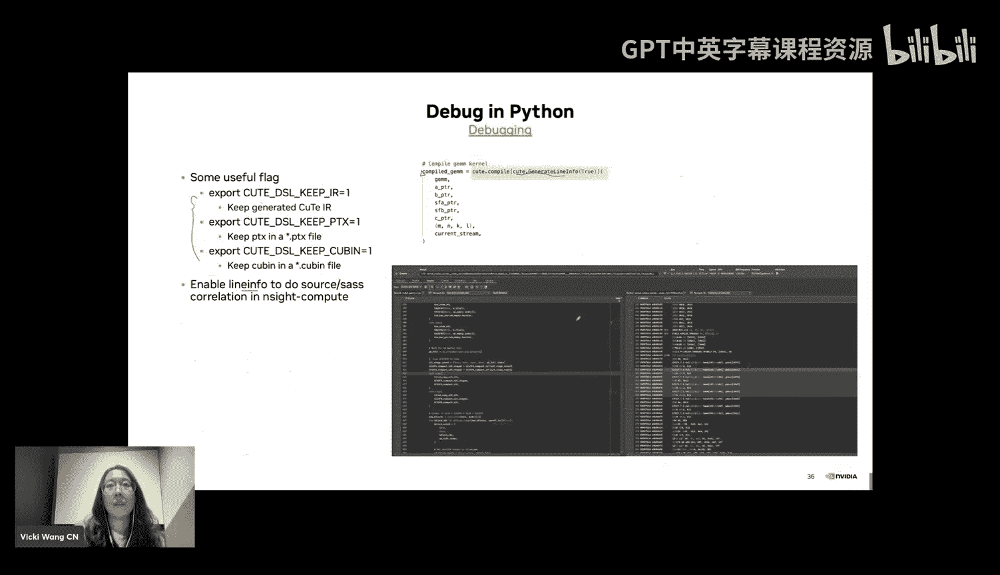

The last feature I want to introduce is this in line Pt feature。

 because the Q DSL is thethon front end in the backend of of Q DSL。

 there are a bunch of our framework via build。 that is something a user invisible。

 So it's possible that when you try to do some fancy granular lowle granularity optimization。

 you may notice some features that not supported in our view In that cases。

 we actually support this in line Pt。 If you are familiar with P text syntax。

 you probably can try this feature to or some view issues that features are not supported in the view。

So that can be another useful features to help you。Unblock your optimization work。mYeah。

 there was a question actually in the chat， which is basically like， do you think it's possible？

To hit。I guess close to speed of light using only Q DSO or will generally like top solutions for these problems use KUudar or PTX。

I think Q DSO can help you reach the speed of light performance because we already released a lot of such kind of examples where Q DSL。

 But because our view is continuing in developing stages and there are a lot of hardware features probably in the release variance not ready yet。

So so in that case， you probably， because this is competition。

 this depends on whether the GPU mode will continue update view to the update version。

 So for that cases， maybe some corner cases， the the view used in the GPU mode is now not continue feature。

 So you you have to use some of these tricks to manage the optimization。 I see。

There was another question for the debugging slide and they're asking does cute dot printf require register memory space theyre saying they weren't able to get it working when reallocating registers with set Max and Reg。

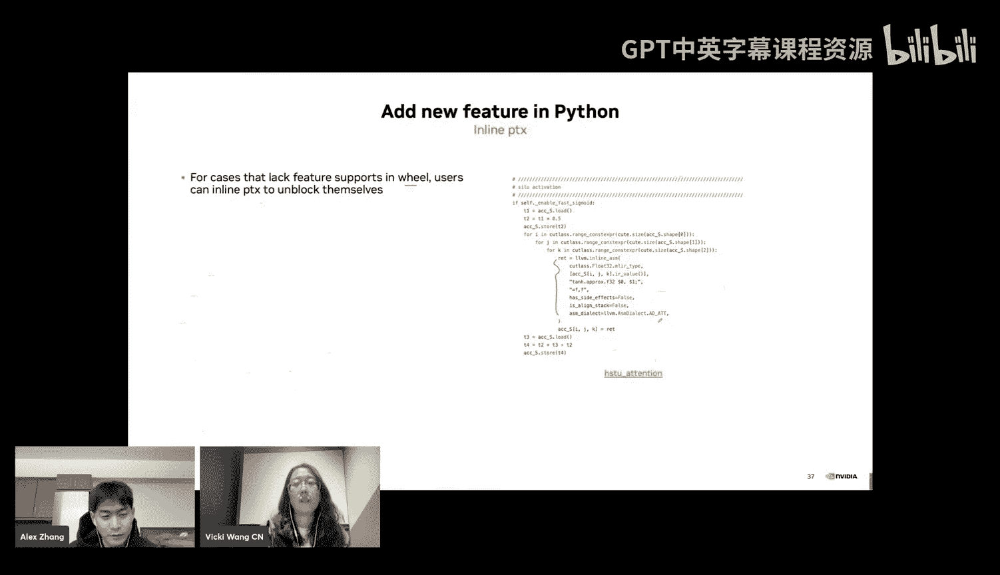

No， because if you look at my， they are all global memory。But I。

 it depends on what you are trying to do print there， because there indeed some。We。

 we indeed have an enhancement of our Q print because。

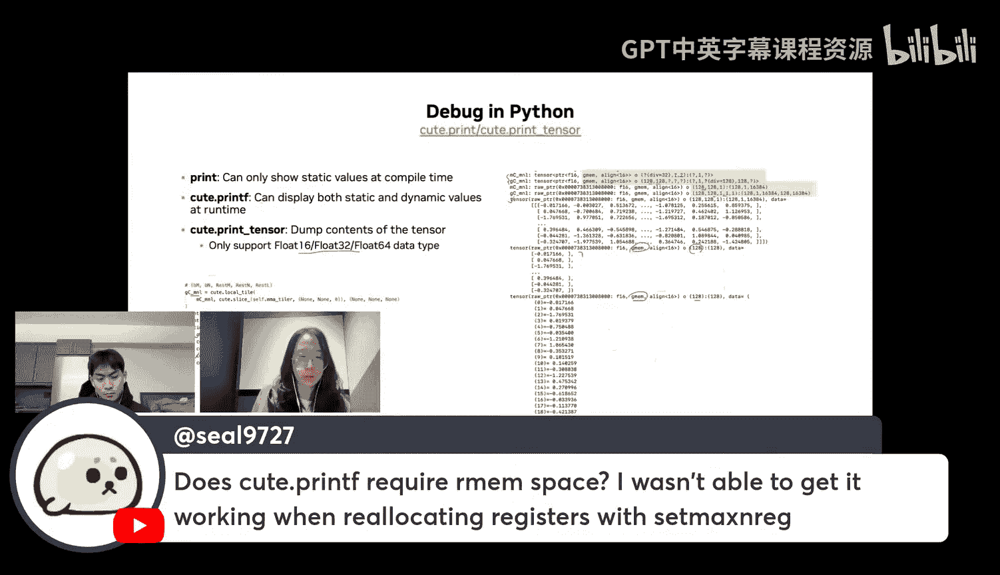

I believe in some older word an our print probably only be able to print tensor incomplicate composition Q layout or Sw of Q layout。

 You probably the slice to ensure you print a linearized buffer。

 And then it probably will give you the right layout。 We enhance this in our latest view。 again。

 that depends on whether we are going to update our this composition。Yeah。Yeah， sorry。

 you can go on from there。Yeah， I think that's almost all the features and details I want to introduce in this。

Talk and there are some other useful resource you probably want to have a look。 One is Chris。

 which is the founder of Q， already give an introduction of Q in our GP movie competition。

 I think this contains all the details of algebra and layout transform。

 So if you really would like to understand more details of how this cute do the magic and fancy layout operations for you probably look at his presentation。

 And also we have a bunch of cute DSL documentation that have detailed ela of most of the features I have in this slide。

 and we have a lot of DSL examples。 I believe most of the examples already show how to achieve the speed of large performance。

 But those examples contains too many optimization details。 So may be hard for you to。

Look at the first guns。 So that's why the Q desktop template app really for this this example just shows the show the simple logic of the function and algorithm and you probably can use those template to understand the common features and then check our examples public in the Github to how to try to apply the optimizations using our public examples to your composition and try to gain the speed of light performance regard。

Hope after this practitioner， you have a better journey and experience with our two。

Yeah perfect thank you so much Yeah， I guess maybe i'll leave a few extra minutes if any more questions roll in I sent a message in the chat but if it wasn't clear like。

😊，The other kernels that Vicki went over are going to be in the competition。

 so if you have any more questions like I recommend asking now because this is I guess the perfect time to ask。

But。Yeah， I guess otherwise like。Good luck， everyone on the competition。

 I think there were a lot of very， very cool solutions to the gem B kernel。

 The gem kernel is ongoing。 I think there's probably two weeks left on that。 maybe even more。

 but Yeah， if if you guys have any questions， please ask otherwise。😊，Thank you so oh， there is one。嗯。

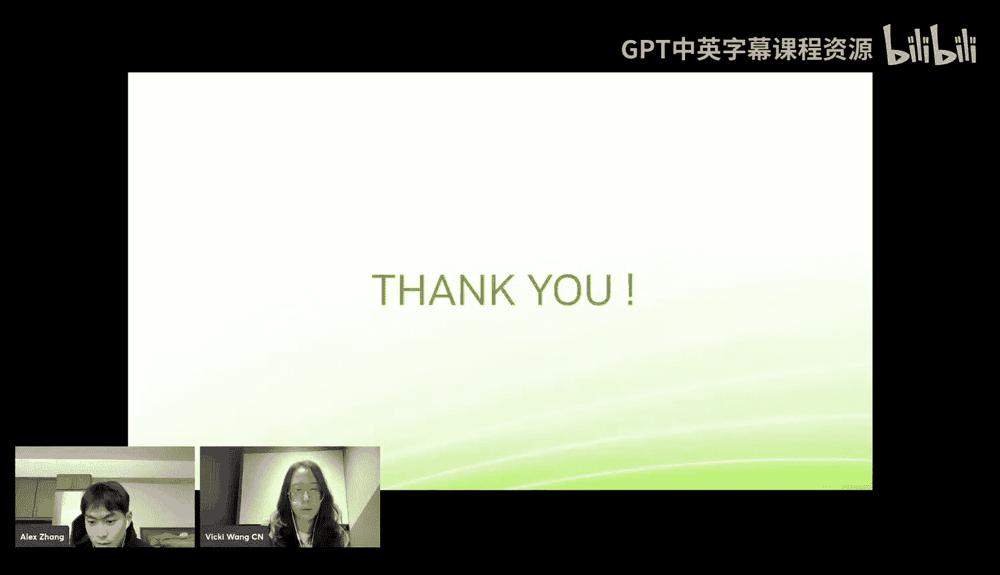

They're asking， is it possible to have runtime asserts in QDSL？Yeah， yes。 If you check the static。

 the Comp time that features says， you can have the run time certain code。

Another person is asking will we have access to the slides after this talk Yeah will Yeah。

 we'll put it on the the lectures repo another person asks I think they're referring to Q tile like the new thing that came out what is the difference between that and QSL So I think Q low levelitive have as we mentioned in the first full control of our hardware as far as can more。

High level solution。 So if you look at Q tell examples。

 I think it won't have too many hardware details under the Q tell backend will help you to all those fun thing adopt in the back end compile。

So I think is a high levelic solution that will make youonic prototype exploration be much more easier because queues still contain too many lowle details。

 Some users already feedback as that it's hard to learn and also hard for people to write a speed of that kernels that could will be much simpler for you to use that to the API。

嗯。Any tips for debugging pipelines and ordering of operations？

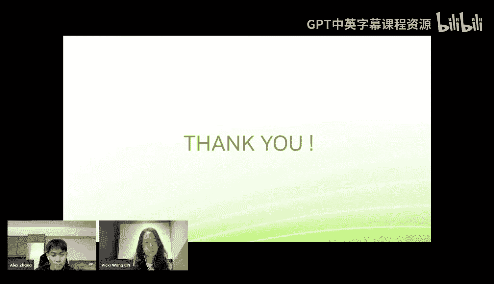

Actually depends so I think you can try several one these server inside the computer send each other too there are some two that you can run to check if there are some risk contention or memory in illegal operations in the code the rest thing I think is just try different print and comment out the code and relate to the pipeline to see if you can root cause the home and the last case is the last suggestion that you can also try could GDP if you film how the GDP worth there you can break and run the code and stop on the problem you hit in the code and try to check which thread or which will actually bring the trouble for you then try to deduce where the source bring the trouble for you。

Perfect， thank you so much and good luck everyone in the competition。

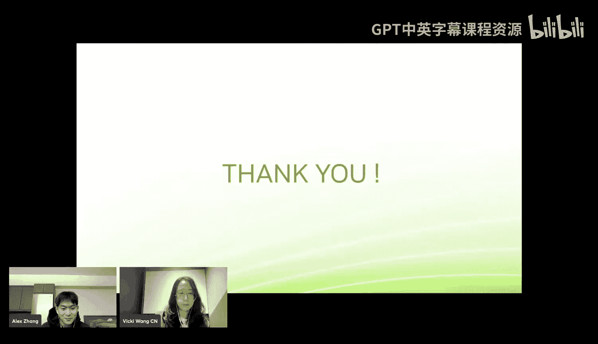

Yeah， good luck to everyone。 Hope you have。