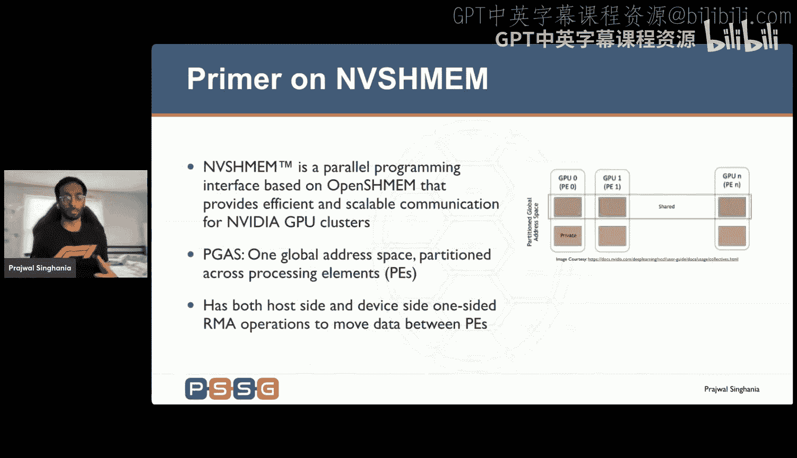
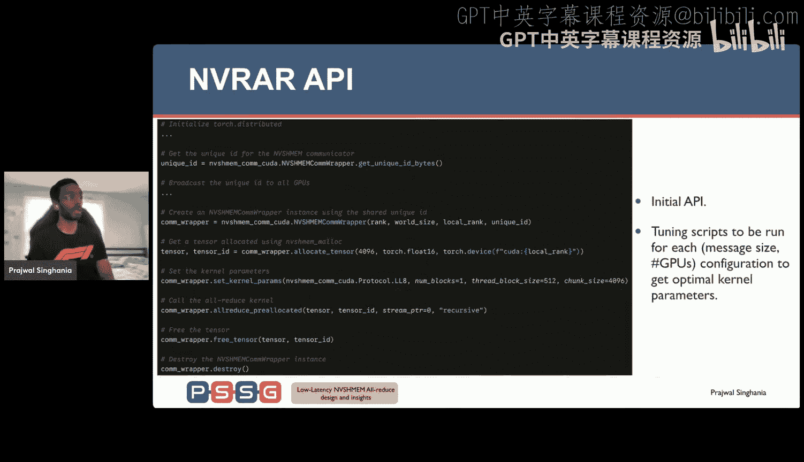
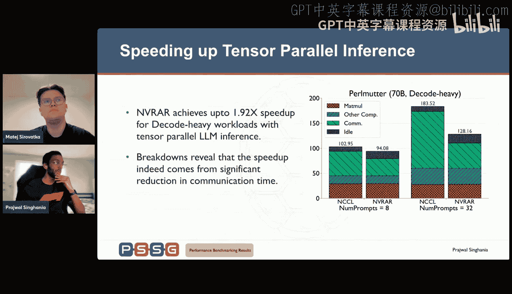
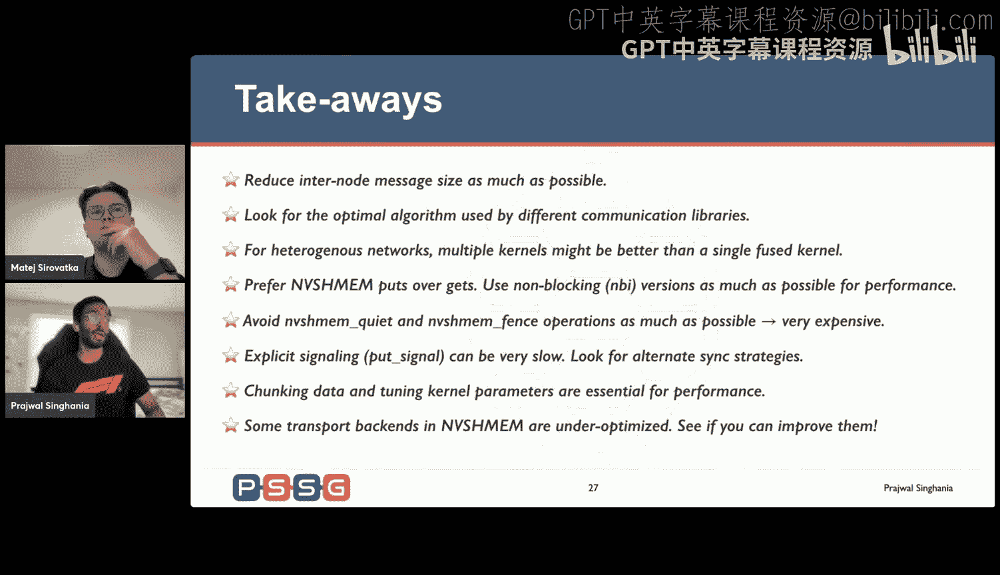
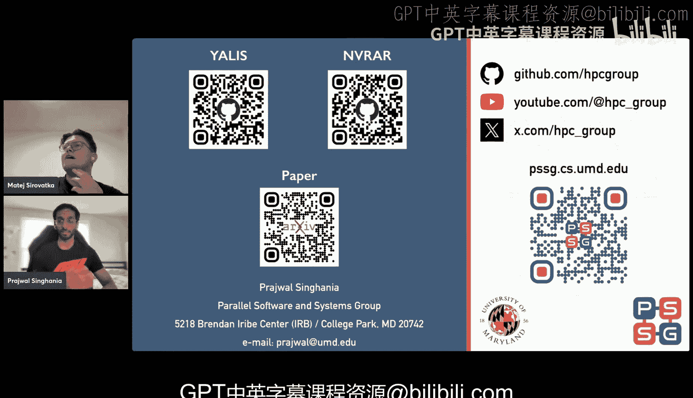

# GPU MODE《CUDA、GPU编程54-87｜GPU MODE》中英字幕（deepseek-v3.2 p34 20251207-Lecture 87_ Low Latency Communication Kernels with NVSHMEM.zh_en -BV1xbmQB3ETC_p34-

，Okay， I think we should be wife now。Let me see it。Okay， let's go。So hey everyone。

 today we have a talk from Pratwell on his recent paper at Ellum in France Beyond single Note。

So recently like scaling inference friends has become a quite a topic and as the models grow art you have to scale between notes。

 which becomes hard when you have parallel strategies STP and this paper and this talk is about writing fast oruse and other communication primitives that work across notes。

 they've also developed their own like small research like in engine which is really cool and they've shown quite nice numbers。

Being faster than anybody laying on their setups and with that profile。Here。Yeah， thank you。

 Me So yeah， today I'm going to be talking about low latency communication kernels for multinot LLM influence with Nmim。

😊，So a bit about me， I'm Prawell， I'm a third year CSPD student at UMD in the US I'm working with Dr。

 Abov Pattle in the parallel。😊，Software and systems group my research interests mainly lie at the intersection of high performance computing and deep learning primarily looking at optimizing systems for LL inference。

 I've dabbled a bit in training recently I've got interested into looking at these communication bottlenecks that exist particularly for L inference and that's what this talk is going to be about。

😊，So before we kind of get into the technical stuff， I'm going to。😊。

Briefly introduce the goal of this talk and a broad outline。So yeah。

 this presentation is based off on my recent work called LLM inference beyond a single node from bottlenecks to mitigations with fast Al communication。

😊，And the purpose of the paper and the stock is essentially going to be sharing our insights on the performance bottlenecks that we found when trying to scale multi and element inference。

😊，And then to narrowing our focus down to the communication bottlenecks that exist in all reduced communication。

And hopefully showing how thoughtful Npam kernel design can mitigate these bottlenecks。

The hope is that anybody who wants to write their own kernels in Enmishm is able to gain some insights from our experiences。

The general outline of this talk is going to be， I'm going to talk about the background first and the results from our performance study。

😊，When scaling Martinino LM inference。Then the meat of this talk is going to talk about the kernel that we design for al reduce and what are the insights we got from that and lastly I'm going to go into the performance results and show how we repeat niel。

Great， so let's get started。😊，So just a bit of background。

 I'm sure a lot of people already know this， but yeah LLM inferences this auto regressive process where you。

😊，Where the model essentially generates traditionally generates one token at a time。😊。

And the input to the model。😊，At each generation step is the output from the previous step。

Traditionally it's divided into two phases， you have this prefi phase where the model processes all the prompt tokens in parallel to generate the first output token this phase。

 as you can imagine is compute bound。😊，Because you have a lot of tokens in your entire prompt。

Being processed in parallel， so you have large matrix multiplications in the linear layerss and the attention layers。

U。After you generate the first token it。What starts is the decocode phase where in the。

Generated token is fed back to the model again to generate the next output token。

 and this phase is more。Memory bound because now the that the input is just like a single token or a batch of few tokens。

 your Mama has become more skinny。Um， and you spend more time loading in the weights of the model or the KVC states。

 etc。Great。So。One of the problems in recent times has been that these models have been growing。

Pretty large and even though GPU VRAM capacity， HVM capacity has been increasing。

You cannot infer state of the art models。On a single GPU。So you need to split the computation。

 the parameters of the model across multiple GPUs just to be able to run them。

There are three primary strategies for doing this， this talk will focus on two of them。😊，um。

The first one is pipeline parallelism， so if you if you remember basically your LLM is repeated。

Like it's a sequence of repeating layers。😊，So it the easy like one of the strategies is that you can have a set of layers on one GPU。

 the next set on the next GPU and so on， and you'll have this input output dependency wherein you'll have to send the output of one set as the input。

😊，To the next set of layers on the next trip you using point to point send and receivers。

UU what you do in this is you also break down your batch of tokens into smaller micro batchches so that you can fill the pipeline and not have a lot of bubbles and you can overlap the compute and communication of it。

Right， so the other strategy is tensor parallelism。😊，So instead of now， instead of like dividing it。

In sets of layers， what you can do is look into each layer。😊。

And you can divide the matrix multiplies within a layer。😊，Across all the GPUs that you have。

So what e GPU is doing is computing a partial matrix multiply。In Thailand。

But now what you need to do is you need to aggregate the results so you have these partial outputs。

 you need to sum them up across all the GPUs after each layer， after each matrix multipier。

 and that's done using an all reduced communication which incurs a very high communication volume。嗯。

Lastly for MOE models you also have expert parallelism。

 again our work does not focus on ME models and we stick to dense models and the two previously mentioned parallelism schemes。

 but in MOE models what you can also do is you have these experts and you can partition your experts among the GPUs that you have and then you need to have all to all communication to route your tokens to the correct expert。

Right right， so why do we need to study multi nodeode LLM inference？😊，Okay， so not everyone has。😊。

U DGX。Bs a big Dgx box with let's say8 GB 200 GPs with the highest B Ram possible right so。

If you have that you might be able to run like a big model on a single node a node here is just like one machine or one compute unit with a set of GPUs and a set of CPUs。

 the GPUs are assumedd like。To be in one envy link domain。

But yeah that's not the case for a lot of people in fact。

 if you look at the traditional HPC clusters they come in varying shapes and forms so like here i've shown examples of like two of the HPpC clusters that are popular one is pearl me so this is at the nurse center。

😊，And I believe this has around 2000 nodes。And each node has four GPUs even on its40 or 80GB。

Wwhich are connected within a node by enV link， but then across nodes you have this slingshot network。

 which is 25 GB per niI per direction。😊，It is much slower than a link。😊，嗯。

And then the other system is like Vista this is at the T supercomputing center and you have like one GS 200 per node here。

 so there is no emmeing domain。😊，In fact and then like the nodes are connected using infinivine in both cases it's a dragon flight apology so you can see that on these machines you will not be able to infer a model like Lama3 3。

14 or 5p or even larger ME models。😊，In fact， on Vista。

 I believe you probably won't be able to run like 70b model also with a decent batch size。

You can see that you need to go beyond this enveing domain and go into these slower interconnects and it's really crucial to understand the performance bottleneck that exist when you go into this domain the standard way that people have。

Scale inference is or the standard like knowledge is that you use T within a node within an invealing domain which is fast and then you use pipeline across nodes this strategy is called hybrid parallelism and like were just looking at dense models。

嗯。All right， so I'll see if there are questions， if not， I'll just continue。Yeah。

 so I kind of wonder like how this scales like I suppose you were optimizing for the two systems that you were mentioning before。

 right？Like how it scales to， what's say different。

 even supercomputing that have PCIe connected to GPUs right inside a node And so like how it scales to those like。

 is that your favorite like more general， I guess。So yeah， one of the things is we haven't。😊。

Tested on sort of supercomputers where it's like even within a node that's BCIe。

Or it's not like it's very slow connects even within a node in terms of， I guess。😊。

It's generalizable to most of the supercomputers that we have worked with。

 so a lot of the DOV supercomputers have this architecture where youll have four or eight nodes or four or8 GPQs per node that are usually connected in a wheeling domain。

😊，嗯。And then I think in the US most of them use a slingshot network by C。

 so it is generalizable to most of those machines， I would think that our sort of the kernel that I' want to talk about is also generalizable to other interconnects。

Apart from Infinivvan and slingshot。😊，But we'll have to like test it out， I guess。😊，Make sense。

 Thank you。Thanks， yeah so going forward， I'm going to present some results from our performance study。

😊，And I'm trying to keep this part short so that I can focus on the kernel designr。

But you can find the extended results in the paper where we look at other models as well like more scenarios etc。

 so what we've tried to do here is we've we've tried to scale multinode LLM inference。😊，On。

The pearl motor system， which had like 4A 100 per noded。Um。We do strong scaling。

 which is where you keep a fixed workload。And you increase the number of resources GPUs in this case。

 so we are going all the way from four GPUs， which is a single node to 32 GPUs。

 which is eight nodes for the Lama 70b model a Lama 3。

170b model and we have like two representative workloads of prefi heavy workload and a decode heavy workloads and we also have like a different number of prompts that we pack together in the workload the workload is characterized by you know like that we have this batch of prompts that we。

Input to the two different LLM engines。And then we wait for the batch to be completed before inputting the next batch。

😊，From a realistic scenario， this kind of workload is found in things like G your training where you're generating rollouts et。

 so we compared different inference engines state of the art ones so VLLM and SDGL mainly，😊，Um。

And we use different parallelism schemes for that。There is also like。

You'll notice that there is like Yas Yaals is stands for yet another LLM inference system it's our own inhouse prototype inference engine which we developed for easier extensibility and instrumentation that can help us。

😊，嗯。Dive deep into the performance because what we found that like these larger code bases are really difficult to work with in terms of instrumentation。

 etc。嗯。Yeah， so one of the expectations in strong scaling is that if you keep the workload fixed and you increase the number of resources。

 your time to solution should go down。😊，But what you'll notice on the results on the right is that that does not happen。

嗯。Any of the inference engines？On any of these parallelism schemes。

 the time actually either like stays constant or it goes up in a lot of cases， and that's not ideal。

😊，So maybe it's just a hard problem right maybecal inference is a hard problem but if you look into it a bit more minutely well see that there are like couple of differences so if you look at the previous heavy workload you will see that。

😊，U。The patternism schemes are a lot more closer。Where you will see that VLLm's hybrid parallelism。

Actually beats out at higher note counts。The other competitors。

But if you will switch this and you will go to the decocode heavy workload and the more memory bound workload。

😊，You'll see a clear distinction between the hybrid parallelism and tensor parallelism。😊，嗯m。

So you'll see that like using hybrid parallelism， the time actually increases by a significant amount。

😊，But when using tensor parallelism just across nodes。You still don't get the idol scaling。

 but the time kind of is better than HV。So this was the first kind of surprising thing to us and we wanted to investigate why that's happening。

😊，So we。Generated inside traces and we use this trace analysis tool from our lab called Pit。

To dig in deeper。The plot here shows these performance breakdown。

 so we look at the TP only case across nodes with AliceIS here and the hybrid parallelism case with VLM here。

U and we break down the time into Ma， other computation， communication and idle time。

And there is like a bunch of analysis in the paper， but I'm going to go over the main things。😊。

That we found interesting here。Um。And I you looking at just like two and four nodes。

 so8 GPUus is two nodes of permeter or 16 is four nodes。

For the two different workloads that we looked at earlier。

 so the three fill heavy on the left and the decocode heavy on the right。

So the first thing that you'll notice is in the prefi heavy case where you have a lot of compute。😊。

Both for Tp and for HP。Um。When you increase the number of GPUs， the max time actually goes down。

 this is an expectation。😊，Um。This is like this matches the expectation that， you know。

 you put in more resources， you've divided the。😊，Computer。😔。

In both tensor parallelism and in pipeline parallelism through micro batchching。Um。

So the time fors will go down。But interestingly， if you look at the deco heavy case。😊，Um。The time。

For the MAmals goes down for the TP case， but it remains almost constant for the hybrid parallelism case。

And this was like very surprising to us。😊，So we wanted to dig in a bit more deeper and we isolated the。

😊，Like one of the matrix multiplies in the decocode phase。In the Decode heavy workload。

 in the Decode phase。😊，So just like。Like stepping back a bit。

 a gem can be characterized by the dimensions of its input。

 so if you're trying to multiply two matrices A and B to get the output C。😊。

You can where the input is。嗯。M cross K and the M is K cross n。

 the matrix multiply can be characterized by like M K and N。Um in this case， like N was。The same for。

U。😊，Both of like for like all all these cases so we don't show it here。

 but what you will see is that。😊，In decods we expect the m to be small because you have like less number of tokens right so it's a skiny matrix that you're trying to multiply with your parameters。

😊，U。And the blue bar here shows what will happen in the pipeline parallelism or hybrid parallelism scenario where you will micro batchch so youll divide your m further down。

Into smaller micro batchches， so you'll reduce M from 32 to 16 here。

Whereas the green bar shows what will happen in Tp where you will actually divide your parameters and you divide the inner dimension by half。

😊，So it goes from57，3 four4 to like28， six，7，28。And what you will see is the blue bar。😊。

Shows no decrease in time at all for the job。Whereas for the green Bay， you see。😊。

The expected decrease by about like a half or less than half。And this is interesting。😊。

This is possibly because。Your matrix multiplies are tile。

And the skinnier you kind of go in one dimension。You do not gain。

Anything by reducing that dimension further？So this is one of the reasons why in the decocode heavy scenario。

Pipline might not be a good option。Lastly， if you look at the communication times right and this is where we can take the talk further。

 but you can clearly see that all communication in Tp cases is like really bad and bear in mind。😊。

That。We are comparing it with hybrid parallelism， so there is still all reduced communication happening within a node。

Um， which is the like yeah， because you use steepy within a node。But that is still small。

But the jump in communication as soon as you are already goes beyond a node is like massive field。

And this is what we kind of focus on in the rest of the dog and motivates our main work。Right。

Focusing down on this like communication bottleneck in Tp so yeah。

 we wanted to focus on this decocode heavy scenario where Tp can actually wind。😊。

For the works that be studying。When we looked at the method sizes， you can see that a prefi。😊。

The method sizes are in the hundreds of Ms range， usually。But for the decocode， you have these like。

😊，Smaller method sizes in the tens to hundreds of KBs。For example， in the previous like case。

 the decocode heavy workload， the method size was 128 kB if youll increase the number of if youll increase the number of prompts in your batch。

 it'll go up to like let's say one MB or something on that。😊。

So we wanted to see if Nchel is the problem。😊，And what's happening with that already use when you go beyond the node。

 so we benchmark nickel against K and pitch on the pearl motor system。😊。

For like a range of method sizes， we show like two representative ones here and what you will see is。

😊，Yeah， for some method size like 128 KB。😊，Nquel might be better。Then Korean pitch。

 but then as you start increasing it， let's say 512 kb。😊。

It starts performing worse than even imp and bear in mind that tech impage is probably not using the most optimal kernels。

 I believe it's tech doing the reduction on the CPU whereas nickel should really be optimized to do stuff on the GPU so this is not ideal at all。

嗯。Yeah， so it scales poorly and it's lower than MP in some cases and in the method sizes that we care about。

😊，嗯。We kind of hypothesized why this could be the case。

 so one of the things is that nickel has only two algorithms。😊。

Two main algorithms for all reduce ring entry tree there are other variants that are that require specialized hardware there's NvS just callant and all of that stuff。

 but I think that requires like。😊，Yeah， specialized hardware。

So we'll focus on like these two algorithms， which are more general and like are used in most cases。

Butas MP has more of algorithms。😊，And it kind of uses this like recursive doubling approach in this range。

 so we thought maybe that's the reason why。😊，Nicel is not performing as well because it's using a suboptily algorithm。

Now a solution could easily be that you use MPI instead of Nel。For this。Part of inference。

 the problem with that is like standard MPI implementations don't have support for things like kgraphs。

 which are really critical for inference performance。😊。

So what we asked ourselves is can we write something。

 can we write a communication kernel ourselveslf that。😊，It has like choreograph support。

For inference and is also like using an optimal algorithm。So after a couple of tries。

 actually we came up with this approach， it's called NVR， so NW member is recursive all use。😊。

And we came up with this three phase design。😊，In the first phase， you have intra node reduce scatter。

Within a single load， so it's on an invealing domain。In the next phase。

 which is where we actually write a device kernel。😊，Using Nampamp。

Where we do a recursive doubling all reduce。Between corresponding。GPUs across the nodes。

And then lastly to get the results correctly， we do an intratro node all the other I'll go over like this in more detail in just a couple of minutess。

 but I I guess I'll pause here and see if there are questions about the previous part and then I can move towards the next slide。

😊，Yeah， I have a question like as you were saying that like with decreasing the。

 I believe it was M M and dimension in the matrix multiplier。

You get a you don't get any speed up right， but when you decrease k。

 you get like a reasonable like 50% speed speed up whatever that was。

 have you actually tried like exploring like writing your own map for this case or like trying to find a better map because I believe like it shouldn't。

I think the M。Like decreasing the M size should be worse than decreasing the K size as you saw。

 but shouldn't be that bad right Yeah that's true。Yeah。

 so that's something that we haven't explored much in fact。

 that's like it's planned as follow up work。😊，As to see， I think in general。

 one of the things is like skinnier matmals and like you know tall and skiny mamals are like are harder problems than like more uniform matmals what we basically hypothesized is that it's something to do with tile sizes。

😊，Like if your tile size is if you're decreasing your M below kind of like a minimal tile size。😊。

Then you don't really get any advantage of doing that。嗯。

Whereas like K is like really huge so you can like have much more of an advantage there。 Yeah。

 but yeah， it's something like yeah， looking at maybe papers as to if people have solved this problem of skinny mamals and。

😊，Trying to plug that in into pipeline parallelism might be a strategy of improving that and we definitely kind of want to look into that。

Make sense。I also wanted to ask about is if you can go back like two slides， I think it was。No。

 just one slide。And so this， is this already like you were mentioning that you wrote your own inference engine like the Yais。

 is this already using Yais or this is just standard view and walking。Oh so this is。

Oh this is just like this is just a per like this is just already use， right？Yeah。

 this is just all use。 So this has been this， this is like outside and inference engine。

 So we use the nickel tests benchmark suite。😊，And there's OSU benchmark like Su。

 which is pretty popular for MPI， so we used both of them。😊，To generate these numbers。

 So these are like isolated from any inference engine or something。

 So this is purely just looking at all use performance。I see。 Thank you。Yeah， so。Yeah。

 so just a bit of primer on like what Nchm is so NWmm is this parallel programming interface based on Openchm from Nmedia。

😊，It's based on the PgaAS model。And I would not go into like a lot of detail into like what that model is。

 but essentially。😊，Um。You have this this。Could you like。

Logically shared global address space like one global address space。

 which is partitioned across your different GPUs or processinging elements as is the as the terminology with enngment so yeah like。

😊，It's basically each P can access the remote P memory as if it was its own memory using like some APIs of course。

 so it can do a put。U or a get on the remote memory API as long as it has the pointer to that remote memory API and stuff。

嗯。And NWwam basically provides you like these host level and device side APIs。😊，To do these。

Like remote memory access operations to move the data between Ps。嗯。

And I'll go over make more of Nm APIs as I go through the design of like NR。😊。

But before I kind of like start looking into like the design details。

 the insight that we have with NR， I just wanted to make this API of NR and。😊。

To show you like what we do。嗯。I hope it's visible to everybody it's not too small， but yeah。

 this is an initial API。😊，It's subject to change stuff。But I sorry。Yeah， but。

What you essentially need to do is you need to first have。😊。

Some sort of like distributed environment that's initialized either using torch or MPI。

We don't handle that， we expect that you know you already create like multiple processes。

 you have a process management。System。But given that you have that。

 you will get these unique ID so we use NWMM has different sort of initializations that can initialize directly using MPI。

😊，I believe there are like other initialization techniques。

 but we use this unique ID based initialization which is pretty standard it can work with like to distributed。

 it can work with MPI and everything so yeah you get this unique ID from the NWFm like NVR wrapper。😊。

嗯。Then you create a communicator like you will create a niel communicator using this unique ID but youll have to do before that is share this unique ID among like all the processes that you want to be in that communicator so that's like either you can do it using MPI or you can do it using Torch。

😊，So this is like the initialization part that' is required to create the communicator。😊。

Once you have done that， you can。😊，Basically ask N wear。On this library that we have for a tensor。

So you give it the tensor size， the d type the device that you want the tensor to be on。

And I'll give you like like。😊，This tensor， which is like a tor tensor in this case and this ID the reason why we do it this way is because you need to allocate the tensor using enmaoc enmam mallc。

😊，Which is necessary to be able to like communicate over them using N。

Then our kernel has a bunch of like。Prameters or hyperparameters that need to be tuned for performance。

😊，So this includes like the blogs that you'll launch。😊。

Um there's a protocol that I'm going to talk about later。

 like the thread block size and there's a chunk size。

So you can set that we also like provide tuning scripts that you need to run for each method size like。

😊，Note count configuration once to get the optimal parameters for performance。

So you can set that and then once you have done that， you just need to call like an al reduce。😊，嗯。

You give it the stream， you give it the tensor， the tensor ID and stuff。And then once you're done。

 you can like free the tensor and you can destroy the communicator。

So this is like a high level overview of like how the code looks in terms of using it。😊。

Now I'll go over like to design a bit and what I've tried to do here is I've tried to mark。😊。

Things that I feel are general enough for other people writing their own kernels in Nshmm。And the。

They're useful for them， like as insights。Um。So on the left， I have the code for NVR。

like sortda code。And this is the driver part of NVR， so this is the high level function。

 which caused the three phases。😊，So i'm going to go over that first。

 so what i'm trying to do here is i'm trying I have a message M which I'm trying to reduce。

Over all the ranks。I have G GPPUs per node。And I have like M number of nodes。😊。

There are a couple of fiber parameters， as I mentioned。

 like chunk size and then the other stuff I'll go over as I go over the design。😊，But yeah。

 so looking at the three phase design。😊，So the first thing that we do is do a reduce scatter so for people who aret aware reduce scatter is this operation where you have like。

😊，Data on all the GPUs， you do a reduce， but you only keep a portion of that data。

After the deduction。So this is like Sha heard。No。This was important。😊。

Because what we wanted to do is reduce the message volume that will go into the inter node phase。

 So whenever you're designing like inter node。Cners you want to minimize especially for latency。

 you want to minimize the internal node message volume as much as possible。

 so doing this reduce scatter makes that every rank within a node has different data elements。😊。

And it's reduced by like G heard。And then if we communicate over this。

 your communication has reduced by G across nodes。So this is like a better choice。

Then doing a two phase design where you would have done an inter node all reduce。

 let's say where everybody would come out with all the data。啊。And then do internal order order use。

Um。For this， we use this enrichment host A。In whichMx， whatever type name like Bf 16 here。

 some reduce scatter on stream and internally actually dissolves to a nickel reduce scatter because it's in an unvealing domain。

😊，嗯。Yeah， then。Comes the inter node phase and this is where this like we call our custom kernel。

 which we call RD inter here。😊，So recursive doubling is this like logarithmic approach where at each step。

😊，Pailers of。GPUs exchange their data and do a reduction。And then on the next step。

 you will go to the next two to the power I pair that you have。😊，And you'll exchange data with it。

Finally， after the blog。Logithmic number of steps every rank should have。

Like the fine like the reduced data。嗯。Yeah， so as I said， it's like。

 so this is where we have the custom and from Colnel and I'm going to go over that later。😊。

So this is the algorithm that MH uses for like short and medium sized messages。

 whereas nickel uses some other algorithms， primarily Nckel uses。

 Nel also uses this logarithmic latency algorithm called like tree algorithm reduce。😊，Where you do。

A similar kind of reduction。But it's a two phase reduction。

 so you do a reduction you still kind of distribute your nodes into a tree。

And you do a reduction up to。The root。And then you do a broadcast。

G all giving the reduced result to all the ranks as opposed to that what we have is a the recursive doubling approach is like a one phase approach so you expect like messages to be just exchanged one center or twice。

😊，And the hope is that this will be faster。嗯。Finally， so now after those two phases。Each rank。

Or node will have。Part of the globally reduced data， they won't have all the data。

So you just need to do an oilga。To get the final data on each of those ranks。And this again。

 is done through an EnglishM host API。Call enM F collect and this again kind of boils down or dissolves to a nickel allga call。

So one of the questions that I mean， people might have is that why did we not go for the fused approach wherein we just write one kernel that does all of these three phases。

And we don't pay this the kernel launch latency。Again and again， and that's definitely possible。😊。

But what while developing the kernel， what we found that。😊。

These when you' are working with heterogeneous networks， so like envy link and。

Some other interconnect across nodes。The kernel launch parameters is the block size that you need to launch。

 the number of thread blocks that you need to launch。Kind of need to be different。

To optimize communication in that like domain。so while it is possible to write a very complex kernel that takes care of all of that。

 we found it a lot easier to have separate kernels。😊。

Wherein each of those kernels can be optimized for the domain that they're operating in。

And of course， nickel is really optimized within a node。😊。

So this gives us like the benefit of just using NQel。

Where it's optimized and then doing something where it's not optimized。

If people want to write a use kernel， yeah that's like。

And they have ideas on how to do it like please let us know and we can look into that。😊，嗯。Yeah。

 sorry to jump into that this So I wonder， like you said that you didn't want tofuse the kernels to like。

Because the。Communication profiles internalode and internal node are way different。

 but so as I understand， couldn't you use the recursive double link with the allga itself and just have the first reduce gather B envy link。

All write the default nickel kernel。Yeah I mean yeah as I said like there are like I think there are like still scope for more optimization here so I would not say that this is like the most optimized version that we've written。

 but we found that this was like a lot easier especially also because you have to care about synchronization right like so when you fuse it within the kernel that we've written let's say you were to fuse the recursive doubling and the oilga you need to make sure that the oilga does not happen。

😊，Before， you know all the。Sort of ranks have the data。

That needs to be there or like the the radar that needs to be sent out has been sent and like has been received and reduced so like for that either we had to add like fences using enm or like quiet operations within a kernel and what we noted is like or like have basically synchronization like if you're launching multiple thread blockss you need to make sure that all the thread blockss are done。

😊，In a certain way， like for like a certain chunk of data， let's say。嗯。

And we found that like having that synchronization leads to bad performance。😊。

There is still scope I think there is like a way to do it。

 but it's just like in terms of ease of programming we found that this is like a lot easier and we were still able to get a decent performance out of it like pretty good performance actually so this kind of balance is like。

😊，Oh。Performance and ease of like writing or maintaining the code。But yeah。

 I definitely think that there is like more to do here， especially， I mean， you know。

 I think in like a lot of these inference engines。😊。

People have found that even nickel like using nickel like call reduce or like within a node is not as optimal and you can do other approaches like you can just do like。

Our R DMMA operations you can do a one shot all reduce or a one shot allga that's written using likeku IPC for example。

 so that is definitely something we want to look into is to replacing these oilga nickel callss with like one shot calls and see how much of a performance skin that gives us。

😊，Yeah， that was like my second question， like if you've if you've like played around with basically tuning to reduce Cather like the all of the justice officer so yeah that as I said。

 like that's like that's on the agenda like we really wanted to first nail down on like producing the main bottleneck。

 which is the internal communication。😊，And the good thing is that our design is modular enough。

 so you can replace that reduce scattercoil with like whatever custom kernel you want to write。

 and then you can replace it with a。😊，One shot， Ill reduce scatter and a one shot。

All you gather and try to then fuse them in。Yeah， thanks。

Thank you yeah so this is kind of like the three phase design that we had but of course this is not enough to get good performance and on top of these we made like several optimizations。

 several other design and implementation choices that we found were important to get good performance。

😊，嗯。Yeah， like the first optimization。Again， looking just to the driver code for now is that you need to synchronize so youll notice that we have these preign and pre receive buffers。

So of course， we want to pre allocatelocate some buffers for each tensor to store the intermediate results。

 the results after the reduced scatter the results after the oil rather than stuff like that。U。

But when you have successive already scores， you want to be able to safely reuse them。And to do that。

You need to have like some sort of global synchronization you don't want to create new buffers every time of course for each call and one option to do this like yeah okay actually steppingping back a bit Nfa gives you these put and get calls which can be nonbing and that's what we use here so you need to make sure those operations are complete。

😊，And the buffers are safe to your reviews。One option。😮，The standard option is to use EnMm quiet。

This ensures completion and visibility across all the ranks that are participating in that that are communicating messages。

😊，So it ensures anything that's been transferred or transmitted before the quiet operation。Will be。

Completed and visible to all ranks。Um。But what we found is that this is a very costly operation。😊，嗯。

Like it would totally tank our performance so we would like recommend anybody using this to use this as least as possible。

😊，The other thing is if you go into the minute details。

 it forces a synchronization among all the ranks so it's like say if you have a communicator among all your GPUs it it forces you to。

😊，呃。Synchronize with all of them and not just the peers that you need to communicate with so in the logarithmic number of steps you only need to communicate let's say with two peers。

 but you will synchronize with all of them。😊，Directive。

And so this is a very coarse grained synchronization between all ranks。😊，啊。

What we did was a bit different。😊，Um。We assign。Each all reduce operation of。Unique sequence of。

And we have this observation that all you care about is that the peers that you communicate with。

Have， you done their job。So you can go ahead with your job。

 so you only need to do a fine grain synchronization between your peers。

So instead of calling and en I'm quiet。😊，What we do is we synchronize over the sequence number so before the start of every hour and we do it at the start of every alld operation。

😊，We see that the other peer ranks are done with the previous sequence number or not。

 and we wait till there。This is implemented using。Atomics。

Atomics in enM so these are the two like APIs enM UN 64 atomic set which allows you to atically set a value on the remote P and then like the the local P does a wait till it sees the correct value。

One crucial thing to note here and this is something that I think will come up。😊。

More and more now is that we found that though en Im quiet as。😊。

Especially slow on slingshot networks， which is using the lip fabric transport and enwm。

 And this is because the lip fabric transport in inwmm is not really。😊，嗯。

Implemented very efficiently or it does not use all the hardware features that its a slingshot。😊。

Provides so Stshot for example， has the ability to do ordered like ordered delivery of messages it has hardware fences。

 but right now again Mim does not use that which makes it even more costly either。😊，嗯。Right。

 so before now I go into the main kernel， I'll give a primer on like the RMA operations that we use。

So Nmamps device side API allows this in kernel one side put and get operation。

 that's how you like transfer data between P， as I mentioned。Based on their guide。😊。

Using ports is better than gets。嗯。So that's what we do。

They have a blocking API and an unblocking API， the nonblocking API is marked by N。

 and we found that using the blocking API is very slow。😊，Blocking essentially， I mean， if you block。

😊，You will not like ill block till you can use the buffer。But otherwise。

It'll return immediately and then you have to make sure that the buffer is not licked。U。

Like buffer is like maintained while。You do other stuff。嗯。Yeah， so there is two APIs。Broadly。

 there is enrichment put signal non locking API。😊，Which does a put and then it。

Also automatically writes a signal。😊，To the remote P and this signal is what you can use to detect on the remote P that here Ive received the data and I can go ahead with my reduction。

😊，嗯。The other is just a standard put。😊，So there's no signaling involved you can just put the data。

 but then you'll have to have some way of synchronizing or like the remote P knowing that this data is the correct data that I'm intended to receive when I can start with my reduction。

😊，U。Also there are like these two like the multiple variants of these APIs so there's a warp variant so traditional like the normal one will be operated by a single thread。

😊，But then you have these warp collective API which will be operated on by a block a warp of threads and then like the block API will be operated cooperatively by a。

😊，By a thread block and we found that like for proxy based transports using the block API gives us the best performance in the intra node scenarios so you should try to use this as much as possible even I believe in intra nodeode。

This is recommended to use the block APIs。啊。8ight。So this leads us to the second optimization， right。

 So one of the things。Like when using these puts right so one one option is that you can just put like you would assume that since you have these small method sizes。

 you can just take all the method sizes and put everything。😊，In one message and just send it。

 but we found that that's not the case， so we introduced these hyperparameter。Of course。

 you have like the number of threadbs。😊，And like this chunk size parameter。

 so parallel thread blocks。Work on independent data。Blocks。

And what this allows is like one thread block can we。😊。

Issuing the put request while the other has received data and it's doing the reduction。

 so it allows for like coast cr tech overlap between reduction and computation communication。

But even within a thread block， what we do is we chunk the data。😊。

And this chunk is sent in one non block input。And we noticed that this is essential because it helps us control。

 I guess the network injection like size， like how much data am I putting in one put call？😊。

And what we found that this these parameters have a huge impact on performance。

 So you can see here that， you know， having like。😊。

Different block size so when trying to do an already use on one MB message on 16 GPUs and you can see that like chunk size having like a big chunk just sending all the data at once is like。

Good herd， but then it's。Like her it's not the same right like having a bigger chunk size helps。

 but it's like still not as big as the original like message size。😊。

So having like this variability or like this ability to tune the chunk size is important and so is the number of blockss。

😊，嗯。The other thing is that you want to allow for asynchronous progress。

Between peer so let's say one peer was done talking like was in step zero。It receive data。

 it send data to its peer， it has received all the data it has done its reduction。

So it now wants to start sending the data to the next peer and the next recursive step。

So it does so what we did was in order to not have this rank weight。嗯。

We have multiple sends and receive buffers， specifically we have as many sends and receive buffers as there are the number of recursive steps。

 which in this case is going to be lo in。😊，嗯。The good thing is like since we're operating on like small method sizes here are like up to our MB。

😊，This overhead is not large。That's really not that big of a problem， but if for large messages。

 this is this can become a big maybe over it。啊。たそ。The last thing is looking at synchronization between steps。

 so earlier we talked about the global synchronization between two already successive calls。😊。

But even within a single already operation。You might have guessed that the recursive steps require。

Some synchronization among the peers right you need to make sure that the data that you have from the other peer is ready before you reduce it into your own local data。

安。As I mentioned earlier， either you can use the put signal API。Which was an option。But。

What we found is that is again very slow， so signaling in enM is pretty slow。😊，And specifically。

 as I mentioned previously as well。😊，For the Slingshot network， it can like。😊，Incur up to like 1。

5 times the round trip time。Just because it's not using hardware fences just because it's not using a lot of the features that the network has to offer and this is like a great actually like come。

😊，So EnR became like open source recently and a lot of people have like contributed to it like trying to improve it。

😊，And you can read a bunch of like these commentss and like the messages that they have so this message that I've linked here。

Will like kind of show you。Like this observation。So yeah。

 like it was kind of lucky for us that we found this and that's why we deviated our focus to like not using the signal API at all。

😊，What we do instead is we use nichel's approach so nickel has this L style protocol or low latency protocol where you don't do explicit synchronization or signaling but。

😊，What you do is you do。You pack in。The data that needs to be reduced and flags that tell you whether the data is valid or not。

In the same pillow。In this case， it's an8 byte payload where the first four bytes are the data。😊。

So if it's like a FP 16 data type， it's going to be like two FP 16 numbers and there's a 4 byte flag。

😊，I know this work， so。And this was like very interesting to me， but。

8 bys is essential here because most networks。And most 64 bit architectures， including GP CPUs。

Opererate。In 64 bit land and that's why8 byte operations are usually atomic so you can be pretty sure that your8 by data will not be split into smaller packets。

If it was split into smaller packets， what you can。End up with is having the flags received。

Earlier than the data because NMm has no guarantees on the data ordering。In general。

But because these operations are inherently atomic。😊，That problem goes away。 and this is。

 in fact Ob like this is in fact a。😊，Property that even nickel depends on。

 so nichel's L style protocol also arrive on this。Um。So， you need this8 byte payload。

And this helps you do the synchronization without calling the signal API you can just call puts。

And you don't need to worry about like data flag memory ordering across devices。

So what we'll do is we'll wait on this flag， we'll see if it's equal to the sequence number in the current step。

 if it is， then the data is valid and then we can reduce it to our local data。😊，嗯。Right。

 so these were the three main optimizations。😊，That helped us achieve good performance。

And now I'll kind of show you the results and the performance that we achieve。So today， this is。U。

So we first benchmark our kernel independently outside an inference engine against Nel。So right。

 so this time the benchmark is written in Pythch because we wanted to use chographs here。😊。

And we are benchmarking against Nel 2。27， which is， I think at the time as the latest one。😊，嗯。

We do it for two machines that I mentioned previously so pe motor， which has a slingshot network。

Four Ns per node and Vista， which is infinbin one niI per node and 200 GB in that case。

So what you will notice in the results is。😊，Basically。

 the blue line is nickel and the orange line is NVR。😊。

We are quite faster than nickel in these method sizes that we care about the paper has more detailed results it has like more method sizes and we I think on an average we see around like。

😊，1。5 to2 x speed ups on pearl motor and then。Two to3 x speed ups at times on Vita。嗯。And。U。

We also kind of wanted to understand like these trend lines， so we modeled the communication and。😊。

This is like one of the like there's this alpha beta model to model communication latencies and bandwidths and the time it takes for a collective。

 so I've shown that here。😊，Um。This is just looking at the latency terms。😊，And effectively。

 NVR has this。Log。Latency terms in terms of the number of nodes。Multiplied by the internal latency。

Nicholel's 3 algorithm has again， has a logarithmic latency term。😊。

Multiplied by the internal latency， but there' is also a factor of two here and ring is like not great for these mess sizes because you have like a linear。

😊，U。Latency term in the number of nodes。But what is important here is these two terms are like similar with a factor of two。

 and this actually replicates itself in these graphs。😊，Because if you'll see the x axises。

Doublings its logarithmic and you expect the time to be a linear。Lanehood。

And you essentially see that both of them are actually just like approximately straight lines。😊。

But N we are is like。Has a smaller slope。It aligns with this like theoretical result as well。U。

Then we integrate this into Alices now。And we run our experiments like a scaling study again。嗯。

We again measure the time to completion of a given batch of tokens， a given batch of prompts。

And we report the relative speed ups that we get。While using NVR against Nel so you can see for the 70b model on 32 GPUs。

 which is eight nodes， you can get up to like 1。8 x times the speed up。And for the4 or5 B model。😊。

Again， like on 64 GPUs， which is like 16 nodes， you can get up to like 1。72 times the。

Speed up end to end time。And finally， we also wanted to， of course， look at。😊。

Like where is the speedup coming from？So we again created these performance breakdowns。😊，And。嗯。

We saw that。Um， you know？For as you like like increase the number of。Trumps， you。

Jt like up to a 50% reduction in communication。And that's where most of the speedup is coming from。嗯。

And it's immediately coming from the communication team。Yeah， I think。Yeah。

 so any questions up to love？😊，Yeah， I like， do regarding this last graph， like。

 as you were showing before， like the difference between your algorithm and basic clinical is just in like factor through of2。

 right？ So with that， I'd assume that like。As you scale the message size。

 you go further and further away from like the waitency boundary so the scaling factor like the factor of two is going to matter was and less right so I would assume that your algorithm is going to perform very well。

On a small message sizes。 And then it's gonna like。Degrade but basically per time。

 which kind of makes sense like and I suppose it's expected。

 but I wonder like on the last slide you were showing that the communication。Did't I no no。

 the last one， which was this one Yeah， Okay， so when you have like a small message I your algorithm basically isn't that much faster than Okay makes sense yeah。

Do you why do this yes？Yeah， that's actually a great question， so。😊，U。There is。Actually a sweet spot。

 so I I don't have those results here， maybe let me see if I have them know。😊。

Oh， sorry。呃。I don't know what happened。What is？呃， just。Okay。啊，要不这。

Yeah， so actually if you look at the paper and we have those results。

 so technically there is a range initially so let's say if you look at this very small message regime which is four bytes to like around a 128 kB。

😊，Where our algorithm is not as fast， it's actually like maybe slower than。😊，You know。

 Nicel in some sense。In certain scenarios in our independent micro benchmarkch and the reason for that is of course。

 like as I said we have multiple kernels so the launch like so the the theoretical results kind of do not。

😊，Take into account things like number of kernels that you have so the alpha values right now here that I've assumed are kind of the same。

😊，But they're actually not the same。These alpha values will depend on。Not just the network latency。

 but the latency of your like。Implementation in a certain sense， if you have more corners。

 this will be higher。There's also a constant factor that you have to include here。

So what we believe is happening is at this smaller， very small regime。

 let's say like 64 kb and stuff like that。You。Your constant factor that the overhead that you have is playing。

More of a role in the latency than even this factor。

 so the sweet spot is more in the 256 kb to 2 MB range where you will see like larger speed ups。😊。

Yeah， and that's why you see this。Difference like where with eight proms， you don't see as much gain。

Yeah。Actually， on that point， we do want to improve it。 So as you suggested earlier。

 like looking into improving。The intra node。Um。Collectives like reduce cat andol rather replacing them with like an one shot approach or maybe you know。

 trying to fuse it again is something we want to look at to further kind of narrow the gap or like increase the gap like we have in performance。

Yeah， I suppose fusing it would help in these way really relatively small message sizes， I guess yep。

Yeah， I mean， I guess it was like also one of my questions like which for that are like the next steps that you see？

And that yeah。Yeah， so that's a good question again， as I said。

There are a bunch of things that we plan One thing very clearly。

 so one of the issues with the LL style protocol that were running is， of course。

 it it increases your。😊，It adds it adds redundancy right so now you're like using like half of the total method size to actually send important data and we went with what nickel does right now which is a four byte flag and four byte data but we realize that's not really needed you can like have your flag to be very small you can have like six like just a two byte flag。

And that increases your message。U。嚟嚟 efficiency by。A significant amount。

 so improving that changing the intran node algorithms to one shot。

I think those will help us further have better performance than Niel。Yeah， thank you。

I guess if no one in the chat has any questions， I guess it's going to be it。

 thank you very much for Tom。If you want to go through these takeaways yeah。

 so yeah I try to basically just try to like some of the takeaways that maybe are useful for other people when we were designing our kernel so there's a big list but effectively try to reduce your internal message size as much as possible。

😊，Look， try looking for the optimal algorithms for the message regime that you're operating in。😊。

That's used by different communication libraries， not just nickel， Riel， etc。Yeah。

 for heterogeneous networks， maybe having multiple kernel instead of using a fused approach might give you like might still give you good performance。

P over getss， that's what En member recommends and then use non blocking versions as much as possible。

Avoed enemies from quiet and fence operations， wherever you can， they're very expensive。Um， yeah。

 avoid explicit signaling， try to look for alternative like synchronization strategies。

 reducing like synchronization as much as you can between the ranks。Then chunking data。

 tuning kernel parameters are very essential for performance。And then yeah。

 some transport backends as I said like lip fabric are very under optimized right now。

 so if you can contribute to enrichment improve them， that'll be great。Yeah。

 I think those are the main takeaways that I found， I think would be helpful。

Yeah， that's kind of it and you can find out work here。😊。

The code for both of like for an inference engine for our already use and the paper。

And most after I group does Yeah， thank you very much。

 I'll be uploading the slides to the GPU mode as usual。So if you want to find them。

 it's going to be there and yeah， thank you everyone for trying so much and yeah， have a good one。

Yeah， have a good one。 Thank you。 Thank you so much for this opportunity。

