# 哈佛大学《大数据算法》课程笔记 - P1：课程介绍与近似计数算法 🚀

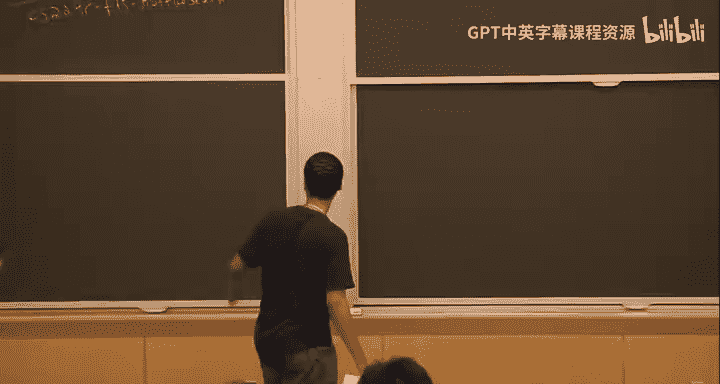

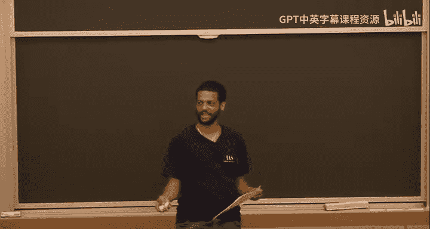

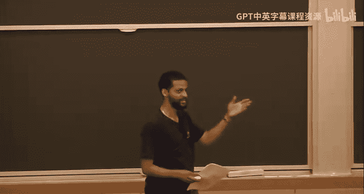

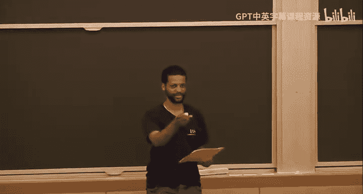

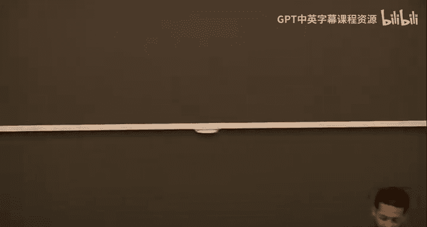

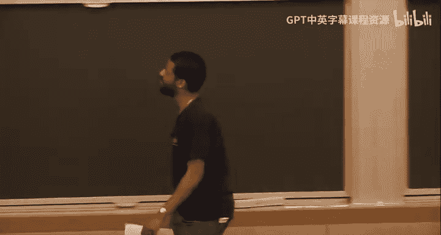

在本节课中，我们将学习大数据算法课程的基本框架，并深入探讨第一个核心算法——莫里斯近似计数算法。我们将从课程概述开始，了解大数据算法所面临的挑战和主要研究方向，然后详细分析一个经典的流式算法，该算法能以极小的空间代价近似地统计事件数量。

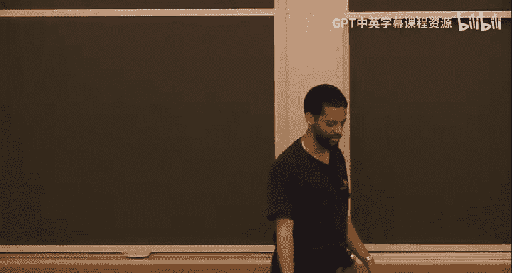

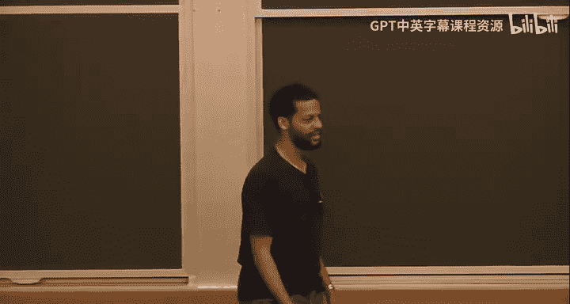

---

## 课程概述与物流信息 📋

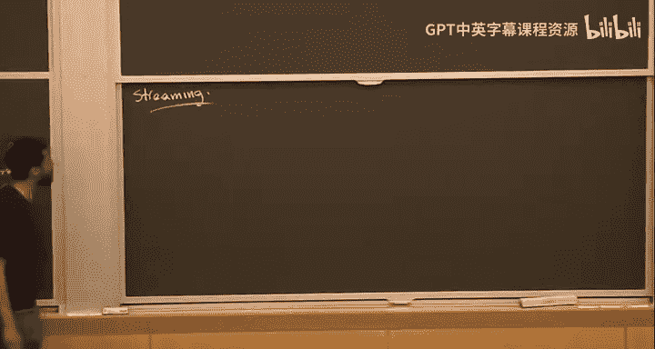

欢迎来到CS 229R《大数据算法》课程。课程网站包含了所有必要信息。请通过课程指定的邮箱地址联系我和助教Yak Yaroswab，以确保邮件能被正确分类和处理。

课程讲座将被录制，视频链接会发布在课程网站上。课程要求包括完成习题集、参与一个最终项目并进行演示。此外，每位学生都需要至少负责一次讲座笔记的记录工作。

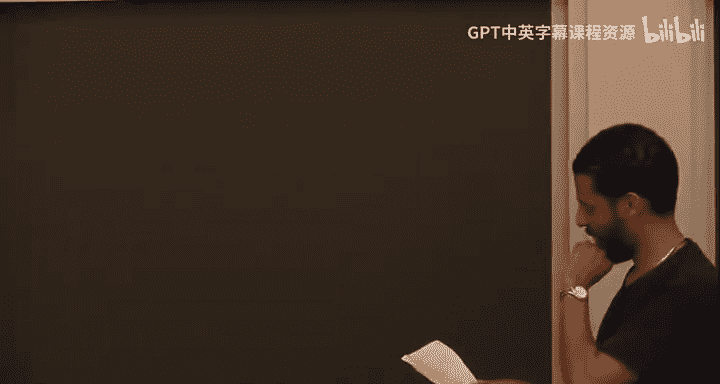

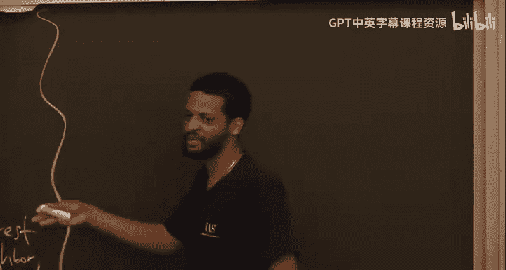

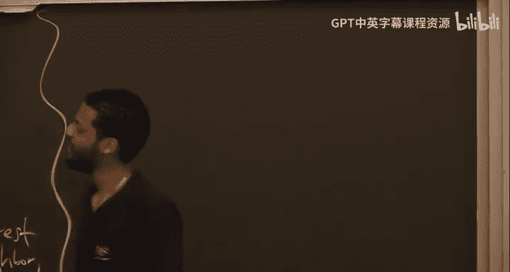

---

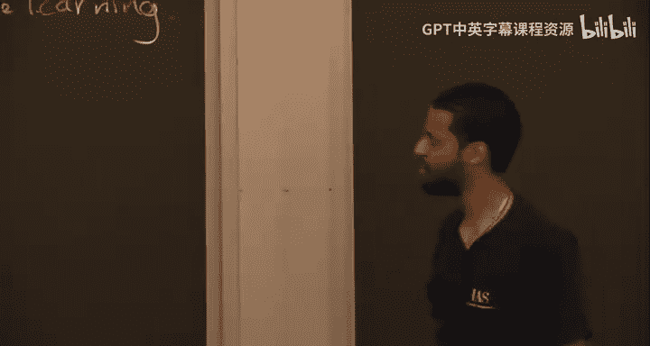

## 什么是大数据算法？ 🤔

本课程关注处理大规模数据的算法。所谓“大数据”，指的是数据规模如此之大，以至于传统的算法分析方法（例如在本科算法课程中学到的）变得不再适用。

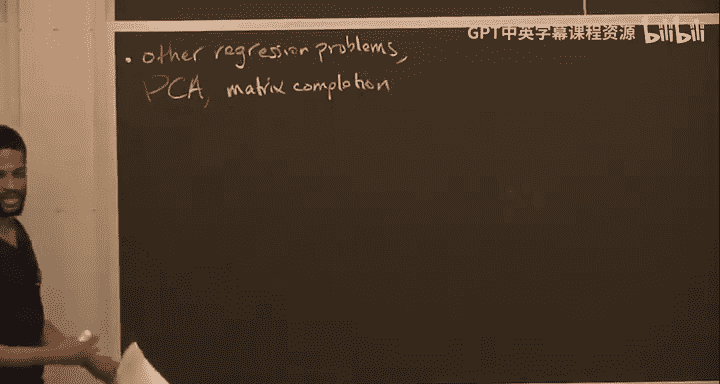

例如，数据可能大到无法完全装入内存，因此算法只能对数据进行单次扫描；或者数据虽然能存储在计算机上，但无法放入内存，必须使用磁盘，而磁盘访问速度远慢于内存。这些都是大数据算法需要解决的问题。

---

## 课程主题概览 📚

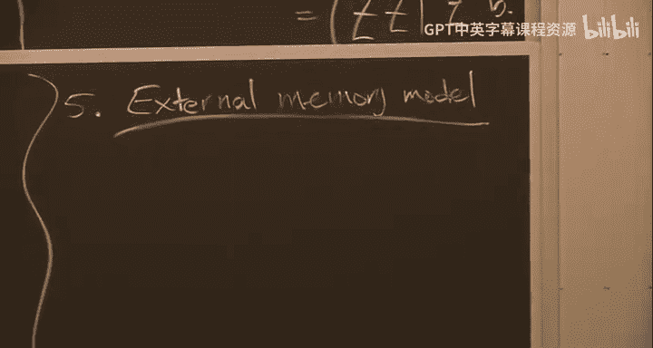

以下是本课程将涵盖的几个核心主题：

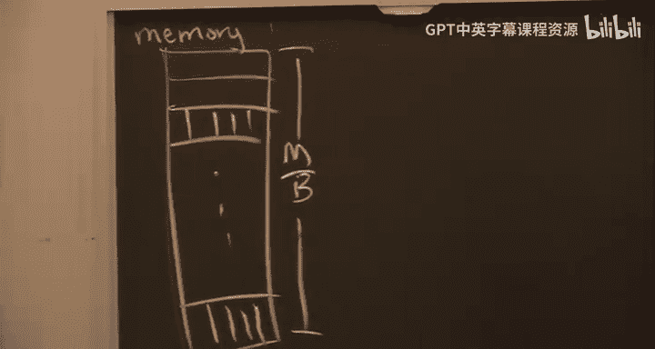

**1. 素描与流式计算**
*   **素描**：数据 `X` 的素描 `C(X)` 是关于某个函数 `F` 的一种数据压缩。其目标是仅通过访问压缩后的素描 `C(X)`（有时是 `C(X)` 和 `C(Y)`），就能计算或近似原始数据 `X` 的函数值 `F(X)`（或 `F(X, Y)`）。
*   **流式计算**：指在数据 `X` 动态更新（例如不断有数据到达）时，在线维护其素描 `C(X)` 的算法。

**2. 降维**
数据通常是高维向量。降维技术能够将数据映射到低维空间，使得在低维数据上解决计算问题后，可以将解“提升”回原始高维空间。由于算法运行时间或所需资源通常依赖于输入维度，降维可以显著加速算法，例如聚类或高维最近邻搜索。

**3. 大规模机器学习**
我们将从算法角度探讨一些大规模机器学习问题，例如如何加速求解过程。一个典型例子是**大规模线性回归**。

**线性回归公式**：
假设我们有观测数据 `(Z_i, b_i)`，满足 `b_i ≈ F(Z_i) + 噪声`。在线性回归中，`F` 是线性函数，即 `F(Z) = X · Z`。目标是找到参数向量 `X`。最小二乘回归通过最小化残差平方和来求解：
`X_ls = argmin_X ||Z * X - b||_2`
其中，矩阵 `Z` 的行是 `Z_i`，向量 `b` 的元素是 `b_i`。其闭式解为（当 `Z` 列满秩时）：
`X_ls = (Z^T Z)^{-1} Z^T b`
当数据量极大时，直接计算这个解（涉及大矩阵乘法）非常昂贵。本课程将介绍能更快获得良好近似解的技术。

**4. 压缩感知**
其核心思想是利用高维信号（如图像）在某个基（如小波基）下的**稀疏性**，通过少量线性测量来廉价地获取或压缩信号。这使得从少量测量中重建信号成为可能，应用包括JPEG图像压缩和加速MRI扫描。

**5. 外部存储模型**
在传统算法分析中，我们衡量算法效率的标准是执行指令的数量。而在外部存储模型中，我们主要衡量**磁盘I/O次数**。这是因为内存访问和磁盘随机寻道之间存在巨大的速度差异（可达六个数量级）。

该模型将磁盘视为由大小为 `B` 的块组成的无限磁带，内存则能容纳 `M` 个数据项，分为 `M/B` 个页。当要访问的数据不在内存中时，需要从磁盘读取相应块到内存（可能还需将内存中的某页写回磁盘），这计为一次I/O操作。算法的目标是最小化I/O次数。B树就是为该模型设计的数据结构。

此外，时间允许的话，我们可能还会探讨其他模型，如MapReduce。

---

## 第一个流式算法：近似计数 🧮

现在，我们开始探讨第一个流式算法：**近似计数**问题。该问题由莫里斯在20世纪70年代提出，被认为是流式算法的开创性工作之一。

**问题定义**：
有一系列事件发生。每当一个事件到达，我们需要更新计数。目标是设计一个算法，在任意时刻当被询问“发生了多少事件”时，能输出一个估计值 `N_tilde`，满足：
`P(|N_tilde - N| > εN) ≤ δ`
其中，`N` 是真实事件数，`ε` 和 `δ` 是预先给定的误差参数和失败概率。算法的核心目标是**最小化空间使用**。

**精确计数的空间下限**：
对于精确计数，只需维护一个计数器，每次事件到达时加1。如果事件数 `N` 的上限已知，存储计数器需要 `O(log N)` 比特。这是最优的，否则由鸽巢原理可知必然出错。

**近似计数的空间下限**：
对于近似计数（例如，答案允许有常数倍误差），直觉上我们只需要知道 `N` 落在哪个2的幂次区间内。区间数量为 `O(log N)`，因此区分它们只需要 `O(log log N)` 比特。这给出了一个空间下界。

### 莫里斯算法

莫里斯算法达到了 `O(log log N)` 的空间复杂度。

**算法步骤**：
1.  初始化变量 `X = 0`。
2.  对每个到达的事件，以概率 `1 / (2^X)` 将 `X` 增加1。
3.  当需要输出估计值时，返回 `N_tilde = 2^X - 1`。

**算法分析**：
我们设 `X_N` 为处理完 `N` 个事件后 `X` 的值。

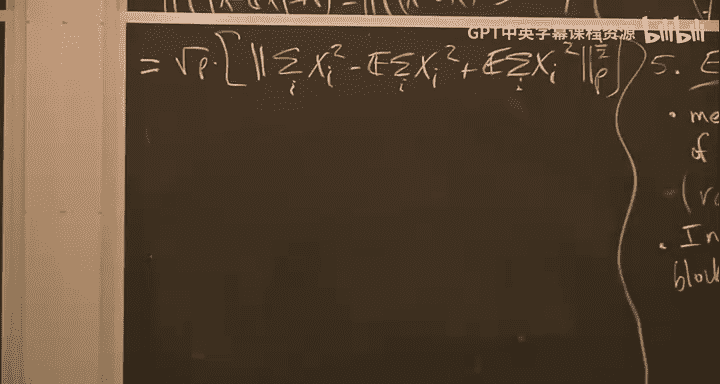

**引理1：期望的正确性**
`E[2^{X_N}] = N + 1`
**证明**（归纳法）：
*   基础情况：`N=0` 时，`X=0`，`2^0 = 1 = 0+1`，成立。
*   归纳步骤：假设对 `N` 成立，即 `E[2^{X_N}] = N+1`。考虑第 `N+1` 个事件。当 `X_N = j` 时，`X_{N+1}` 有两种可能：
    *   以概率 `1 - 1/(2^j)` 保持为 `j`，此时 `2^{X_{N+1}} = 2^j`。
    *   以概率 `1/(2^j)` 增加为 `j+1`，此时 `2^{X_{N+1}} = 2^{j+1}`。
    因此，条件期望 `E[2^{X_{N+1}} | X_N = j] = 2^j * (1 - 1/(2^j)) + 2^{j+1} * (1/(2^j)) = 2^j + 1`。
    对 `j` 求期望，`E[2^{X_{N+1}}] = E[2^{X_N}] + 1 = (N+1) + 1 = N+2`。归纳成立。

**引理2：二阶矩分析**
通过类似的归纳法可以证明（详细步骤见课程笔记）：
`E[2^{2 X_N}] = (3/2) N^2 + (3/2) N + 1`
由此可以推导出估计值的方差：
`E[(N_tilde - N)^2] = E[(2^{X_N} - 1 - N)^2] ≤ (1/2) N^2`

**应用切比雪夫不等式**：
根据切比雪夫不等式：
`P(|N_tilde - N| > εN) ≤ Var(N_tilde) / (ε^2 N^2) ≤ (1/2) / ε^2`
这意味着失败概率有一个常数上界（例如，当 `ε=1` 时，失败概率不超过 `1/2`）。

### 改进算法：Morris+ 和 Morris++

为了得到任意小的误差 `ε` 和失败概率 `δ`，我们可以对基础算法进行增强。

**Morris+ 算法**：
1.  并行运行 `s` 个独立的莫里斯算法实例。
2.  输出这 `s` 个实例估计值的平均值。
由于方差可加，求平均后估计值的方差减小为原来的 `1/s`。因此，失败概率变为 `O(1/(s ε^2))`。要使得失败概率小于 `δ`，需要设置 `s = O(1/(ε^2 δ))`。空间复杂度为 `O(s * log log N)`。

**Morris++ 算法**：
1.  运行 `t` 个独立的 Morris+ 实例，每个实例配置其失败概率为常数（例如 `1/3`）。
2.  输出这 `t` 个 Morris+ 实例估计值的**中位数**。
中位数估计器失败，意味着超过一半的 Morris+ 实例失败。每个 Morris+ 实例失败概率为常数（如 `1/3`）。利用切尔诺夫不等式可以证明，当 `t = O(log(1/δ))` 时，整体失败概率可降至 `δ`。因此，总空间复杂度为 `O( (log(1/δ))/ε^2 * log log N )`。

这种“先取平均，再取中位数”的方法是一种通用技巧，可以将一个较弱的估计器增强为高概率成功的强估计器。

---

## 总结 ✨

本节课中，我们一起学习了大数据算法课程的总体框架，明确了处理海量数据时在内存、I/O等方面面临的独特挑战。我们深入探讨了第一个流式算法——莫里斯近似计数算法。该算法巧妙地利用随机性，仅用 `O(log log N)` 比特的空间就能对事件数量进行近似统计。通过分析其期望和方差，并运用切比雪夫不等式，我们理解了其理论保证。进一步，我们看到了如何通过“并行求平均”和“取中位数”的增强技巧（Morris+, Morris++），将算法推广到满足任意精度 `ε` 和置信度 `δ` 的要求。这为我们后续学习更复杂的素描与流式算法奠定了坚实的基础。