# 哈佛大学《大数据算法》课程笔记 - 第2讲：流式算法与不同元素问题 🧮

在本节课中，我们将继续学习流式算法，并重点探讨一个经典问题——不同元素问题。我们将从理想化的算法开始，逐步将其转化为实际可实现的版本，并分析其空间复杂度。

---

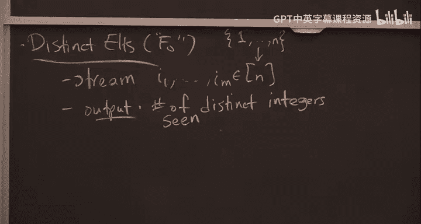

## 回顾与引言

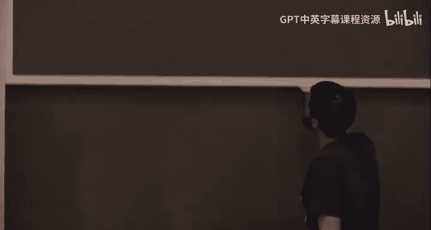

上一讲我们介绍了近似计数算法，即莫里斯算法。该算法提供了一个无偏估计器，并通过取多个估计器的平均值（Morris+）以及这些平均值的**中位数**（Morris++）来获得高概率下的良好近似。这种“先平均，再取中位数”的思想在流式算法设计中非常常见。

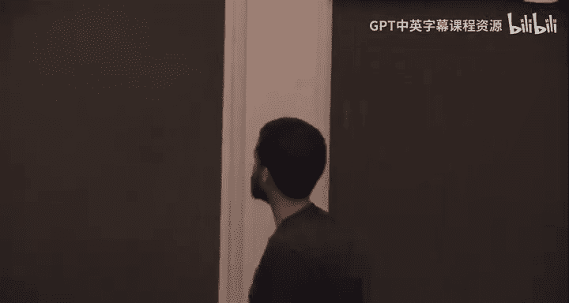

本节课我们将应用类似的思想，来研究另一个极端问题：不同元素问题。

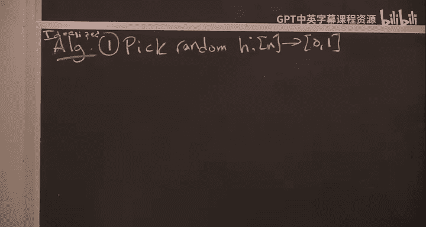

---

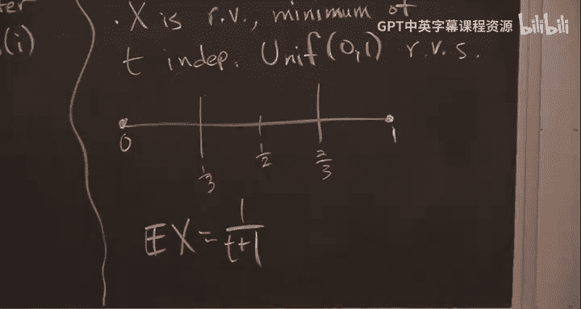

## 不同元素问题（F0问题）🔍

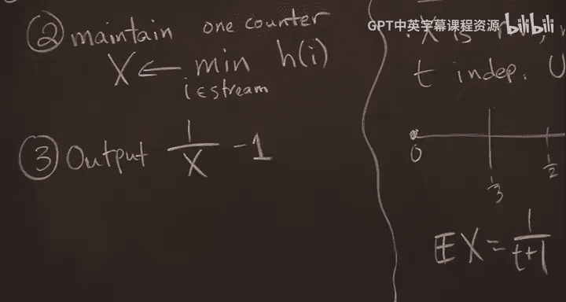

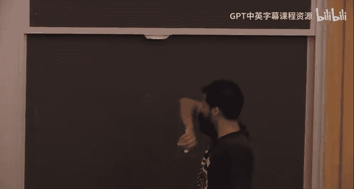

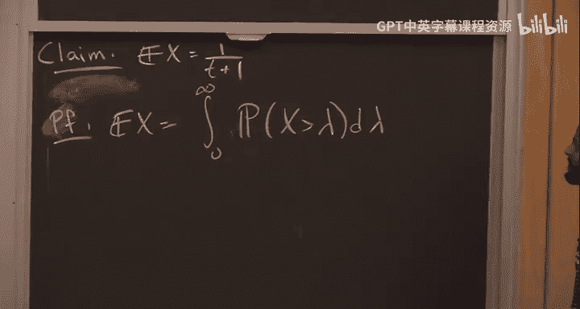

### 问题定义
我们观察一个由整数组成的流，每个更新是一个介于1到n之间的数字。算法的目标是输出流中**不同整数的数量**。

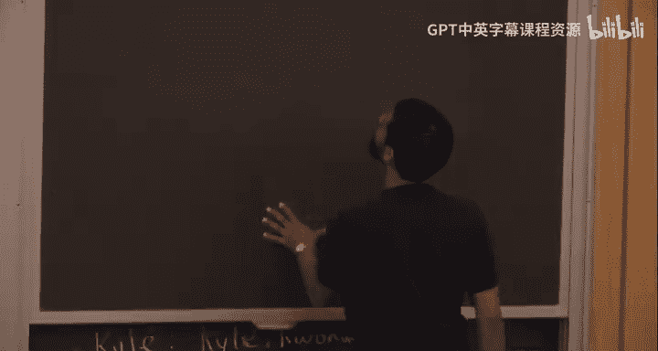

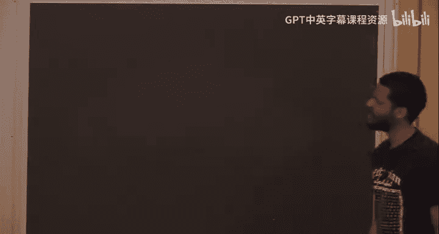

我们用 `T` 表示真实的答案。与之前一样，我们的目标是最小化空间消耗。

### 两种简单算法
以下是两种直接的解决方案：

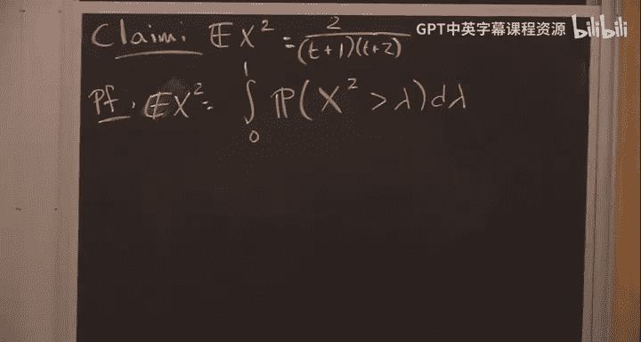

1.  **位数组法**：维护一个长度为 `n` 的位数组。当看到整数 `i` 时，将第 `i` 位设为1。最后，统计数组中1的个数。空间复杂度为 `O(n)` 比特。
2.  **存储列表法**：直接存储所有出现过的数字。如果流长度为 `M`，每个数字需要 `log n` 比特存储，总空间为 `O(M log n)` 比特。

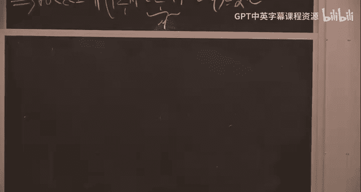

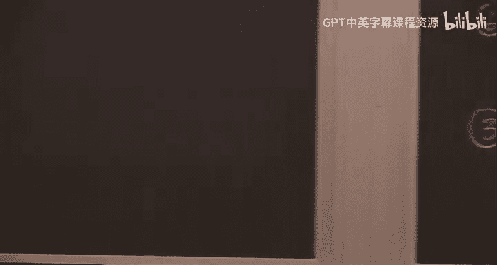

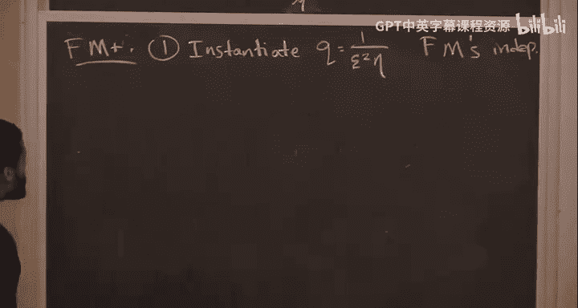

因此，精确解的空间复杂度至少为 `min(n, M log n)`。然而，我们将允许算法输出一个**随机化的近似解**。

### 近似目标
我们希望算法输出一个估计值 `T̃`，使得以下不等式以高概率成立：
`Pr[ |T - T̃| > εT ] ≤ δ`

其中 `ε` 是近似参数，`δ` 是失败概率。

---

## 理想化算法：Flajolet-Martin 算法

首先，我们介绍一个由 Flajolet 和 Martin 在1983年提出的理想化算法。该算法是后续实际算法的基础。

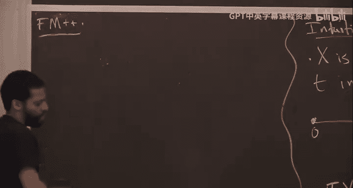

### 算法步骤
1.  **选取哈希函数**：随机选取一个哈希函数 `h`，将输入域 `[1, n]` 映射到连续区间 `[0, 1]`。
2.  **维护最小值**：在内存中仅维护一个数字 `X`，它是所有看到的 `h(i)` 的最小值。
3.  **输出估计**：处理完流后，输出 `(1/X) - 1`。

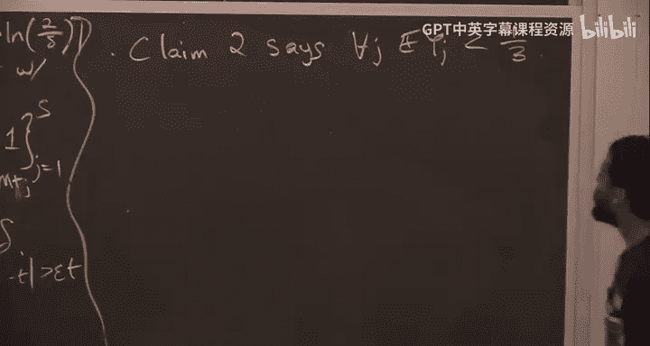

### 算法原理与期望
`X` 实际上是 `T` 个独立均匀分布于 `[0,1]` 的随机变量的最小值。直觉上，`T` 个随机点均匀分布在 `[0,1]` 区间，第一个点的期望位置大约是 `1/(T+1)`。

**证明期望**：
`E[X] = ∫₀¹ (1-λ)^T dλ = 1/(T+1)`

因此，`1/X` 的期望大约是 `T+1`，我们的估计器 `(1/X)-1` 的期望大约是 `T`。

### 方差分析
为了应用切比雪夫不等式，我们还需要知道 `X` 的方差。经过计算可得：
`Var(X) ≤ 1/(T+1)^2`

这意味着方差随着 `T` 增大而减小，是一个良好的性质。

---

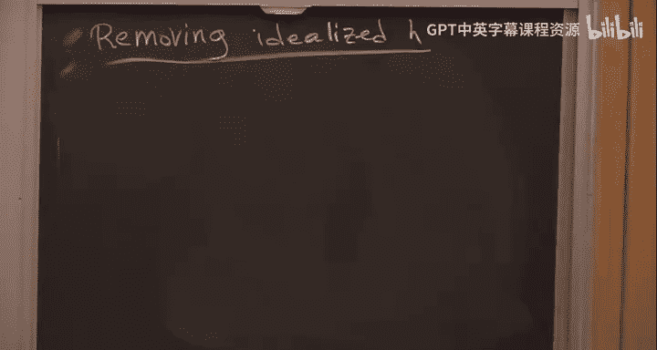

## 从理想到现实：改进算法

上述理想化算法存在两个问题：
1.  存储一个完全随机的哈希函数 `h` 需要 `O(n)` 空间。
2.  算法操作的是实数，而计算机只有有限精度。

接下来，我们通过“平均”和“取中位数”的技巧来改进算法，并最终解决哈希函数的存储问题。

### FM+ 算法：通过平均降低方差
我们独立运行 `Q = 1/(ε²η)` 个上述理想化算法实例。设第 `i` 个实例维护的最小值为 `X_i`。

**FM+ 算法输出**：`(1 / ( (1/Q) * Σ X_i )) - 1`

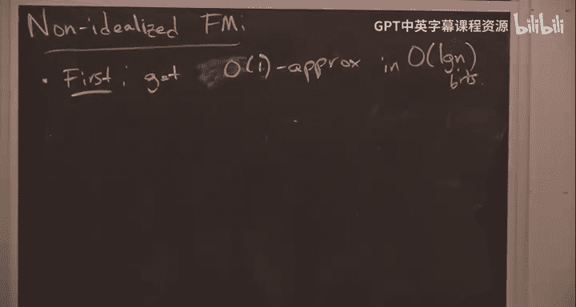

**分析**：
*   **期望**：由于线性性，平均值 `(1/Q) Σ X_i` 的期望仍然是 `1/(T+1)`。
*   **方差**：独立随机变量和的方差等于方差之和。平均值后的方差变为原来的 `1/Q`，即 `Var_avg ≤ (1/(T+1)^2) / Q`。

应用切比雪夫不等式，可以证明估计值以至少 `1-η` 的概率满足 `(1-ε)T ≤ T̃ ≤ (1+ε)T`。

### FM++ 算法：通过中位数提升成功概率
FM+ 算法以常数概率（例如 `η=1/3`）给出好估计。为了将成功概率提升到 `1-δ`，我们采用取中位数的方法。

**FM++ 算法步骤**：
1.  独立实例化 `S = O(log(1/δ))` 个 FM+ 算法（每个设置 `η=1/3`）。
2.  输出这 `S` 个估计值的中位数。

**分析**：
定义指示变量 `Y_j`，当第 `j` 个 FM+ 实例失败（估计误差过大）时为1，否则为0。`E[Y_j] ≤ 1/3`。
中位数失败意味着超过一半的实例失败，即 `Σ Y_j > S/2`。这要求 `Σ Y_j` 显著偏离其期望 `≤ S/3`。利用切尔诺夫界可以证明，当 `S = O(log(1/δ))` 时，失败概率被限制在 `δ` 以内。

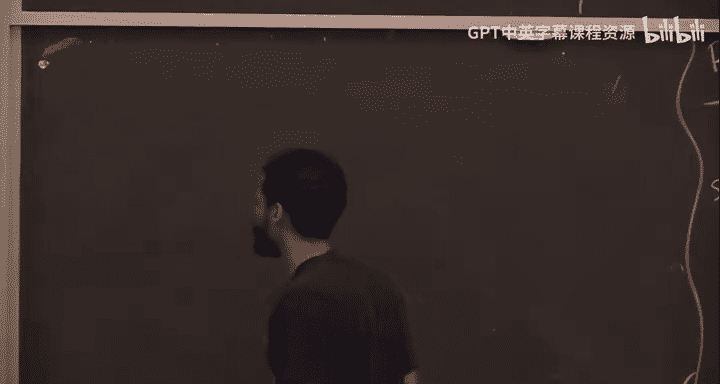

**最终空间复杂度（忽略哈希函数存储）**：`O( (1/ε²) * log(1/δ) )`

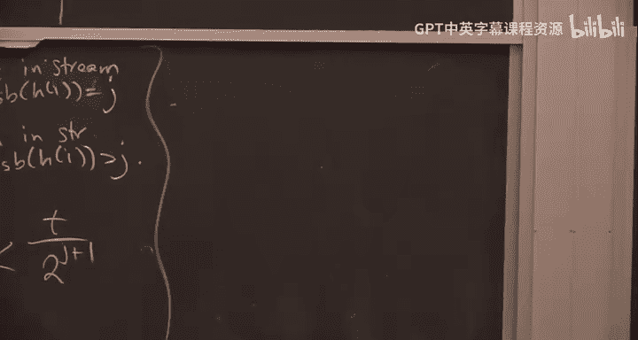

---

## 实现真正的有限空间：哈希函数与层次化算法

现在，我们解决哈希函数的存储问题，并给出一个实际可实现的算法。

### 有限独立哈希函数族
我们无法存储完全随机的函数。替代方案是使用 `k` 阶独立哈希函数族。一个关键的例子是低阶多项式哈希：
*   **构造**：对于素数 `p`，所有次数小于 `k` 的多项式构成一个哈希函数族。
*   **性质**：该族是 `k` 阶独立的。存储这样一个函数只需要存储 `k` 个系数，即 `O(k log p)` 比特。当 `k=2`（两两独立）时，仅需 `O(log p)` 比特。

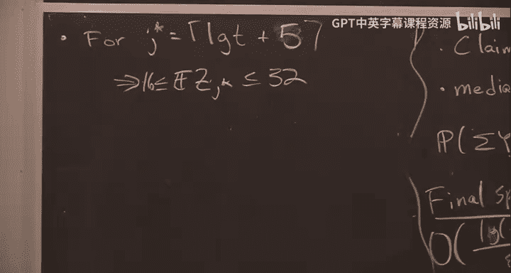

### 一个常数因子近似算法
我们首先设计一个空间为 `O(log n)` 比特的算法，它能以高概率给出 `T` 的常数因子近似。

**算法思路**：
1.  选取一个两两独立的哈希函数 `h`，将 `[1, n]` 映射到 `[1, n]`（假设 `n` 是2的幂）。
2.  维护一个变量 `X`，它是流中所有元素 `h(i)` 的**最低有效非零位索引**的最大值（例如，`h(i)=...001000`，则最低有效非零位索引是3）。
3.  输出 `2^X`。

**直观理解**：
对于一个特定的 `i`，`h(i)` 的最低有效非零位索引为 `j` 的概率约为 `1/2^(j+1)`。因此，期望有 `T/2^(j+1)` 个元素的哈希值最低有效非零位索引为 `j`。当 `j ≈ log₂ T` 时，期望数量约为常数。算法记录的 `X` 大致就在 `log₂ T` 附近，因此 `2^X` 是 `T` 的常数因子近似。通过方差分析（利用两两独立性）和切尔诺夫/马尔可夫不等式，可以严格证明这一点。

### 提升到 (1+ε) 近似：层次化算法
为了得到更精确的 `(1+ε)` 近似，我们采用层次化（分桶）的思想。

**算法框架**：
1.  并行运行多个“基础估计器”，每个负责一个“层次”。
2.  每个层次 `j` 对应一个两两独立的哈希函数 `g_j`，它将元素哈希到两个桶之一（模拟最低有效位为 `j` 的判断）。
3.  对于层次 `j`，我们运行一个**简易求解器**，它只精确记录前 `C/ε²` 个映射到该桶的**不同元素**。如果不同元素数量超过此阈值，求解器只输出阈值。
4.  同时，运行前述的常数因子近似算法，以确定一个层次 `j*`，使得期望映射到该桶的元素数量 `E ≈ 1/ε²`。
5.  最终，输出 `2^(j*+1) * (层次 j* 上简易求解器的输出)`。

**为何有效**：
*   在选定的层次 `j*`，期望有 `Θ(1/ε²)` 个不同元素被映射过来。由于两两独立性，实际数量将高度集中在期望值附近（切比雪夫不等式），相对误差约为 `ε`。
*   简易求解器在该层次上能精确计数（因为数量级约为 `1/ε²`，未超过其容量）。
*   常数因子近似算法确保了我们能找到这样一个合适的层次 `j*`。

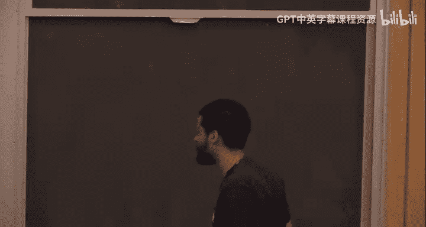

**最终空间复杂度**：
*   常数因子近似算法：`O(log n)` 比特。
*   哈希函数族：`O(log n)` 比特。
*   简易求解器：共 `O(log n)` 个，每个使用 `O((1/ε²) log n)` 比特。
*   **总计**：`O((1/ε²) log² n)` 比特。

**最优性**：已知存在算法可以达到 `O((1/ε²) + log n)` 比特的空间，并且这已被证明是最优的。

---

## 总结与下节预告

本节课我们一起深入学习了不同元素问题（F0问题）的流式算法解决方案：

1.  我们从 **Flajolet-Martin 理想化算法** 出发，理解了其基于最小哈希值的核心思想。
2.  通过 **FM+**（平均）和 **FM++**（中位数）技术，我们将算法转化为具有高成功概率的实用随机近似算法。
3.  我们探讨了 **有限独立哈希函数族**（特别是两两独立族）如何用少量空间模拟完全随机函数，从而解决了理想算法中哈希函数存储开销大的问题。
4.  最后，我们介绍了一个 **层次化算法**，通过并行运行多个不同精度的估计器并结合一个常数因子近似器作为“指导”，最终实现了空间复杂度为 `O((1/ε²) log² n)` 的非理想化、可实现的 `(1+ε)` 近似算法。

在下一讲中，我们将探讨该问题的下界，即证明如果不允许随机化或近似，任何算法都无法在小于 `min(n, M log n)` 的空间内解决此问题。我们还将简要介绍另一个流式算法问题——巨大偏差问题。