# 3：下界与转盘模型 🧮

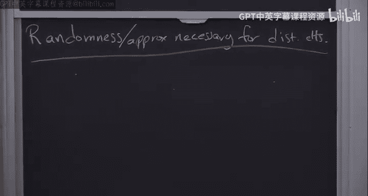

在本节课中，我们将要学习大数据流算法中的两个核心概念：**下界证明**与**转盘模型**。我们将首先探讨为什么对于“不同元素计数”问题，随机化和近似是必不可少的。接着，我们将转向一个更通用的流模型——转盘模型，并学习一种强大的算法设计技术：**线性草图**。

---

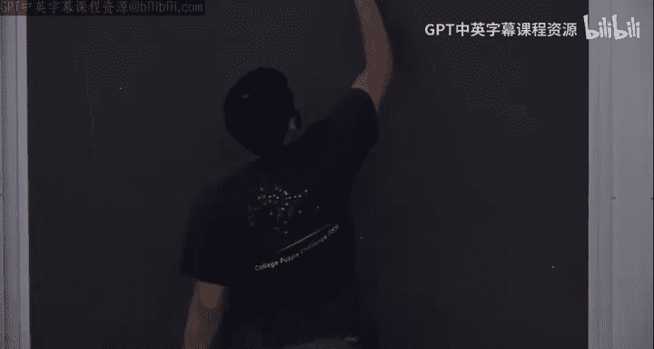

## 下界：为什么我们需要随机化和近似？ 🚫

上一节我们介绍了用于不同元素计数的Flajolet-Martin算法及其变种。该算法使用了随机化和近似。你可能会问，我们能否放松这些要求？例如，设计一个确定性的精确算法？或者一个确定性的近似算法？又或者一个随机化的精确算法？本节中，我们将通过下界证明来展示，对于“不同元素计数”问题，**随机化和近似两者都是必需的**。

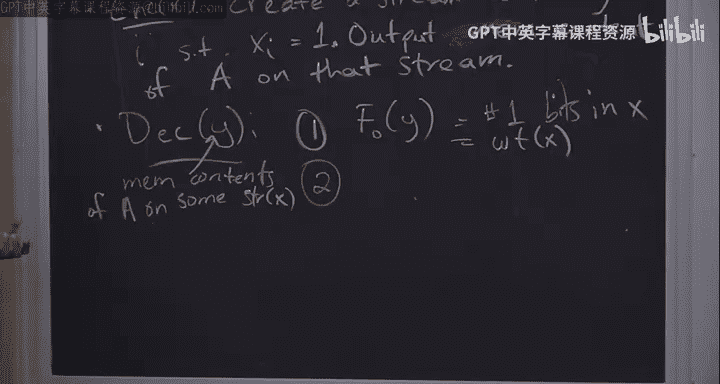

### 确定性精确算法需要线性空间

**核心概念**：任何使用空间少于 `n` 比特的确定性精确算法都是不存在的。

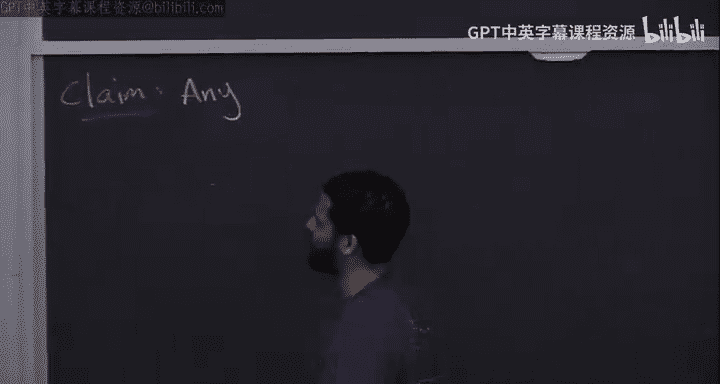

**证明思路**：我们通过构造一个压缩方案来证明。假设存在一个空间为 `S` 比特的确定性精确算法 `A`。我们可以利用 `A` 来编码任意一个 `n` 比特的向量 `x`。

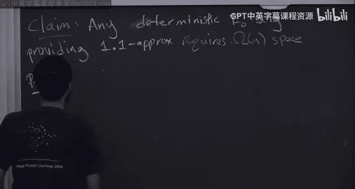

1.  **编码**：根据向量 `x` 创建一个流。对于 `x` 中每一个为 `1` 的位 `i`，将元素 `i` 加入流中。然后运行算法 `A` 处理这个流，并将其最终的内存状态（`S` 比特）作为 `x` 的编码。
2.  **解码**：给定编码（即 `A` 的内存状态），解码器可以通过“询问”算法 `A` 来逐位恢复 `x`。对于每一位 `i`，解码器将 `i` 追加到当前流中，然后查询 `A` 得到的不同元素计数。如果计数不变，则 `x_i = 1`；如果计数增加，则 `x_i = 0`。

由于这是一个从所有 `2^n` 个可能的 `n` 比特向量到 `S` 比特字符串的**单射**，根据鸽巢原理，必须有 `S ≥ n`。因此，任何确定性精确算法都需要至少 `n` 比特的线性空间。

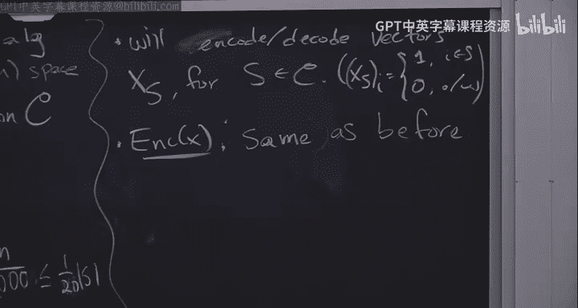

### 确定性近似算法也需要线性空间

**核心概念**：即使允许近似（例如 `(1 ± 0.1)` 近似），任何确定性算法仍然需要 `Ω(n)` 比特的空间。

**证明思路**：我们同样通过编码论证，但需要构造一个特殊的向量集合 `C`。这个集合满足：
*   所有向量中 `1` 的数量（权重）相同，例如 `n/100`。
*   集合 `C` 的大小是指数级的（例如 `2^{cn}`）。
*   集合中任意两个不同向量的交集很小（例如最多 `n/1000`）。

如果我们有一个空间为 `S` 的确定性 `(1±0.1)` 近似算法 `A`，我们可以用它来编码集合 `C` 中的向量。

1.  **编码**：与之前类似，用向量 `x_S ∈ C` 创建流，并存储 `A` 处理后的内存状态。
2.  **解码**：解码器遍历集合 `C` 中的每一个候选向量 `x_S‘`。它将 `x_S‘` 对应的流追加到当前状态，然后查询 `A`。
    *   如果 `x_S‘` 是正确的原始向量，那么追加后不同元素数量不变（仍为 `n/100`），`A` 的输出将接近 `n/100`。
    *   如果 `x_S‘` 是错误的，由于两个向量交集很小，追加后不同元素数量会接近 `n/50`，`A` 的输出将接近 `n/50`。
    解码器可以通过 `A` 的输出区分这两种情况，从而找到正确的原始向量。

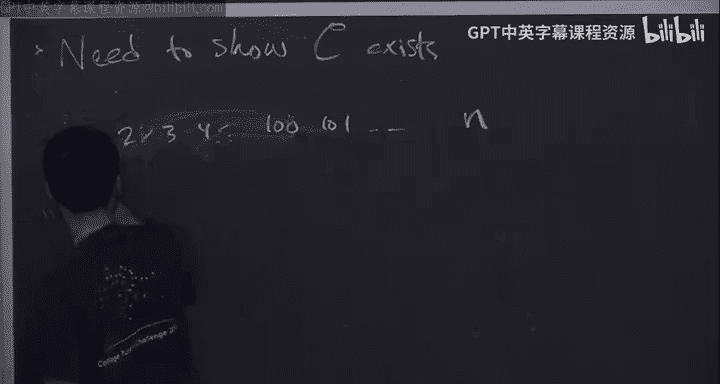

这同样定义了一个从大小为 `|C| = 2^{cn}` 的集合到 `S` 比特字符串的单射，因此 `S ≥ cn`，即空间是线性的。

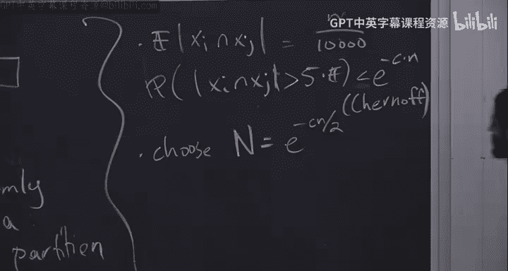

**集合 `C` 的存在性**：可以通过概率方法证明。随机选择大量大小为 `n/100` 的子集，利用切尔诺夫边界论证，可以证明存在一个满足上述条件的指数级大集合。

### 随机化精确算法也需要线性空间

这个问题将作为习题（PSet 1），其证明思路与上述类似，同样需要利用那个特殊的向量集合 `C`。

**总结**：对于不同元素计数问题，要获得亚线性空间（即 `o(n)` 空间）的算法，我们必须同时接受**随机化**和**近似**。这是该问题内在的复杂性所决定的。

---

## 转盘模型与线性草图 🌀

现在，让我们转向另一种更通用的流处理模型。到目前为止，我们看到的算法都属于“仅插入”模型。但是，如果流中允许删除操作呢？

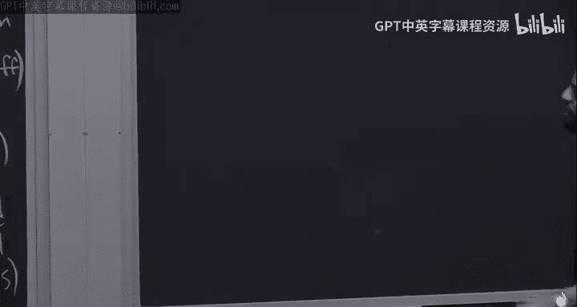

### 什么是转盘模型？

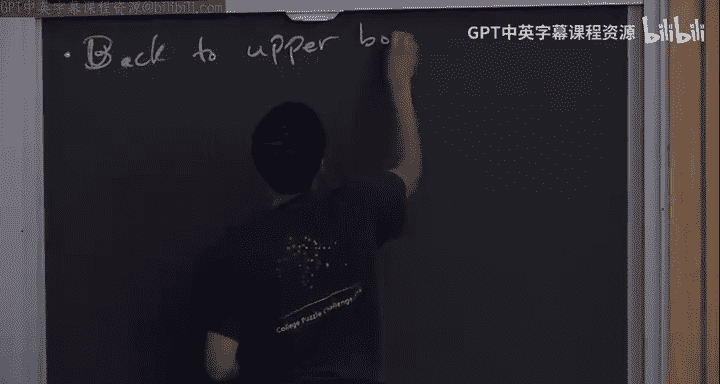

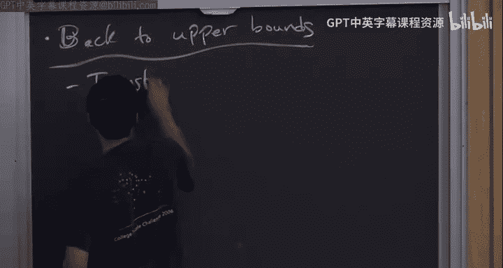

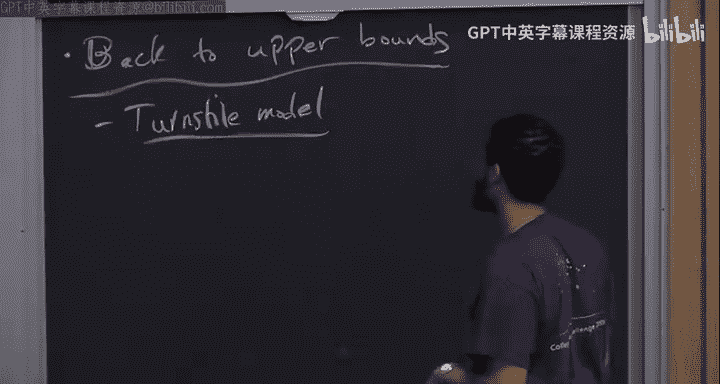

在转盘模型中，我们维护一个初始为零的 `n` 维向量 `x`。流是一系列更新操作 `(i, Δ)`，表示 `x_i ← x_i + Δ`，其中 `Δ` 可以是正数（插入）或负数（删除）。我们的目标是计算或近似向量 `x` 的某个函数 `f(x)`，同时使用远小于存储整个向量 `x`（需要 `O(n)` 空间）的内存。

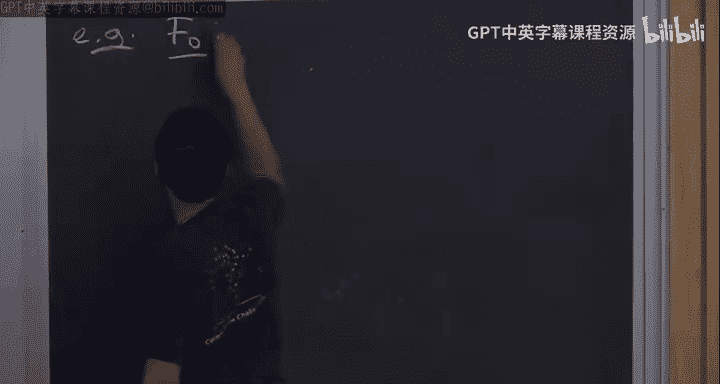

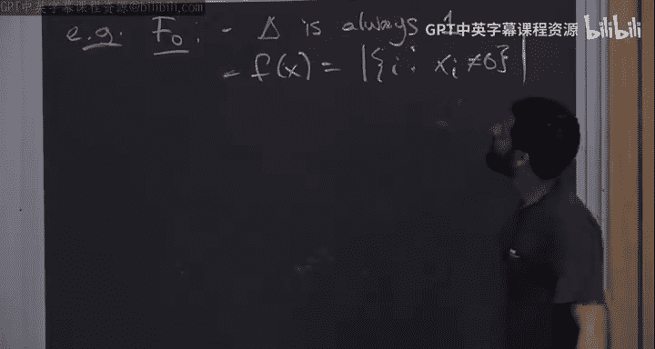

**例子**：当所有 `Δ = 1` 时，`f(x) = F0`（非零坐标的数量）就是带删除的不同元素计数问题。

### 核心算法技术：线性草图

设计转盘模型算法的主要（通常是唯一）技术是**线性草图**。

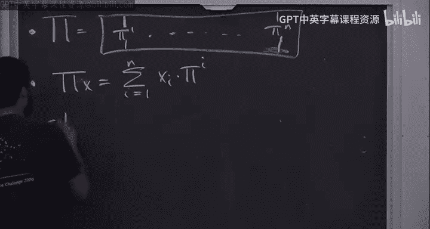

**核心概念**：算法在内存中维护一个“草图”向量 `y`，它是原始向量 `x` 的一个线性变换：`y = Πx`。其中 `Π` 是一个 `m × n` 的矩阵（`m << n`）。

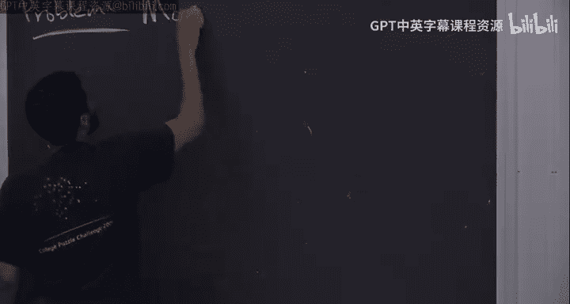

**处理更新**：当收到更新 `(i, Δ)` 时，新的向量 `x’ = x + Δ * e_i`（`e_i` 是第 `i` 个标准基向量）。因此，新的草图 `y’ = Πx’ = Πx + Δ * Π_i`，其中 `Π_i` 是矩阵 `Π` 的第 `i` 列。这意味着更新草图 `y` 只需要加上 `Δ` 乘以第 `i` 列即可。关键在于，我们不需要显式存储巨大的矩阵 `Π`，而只需能够高效生成其任意一列（例如，通过哈希函数指定）。

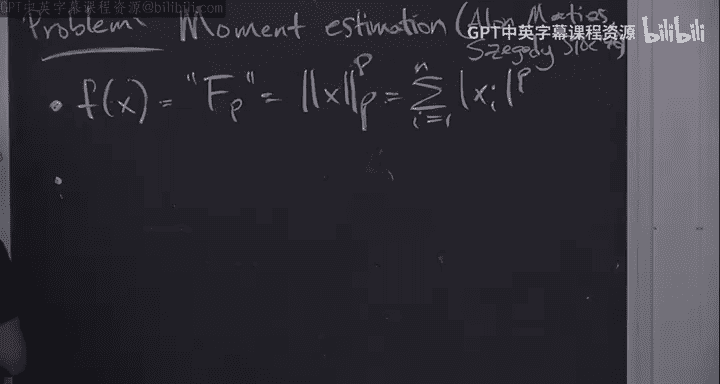

---

## 矩估计问题 📊

现在，我们在线性草图的框架下看一个具体问题：**矩估计**。我们希望估计向量 `x` 的 `L_p` 范数的 `p` 次方，即 `F_p = Σ_i |x_i|^p`。当 `p=0` 时（定义 `0^0=0`），`F_0` 就是不同元素计数。

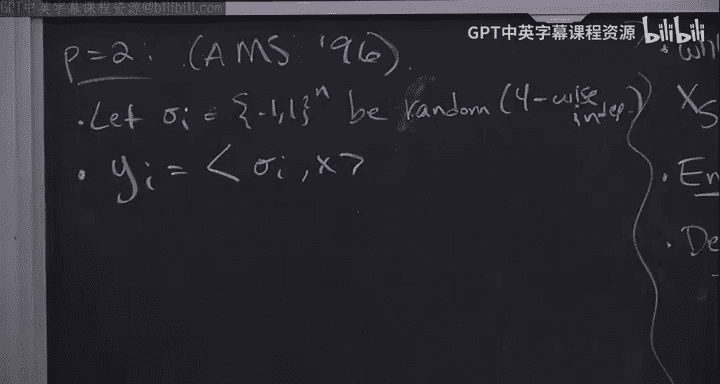

这个问题有一个有趣的复杂度相变：
*   当 `0 ≤ p ≤ 2` 时，存在空间复杂度为 `O(ε^{-2} log n)` 的 `(1±ε)` 近似算法。
*   当 `p > 2` 时，任何常数因子近似算法都需要 `Ω(n^{1 - 2/p})` 的空间，并且存在匹配此下界的算法。

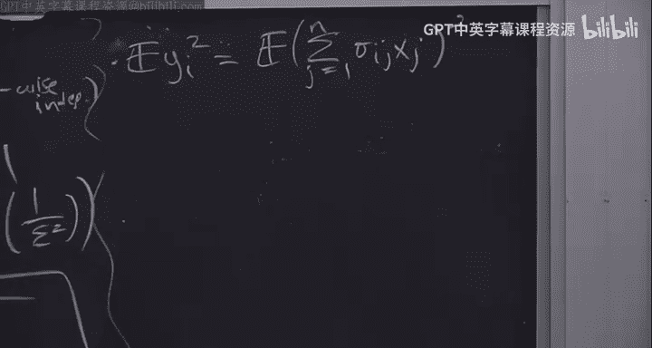

### `p=2` 时的算法：AMS草图

我们首先看 `p=2` 的情况，即估计 `F_2 = Σ_i x_i^2`（`L_2` 范数的平方）。算法由Alon、Matias和Szegedy在1996年提出。

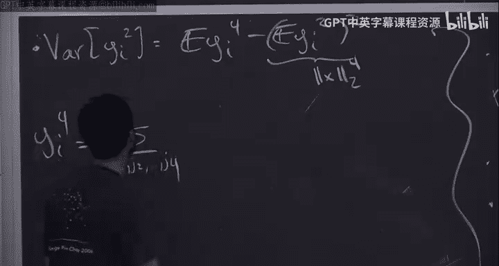

**算法描述**：
1.  选择一个 `m × n` 的矩阵 `Π`，其每一行 `σ_i` 是一个从 `{1, ..., n}` 到 `{-1, +1}` 的4-wise独立哈希函数。我们可以用 `O(log n)` 比特存储整个 `Π`。
2.  维护草图 `y = Πx`，其中 `y_i = σ_i · x`（点积）。
3.  当需要估计时，输出 `(1/m) * Σ_{i=1}^m y_i^2`。

**工作原理**：
*   **期望**：`E[y_i^2] = F_2`。因为 `E[σ_{i,j}^2] = 1`，且对于 `j ≠ j‘`，由于2-wise独立性，`E[σ_{i,j} σ_{i,j‘}] = 0`。
*   **方差**：利用4-wise独立性，可以计算得到 `Var[y_i^2] ≤ 2 * F_2^2`。
*   通过设置 `m = O(1/ε^2)` 并取平均值，再利用切比雪夫不等式，我们可以得到一个 `(1±ε)` 近似估计。为了进一步提高成功概率，可以取多个估计值的中位数。

这个算法是线性草图的一个完美例子：更新高效，且空间复杂度为 `O(ε^{-2} log n)`。

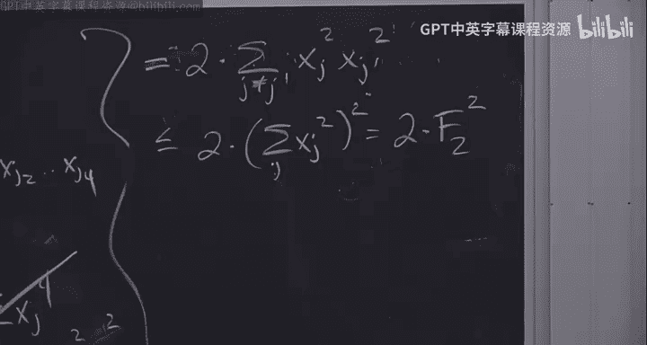

---

## 扩展到 `0 < p ≤ 2`：Indyk算法 🧪

对于更一般的 `p`（`0 < p ≤ 2`），我们可以使用Indyk提出的算法。该算法的核心依赖于一类称为 **`p`-稳定分布** 的概率分布。

**`p`-稳定分布的定义**：一个分布 `D` 是 `p`-稳定的，如果对于任意向量 `x ∈ R^n` 和独立同分布于 `D` 的随机变量 `Z_1, ..., Z_n`，随机变量 `Σ_i x_i Z_i` 的分布与 `(Σ_i |x_i|^p)^{1/p} * Z` 相同，其中 `Z` 也服从分布 `D`。换句话说，线性组合的分布是 `x` 的 `L_p` 范数乘以一个同分布的随机变量。

**例子**：
*   `p=2`：高斯分布是2-稳定的。
*   `p=1`：柯西分布是1-稳定的。

一个关键定理（Levy, 1920s）指出：`p`-稳定分布**当且仅当** `0 < p ≤ 2` 时存在。对于 `p > 2`，不存在这样的分布。这从算法角度解释了为什么 `p > 2` 时问题的复杂度会剧增。

**理想化算法（假设无限精度和真正的 `p`-稳定分布）**：
1.  设矩阵 `Π` 的每一行 `Z_i` 是一个独立同分布的 `p`-稳定随机向量。
2.  维护草图 `y = Πx`，其中 `y_i = Z_i · x`。
3.  估计时，输出 `median(|y_1|, |y_2|, ..., |y_m|)`。这里我们假设所使用的 `p`-稳定分布 `D_p` 满足 `P_{Z~D_p}(|Z| ∈ [1-ε, 1+ε])` 是一个常数（可通过缩放实现）。

**分析思路（下节课详述）**：可以证明，每个 `|y_i|` 是 `||x||_p` 的一个常数因子近似估计器，并且具有常数概率。通过取 `m = O(1/ε^2)` 个这样的估计值并计算它们的中位数，我们可以得到一个 `(1±ε)` 近似估计。在实际实现中，我们需要处理有限精度问题，并用有限独立哈希函数来模拟 `p`-稳定分布的采样。

---

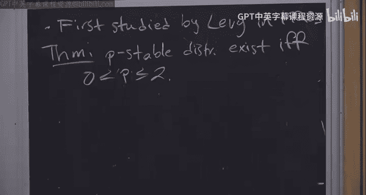

## 总结 🎯

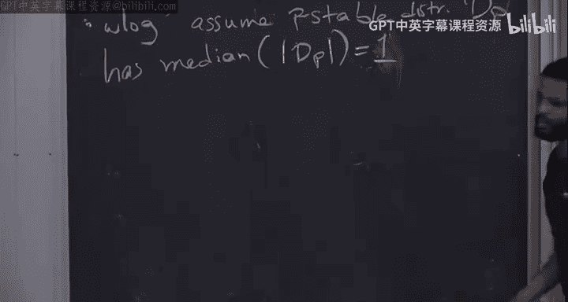

本节课中我们一起学习了：
1.  **下界证明**：通过巧妙的编码论证，我们证明了对于不同元素计数（`F_0`）问题，任何使用亚线性空间的算法都必须同时是**随机化**和**近似**的。确定性精确、确定性近似、随机化精确的算法都需要线性空间。
2.  **转盘模型**：一个允许插入和删除操作的通用流模型。
3.  **线性草图**：解决转盘模型问题的核心技术，通过维护一个原始向量的低维线性投影 `y = Πx` 来工作。
4.  **矩估计 `F_p`**：
    *   介绍了 `p=2` 时高效的AMS草图算法。
    *   概述了 `0 < p ≤ 2` 时基于 `p`-稳定分布的Indyk算法框架，并指出了 `p > 2` 时复杂度会发生相变的理论原因（`p`-稳定分布不存在）。

下一节课，我们将深入分析Indyk算法，并探讨 `p > 2` 时的情况，然后继续研究更多的流计算问题。