# 哈佛大学《大数据算法》课程笔记 - P4：Lp范数估计（下）与Nisan伪随机生成器 🧮


在本节课中，我们将继续学习用于估计数据流中向量Lp范数的算法。我们将首先完成对Indyk算法的分析，然后探讨如何利用Nisan的伪随机生成器来减少算法所需的随机比特数。最后，我们将简要介绍一种适用于p>2情况的Lp范数估计算法。

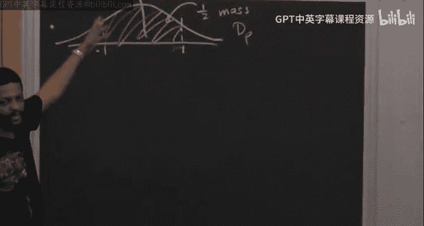

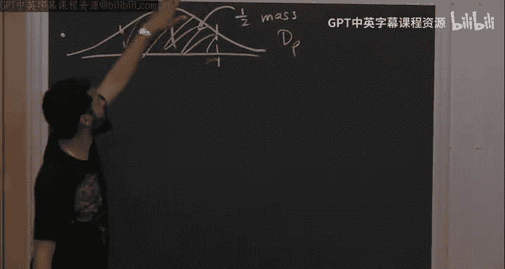


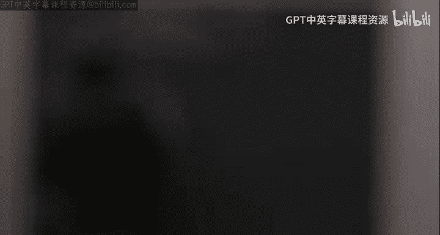

---

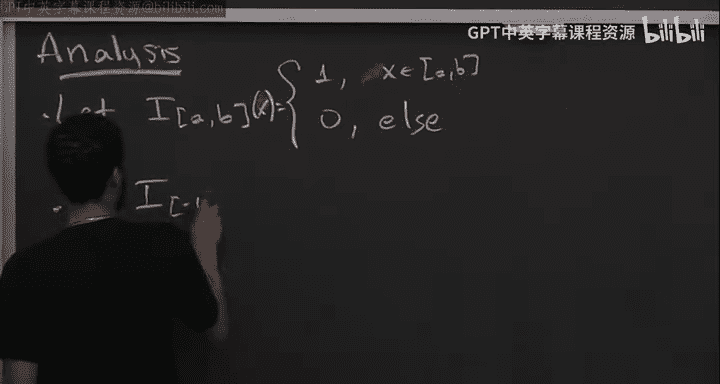

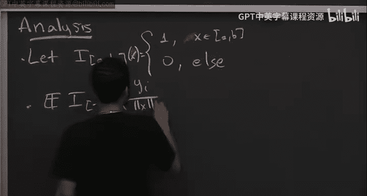

## 回顾：Indyk算法与p稳定分布

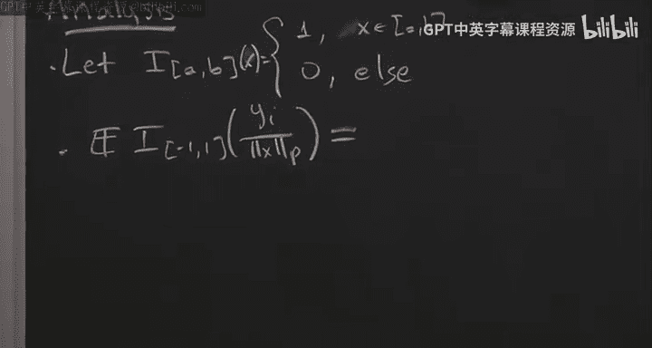

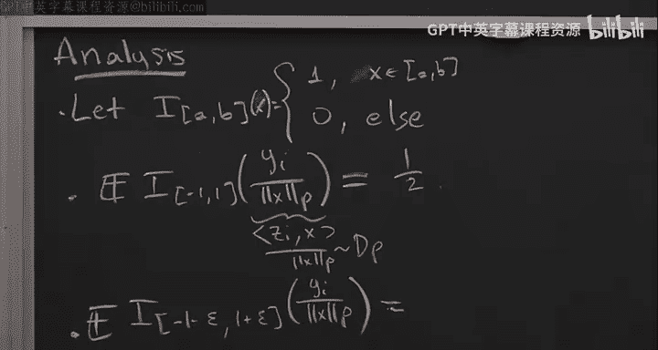

上一节我们介绍了Indyk算法，它利用p稳定分布来估计向量的Lp范数。让我们快速回顾一下核心概念。

一个分布D_p被称为**p稳定分布**，如果对于任意实数向量x = (x₁, x₂, ..., xₙ)和从D_p中独立抽取的随机变量Z₁, Z₂, ..., Zₙ，其线性组合的分布满足：
```
∑ᵢ Zᵢ * xᵢ  ~  ||x||_p * D_p
```
其中，`||x||_p` 是向量x的Lp范数。这种分布仅当 0 < p ≤ 2 时存在。

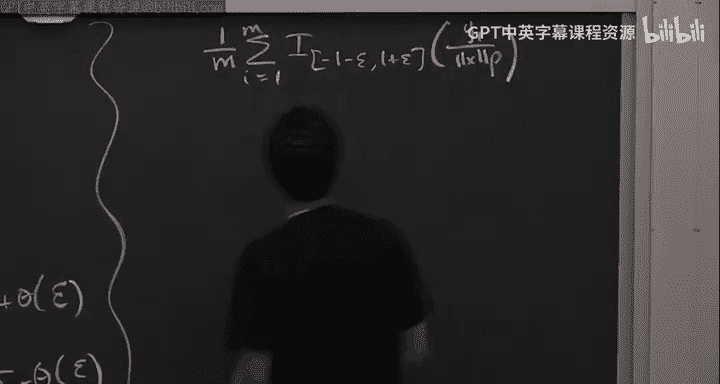

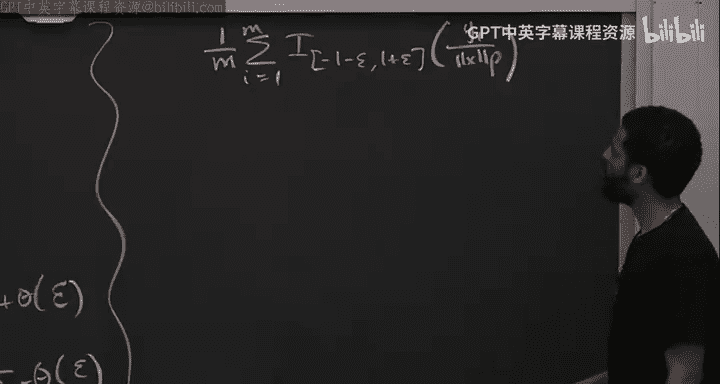


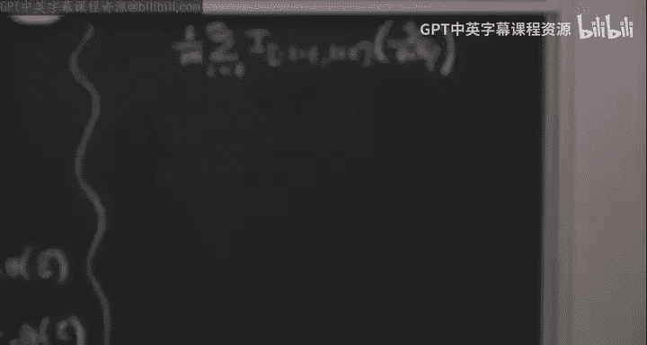

**算法步骤**如下：
1.  构造一个大小为 m × n 的线性投影矩阵 Π，其中每个元素 Πᵢⱼ 独立地从p稳定分布D_p中抽取。
2.  计算投影向量 **y = Πx**。
3.  估计Lp范数为 **median(|y₁|, |y₂|, ..., |yₘ|)**。

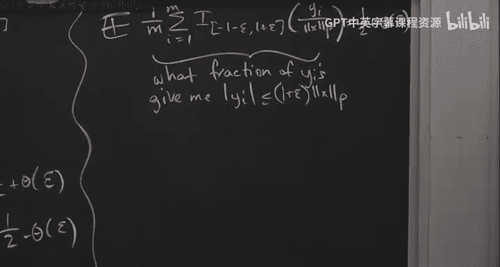

其中，行数 m 的数量级为 **O(1/ε²)**，以获得 (1±ε) 的近似。

---

## 分析Indyk算法的正确性


本节中，我们来看看如何分析这个算法的正确性。核心思想是证明投影值 yᵢ 的中位数以高概率落在期望的区间内。

我们定义指示函数 **I_[a,b](x)**，当x在区间[a, b]内时值为1，否则为0。


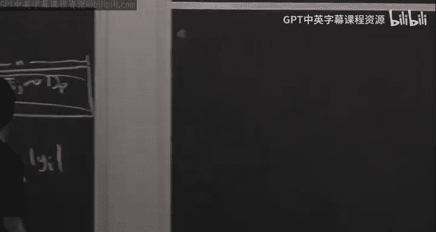

考虑随机变量 **I_[ -1-ε, 1+ε ]( yᵢ / ||x||_p )**。由于 yᵢ / ||x||_p 服从 D_p 分布，且我们假设D_p的半数质量位于[-1,1]区间内，因此该指示函数的期望值为：
```
E[ I_[ -1-ε, 1+ε ]( yᵢ / ||x||_p ) ] = 1/2 + Θ(ε)
```
这意味着，在期望下，超过半数的 yᵢ 满足 `|yᵢ| ≤ (1+ε)||x||_p`。

同理，对于区间 `[-1+ε, 1-ε]`，其期望值为 `1/2 - Θ(ε)`，意味着少于半数的 yᵢ 满足 `|yᵢ| ≤ (1-ε)||x||_p`。

如果这两个事件同时发生，那么 `|yᵢ|` 的中位数必然落在 `[(1-ε)||x||_p, (1+ε)||x||_p]` 区间内，这正是我们想要的。

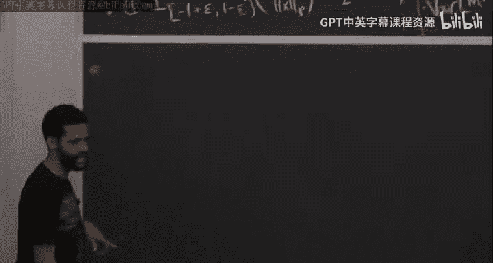


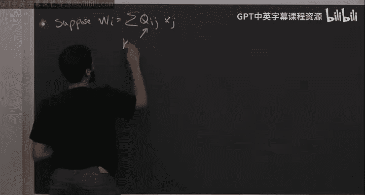

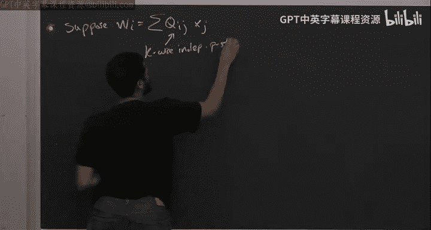

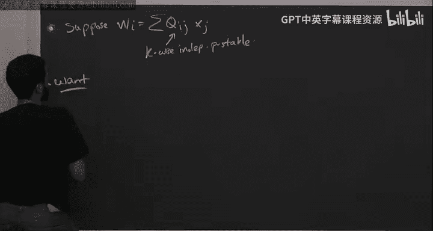

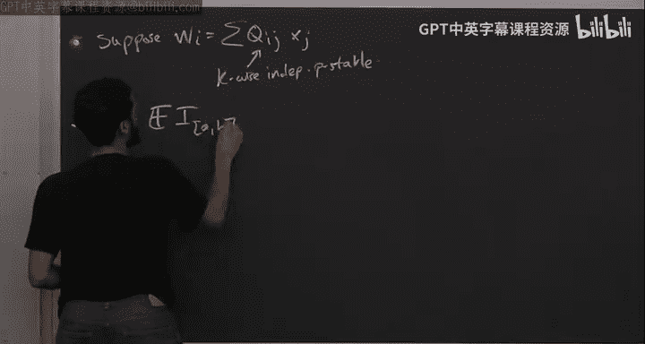

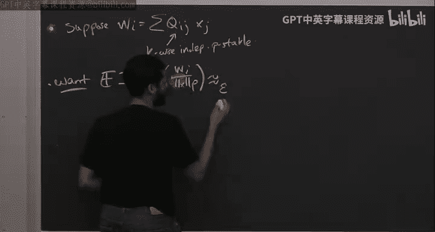

然而，这只是期望。为了以高概率保证这两个事件发生，我们需要使用**切尔诺夫不等式**，这要求我们控制随机变量的方差。

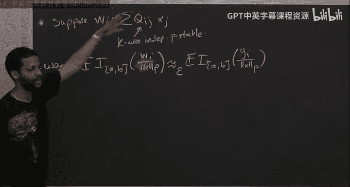

指示函数 `I_[...]( yᵢ / ||x||_p )` 的方差最多为1。对于m个独立同分布的此类变量，其平均值的方差最多为 `1/m`。因此，通过设置 `m = O(1/ε²)`，我们可以应用切尔诺夫界，证明算法以至少2/3的概率成功。

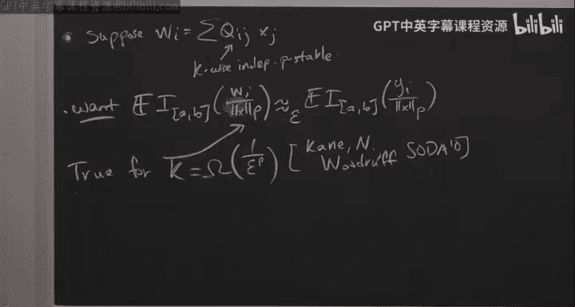

---

## 随机性挑战与Nisan伪随机生成器 🎲

上述分析假设矩阵Π的每一行、每一列的元素都是完全独立的随机数。存储这样一个矩阵需要海量的随机比特，这在实践中是不可行的。

一个自然的想法是使用**k-独立哈希函数**来生成“看似随机”但相关性受控的随机数。理论上，对于p稳定分布，只要k足够大（例如 `k = O(1/ε^p)`），使用k-独立随机变量构造的矩阵Π仍然能使算法近似正确。

但是，为每一行单独存储一个k-独立哈希函数的种子，总空间开销仍然可能很大。这里的关键洞察是：**行与行之间只需要满足两两独立**。这允许我们使用一个全局的、空间效率更高的伪随机方案。

接下来，我们将介绍Nisan的伪随机生成器，它是一种专门用于“欺骗”空间受限计算模型的强大工具。

---

## Nisan伪随机生成器简介

Nisan的定理为解决上述随机性问题提供了优雅的方案。它主要针对一种称为**分支程序**的计算模型。

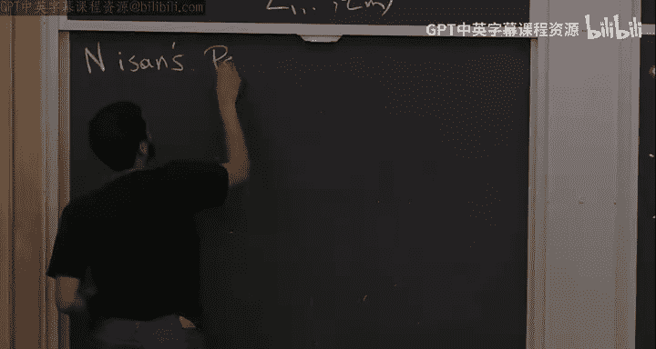

**分支程序**可以视作一个网格状的有向图，它模拟了一个空间上限为S比特的算法：
*   算法从左边的初始节点开始。
*   算法每次读取S比特的输入。
*   根据当前状态和读入的S比特，算法转移到下一层的某个节点。
*   经过R轮后，算法到达最终状态（最后一层的某个节点）。

**Nisan定理**指出：存在一个伪随机生成器H，它仅使用 `T = O(S * log(R/S))` 个真正的随机比特，就能生成一个长度为 `R*S` 的“伪随机”比特串。对于**任何**分支程序B和**任何**输出判断函数F，用H生成的串作为输入，与用真正均匀随机串作为输入，导致B输出特定结果的概率差异极小（不超过 `2^{-S}`）。

这意味着，对于一个空间为S的算法，外部只需要提供 `O(S log R)` 个真随机比特，就能模拟出需要 `R*S` 个真随机比特才能产生的行为，且算法几乎无法区分。

**生成器H的构造**基于一个完美二叉树：
1.  树根是一个随机的S比特串。
2.  树的每一层使用一个独立的两两独立哈希函数。
3.  左子节点复制父节点的值。
4.  右子节点是父节点值经过该层哈希函数变换的结果。
5.  所有叶子节点的值拼接起来，就构成了输出的伪随机长比特串。

存储整个生成器（包括所有哈希函数描述和种子）仅需 `O(S log R)` 比特。


---


## 将Nisan生成器应用于Indyk算法

现在，我们来看看如何利用Nisan的生成器来为Indyk算法高效地生成矩阵Π。

我们构造一个特定的分支程序B_x（它依赖于输入向量x），该程序模拟Indyk算法的**验证过程**：
1.  程序维护三个计数器：`low`, `high`, `cur`，初始化为0。
2.  按顺序读入矩阵Π的每一个元素 `Πᵢⱼ`。
3.  对于每个元素，更新 `cur += Πᵢⱼ * xⱼ`。
4.  当处理完一行（即一个yᵢ）后，检查 `cur`：
    *   如果 `|cur| ≤ (1-ε)||x||_p`，则 `low++`。
    *   如果 `|cur| ≤ (1+ε)||x||_p`，则 `high++`。
5.  处理完所有行后，如果 `high > m/2` 且 `low < m/2`，则程序输出“成功”。

这个程序的空间复杂度 `S = O(log n + log m + 精度比特数) = O(log n)`。输入长度 `R*S` 对应整个Π矩阵的所有元素。

我们的分析表明，如果Π是真正随机的，那么这个分支程序以高概率（≥2/3）输出“成功”。根据Nisan定理，如果我们使用Nisan生成器产生的伪随机比特来填充Π，分支程序输出“成功”的概率将与使用真随机时非常接近（差异小于 `1/poly(n)`）。

因此，最终的Indyk算法实现只需存储一个 `O(log² n)` 比特的Nisan生成器种子，即可按需动态生成整个矩阵Π的元素，将总空间复杂度控制为 `O(ε⁻² log n + log² n)`。

---

## 对于p > 2的情况

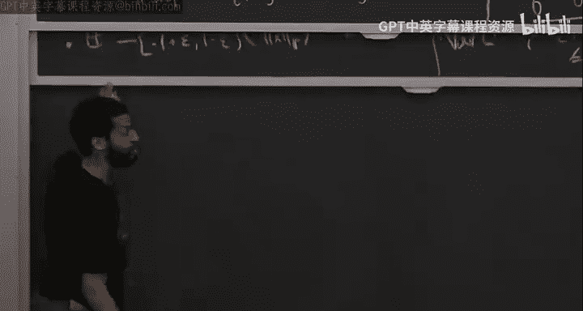


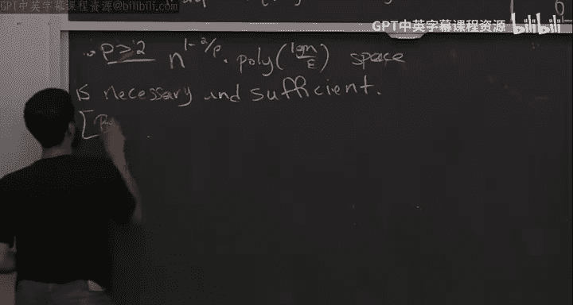

Indyk算法和p稳定分布仅适用于 p ≤ 2。对于 p > 2 的情况，需要不同的方法。

Andoni等人提出了一种基于**指数分布**和**稀疏投影**的算法。其核心思想是：
1.  构造一个对角矩阵D，其对角线元素为 `1 / (u_i)^{1/p}`，其中 `u_i` 服从指数分布。
2.  构造一个稀疏投影矩阵P，每列只有一个随机±1的非零元素。
3.  维护的草图是 **y = P * D * x**。
4.  用 **||y||_∞**（即y中绝对值的最大值）来估计 **||x||_p**。

该算法可以达到 `Õ(n^{1-2/p})` 的空间复杂度，这被证明是估计p>2时Lp范数所需的空间下界。


**简要分析思路**：
*   首先，可以证明 `z = Dx` 的最大值 `||z||_∞` 本身就以常数概率给出 `||x||_p` 的常数倍近似。
*   然后，证明稀疏投影P不会显著破坏这个最大值估计的性质。
*   由于P非常稀疏，最终只需要维护 `O(n^{1-2/p})` 个计数器。

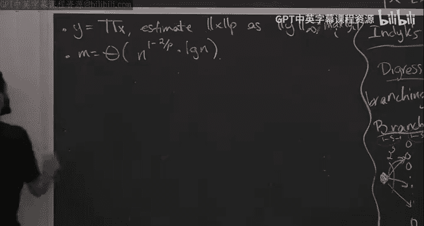

---


## 总结

本节课中我们一起学习了：
1.  **完成了对Indyk算法的分析**：利用p稳定分布和切尔诺夫界，证明了其中位数估计器能以 `O(1/ε²)` 的空间提供(1±ε)近似的Lp范数估计（p≤2）。
2.  **引入了Nisan伪随机生成器**：这是一个强大的工具，可以用 `O(S log R)` 的真随机比特，为空间S的算法模拟 `R*S` 长的随机输入，从而极大减少算法对随机性的需求。
3.  **应用Nisan生成器优化Indyk算法**：通过构造一个模拟算法验证过程的分支程序，我们可以使用Nisan生成器动态产生矩阵Π，将存储开销从巨大的完全随机矩阵降至 `O(log² n)`。
4.  **简要了解了p>2的范数估计方法**：使用指数分布和稀疏投影，可以在 `Õ(n^{1-2/p})` 空间内获得常数倍近似。

这些技术展示了在大数据算法中，如何巧妙地结合概率论、伪随机性和计算模型理论，设计出既高效又实用的解决方案。