# 5：P>2范数估计与点查询问题 🧮

在本节课中，我们将学习如何估计P>2的向量范数，并初步了解流式模型中的另一个重要问题——点查询（Point Query）及其相关的频繁项（Heavy Hitters）问题。

---

## P>2范数估计回顾

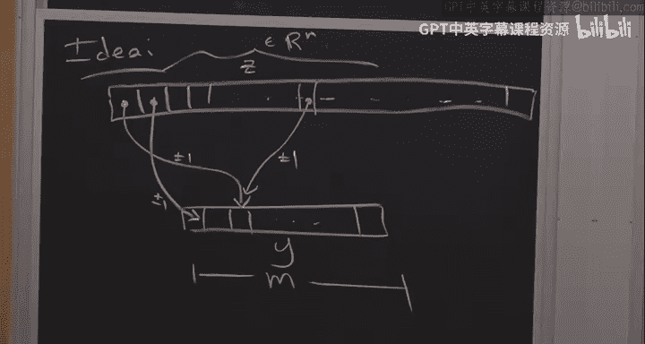

上一节我们介绍了使用稳定分布（Stable Distributions）和Indyk算法来估计P≤2的向量范数。本节中，我们来看看当P>2时，如何设计一个高效的流式算法来估计向量的LP范数。

我们回顾一下Andoni等人提出的算法框架。该算法维护三个部分：一个随机符号矩阵 **P**，一个对角矩阵 **D**，以及我们的高维向量 **x**。

*   **矩阵 P**： 每一列只有一个随机符号（±1），其余位置为0。
*   **矩阵 D**： 是一个对角矩阵，对角线元素为 `u_i^{-1/p}`，其中 `u_i` 服从指数分布。
*   **向量 Z**： 定义为 `Z = Dx`。

上节课我们证明了一个关键引理：`Z` 的无穷范数 `||Z||_∞` 能以高概率在常数因子内近似 `x` 的LP范数 `||x||_p`。然而，直接存储 `Z` 需要 `O(n)` 空间，这在大数据场景下不可行。

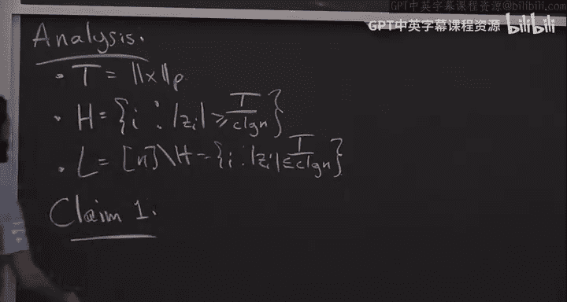

因此，算法的核心是维护一个低维的素描（sketch）向量 **Y**，定义为：
`Y = P * D * x`
其中 `Y` 的维度 `m` 远小于 `n`。我们的目标是证明，通过输出 `||Y||_∞`，我们仍然能得到 `||x||_p` 的一个良好近似。

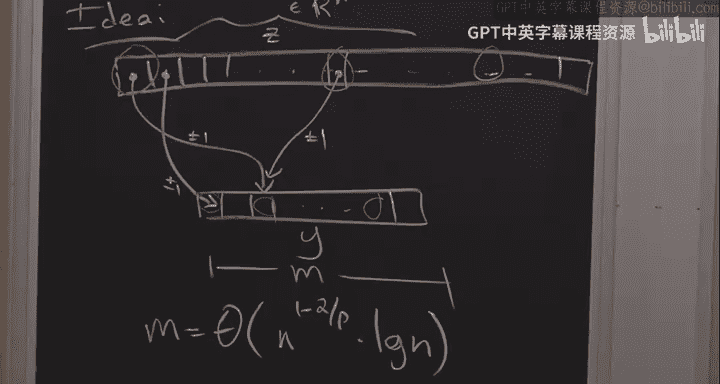

---

## 算法直观理解与游戏计划 🎯

`Y` 的构造可以直观理解为“哈希计数”过程：
*   高维向量 `Z` 的每个坐标 `Z_i` 被一个哈希函数 `h` 映射到 `m` 个桶（即 `Y` 的坐标）中的一个。
*   在放入桶之前，`Z_i` 会乘以一个随机符号 `σ_i`。
*   每个桶 `Y_j` 的值就是所有哈希到该桶的 `σ_i * Z_i` 之和。

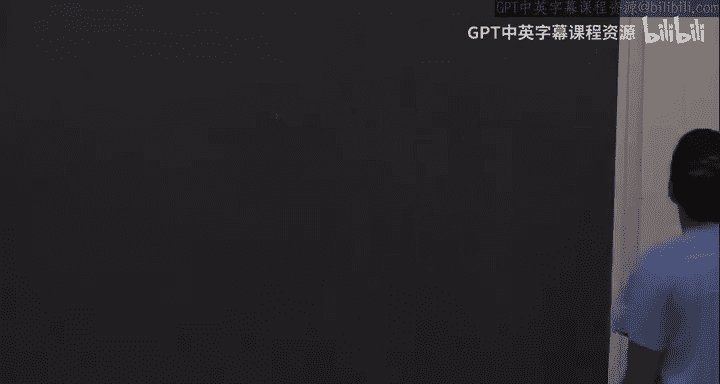

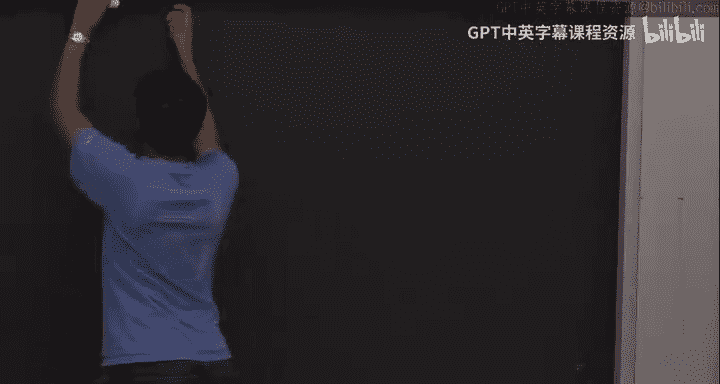

这带来了两个挑战：
1.  **大值碰撞**： 如果多个“大”的 `Z_i`（其值接近 `||x||_p`）被哈希到同一个桶，它们可能因随机符号而相互抵消，或者叠加得过大，从而破坏近似精度。
2.  **小值干扰**： 即使大值被完美哈希（即不碰撞），桶中也可能混入许多“小”的 `Z_i`，这些噪声可能干扰我们对桶中大值的观测。

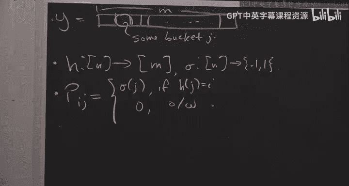

我们的分析将围绕解决这两个挑战展开：

1.  **控制大值数量**： 我们将证明，值超过 `T/(C log n)`（其中 `T = ||x||_p`）的“重”坐标（Heavy indices）的期望数量是 `(C log n)^p`，即 `poly(log n)`。通过设置足够多的桶数 `m`，我们可以以高概率保证这些少量的重坐标被完美哈希（无碰撞）。
2.  **控制小值噪声**： 对于每个桶，来自“轻”坐标（Light indices）的贡献和是一个期望为0的随机变量。我们将使用伯恩斯坦不等式（Bernstein‘s Inequality）证明，以高概率，每个桶中的噪声幅度都很小（例如，小于 `T/10`）。

基于以上两点，我们可以得出结论：`||Y||_∞` 能够以高概率在常数因子内近似 `||x||_p`。

---

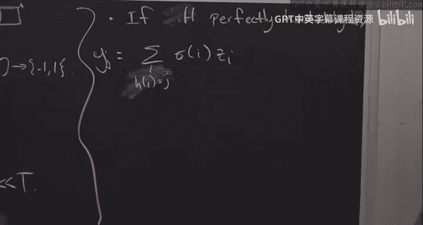

## 严格分析

### 定义与引理1：重坐标数量的期望

设 `T = ||x||_p`。对于任意 `L > 0`，定义重坐标集合 `H` 为满足 `|Z_i| > T/L` 的索引 `i` 的集合。

**引理1**： 重坐标的期望数量 `E[|H|] ≤ L^p`。

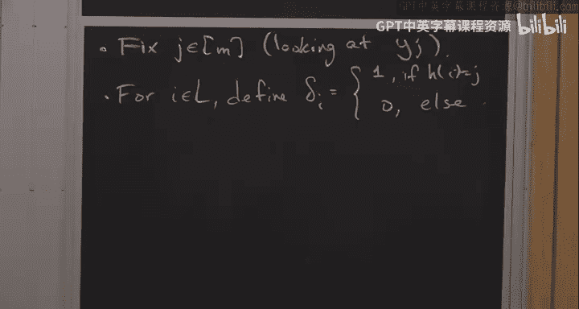

**证明概要**：
定义指示变量 `Q_i = 1` 当且仅当 `|Z_i| > T/L`。
`Z_i = x_i / u_i^{1/p}`，其中 `u_i` 服从指数分布 `Exp(1)`。
因此，
`Pr[Q_i = 1] = Pr[|Z_i| > T/L] = Pr[u_i < (|x_i|^p * L^p) / T^p] = 1 - e^{- (|x_i|^p * L^p) / T^p}`。
利用不等式 `1 - e^{-x} ≤ x` (对于 `x ≥ 0`)，我们有：
`Pr[Q_i = 1] ≤ (|x_i|^p * L^p) / T^p`。
求和得：`E[|H|] = Σ_i Pr[Q_i = 1] ≤ (L^p / T^p) * Σ_i |x_i|^p = L^p`。
证毕。

取 `L = C log n`，则 `E[|H|] = O((log n)^p)`。根据马尔可夫不等式，`|H|` 实际为 `poly(log n)` 的概率很高。如果我们设置桶的数量 `m` 约为 `(log n)^{2p}`，根据生日悖论原理，这些重坐标被完美哈希（无碰撞）的概率就很高。

### 控制轻坐标的噪声

现在，我们关注单个桶 `j` 中轻坐标的贡献。设 `L` 为轻坐标集合（`|Z_i| ≤ T/L`）。桶 `j` 中的噪声为：
`Noise_j = Σ_{i ∈ L, h(i)=j} σ_i * Z_i`

我们将对固定的 `D`（即固定的 `Z`）应用伯恩斯坦不等式。对于每个轻坐标 `i`，定义随机变量 `R_i = σ_i * Z_i * 1_{h(i)=j}`。这些 `R_i` 在给定 `Z` 的条件下是独立的（因为哈希函数 `h` 和符号 `σ` 独立于 `Z`）。

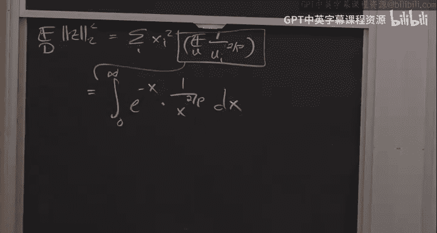

*   **期望**： `E[R_i] = 0`。
*   **界 K**： 由于是轻坐标，`|R_i| ≤ |Z_i| ≤ T/L`。取 `K = T/L`。
*   **方差上界**： 可以证明，`Var(Σ_i R_i) ≤ ||Z||_2^2 / m`。

然而，`||Z||_2^2` 本身依赖于随机矩阵 `D`。我们需要证明它以高概率不大。计算其期望：
`E[||Z||_2^2] = Σ_i x_i^2 * E[1 / u_i^{2/p}]`。
由于 `p > 2`，积分 `∫_0^∞ e^{-x} / x^{2/p} dx` 收敛到一个常数。因此，`E[||Z||_2^2] = O(||x||_2^2)`。

接着，利用霍尔德不等式（Hölder‘s Inequality）关联 `L2` 和 `Lp` 范数：
`||x||_2^2 ≤ ||x||_p^2 * n^{1 - 2/p}`。
因此，`E[||Z||_2^2] = O(T^2 * n^{1 - 2/p})`。

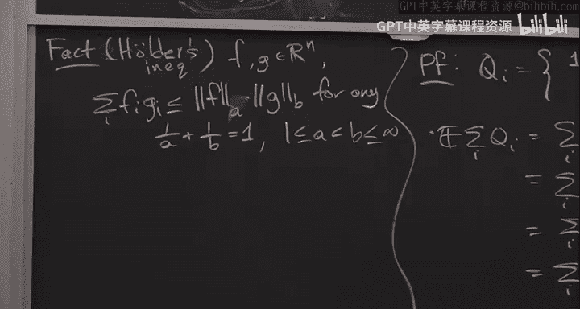

根据马尔可夫不等式，以高概率（例如99%），`||Z||_2^2 = O(T^2 * n^{1 - 2/p})`。我们选择桶数 `m = Θ(n^{1 - 2/p} * log n)`，使得 `Var(Σ_i R_i) ≤ O(T^2 / log n)`。

现在应用伯恩斯坦不等式。我们想证明 `Pr[|Noise_j| > T/10]` 非常小。将方差上界和 `K` 值代入伯恩斯坦不等式，并通过调整常数（即增大 `m` 的常数因子），我们可以使这个失败概率小于 `1/n^3`。

由于只有 `m ≤ n` 个桶，通过并集界限（Union Bound），所有桶的噪声都小于 `T/10` 的概率很高。

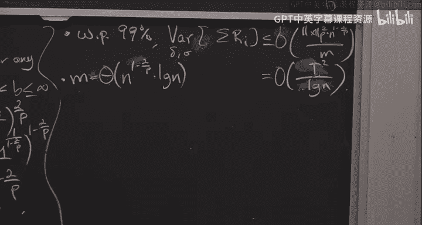

### 结论

结合以上分析：
1.  重坐标数量少，且以高概率被完美哈希。
2.  每个桶中的噪声以高概率很小。

因此，对于包含重坐标的桶，其值 `Y_j` 主要由该重坐标主导（`±` 一个小的噪声），从而 `|Y_j|` 是 `T` 的一个良好近似。对于不包含重坐标的桶，其值 `Y_j` 就是噪声本身，很小。所以，`||Y||_∞` 就是某个重坐标值的良好近似，进而也是 `||x||_p` 的常数因子近似。

空间复杂度为 `O(m) = O(n^{1 - 2/p} * log n)`。值得注意的是，当 `p=2` 时，空间为 `polylog(n)`；当 `p>2` 时，空间为 `n^{1 - 2/p}`。这暗示 `p=2` 可能是一个计算复杂度的临界点，我们将在后续关于下界的课程中深入探讨。

---

## 从范数估计到点查询与频繁项 🔍

现在，我们转向流式模型中的另一个实际问题。假设有一个高维向量 `x`（例如，索引是所有可能的搜索词，值是搜索次数），它在动态更新（流式数据）。我们关心两类查询：

1.  **点查询（Point Query）**： 给定索引 `i`，返回 `x_i` 的一个近似值，保证误差在 `±ε * ||x||_1` 范围内。
    `Output ∈ [x_i - ε||x||_1, x_i + ε||x||_1]`
2.  **频繁项/热点发现（Heavy Hitters）**： 返回一个列表 `L`，满足：
    *   若 `x_i ≥ ε||x||_1`，则 `i ∈ L`。（包含所有真热点）
    *   若 `x_i < (ε/2)||x||_1`，则 `i ∉ L`。（避免明显的假阳性）

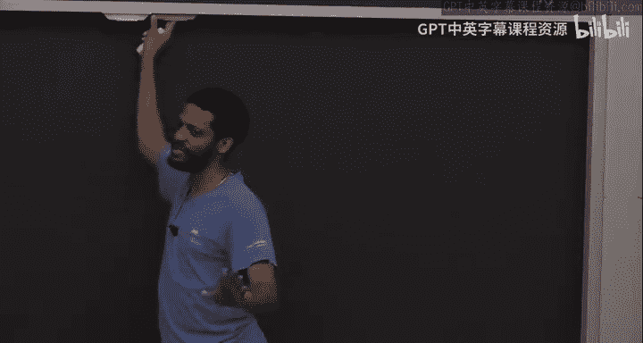

点查询是更基础的操作。事实上，**如果能解决点查询，就能解决频繁项发现问题**（尽管时间复杂度可能较高）。方法如下：
运行一个误差参数为 `ε/10` 的点查询数据结构。当需要获取频繁项列表时，遍历所有可能的索引 `i`（从1到 `n`），并对每个 `i` 执行点查询。如果查询结果 `≥ 0.9ε||x||_1`，则将 `i` 加入输出列表。这样可以保证捕获所有真正的频繁项，且列表中的项至少具有 `0.8ε||x||_1` 的频率。

---

## 确定性点查询算法简介

接下来，我们介绍一种基于**不相干矩阵（Incoherent Matrix）**的确定性方法来解决点查询问题。

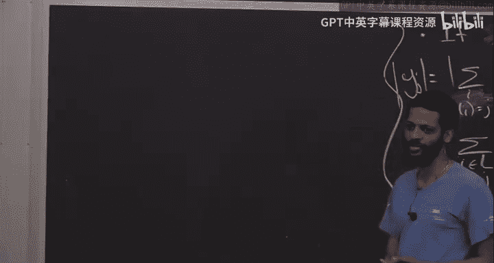

**定义（ε-不相干矩阵）**：
一个 `m × n` 的矩阵 `Φ` 是 `ε-不相干`的，如果：
1.  对任意列 `i`，`||Φ_i||_2 = 1`。（列是单位范数）
2.  对任意不同的列 `i` 和 `j`，`|⟨Φ_i, Φ_j⟩| ≤ ε`。（任意两列近似正交）

不相干矩阵可以看作一个“好”的素描矩阵。

**定义（ε-纠错码）**：
一个参数为 `(ε, T, Q, n)` 的纠错码 `C` 是一个包含 `n` 个码字的集合，每个码字 `c_i` 是长度为 `T`、字母表大小为 `Q` 的向量。并且，对于任意两个不同的码字 `c_i` 和 `c_j`，它们的汉明距离（不同位置的个数）至少为 `(1 - ε)T`。

**引理**： 一个 `(ε, T, Q, n)` 纠错码可以构造出一个 `ε-不相干` 矩阵 `Φ`，其维度为 `m = Q * T`。

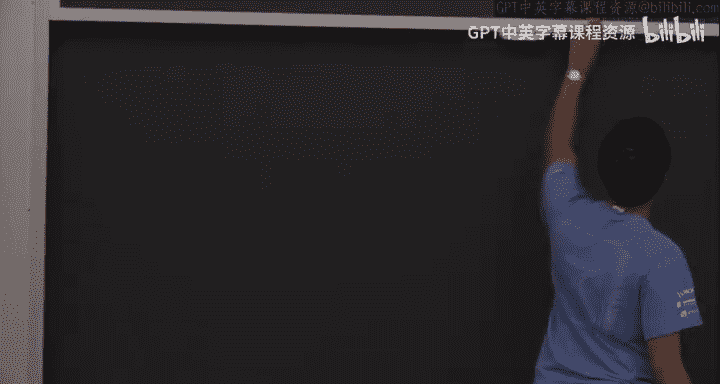

**构造方法**：
矩阵 `Φ` 的每一列对应一个码字 `c_i`。我们将 `Φ` 的 `m` 行分成 `T` 个块，每块有 `Q` 行。对于第 `i` 列，在第 `t` 个块中，我们在对应于码字 `c_i` 的第 `t` 个符号的位置上放置一个 `1`，该块其他位置为 `0`。最后，将整个列乘以归一化因子 `1/√T`，使得每列的 `L2` 范数为1。由于码字间汉明距离大，任意两列的内积至多为 `ε`。

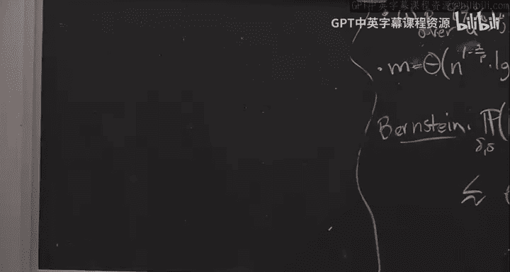

**最终结论**（下节课详细证明）：
一个 `ε-不相干` 矩阵可以被用作一个素描（sketch）来解决点查询问题。并且，存在随机的编码方案，其参数 `T = O((1/ε) log n)`, `Q = O(1/ε)`，能以高概率构造出所需的 `(ε, T, Q, n)` 码。因此，我们可以先（随机地）构造这样一个码，进而得到一个确定性的不相干矩阵 `Φ`，用于解决点查询。

---

## 总结 📝

本节课中我们一起学习了：
1.  **P>2范数估计**： 我们深入分析了Andoni等人的算法，通过维护一个低维素描 `Y = P D x`，并巧妙地控制“重”坐标的碰撞和“轻”坐标的噪声，实现了对 `||x||_p` 的常数因子近似估计，所需空间为 `O(n^{1 - 2/p} log n)`。
2.  **点查询与频繁项问题**： 我们定义了流式模型中的点查询和频繁项发现问题，并指出点查询是更基础的操作。频繁项发现问题可以通过多次调用点查询来解决。
3.  **确定性算法基础**： 我们引入了不相干矩阵和纠错码的概念，并展示了如何利用纠错码构造不相干矩阵，为下节课讲解基于不相干矩阵的确定性点查询算法奠定了基础。

下节课，我们将完成点查询算法的分析，并探讨更高效的（随机化）频繁项发现算法。