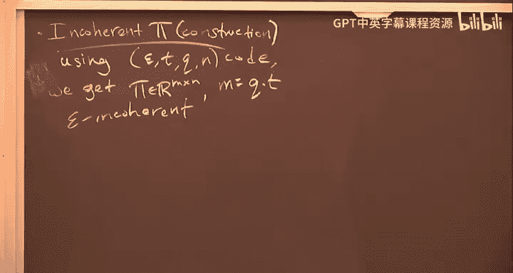
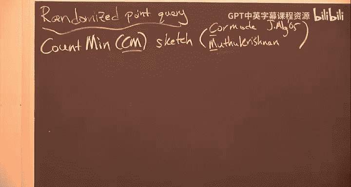
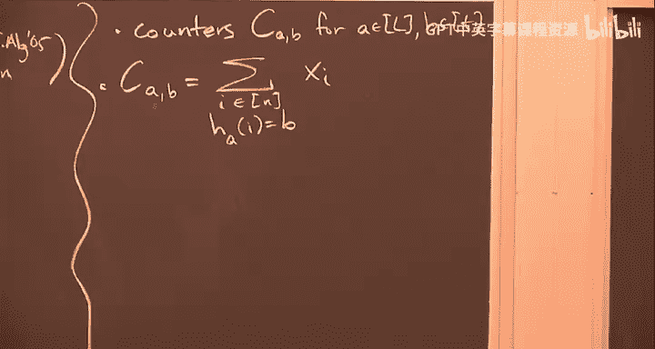
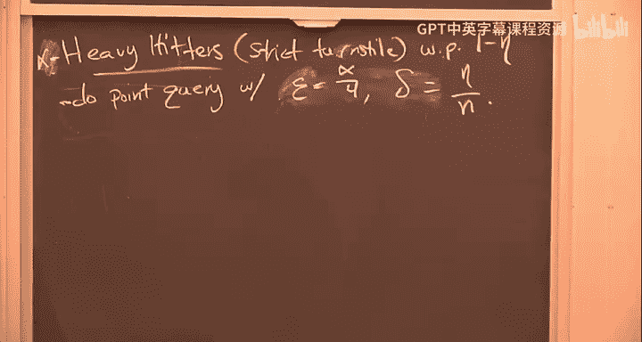

# 哈佛大学《大数据算法》课程笔记 - P6：点查询与频繁项检测 🎯

在本节课中，我们将要学习大数据流处理中的两个核心问题：**点查询**和**频繁项检测**。我们将探讨如何使用**不相干矩阵**和**Count-Min Sketch**这两种关键技术来解决这些问题，并比较它们的优缺点。

---

## 点查询问题 📍

上一节我们介绍了流处理的基本模型。本节中我们来看看**点查询**的具体定义。

点查询问题定义如下：
*   存在一个高维向量 **x**（维度为 n），在“旋转门”流模型下持续更新。
*   查询时，输入一个索引 **i**（1 ≤ i ≤ n），需要输出 **xᵢ** 的值，并允许一定的误差。
*   误差要求：输出值必须在 **xᵢ ± ε‖x‖₁** 范围内。其中 ‖x‖₁ 是向量的 L1 范数（所有元素绝对值之和）。

这被称为 **L1 点查询**。

---

## 频繁项检测问题 🔍

与点查询紧密相关的问题是**频繁项检测**（或称“Heavy Hitters”问题）。

频繁项检测问题定义如下：
*   给定一个参数 ε，需要返回一个索引的列表 **L**。
*   **完整性**：所有“ε-频繁项”（即满足 xᵢ ≥ ε‖x‖₁ 的项）都必须包含在列表 L 中。
*   **准确性**：列表 L 中不应包含任何“非 (ε/2)-频繁项”（即满足 xᵢ < (ε/2)‖x‖₁ 的项）。

这意味着列表 L 的大小最多为 2/ε。

---

## 使用 ε-不相干矩阵求解 🧮

上一节我们定义了ε-不相干矩阵。本节中我们来看看如何利用它来同时解决上述两个问题。

一个矩阵 **Π** 是 ε-不相干的，如果其所有列向量都是单位范数，且任意两个不同列向量的内积绝对值不超过 ε。可以将其视为几乎正交的向量集合。

**核心思路**：使用 Π 作为草图（sketch）。

**草图构建**：
*   维护向量 **y = Πx**。

**点查询估计**：
*   当查询索引 i 时，输出估计值 **x̃ᵢ = (Πᵀ y)ᵢ**，即 Πᵀ 的第 i 行与 y 的点积。

**原理分析**：
*   因为 **ΠᵀΠ** 近似于单位矩阵。
*   具体推导：x̃ = Πᵀy = ΠᵀΠx。
*   因此，x̃ᵢ = xᵢ + Σ_{j≠i} (xⱼ * ⟨πᵢ, πⱼ⟩)。
*   由于 |⟨πᵢ, πⱼ⟩| ≤ ε，所以误差 |x̃ᵢ - xᵢ| ≤ ε * Σ_{j≠i} |xⱼ| ≤ ε‖x‖₁。

这提供了 **L∞/L1** 的误差保证：‖x̃ - x‖∞ ≤ ε‖x‖₁。

---

### 不相干矩阵的构造方法

以下是两种主要的构造方法：

**1. 基于随机编码**
*   思路：随机生成一个编码，其码字（codeword）之间的重合度很低。
*   参数：设置字母表大小 Q ≈ 2/ε，码字长度 T ≈ O(log n / ε²)。
*   方法：独立随机地为 n 个长度为 T 的向量选择每个位置的符号（1到Q）。
*   分析：利用切尔诺夫边界和并集界限，可以证明以高概率得到一个 ε-不相干矩阵。其草图大小 M = Q * T = O((log n)/ε²)。

**2. 基于里德-所罗门码**
*   思路：使用代数编码（多项式）构造。
*   参数：Q = T = Θ((log n)/(ε * (log log n + log(1/ε))))。
*   结果：草图大小 M = Q * T = Θ((log² n)/(ε² * (log log n + log(1/ε))²))。
*   比较：当 ε 不太小时，这种方法比随机编码更优；当 ε 极小时，两者渐近性能相同。

存在一个下界表明，任何不相干矩阵必须满足 M ≥ Ω((log n)/(ε² * log(1/ε)))。上述构造在某些参数范围内达到了这个下界。

---

### 从点查询到频繁项检测的黑盒转换

给定一个误差为 ε/4 的点查询数据结构，可以如下解决频繁项检测问题：

**算法步骤**：
1.  实例化该点查询数据结构。
2.  遍历所有索引 i（从 1 到 n）。
3.  对每个 i 进行点查询，得到估计值 x̃ᵢ。
4.  如果 x̃ᵢ ≥ (3ε/4)‖x‖₁，则将 i 加入输出列表 L。

**正确性分析**：
*   对于真正的 ε-频繁项，其真实值 xᵢ ≥ ε‖x‖₁。由于误差不超过 (ε/4)‖x‖₁，估计值 x̃ᵢ ≥ (3ε/4)‖x‖₁，因此会被包含。
*   对于非 (ε/2)-频繁项，其真实值 xᵢ < (ε/2)‖x‖₁。加上误差后，估计值 x̃ᵢ < (3ε/4)‖x‖₁，因此不会被包含。

**缺点**：需要遍历所有 n 个索引，查询时间慢。

---

## 随机化方法：Count-Min Sketch 🎲

上一节我们介绍了确定性的不相干矩阵方法。本节中我们来看看一种更节省空间的随机化方法——**Count-Min Sketch**。

Count-Min Sketch 基于哈希技术，在“严格旋转门”模型（所有 xᵢ ≥ 0）下工作。

**数据结构**：
*   创建一个 L 行、T 列的计数器网格 **C**。
*   选择 L 个相互独立的、两两独立的哈希函数：h₁, h₂, ..., hₗ，每个都将索引 {1...n} 映射到 {1...T}。

**更新操作**（将 xᵢ 增加 v）：
*   对于每一行 r（1 ≤ r ≤ L）：
    *   计算哈希位置 b = hᵣ(i)。
    *   将计数器 C[r][b] 增加 v。

**点查询估计**（查询 xᵢ）：
*   对于每一行 r，查看计数器值 C[r][hᵣ(i)]。
*   输出这些值中的**最小值**作为 xᵢ 的估计值。即：x̃ᵢ = min_{1≤r≤L} C[r][hᵣ(i)]。

**参数设置与误差分析**：
*   设置 T = ⌈2/ε⌉，L = ⌈log₂(1/δ)⌉。其中 δ 是失败概率。
*   对于某一行 r，计数器 C[r][hᵣ(i)] 包含 xᵢ 加上所有与 i 哈希到同一位置的其它项 xⱼ 之和。
*   由于哈希函数是两两独立的，其它任意项 j 与 i 碰撞的概率为 1/T。
*   因此，**误差项的期望值** E[error] ≤ (Σ_{j≠i} xⱼ) / T ≤ (‖x‖₁) / T ≤ (ε/2) ‖x‖₁。
*   在严格旋转门模型下，所有 xⱼ ≥ 0，误差项非负，因此每个计数器给出的都是**高估**的值。
*   根据马尔可夫不等式，**单行误差过大**的概率：P(error > ε‖x‖₁) ≤ (E[error])/(ε‖x‖₁) ≤ 1/2。
*   由于 L 行是独立的，**所有行同时误差过大**（导致最小值误差过大）的概率 ≤ (1/2)^L = δ。

因此，Count-Min Sketch 以至少 1-δ 的概率保证：x̃ᵢ ≤ xᵢ + ε‖x‖₁。

**空间复杂度**：M = O((1/ε) * log(1/δ))。这比确定性方法的 O(1/ε²) 更优。

**关于适应性查询的说明**：此随机化保证适用于**非适应性查询**。如果查询基于之前查询的结果（适应性查询），则此保证可能失效，此时确定性方法更有优势。

---

### 基于树的快速频繁项检测算法 🌳

上一节提到黑盒转换的查询时间很慢。本节中我们利用 Count-Min Sketch 和树结构，实现更快的频繁项检测。

**核心思想**：
*   将 n 个索引视为完全二叉树的叶子节点。
*   为树的**每一层**维护一个独立的 Count-Min Sketch，用于跟踪该层上每个“节点”（即索引区间）的权重和。
*   在严格旋转门模型下，如果一个叶子是频繁项，那么从该叶子到根节点路径上的所有祖先节点，在其所在层也都是频繁项。

**算法过程**：
1.  **更新**：当更新叶子 i 时，更新从叶子 i 到根节点路径上每一层对应的 Count-Min Sketch。
2.  **查询**：
    *   从根节点开始（根节点总是频繁项）。
    *   检查当前节点的两个子节点（通过查询该层的 Count-Min Sketch）。
    *   只递归进入那些估计值超过 (3ε/4)‖x‖₁ 的子节点。
    *   最终到达叶子节点，将其加入输出列表。

**正确性与效率**：
*   每一层最多只有 O(1/ε) 个节点可能是频繁项。
*   因此，在整个树中，我们最多只会检查 O((1/ε) * log n) 个节点。
*   需要为每个 Count-Min Sketch 设置更小的失败概率 δ‘，通过并集界限保证整体算法成功的概率。

**最终复杂度**：
*   **空间**：O((1/ε) * log n * log(log n / (εδ)))。
*   **查询时间**：O((1/ε) * log n)。
*   **更新时间**：O(log n * log(1/δ))。

---

## 更强的保证：L1/L1 稀疏恢复 🏆

Count-Min Sketch 不仅能做点查询，还能提供更强的**稀疏近似恢复**保证。

**问题定义**：给定向量 x，希望找到一个 **k-稀疏**（即最多 k 个非零元）的向量 y，使得 ‖x - y‖₁ ≤ (1+ε) * ‖x_{-k}‖₁。其中 ‖x_{-k}‖₁ 是将 x 中绝对值最大的 k 个分量置零后的 L1 范数。

**使用 Count-Min Sketch 的算法**：
1.  设置 Count-Min Sketch 参数：T = O(k/ε)， L = O(log(1/δ))。
2.  对每个索引 i，通过 Count-Min Sketch 得到估计值 x̃ᵢ。
3.  找出 x̃ 中绝对值最大的 k 个索引，构成集合 T。
4.  输出向量 y，其中 yᵢ = x̃ᵢ（若 i ∈ T），否则 yᵢ = 0。

**直觉解释**：
*   当哈希桶数量 T 足够大时，一个特定索引 i 与“头部”（绝对值最大的 k 个元素）发生碰撞的概率很低。
*   因此，估计误差主要来自“尾部”元素与 i 的碰撞，其期望与 ‖x_{-k}‖₁ 成正比，而非整个 ‖x‖₁。

通过分析可以证明，得到的 k-稀疏向量 y 满足上述 L1/L1 近似保证。特别地，如果 x 本身就是 k-稀疏的，那么可以精确恢复 x。

---

## 总结 📝

本节课中我们一起学习了大数据流处理中的核心算法：
1.  **点查询**和**频繁项检测**的问题定义。
2.  使用 **ε-不相干矩阵**的确定性解法，其草图大小为 O((log n)/ε²)。
3.  使用 **Count-Min Sketch** 的随机化解法，其草图大小为 O((log(1/δ))/ε)，效率更高，但保证适用于非适应性查询。
4.  通过**树形结构**将 Count-Min Sketch 应用于频繁项检测，显著提升了查询速度。
5.  Count-Min Sketch 还能提供更强的 **L1/L1 稀疏恢复**保证，用于压缩感知等任务。

这些工具为在大数据流中快速、节省空间地监控关键统计量提供了坚实的基础。