# 哈佛大学《大数据算法》课程笔记 - P8：流式模型中的动态规划 🧮

在本节课中，我们将学习如何在流式模型下处理动态规划问题。我们将重点关注两个密切相关的问题：**最长递增子序列** 和 **距离单调性**。我们将看到，尽管这两个问题在离线情况下本质相同，但在流式模型下，它们的空间复杂度却截然不同。

上一节我们介绍了流式模型中的一些上界算法，本节中我们来看看如何将经典的动态规划问题适配到流式场景。

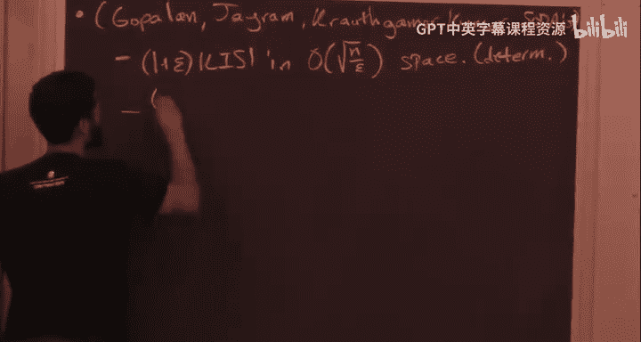

---

## 问题定义

在以下两个问题中，我们都有一个输入序列，序列中的每个数字介于1到M之间。

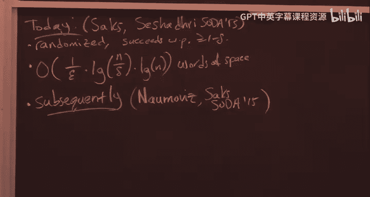

*   **最长递增子序列**：目标是找到一个尽可能长的子序列，使得其中的数字是**非递减**的（即弱递增）。
*   **距离单调性**：目标是找到需要从序列中**删除的最少元素数量**，使得剩余序列是单调递增的。

这两个问题是紧密相关的。事实上，**距离单调性**的值等于序列总长度 n 减去**最长递增子序列**的长度。因为要得到单调序列，最优策略就是保留最长递增子序列，删除其他所有元素。

---

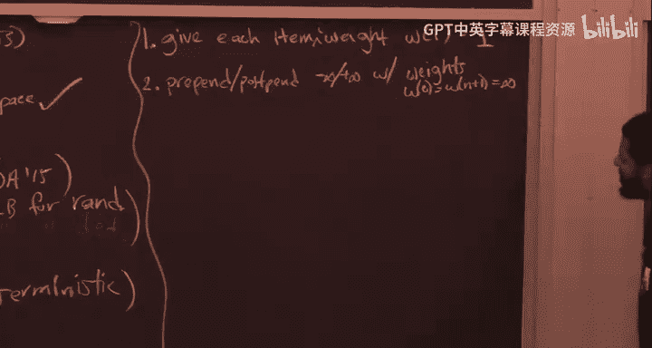

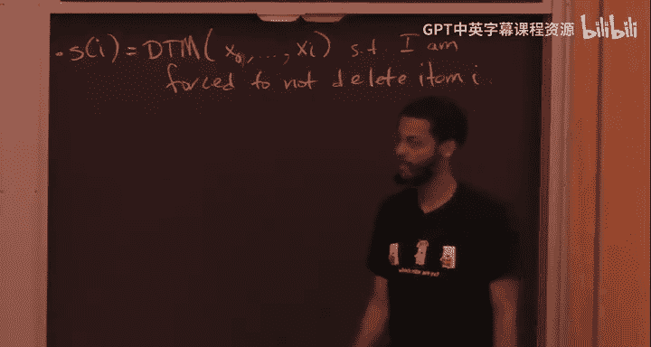

## 流式算法的挑战与成果

标准的动态规划解法需要线性空间来存储DP表，这在流式大数据场景下是不可接受的。因此，研究转向了**亚线性空间**的近似算法。

以下是该领域的一些关键成果：

*   **LIS的确定性算法**：可以在约 `O(√n / ε)` 字的空间内，得到LIS长度的 (1+ε) 近似。这个上界是紧的，任何确定性算法都需要这么多空间。
*   **DTM的随机算法**：可以在仅 `O((1/ε) * log² n)` 字的空间内，得到DTM的 (1+ε) 近似。这比LIS所需的空间高效得多。
*   **开放性问题**：是否存在高效的**随机化**算法，能在多对数空间内近似LIS？这仍然是一个未解决的问题。

本节课将重点介绍Saks和Seshadhri在2013年提出的，用于解决**距离单调性**问题的随机流式算法。

---

## 基础动态规划解法

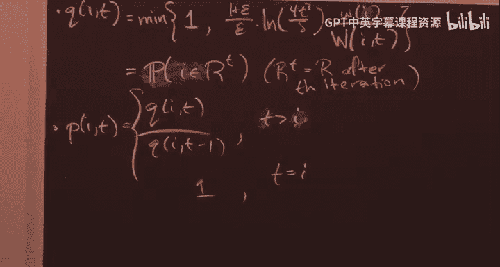

首先，我们回顾一下离线情况下，使用动态规划解决距离单调性问题的思路。为了处理边界情况，我们在序列首尾添加哨兵元素（值分别为 -∞ 和 +∞，权重为无穷大，确保它们永远不会被删除）。

定义：
*   `w_i`：第 i 个元素的权重（在基础问题中，所有 `w_i = 1`，哨兵权重为∞）。
*   `W_i`：前 i 个元素的权重前缀和（`W_i = Σ_{j=1}^{i} w_j`）。
*   `S_i`：考虑子序列 `x_0, x_1, ..., x_i`，并且**强制保留**元素 `x_i` 时，需要删除的最小权重和（即子问题的DTM值）。

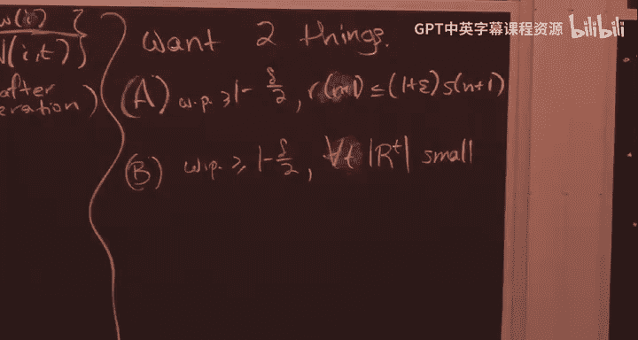

动态规划递推关系如下：
对于每个时间点 `t`（从1到 n+1）：
1.  更新前缀和：`W_t = W_{t-1} + w_t`
2.  计算 `S_t`：`S_t = min_{i∈R, x_i ≤ x_t} ( S_i + (W_{t-1} - W_i) )`
    *   其中 `R` 是当前已处理的所有索引集合 `{0, 1, ..., t-1}`。
    *   这个递推式的含义是：为了以 `t` 结尾，我们需要找到一个之前的元素 `i`（其值不大于 `x_t`），然后删除 `i` 和 `t` 之间的所有元素。
3.  将 `t` 加入集合 `R`。

最终，`S_{n+1}` 就是整个序列的距离单调性值。这个算法需要 `O(n)` 空间来存储所有的 `S_i` 值。

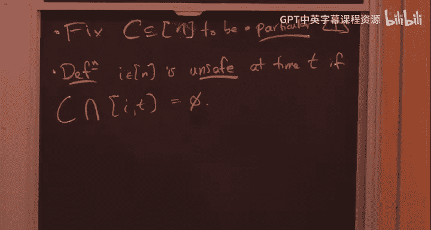

---

## 流式算法：随机化“遗忘”策略

流式算法的核心思想是：我们无法记住所有过去的 `S_i` 值。Saks和Seshadhri的巧妙之处在于，在每一步之后，**以一定的概率随机“遗忘”** DP表中过去的部分条目。

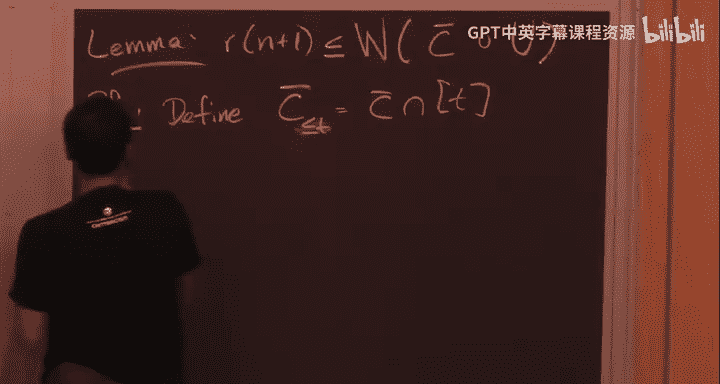

我们维护一个动态的、规模较小的集合 `R`，它只包含我们“记住”的过去索引。算法流程修改如下：

对于每个时间点 `t`：
*   **步骤A, B, C**：与基础DP类似，但只在当前的小集合 `R` 上计算最小值，得到近似的 `r_t`（对应原来的 `S_t`）。
*   **关键步骤D**：对于当前 `R` 中的每个索引 `i`，我们以概率 `(1 - p_{i,t})` 将其从 `R` 中移除。

**概率 `p_{i,t}` 的定义**：
我们定义 `q_{i,t} = min( 1, (1+ε)/ε * ln(4t³/δ) * (w_i / W_{[i, t]}) )`，其中 `W_{[i, t]}` 是区间 `[i, t]` 内元素的权重和。
那么，`p_{i,t} = q_{i,t} / q_{i, t-1}`（当 `t > i`），且 `p_{i,i} = 1`。

这个设计的精妙之处在于：
*   `q_{i,t}` 恰好是元素 `i` 在时间 `t` 之后仍然保留在集合 `R` 中的**概率**。
*   当所有权重 `w_i = 1` 时，`q_{i,t} ≈ O(1/(t-i))`。这意味着一个元素被记住的概率大致反比于它距今的时间长度。
*   因此，在任何时刻 `t`，我们期望记住的过去元素数量大约是 `O(log t)`，实现了多对数空间。

---

## 算法分析概要

我们需要证明两件事：
1.  **正确性**：算法输出的 `r_{n+1}` 以高概率是真实DTM值 `S_{n+1}` 的 (1+ε) 近似。
2.  **空间界**：集合 `R` 的大小以高概率保持为多对数级别。

**正确性证明的核心思路**：
1.  固定一个最优的LIS序列 `C`。
2.  定义“不安全”的时刻：如果在某个时刻 `t`，区间 `[i, t]` 内所有属于 `C` 的元素都已被我们从 `R` 中遗忘，则称 `i` 在 `t` 时刻是“不安全”的。
3.  可以证明，算法的输出 `r_{n+1}` 最多不超过 `S_{n+1}` 加上所有“不安全”元素的权重和。
4.  通过精心设计的概率 `p_{i,t}`，我们可以证明，任何一个元素成为“不安全”元素的概率非常低。再利用“危险区间”的概念进行聚合分析，最终可以证明，所有“不安全”元素的总权重以高概率不超过 `ε * S_{n+1}`。这就保证了近似比。

**空间界证明**：
在任意时刻 `t`，`R` 中元素的数量是多个独立伯努利指示变量之和。其期望值是 `O(log t)`。通过切尔诺夫界和所有时间步上的联合界，可以证明 `R` 的大小始终以高概率保持在多对数级别。

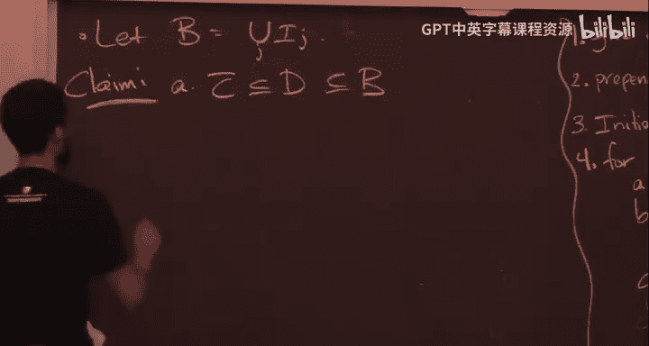

---

## 总结

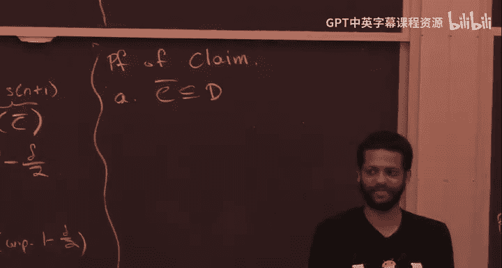

本节课中我们一起学习了如何将动态规划问题应用于流式模型。我们重点探讨了**距离单调性**问题，并介绍了一个巧妙的随机算法。该算法通过在每一步以精心设计的概率“遗忘”过去的DP状态，将空间复杂度从线性降低到了多对数级别，同时保证了 (1+ε) 的近似精度。

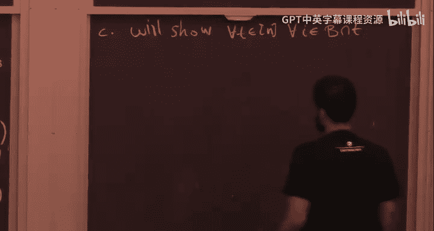

关键要点在于：
*   **LIS** 和 **DTM** 在流式模型下的复杂度不同，后者存在更高效的空间近似算法。
*   **随机化**和**近似**是突破流式算法空间下界的强大工具。
*   通过分析“不安全”事件和利用概率工具，可以证明这种“健忘型”动态规划的有效性。

这个算法展示了流式计算中一种重要的设计范式：**为了获得亚线性空间，有时需要主动且智能地丢弃信息**。