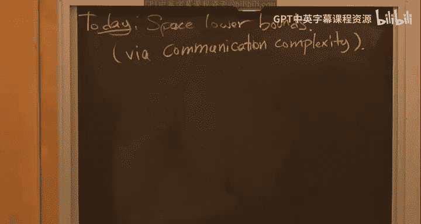
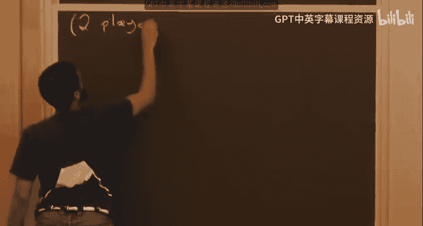
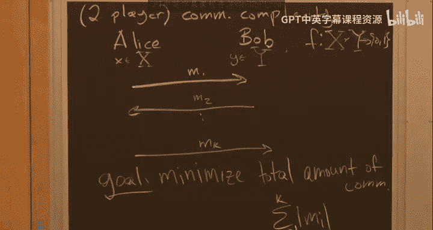
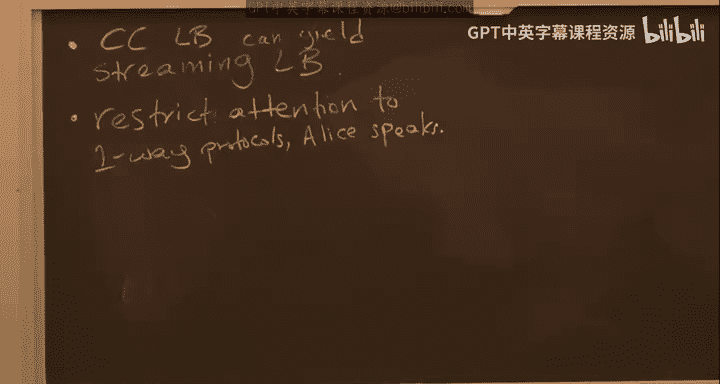
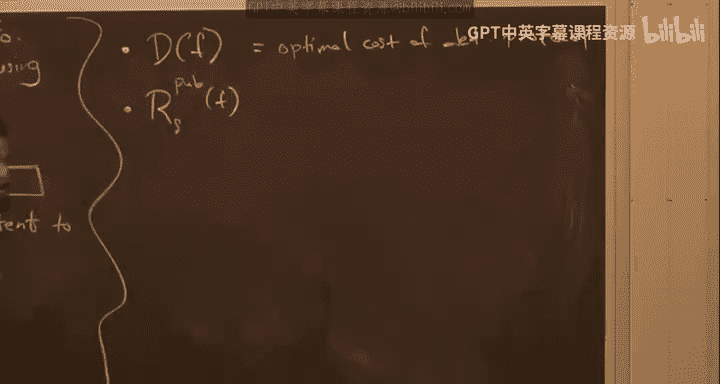

# 哈佛大学《大数据算法》课程笔记 - P9：流算法空间下界证明 🧠

在本节课中，我们将学习如何证明流算法的空间下界。我们将通过**通信复杂性**这一工具，将流算法的空间需求与通信问题的难度联系起来，从而证明几个经典流问题所需的最小空间。

---

## 通信复杂性简介

上一节我们提到了通信复杂性是证明流算法空间下界的关键工具。本节中，我们来看看它的具体定义。

通信复杂性研究的是两个或多个参与者（例如 Alice 和 Bob）为了共同计算某个函数 `F(x, y)` 所需交换的最小信息量（比特数）。

*   **参与者**：Alice 持有私有输入 `x ∈ X`，Bob 持有私有输入 `y ∈ Y`。
*   **目标**：共同计算函数 `F(x, y)` 的值（通常输出为 0 或 1）。
*   **协议**：参与者事先约定好一套通信规则（协议）。根据规则和各自的输入，他们交换一系列消息。
*   **成本**：通信成本是所交换消息的总比特数。目标是设计成本最低的正确协议。

总是存在两种平凡的协议：
1.  Alice 直接将整个 `x` 发送给 Bob，成本为 `log|X|` 比特。
2.  Bob 直接将整个 `y` 发送给 Alice，成本为 `log|Y|` 比特。

研究的核心在于，是否存在成本显著低于这些平凡协议的非平凡协议。

---

## 通信复杂性与流算法下界的关联

理解了通信复杂性的基本概念后，我们来看看它如何帮助我们证明流算法的空间下界。

其核心思想是**归约**。如果我们知道某个通信问题 `F` 很难（即需要高通信成本），并且可以证明“如果能用较小的空间 `S` 解决某个流问题，就能用较小的通信成本解决 `F`”，那么流问题的空间 `S` 就不可能太小。

具体连接方式如下：
假设存在一个空间复杂度为 `S` 比特的单遍流算法 `A`。考虑一个通信问题，其中 Alice 的输入构成流的前半部分，Bob 的输入构成流的后半部分。为了计算关于整个流的函数 `F`，他们可以执行以下协议：
1.  Alice 在她的输入（前半部分流）上运行流算法 `A`。
2.  Alice 将算法 `A` 的完整内存状态（`S` 比特）发送给 Bob。
3.  Bob 从他持有的输入（后半部分流）开始，继续在接收到的内存状态上运行算法 `A`。
4.  Bob 查询算法 `A` 的最终输出，得到答案。

这个协议的总通信量正好是 `S` 比特。因此，任何解决该通信问题的协议都至少需要 `S` 比特，所以 `S` 必须至少等于该通信问题的（单向）通信复杂性下界。

---

## 确定性精确 F0 的线性下界

为了熟悉这个证明框架，我们首先用它来重新表述一个我们已经知道的结果：精确计算不同元素数量（F0）需要线性空间。

我们通过从**相等函数**归约来证明。

*   **相等函数**：`EQ(x, y)`，其中 `x` 和 `y` 都是 `n` 比特字符串。当 `x = y` 时输出 1，否则输出 0。
*   **已知结论**：`EQ` 的单向确定性通信复杂性为 `Ω(n)` 比特。直观上，Alice 必须发送几乎整个 `x`，Bob 才能判断是否相等。

**归约证明**：
假设存在一个空间为 `S` 比特的确定性流算法 `A`，可以精确计算 F0。
1.  Alice 将她的 `n` 比特输入 `x` 视为一个流：如果 `x_i = 1`，则将元素 `i` 加入流；如果 `x_i = 0`，则不加入。
2.  Alice 在此流上运行算法 `A`，并将最终的内存内容（`S` 比特）发送给 Bob。
3.  Bob 现在可以恢复出 Alice 的整个输入 `x`：对于每个 `i` 从 1 到 `n`，Bob 将 `i` 追加到流中，并再次查询 F0。如果 F0 计数增加，说明 `i` 之前不在流中（即 `x_i = 0`）；如果未增加，说明 `i` 已在流中（即 `x_i = 1`）。
4.  恢复 `x` 后，Bob 可以将其与自己的输入 `y` 比较，计算出 `EQ(x, y)`。

上述过程构成了一个解决 `EQ` 问题的、通信成本为 `S` 比特的单向协议。由于 `EQ` 需要 `Ω(n)` 比特通信，因此必然有 `S = Ω(n)`。这就证明了精确 F0 需要线性空间。

---

## 通信复杂性的不同度量

在讨论随机化流算法下界之前，我们需要区分通信复杂性的几种不同度量，它们对应不同的随机性模型。

以下是几个关键定义：
*   `D(F)`：计算函数 `F` 的**最优确定性协议**的最小成本（最坏情况输入）。
*   `R_δ^{pub}(F)`：计算函数 `F` 的**最优随机化协议**的最小成本（最坏情况输入），允许的失败概率为 `δ`，且随机性是**公共的**（Alice 和 Bob 都能看到同一个随机字符串）。
*   `R_δ^{priv}(F)`：与上类似，但随机性是**私有的**（Alice 和 Bob 各自拥有独立的随机字符串）。
*   `D_δ^μ(F)`：当输入 `(x, y)` 服从分布 `μ` 时，计算 `F` 的**最优确定性协议**的最小成本，允许的失败概率为 `δ`。

这些度量之间存在以下关系：
`D(F) ≥ R_δ^{priv}(F) ≥ R_δ^{pub}(F) ≥ D_δ^μ(F)`（对于任意分布 `μ`）

对于证明随机化流算法的下界，**私有随机性模型**最贴合实际，因为流算法中的哈希函数等随机性需要存储，在通信中必须显式传递。然而，证明私有模型的下界通常更难。因此，我们通常的策略是：
1.  构造一个“困难”的输入分布 `μ`。
2.  证明在该分布下，即使有公共随机性，任何协议的通信成本也很高，即 `R_δ^{pub}(F)` 很大。
3.  由于 `R_δ^{priv}(F) ≥ R_δ^{pub}(F)`，这自动意味着私有模型的下界也很高。
4.  通过归约，得到流算法的空间下界。

---

## 索引问题及其下界

现在，我们引入一个在流算法下界证明中非常核心的通信问题：**索引问题**。

*   **索引问题**：Alice 持有一个 `n` 比特字符串 `x ∈ {0,1}^n`。Bob 持有一个索引 `j ∈ [n]`。他们需要输出 `x_j`（`x` 的第 `j` 位）。
*   **关键结论**：索引问题的单向公共随机性通信复杂性下界为 `Ω(n)`。更精确地说，对于失败概率 `δ`，有 `R_δ^{pub}(Index) ≥ n(1 - H_2(δ))`，其中 `H_2(δ)` 是二元熵函数 `-δ log δ - (1-δ)log(1-δ)`。当 `δ` 为常数（如 1/3）时，这也是 `Ω(n)`。

**直观理解**：在单向通信中，Alice 不知道 Bob 关心哪一位 `j`。为了确保 Bob 能以高概率正确猜出任意 `j` 对应的 `x_j`，Alice 几乎必须发送整个字符串 `x` 的信息。

**证明概要（利用信息论）**：
1.  设 `Π` 为最优公共随机性协议产生的消息（随机变量）。
2.  协议长度 `|Π|` 至少等于其熵 `H(Π)`。
3.  `H(Π) ≥ I(X; Π)`，即 `Π` 与整个输入 `X` 的互信息。
4.  使用链式法则：`I(X; Π) = Σ_{i=1}^n I(X_i; Π | X_{<i})`。
5.  对于均匀随机的 `X`，`X_i` 与 `X_{<i}` 独立，因此 `I(X_i; Π | X_{<i}) = H(X_i) - H(X_i | Π, X_{<i})`。
6.  `H(X_i) = 1`（因为均匀分布）。
7.  由于协议能以至少 `1-δ` 的概率正确输出 `X_i`（对任意 `i`），根据**法诺不等式**，条件熵 `H(X_i | Π)` ≤ `H_2(δ)`。进一步地，`H(X_i | Π, X_{<i}) ≤ H(X_i | Π) ≤ H_2(δ)`。
8.  因此，每个 `i` 对应的互信息至少为 `1 - H_2(δ)`。
9.  总和为 `n(1 - H_2(δ))`，即 `|Π| = Ω(n)`。

---

## 应用于中位数计算

我们首先展示如何将索引问题归约到**精确中位数计算**，从而证明后者需要线性空间。

**归约构造**：
假设存在一个空间为 `S` 的随机化流算法，能以至少 `2/3` 的概率精确计算流的中位数。
1.  Alice 持有 `x ∈ {0,1}^n`，Bob 持有索引 `j ∈ [n]`。
2.  **Alice 构造流**：对于 `i = 1 to n`，她将值 `(2i + x_i)` 插入流中。例如，若 `x_i=0`，插入 `2i`；若 `x_i=1`，插入 `2i+1`。这样，Alice 的 `n` 个比特被编码为 `n` 个不同的、成对出现的数字。
3.  Alice 运行中位数算法，并将内存状态（`S` 比特）发送给 Bob。
4.  **Bob 扩展流**：Bob 的目标是让第 `j` 个元素（即 `2j + x_j`）成为整个扩展流的中位数。他通过添加大量“小”值或“大”值来实现：
    *   他添加 `(j-1)` 个值为 `0` 的元素（所有值都小于 `2`）。
    *   他添加 `(n-j)` 个值为 `(2n+2)` 的元素（所有值都大于 `2n+1`）。
5.  现在，扩展后的流共有 `n + (j-1) + (n-j) = 2n-1` 个元素。其中位数是第 `n` 小的元素。由于添加的 `0` 和 `(2n+2)` 分别位于排序序列的两端，原始流中的第 `j` 个元素恰好成为总体的第 `n` 个元素，即中位数。
6.  Bob 继续运行中位数算法，得到结果。如果结果是 `2j`，则 `x_j = 0`；如果结果是 `2j+1`，则 `x_j = 1`。

这样，我们就用 `S` 比特的通信解决了索引问题。由于索引问题需要 `Ω(n)` 比特的通信，因此 `S = Ω(n)`。这证明了精确中位数计算需要线性空间。

---

## 应用于近似 F0

接下来，我们证明近似计算不同元素数量（F0）到 `(1±ε)` 因子需要 `Ω(ε^{-2})` 空间。这通过从**间隙汉明距离问题**归约来实现。

*   **间隙汉明距离问题**：Alice 和 Bob 分别持有 `t` 比特字符串 `x` 和 `y`。他们被承诺以下两种情况之一：
    *   `HAM(x, y) ≥ t/2 + √t`
    *   `HAM(x, y) ≤ t/2 - √t`
    他们的目标是区分属于哪种情况。
*   **已知结论**：间隙汉明距离的单向通信复杂性是 `Ω(t)`。并且，可以通过索引问题归约来证明此结论。

**关键等式**：对于 `0/1` 向量，不同元素数量满足 `2 * F0(x, y) = |x| + |y| + HAM(x, y)`，其中 `|x|` 表示 `x` 中 `1` 的个数（权重）。

**归约证明**：
1.  设 `t = Θ(1/ε^2)`。假设存在一个空间为 `S` 的流算法，能以 `2/3` 概率将 F0 近似到 `(1±ε/2)` 因子。
2.  Alice 和 Bob 获得间隙汉明距离问题的输入 `x` 和 `y`（各 `t` 比特）。
3.  **Alice 构造流**：将她的输入 `x` 视为流：如果 `x_i=1`，则插入元素 `i`。
4.  Alice 运行 F0 算法，并将内存状态（`S` 比特）连同她向量的权重 `|x|`（需 `log t` 比特）一起发送给 Bob。
5.  **Bob 计算**：
    *   Bob 知道 `|y|`（他自己的输入）。
    *   Bob 将他的输入 `y` 作为流后半部分继续运行算法，得到 F0 的估计值 `est`，满足 `|2*F0_true - 2*est| ≤ ε t`（因为 `(1±ε/2)` 近似意味着 `2*F0` 的误差在 `±ε t` 内）。
    *   根据关键等式，汉明距离 `HAM(x, y) = 2*F0_true - |x| - |y|`。
    *   Bob 可以计算汉明距离的估计：`est_HAM = 2*est - |x| - |y|`。
    *   这个估计的误差满足 `|est_HAM - HAM_true| ≤ ε t`。
6.  由于间隙汉明距离问题的两个情况相差 `2√t ≈ 2ε t`（因为 `t = Θ(1/ε^2)`），只要估计误差小于 `ε t`，Bob 就能以高概率区分这两种情况，从而解决间隙汉明距离问题。

因此，解决 F0 近似问题的算法空间 `S`，必须至少与间隙汉明距离问题的通信下界 `Ω(t) = Ω(1/ε^2)` 一样大。这就证明了 `Ω(1/ε^2)` 的空间下界。

---

## 总结与展望

本节课中，我们一起学习了如何利用通信复杂性这一强大工具来证明流算法的空间下界。

我们首先建立了通信复杂性与流算法空间下界之间的通用归约框架。然后，我们回顾了如何用该框架证明精确 F0 的线性下界。接着，我们介绍了索引问题及其信息论下界证明，并展示了如何将其归约到精确中位数计算，从而得到后者的线性下界。最后，我们通过从间隙汉明距离问题归约，证明了 `(1±ε)` 近似 F0 需要 `Ω(1/ε^2)` 空间。

这些技巧是流算法理论中的核心工具。索引问题及其变体（如多玩家下的不相交问题）可用于证明更多问题的下界，例如 `p > 2` 时的 `F_p` 矩估计下界。掌握这种归约思想，对于理解流算法能力的根本限制至关重要。