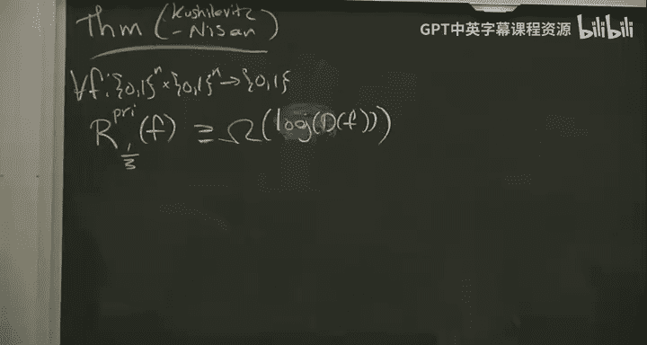
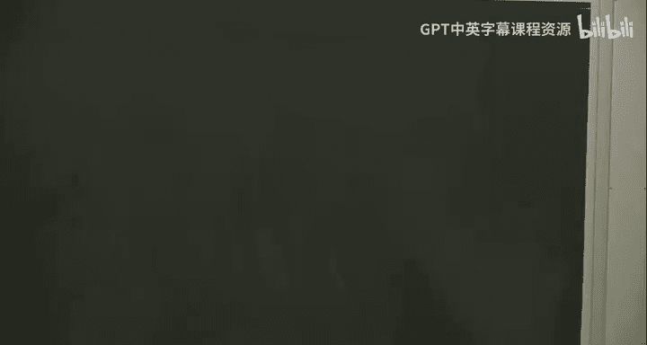
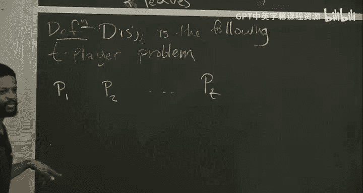
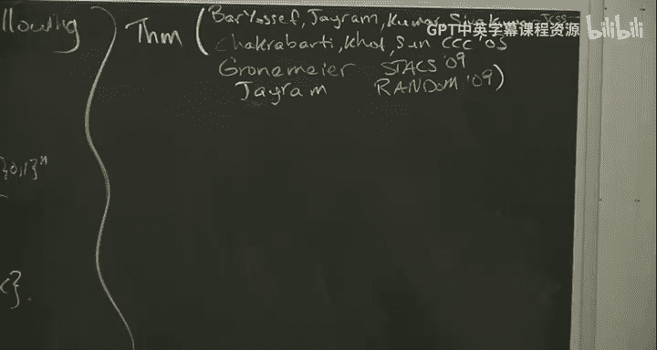
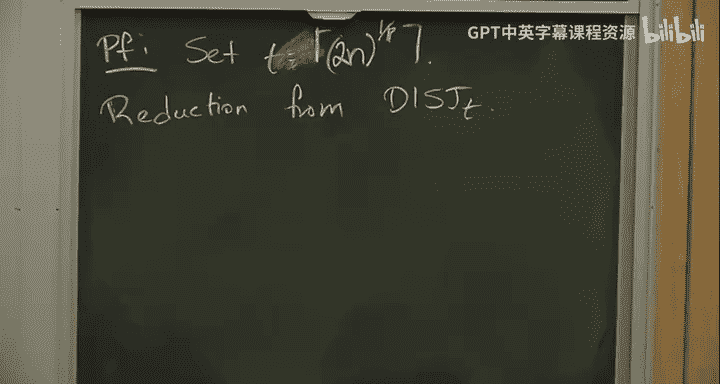
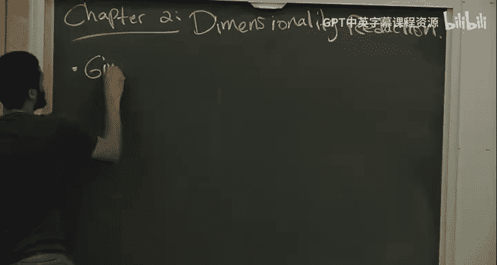
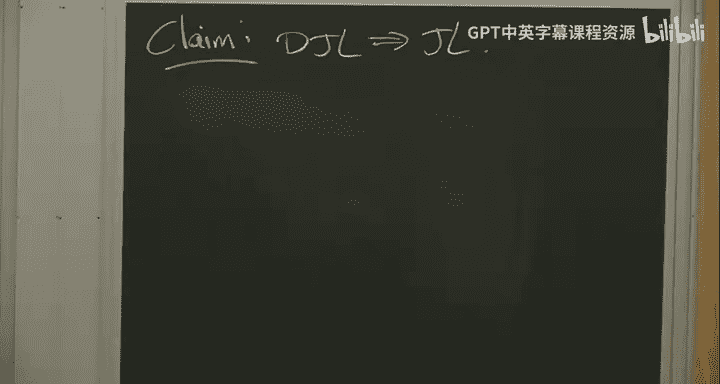

# 10：流算法下界与降维技术入门 🚀

在本节课中，我们将完成对流算法空间下界的讨论，并开启一个全新的主题：降维技术。我们将首先回顾如何通过通信复杂性证明流算法的空间下界，然后介绍降维的基本概念及其重要性，特别是著名的Johnson-Lindenstrauss引理。

---

## 回顾：通过通信复杂性证明流算法下界 📉

上一节我们介绍了如何通过通信复杂性来证明流算法的空间下界。其核心思路是：首先证明某些通信问题是困难的，然后将这些困难问题归约到我们的流问题上。

以下是几个关键归约的例子：
*   **精确估计不同元素数量（F0）**：可以通过从“相等性”问题归约，得到确定性的线性空间下界。
*   **随机近似F0**：可以通过从“索引”问题归约到“间隙汉明距离”问题，再归约到随机近似F0，从而得到Ω(1/ε²)的空间下界。
*   **随机中位数查找**：同样可以通过归约得到下界。

本节中，我们将完成蓝色部分标注内容的证明，然后结束对流算法的讨论。

---

## 流算法下界的进一步证明 🔍

### 1. 随机精确F0的线性空间下界

**断言**：随机化的、失败概率为常数的精确F0算法需要Ω(n)的空间。

**证明**：我们通过从“索引”问题归约来证明。
*   **索引问题**：Alice有一个n位字符串x，Bob有一个索引j。目标是让Bob知道x[j]是0还是1。
*   **归约构造**：
    1.  Alice根据她的输入x构造流：如果x[i]=1，则将i放入流中。
    2.  Alice在流上运行假定的精确F0算法，将算法内存状态连同x中1的个数（即支撑集大小）发送给Bob。
    3.  Bob将元素j追加到流中，然后查询F0值。
    4.  如果F0值增加，则说明j原本不在流中，即x[j]=0；否则x[j]=1。
*   **通信成本**：Alice发送了S（算法空间） + log n（支撑集大小）比特。
*   **下界**：已知索引问题需要Ω(n)比特的通信。因此，S + log n = Ω(n)，这意味着S = Ω(n)。

这个证明简洁地展示了“索引”问题作为下界工具的威力。

### 2. 随机近似F0的对数空间下界

**定理**：随机近似F0算法也需要Ω(log n)的空间。

**证明思路**：
1.  首先，一个已知定理指出：任何通信问题的随机私有硬币通信复杂度，至少是其确定性通信复杂度的对数。即：`R(f) = Ω(log D(f))`。
2.  回顾之前证明确定性近似F0下界时，我们构造了一个大小为2^Ω(n)的子集族C，其中每个子集大小固定，且任意两个不同子集的交集很小。
3.  在这个子集族C上，确定性“相等性”测试需要Ω(n)通信（根据鸽巢原理）。
4.  根据上述定理，在C上的随机“相等性”测试则需要Ω(log n)通信。
5.  最后，我们可以将C上的随机“相等性”测试归约到随机近似F0问题（方法类似：Alice和Bob分别插入其集合对应的元素到流中，通过查询F0值是否近似翻倍来判断集合是否相等）。
6.  因此，随机近似F0算法的空间复杂度也必须为Ω(log n)。

结合之前得到的Ω(1/ε²)下界，随机近似F0的完整空间下界是Ω(1/ε² + log n)，这与已知的最优算法匹配。

### 3. 高阶矩Fp (p>2)的空间下界

对于p>2，近似计算Fp（Lp范数的p次方）需要Ω(n^(1-2/p))的空间，这同样是最优的（忽略对数因子）。

**证明思路**（基于T玩家不相交问题）：
*   **T玩家不相交问题**：有T个玩家，每人有一个n位字符串（视为集合）。承诺两种情况之一：要么所有集合两两不相交；要么存在一个公共元素k，使得每对集合的交集恰好是{k}。目标是区分这两种情况。
*   **下界**：该问题的随机通信复杂度下界为Ω(n / T)。这意味着某个玩家必须发送Ω(n / T²)比特。
*   **归约到Fp**：
    1.  玩家们依次将各自集合中的元素作为流处理，并传递流算法的状态。
    2.  在“全不相交”情况下，每个元素频率最多为1，因此Fp ≤ n。
    3.  在“存在公共元素k”情况下，元素k的频率为T，因此Fp ≥ T^p。
    4.  如果p>2，且T约等于n^(1/p)，那么这两种情况的Fp值相差一个大于2的因子。因此，一个足够好的近似Fp算法可以区分它们。
*   **结论**：每个玩家传递的空间S必须满足S = Ω(n / T²)。代入T = n^(1/p)，得到S = Ω(n^(1 - 2/p))。

**关于L∞范数的注记**：L∞范数（最大频率）本质上对应p = log n的情况。通过两玩家不相交问题的归约，可以证明其需要Ω(n)的空间，这与上述公式当p=log n时（n^(1 - 2/log n) ~ 常数）所暗示的线性下界精神一致。

---

## 新篇章：降维技术 📉

现在，我们告别流算法，开启新的章节——降维技术。

### 降维的动机

在许多算法问题中，输入是高维向量（例如，图像特征、文档向量化表示）。高维度会导致：
*   运行时间增加
*   存储成本上升
*   通信开销变大

**降维的目标**：在运行核心算法之前，对高维数据进行预处理，将其映射到低维空间，同时**保留关键的结构信息**，从而使得后续算法更高效。

需要保留的几何结构可能包括：
*   点对之间的距离
*   向量之间的角度
*   点集的体积
*   特定优化问题的最优解性质

本节我们将主要关注**距离保持**。

### 失真度与JL引理

**定义（失真度）**：给定两个度量空间(X, d_X)和(Y, d_Y)，以及映射f: X → Y。若存在常数C1, C2，使得对所有x, x‘ ∈ X，有：
`C1 * d_X(x, x') ≤ d_Y(f(x), f(x')) ≤ C2 * d_X(x, x')`
且 `D = C2 / C1`，则称映射f的**失真度**最多为D。

我们将专注于**赋范向量空间**，其中距离由范数定义：`d(x, y) = ||x - y||`。

**Johnson-Lindenstrauss (JL) 引理**：对于任意一组n个点（向量）`{x1, ..., xN} ⊂ R^n`（欧几里得空间L2），以及任意ε ∈ (0, 1/2)，存在一个线性映射π: R^n → R^m，其中`m = O(ε^(-2) log N)`，使得该映射到低维空间后，所有点对之间的欧氏距离保持(1±ε)因子不变。即，映射的失真度至多为(1+ε)。

**重要性**：JL引理表明，对于欧氏距离，我们可以将点集降至仅与点数量对数相关的维度，而与原始维度n无关！这为处理高维数据提供了强大工具。

### 为什么专注于L2范数？

研究表明，L2范数在降维中具有特殊性：
*   对于L1范数，要实现常数失真度降维，目标维度需要是n^Ω(1)，而非对数维度。
*   更一般地，Johnson和Naor的定理指出：如果一个赋范空间具有“任意n点集都可嵌入到O(log n)维子空间且失真度为常数”的性质（即JL性质），那么该空间本质上必须近似于L2空间。

因此，L2范数是实现高效降维的“最佳舞台”，这也是我们重点研究它的原因。

### 分布式JL引理

为了证明JL引理，我们通常先证明一个更简单的“分布式”版本。

**分布式JL引理**：对于任意维度n，任意ε, δ ∈ (0, 1/2)，存在一个分布在矩阵π上（π是m×n矩阵，`m = O(ε^(-2) log(1/δ))`），使得对于任意固定单位向量x (||x||=1)，有：
`Pr[ | ||πx||² - 1 | > ε ] ≤ δ.`
也就是说，随机选取的矩阵π以高概率(1-δ)近似保持单个向量的长度。

**如何从分布式JL推出标准JL**：
1.  给定N个点，考虑所有`(N choose 2)`个归一化的差向量 `(xi - xj)/||xi - xj||`。
2.  令分布式JL中的失败概率δ < 1/(N choose 2)。
3.  根据联合界，随机矩阵π在**所有**差向量上同时保持长度的概率 > 0。
4.  因此，**存在**一个确定的矩阵π满足要求，其维度m = O(ε^(-2) log N)。

**与流算法的联系**：你可能会觉得这个随机矩阵π很眼熟。它正是AMS草图等流算法中使用的**随机符号矩阵**（每个元素独立地以1/√m缩放为+1或-1）。在流算法中，我们通常用切比雪夫不等式分析，得到m = O(1/(ε²δ))。为了得到更好的对数依赖log(1/δ)，我们需要更强大的工具来分析这种随机二次型的尾部行为。

---

## 下节课预告 🎯

本节课我们一起学习了流算法下界的最终证明，并引入了降维技术的基本概念和JL引理。

下节课我们将：
*   证明**分布式JL引理**。
*   引入**Hanson-Wright不等式**，它是分析独立随机变量二次型尾部概率的强大工具。
*   利用Hanson-Wright不等式，我们可以更优雅地证明分布式JL，并探索更高效的JL构造方法。

我们将看到，大数据算法中的不同领域（如流算法、降维）在技术层面上是紧密相连的。