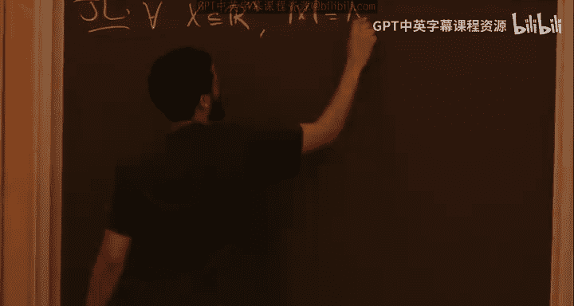
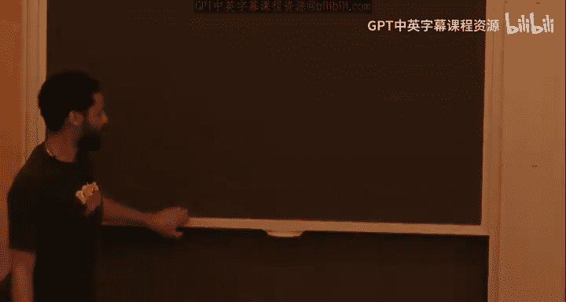
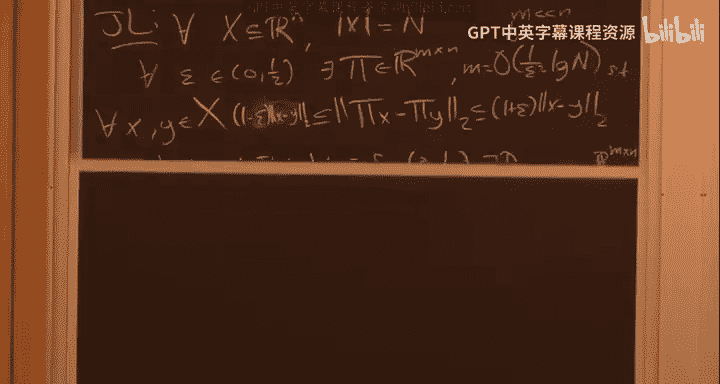
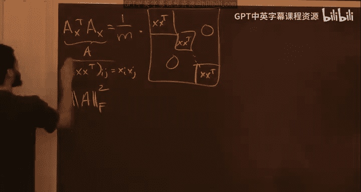
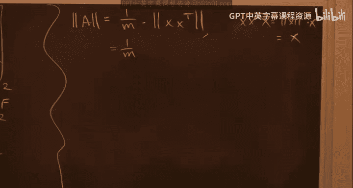

# 11：Johnson-Lindenstrauss引理与Hanson-Wright不等式 🎯




在本节课中，我们将学习Johnson-Lindenstrauss引理，这是一个在大数据降维中至关重要的工具。我们将看到如何通过一个简单的随机线性映射，将高维数据点嵌入到低维空间，同时几乎保持所有点对之间的距离。为了证明这一点，我们将深入探讨Hanson-Wright不等式，这是一个强大的概率工具，用于控制随机二次型的集中性。




## 概述 📋



Johnson-Lindenstrauss引理指出，对于任意一组高维点，存在一个到低维空间的线性映射，能够以高概率保持所有点对之间的距离。我们将首先形式化地定义这个引理，然后介绍一个更易于处理的“分布化”版本。证明的核心将依赖于Hanson-Wright不等式，该不等式为随机符号向量（Rademacher向量）的二次型提供了尾概率界。

## Johnson-Lindenstrauss引理与分布化版本


设 `X` 是 `N` 维空间中的一个点集，其大小为 `|X| = N`。对于任意 `ε ∈ (0, 1/2)`，存在一个线性映射 `π: R^N -> R^M`，其中 `M = O(ε^(-2) log N)`，使得对于所有 `x, y ∈ X`，有：
```
(1 - ε) ||x - y|| ≤ ||π(x) - π(y)|| ≤ (1 + ε) ||x - y||
```
这里的 `M` 远小于 `N`，实现了降维。

然而，直接证明这个引理是复杂的。一个更实用的途径是证明其“分布化”版本。

**分布化Johnson-Lindenstrauss引理**：对于任意 `ε, δ ∈ (0, 1/2)`，存在一个随机矩阵 `π` 的概率分布（`π ∈ R^{M×N}`），使得对于任意单位范数向量 `x`（即 `||x|| = 1`），有：
```
Pr[ | ||π(x)||^2 - 1 | > ε ] ≤ δ
```
其中 `M = O(ε^(-2) log(1/δ))`。

这个引理意味着映射 `π` 能以高概率保持向量 `x` 的范数。由于 `π` 是线性的，这自然就保持了所有向量间的距离。通过设置 `δ = 1/N^2` 并对所有可能的向量对取并集，可以从分布化版本推导出原始的JL引理。

上一节我们介绍了JL引理及其分布化形式的目标，本节中我们来看看如何构造这样的随机映射并证明其性质。

## 历史构造与简单随机映射

在Johnson和Lindenstrauss于1984年的原始论文中，他们通过随机旋转矩阵后投影到前 `M` 个坐标来构造 `π`。然而，随机旋转矩阵的条目不是独立的，实现起来有一定开销。



后续的研究表明，使用具有独立同分布条目的随机矩阵同样有效，这大大简化了实现。我们将分析以下这种简单的构造：

令 `π` 是一个 `M×N` 的矩阵，其每个条目 `π_{ij}` 独立地以 `1/√M` 的概率取 `+1` 或 `-1`。即：
```
π_{ij} = σ_{ij} / √M, 其中 σ_{ij} 是独立的Rademacher随机变量（等概率取 ±1）。
```
我们将证明，这个简单的分布满足分布化JL引理。



## Hanson-Wright不等式：核心工具

证明分布化JL引理的关键是Hanson-Wright不等式。这个定理由Hanson和Wright于1971年证明，它控制了随机二次型的偏差。

**Hanson-Wright不等式**：设 `A` 是一个 `n×n` 的实对称矩阵。设 `σ = (σ_1, ..., σ_n)` 是独立的Rademacher随机变量。那么，对于任意 `λ > 0`，有：
```
Pr[ | σ^T A σ - E[σ^T A σ] | > λ ] ≤ C_1 * exp(-C_2 * min( λ^2 / ||A||_F^2, λ / ||A||_{op} ))
```
其中：
*   `||A||_F` 是 `A` 的Frobenius范数（所有条目平方和的平方根）。
*   `||A||_{op}` 是 `A` 的算子范数（最大奇异值，对于实对称矩阵即最大特征值的绝对值）。
*   `C_1, C_2` 是普适常数。


这个尾界是混合型的，包含了高斯尾（`λ^2 / ||A||_F^2`）和指数尾（`λ / ||A||_{op}`）。它等价于对所有 `p ≥ 1` 的矩有界：
```
( E[ | σ^T A σ - E[σ^T A σ] |^p ] )^(1/p) ≲ √p * ||A||_F + p * ||A||_{op}
```

## 从Hanson-Wright推导分布化JL

现在，我们利用Hanson-Wright不等式来证明我们构造的随机映射 `π` 满足分布化JL引理。

**证明**：
对于单位向量 `x`，考虑随机变量 `Z = ||π(x)||^2`。
```
Z = ||π(x)||^2 = ∑_{r=1}^{M} ( (1/√M) ∑_{i=1}^{N} σ_{ri} x_i )^2 = (1/M) ∑_{r,i,j} x_i x_j σ_{ri} σ_{rj}
```
我们可以将其重写为二次型。定义一个大向量 `σ`，它由所有 `σ_{ri}`（`r=1..M, i=1..N`）拼接而成。构造一个分块对角矩阵 `A_x`，其每个 `M×M` 块都是 `(1/M) * x x^T`。可以验证：
```
Z = σ^T A_x σ
```
并且 `E[Z] = 1`（因为 `E[σ_{ri}σ_{rj}] = 1` 当 `i=j`，否则为0，且 `||x||^2=1`）。

我们需要 bound `Pr[ |Z - 1| > ε ]`。这正是Hanson-Wright不等式的形式，其中 `A = A_x`。

计算 `A_x` 的范数：
*   **Frobenius范数**：`||A_x||_F^2 = 1/M`。
*   **算子范数**：`||A_x||_{op} = 1/M`。

将这两个范数代入Hanson-Wright不等式，我们得到：
```
Pr[ |Z - 1| > ε ] ≤ C_1 * exp( -C_2 * min( ε^2 / (1/M), ε / (1/M) ) )
                 = C_1 * exp( -C_2 * min( M ε^2, M ε ) )
```
为了使这个概率小于 `δ`，我们只需要选择 `M` 使得：
```
M ≥ C * max( ε^(-2) log(1/δ), ε^(-1) log(1/δ) )
```
由于 `ε < 1/2`，`ε^(-2)` 项占主导，因此 `M = O(ε^(-2) log(1/δ))` 足以满足要求。证毕。

可以看到，一旦有了Hanson-Wright不等式，分布化JL引理的证明变得非常简洁。接下来，我们将深入探讨Hanson-Wright不等式本身的证明。

## 证明Hanson-Wright不等式：所需工具

Hanson-Wright不等式的证明需要三个核心工具：
1.  **Khintchine不等式**：用于控制随机线性形式的矩。
2.  **解耦（Decoupling）**：将二次型问题约化为线性形式问题。
3.  **平方根技巧（Rudelson's Square Root Trick）**：用于处理递归的矩 bound。


我们将逐一介绍并证明它们。

### 1. Khintchine不等式

Khintchine不等式给出了Rademacher线性组合的矩 bound。

**定理（Khintchine）**：对于任意向量 `x ∈ R^n` 和任意 `p ≥ 1`，存在常数 `C_p`（仅依赖于 `p`），使得：
```
( E[ | ∑_{i=1}^n σ_i x_i |^p ] )^(1/p) ≤ C_p * ||x||_2
```
特别地，对于 `p ≥ 2`，有 `C_p ≲ √p`。这意味着其尾概率服从高斯型衰减：`Pr[ |∑ σ_i x_i| > λ ] ≲ exp(-c λ^2 / ||x||_2^2)`。

**证明思路**：我们只需对偶数 `p` 证明 `C_p ≲ √p` 即可（通过取整技巧可推广到所有 `p`）。将期望展开为单项式求和。对于存活项（所有索引出现偶数次），其系数在Rademacher情形下为1，在高斯情形下（将 `σ_i` 替换为标准高斯 `g_i`）至少为1。因此，Rademacher的 `p` 阶矩被高斯情形的 `p` 阶矩所控制。而高斯线性组合 `∑ g_i x_i` 本身是一个方差为 `||x||_2^2` 的高斯变量，其 `p` 阶矩为 `≲ √p * ||x||_2`。这就完成了证明。


### 2. 解耦（Decoupling）

解耦技术允许我们将一个二次型的矩 bound 用两个独立的随机向量序列的线性型的矩来 bound。

**定理（Decoupling）**：设 `A` 是 `n×n` 实矩阵（对角线元素可为任意值）。设 `σ` 和 `σ‘` 是两组独立的Rademacher向量。那么，对于任意 `p ≥ 1`，有：
```
( E_σ[ | ∑_{i≠j} A_{ij} σ_i σ_j |^p ] )^(1/p) ≤ 4 * ( E_{σ, σ'}[ | ∑_{i,j} A_{ij} σ_i σ‘_j |^p ] )^(1/p)
```
注意右边是对所有 `i, j` 求和，且 `σ` 和 `σ‘` 独立。

**证明思路**：引入独立的伯努利(1/2)随机变量 `η_i`。将原和式写为 `4 * E_η[ ∑_{i≠j} A_{ij} σ_i σ_j η_i (1-η_j) ]`。利用Jensen不等式将期望移到绝对值 `p` 次方外面。然后，存在一个固定的 `η’ ∈ {0,1}^n` 使得 bound 成立。令 `S = {i: η‘_i = 1}`，则和式变为 `∑_{i∈S, j∉S} A_{ij} σ_i σ_j`。由于 `{σ_j : j∉S}` 是独立随机符号，我们可以将其替换为另一个独立的序列 `σ‘_j` 而不改变分布。最后，通过添加期望为零的项（如 `i,j ∈ S` 或 `i,j ∉ S` 的项，因为 `E[σ‘_j]=0`），我们可以将和式补全为 `∑_{i,j} A_{ij} σ_i σ‘_j`，再次利用Jensen不等式完成证明。

### 3. 证明Hanson-Wright不等式

现在，我们结合Khintchine不等式和解耦技术来证明Hanson-Wright不等式。我们证明其矩形式：对于 `p ≥ 2`，
```
( E[ | σ^T A σ - E[σ^T A σ] |^p ] )^(1/p) ≲ √p * ||A||_F + p * ||A||_{op}
```
（对于 `1 ≤ p < 2` 的情形，可由 `p=2` 的情形推出）。

**证明**：
令 `Z = σ^T A σ - E[σ^T A σ]`。注意 `E[σ^T A σ] = trace(A)`，而去心二次型 `Z` 等价于 `∑_{i≠j} A_{ij} σ_i σ_j`（当 `A` 对称时）。

1.  **应用解耦**：
    ```
    || Z ||_p ≲ || ∑_{i,j} A_{ij} σ_i σ‘_j ||_p
    ```
    这里 `||·||_p` 表示 `L_p` 范数（即 `(E|·|^p)^(1/p)`），且右边的期望是对 `σ` 和 `σ‘` 取的。

2.  **条件化与Khintchine**：将 `σ‘` 视为条件，对 `σ` 应用Khintchine不等式：
    ```
    || ∑_{i,j} A_{ij} σ_i σ‘_j ||_p ≤ √p * ( E_{σ‘}[ || A σ‘ ||_2^p ] )^(1/p)
    ```
    因为对于固定的 `σ‘`，`∑_i (∑_j A_{ij} σ‘_j) σ_i` 是关于 `σ` 的线性形式，其 `L_2` 系数向量的范数正是 `|| A σ‘ ||_2`。

3.  **矩的转换**：注意 `(E[ || A σ‘ ||_2^p ])^(1/p) = || || A σ‘ ||_2^2 ||_{p/2}^{1/2}`。通过广义三角不等式，这小于等于：
    ```
    ( E[|| A σ‘ ||_2^2 ] )^{1/2} + || || A σ‘ ||_2^2 - E[|| A σ‘ ||_2^2] ||_{p/2}^{1/2}
    ```
    第一项等于 `||A||_F`（Frobenius范数）。第二项是另一个去心二次型的 `L_{p/2}` 范数的平方根，即 `|| σ‘^T (A^T A) σ‘ - E[...] ||_{p/2}^{1/2}`。

4.  **递归与平方根技巧**：我们对这个新的二次型再次应用解耦和Khintchine（步骤类似，但阶数变为 `p/2`）。经过推导，我们会得到一个关于变量 `E = ||Z||_p / √p` 的不等式，其形式类似于：
    ```
    E^2 ≲ ||A||_F + p^{1/2} ||A||_{op}^{1/2} * E
    ```
    这是一个关于 `E` 的二次不等式。解这个不等式（取较大的根），并利用 `√(a^2+b^2) ≲ a + b`，最终可得：
    ```
    E ≲ ||A||_F + p^{1/2} ||A||_{op}
    ```
    因此，
    ```
    ||Z||_p = √p * E ≲ √p * ||A||_F + p * ||A||_{op}
    ```
    这正是我们想要证明的矩 bound。通过矩生成函数或直接代入尾概率公式，即可得到定理陈述中的指数尾 bound。

## 总结 🏁

在本节课中，我们一起学习了：
1.  **Johnson-Lindenstrauss引理**：一个强大的降维工具，它保证可以通过随机线性映射将高维数据压缩到低维空间，同时近乎完美地保持距离信息。
2.  **分布化JL引理**：一个更易于证明的版本，它要求随机映射能以高概率保持单个单位向量的范数。
3.  **简单随机映射构造**：使用独立同分布的 `±1/√M` 随机变量作为矩阵条目的映射，即可满足分布化JL引理。
4.  **Hanson-Wright不等式**：证明的核心，它给出了Rademacher二次型集中性的精确控制。
5.  **关键证明工具**：我们深入探讨了Khintchine不等式（控制线性形式）、解耦技术（将二次型转化为线性型）以及平方根技巧（处理递归矩 bound），并利用它们完成了Hanson-Wright不等式的证明。

通过这一系列内容，我们不仅理解了一个重要的大数据算法理论基础，也掌握了一套分析随机矩阵和二次型集中性的有力工具。这些工具在机器学习、数据科学和算法设计的多个领域都有广泛应用。