# 哈佛大学《大数据算法》课程笔记 - 第12讲：Johnson-Lindenstrauss引理的下界与超越最坏情况分析 🎯

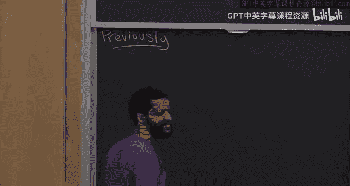

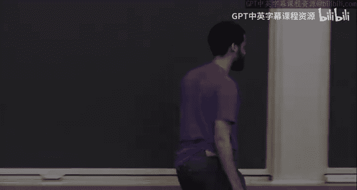

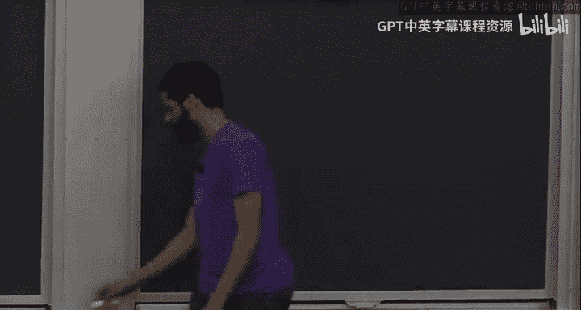

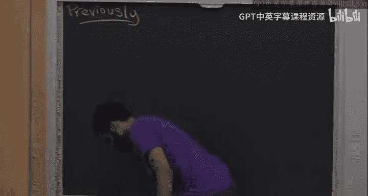

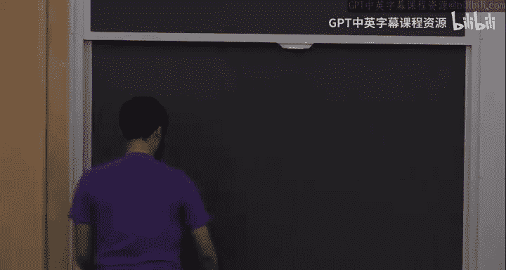

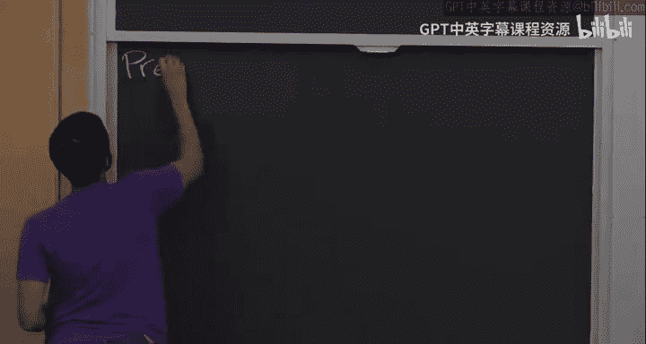

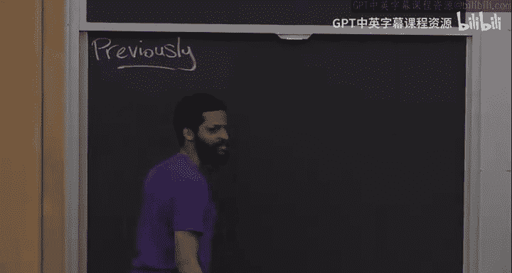

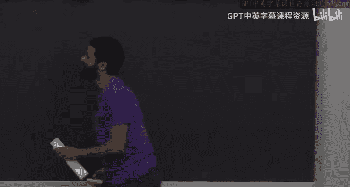

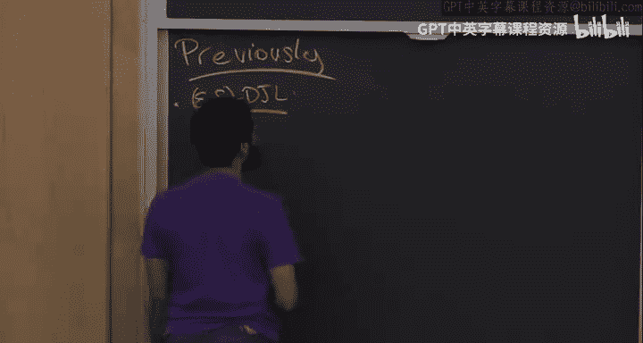

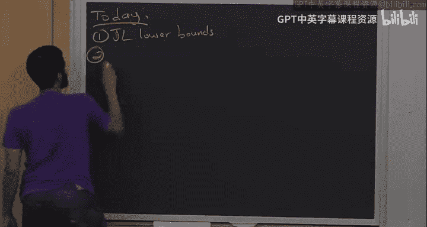

在本节课中，我们将学习Johnson-Lindenstrauss引理的下界，并探讨如何超越最坏情况分析，以获得针对特定数据集的更优维度约简保证。

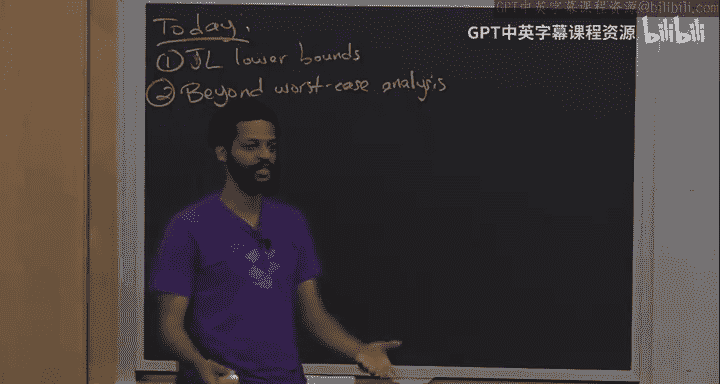

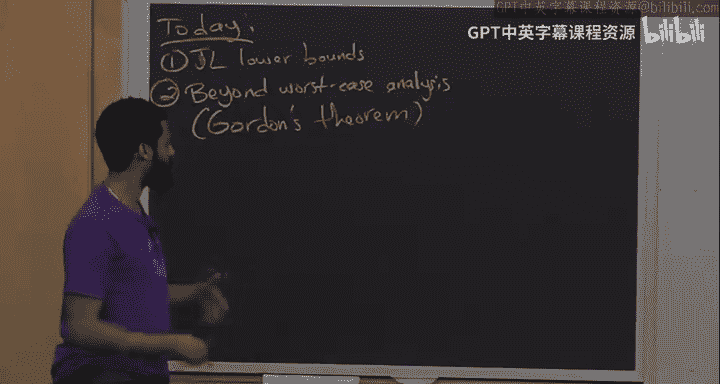

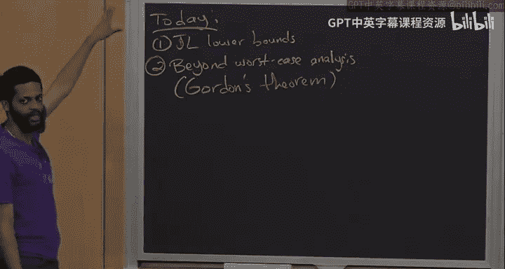

---

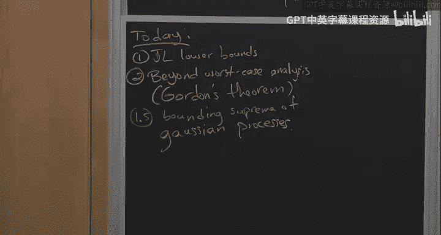

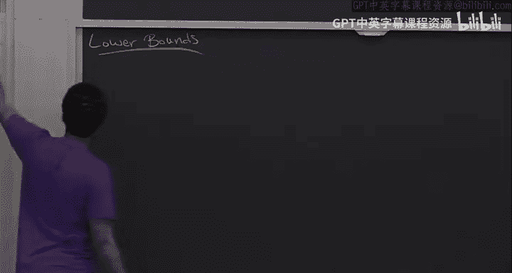

## 1. 下界介绍 📉

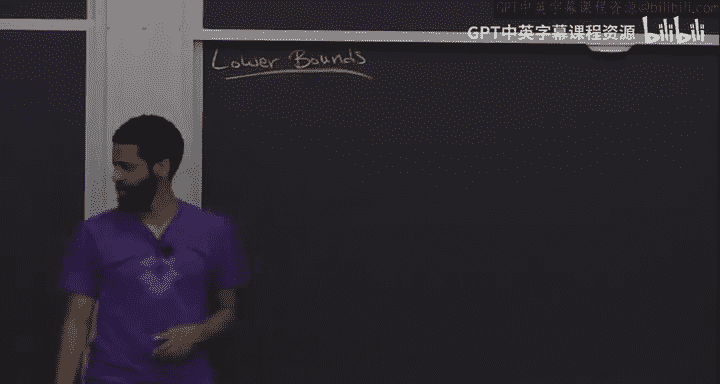

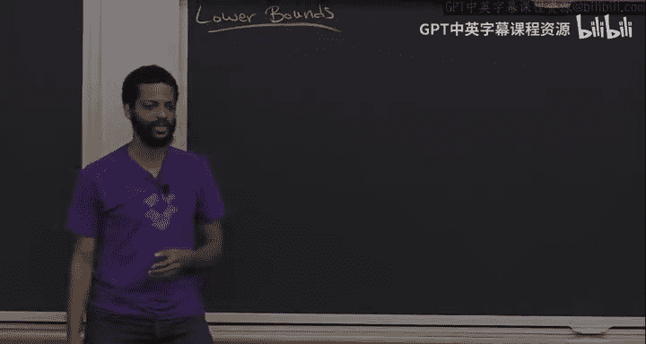

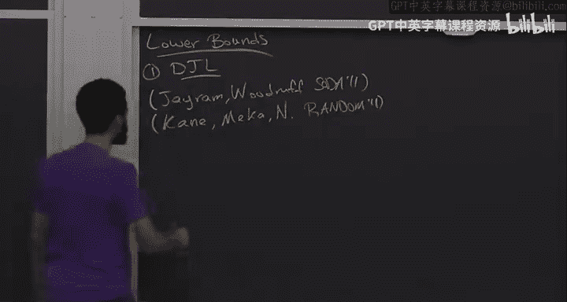

上一节我们证明了分布式的Johnson-Lindenstrauss引理。本节中，我们来看看其下界，即证明JL引理在某种意义上是最优的。

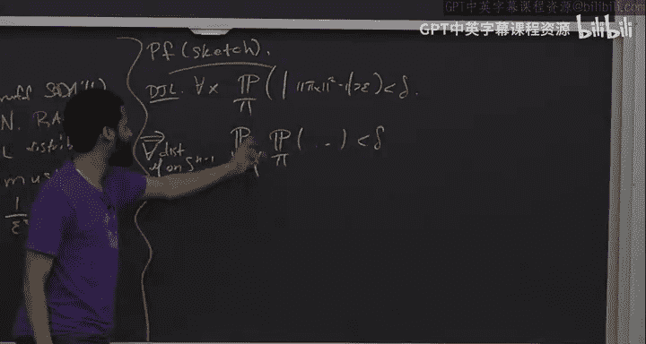

这些下界的形式如下：对于任意给定的点数N，总存在一个包含N个点的集合，使得任何嵌入到低维空间的方法都需要至少大约 `min(N, 1/ε² log N)` 的维度。这表明JL引理几乎是“最坏情况”下最优的。

---

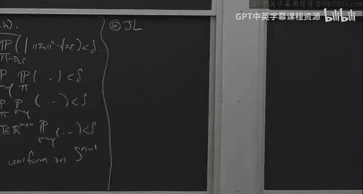

## 2. 分布式JL引理的下界

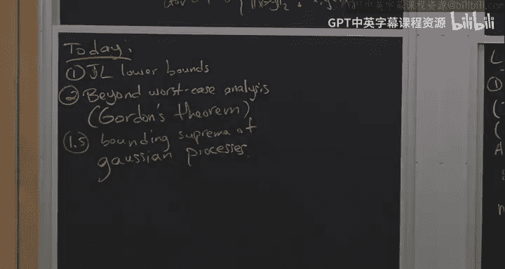

首先，我们区分两个不同的问题：**分布式JL引理**和**标准JL引理**。文献中常统称为JL，但它们是不同的问题，其中一个已解决，另一个仍有开放性问题。

分布式JL引理的下界由J. Ram和Woodruff等人证明。其结论是：对于任意ε, δ ∈ (0, 1/2)，任何(ε, δ)-分布式JL方案所需的维度m必须满足：
`m ≥ min(n, 1/ε² log(1/δ))`

以下是证明思路的简要概述：

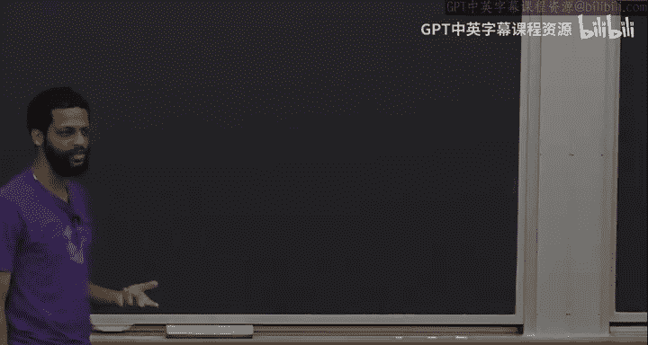

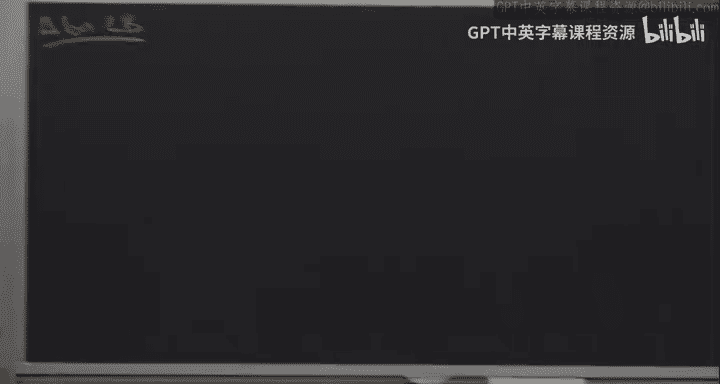

分布式JL保证：对于所有向量x，映射π满足 `| ||πx||² - 1 | > ε` 的概率至多为δ。
这意味着对于球面上的任意分布μ，有：
`Pr_{x~μ}[Pr_π[| ||πx||² - 1 | > ε] ] ≤ δ`
通过交换概率顺序，可以论证：如果π只有m行，那么除非m足够大（至少为 `1/ε² log(1/δ)`），否则它无法以高概率保持随机向量的范数。

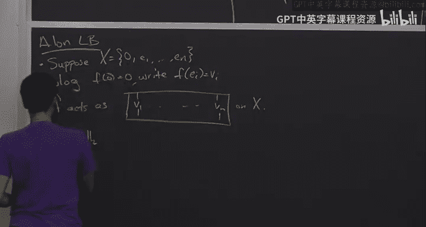

---

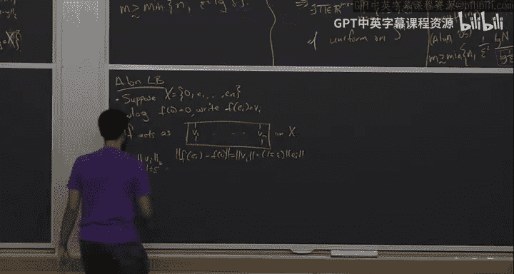

## 3. 标准JL引理的下界（线性映射）

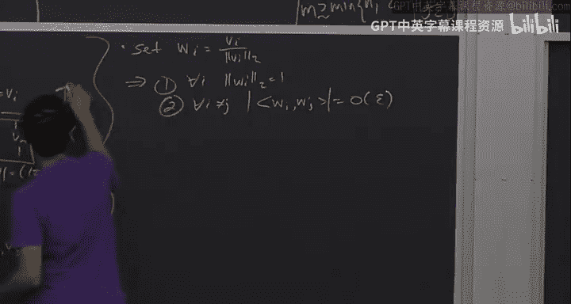

如果我们要求嵌入映射F必须是线性的（即F(x) = Πx），那么存在一个下界。

与Casper Green Larson合作的工作表明，对于线性映射，所需的维度m必须满足：
`m ≥ min(n, 1/ε² log n)`
这个下界是紧的，因为单位矩阵可以达到n维，而JL引理可以达到 `1/ε² log n` 维。

证明思路是使用概率方法：对于一个固定的线性映射Π，如果它的行数不足，那么它无法以高概率保持一个随机高斯向量的范数。通过考虑一组随机高斯向量，并对其所有可能的距离（包括到0点的距离）进行保持，可以论证，如果Π不能以良好概率保持其中一个向量的范数，那么它保持所有向量范数的概率就更小。最后，通过对所有可能的Π矩阵进行并集论证（需要处理无限多矩阵的问题，可通过构造有限网来解决），可以得出不存在满足条件的线性映射。

---

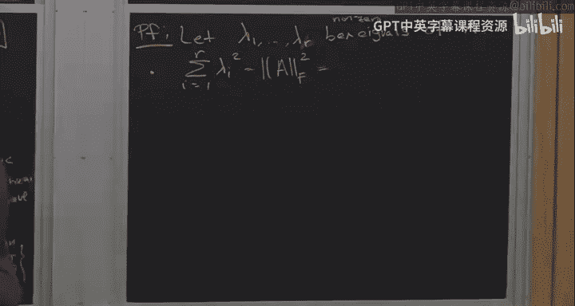

## 4. 标准JL引理的下界（任意映射）

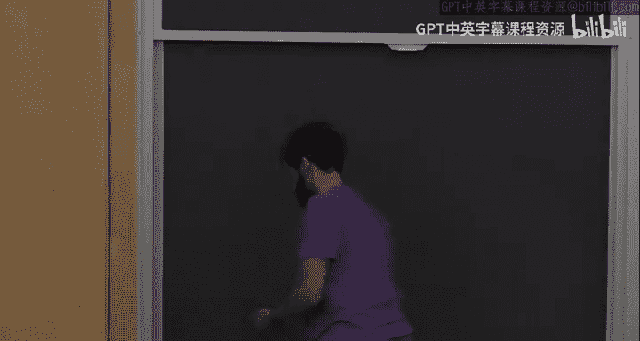

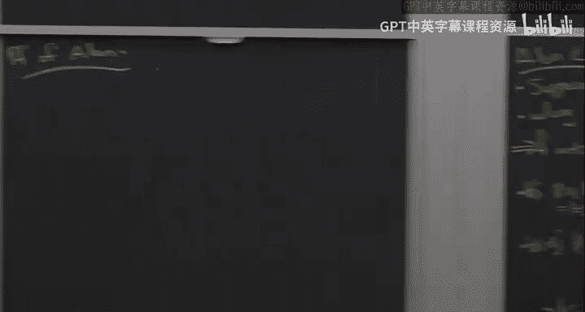

如果我们允许嵌入映射F是任意（非线性）函数，情况则不同。Alon在2003年证明了一个下界：
`m ≥ min(n, (1/ε² log n) / log(1/ε))`
目前仍有一个开放性问题：能否移除分母中的 `log(1/ε)` 项，使下界与线性映射情况下的 `1/ε² log n` 匹配？

证明基于“不相干向量”的概念。考虑一个简单的点集：`X = {0, e1, e2, ..., en}`，即零向量和标准基向量。任何保持这些点距离的嵌入F，在经过平移使F(0)=0后，可以定义一个矩阵V，其列向量为 `vi = F(ei)`。根据距离保持性质，可以推导出这些vi具有单位范数，且彼此之间的点积为O(ε)。换句话说，我们得到了一组近似正交（不相干）的向量。

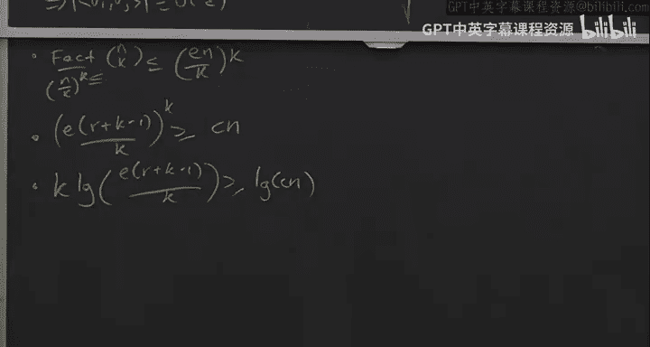

核心问题转化为：在低维空间中，不可能存在太多这样的不相干向量。定义矩阵 `A = V^T V`，其对角线元素为1，非对角线元素绝对值≤ ε。Alon的结论是，任何如此接近单位矩阵的实对称矩阵A，其秩r必须满足：
`r ≥ min(n, (1/ε² log n) / log(1/ε))`

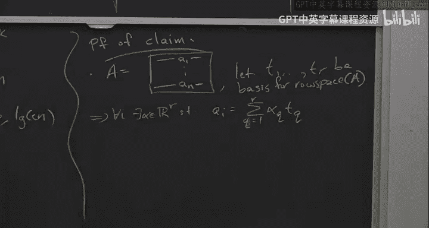

为了证明这个秩的下界，我们首先证明一个较弱的版本（Alon-）：如果非对角线元素≤ `1/√n`，则秩r = Ω(n)。然后，通过考虑矩阵A的逐元素k次幂 `A^(k)`，并选择合适的k使得 `ε^k ≤ 1/√n`。可以证明，如果原矩阵A的秩为r，则 `A^(k)` 的秩至多为 `C(r+k-1, k)`。结合弱版本结论，`A^(k)` 的秩必须为Ω(n)，从而推导出关于r的下界。

关于秩 `rank(A^(k)) ≤ C(r+k-1, k)` 的证明，利用了行空间基的展开和“星与条”的组合计数论证。

---

## 5. 超越最坏情况分析：Gordon定理 🌟

最坏情况的下界告诉我们存在难以处理的向量集。但在实际应用中，我们面对的数据集可能并非这种最坏情况。我们希望能获得依赖于数据集本身特性的、更优的维度约简保证。

这就是Gordon定理（或称“逃离网格定理”）的内容。它提供了针对特定集合T的维度约简保证。

**定理陈述**： 假设投影矩阵Π的每个元素独立服从 `±1/√m` 分布（或任何衰减速度不低于高斯分布的、均值为0、方差为1的分布）。令T是单位球面上的一个子集。如果投影后的维度m满足：
`m ≥ (G(T)² + log(1/δ)) / ε²`
那么，以至少 `1-δ` 的概率，对于所有 `x ∈ T`，有：
`| ||Πx||² - 1 | ≤ ε`

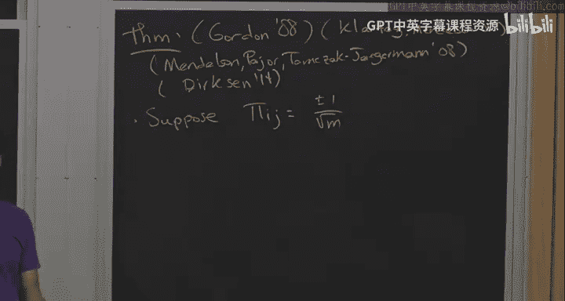

其中，`G(T)` 是集合T的**高斯均值宽度**，定义为：
`G(T) = E_g [ sup_{x∈T} | g · x | ]`
这里，g是一个n维标准高斯随机向量。

**理解G(T)**：
*   **意义**：`G(T)` 衡量了集合T的“复杂度”或“宽度”。集合越分散、越复杂，`G(T)` 越大。
*   **与JL的关系**：可以证明，对于任意有限集T，总有 `G(T) ≤ O(√log |T|)`。因此，Gordon定理的要求 `m ≥ O( (log |T| + log(1/δ))/ε² )` 永远不会比JL引理差。
*   **优势**：如果集合T中的向量高度相关或聚集在一起，`G(T)` 可能远小于 `√log |T|`，从而允许使用更低的维度m。例如，如果T中所有向量都几乎相同，则 `G(T)` 接近一个常数。

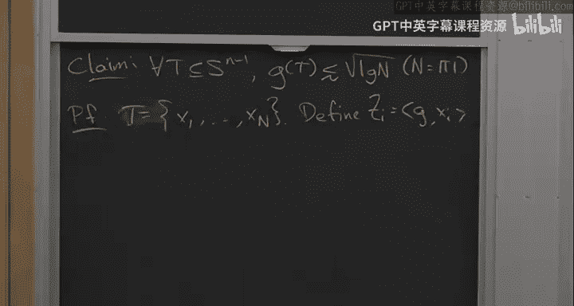

---

## 6. 如何估计高斯均值宽度 G(T) 📏

为了应用Gordon定理，我们需要估计或界定 `G(T)`。以下是几种方法，从简单到精细：

1.  **简单界**：对于任何有限集T，有 `G(T) ≤ O(√log |T|)`。证明使用了积分尾部概率和 Gaussian 的尾部界。

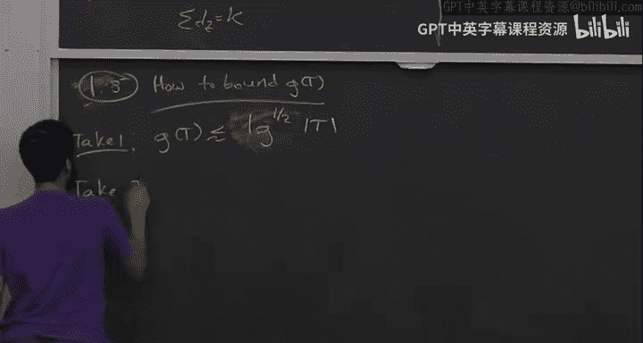

2.  **通过ε-网**：如果能为T构造一个大小为N‘的ε-网T’，那么 `G(T) ≤ G(T') + ε√n`。当向量聚集时，可以用很小的N‘构造网，从而得到更好的界。

3.  **Dudley不等式（链式积分）**：这是更精细的界。
    `G(T) ≤ C * ∫_0^∞ √log N(T, u) du`
    其中 `N(T, u)` 是T在L2距离下、半径为u的最优覆盖网的大小。这个积分上界通常比简单界更紧。

4.  **最优刻画（Talagrand）**：存在一个称为 `γ₂(T)` 的泛函（通过最优分层序列定义），满足：
    `c * γ₂(T) ≤ G(T) ≤ C * γ₂(T)`
    即，高斯均值宽度在常数因子内等于 `γ₂(T)`。这给出了估计 `G(T)` 的最优方式。

---

## 7. Gordon定理与JL引理的等价性

最近的研究表明，分布式JL引理与Gordon定理在本质上是等价的。
*   Gordon定理显然蕴含了JL引理（因为 `G(T) ≤ √log |T|`）。
*   反过来，也可以证明：如果存在一个满足特定参数的分布式JL方案，那么它可以用来推导出Gordon定理的结论。基本思想是，在由Dudley不等式或 `γ₂` 泛函定义的不同尺度（scales）上，对数据集T的近似网（nets）应用JL引理，最终可以保证整个集合T的距离被保持。

---

## 总结 📚

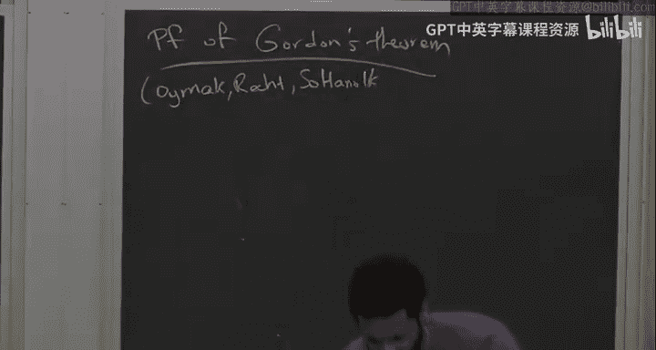

本节课中我们一起学习了：
1.  **JL引理的下界**：证明了在最坏情况下，JL引理给出的目标维度 `O((log N)/ε²)` 几乎是紧的。我们分别探讨了分布式JL、线性映射JL和任意映射JL的下界。
2.  **超越最坏情况分析**：引入了Gordon定理，它将维度约简所需的维度与数据集本身的复杂度 `G(T)`（高斯均值宽度）联系起来。对于结构简单、向量相关性高的数据集，我们可以获得比标准JL引理更好的维度约简保证。
3.  **高斯均值宽度的估计**：介绍了多种估计 `G(T)` 的方法，从简单界到最优的 `γ₂` 泛函刻画。
4.  **定理间的联系**：了解到Gordon定理与JL引理在本质上是等价的，这深化了我们对维度约简理论的理解。

通过本讲内容，我们认识到维度约简不仅存在普遍的最坏情况限制，还可以根据数据的具体特性进行优化，这为实际应用提供了更强大的理论工具。