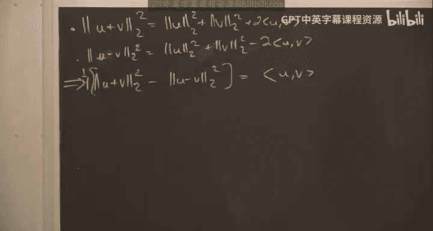
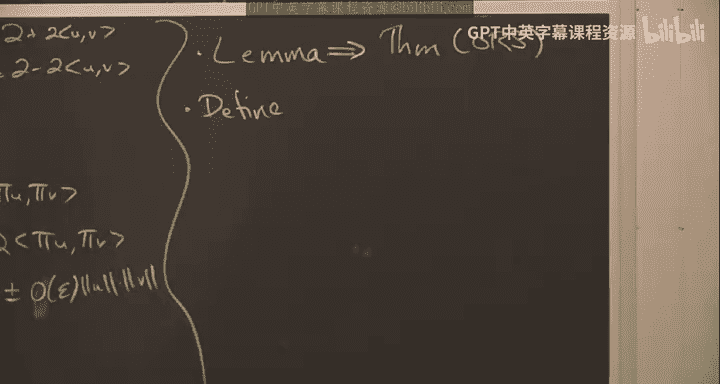
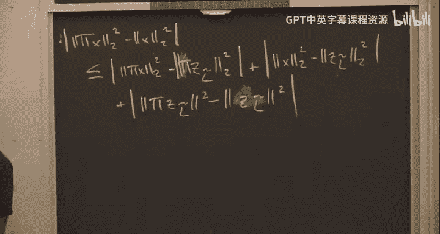

# 13：超越最坏情况分析与快速JL变换 🚀


在本节课中，我们将学习如何对Johnson-Lindenstrauss引理进行超越最坏情况的分析，并探索如何构建更快速的JL变换矩阵，以加速降维过程。

## 回顾：高斯过程与Gordon定理

上一节我们介绍了JL引理的下界，并转向了超越最坏情况的分析。我们以Gordon定理的陈述作为结尾。在深入Gordon定理之前，我们定义了高斯过程上确界的一些概念。

设T是R^N中的一个有界子集。我们定义了关于距离函数d的T的γ₂泛函，其形式如下：

```
γ₂(T, d) ≈ inf sup Σ 2^{r/2} * d(T, T_r)
```

其中，T_r是T的一个大小为2^{2^r}的网。这个泛函与高斯平均宽度G(T)密切相关，G(T)定义为：

```
G(T) = E[ sup_{x∈T} g·x ]
```

其中g是一个随机高斯向量。定理指出，γ₂(T)和G(T)在常数因子内是相等的。



Gordon定理是JL引理的一个强化。它指出，如果T是单位球面上的一个子集，那么存在一个具有高斯条目的矩阵Π，其行数依赖于`(G(T)/ε)²`，使得以高概率同时保留T中的每个向量。



## 从分布JL到Gordon定理



Gordon定理可以通过分布JL来证明。关键在于满足一个多尺度的分布JL条件。

以下是证明的核心思路。我们首先定义一个引理，该引理列出了几个确定性条件。如果这些条件成立，那么矩阵Π就能保留T中的所有向量。

1.  **条件一与条件二（范数保留）**：对于所有R，以及所有在特定集合（如T_R、T_{R-1}及其差集）中的向量v，要求Πv的范数接近v的范数。这本质上是标准的JL陈述。
2.  **条件三（内积保留）**：对于所有在特定集合中的向量u和v，要求Πu和Πv的内积接近u和v的内积。这可以通过将内积表示为向量和与差的范数平方，并应用JL引理来保证。
3.  **条件四（算子范数界）**：要求矩阵Π的算子范数有界。这可以通过在R^N的一个网上应用JL引理并取并集来证明。

如果矩阵Π的分布能满足所有这些不同尺度上的分布JL条件，那么通过联合界，所有这些事件同时以高概率成立，从而Gordon定理得证。有趣的是，对于亚高斯矩阵（如随机符号矩阵），只需满足基尺度（R=0）的分布JL，就能自动满足所有其他尺度的条件，这直接推导出了Gordon定理。

## 实现更快的降维：稀疏与结构化JL

到目前为止，我们主要关注如何将目标维度M降至最小。然而，降维过程本身（即计算Πx）也可能成为瓶颈，特别是当Π是稠密矩阵时。本节我们来看看如何加速这一步。

有两种主要思路：

1.  **使Π稀疏**：如果Π是稀疏的，那么矩阵-向量乘法会更快。
2.  **使Π具有快速乘法结构**：即使Π不稀疏，特定的结构（如基于哈希）也能实现快速计算。

我们将首先关注稀疏化的方法。

### 稀疏JL变换的历史与构造

早期的尝试是让Π的条目独立且稀疏。例如，Achlioptas提出了一种分布，其中每个条目以1/6的概率为+1，1/6的概率为-1，2/3的概率为0。这实现了常数因子的加速，但后续研究表明，在条目独立的条件下，加速程度存在基本限制。

为了突破这个限制，需要放弃条目独立性。Kane和Nelson提出了一种构造，其中每一列恰好有S个非零元，每个非零元是一个随机符号除以√S。另一种等价的构造是CountSketch矩阵：将行分成S个块，每个块大小为M/S；对于每一列，在每个块中随机选择一个位置放入一个随机符号。

分析这种稀疏JL变换可以使用Hanson-Wright不等式。关键步骤是将`||Πx||² - 1`写成一个二次型`σᵀB_xσ`，其中σ是随机符号向量，B_x是一个依赖于随机稀疏模式Δ的矩阵。然后，通过控制B_x的算子范数和Frobenius范数，并应用矩方法和马尔可夫不等式，可以证明其满足分布JL性质，所需行数M为`O((1/ε²) log(1/δ))`，每列非零元数S为`O((1/ε) log(1/δ))`。

## 总结

本节课中我们一起学习了：
1.  如何利用高斯平均宽度和Gordon定理对JL变换进行超越最坏情况的、与数据实例相关的分析。
2.  分布JL性质如何蕴含Gordon定理。
3.  为了加速降维计算，可以构造稀疏的JL变换矩阵（如基于CountSketch），在保持目标维度M近乎最优的同时，显著减少计算量。其分析工具仍然是Hanson-Wright不等式和矩方法。

下一讲，我们将继续探讨具有快速乘法结构的JL变换，并可能触及当前的一些开放问题。