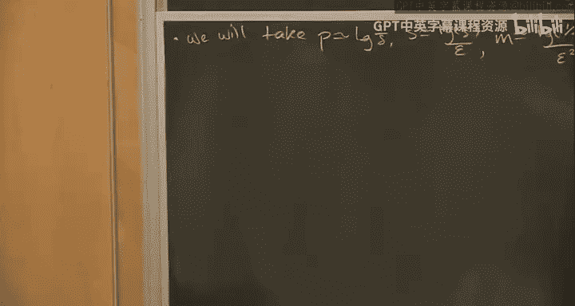
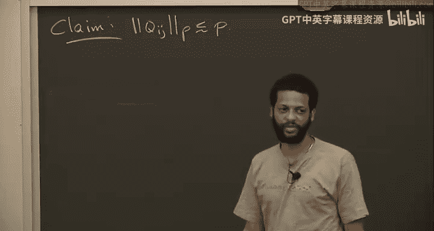
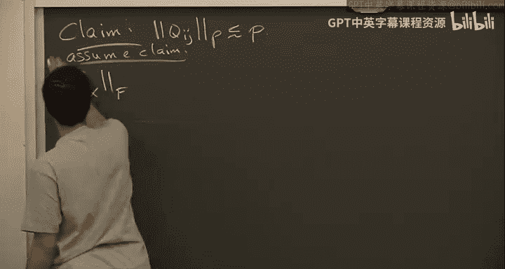
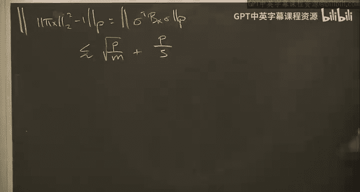
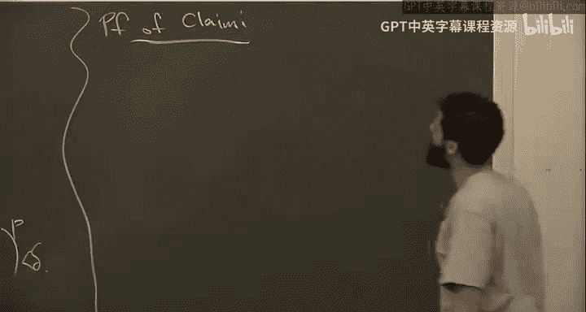
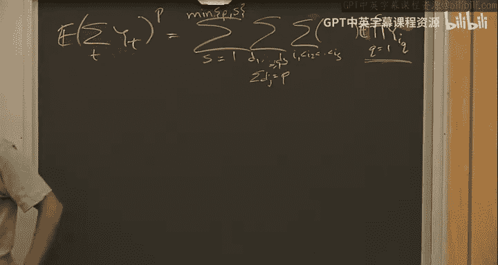
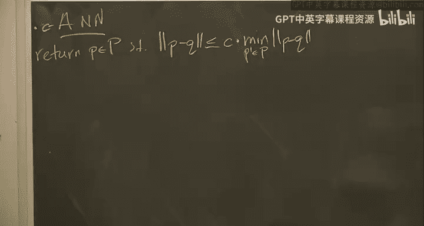

# 哈佛大学《大数据算法》课程笔记 - P14：稀疏JL与快速JL 🚀

在本节课中，我们将完成对稀疏JL（Johnson-Lindenstrauss）嵌入矩阵的证明分析，然后探讨快速JL变换，并介绍JL在高维近似最近邻搜索中的一个应用。

---

## 完成稀疏JL证明 🔍

上一节我们介绍了稀疏JL矩阵 `Π`。现在，我们来完成其证明。

`Π` 是一个缩放因子为 `1/√s` 的矩阵。每一列恰好有 `s` 个非零元素，这些非零元素的位置是随机选择的，并带有随机符号，其余位置为零。各列之间相互独立。

我们关注的关键量是 `||Πx||² - 1` 的尾部概率。这可以写成一个二次型 `σᵀ B(x) σ`，其中 `B(x)` 是一个块对角矩阵。通过 Hanson-Wright 不等式，我们可以先对随机符号 `σ` 取期望，得到 `√p` 倍的 Frobenius 范数加上 `p` 倍的算子范数。

上一节我们已经论证过，无论 `δ`（决定非零元素位置的随机变量）如何，`B(x)` 的算子范数始终不超过 `1/s`。因此，分析的重点在于处理 Frobenius 范数。

Frobenius 范数的平方可以展开为：
`||B(x)||_F² = (1/s²) * Σ_{i≠j} x_i² x_j² * Q_{ij}`
其中，`Q_{ij}` 是一个随机变量，表示坐标 `i` 和 `j` 在哈希过程中发生碰撞的次数。

为了完成证明，我们需要一个关键引理。

**引理**：对于参数 `s`, `m`, `p` 的特定设置，`Q_{ij}` 的 `p` 范数至多为 `p`。

假设该引理成立，我们可以继续分析。利用 `p` 范数的性质和三角不等式，我们可以推导出：
`|| ||Πx||² - 1 ||_p ≤ O(√p/m + p/s)`

通过马尔可夫不等式，最终可以证明，对于设定的参数，`||Πx||²` 偏离 `1` 超过 `ε` 的概率至多为 `δ`。

现在，我们来证明这个关于 `Q_{ij}` 的引理。

**引理证明**：
`Q_{ij}` 是坐标 `i` 和 `j` 的碰撞次数。固定列 `i`，它有 `s` 个非零位置。列 `j` 独立于列 `i`，但列 `j` 内部的 `s` 个非零位置选择并非完全独立（因为是无放回抽样）。我们定义指示变量 `Y_t`，表示在列 `i` 的第 `t` 个非零位置上，列 `j` 是否也非零。那么 `Q_{ij} = Σ_{t=1}^{s} Y_t`。

虽然 `Y_t` 之间不独立，但我们可以论证其任意阶矩都被独立情况下的矩所控制。在独立情况下，每个 `Y_t` 为 `1` 的概率是 `s/m`。而在我们的无放回抽样模型中，给定前 `t-1` 次碰撞后，第 `t` 次碰撞的条件概率为 `(s-t+1)/(m-t+1) ≤ s/m`。因此，任何单项式 `E[Π Y_{i_q}^{d_q}]` 的期望值都小于等于独立情况下的 `(s/m)^L`。由于所有单项式非负，整个 `E[(Σ Y_t)^p]` 的期望也被独立情况所控制。

对于独立的指示变量和，我们可以使用切尔诺夫或伯恩斯坦不等式来得到其矩的界，从而证明引理中 `Q_{ij}` 的 `p` 范数界。

**为什么需要恰好 `s` 个非零？**
如果每列非零个数的期望是 `s` 而非恰好 `s`，那么在展开 `||Πx||² - 1` 时，对角线项不会完全抵消，这将破坏我们整个二次型 `B(x)` 的构造，使得分析失效。

---

## 快速JL变换 ⚡

稀疏JL的嵌入时间与向量 `x` 的支撑集大小乘以 `s` 成正比。当 `x` 稠密时，我们希望有接近线性的嵌入时间。快速JL变换（FJLT）利用结构化矩阵实现了这一点。

FJLT 矩阵 `Π` 被构造为三个矩阵的乘积：`Π = P * H * D`。

以下是各组成部分：
*   **`D`**：一个 `n×n` 的对角矩阵，对角线元素为随机 ±1 符号。
*   **`H`**：一个 `n×n` 的正交矩阵，需要满足两个性质：
    1.  最大条目幅度为 `O(1/√n)`。
    2.  支持快速矩阵向量乘法（例如，`O(n log n)` 时间）。
    离散傅里叶变换（DFT）或哈达玛变换（Hadamard Transform）都满足这些条件。
*   **`P`**：一个 `n×n` 的“采样”矩阵。为了简化分析，我们可以将其视为一个随机对角矩阵，其中每个对角线元素以概率 `m/n` 为 1（并乘以缩放因子 `√(n/m)`），否则为 0。这相当于从 `H` 的结果中随机选择约 `m` 行。

**设计直觉**：
核心思想源于海森堡不确定性原理的启发：一个向量和它的傅里叶变换不能同时在少数坐标上高度集中。
1.  直接对 `x` 采样（`Px`）方差可能很高，特别是当 `x` 本身集中在少数坐标时。
2.  先应用 `H` 可以“铺开”向量，使 `Hx` 的坐标更均匀，从而降低采样方差。
3.  然而，如果 `x` 本身已经很均匀，`H` 可能反而使其集中。随机符号矩阵 `D` 的作用就是防止这种最坏情况。可以证明，对于任何单位范数向量 `x`，`HDx` 的每个坐标的幅度以高概率不超过 `O(√(log(n/δ)/n))`，从而保证了良好的“铺开”性质。

通过这种预处理，再应用采样矩阵 `P`，并结合伯恩斯坦不等式等工具进行分析，可以证明 `m = O(ε^{-2} log(1/δ) log(n/δ))` 足以以高概率保证JL性质。这比最优的 `O(ε^{-2} log(1/δ))` 多了一个 `log(n/δ)` 因子。

为了获得精确的JL界，可以在 `PHD` 之后再乘一个具有正确参数的JL矩阵 `G`（如高斯矩阵或稀疏JL矩阵）。这样，总运行时间为应用 `D`（线性时间）、`H`（`n log n` 时间）、`P`（线性时间）以及将 `G` 应用于降维后向量的时间。

后续的研究通过不同的分析框架（例如，先论证 `PH` 具有限制等距性等性质，再分析 `D` 的作用）改进了这个结果，消除了对 `δ` 的对数平方依赖，对于需要 `δ` 极小的应用场景尤为重要。

---

## 应用：高维近似最近邻搜索 🎯

JL引理的一个直接应用是解决高维空间中的近似最近邻搜索问题。

**问题定义**：
给定一个静态的 `n` 个点集合 `P ⊂ R^d`（例如，图像特征向量），需要构建一个数据结构。对于查询向量 `q ∈ R^d`，返回一个点 `p ∈ P`，使得 `||p - q||` 至多是真正最近邻距离的 `c` 倍（`c > 1` 为近似比）。

**维数灾难**：
在低维（如2维）中，可以通过构建维诺图（Voronoi Diagram）和点定位在近线性空间和对数查询时间内解决精确最近邻问题。但在高维 `d` 下，维诺图本身的复杂度可能高达 `n^{⌈d/2⌉}`，使其不实用。

**利用JL的解决方案**：
一种思路是将近似最近邻搜索约简为“`cR`-近邻”问题：给定半径 `R`，如果存在点距离 `q` 在 `R` 以内，则返回一个距离在 `cR` 以内的点；否则报告失败。通过二分搜索 `R`，可以将近似最近邻问题转化为 `cR`-近邻问题。

以下是一个基于JL和网格的简单 `cR`-近邻数据结构（以 `R=1, c=1+ε` 为例）：

1.  **预处理**：
    *   选取一个JL变换 `Φ: R^d → R^k`，其中 `k = O(ε^{-2} log n)`。
    *   对数据库中的所有点 `p_i` 应用 `Φ`，得到降维后的点集 `Φ(p_i)`。
    *   在 `R^k` 空间中，施加一个边长为 `ε/√k` 的均匀网格。任何网格单元的直径（最大L2距离）不超过 `ε`。
    *   对于每个降维后的点 `Φ(p_i)`，考虑以其为中心、半径为1的L2球。找出所有与该球相交的网格单元。
    *   将所有这样的（网格单元，点索引`i`）对存储在一个哈希表中。

2.  **查询**：
    *   对于查询 `q`，首先计算其降维表示 `Φ(q)`。
    *   确定 `Φ(q)` 落入哪个网格单元。
    *   在哈希表中查找该网格单元。如果找到，则返回关联的任意一个点索引 `i` 对应的原始点 `p_i`。

**正确性**：
如果存在某个数据库点 `p*` 满足 `||Φ(p*) - Φ(q)|| ≤ 1`（由JL性质，这近似意味着 `||p* - q||` 较小），那么 `Φ(q)` 所在的网格单元必定与以 `Φ(p*)` 为中心、半径为1的球相交，因此会被存储在哈希表中。查询返回的点 `p` 满足 `||Φ(p) - Φ(q)|| ≤ 1 + ε`（因为网格单元直径至多 `ε`），再次由JL性质，这意味着 `||p - q|| ≈ (1+ε) * ||p* - q||`。

**空间复杂度**：
关键在于每个半径为 `1+ε` 的球（包含所有与之相交的网格单元）所覆盖的网格单元数量。这个数量由球的体积与网格单元体积的比值决定，约为 `O(1/ε)^k`。代入 `k = O(ε^{-2} log n)`，总空间约为 `O(dn) + n * (1/ε)^{O(ε^{-2} log n)} = O(dn) + n^{O(1/ε^2)}`。

虽然这个空间复杂度对于理论分析是多项式，但指数中 `1/ε^2` 使其在实际中可能很大。因此，更流行的解决方案是使用局部敏感哈希系列方法，它们能以接近线性的空间和次线性的查询时间解决这个问题。

---

## 总结 📝

本节课我们一起学习了：
1.  **完成了稀疏JL嵌入的证明**，核心在于分析哈希碰撞次数 `Q_{ij}` 的矩，并利用其被独立情形所控制的性质。
2.  **介绍了快速JL变换**，它通过 `PHD` 的结构化矩阵乘积，在 `O(n log n)` 时间内实现嵌入，特别适用于稠密向量。
3.  **探讨了JL在高维近似最近邻搜索中的一个应用**，展示了如何通过JL降维和网格划分来构建一个简单的数据结构，并分析了其原理和复杂度。

这些内容体现了降维技术在应对高维数据挑战中的核心作用，并为后续学习更高效的近似最近邻算法（如局部敏感哈希）奠定了基础。