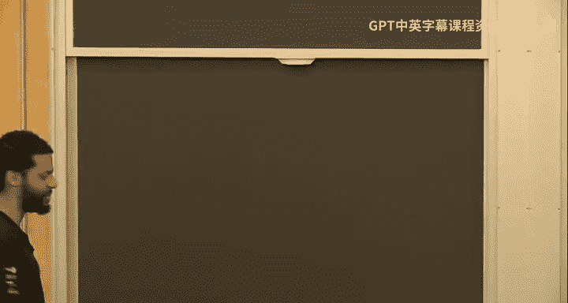
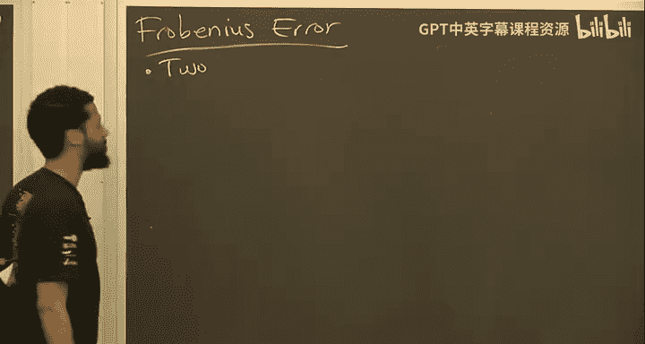
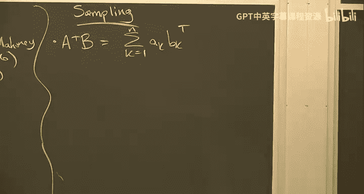
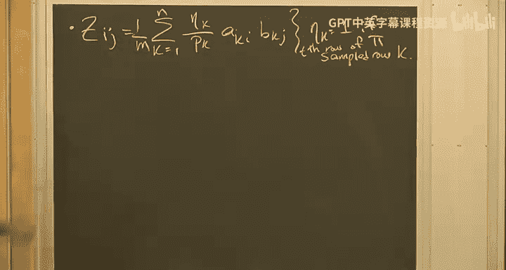
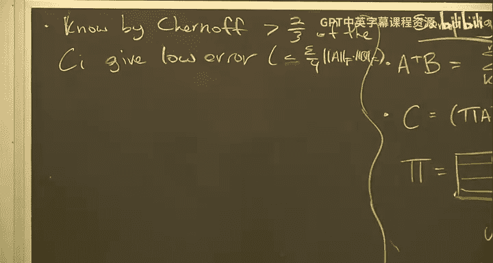
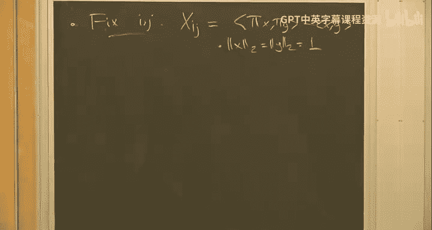
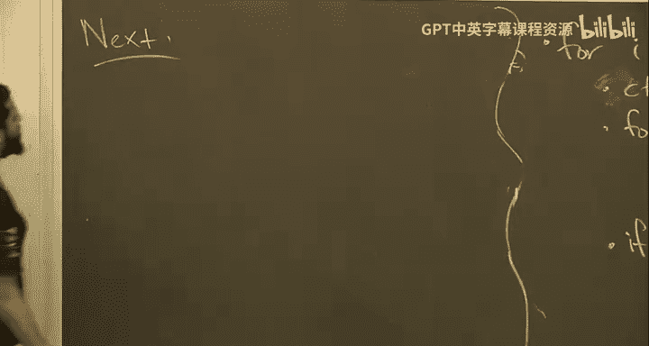

# 大数据算法课程 (COMPSCI 229r) 第15讲：近似矩阵乘法 🧮

在本节课中，我们将学习如何高效地近似计算两个大矩阵的乘积。当矩阵的行数 `N` 远大于列数 `D` 和 `P` 时，精确计算 `A^T B` 的复杂度为 `O(NDP)`。我们将探讨两种近似方法，它们能以更快的速度得到一个误差可控的结果。

## 问题定义与精确计算

我们有两个矩阵：`A` 是 `N x D` 矩阵，`B` 是 `N x P` 矩阵。目标是计算矩阵乘积 `A^T B`。

直接计算 `A^T B` 的标准算法时间复杂度为 `O(NDP)`。我们也可以利用快速矩阵乘法技术。例如，可以将输出矩阵划分为 `D x D` 的块，每个块的计算可以利用快速方阵乘法算法，其时间复杂度为 `O(D^ω)`，其中 `ω` 是矩阵乘法的指数（目前已知 `ω < 2.373`）。

然而，本节课我们关注的是**近似计算**。我们愿意接受一个矩阵 `C`，使得 `A^T B - C` 的某种范数（例如Frobenius范数）很小，但计算速度更快。

## 基于采样的方法（Frobenius范数误差）

第一种方法是基于行采样。注意到 `A^T B` 可以表示为外积的和：`A^T B = Σ_{k=1}^{N} a_k b_k^T`，其中 `a_k` 和 `b_k` 分别是矩阵 `A` 和 `B` 的第 `k` 行。

采样方法的核心思想是：我们并不对所有 `N` 个外积求和，而是根据某种概率分布采样 `M` 个行对，并对采样的外积进行缩放，以得到一个无偏估计量。

以下是具体步骤：
1.  定义采样概率：对于第 `k` 行，其被采样的概率 `p_k` 与 `||a_k|| * ||b_k||` 成正比。
2.  独立采样 `M` 次。对于第 `t` 次采样，若选中第 `k_t` 行，则构造估计项 `Z_t = (1/(M * p_{k_t})) * a_{k_t} b_{k_t}^T`。
3.  最终的估计矩阵为 `C = Σ_{t=1}^{M} Z_t`。

可以证明，`C` 是 `A^T B` 的无偏估计。通过马尔可夫不等式分析，可以得出以下结论：当采样次数 `M ≥ 1/(ε²δ)` 时，以至少 `1-δ` 的概率满足 `||A^T B - C||_F ≤ ε * ||A||_F * ||B||_F`。计算复杂度从 `O(NDP)` 降为 `O(MDP)`，而 `M` 是一个与 `ε` 和 `δ` 相关的常数。

## 改进运行时间对失败概率 δ 的依赖

上述方法的运行时间依赖于 `1/δ`。我们希望将其改进为 `log(1/δ)`。一个技巧是运行 `R = O(log(1/δ))` 个独立的上述估计器，每个的失败概率设为常数（例如1/10）。根据切尔诺夫界，其中至少有2/3的估计器是“好的”（即误差很小）。

接下来的挑战是如何从这 `R` 个候选矩阵中识别出一个好的，而无需计算真实的 `A^T B`。方法如下：
1.  对于每个候选矩阵 `C_i`，计算它与所有其他 `C_j` 的Frobenius距离。
2.  如果某个 `C_i` 与超过半数的其他 `C_j` 距离都很小（≤ (ε/2)*||A||_F||B||_F），则返回这个 `C_i`。

分析表明，一个好的 `C_i` 一定会通过这个测试，而一个坏的 `C_i` 则无法欺骗我们，因为它要与超过半数的其他矩阵接近，而这些矩阵中必然包含好的，通过三角不等式可以推出这个坏的 `C_i` 本身误差也很小。这样就以 `O(log(1/δ))` 的代价获得了高成功概率。

## 基于JL引理的方法（Frobenius范数误差）

第二种方法利用满足**JL矩性质**的随机投影矩阵 `Π`，这种方法对输入是** oblivious **（无需知晓数据内容）的。

一个分布 `D` 在 `M x N` 矩阵上满足 `(ε, δ, p)`-JL矩性质，如果对于任意单位范数向量 `x ∈ R^N`，从 `D` 中随机抽取的 `Π` 满足：`E[ | ||Πx||² - 1 |^p ] ≤ ε^p * δ`。

许多熟悉的构造具有此性质，例如：
*   AMS草图（`p=2`，需要 `M = O(1/(ε²δ))`）。
*   带符号的Count Sketch/Thorup-Zhang草图（`p=2`，需要 `M = O(1/(ε²δ))`）。
*   高斯或亚高斯投影（`p=O(log(1/δ))`，需要 `M = O(log(1/δ)/ε²)`）。

主要定理是：如果 `Π` 来自一个满足 `(ε, δ, p)`-JL矩性质的分布（`p≥2`），那么对于任意矩阵 `A, B`，以至少 `1-δ` 的概率有：`||A^T B - (ΠA)^T (ΠB)||_F ≤ 3ε * ||A||_F * ||B||_F`。

证明思路是通过马尔可夫不等式，将问题转化为控制 `||A^T B - (ΠA)^T (ΠB)||_F` 的 `p` 阶矩。通过巧妙的分解和JL矩性质的定义，可以完成这个上界的估计。这种方法的好处是投影矩阵 `Π` 与输入 `A, B` 无关，适用于数据流等动态场景。

## 引入更强的近似：谱范数误差与子空间嵌入

以上两种方法都保证了Frobenius范数下的误差。接下来我们引入一种更强的近似保证：**谱范数（算子范数）误差**。

我们希望找到 `Π`，使得 `|| (ΠA)^T (ΠB) - A^T B ||_op ≤ ε * ||A||_op * ||B||_op`。通过将矩阵 `A` 和 `B` 并排拼接成一个新矩阵 `M = [A B]`，可以证明上述问题等价于要求 `Π` 同时保留下述所有向量的范数：

对于所有向量 `x`，满足 `||Π(Ax)||² = (1 ± ε) ||Ax||²`。

这比谱范数误差的条件更强。满足这个性质的 `Π` 被称为矩阵 `A` 列空间的**子空间嵌入**。子空间嵌入在加速最小二乘回归、主成分分析等许多线性代数问题中至关重要。

下一讲我们将探讨实现子空间嵌入的两种方法：一种基于更复杂的采样（杠杆得分采样），另一种基于JL类型的投影。需要注意的是，要达到这种更强的保证，所需的样本或投影维度 `M` 将依赖于矩阵 `A` 的秩或列数 `D`，而不再是一个常数。

## 总结

本节课我们一起学习了大数据下的近似矩阵乘法。
*   我们首先介绍了基于行采样的方法，可以在Frobenius范数下快速得到近似结果，并通过“中位数技巧”将运行时间对失败概率的依赖从 `1/δ` 改进到 `log(1/δ)`。
*   接着，我们介绍了基于JL矩性质的随机投影方法，同样获得Frobenius范数误差保证，并且具有对输入数据 oblivious 的优点。
*   最后，我们引出了更强大的谱范数误差保证和子空间嵌入的概念，这将是下一讲的重点，并为众多大规模线性代数问题提供加速基础。